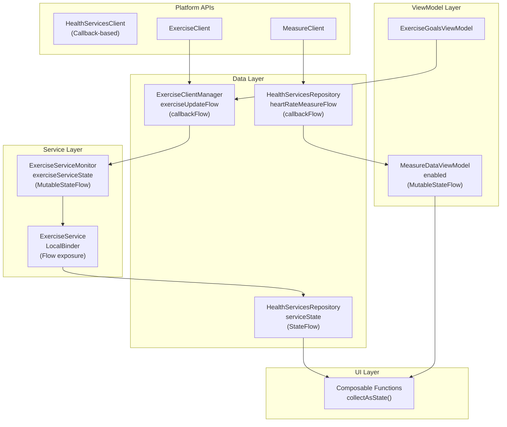
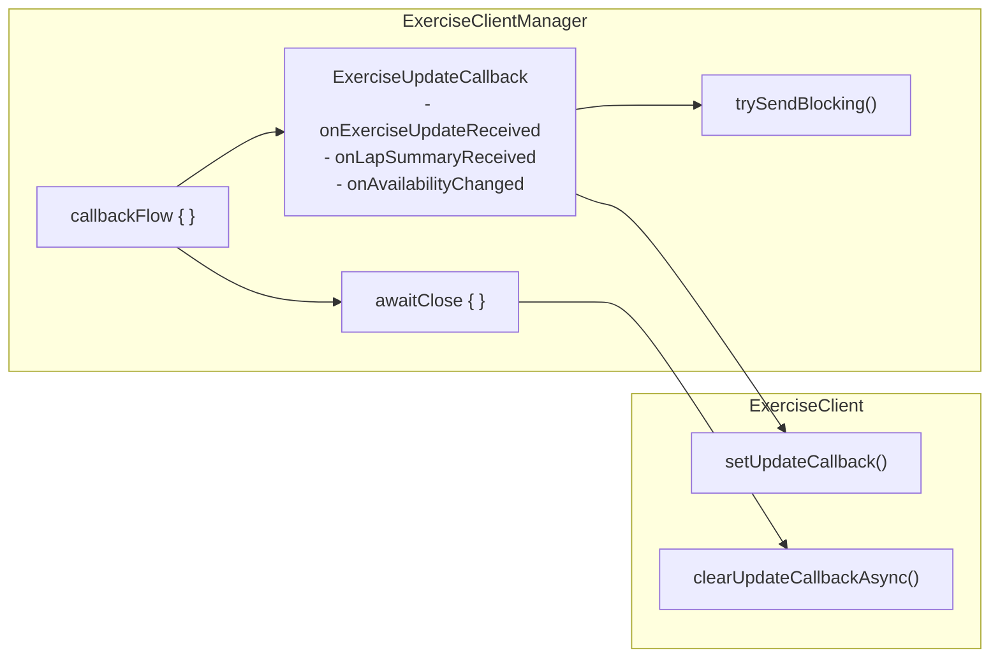
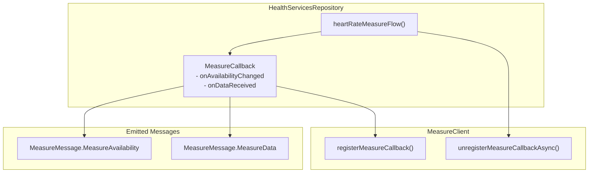
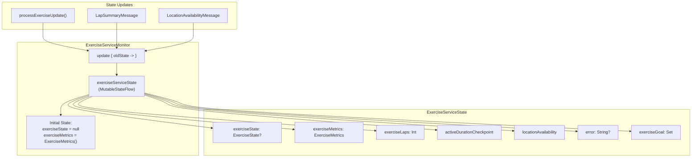
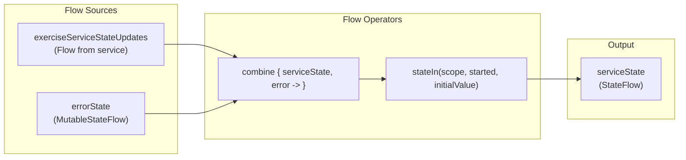
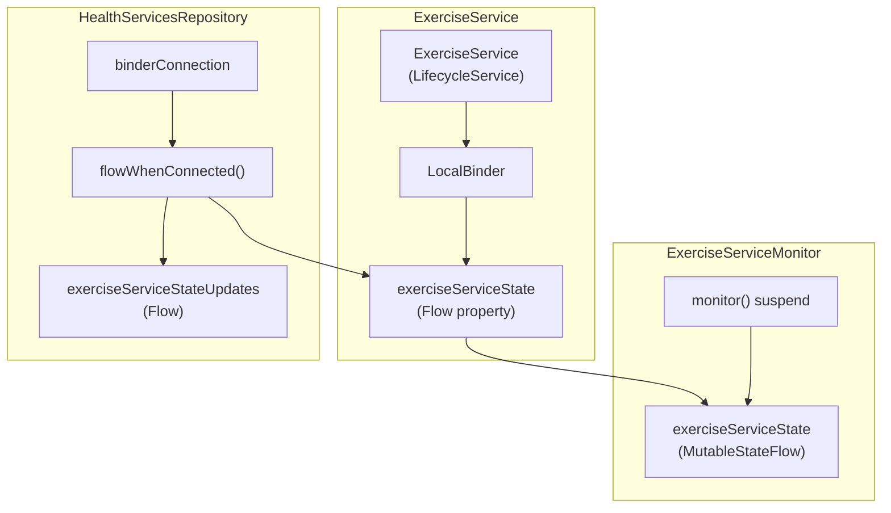
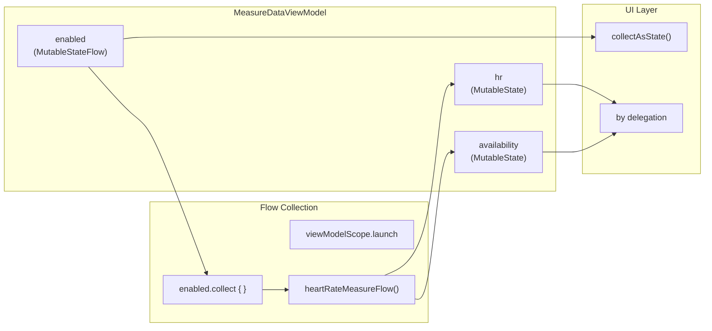

<!-- source: DeepWiki mcp.deepwiki.com · repo android/health-samples · page 8.2 State Management with Flow · fetched 2026-10-23 -->

# State Management with Flow

<details>
<summary>Relevant source files</summary>

The following files were used as context for generating this wiki page:

- [health-services/ExerciseSampleCompose/app/src/main/java/com/example/exercisesamplecompose/app/Screens.kt](health-services/ExerciseSampleCompose/app/src/main/java/com/example/exercisesamplecompose/app/Screens.kt)
- [health-services/ExerciseSampleCompose/app/src/main/java/com/example/exercisesamplecompose/data/ExerciseClientKtx.kt](health-services/ExerciseSampleCompose/app/src/main/java/com/example/exercisesamplecompose/data/ExerciseClientKtx.kt)
- [health-services/ExerciseSampleCompose/app/src/main/java/com/example/exercisesamplecompose/data/ExerciseClientManager.kt](health-services/ExerciseSampleCompose/app/src/main/java/com/example/exercisesamplecompose/data/ExerciseClientManager.kt)
- [health-services/ExerciseSampleCompose/app/src/main/java/com/example/exercisesamplecompose/data/HealthServicesRepository.kt](health-services/ExerciseSampleCompose/app/src/main/java/com/example/exercisesamplecompose/data/HealthServicesRepository.kt)
- [health-services/ExerciseSampleCompose/app/src/main/java/com/example/exercisesamplecompose/presentation/dialogs/ExerciseGoalMet.kt](health-services/ExerciseSampleCompose/app/src/main/java/com/example/exercisesamplecompose/presentation/dialogs/ExerciseGoalMet.kt)
- [health-services/ExerciseSampleCompose/app/src/main/java/com/example/exercisesamplecompose/presentation/goals/ExerciseGoalsScreen.kt](health-services/ExerciseSampleCompose/app/src/main/java/com/example/exercisesamplecompose/presentation/goals/ExerciseGoalsScreen.kt)
- [health-services/ExerciseSampleCompose/app/src/main/java/com/example/exercisesamplecompose/presentation/goals/ExerciseGoalsViewModel.kt](health-services/ExerciseSampleCompose/app/src/main/java/com/example/exercisesamplecompose/presentation/goals/ExerciseGoalsViewModel.kt)
- [health-services/ExerciseSampleCompose/app/src/main/java/com/example/exercisesamplecompose/presentation/theme/ThemePreview.kt](health-services/ExerciseSampleCompose/app/src/main/java/com/example/exercisesamplecompose/presentation/theme/ThemePreview.kt)
- [health-services/ExerciseSampleCompose/app/src/main/java/com/example/exercisesamplecompose/service/ExerciseService.kt](health-services/ExerciseSampleCompose/app/src/main/java/com/example/exercisesamplecompose/service/ExerciseService.kt)
- [health-services/ExerciseSampleCompose/app/src/main/java/com/example/exercisesamplecompose/service/ExerciseServiceMonitor.kt](health-services/ExerciseSampleCompose/app/src/main/java/com/example/exercisesamplecompose/service/ExerciseServiceMonitor.kt)
- [health-services/ExerciseSampleCompose/app/src/main/java/com/example/exercisesamplecompose/service/ExerciseState.kt](health-services/ExerciseSampleCompose/app/src/main/java/com/example/exercisesamplecompose/service/ExerciseState.kt)
- [health-services/MeasureDataCompose/app/build.gradle.kts](health-services/MeasureDataCompose/app/build.gradle.kts)
- [health-services/MeasureDataCompose/app/src/main/java/com/example/measuredatacompose/data/HealthServicesRepository.kt](health-services/MeasureDataCompose/app/src/main/java/com/example/measuredatacompose/data/HealthServicesRepository.kt)
- [health-services/MeasureDataCompose/app/src/main/java/com/example/measuredatacompose/presentation/HrLabel.kt](health-services/MeasureDataCompose/app/src/main/java/com/example/measuredatacompose/presentation/HrLabel.kt)
- [health-services/MeasureDataCompose/app/src/main/java/com/example/measuredatacompose/presentation/MeasureDataApp.kt](health-services/MeasureDataCompose/app/src/main/java/com/example/measuredatacompose/presentation/MeasureDataApp.kt)
- [health-services/MeasureDataCompose/app/src/main/java/com/example/measuredatacompose/presentation/MeasureDataScreen.kt](health-services/MeasureDataCompose/app/src/main/java/com/example/measuredatacompose/presentation/MeasureDataScreen.kt)
- [health-services/MeasureDataCompose/app/src/main/java/com/example/measuredatacompose/presentation/MeasureDataViewModel.kt](health-services/MeasureDataCompose/app/src/main/java/com/example/measuredatacompose/presentation/MeasureDataViewModel.kt)
- [health-services/MeasureDataCompose/app/src/main/java/com/example/measuredatacompose/presentation/NotSupportedScreen.kt](health-services/MeasureDataCompose/app/src/main/java/com/example/measuredatacompose/presentation/NotSupportedScreen.kt)
- [health-services/MeasureDataCompose/app/src/main/java/com/example/measuredatacompose/theme/Theme.kt](health-services/MeasureDataCompose/app/src/main/java/com/example/measuredatacompose/theme/Theme.kt)
- [health-services/MeasureDataCompose/build.gradle.kts](health-services/MeasureDataCompose/build.gradle.kts)

</details>


## Purpose and Scope

This document describes the reactive state management patterns using Kotlin Flow and StateFlow across the health-samples repository. It covers the architectural approach of bridging callback-based Health Services APIs to Flow-based reactive streams, managing state through repositories and services, and consuming state in ViewModels and UI layers.

For general architectural patterns, see [Common Patterns and Best Practices](#8). For permission handling specifics, see [Permission Handling](#8.1). For Wear OS-specific UI patterns, see [Wear OS UI Patterns](#8.3).

## Flow Architecture Overview

The samples implement a layered reactive architecture where data flows from platform APIs through repositories to ViewModels and UI components.



**Sources:**
- [health-services/ExerciseSampleCompose/app/src/main/java/com/example/exercisesamplecompose/data/ExerciseClientManager.kt:198-234]()
- [health-services/ExerciseSampleCompose/app/src/main/java/com/example/exercisesamplecompose/service/ExerciseServiceMonitor.kt:36-65]()
- [health-services/ExerciseSampleCompose/app/src/main/java/com/example/exercisesamplecompose/data/HealthServicesRepository.kt:53-68]()
- [health-services/MeasureDataCompose/app/src/main/java/com/example/measuredatacompose/data/HealthServicesRepository.kt:55-83]()

## callbackFlow: Bridging Callback-Based APIs

The `callbackFlow` builder converts callback-based Health Services APIs into cold Flows. This pattern is used extensively to bridge platform APIs that use callbacks to the reactive Flow paradigm.

### Exercise Update Flow Pattern



The `exerciseUpdateFlow` in `ExerciseClientManager` demonstrates this pattern:

| Component | Purpose | Code Location |
|-----------|---------|---------------|
| `callbackFlow` builder | Creates cold Flow from callback | [ExerciseClientManager.kt:198-199]() |
| `ExerciseUpdateCallback` | Receives exercise updates | [ExerciseClientManager.kt:200-227]() |
| `trySendBlocking()` | Emits data to Flow | [ExerciseClientManager.kt:203, 207, 222]() |
| `setUpdateCallback()` | Registers callback | [ExerciseClientManager.kt:229]() |
| `awaitClose` | Cleanup on cancellation | [ExerciseClientManager.kt:230-233]() |

**Key characteristics:**
- **Cold stream**: Flow doesn't emit until collected
- **Automatic cleanup**: `awaitClose` ensures callback unregistration when Flow is cancelled
- **Sealed class messages**: `ExerciseMessage` hierarchy encapsulates different update types
- **Thread-safe emission**: `trySendBlocking` safely emits from callback thread

**Sources:**
- [health-services/ExerciseSampleCompose/app/src/main/java/com/example/exercisesamplecompose/data/ExerciseClientManager.kt:192-234]()
- [health-services/ExerciseSampleCompose/app/src/main/java/com/example/exercisesamplecompose/data/ExerciseClientManager.kt:248-260]()

### Measure Data Flow Pattern

The `MeasureDataCompose` sample follows the same pattern for heart rate measurements:



**Sources:**
- [health-services/MeasureDataCompose/app/src/main/java/com/example/measuredatacompose/data/HealthServicesRepository.kt:48-83]()
- [health-services/MeasureDataCompose/app/src/main/java/com/example/measuredatacompose/data/HealthServicesRepository.kt:86-89]()

## StateFlow: Exposing UI State

`StateFlow` is used to expose hot, stateful streams that always have a current value. Unlike cold Flows, StateFlow is shared among collectors and maintains its latest value.

### MutableStateFlow for Internal State

`MutableStateFlow` is used for internal state management that needs to be updated imperatively while exposing a read-only `StateFlow` interface.



**State update pattern:**
```kotlin
// Initialization
val exerciseServiceState = MutableStateFlow(
    ExerciseServiceState(
        exerciseState = null,
        exerciseMetrics = ExerciseMetrics()
    )
)

// Updates using .update { }
exerciseServiceState.update { oldState ->
    oldState.copy(
        exerciseState = exerciseUpdate.exerciseStateInfo.state,
        exerciseMetrics = oldState.exerciseMetrics.update(exerciseUpdate.latestMetrics),
        activeDurationCheckpoint = exerciseUpdate.activeDurationCheckpoint ?: oldState.activeDurationCheckpoint
    )
}
```

**Sources:**
- [health-services/ExerciseSampleCompose/app/src/main/java/com/example/exercisesamplecompose/service/ExerciseServiceMonitor.kt:36-42]()
- [health-services/ExerciseSampleCompose/app/src/main/java/com/example/exercisesamplecompose/service/ExerciseServiceMonitor.kt:68-84]()
- [health-services/ExerciseSampleCompose/app/src/main/java/com/example/exercisesamplecompose/service/ExerciseState.kt:44-53]()
- [health-services/ExerciseSampleCompose/app/src/main/java/com/example/exercisesamplecompose/service/ExerciseState.kt:25-42]()

## Flow Operators and Composition

### Combining Multiple Flows

The `HealthServicesRepository` demonstrates combining multiple Flow sources to create derived state:



**Implementation pattern:**
```kotlin
private val exerciseServiceStateUpdates: Flow<ExerciseServiceState> =
    binderConnection.flowWhenConnected(
        ExerciseService.LocalBinder::exerciseServiceState
    )

private var errorState: MutableStateFlow<String?> = MutableStateFlow(null)

val serviceState: StateFlow<ServiceState> =
    exerciseServiceStateUpdates
        .combine(errorState) { exerciseServiceState, errorString ->
            ServiceState.Connected(exerciseServiceState.copy(error = errorString))
        }.stateIn(
            coroutineScope,
            started = SharingStarted.Eagerly,
            initialValue = ServiceState.Disconnected
        )
```

**Key operators used:**

| Operator | Purpose | Usage Location |
|----------|---------|----------------|
| `combine` | Merge multiple Flows | [HealthServicesRepository.kt:62]() |
| `stateIn` | Convert Flow to StateFlow | [HealthServicesRepository.kt:64-68]() |
| `takeWhile` | Conditionally stop collection | [MeasureDataViewModel.kt:55]() |

**Sources:**
- [health-services/ExerciseSampleCompose/app/src/main/java/com/example/exercisesamplecompose/data/HealthServicesRepository.kt:53-68]()
- [health-services/ExerciseSampleCompose/app/src/main/java/com/example/exercisesamplecompose/data/HealthServicesRepository.kt:108-119]()

### Conditional Flow Collection with takeWhile

The `MeasureDataViewModel` demonstrates conditional Flow collection based on UI state:

```kotlin
viewModelScope.launch {
    enabled.collect {
        if (it) {
            healthServicesRepository.heartRateMeasureFlow()
                .takeWhile { enabled.value }
                .collect { measureMessage ->
                    when (measureMessage) {
                        is MeasureMessage.MeasureData -> {
                            hr.value = measureMessage.data.last().value
                        }
                        is MeasureMessage.MeasureAvailability -> {
                            availability.value = measureMessage.availability
                        }
                    }
                }
        }
    }
}
```

**Sources:**
- [health-services/MeasureDataCompose/app/src/main/java/com/example/measuredatacompose/presentation/MeasureDataViewModel.kt:51-68]()

## Service-to-Repository Flow Exposure

The `ExerciseService` exposes its Flow through a bound service pattern, allowing the repository to observe state even when the UI is not visible.



**Binder exposure pattern:**
```kotlin
// In ExerciseService.kt
inner class LocalBinder : Binder() {
    fun getService() = this@ExerciseService
    
    val exerciseServiceState: Flow<ExerciseServiceState>
        get() = this@ExerciseService.exerciseServiceMonitor.exerciseServiceState
}

// In HealthServicesRepository.kt
private val binderConnection =
    lifecycle.bindService<ExerciseService.LocalBinder, ExerciseService>(applicationContext)

private val exerciseServiceStateUpdates: Flow<ExerciseServiceState> =
    binderConnection.flowWhenConnected(
        ExerciseService.LocalBinder::exerciseServiceState
    )
```

**Sources:**
- [health-services/ExerciseSampleCompose/app/src/main/java/com/example/exercisesamplecompose/service/ExerciseService.kt:225-231]()
- [health-services/ExerciseSampleCompose/app/src/main/java/com/example/exercisesamplecompose/data/HealthServicesRepository.kt:50-56]()

## ViewModel Flow Consumption

ViewModels consume Flows from repositories and expose UI state through StateFlow or Compose State.

### Pattern 1: StateFlow in ViewModel



**ViewModel state management:**

| State Type | Usage | Example |
|------------|-------|---------|
| `MutableStateFlow` | Hot state with Flow semantics | `val enabled: MutableStateFlow<Boolean>` |
| `MutableState` | Compose-optimized state | `val hr: MutableState<Double>` |
| `StateFlow` (read-only) | Exposed repository state | Repository's `serviceState` |

**Sources:**
- [health-services/MeasureDataCompose/app/src/main/java/com/example/measuredatacompose/presentation/MeasureDataViewModel.kt:30-77]()

### Pattern 2: Hilt ViewModel with ExerciseClientManager

```kotlin
@HiltViewModel
class ExerciseGoalsViewModel
@Inject
constructor(
    private val exerciseClientManager: ExerciseClientManager
) : ViewModel() {
    private val _distanceGoal = mutableDoubleStateOf(0.0)
    val distanceGoal: State<Double> = _distanceGoal.asDoubleState()
    
    fun setGoals(thresholds: Thresholds) {
        _distanceGoal.value = thresholds.distance
        exerciseClientManager.updateGoals(thresholds)
    }
}
```

**Sources:**
- [health-services/ExerciseSampleCompose/app/src/main/java/com/example/exercisesamplecompose/presentation/goals/ExerciseGoalsViewModel.kt:28-46]()

## Flow Collection Lifecycle Management

### Service-Scoped Collection

The `ExerciseService` uses `repeatOnLifecycle` to manage Flow collection lifecycle:

```kotlin
lifecycleScope.launch(Dispatchers.Default) {
    repeatOnLifecycle(Lifecycle.State.STARTED) {
        exerciseServiceMonitor.monitor()
    }
}
```

**Key points:**
- Collection starts when service reaches `STARTED` state
- Automatically cancelled when service drops below `STARTED`
- Ensures no resource leaks when service is stopped

**Sources:**
- [health-services/ExerciseSampleCompose/app/src/main/java/com/example/exercisesamplecompose/service/ExerciseService.kt:126-130]()

### ViewModel-Scoped Collection

ViewModels use `viewModelScope` for automatic cancellation when ViewModel is cleared:

```kotlin
init {
    viewModelScope.launch {
        enabled.collect {
            if (it) {
                healthServicesRepository.heartRateMeasureFlow()
                    .takeWhile { enabled.value }
                    .collect { measureMessage ->
                        // Process message
                    }
            }
        }
    }
}
```

**Sources:**
- [health-services/MeasureDataCompose/app/src/main/java/com/example/measuredatacompose/presentation/MeasureDataViewModel.kt:41-69]()

## State Update Patterns

### Immutable State with Copy

All state objects use immutable data classes with `copy()` for updates:

```kotlin
data class ExerciseServiceState(
    val exerciseState: ExerciseState? = null,
    val exerciseMetrics: ExerciseMetrics = ExerciseMetrics(),
    val exerciseLaps: Int = 0,
    val activeDurationCheckpoint: ActiveDurationCheckpoint? = null,
    val locationAvailability: LocationAvailability = LocationAvailability.UNKNOWN,
    val error: String? = null,
    val exerciseGoal: Set<ExerciseGoal<out Number>> = emptySet()
)

// Update pattern
exerciseServiceState.update { oldState ->
    oldState.copy(exerciseLaps = it.lapSummary.lapCount)
}
```

**Sources:**
- [health-services/ExerciseSampleCompose/app/src/main/java/com/example/exercisesamplecompose/service/ExerciseState.kt:44-53]()
- [health-services/ExerciseSampleCompose/app/src/main/java/com/example/exercisesamplecompose/service/ExerciseServiceMonitor.kt:50-55]()

### Nested State Updates

The `ExerciseMetrics` class demonstrates composable state updates:

```kotlin
data class ExerciseMetrics(
    val heartRate: Double? = null,
    val distance: Double? = null,
    val calories: Double? = null,
    val heartRateAverage: Double? = null
) {
    fun update(latestMetrics: DataPointContainer): ExerciseMetrics =
        copy(
            heartRate = latestMetrics.getData(DataType.HEART_RATE_BPM).lastOrNull()?.value ?: heartRate,
            distance = latestMetrics.getData(DataType.DISTANCE_TOTAL)?.total ?: distance,
            calories = latestMetrics.getData(DataType.CALORIES_TOTAL)?.total ?: calories,
            heartRateAverage = latestMetrics.getData(DataType.HEART_RATE_BPM_STATS)?.average ?: heartRateAverage
        )
}
```

**Sources:**
- [health-services/ExerciseSampleCompose/app/src/main/java/com/example/exercisesamplecompose/service/ExerciseState.kt:25-42]()

## Summary: Flow Usage by Layer

| Layer | Flow Type | Purpose | Example Class |
|-------|-----------|---------|---------------|
| **Data Layer** | `callbackFlow` | Bridge callback APIs to Flows | `ExerciseClientManager.exerciseUpdateFlow` |
| **Service Layer** | `MutableStateFlow` | Maintain service state | `ExerciseServiceMonitor.exerciseServiceState` |
| **Service Binder** | `Flow` (exposed) | Expose service state to repository | `ExerciseService.LocalBinder.exerciseServiceState` |
| **Repository** | `StateFlow` | Combine and share state | `HealthServicesRepository.serviceState` |
| **Repository** | `callbackFlow` | Bridge measure APIs | `HealthServicesRepository.heartRateMeasureFlow` |
| **ViewModel** | `MutableStateFlow` | UI toggle state | `MeasureDataViewModel.enabled` |
| **ViewModel** | `MutableState` | Compose state | `MeasureDataViewModel.hr` |

**Sources:**
- [health-services/ExerciseSampleCompose/app/src/main/java/com/example/exercisesamplecompose/data/ExerciseClientManager.kt:198-234]()
- [health-services/ExerciseSampleCompose/app/src/main/java/com/example/exercisesamplecompose/service/ExerciseServiceMonitor.kt:36-42]()
- [health-services/ExerciseSampleCompose/app/src/main/java/com/example/exercisesamplecompose/service/ExerciseService.kt:225-231]()
- [health-services/ExerciseSampleCompose/app/src/main/java/com/example/exercisesamplecompose/data/HealthServicesRepository.kt:53-68]()
- [health-services/MeasureDataCompose/app/src/main/java/com/example/measuredatacompose/data/HealthServicesRepository.kt:55-83]()
- [health-services/MeasureDataCompose/app/src/main/java/com/example/measuredatacompose/presentation/MeasureDataViewModel.kt:33-77]()

---

