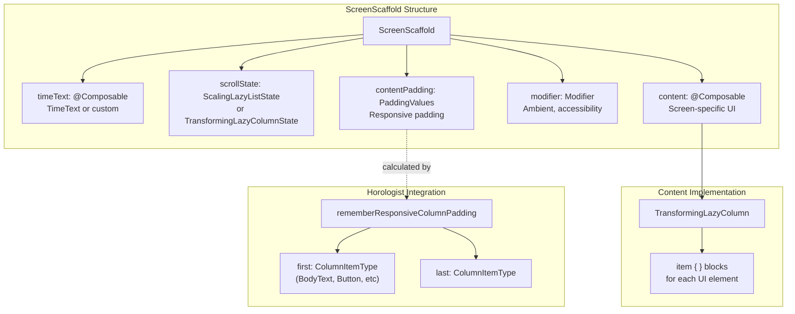
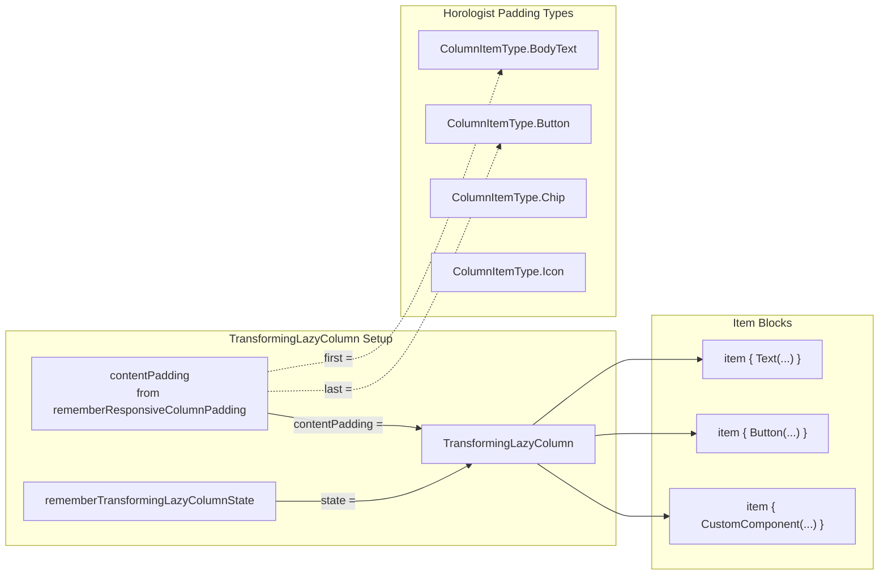
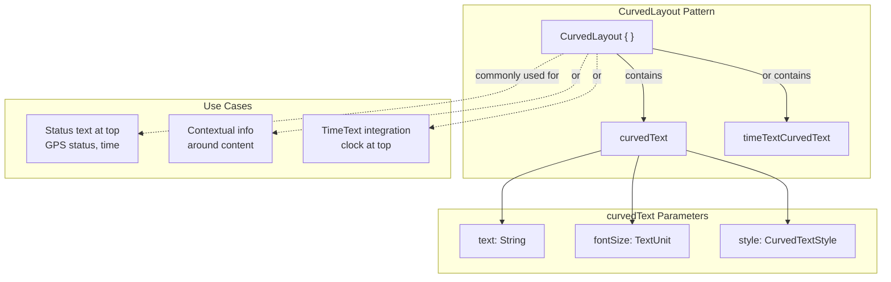
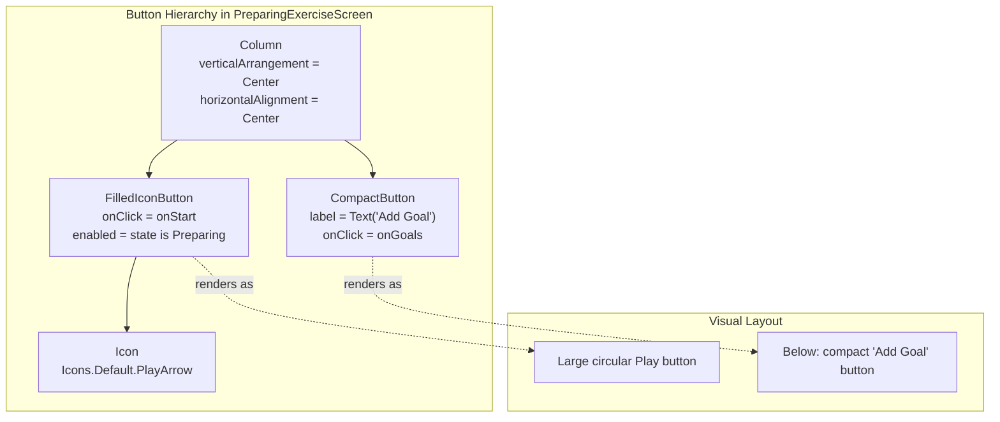
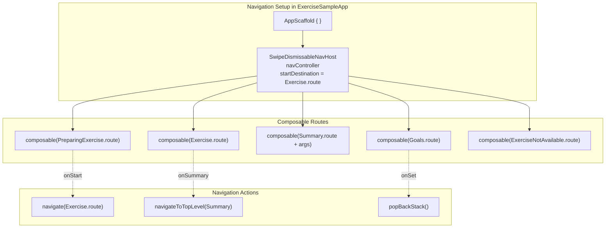
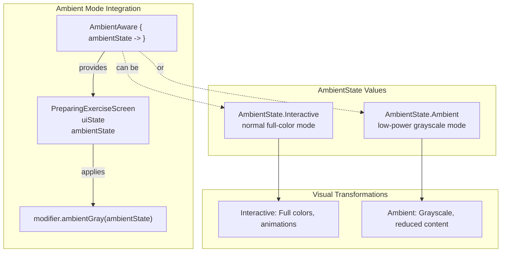
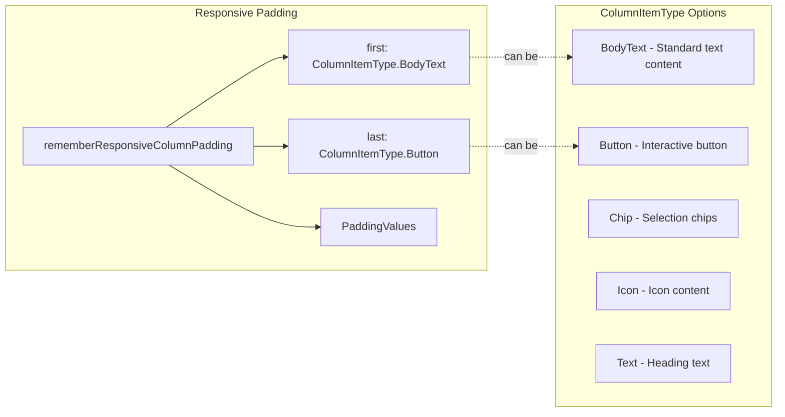
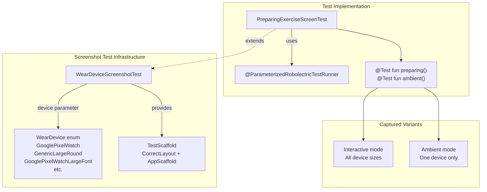

<!-- source: DeepWiki mcp.deepwiki.com · repo android/health-samples · page 8.3 Wear OS UI Patterns · fetched 2026-10-23 -->

# Wear OS UI Patterns

Relevant source files

The following files were used as context for generating this wiki page:

- [health-connect/HealthConnectSample/build.gradle](health-connect/HealthConnectSample/build.gradle)
- [health-platform-v1/HealthPlatformSample/build.gradle](health-platform-v1/HealthPlatformSample/build.gradle)
- [health-services/ExerciseSampleCompose/app/src/main/java/com/example/exercisesamplecompose/presentation/ExerciseSampleApp.kt](health-services/ExerciseSampleCompose/app/src/main/java/com/example/exercisesamplecompose/presentation/ExerciseSampleApp.kt)
- [health-services/ExerciseSampleCompose/app/src/main/java/com/example/exercisesamplecompose/presentation/preparing/PreparingExerciseScreen.kt](health-services/ExerciseSampleCompose/app/src/main/java/com/example/exercisesamplecompose/presentation/preparing/PreparingExerciseScreen.kt)
- [health-services/ExerciseSampleCompose/app/src/main/res/values/strings.xml](health-services/ExerciseSampleCompose/app/src/main/res/values/strings.xml)
- [health-services/ExerciseSampleCompose/app/src/test/java/com/example/exercisesamplecompose/presentation/PreparingExerciseScreenTest.kt](health-services/ExerciseSampleCompose/app/src/test/java/com/example/exercisesamplecompose/presentation/PreparingExerciseScreenTest.kt)
- [health-services/ExerciseSampleCompose/gradle/libs.versions.toml](health-services/ExerciseSampleCompose/gradle/libs.versions.toml)
- [health-services/MeasureDataCompose/gradle/libs.versions.toml](health-services/MeasureDataCompose/gradle/libs.versions.toml)
- [health-services/PassiveDataCompose/gradle/libs.versions.toml](health-services/PassiveDataCompose/gradle/libs.versions.toml)
- [health-services/PassiveGoalsCompose/gradle/libs.versions.toml](health-services/PassiveGoalsCompose/gradle/libs.versions.toml)

## Purpose and Scope

This document describes the Wear OS-specific UI patterns and components used across the Health Services samples. These patterns demonstrate best practices for building health and fitness applications on Wear OS, including round screen optimization, ambient mode support, and specialized navigation. The patterns are primarily demonstrated in [ExerciseSampleCompose](#2.1) and applied with variations in [MeasureDataCompose](#2.2), [PassiveDataCompose](#2.3), and [PassiveGoalsCompose](#2.4).

For general architecture patterns (MVVM, dependency injection), see [Application Architecture](#2.1.1). For permission handling, see [Permission Handling](#8.1). For reactive state management, see [State Management with Flow](#8.2).

---

## Core Wear OS Dependencies

All Health Services samples leverage Wear OS-specific Compose libraries and the Horologist toolkit. The following table shows the key dependencies:

| Library | Version | Purpose |
|---------|---------|---------|
| `androidx.wear.compose:compose-material3` | 1.5.0-beta02 to 1.5.0-beta04 | Material Design 3 components optimized for Wear OS |
| `androidx.wear.compose:compose-foundation` | 1.4.1 to 1.5.0-beta04 | Core Wear Compose layouts (curved text, lazy columns) |
| `androidx.wear.compose:compose-navigation` | 1.4.0 | Navigation with swipe-to-dismiss support |
| `com.google.android.horologist:horologist-compose-layout` | 0.7.14-beta | Responsive layout utilities for different screen sizes |
| `com.google.android.horologist:horologist-health-composables` | 0.7.14-beta | Health-specific UI components |
| `com.google.android.horologist:horologist-health-service` | 0.7.14-beta | Health Services integration utilities |

**Sources:**
- [health-services/ExerciseSampleCompose/gradle/libs.versions.toml:6,10,49-51,61-62]()
- [health-services/MeasureDataCompose/gradle/libs.versions.toml:6,15,30-31]()
- [health-services/PassiveGoalsCompose/gradle/libs.versions.toml:7,17,19,34-35,37]()

---

## Screen Layout Architecture

### ScreenScaffold Pattern

Wear OS screens use `ScreenScaffold` to provide consistent layout structure with time text, scrolling state management, and content padding:

The `PreparingExerciseScreen` demonstrates this pattern:

**Sources:**
- [health-services/ExerciseSampleCompose/app/src/main/java/com/example/exercisesamplecompose/presentation/preparing/PreparingExerciseScreen.kt:142-153]()

### TransformingLazyColumn

`TransformingLazyColumn` provides optimized scrolling with proper animations for round screens. Unlike standard `LazyColumn`, it applies scaling and morphing transformations as items scroll:

**Sources:**
- [health-services/ExerciseSampleCompose/app/src/main/java/com/example/exercisesamplecompose/presentation/preparing/PreparingExerciseScreen.kt:142-146,159-209]()

---

## Curved Layouts for Round Screens

Wear OS provides curved text layouts that follow the circular edge of round watch faces.

### CurvedLayout and curvedText

The `LocationStatusText` composable in `PreparingExerciseScreen` demonstrates curved text for GPS status:

**Sources:**
- [health-services/ExerciseSampleCompose/app/src/main/java/com/example/exercisesamplecompose/presentation/preparing/PreparingExerciseScreen.kt:49,59,230-235]()

### TimeText Component

`TimeText` displays the current time at the top of the screen in a curved layout. It can be customized or replaced:

- **Default usage**: `ScreenScaffold(timeText = {})` shows no time text
- **With TimeText**: Use `TimeText()` or `timeTextCurvedText()` for curved time display
- **Custom content**: Replace with any curved or linear composable

**Sources:**
- [health-services/ExerciseSampleCompose/app/src/main/java/com/example/exercisesamplecompose/presentation/preparing/PreparingExerciseScreen.kt:58,149]()

---

## Wear Material3 Components

### Button Components

Wear Material3 provides specialized button types optimized for small touch targets on watch screens:

| Component | Size | Use Case | Example |
|-----------|------|----------|---------|
| `FilledIconButton` | Large circular | Primary actions (start, stop, pause) | Exercise start button |
| `CompactButton` | Small rectangular | Secondary actions | Goal settings |
| `Button` | Medium rectangular | Standard actions | Generic operations |
| `IconButton` | Medium circular | Icon-only actions | Navigation, toggles |

**Sources:**
- [health-services/ExerciseSampleCompose/app/src/main/java/com/example/exercisesamplecompose/presentation/preparing/PreparingExerciseScreen.kt:53-54,184-193,196-207]()

### Material Icons Extended

All samples use `androidx.compose.material:material-icons-extended` for consistent iconography. Common icons include:

- `Icons.Default.PlayArrow` - Start exercise
- `Icons.Default.Pause` - Pause exercise  
- `Icons.Default.Stop` - End exercise
- Custom icons for heart rate, distance, etc.

**Sources:**
- [health-services/ExerciseSampleCompose/gradle/libs.versions.toml:34]()
- [health-services/ExerciseSampleCompose/app/src/main/java/com/example/exercisesamplecompose/presentation/preparing/PreparingExerciseScreen.kt:28-29,188-191]()

---

## Navigation Patterns

### SwipeDismissableNavHost

Wear OS navigation uses `SwipeDismissableNavHost` to enable swipe-right-to-dismiss gestures for hierarchical navigation:

**Sources:**
- [health-services/ExerciseSampleCompose/app/src/main/java/com/example/exercisesamplecompose/presentation/ExerciseSampleApp.kt:43-105]()

### Screen Route Definitions

Routes are defined as objects with companion properties:

- `PreparingExercise.route` - Preparing sensors screen
- `Exercise.route` - Active exercise screen
- `Summary.route` - Post-exercise summary with navigation arguments
- `Goals.route` - Goal configuration screen
- `ExerciseNotAvailable.route` - Error state screen

**Sources:**
- [health-services/ExerciseSampleCompose/app/src/main/java/com/example/exercisesamplecompose/presentation/ExerciseSampleApp.kt:27-30,49-103]()

---

## Ambient Mode Support

Wear OS devices support ambient (always-on) mode where the screen displays minimal information to conserve battery. The Health Services samples implement ambient mode awareness using Horologist.

### AmbientAware Pattern

**Sources:**
- [health-services/ExerciseSampleCompose/app/src/main/java/com/example/exercisesamplecompose/presentation/preparing/PreparingExerciseScreen.kt:68-69,108-118,136,152]()

### Always-On Routes

Certain routes are configured to remain visible in ambient mode. In ExerciseSampleCompose, the `AlwaysOnRoutes` list defines which screens support ambient mode:

**Sources:**
- [health-services/ExerciseSampleCompose/app/src/main/java/com/example/exercisesamplecompose/presentation/ExerciseSampleApp.kt:108]()

### ambientGray Modifier

The `ambientGray` modifier (custom extension) automatically adjusts UI colors based on ambient state, transitioning from full color to grayscale:

**Sources:**
- [health-services/ExerciseSampleCompose/app/src/main/java/com/example/exercisesamplecompose/presentation/preparing/PreparingExerciseScreen.kt:64,152]()

---

## Horologist Integration

Horologist is Google's library of Wear OS utilities and patterns. The Health Services samples extensively use Horologist for production-ready UI components.

### Layout Utilities

#### rememberResponsiveColumnPadding

Provides appropriate padding based on screen size and item types:

This ensures proper spacing at the top and bottom of scrolling content across different watch sizes.

**Sources:**
- [health-services/ExerciseSampleCompose/app/src/main/java/com/example/exercisesamplecompose/presentation/preparing/PreparingExerciseScreen.kt:70-71,143-146]()

### Health Composables

The `horologist-health-composables` library provides health-specific UI components:

- Health metric displays with proper formatting
- Exercise state visualizations
- Goal progress indicators
- Sensor status indicators

**Sources:**
- [health-services/ExerciseSampleCompose/gradle/libs.versions.toml:50]()

### Screenshot Testing Integration

Horologist provides `horologist-roboscreenshots` for consistent screenshot testing across device configurations:

**Sources:**
- [health-services/ExerciseSampleCompose/gradle/libs.versions.toml:52]()
- [health-services/ExerciseSampleCompose/app/src/test/java/com/example/exercisesamplecompose/presentation/PreparingExerciseScreenTest.kt:26-27,33-101]()

---

## Common UI Patterns Summary

The following table summarizes the most common UI pattern combinations across Health Services samples:

| Pattern | ExerciseSample | MeasureData | PassiveData | PassiveGoals |
|---------|----------------|-------------|-------------|--------------|
| ScreenScaffold | ✓ | ✓ | ✓ | ✓ |
| TransformingLazyColumn | ✓ | ✓ | ✓ | ✓ |
| CurvedLayout | ✓ | ✓ | ✓ | ✓ |
| SwipeDismissableNavHost | ✓ | ✓ | ✓ | ✓ |
| AmbientAware | ✓ | - | - | - |
| Horologist Layout | ✓ | - | - | ✓ |
| Material3 Buttons | ✓ | ✓ | ✓ | ✓ |
| Screenshot Tests | ✓ | - | - | - |

**Sources:**
- [health-services/ExerciseSampleCompose/gradle/libs.versions.toml:1-73]()
- [health-services/MeasureDataCompose/gradle/libs.versions.toml:1-38]()
- [health-services/PassiveDataCompose/gradle/libs.versions.toml:1-37]()
- [health-services/PassiveGoalsCompose/gradle/libs.versions.toml:1-43]()