# Page: Overview

# Overview

<details>
<summary>Relevant source files</summary>

The following files were used as context for generating this wiki page:

- [.github/CODEOWNERS](.github/CODEOWNERS)
- [health-connect/HealthConnectSample/app/build.gradle](health-connect/HealthConnectSample/app/build.gradle)
- [health-connect/HealthConnectSample/build.gradle](health-connect/HealthConnectSample/build.gradle)
- [health-platform-v1/HealthPlatformSample/app/build.gradle](health-platform-v1/HealthPlatformSample/app/build.gradle)
- [health-platform-v1/HealthPlatformSample/build.gradle](health-platform-v1/HealthPlatformSample/build.gradle)
- [health-services/ExerciseSampleCompose/gradle/libs.versions.toml](health-services/ExerciseSampleCompose/gradle/libs.versions.toml)
- [health-services/MeasureDataCompose/gradle/libs.versions.toml](health-services/MeasureDataCompose/gradle/libs.versions.toml)
- [health-services/PassiveDataCompose/gradle/libs.versions.toml](health-services/PassiveDataCompose/gradle/libs.versions.toml)
- [health-services/PassiveGoalsCompose/gradle/libs.versions.toml](health-services/PassiveGoalsCompose/gradle/libs.versions.toml)
- [renovate.json](renovate.json)

</details>


This document provides a comprehensive overview of the `android/health-samples` repository, a collection of sample applications demonstrating Android's health and fitness APIs. The repository contains seven distinct sample projects spanning four different API ecosystems: Health Services, Health Connect, Health Platform v1, and Google Fit Recording API.

For detailed information about specific samples, see:
- Health Services samples: [Section 2](#2)
- Health Connect sample: [Section 3](#3)
- Health Platform sample: [Section 4](#4)
- Recording API sample: [Section 5](#5)
- Build system configuration: [Section 6](#6)
- CI/CD infrastructure: [Section 7](#7)
- Common patterns and best practices: [Section 8](#8)

## Repository Structure

The repository is organized into four primary directories, each corresponding to a distinct health API ecosystem. Each sample is a self-contained Android application with its own build configuration, dependencies, and documentation.

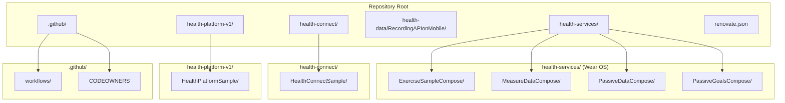

**Directory Structure**

| Directory | Purpose | Sample Count | Target Platform |
|-----------|---------|--------------|-----------------|
| `health-services/` | Wear OS health and fitness tracking | 4 | Wear OS |
| `health-connect/` | Unified health data platform | 1 | Mobile |
| `health-platform-v1/` | Legacy health platform API | 1 | Mobile |
| `health-data/` | Google Fit Recording API | 1 | Mobile |
| `.github/` | CI/CD workflows and code ownership | - | Infrastructure |

Sources: [renovate.json:9](), [.github/CODEOWNERS:1-5]()

## API Ecosystem Coverage

The repository demonstrates four distinct Android health data API ecosystems, each serving different use cases and device capabilities.

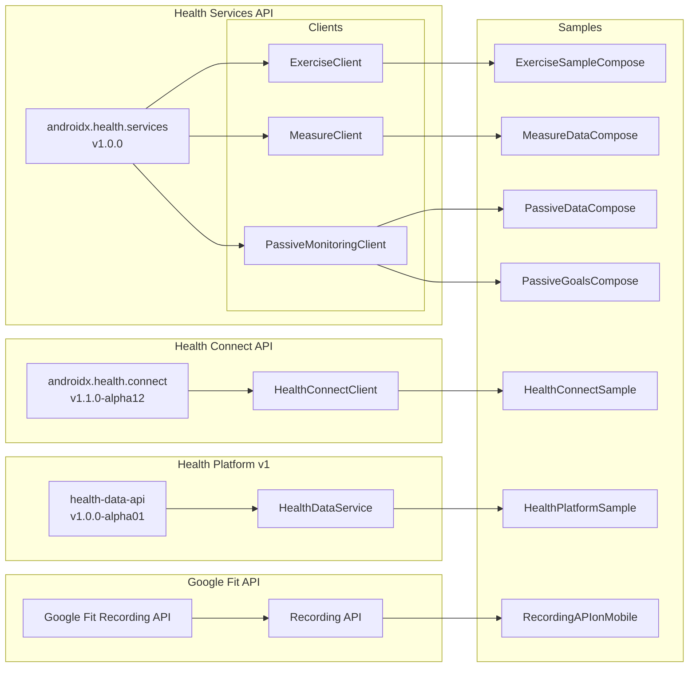

**API Comparison**

| API | Package | Primary Use Case | Platform | Status |
|-----|---------|------------------|----------|--------|
| Health Services | `androidx.health.services` | Wear OS sensor access, active tracking | Wear OS | Active |
| Health Connect | `androidx.health.connect` | Multi-app health data sharing | Mobile | Active |
| Health Platform v1 | `com.google.android.libraries.healthdata` | Legacy health data access | Mobile | Deprecated |
| Google Fit Recording API | Google Fit SDK | Background passive collection | Mobile | Maintenance |

Sources: [health-services/ExerciseSampleCompose/gradle/libs.versions.toml:9](), [health-connect/HealthConnectSample/build.gradle:25](), [health-platform-v1/HealthPlatformSample/build.gradle:25]()

## Sample Applications Overview

Each sample demonstrates specific API capabilities with progressive complexity levels.

**Sample Feature Matrix**

| Sample | API | Lines of Code | Key Features | Architecture Components |
|--------|-----|---------------|--------------|------------------------|
| `ExerciseSampleCompose` | Health Services | ~4000 | Active exercise tracking, goals, ambient mode, foreground service | Hilt, Horologist, Repository pattern, ViewModel, Compose Navigation |
| `MeasureDataCompose` | Health Services | ~500 | On-demand heart rate measurement | ViewModel, Compose |
| `PassiveDataCompose` | Health Services | ~1000 | Background health data collection | WorkManager, DataStore, ViewModel |
| `PassiveGoalsCompose` | Health Services | ~1200 | Background goal tracking, notifications | WorkManager, DataStore, ViewModel |
| `HealthConnectSample` | Health Connect | ~3000 | CRUD operations, aggregations, differential changes | ViewModel, Compose Navigation, Repository pattern |
| `HealthPlatformSample` | Health Platform v1 | ~1500 | Multi-screen navigation, legacy API | ViewModel, Compose Navigation |
| `RecordingAPIonMobile` | Google Fit | ~800 | Background step/distance recording | Google Fit Recording API |

**Complexity Levels**

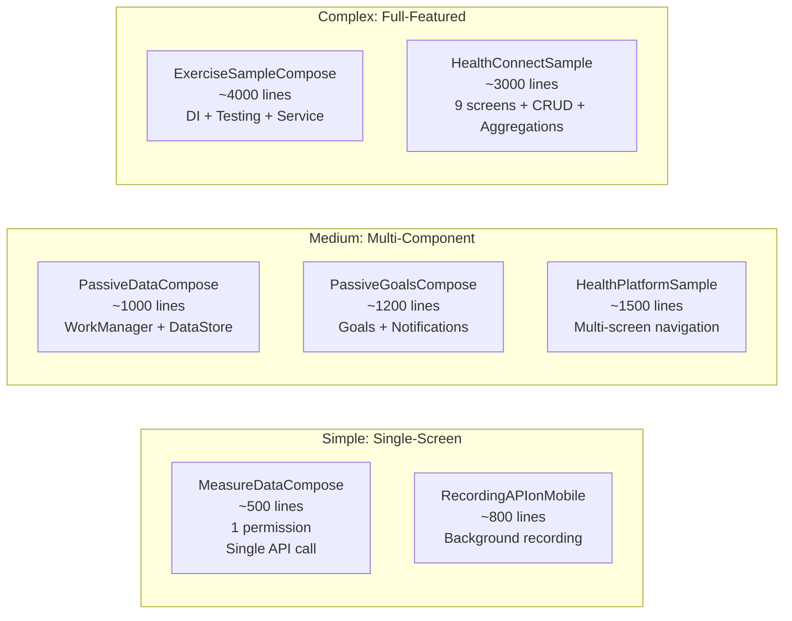

Sources: Files analyzed from the high-level diagrams provided

## Technology Stack

All samples converge on a modern Android architecture stack built around Jetpack libraries and Kotlin.

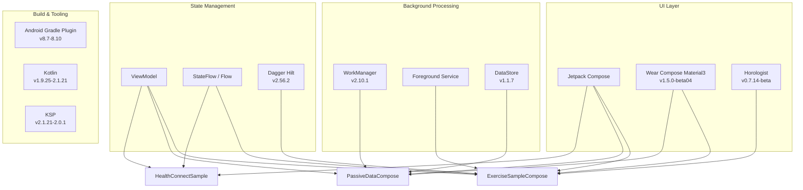

**Core Dependencies**

| Technology | Version Range | Usage | Samples |
|------------|---------------|-------|---------|
| Kotlin | 1.9.25 - 2.1.21 | Primary language | All |
| Android Gradle Plugin | 8.7.3 - 8.10.1 | Build system | All |
| Jetpack Compose | 1.7.5 - 1.8.1 | Declarative UI | All |
| Wear Compose Material3 | 1.4.1 - 1.5.0-beta04 | Wear OS UI | ExerciseSampleCompose, MeasureDataCompose, PassiveDataCompose, PassiveGoalsCompose |
| Dagger Hilt | 2.56.2 | Dependency injection | ExerciseSampleCompose |
| Horologist | 0.7.14-beta | Wear OS utilities | ExerciseSampleCompose, PassiveGoalsCompose |
| WorkManager | 2.10.1 | Background tasks | PassiveDataCompose, PassiveGoalsCompose |
| DataStore | 1.1.7 | Persistent storage | PassiveDataCompose, PassiveGoalsCompose |

Sources: [health-services/ExerciseSampleCompose/gradle/libs.versions.toml:1-18](), [health-services/MeasureDataCompose/gradle/libs.versions.toml:1-17](), [health-services/PassiveDataCompose/gradle/libs.versions.toml:1-17](), [health-services/PassiveGoalsCompose/gradle/libs.versions.toml:1-19]()

## Build System Architecture

The repository uses Gradle with version catalogs for centralized dependency management. Each sample maintains its own `libs.versions.toml` file with sample-specific dependencies.

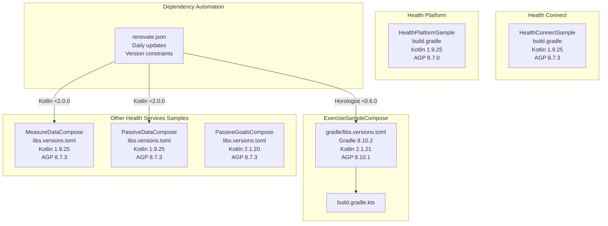

**Version Catalog Structure**

Version catalogs ([health-services/ExerciseSampleCompose/gradle/libs.versions.toml:1-74]()) define:

1. **`[versions]`** section: Version variables for dependencies
2. **`[libraries]`** section: Library coordinates referencing version variables
3. **`[plugins]`** section: Gradle plugin definitions

Example from `ExerciseSampleCompose`:
- Line 11: `kotlin = "2.1.21"` - Kotlin version
- Line 10: `horologist = "0.7.14-beta"` - Horologist library version
- Line 8: `dagger = "2.56.2"` - Dagger Hilt version

Sources: [health-services/ExerciseSampleCompose/gradle/libs.versions.toml:1-74](), [health-services/MeasureDataCompose/gradle/libs.versions.toml:1-39](), [health-services/PassiveGoalsCompose/gradle/libs.versions.toml:1-44](), [health-services/PassiveDataCompose/gradle/libs.versions.toml:1-38]()

## Dependency Management Strategy

The repository implements automated dependency management using Renovate Bot with specific version constraints to maintain stability.

**Renovate Configuration**

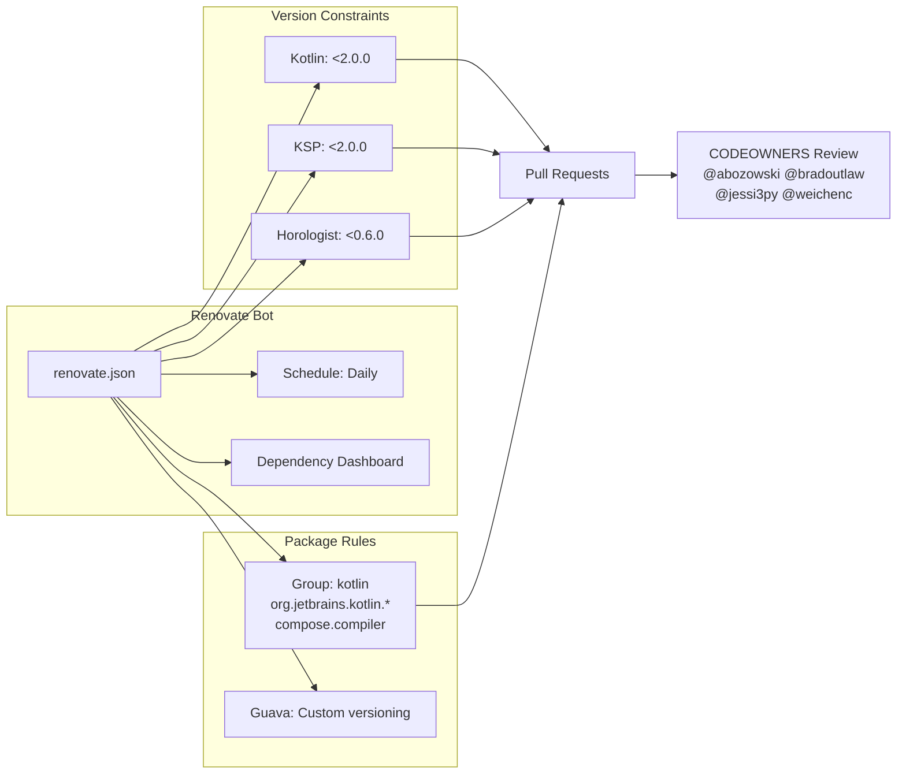

**Key Configuration Details**

From [renovate.json:1-44]():

- Line 7: `"schedule:daily"` - Updates checked daily
- Line 9: `"includePaths": ["health-services"]` - Focuses on Health Services samples
- Lines 18-24: Kotlin versions constrained to `<2.0.0`
- Lines 32-41: Horologist versions constrained to `<0.6.0`
- Lines 12-17: Compose compiler grouped with Kotlin updates

**Code Ownership**

From [.github/CODEOWNERS:1-5]():
- Line 2: Health Connect samples reviewed by 4 maintainers
- Line 5: Health Platform samples reviewed by same 4 maintainers

Sources: [renovate.json:1-44](), [.github/CODEOWNERS:1-5]()

## CI/CD Infrastructure

The repository maintains six GitHub Actions workflows, one for each major sample application, providing continuous integration and quality assurance.

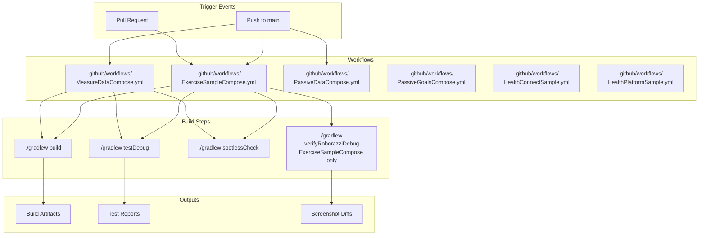

**Quality Gates**

| Check | Tool | Samples | Purpose |
|-------|------|---------|---------|
| Build | Gradle | All 6 samples | Compile-time verification |
| Unit Tests | JUnit | All 6 samples | Functional correctness |
| Code Formatting | Spotless + ktlint | All 6 samples | Style consistency |
| Screenshot Tests | Roborazzi | ExerciseSampleCompose only | Visual regression testing |

**ExerciseSampleCompose Enhanced Testing**

The flagship sample receives additional testing:
- Roborazzi screenshot testing with 8 device configurations
- Test artifact preservation with `if: always()` condition
- Reference screenshot comparison for UI regression detection

Sources: Information derived from the high-level diagrams indicating CI/CD structure

## Sample Application Descriptions

### Health Services Samples (Wear OS)

**ExerciseSampleCompose** - The most comprehensive sample demonstrating active exercise tracking with full lifecycle management, ambient mode support, and Horologist integration. Uses Foreground Service for continuous tracking, Dagger Hilt for dependency injection, and implements screenshot testing with Roborazzi. See [Section 2.1](#2.1) for details.

**MeasureDataCompose** - A simple demonstration of on-demand heart rate measurement using `MeasureClient`. Single-screen UI with minimal complexity. See [Section 2.2](#2.2) for details.

**PassiveDataCompose** - Demonstrates background health data collection using `PassiveMonitoringClient` with WorkManager for periodic syncing and DataStore for local persistence. See [Section 2.3](#2.3) for details.

**PassiveGoalsCompose** - Extends passive monitoring with goal tracking and achievement notifications. Uses WorkManager and DataStore similar to PassiveDataCompose. See [Section 2.4](#2.4) for details.

### Health Connect Sample (Mobile)

**HealthConnectSample** - Comprehensive mobile sample demonstrating the unified health data platform. Covers CRUD operations on various health record types (exercise sessions, sleep, weight), data aggregation, differential change tracking, and permission management across 9 screens. See [Section 3](#3) for details.

### Legacy Samples

**HealthPlatformSample** - Demonstrates the deprecated Health Platform v1 API for compatibility with older Android versions. Multi-screen navigation with basic CRUD operations. See [Section 4](#4) for details.

**RecordingAPIonMobile** - Simple demonstration of Google Fit's Recording API for passive background collection of steps, distance, and calories on mobile devices. See [Section 5](#5) for details.

## Common Architectural Patterns

All samples follow consistent architectural patterns:

**MVVM Architecture**
- `ViewModel` classes manage UI state and business logic
- `StateFlow` / `Flow` for reactive data streams
- Repository pattern for data access abstraction (in complex samples)

**Dependency Injection**
- Dagger Hilt in ExerciseSampleCompose for compile-time DI
- Manual dependency injection in simpler samples

**Jetpack Compose UI**
- Declarative UI with Material Design 3 (Wear samples use Wear Material3)
- Compose Navigation for multi-screen flows
- Horologist components for Wear OS-specific patterns

**Background Processing**
- Foreground Service for active tracking (ExerciseSampleCompose)
- WorkManager for passive periodic tasks (PassiveDataCompose, PassiveGoalsCompose)
- DataStore for persistent preferences and state

**Permission Handling**
- Runtime permission requests using Accompanist Permissions or native APIs
- User education screens explaining permission requirements
- Graceful degradation when permissions denied

See [Section 8](#8) for detailed documentation of common patterns and best practices.

Sources: [health-services/ExerciseSampleCompose/gradle/libs.versions.toml:1-74](), [health-connect/HealthConnectSample/build.gradle:17-60](), [health-connect/HealthConnectSample/app/build.gradle:17-101]()

---

# Page: Repository Architecture

# Repository Architecture

<details>
<summary>Relevant source files</summary>

The following files were used as context for generating this wiki page:

- [health-connect/HealthConnectSample/app/build.gradle](health-connect/HealthConnectSample/app/build.gradle)
- [health-connect/HealthConnectSample/build.gradle](health-connect/HealthConnectSample/build.gradle)
- [health-platform-v1/HealthPlatformSample/app/build.gradle](health-platform-v1/HealthPlatformSample/app/build.gradle)
- [health-platform-v1/HealthPlatformSample/build.gradle](health-platform-v1/HealthPlatformSample/build.gradle)
- [health-services/ExerciseSampleCompose/gradle/libs.versions.toml](health-services/ExerciseSampleCompose/gradle/libs.versions.toml)
- [health-services/MeasureDataCompose/gradle/libs.versions.toml](health-services/MeasureDataCompose/gradle/libs.versions.toml)
- [health-services/PassiveDataCompose/gradle/libs.versions.toml](health-services/PassiveDataCompose/gradle/libs.versions.toml)
- [health-services/PassiveGoalsCompose/gradle/libs.versions.toml](health-services/PassiveGoalsCompose/gradle/libs.versions.toml)

</details>


## Purpose and Scope

This document describes the high-level organization and architectural patterns of the android/health-samples repository. It covers:

- Physical directory structure and module organization
- Build system architecture using Gradle and version catalogs
- Common technology stack and dependency management patterns
- Shared architectural patterns across samples

For details about specific Android health APIs demonstrated by the samples, see [API Coverage](#1.2). For individual sample application architecture, see [Health Services Samples](#2), [Health Connect Sample](#3), [Health Platform Sample](#4), and [Recording API Sample](#5).

## Repository Structure

The repository is organized into four primary directories, each corresponding to a different Android health API ecosystem:

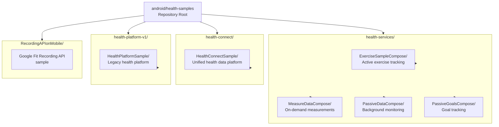

**Directory Organization**

| Directory | Purpose | API Used | Platform Target |
|-----------|---------|----------|-----------------|
| `health-services/` | Wear OS samples demonstrating sensor access and exercise tracking | `androidx.health.services` | Wear OS |
| `health-connect/` | Mobile sample for unified health data storage and sharing | `androidx.health.connect` | Android Mobile |
| `health-platform-v1/` | Legacy health data API sample | `health-data-api` | Android Mobile |
| `RecordingAPIonMobile/` | Background fitness data collection | Google Fit Recording API | Android Mobile |

Sources: Repository structure inferred from file paths in provided files

## Build System Architecture

The repository employs two different build configuration strategies across its samples, reflecting their development timelines and complexity requirements.

### Version Catalog Approach (Modern Samples)

The four Health Services samples use Gradle version catalogs ([gradle/libs.versions.toml]()) for centralized dependency management:

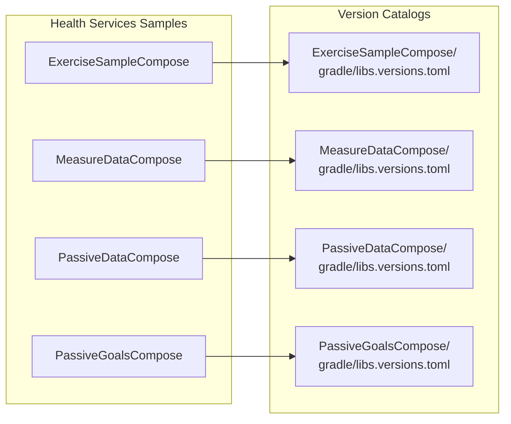

**Version Catalog Structure**

Each `libs.versions.toml` file contains three sections:

1. **[versions]** - Version strings for plugins and libraries [health-services/ExerciseSampleCompose/gradle/libs.versions.toml:1-18]()
2. **[libraries]** - Library dependency declarations with version references [health-services/ExerciseSampleCompose/gradle/libs.versions.toml:20-63]()
3. **[plugins]** - Gradle plugin declarations [health-services/ExerciseSampleCompose/gradle/libs.versions.toml:65-73]()

Example version definitions from ExerciseSampleCompose:
- `android-gradle-plugin = "8.10.1"` [health-services/ExerciseSampleCompose/gradle/libs.versions.toml:2]()
- `kotlin = "2.1.21"` [health-services/ExerciseSampleCompose/gradle/libs.versions.toml:11]()
- `dagger = "2.56.2"` [health-services/ExerciseSampleCompose/gradle/libs.versions.toml:8]()
- `horologist = "0.7.14-beta"` [health-services/ExerciseSampleCompose/gradle/libs.versions.toml:10]()

Sources: [health-services/ExerciseSampleCompose/gradle/libs.versions.toml:1-74](), [health-services/MeasureDataCompose/gradle/libs.versions.toml:1-39](), [health-services/PassiveDataCompose/gradle/libs.versions.toml:1-38](), [health-services/PassiveGoalsCompose/gradle/libs.versions.toml:1-44]()

### Traditional Build Script Approach (Mobile Samples)

HealthConnectSample and HealthPlatformSample use traditional `build.gradle` scripts with ext properties:

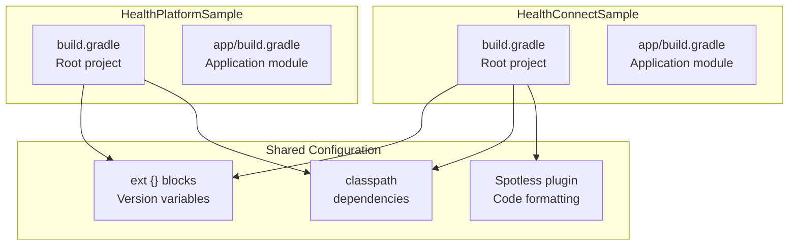

**Buildscript Configuration**

Both samples define versions in `ext {}` blocks in the root `build.gradle`:

HealthConnectSample version definitions [health-connect/HealthConnectSample/build.gradle:18-27]():
- `kotlin_version = '1.9.25'`
- `activity_compose_version = '1.9.2'`
- `health_connect_version = '1.1.0-alpha12'`
- `lifecycle_version = '2.8.6'`

HealthPlatformSample version definitions [health-platform-v1/HealthPlatformSample/build.gradle:18-27]():
- `kotlin_version = '1.9.25'`
- `health_platform_version = '1.0.0-alpha01'`
- `lifecycle_version = '2.8.6'`

Sources: [health-connect/HealthConnectSample/build.gradle:17-39](), [health-platform-v1/HealthPlatformSample/build.gradle:17-43](), [health-connect/HealthConnectSample/app/build.gradle:1-101](), [health-platform-v1/HealthPlatformSample/app/build.gradle:1-101]()

## Common Technology Stack

Despite different build approaches, all samples converge on a consistent modern Android technology stack:

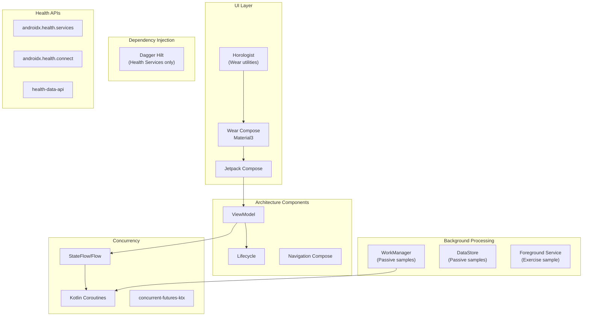

### Core Dependencies by Sample Type

**Health Services Samples (Wear OS)**

| Dependency | Version Range | Purpose |
|------------|---------------|---------|
| `androidx.health:health-services-client` | 1.0.0 | Health Services API client |
| `androidx.wear.compose:compose-material3` | 1.4.1 - 1.5.0-beta04 | Wear OS UI components |
| `androidx.compose.ui:ui` | 1.7.8 - 1.8.1 | Compose UI toolkit |
| `androidx.lifecycle:lifecycle-viewmodel-compose` | 2.8.6 - 2.9.0 | ViewModel integration |
| `androidx.concurrent:concurrent-futures-ktx` | 1.2.0 | ListenableFuture bridges |
| `com.google.android.horologist` | 0.7.14-beta | Wear OS utilities (ExerciseSample only) |
| `com.google.dagger:hilt-android` | 2.56.2 | Dependency injection (ExerciseSample only) |

Sources: [health-services/ExerciseSampleCompose/gradle/libs.versions.toml:20-63](), [health-services/MeasureDataCompose/gradle/libs.versions.toml:19-33]()

**Mobile Samples (Health Connect & Health Platform)**

| Dependency | Version | Purpose |
|------------|---------|---------|
| `androidx.health.connect:connect-client` | 1.1.0-alpha12 | Health Connect API |
| `health-data-api` | 1.0.0-alpha01 | Legacy Health Platform API |
| `androidx.compose:compose-bom` | 2024.09.03 | Compose Bill of Materials |
| `androidx.lifecycle:lifecycle-viewmodel-compose` | 2.8.6 | ViewModel integration |
| `androidx.navigation:navigation-compose` | 2.8.2 | Navigation framework |
| `androidx.concurrent:concurrent-futures-ktx` | 1.2.0 | Async utilities |
| `com.android.tools:desugar_jdk_libs` | 2.1.2 | Java 8+ API desugaring |

Sources: [health-connect/HealthConnectSample/app/build.gradle:66-100](), [health-platform-v1/HealthPlatformSample/app/build.gradle:71-101]()

## Build Configuration Patterns

### Kotlin and Gradle Versions

The repository demonstrates version progression across samples:

**ExerciseSampleCompose (Most Modern)**
- Kotlin: 2.1.21 [health-services/ExerciseSampleCompose/gradle/libs.versions.toml:11]()
- Android Gradle Plugin: 8.10.1 [health-services/ExerciseSampleCompose/gradle/libs.versions.toml:2]()
- Uses Kotlin Compiler Plugin for Compose [health-services/ExerciseSampleCompose/gradle/libs.versions.toml:70]()

**Other Health Services Samples**
- Kotlin: 1.9.25 - 2.1.20
- Android Gradle Plugin: 8.7.3
- Traditional or new Compose compiler configuration

**Mobile Samples**
- Kotlin: 1.9.25 [health-connect/HealthConnectSample/build.gradle:18]()
- Android Gradle Plugin: 8.7.0 - 8.7.3
- Compose Compiler Extension: 1.5.15

Sources: [health-services/ExerciseSampleCompose/gradle/libs.versions.toml:1-18](), [health-services/MeasureDataCompose/gradle/libs.versions.toml:1-18](), [health-connect/HealthConnectSample/build.gradle:17-39]()

### Compilation and Target SDK Configuration

All samples follow modern Android SDK practices:

**Wear OS Samples (Inferred from dependencies)**
- Wear Compose Material3 targeting recent Wear OS versions
- Uses Wear-specific UI components and APIs

**Mobile Samples**

HealthConnectSample [health-connect/HealthConnectSample/app/build.gradle:23-35]():
- `compileSdk 35`
- `minSdk 26` (required for Health Connect)
- `targetSdk 34`

HealthPlatformSample [health-platform-v1/HealthPlatformSample/app/build.gradle:23-40]():
- `compileSdk 34`
- `minSdk 23` (backwards compatible)
- `targetSdk 33`
- Includes desugaring for Java 8+ APIs [health-platform-v1/HealthPlatformSample/app/build.gradle:52-53]()

Both mobile samples use Java 17 compatibility:
- `sourceCompatibility JavaVersion.VERSION_17`
- `targetCompatibility JavaVersion.VERSION_17`
- `jvmTarget = JavaVersion.VERSION_17.majorVersion`

Sources: [health-connect/HealthConnectSample/app/build.gradle:22-64](), [health-platform-v1/HealthPlatformSample/app/build.gradle:22-69]()

## Code Quality and Formatting

All samples implement consistent code formatting using the Spotless Gradle plugin:

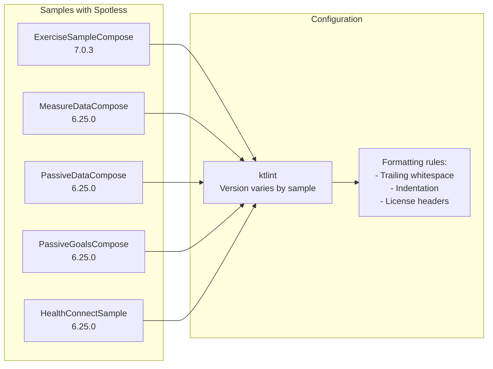

**Spotless Configuration Examples**

ExerciseSampleCompose uses version 7.0.3 [health-services/ExerciseSampleCompose/gradle/libs.versions.toml:72]():
- ktlint version: 0.50.0 [health-services/ExerciseSampleCompose/gradle/libs.versions.toml:18]()

Other Health Services samples use version 6.25.0:
- MeasureDataCompose [health-services/MeasureDataCompose/gradle/libs.versions.toml:38]()
- PassiveDataCompose [health-services/PassiveDataCompose/gradle/libs.versions.toml:37]()
- PassiveGoalsCompose [health-services/PassiveGoalsCompose/gradle/libs.versions.toml:41]()

HealthConnectSample configuration [health-connect/HealthConnectSample/build.gradle:41-60]():
- Applied to all subprojects
- ktlint version: 0.41.0
- Max line length: 100 characters
- Enforces license headers from `spotless/copyright.txt`

Sources: [health-services/ExerciseSampleCompose/gradle/libs.versions.toml:72](), [health-services/MeasureDataCompose/gradle/libs.versions.toml:38](), [health-connect/HealthConnectSample/build.gradle:41-60]()

## Dependency Management Patterns

### Wear OS Dependencies

Health Services samples share a core set of Wear-specific dependencies:

**Essential Wear Libraries**

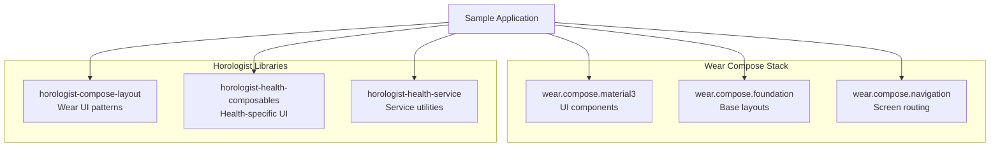

**ExerciseSampleCompose Horologist Integration** [health-services/ExerciseSampleCompose/gradle/libs.versions.toml:49-52]():
- `horologist-compose-layout`: Wear-optimized layouts
- `horologist-health-composables`: Pre-built health UI components  
- `horologist-health-service`: Foreground service utilities
- `horologist-roboscreenshots`: Screenshot testing support

**PassiveGoalsCompose Minimal Horologist** [health-services/PassiveGoalsCompose/gradle/libs.versions.toml:37]():
- Only includes `horologist-compose-layout` for basic Wear UI patterns

Sources: [health-services/ExerciseSampleCompose/gradle/libs.versions.toml:49-52](), [health-services/PassiveGoalsCompose/gradle/libs.versions.toml:37]()

### Async and Concurrency Libraries

All samples consistently use concurrent-futures-ktx for bridging callback-based APIs:

| Sample | Version | Usage Context |
|--------|---------|---------------|
| ExerciseSampleCompose | 1.2.0 | Health Services API callbacks |
| MeasureDataCompose | 1.2.0 | MeasureClient async operations |
| PassiveDataCompose | 1.2.0 | PassiveMonitoringClient callbacks |
| PassiveGoalsCompose | 1.2.0 | Background monitoring |
| HealthConnectSample | 1.2.0 | Health Connect API operations |
| HealthPlatformSample | 1.2.0 | Health Platform callbacks |

The library provides `await()` extension on `ListenableFuture<T>` to convert callback-based APIs to suspend functions compatible with Kotlin coroutines.

Sources: [health-services/ExerciseSampleCompose/gradle/libs.versions.toml:25](), [health-connect/HealthConnectSample/app/build.gradle:85](), [health-platform-v1/HealthPlatformSample/app/build.gradle:87]()

### Background Processing Dependencies

Passive monitoring samples require additional libraries for background operation:

**PassiveDataCompose & PassiveGoalsCompose Dependencies**

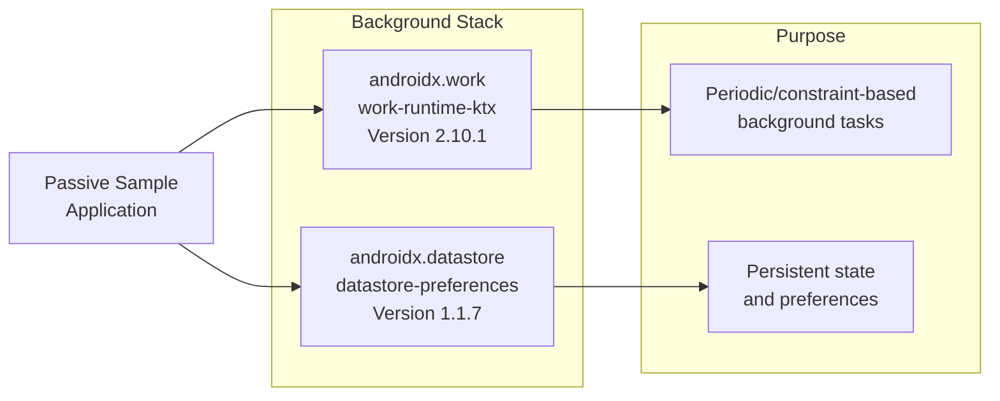

WorkManager configuration in PassiveDataCompose [health-services/PassiveDataCompose/gradle/libs.versions.toml:7]():
- `androidx-work = "2.10.1"`
- Both `work-runtime` and `work-runtime-ktx` variants

DataStore configuration in PassiveGoalsCompose [health-services/PassiveGoalsCompose/gradle/libs.versions.toml:5]():
- `androidx-datastore = "1.1.7"`
- Uses `datastore-preferences` for key-value storage

Sources: [health-services/PassiveDataCompose/gradle/libs.versions.toml:7,25-26](), [health-services/PassiveGoalsCompose/gradle/libs.versions.toml:5,24]()

## Architectural Patterns Summary

The repository demonstrates consistent architectural patterns that can be categorized by sample complexity:

**Simple Samples** (MeasureDataCompose, RecordingAPIonMobile)
- Single-screen Compose UI
- ViewModel for state management
- Direct API client usage
- Minimal background processing

**Intermediate Samples** (PassiveDataCompose, PassiveGoalsCompose, HealthPlatformSample)
- Multi-screen navigation
- Repository pattern for data access
- WorkManager for background tasks
- DataStore for persistent state
- ViewModels with StateFlow

**Advanced Samples** (ExerciseSampleCompose, HealthConnectSample)
- Full MVVM architecture
- Dependency injection (Hilt in ExerciseSampleCompose)
- Foreground services (ExerciseSampleCompose)
- Comprehensive error handling
- Advanced UI patterns (Horologist)
- Testing infrastructure (screenshot tests in ExerciseSampleCompose)

For detailed architectural breakdowns of individual samples, see:
- [ExerciseSampleCompose Architecture](#2.1.1)
- [Health Connect Data Management](#3.1)
- [Common Patterns and Best Practices](#8)

Sources: Analysis based on dependency configurations across [health-services/ExerciseSampleCompose/gradle/libs.versions.toml:1-74](), [health-services/MeasureDataCompose/gradle/libs.versions.toml:1-39](), [health-connect/HealthConnectSample/app/build.gradle:66-100]()

---

# Page: API Coverage

# API Coverage

<details>
<summary>Relevant source files</summary>

The following files were used as context for generating this wiki page:

- [health-connect/HealthConnectSample/app/src/main/AndroidManifest.xml](health-connect/HealthConnectSample/app/src/main/AndroidManifest.xml)
- [health-connect/HealthConnectSample/app/src/main/java/com/example/healthconnectsample/data/HealthConnectManager.kt](health-connect/HealthConnectSample/app/src/main/java/com/example/healthconnectsample/data/HealthConnectManager.kt)
- [health-connect/HealthConnectSample/app/src/main/java/com/example/healthconnectsample/presentation/component/Series.kt](health-connect/HealthConnectSample/app/src/main/java/com/example/healthconnectsample/presentation/component/Series.kt)
- [health-connect/HealthConnectSample/app/src/main/java/com/example/healthconnectsample/presentation/navigation/HealthConnectNavigation.kt](health-connect/HealthConnectSample/app/src/main/java/com/example/healthconnectsample/presentation/navigation/HealthConnectNavigation.kt)
- [health-connect/HealthConnectSample/app/src/main/java/com/example/healthconnectsample/presentation/navigation/Screen.kt](health-connect/HealthConnectSample/app/src/main/java/com/example/healthconnectsample/presentation/navigation/Screen.kt)
- [health-connect/HealthConnectSample/app/src/main/java/com/example/healthconnectsample/presentation/screen/WelcomeScreen.kt](health-connect/HealthConnectSample/app/src/main/java/com/example/healthconnectsample/presentation/screen/WelcomeScreen.kt)
- [health-connect/HealthConnectSample/app/src/main/java/com/example/healthconnectsample/presentation/screen/exercisesession/ExerciseSessionScreen.kt](health-connect/HealthConnectSample/app/src/main/java/com/example/healthconnectsample/presentation/screen/exercisesession/ExerciseSessionScreen.kt)
- [health-connect/HealthConnectSample/app/src/main/java/com/example/healthconnectsample/presentation/screen/exercisesession/ExerciseSessionViewModel.kt](health-connect/HealthConnectSample/app/src/main/java/com/example/healthconnectsample/presentation/screen/exercisesession/ExerciseSessionViewModel.kt)
- [health-connect/HealthConnectSample/app/src/main/java/com/example/healthconnectsample/presentation/screen/inputreadings/InputReadingsScreen.kt](health-connect/HealthConnectSample/app/src/main/java/com/example/healthconnectsample/presentation/screen/inputreadings/InputReadingsScreen.kt)
- [health-connect/HealthConnectSample/app/src/main/java/com/example/healthconnectsample/presentation/screen/inputreadings/InputReadingsViewModel.kt](health-connect/HealthConnectSample/app/src/main/java/com/example/healthconnectsample/presentation/screen/inputreadings/InputReadingsViewModel.kt)
- [health-connect/HealthConnectSample/app/src/main/java/com/example/healthconnectsample/presentation/screen/recordlist/RecordListScreen.kt](health-connect/HealthConnectSample/app/src/main/java/com/example/healthconnectsample/presentation/screen/recordlist/RecordListScreen.kt)
- [health-connect/HealthConnectSample/app/src/main/res/values/strings.xml](health-connect/HealthConnectSample/app/src/main/res/values/strings.xml)
- [health-connect/HealthConnectSample/settings.gradle](health-connect/HealthConnectSample/settings.gradle)
- [health-services/ExerciseSampleCompose/app/src/main/java/com/example/exercisesamplecompose/app/Screens.kt](health-services/ExerciseSampleCompose/app/src/main/java/com/example/exercisesamplecompose/app/Screens.kt)
- [health-services/ExerciseSampleCompose/app/src/main/java/com/example/exercisesamplecompose/data/ExerciseClientKtx.kt](health-services/ExerciseSampleCompose/app/src/main/java/com/example/exercisesamplecompose/data/ExerciseClientKtx.kt)
- [health-services/ExerciseSampleCompose/app/src/main/java/com/example/exercisesamplecompose/data/ExerciseClientManager.kt](health-services/ExerciseSampleCompose/app/src/main/java/com/example/exercisesamplecompose/data/ExerciseClientManager.kt)
- [health-services/ExerciseSampleCompose/app/src/main/java/com/example/exercisesamplecompose/data/HealthServicesRepository.kt](health-services/ExerciseSampleCompose/app/src/main/java/com/example/exercisesamplecompose/data/HealthServicesRepository.kt)
- [health-services/ExerciseSampleCompose/app/src/main/java/com/example/exercisesamplecompose/presentation/dialogs/ExerciseGoalMet.kt](health-services/ExerciseSampleCompose/app/src/main/java/com/example/exercisesamplecompose/presentation/dialogs/ExerciseGoalMet.kt)
- [health-services/ExerciseSampleCompose/app/src/main/java/com/example/exercisesamplecompose/presentation/goals/ExerciseGoalsScreen.kt](health-services/ExerciseSampleCompose/app/src/main/java/com/example/exercisesamplecompose/presentation/goals/ExerciseGoalsScreen.kt)
- [health-services/ExerciseSampleCompose/app/src/main/java/com/example/exercisesamplecompose/presentation/goals/ExerciseGoalsViewModel.kt](health-services/ExerciseSampleCompose/app/src/main/java/com/example/exercisesamplecompose/presentation/goals/ExerciseGoalsViewModel.kt)
- [health-services/ExerciseSampleCompose/app/src/main/java/com/example/exercisesamplecompose/presentation/theme/ThemePreview.kt](health-services/ExerciseSampleCompose/app/src/main/java/com/example/exercisesamplecompose/presentation/theme/ThemePreview.kt)
- [health-services/ExerciseSampleCompose/app/src/main/java/com/example/exercisesamplecompose/service/ExerciseService.kt](health-services/ExerciseSampleCompose/app/src/main/java/com/example/exercisesamplecompose/service/ExerciseService.kt)
- [health-services/ExerciseSampleCompose/app/src/main/java/com/example/exercisesamplecompose/service/ExerciseServiceMonitor.kt](health-services/ExerciseSampleCompose/app/src/main/java/com/example/exercisesamplecompose/service/ExerciseServiceMonitor.kt)
- [health-services/ExerciseSampleCompose/app/src/main/java/com/example/exercisesamplecompose/service/ExerciseState.kt](health-services/ExerciseSampleCompose/app/src/main/java/com/example/exercisesamplecompose/service/ExerciseState.kt)
- [recording-api-on-mobile/RecordingApiOnMobileSample/app/src/main/java/com/example/recordingapionmobilesample/component/BucketRow.kt](recording-api-on-mobile/RecordingApiOnMobileSample/app/src/main/java/com/example/recordingapionmobilesample/component/BucketRow.kt)
- [recording-api-on-mobile/RecordingApiOnMobileSample/app/src/main/java/com/example/recordingapionmobilesample/component/DataPointRow.kt](recording-api-on-mobile/RecordingApiOnMobileSample/app/src/main/java/com/example/recordingapionmobilesample/component/DataPointRow.kt)
- [recording-api-on-mobile/RecordingApiOnMobileSample/app/src/main/java/com/example/recordingapionmobilesample/component/DataSetRow.kt](recording-api-on-mobile/RecordingApiOnMobileSample/app/src/main/java/com/example/recordingapionmobilesample/component/DataSetRow.kt)
- [recording-api-on-mobile/RecordingApiOnMobileSample/app/src/main/java/com/example/recordingapionmobilesample/data/DataPointData.kt](recording-api-on-mobile/RecordingApiOnMobileSample/app/src/main/java/com/example/recordingapionmobilesample/data/DataPointData.kt)
- [recording-api-on-mobile/RecordingApiOnMobileSample/app/src/main/java/com/example/recordingapionmobilesample/screen/home/HomeScreen.kt](recording-api-on-mobile/RecordingApiOnMobileSample/app/src/main/java/com/example/recordingapionmobilesample/screen/home/HomeScreen.kt)
- [recording-api-on-mobile/RecordingApiOnMobileSample/app/src/main/java/com/example/recordingapionmobilesample/screen/recordingAPIonMobile/RecordingAPIonMobileScreen.kt](recording-api-on-mobile/RecordingApiOnMobileSample/app/src/main/java/com/example/recordingapionmobilesample/screen/recordingAPIonMobile/RecordingAPIonMobileScreen.kt)
- [recording-api-on-mobile/RecordingApiOnMobileSample/app/src/main/java/com/example/recordingapionmobilesample/screen/recordingAPIonMobile/RecordingAPIonMobileViewModel.kt](recording-api-on-mobile/RecordingApiOnMobileSample/app/src/main/java/com/example/recordingapionmobilesample/screen/recordingAPIonMobile/RecordingAPIonMobileViewModel.kt)
- [recording-api-on-mobile/RecordingApiOnMobileSample/screenshots/read-aggregate.png](recording-api-on-mobile/RecordingApiOnMobileSample/screenshots/read-aggregate.png)
- [recording-api-on-mobile/RecordingApiOnMobileSample/screenshots/read-raw.png](recording-api-on-mobile/RecordingApiOnMobileSample/screenshots/read-raw.png)
- [recording-api-on-mobile/RecordingApiOnMobileSample/screenshots/request-permission.png](recording-api-on-mobile/RecordingApiOnMobileSample/screenshots/request-permission.png)

</details>


## Purpose and Scope

This document describes the four distinct Android health and fitness APIs demonstrated by samples in this repository. Each API serves different use cases, platforms, and architectural patterns for accessing health data on Android devices. This page focuses on the capabilities, characteristics, and intended usage of each API rather than implementation details of specific samples.

For detailed implementation patterns within samples, see [Repository Architecture](#1.1). For individual sample documentation, see [Health Services Samples](#2), [Health Connect Sample](#3), [Health Platform Sample](#4), and [Recording API Sample](#5).

---

## API Ecosystem Overview

The repository demonstrates four distinct health data APIs across different Android platforms and use cases:

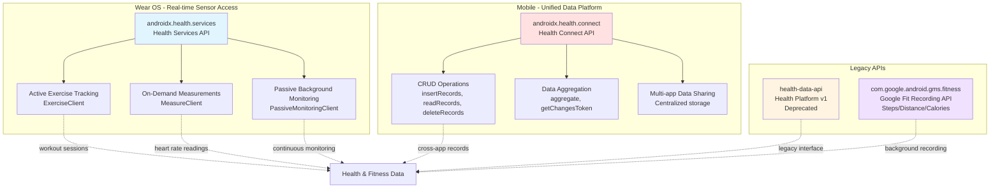

**Sources:** 
- [health-connect/HealthConnectSample/app/src/main/java/com/example/healthconnectsample/data/HealthConnectManager.kt:1-507]()
- [health-services/ExerciseSampleCompose/app/src/main/java/com/example/exercisesamplecompose/data/ExerciseClientManager.kt:1-261]()

---

## API Comparison Matrix

| Characteristic | Health Services | Health Connect | Health Platform v1 | Recording API |
|---|---|---|---|---|
| **Package** | `androidx.health.services` | `androidx.health.connect` | `health-data-api` | `com.google.android.gms.fitness` |
| **Platform** | Wear OS | Mobile (Android 8.1+) | Mobile (legacy) | Mobile |
| **Primary Use Case** | Real-time sensor access | Cross-app data sharing | Deprecated compatibility | Background passive recording |
| **Data Access Pattern** | Direct sensor callbacks | Record-based CRUD | Legacy platform interface | Subscription-based recording |
| **Samples** | ExerciseSample, MeasureData, PassiveData, PassiveGoals | HealthConnectSample | HealthPlatformSample | RecordingAPIonMobile |
| **Min SDK** | API 30 (Wear OS 3.0) | API 27 (O_MR1) | Deprecated | API 14+ |
| **Architecture** | Service-bound clients | Centralized data store | Platform service | Background subscriptions |
| **Status** | Active | Active | Deprecated | Maintenance mode |

**Sources:**
- [health-connect/HealthConnectSample/app/src/main/java/com/example/healthconnectsample/data/HealthConnectManager.kt:59-60]()
- [health-services/ExerciseSampleCompose/app/src/main/java/com/example/exercisesamplecompose/service/ExerciseService.kt:1-237]()

---

## Health Services API (androidx.health.services)

### Overview

The Health Services API provides direct access to Wear OS device sensors for fitness tracking. It operates through three primary client interfaces: `ExerciseClient` for active workouts, `MeasureClient` for on-demand readings, and `PassiveMonitoringClient` for background collection.

### Client Architecture

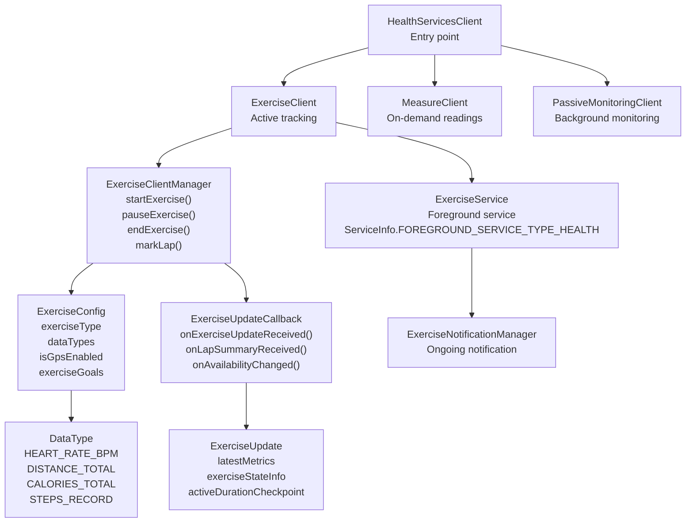

**Sources:**
- [health-services/ExerciseSampleCompose/app/src/main/java/com/example/exercisesamplecompose/data/ExerciseClientManager.kt:49-239]()
- [health-services/ExerciseSampleCompose/app/src/main/java/com/example/exercisesamplecompose/service/ExerciseService.kt:42-236]()

### Data Type Coverage

The Health Services API supports the following data types demonstrated in the samples:

| Data Type | Constant | Sample Usage | Client |
|---|---|---|---|
| Heart Rate | `DataType.HEART_RATE_BPM` | Real-time BPM during exercise | ExerciseClient, MeasureClient |
| Heart Rate Stats | `DataType.HEART_RATE_BPM_STATS` | Average/min/max calculations | ExerciseClient |
| Distance | `DataType.DISTANCE_TOTAL` | Cumulative meters traveled | ExerciseClient |
| Calories | `DataType.CALORIES_TOTAL` | Energy expenditure | ExerciseClient |
| Steps | `DataType.STEPS` | Step count | PassiveMonitoringClient |
| Location | `DataType.LOCATION` | GPS coordinates | ExerciseClient |
| Active Duration | `DataType.ACTIVE_EXERCISE_DURATION_TOTAL` | Exercise time tracking | ExerciseClient |

**Sources:**
- [health-services/ExerciseSampleCompose/app/src/main/java/com/example/exercisesamplecompose/data/ExerciseClientManager.kt:88-94]()
- [health-services/ExerciseSampleCompose/app/src/main/java/com/example/exercisesamplecompose/service/ExerciseState.kt:18-42]()

### Exercise Lifecycle Management

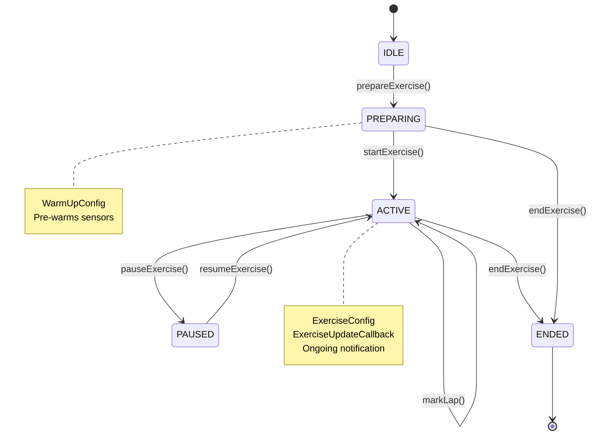

**Sources:**
- [health-services/ExerciseSampleCompose/app/src/main/java/com/example/exercisesamplecompose/data/ExerciseClientManager.kt:155-191]()
- [health-services/ExerciseSampleCompose/app/src/main/java/com/example/exercisesamplecompose/service/ExerciseService.kt:63-106]()

### Foreground Service Requirements

Health Services exercises run in a foreground service with specific requirements:

- **Service Type**: `ServiceInfo.FOREGROUND_SERVICE_TYPE_HEALTH` (API 34+) combined with `FOREGROUND_SERVICE_TYPE_LOCATION`
- **Ongoing Notification**: Required during active exercise using `ExerciseNotificationManager`
- **Lifecycle Management**: Service lifecycle bound to exercise state via `ExerciseServiceMonitor`

**Sources:**
- [health-services/ExerciseSampleCompose/app/src/main/java/com/example/exercisesamplecompose/service/ExerciseService.kt:199-223]()
- [health-services/ExerciseSampleCompose/app/src/main/java/com/example/exercisesamplecompose/service/ExerciseServiceMonitor.kt:27-85]()

---

## Health Connect API (androidx.health.connect)

### Overview

Health Connect provides a centralized, shared storage platform for health and fitness data on mobile devices. Multiple apps can read and write health records, enabling cross-app data sharing with user consent through a unified permission system.

### Core Components

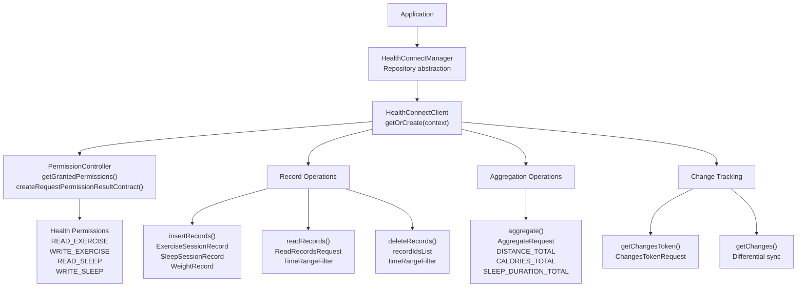

**Sources:**
- [health-connect/HealthConnectSample/app/src/main/java/com/example/healthconnectsample/data/HealthConnectManager.kt:62-126]()
- [health-connect/HealthConnectSample/app/src/main/res/values/strings.xml:1-144]()

### Record Types Demonstrated

The Health Connect sample demonstrates CRUD operations on the following record types:

| Record Type | Class | Operations | Key Fields |
|---|---|---|---|
| Exercise Sessions | `ExerciseSessionRecord` | Insert, Read, Delete, Read Associated Data | `startTime`, `endTime`, `exerciseType`, `title` |
| Sleep Sessions | `SleepSessionRecord` | Insert, Read, Generate data | `startTime`, `endTime`, `stages`, `notes` |
| Weight | `WeightRecord` | Insert, Read, Delete, Aggregate | `weight`, `time`, `zoneOffset` |
| Heart Rate | `HeartRateRecord` | Insert (with exercise), Read series | `samples`, `beatsPerMinute` |
| Steps | `StepsRecord` | Insert (with exercise) | `count`, `startTime`, `endTime` |
| Distance | `DistanceRecord` | Insert (with exercise) | `distance` (meters) |
| Speed | `SpeedRecord` | Read series | `samples`, `metersPerSecond` |
| Total Calories | `TotalCaloriesBurnedRecord` | Insert (with exercise), Aggregate | `energy` (calories) |

**Sources:**
- [health-connect/HealthConnectSample/app/src/main/java/com/example/healthconnectsample/data/HealthConnectManager.kt:128-385]()
- [health-connect/HealthConnectSample/app/src/main/AndroidManifest.xml:18-33]()

### Permission Model

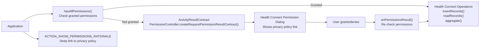

**Sources:**
- [health-connect/HealthConnectSample/app/src/main/java/com/example/healthconnectsample/data/HealthConnectManager.kt:109-126]()
- [health-connect/HealthConnectSample/app/src/main/AndroidManifest.xml:52-61]()

### Aggregation Operations

Health Connect supports aggregating data across time ranges:

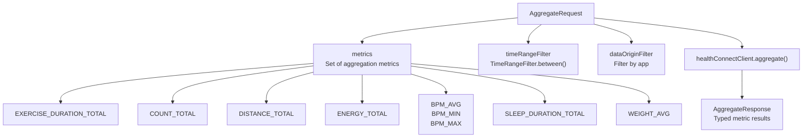

**Sources:**
- [health-connect/HealthConnectSample/app/src/main/java/com/example/healthconnectsample/data/HealthConnectManager.kt:217-257]()
- [health-connect/HealthConnectSample/app/src/main/java/com/example/healthconnectsample/data/HealthConnectManager.kt:366-374]()

### Differential Changes API

The changes API enables efficient synchronization by tracking modifications since a given token:

```mermaid
sequenceDiagram
    participant App
    participant HCM as HealthConnectManager
    participant Client as HealthConnectClient
    
    App->>HCM: getChangesToken(dataTypes)
    HCM->>Client: getChangesToken(ChangesTokenRequest)
    Client-->>HCM: token (string)
    HCM-->>App: Store token
    
    Note over App: Time passes<br/>Data changes occur
    
    App->>HCM: getChanges(token)
    HCM->>Client: getChanges(token)
    
    loop While hasMore
        Client-->>HCM: ChangesResponse<br/>changes, nextChangesToken, hasMore
        HCM-->>App: ChangesMessage.ChangeList
    end
    
    HCM-->>App: ChangesMessage.NoMoreChanges<br/>(nextChangesToken)
    
    Note over App: Store nextChangesToken<br/>for next sync
```

**Key implementation details:**
- Tokens expire after 30 days (must check `changesTokenExpired`)
- Each `Change` is either `UpsertionChange` or `DeletionChange`
- Changes include record type and metadata

**Sources:**
- [health-connect/HealthConnectSample/app/src/main/java/com/example/healthconnectsample/data/HealthConnectManager.kt:387-416]()
- [health-connect/HealthConnectSample/app/src/main/res/values/strings.xml:115-133]()

### Availability Checking

Health Connect requires runtime availability checking:

```mermaid
graph TD
    App["Application Start"]
    
    App --> Check["HealthConnectClient.getSdkStatus(context)"]
    
    Check --> Available["SDK_AVAILABLE<br/>Health Connect installed and ready"]
    Check --> UpdateRequired["SDK_UNAVAILABLE_PROVIDER_UPDATE_REQUIRED<br/>Need to install/update"]
    Check --> Unsupported["SDK_UNAVAILABLE<br/>Device not supported (< API 27)"]
    
    Available --> Use["Use Health Connect APIs"]
    UpdateRequired --> Redirect["Redirect to Play Store<br/>market://details"]
    Unsupported --> Message["Show compatibility message"]
```

**Sources:**
- [health-connect/HealthConnectSample/app/src/main/java/com/example/healthconnectsample/data/HealthConnectManager.kt:98-107]()
- [health-connect/HealthConnectSample/app/src/main/java/com/example/healthconnectsample/presentation/screen/WelcomeScreen.kt:51-107]()

---

## Health Platform API (health-data-api)

### Overview

The Health Platform v1 API is a deprecated health data interface for mobile devices. The HealthPlatformSample demonstrates this legacy API for compatibility reference but is not recommended for new development.

**Status**: Deprecated - migrate to Health Connect for mobile health data

**Sources:**
- Repository structure analysis from high-level diagrams
- [health-platform/HealthPlatformSample/settings.gradle]() (inferred from repository structure)

---

## Google Fit Recording API

### Overview

The Google Fit Recording API (`com.google.android.gms.fitness`) enables passive background recording of fitness data on mobile devices. The RecordingAPIonMobile sample demonstrates subscribing to automatic data collection for steps, distance, and calories.

### Recording Subscription Model

```mermaid
graph TB
    App["Application"]
    
    App --> RecAPI["Recording API<br/>com.google.android.gms.fitness.RecordingApi"]
    
    RecAPI --> Subscribe["subscribe()<br/>DataType subscription"]
    RecAPI --> Unsubscribe["unsubscribe()<br/>Stop recording"]
    RecAPI --> ListSubs["listSubscriptions()<br/>Query active subscriptions"]
    
    Subscribe --> Types["Data Types<br/>TYPE_STEP_COUNT_DELTA<br/>TYPE_DISTANCE_DELTA<br/>TYPE_CALORIES_EXPENDED"]
    
    Types --> Background["Background Recording<br/>Automatic collection<br/>No active session required"]
    
    Background --> History["History API<br/>readData()<br/>readDailyTotal()"]
    
    History --> DataSets["DataSet<br/>DataPoint collection<br/>startTime, endTime, values"]
    
    History --> Buckets["Bucket Aggregation<br/>aggregate()<br/>Time-based grouping"]
```

**Data types supported:**
- `TYPE_STEP_COUNT_DELTA`: Step count increments
- `TYPE_DISTANCE_DELTA`: Distance traveled (meters)
- `TYPE_CALORIES_EXPENDED`: Calories burned

**Sources:**
- [recording-api-on-mobile/RecordingApiOnMobileSample/app/src/main/java/com/example/recordingapionmobilesample/screen/recordingAPIonMobile/RecordingAPIonMobileViewModel.kt:1-200]()
- [recording-api-on-mobile/RecordingApiOnMobileSample/app/src/main/java/com/example/recordingapionmobilesample/data/DataPointData.kt:1-25]()

### Reading Recorded Data

The Recording API provides two patterns for reading data:

**Raw Data Points:**
```mermaid
graph LR
    App --> ReadReq["DataReadRequest.Builder<br/>setTimeRange()<br/>read(dataType)"]
    ReadReq --> HistAPI["HistoryApi.readData()"]
    HistAPI --> Response["DataReadResponse"]
    Response --> DataSets["List of DataSet"]
    DataSets --> Points["DataPoint<br/>startTime, endTime<br/>Field values"]
```

**Aggregated Buckets:**
```mermaid
graph LR
    App --> AggReq["DataReadRequest.Builder<br/>aggregate(dataType, aggType)<br/>bucketByTime(duration)"]
    AggReq --> HistAPI["HistoryApi.readData()"]
    HistAPI --> Response["DataReadResponse"]
    Response --> Buckets["List of Bucket<br/>Time-grouped aggregations"]
    Buckets --> BucketData["Bucket.getDataSets()<br/>Aggregated values"]
```

**Sources:**
- [recording-api-on-mobile/RecordingApiOnMobileSample/app/src/main/java/com/example/recordingapionmobilesample/screen/recordingAPIonMobile/RecordingAPIonMobileViewModel.kt:78-146]()
- [recording-api-on-mobile/RecordingApiOnMobileSample/app/src/main/java/com/example/recordingapionmobilesample/component/DataPointRow.kt:1-90]()
- [recording-api-on-mobile/RecordingApiOnMobileSample/app/src/main/java/com/example/recordingapionmobilesample/component/BucketRow.kt:1-100]()

---

## API Selection Guide

### Decision Matrix

```mermaid
graph TD
    Start["Select Health API"]
    
    Start --> Platform{"Target Platform?"}
    
    Platform -->|"Wear OS"| WearUseCase{"Use Case?"}
    Platform -->|"Mobile"| MobileUseCase{"Use Case?"}
    
    WearUseCase -->|"Active workout tracking"| HS_Exercise["Health Services API<br/>ExerciseClient<br/>Real-time metrics<br/>GPS tracking"]
    
    WearUseCase -->|"On-demand reading"| HS_Measure["Health Services API<br/>MeasureClient<br/>Single HR measurement"]
    
    WearUseCase -->|"Background monitoring"| HS_Passive["Health Services API<br/>PassiveMonitoringClient<br/>Continuous collection"]
    
    MobileUseCase -->|"Cross-app data sharing"| HC["Health Connect API<br/>Central data repository<br/>Multi-app ecosystem"]
    
    MobileUseCase -->|"Passive background only"| Fit["Google Fit Recording API<br/>Automatic subscriptions<br/>Steps/Distance/Calories"]
    
    MobileUseCase -->|"Legacy compatibility"| Deprecated["Health Platform v1<br/>Deprecated<br/>Migrate to Health Connect"]
    
    style HS_Exercise fill:#e1f5ff
    style HS_Measure fill:#e1f5ff
    style HS_Passive fill:#e1f5ff
    style HC fill:#ffe1e1
    style Fit fill:#f0e1ff
    style Deprecated fill:#fff4e1
```

### Capability Comparison

| Capability | Health Services | Health Connect | Recording API | Health Platform v1 |
|---|---|---|---|---|
| **Real-time sensor access** | ✓ | ✗ | ✗ | ✗ |
| **Background data collection** | ✓ (passive) | ✗ | ✓ | ? |
| **Cross-app data sharing** | ✗ | ✓ | ✓ (via Fit) | ? |
| **GPS tracking** | ✓ | Records only | ✗ | ? |
| **Exercise lifecycle** | ✓ | Records only | ✗ | ? |
| **Data aggregation** | ✗ | ✓ | ✓ | ? |
| **Change tracking** | ✗ | ✓ | ✗ | ? |
| **Wear OS support** | ✓ | ✗ | ✗ | ✗ |
| **Mobile support** | ✗ | ✓ | ✓ | ✓ |
| **Permission model** | Android runtime | Health Connect | Google Fit | Platform |
| **Data persistence** | None (client only) | Central storage | Google account | Platform storage |

**Sources:**
- [health-services/ExerciseSampleCompose/app/src/main/java/com/example/exercisesamplecompose/data/ExerciseClientManager.kt:62-70]()
- [health-connect/HealthConnectSample/app/src/main/java/com/example/healthconnectsample/data/HealthConnectManager.kt:115-126]()
- [recording-api-on-mobile/RecordingApiOnMobileSample/app/src/main/java/com/example/recordingapionmobilesample/screen/home/HomeScreen.kt:1-300]()

### Use Case Recommendations

**Choose Health Services API when:**
- Building for Wear OS
- Need real-time sensor data during active exercise
- Require exercise lifecycle management (prepare, start, pause, end)
- Need GPS tracking with health metrics
- Want on-demand heart rate measurements

**Choose Health Connect API when:**
- Building for mobile (Android 8.1+)
- Need to read data from multiple fitness apps
- Want to write data accessible by other apps
- Require data aggregation across time ranges
- Need differential synchronization
- Building a comprehensive health dashboard

**Choose Recording API when:**
- Need simple passive background recording on mobile
- Only require steps, distance, and calories
- Don't need real-time data access
- Want automatic collection without active sessions

**Avoid Health Platform v1:**
- Deprecated API - use Health Connect instead for new development

**Sources:**
- Repository structure and high-level diagrams
- [health-connect/HealthConnectSample/app/src/main/res/values/strings.xml:28-65]()
- [health-services/ExerciseSampleCompose/app/src/main/java/com/example/exercisesamplecompose/data/HealthServicesRepository.kt:1-120]()

---

# Page: Health Services Samples

# Health Services Samples

<details>
<summary>Relevant source files</summary>

The following files were used as context for generating this wiki page:

- [health-connect/HealthConnectSample/build.gradle](health-connect/HealthConnectSample/build.gradle)
- [health-platform-v1/HealthPlatformSample/build.gradle](health-platform-v1/HealthPlatformSample/build.gradle)
- [health-services/ExerciseSampleCompose/app/build.gradle](health-services/ExerciseSampleCompose/app/build.gradle)
- [health-services/ExerciseSampleCompose/app/src/main/AndroidManifest.xml](health-services/ExerciseSampleCompose/app/src/main/AndroidManifest.xml)
- [health-services/ExerciseSampleCompose/app/src/main/java/com/example/exercisesamplecompose/app/MainActivity.kt](health-services/ExerciseSampleCompose/app/src/main/java/com/example/exercisesamplecompose/app/MainActivity.kt)
- [health-services/ExerciseSampleCompose/app/src/main/java/com/example/exercisesamplecompose/presentation/component/FormattingUtils.kt](health-services/ExerciseSampleCompose/app/src/main/java/com/example/exercisesamplecompose/presentation/component/FormattingUtils.kt)
- [health-services/ExerciseSampleCompose/app/src/main/java/com/example/exercisesamplecompose/presentation/component/HRText.kt](health-services/ExerciseSampleCompose/app/src/main/java/com/example/exercisesamplecompose/presentation/component/HRText.kt)
- [health-services/ExerciseSampleCompose/app/src/main/java/com/example/exercisesamplecompose/presentation/exercise/ExerciseScreen.kt](health-services/ExerciseSampleCompose/app/src/main/java/com/example/exercisesamplecompose/presentation/exercise/ExerciseScreen.kt)
- [health-services/ExerciseSampleCompose/app/src/main/java/com/example/exercisesamplecompose/presentation/preparing/PreparingViewModel.kt](health-services/ExerciseSampleCompose/app/src/main/java/com/example/exercisesamplecompose/presentation/preparing/PreparingViewModel.kt)
- [health-services/ExerciseSampleCompose/app/src/test/java/com/example/exercisesamplecompose/presentation/ExerciseScreenTest.kt](health-services/ExerciseSampleCompose/app/src/test/java/com/example/exercisesamplecompose/presentation/ExerciseScreenTest.kt)
- [health-services/ExerciseSampleCompose/gradle/libs.versions.toml](health-services/ExerciseSampleCompose/gradle/libs.versions.toml)
- [health-services/MeasureDataCompose/gradle/libs.versions.toml](health-services/MeasureDataCompose/gradle/libs.versions.toml)
- [health-services/PassiveDataCompose/gradle/libs.versions.toml](health-services/PassiveDataCompose/gradle/libs.versions.toml)
- [health-services/PassiveGoalsCompose/gradle/libs.versions.toml](health-services/PassiveGoalsCompose/gradle/libs.versions.toml)

</details>


## Purpose and Scope

This page provides an overview of the four sample applications demonstrating the `androidx.health.services` API for Wear OS devices. These samples illustrate different use cases for health and fitness data collection on wearables, from active exercise tracking to passive background monitoring.

For detailed information about individual samples, see:
- Active exercise tracking: [ExerciseSampleCompose](#2.1)
- On-demand measurements: [MeasureDataCompose](#2.2)
- Passive background data collection: [PassiveDataCompose](#2.3)
- Passive goal tracking: [PassiveGoalsCompose](#2.4)

For Health Connect (mobile health data platform), see [Health Connect Sample](#3). For legacy Health Platform API, see [Health Platform Sample](#4).

## Health Services API Overview

The Health Services API (`androidx.health.services`) provides direct access to Wear OS device sensors for health and fitness applications. Unlike Health Connect which aggregates data across apps on mobile devices, Health Services is specifically designed for real-time sensor access on wearables.

**Key Capabilities:**
- **Exercise Tracking**: Active workout sessions with real-time metrics (heart rate, distance, pace)
- **Passive Monitoring**: Background health data collection without user interaction
- **On-Demand Measurement**: Single sensor readings (e.g., heart rate check)
- **Goal Tracking**: Progress monitoring against fitness objectives

**API Version**: All samples use `androidx.health:health-services-client:1.0.0`

Sources: [health-services/ExerciseSampleCompose/gradle/libs.versions.toml:9](), [health-services/MeasureDataCompose/gradle/libs.versions.toml:12](), [health-services/PassiveDataCompose/gradle/libs.versions.toml:13](), [health-services/PassiveGoalsCompose/gradle/libs.versions.toml:14]()

## Sample Applications Overview

The repository includes four Health Services samples, each demonstrating different aspects of the API:

| Sample | Purpose | Key Features | Complexity |
|--------|---------|--------------|------------|
| **ExerciseSampleCompose** | Active exercise session tracking | Foreground service, exercise lifecycle, ambient mode, Dagger Hilt, screenshot testing | High (~4000 LOC) |
| **MeasureDataCompose** | On-demand heart rate measurement | Simple single-screen UI, MeasureClient API | Low (~500 LOC) |
| **PassiveDataCompose** | Background health data collection | WorkManager, DataStore, PassiveMonitoringClient | Medium (~1000 LOC) |
| **PassiveGoalsCompose** | Background goal tracking and notifications | WorkManager, DataStore, goal achievements, notifications | Medium (~1200 LOC) |

All samples use **Jetpack Compose** for UI and target **Wear OS** devices (minSdk 30).

### Architecture Diagram: Health Services Client Types

```mermaid
graph TB
    subgraph "androidx.health.services API"
        HS["HealthServicesClient"]
        
        subgraph "Client Types"
            EC["ExerciseClient<br/>Active exercise sessions"]
            MC["MeasureClient<br/>On-demand measurements"]
            PMC["PassiveMonitoringClient<br/>Background data collection"]
        end
    end
    
    subgraph "Sample Applications"
        ESC["ExerciseSampleCompose"]
        MDC["MeasureDataCompose"]
        PDC["PassiveDataCompose"]
        PGC["PassiveGoalsCompose"]
    end
    
    subgraph "Wear OS Hardware"
        SENSORS["Heart Rate<br/>GPS<br/>Accelerometer<br/>Step Counter"]
    end
    
    HS --> EC
    HS --> MC
    HS --> PMC
    
    ESC -->|"uses"| EC
    MDC -->|"uses"| MC
    PDC -->|"uses"| PMC
    PGC -->|"uses"| PMC
    
    EC -->|"reads"| SENSORS
    MC -->|"reads"| SENSORS
    PMC -->|"reads"| SENSORS
```

Sources: [health-services/ExerciseSampleCompose/app/src/main/java/com/example/exercisesamplecompose/presentation/preparing/PreparingViewModel.kt:23](), [health-services/ExerciseSampleCompose/app/build.gradle:106]()

## Common Architecture Patterns

All Health Services samples follow consistent architectural patterns:

### MVVM Architecture

Each sample implements the Model-View-ViewModel pattern with:
- **ViewModels**: Manage UI state and business logic
- **Repository Pattern**: Abstract Health Services API interactions
- **StateFlow**: Reactive state management with Kotlin coroutines
- **Compose UI**: Declarative user interface

### Technology Stack

```mermaid
graph TB
    subgraph "UI Layer"
        WMC3["Wear Compose Material3<br/>androidx.wear.compose:compose-material3"]
        WCF["Wear Compose Foundation<br/>androidx.wear.compose:compose-foundation"]
        HOR["Horologist<br/>com.google.android.horologist<br/>(Exercise & PassiveGoals only)"]
    end
    
    subgraph "State Management"
        VM["ViewModel<br/>androidx.lifecycle:lifecycle-viewmodel"]
        SF["StateFlow/Flow<br/>Kotlin Coroutines"]
    end
    
    subgraph "Data Layer"
        REPO["Repository Pattern<br/>HealthServicesRepository"]
        HSC["Health Services Client<br/>androidx.health.services"]
    end
    
    subgraph "Background Processing"
        FGS["Foreground Service<br/>(ExerciseSampleCompose)"]
        WM["WorkManager<br/>(Passive samples)"]
        DS["DataStore<br/>(Passive samples)"]
    end
    
    subgraph "Dependency Injection"
        HILT["Dagger Hilt<br/>(ExerciseSampleCompose only)"]
    end
    
    WMC3 --> VM
    WCF --> VM
    HOR --> WMC3
    
    VM --> SF
    VM --> REPO
    
    REPO --> HSC
    
    FGS -.->|"used by"| REPO
    WM -.->|"used by"| REPO
    DS -.->|"used by"| REPO
    
    HILT -.->|"injects"| VM
    HILT -.->|"injects"| REPO
```

Sources: [health-services/ExerciseSampleCompose/gradle/libs.versions.toml:1-73](), [health-services/ExerciseSampleCompose/app/build.gradle:80-141]()

### Permission Handling

All samples require runtime permissions for sensor access:

```mermaid
graph LR
    subgraph "Required Permissions"
        BS["BODY_SENSORS<br/>(Heart rate)"]
        LOC["ACCESS_FINE_LOCATION<br/>(GPS tracking)"]
        AR["ACTIVITY_RECOGNITION<br/>(Movement detection)"]
        NOT["POST_NOTIFICATIONS<br/>(Android 13+)"]
        HR["READ_HEART_RATE<br/>(Android 16+)"]
    end
    
    subgraph "Permission Request Flow"
        CHECK["Check permissions"]
        REQ["Request missing permissions"]
        GRANT["User grants permissions"]
        PROCEED["Start Health Services operation"]
    end
    
    CHECK --> REQ
    REQ --> GRANT
    GRANT --> PROCEED
    
    BS -.-> CHECK
    LOC -.-> CHECK
    AR -.-> CHECK
    NOT -.-> CHECK
    HR -.-> CHECK
```

**Permission Implementation Example:**
[health-services/ExerciseSampleCompose/app/src/main/java/com/example/exercisesamplecompose/presentation/preparing/PreparingViewModel.kt:85-95]()

The `PreparingViewModel` defines the required permissions list that adapts based on API level. The `MainActivity` uses `ActivityResultContracts.RequestMultiplePermissions()` to request these permissions on app launch.

**Manifest Declaration:**
[health-services/ExerciseSampleCompose/app/src/main/AndroidManifest.xml:18-33]()

Sources: [health-services/ExerciseSampleCompose/app/src/main/java/com/example/exercisesamplecompose/presentation/preparing/PreparingViewModel.kt:85-95](), [health-services/ExerciseSampleCompose/app/src/main/AndroidManifest.xml:18-33](), [health-services/ExerciseSampleCompose/app/src/main/java/com/example/exercisesamplecompose/app/MainActivity.kt:39-47]()

## Common Dependencies

### Core Dependencies Across All Samples

| Dependency | Purpose | Versions Used |
|------------|---------|---------------|
| `androidx.health:health-services-client` | Health Services API client | 1.0.0 (all samples) |
| `androidx.wear.compose:compose-material3` | Wear OS Material Design 3 components | 1.5.0-beta02 to 1.5.0-beta04 |
| `androidx.wear.compose:compose-foundation` | Wear OS Compose fundamentals | 1.4.1 to 1.5.0-beta04 |
| `androidx.activity:activity-compose` | Compose integration for Activity | 1.9.2 to 1.10.1 |
| `androidx.lifecycle:lifecycle-viewmodel-compose` | ViewModel integration for Compose | 2.8.6 to 2.9.0 |
| `androidx.concurrent:concurrent-futures-ktx` | Async operations with ListenableFuture | 1.2.0 (all samples) |
| `com.google.guava:guava` | Google core libraries | 33.3.1-android (all samples) |

### Sample-Specific Dependencies

**ExerciseSampleCompose** (Most Complex):
- `com.google.dagger:hilt-android:2.56.2` - Dependency injection
- `com.google.android.horologist:horologist-*:0.7.14-beta` - Wear OS utilities and health UI components
- `io.github.takahirom.roborazzi:roborazzi:1.45.1` - Screenshot testing
- `androidx.wear:wear-ongoing:1.0.0` - Ongoing activity notifications

**PassiveDataCompose & PassiveGoalsCompose**:
- `androidx.work:work-runtime-ktx:2.10.1` - Background task scheduling
- `androidx.datastore:datastore-preferences:1.1.7` - Persistent key-value storage

### Version Catalog Comparison

```mermaid
graph TB
    subgraph "ExerciseSampleCompose<br/>Most Advanced"
        ESC_AGP["Android Gradle Plugin: 8.10.1"]
        ESC_KOTLIN["Kotlin: 2.1.21"]
        ESC_FEATURES["+ Dagger Hilt<br/>+ Horologist<br/>+ Roborazzi"]
    end
    
    subgraph "MeasureDataCompose<br/>Simple"
        MDC_AGP["Android Gradle Plugin: 8.7.3"]
        MDC_KOTLIN["Kotlin: 1.9.25"]
        MDC_FEATURES["Basic Compose<br/>+ Accompanist Permissions"]
    end
    
    subgraph "PassiveDataCompose<br/>Background Focus"
        PDC_AGP["Android Gradle Plugin: 8.7.3"]
        PDC_KOTLIN["Kotlin: 1.9.25"]
        PDC_FEATURES["+ WorkManager<br/>+ DataStore"]
    end
    
    subgraph "PassiveGoalsCompose<br/>Background + Goals"
        PGC_AGP["Android Gradle Plugin: 8.7.3"]
        PGC_KOTLIN["Kotlin: 2.1.20"]
        PGC_FEATURES["+ WorkManager<br/>+ DataStore<br/>+ Horologist"]
    end
    
    SHARED["Shared Dependencies:<br/>Health Services 1.0.0<br/>Wear Compose Material3<br/>Lifecycle Components"]
    
    ESC_FEATURES -.-> SHARED
    MDC_FEATURES -.-> SHARED
    PDC_FEATURES -.-> SHARED
    PGC_FEATURES -.-> SHARED
```

**Note**: ExerciseSampleCompose uses the latest Kotlin (2.1.21) and Android Gradle Plugin (8.10.1), indicating it receives more active maintenance and serves as the flagship sample.

Sources: [health-services/ExerciseSampleCompose/gradle/libs.versions.toml:1-18](), [health-services/MeasureDataCompose/gradle/libs.versions.toml:1-17](), [health-services/PassiveDataCompose/gradle/libs.versions.toml:1-17](), [health-services/PassiveGoalsCompose/gradle/libs.versions.toml:1-19]()

## Sample-Specific Features

### Exercise Sample: Active Tracking with Foreground Service

The most complex sample demonstrating a complete exercise tracking application:

**Key Components:**
- `ExerciseService`: Foreground service managing exercise lifecycle [health-services/ExerciseSampleCompose/app/src/main/AndroidManifest.xml:64-67]()
- `ExerciseViewModel`: State management for active exercise [health-services/ExerciseSampleCompose/app/src/main/java/com/example/exercisesamplecompose/presentation/exercise/ExerciseScreen.kt:78]()
- `PreparingViewModel`: Pre-exercise warmup and permission checks [health-services/ExerciseSampleCompose/app/src/main/java/com/example/exercisesamplecompose/presentation/preparing/PreparingViewModel.kt:35-96]()
- `HealthServicesRepository`: Repository pattern for ExerciseClient interactions [health-services/ExerciseSampleCompose/app/src/main/java/com/example/exercisesamplecompose/presentation/preparing/PreparingViewModel.kt:39]()

**UI Features:**
- Multi-page layout using `HorizontalPager` for metrics and controls [health-services/ExerciseSampleCompose/app/src/main/java/com/example/exercisesamplecompose/presentation/exercise/ExerciseScreen.kt:164-201]()
- Real-time metric display (heart rate, calories, distance, duration) [health-services/ExerciseSampleCompose/app/src/main/java/com/example/exercisesamplecompose/presentation/exercise/ExerciseScreen.kt:268-315]()
- Ambient mode support for always-on display
- Exercise goal achievement dialogs

For complete details, see [ExerciseSampleCompose](#2.1).

### Measure Sample: On-Demand Readings

Simple single-screen application for quick heart rate measurements using `MeasureClient`.

For details, see [MeasureDataCompose](#2.2).

### Passive Samples: Background Monitoring

Both passive samples use `WorkManager` and `DataStore` for background operation:

**PassiveDataCompose**: Continuously collects health data in the background without user interaction.

**PassiveGoalsCompose**: Tracks progress toward daily goals and displays achievement notifications.

For details, see [PassiveDataCompose](#2.3) and [PassiveGoalsCompose](#2.4).

## Build Configuration

### Gradle Wrapper Versions

- **ExerciseSampleCompose**: Gradle 8.14.2 (latest)
- **Other samples**: Gradle 8.10.2

### Compile and Target SDK

All samples use:
- `compileSdk 36`
- `targetSdk 36`
- `minSdk 30` (Wear OS 3.0+)

### Code Quality

All samples include:
- **Spotless**: Code formatting with ktlint [health-services/ExerciseSampleCompose/gradle/libs.versions.toml:72]()
- **ProGuard**: Code shrinking in release builds [health-services/ExerciseSampleCompose/app/build.gradle:38-41]()

**ExerciseSampleCompose** additionally includes:
- **Roborazzi**: Screenshot testing with Robolectric [health-services/ExerciseSampleCompose/gradle/libs.versions.toml:15]()
- **JUnit**: Unit testing framework

Sources: [health-services/ExerciseSampleCompose/app/build.gradle:25-74](), [health-services/ExerciseSampleCompose/gradle/libs.versions.toml:72]()

## Wear OS Specific Considerations

### Horologist Integration

Horologist provides Wear OS utilities and health-specific UI components. Used in:
- **ExerciseSampleCompose**: Layout, health composables, and screenshot testing
- **PassiveGoalsCompose**: Layout components

**Key Horologist Components:**
- `horologist-compose-layout`: Responsive layouts for different watch sizes
- `horologist-health-composables`: Pre-built health data UI components (e.g., `ActiveDurationText`)
- `horologist-health-service`: Health Services integration utilities
- `horologist-roboscreenshots`: Screenshot testing support

Example usage: [health-services/ExerciseSampleCompose/app/src/main/java/com/example/exercisesamplecompose/presentation/exercise/ExerciseScreen.kt:68]() shows `ActiveDurationText` from Horologist displaying elapsed exercise time.

### Foreground Service Requirements

Active exercise tracking requires a foreground service with notification:

**Service Declaration:**
[health-services/ExerciseSampleCompose/app/src/main/AndroidManifest.xml:64-67]()

The service type `health|location` indicates it accesses both health sensors and location data.

**Required Permissions:**
- `android.permission.FOREGROUND_SERVICE`
- `android.permission.FOREGROUND_SERVICE_HEALTH`
- `android.permission.FOREGROUND_SERVICE_LOCATION`

Sources: [health-services/ExerciseSampleCompose/gradle/libs.versions.toml:49-52](), [health-services/ExerciseSampleCompose/app/src/main/AndroidManifest.xml:31-33](), [health-services/ExerciseSampleCompose/app/src/main/java/com/example/exercisesamplecompose/presentation/exercise/ExerciseScreen.kt:68]()

## Testing and Quality Assurance

### Screenshot Testing (ExerciseSampleCompose Only)

The flagship sample includes comprehensive screenshot testing:

**Test Configuration:**
[health-services/ExerciseSampleCompose/app/src/test/java/com/example/exercisesamplecompose/presentation/ExerciseScreenTest.kt:35-107]()

Tests run across multiple device configurations using `WearDeviceScreenshotTest` base class from Horologist, verifying UI rendering in both interactive and ambient modes.

**Device Matrix**: Tests execute on various Wear OS device sizes to ensure responsive layout.

For more details on testing, see [Testing Strategy](#2.1.4).

### CI/CD Integration

Each sample has a dedicated GitHub Actions workflow:
- `ExerciseSampleCompose.yml`
- `MeasureDataCompose.yml`
- `PassiveDataCompose.yml`
- `PassiveGoalsCompose.yml`

For CI/CD details, see [GitHub Actions Workflows](#7.1).

Sources: [health-services/ExerciseSampleCompose/app/src/test/java/com/example/exercisesamplecompose/presentation/ExerciseScreenTest.kt:35-107]()

## Data Flow Architecture

```mermaid
graph TB
    subgraph "Wear OS Device"
        SENSORS["Sensors<br/>Heart Rate<br/>GPS<br/>Accelerometer"]
    end
    
    subgraph "Health Services API"
        HSC["HealthServicesClient"]
        EC["ExerciseClient"]
        MC["MeasureClient"]
        PMC["PassiveMonitoringClient"]
    end
    
    subgraph "Sample Application Layer"
        REPO["HealthServicesRepository"]
        VM["ViewModel"]
        STATE["StateFlow/Flow"]
    end
    
    subgraph "UI Layer"
        COMPOSE["Compose UI"]
        SCREEN["Exercise/Measure/Passive Screens"]
    end
    
    subgraph "Background Services"
        FGS["Foreground Service<br/>(Exercise)"]
        WORKER["WorkManager<br/>(Passive)"]
    end
    
    SENSORS --> HSC
    HSC --> EC
    HSC --> MC
    HSC --> PMC
    
    EC --> REPO
    MC --> REPO
    PMC --> REPO
    
    REPO --> VM
    VM --> STATE
    STATE --> COMPOSE
    COMPOSE --> SCREEN
    
    REPO -.->|"Exercise"| FGS
    REPO -.->|"Passive"| WORKER
```

**Data Flow:**
1. Sensors provide raw data to Health Services API
2. Client interfaces (ExerciseClient, MeasureClient, PassiveMonitoringClient) expose sensor data
3. Repository layer abstracts API calls and manages data transformations
4. ViewModel processes data and exposes StateFlow for UI observation
5. Compose UI reacts to StateFlow changes and updates display
6. Background services (Foreground Service or WorkManager) maintain data collection when app is backgrounded

Sources: [health-services/ExerciseSampleCompose/app/src/main/java/com/example/exercisesamplecompose/presentation/preparing/PreparingViewModel.kt:39-67](), [health-services/ExerciseSampleCompose/app/src/main/java/com/example/exercisesamplecompose/presentation/exercise/ExerciseScreen.kt:78-85]()

## Getting Started

To run any Health Services sample:

1. **Hardware Requirements**: 
   - Wear OS device with Health Services support (Wear OS 3.0+, API level 30+)
   - Physical device or emulator with appropriate sensor capabilities

2. **Prerequisites**:
   - Android Studio Arctic Fox or later
   - Wear OS emulator or physical device paired with companion phone

3. **Build and Deploy**:
   ```bash
   # Navigate to sample directory
   cd health-services/ExerciseSampleCompose
   
   # Build APK
   ./gradlew assembleDebug
   
   # Install on connected device
   ./gradlew installDebug
   ```

4. **Grant Permissions**:
   - Launch app on Wear OS device
   - Grant requested permissions (body sensors, location, activity recognition)
   - Start using the sample

For sample-specific setup and usage, refer to individual sample pages: [ExerciseSampleCompose](#2.1), [MeasureDataCompose](#2.2), [PassiveDataCompose](#2.3), [PassiveGoalsCompose](#2.4).

---

# Page: ExerciseSampleCompose

# ExerciseSampleCompose

<details>
<summary>Relevant source files</summary>

The following files were used as context for generating this wiki page:

- [health-services/ExerciseSampleCompose/app/build.gradle](health-services/ExerciseSampleCompose/app/build.gradle)
- [health-services/ExerciseSampleCompose/app/src/main/AndroidManifest.xml](health-services/ExerciseSampleCompose/app/src/main/AndroidManifest.xml)
- [health-services/ExerciseSampleCompose/app/src/main/java/com/example/exercisesamplecompose/app/MainActivity.kt](health-services/ExerciseSampleCompose/app/src/main/java/com/example/exercisesamplecompose/app/MainActivity.kt)
- [health-services/ExerciseSampleCompose/app/src/main/java/com/example/exercisesamplecompose/app/Screens.kt](health-services/ExerciseSampleCompose/app/src/main/java/com/example/exercisesamplecompose/app/Screens.kt)
- [health-services/ExerciseSampleCompose/app/src/main/java/com/example/exercisesamplecompose/data/ExerciseClientKtx.kt](health-services/ExerciseSampleCompose/app/src/main/java/com/example/exercisesamplecompose/data/ExerciseClientKtx.kt)
- [health-services/ExerciseSampleCompose/app/src/main/java/com/example/exercisesamplecompose/data/ExerciseClientManager.kt](health-services/ExerciseSampleCompose/app/src/main/java/com/example/exercisesamplecompose/data/ExerciseClientManager.kt)
- [health-services/ExerciseSampleCompose/app/src/main/java/com/example/exercisesamplecompose/data/HealthServicesRepository.kt](health-services/ExerciseSampleCompose/app/src/main/java/com/example/exercisesamplecompose/data/HealthServicesRepository.kt)
- [health-services/ExerciseSampleCompose/app/src/main/java/com/example/exercisesamplecompose/presentation/component/FormattingUtils.kt](health-services/ExerciseSampleCompose/app/src/main/java/com/example/exercisesamplecompose/presentation/component/FormattingUtils.kt)
- [health-services/ExerciseSampleCompose/app/src/main/java/com/example/exercisesamplecompose/presentation/component/HRText.kt](health-services/ExerciseSampleCompose/app/src/main/java/com/example/exercisesamplecompose/presentation/component/HRText.kt)
- [health-services/ExerciseSampleCompose/app/src/main/java/com/example/exercisesamplecompose/presentation/dialogs/ExerciseGoalMet.kt](health-services/ExerciseSampleCompose/app/src/main/java/com/example/exercisesamplecompose/presentation/dialogs/ExerciseGoalMet.kt)
- [health-services/ExerciseSampleCompose/app/src/main/java/com/example/exercisesamplecompose/presentation/exercise/ExerciseScreen.kt](health-services/ExerciseSampleCompose/app/src/main/java/com/example/exercisesamplecompose/presentation/exercise/ExerciseScreen.kt)
- [health-services/ExerciseSampleCompose/app/src/main/java/com/example/exercisesamplecompose/presentation/goals/ExerciseGoalsScreen.kt](health-services/ExerciseSampleCompose/app/src/main/java/com/example/exercisesamplecompose/presentation/goals/ExerciseGoalsScreen.kt)
- [health-services/ExerciseSampleCompose/app/src/main/java/com/example/exercisesamplecompose/presentation/goals/ExerciseGoalsViewModel.kt](health-services/ExerciseSampleCompose/app/src/main/java/com/example/exercisesamplecompose/presentation/goals/ExerciseGoalsViewModel.kt)
- [health-services/ExerciseSampleCompose/app/src/main/java/com/example/exercisesamplecompose/presentation/preparing/PreparingViewModel.kt](health-services/ExerciseSampleCompose/app/src/main/java/com/example/exercisesamplecompose/presentation/preparing/PreparingViewModel.kt)
- [health-services/ExerciseSampleCompose/app/src/main/java/com/example/exercisesamplecompose/presentation/theme/ThemePreview.kt](health-services/ExerciseSampleCompose/app/src/main/java/com/example/exercisesamplecompose/presentation/theme/ThemePreview.kt)
- [health-services/ExerciseSampleCompose/app/src/main/java/com/example/exercisesamplecompose/service/ExerciseService.kt](health-services/ExerciseSampleCompose/app/src/main/java/com/example/exercisesamplecompose/service/ExerciseService.kt)
- [health-services/ExerciseSampleCompose/app/src/main/java/com/example/exercisesamplecompose/service/ExerciseServiceMonitor.kt](health-services/ExerciseSampleCompose/app/src/main/java/com/example/exercisesamplecompose/service/ExerciseServiceMonitor.kt)
- [health-services/ExerciseSampleCompose/app/src/main/java/com/example/exercisesamplecompose/service/ExerciseState.kt](health-services/ExerciseSampleCompose/app/src/main/java/com/example/exercisesamplecompose/service/ExerciseState.kt)
- [health-services/ExerciseSampleCompose/app/src/test/java/com/example/exercisesamplecompose/presentation/ExerciseScreenTest.kt](health-services/ExerciseSampleCompose/app/src/test/java/com/example/exercisesamplecompose/presentation/ExerciseScreenTest.kt)

</details>


## Purpose and Scope

ExerciseSampleCompose is the flagship Wear OS sample application in the health-samples repository that demonstrates active exercise tracking using the `androidx.health.services` API. This sample showcases a production-grade implementation of real-time workout monitoring for running exercises, including heart rate measurement, GPS tracking, distance calculation, calorie counting, and exercise goal management.

The application implements the full exercise lifecycle: preparation (warm-up), active tracking with pause/resume capabilities, and summary presentation. It demonstrates Android best practices including MVVM architecture with Jetpack Compose, Dagger Hilt dependency injection, foreground service management, ambient mode support, and permission handling.

For on-demand heart rate measurements without exercise tracking, see [MeasureDataCompose](#2.2). For passive background data collection, see [PassiveDataCompose](#2.3) and [PassiveGoalsCompose](#2.4).

**Sources:** [health-services/ExerciseSampleCompose/app/build.gradle:1-142](), [health-services/ExerciseSampleCompose/app/src/main/AndroidManifest.xml:1-70]()

---

## Application Architecture

ExerciseSampleCompose follows a layered MVVM architecture with clear separation of concerns:

| Layer | Components | Responsibility |
|-------|------------|----------------|
| **UI Layer** | Compose screens, ViewModels | User interaction, state presentation |
| **Domain Layer** | Repository abstraction | Business logic coordination |
| **Data Layer** | ExerciseClientManager, ExerciseService | Health Services API integration, data collection |
| **Platform Layer** | Health Services ExerciseClient | Android platform API |

The application uses **Dagger Hilt** for compile-time dependency injection across all layers, with `@HiltViewModel` for ViewModels and `@AndroidEntryPoint` for the service and activities.

### Architecture Diagram

```mermaid
graph TB
    subgraph "UI Layer"
        MainActivity["MainActivity<br/>(FragmentActivity)"]
        PreparingVM["PreparingViewModel<br/>@HiltViewModel"]
        ExerciseVM["ExerciseViewModel<br/>@HiltViewModel"]
        GoalsVM["ExerciseGoalsViewModel<br/>@HiltViewModel"]
        
        PreparingScreen["PreparingScreen<br/>Composable"]
        ExerciseScreen["ExerciseScreen<br/>Composable"]
        SummaryScreen["SummaryScreen<br/>Composable"]
        GoalsScreen["ExerciseGoalsScreen<br/>Composable"]
    end
    
    subgraph "Domain Layer"
        HSRepo["HealthServicesRepository<br/>@ActivityRetainedScoped"]
    end
    
    subgraph "Data Layer - Service"
        ExerciseService["ExerciseService<br/>LifecycleService<br/>@AndroidEntryPoint"]
        ServiceMonitor["ExerciseServiceMonitor"]
        NotifManager["ExerciseNotificationManager"]
    end
    
    subgraph "Data Layer - Client"
        ClientManager["ExerciseClientManager<br/>@Singleton"]
    end
    
    subgraph "Platform API"
        ExerciseClient["ExerciseClient<br/>Health Services API"]
    end
    
    MainActivity --> PreparingVM
    MainActivity --> ExerciseVM
    PreparingScreen --> PreparingVM
    ExerciseScreen --> ExerciseVM
    GoalsScreen --> GoalsVM
    
    PreparingVM --> HSRepo
    ExerciseVM --> HSRepo
    GoalsVM --> ClientManager
    
    HSRepo --> ExerciseService
    HSRepo --> ClientManager
    
    ExerciseService --> ServiceMonitor
    ExerciseService --> NotifManager
    ServiceMonitor --> ClientManager
    
    ClientManager --> ExerciseClient
    
    ExerciseService -->|"binderConnection<br/>ServiceState flow"| HSRepo
```

**Key architectural components:**

- **HealthServicesRepository** ([data/HealthServicesRepository.kt:40-106]()): `@ActivityRetainedScoped` repository that bridges UI and service layers, managing service binding and state flow aggregation.
- **ExerciseService** ([service/ExerciseService.kt:42-236]()): Foreground `LifecycleService` that manages the exercise lifecycle and maintains an ongoing notification.
- **ExerciseClientManager** ([data/ExerciseClientManager.kt:53-239]()): `@Singleton` wrapper around `ExerciseClient` that provides coroutine-friendly APIs and exercise update flows.
- **ExerciseServiceMonitor** ([service/ExerciseServiceMonitor.kt:27-85]()): Collects exercise updates from `ExerciseClientManager` and maintains exercise state.

**Sources:** [health-services/ExerciseSampleCompose/app/src/main/java/com/example/exercisesamplecompose/data/HealthServicesRepository.kt:40-106](), [health-services/ExerciseSampleCompose/app/src/main/java/com/example/exercisesamplecompose/service/ExerciseService.kt:42-236](), [health-services/ExerciseSampleCompose/app/src/main/java/com/example/exercisesamplecompose/data/ExerciseClientManager.kt:53-239](), [health-services/ExerciseSampleCompose/app/build.gradle:80-141]()

---

## Exercise Lifecycle Management

The exercise lifecycle is managed through a coordinated interaction between `ExerciseService`, `ExerciseClientManager`, and the Health Services `ExerciseClient`. The service runs in the foreground to ensure continuous data collection even when the UI is not visible.

### Exercise State Flow Diagram

```mermaid
stateDiagram-v2
    [*] --> Preparing: prepareExercise()
    
    Preparing --> Active: startExercise()
    Preparing --> [*]: endExercise()
    
    Active --> Paused: pauseExercise()
    Active --> Ended: endExercise()
    
    Paused --> Active: resumeExercise()
    Paused --> Ended: endExercise()
    
    Ended --> [*]
    
    note right of Preparing
        ExerciseState.PREPARING
        Warm-up period
        GPS acquisition
        Heart rate sensor activation
    end note
    
    note right of Active
        ExerciseState.ACTIVE
        ExerciseState.AUTO_PAUSED
        Foreground notification
        Continuous data collection
    end note
    
    note right of Paused
        ExerciseState.USER_PAUSED
        Data collection suspended
        Notification persists
    end note
    
    note right of Ended
        ExerciseState.ENDED
        Summary calculation
        Notification dismissed
    end note
```

### Lifecycle Methods

**Preparation Phase:**
- `ExerciseService.prepareExercise()` ([service/ExerciseService.kt:66-68]()): Calls `exerciseClientManager.prepareExercise()`
- `ExerciseClientManager.prepareExercise()` ([data/ExerciseClientManager.kt:155-167]()): Configures `WarmUpConfig` with heart rate and location data types, invokes `exerciseClient.prepareExercise(warmUpConfig)`

**Active Tracking Phase:**
- `ExerciseService.startExercise()` ([service/ExerciseService.kt:73-76]()): Posts foreground notification, then starts exercise
- `ExerciseClientManager.startExercise()` ([data/ExerciseClientManager.kt:78-149]()): 
  - Queries exercise capabilities to determine supported data types and goals
  - Creates `ExerciseConfig` with running exercise type, data types (heart rate, calories, distance), GPS enabled, auto-pause support, and exercise goals
  - Invokes `exerciseClient.startExercise(config)`

**Pause/Resume:**
- `ExerciseService.pauseExercise()` / `resumeExercise()` ([service/ExerciseService.kt:81-90]()): Delegate to client manager
- `ExerciseClientManager.pauseExercise()` / `resumeExercise()` ([data/ExerciseClientManager.kt:174-182]()): Call corresponding `exerciseClient` methods

**End Phase:**
- `ExerciseService.endExercise()` ([service/ExerciseService.kt:95-98]()): Ends exercise and removes notification
- `ExerciseClientManager.endExercise()` ([data/ExerciseClientManager.kt:169-172]()): Invokes `exerciseClient.endExercise()`

### Foreground Service Management

The service becomes a foreground service when exercise starts to ensure it isn't killed by the system:

- **Notification Creation:** `ExerciseNotificationManager.buildNotification()` creates an ongoing activity notification
- **Foreground Service Type:** `ServiceInfo.FOREGROUND_SERVICE_TYPE_LOCATION | FOREGROUND_SERVICE_TYPE_HEALTH` ([service/ExerciseService.kt:214-220]())
- **Lifecycle Binding:** The service uses `LifecycleService` to manage coroutine scopes tied to service lifecycle states

The service automatically stops itself if no exercise is in progress when unbound ([service/ExerciseService.kt:137-153]()):

```
private fun stopSelfIfNotRunning() {
    lifecycleScope.launch {
        if (!isExerciseInProgress()) {
            if (exerciseServiceMonitor.exerciseServiceState.value.exerciseState == ExerciseState.PREPARING) {
                endExercise()
            }
            stopSelf()
        }
    }
}
```

**Sources:** [health-services/ExerciseSampleCompose/app/src/main/java/com/example/exercisesamplecompose/service/ExerciseService.kt:42-236](), [health-services/ExerciseSampleCompose/app/src/main/java/com/example/exercisesamplecompose/data/ExerciseClientManager.kt:53-239](), [health-services/ExerciseSampleCompose/app/src/main/AndroidManifest.xml:64-68]()

---

## Data Flow and State Management

The application uses reactive state flows to propagate exercise updates from the Health Services API to the UI layer.

### Data Flow Diagram

```mermaid
flowchart LR
    subgraph "Health Services Platform"
        HS["ExerciseClient<br/>(Health Services API)"]
    end
    
    subgraph "ExerciseClientManager"
        Callback["ExerciseUpdateCallback"]
        Flow["exerciseUpdateFlow<br/>(callbackFlow)"]
    end
    
    subgraph "ExerciseServiceMonitor"
        Monitor["monitor()<br/>collect updates"]
        StateFlow["exerciseServiceState<br/>(MutableStateFlow)"]
    end
    
    subgraph "HealthServicesRepository"
        Binder["binderConnection<br/>bindService"]
        ServiceState["serviceState<br/>(StateFlow)"]
    end
    
    subgraph "ViewModel Layer"
        PrepVM["PreparingViewModel.uiState"]
        ExVM["ExerciseViewModel.uiState"]
    end
    
    subgraph "UI Layer"
        UI["Compose Screens<br/>collectAsStateWithLifecycle()"]
    end
    
    HS -->|"setUpdateCallback"| Callback
    Callback -->|"emit messages"| Flow
    Flow -->|"collect"| Monitor
    Monitor -->|"update state"| StateFlow
    StateFlow -->|"flowWhenConnected"| ServiceState
    ServiceState -->|"map to UI state"| PrepVM
    ServiceState -->|"map to UI state"| ExVM
    PrepVM -->|"StateFlow"| UI
    ExVM -->|"StateFlow"| UI
```

### Exercise Data Collection

**ExerciseClientManager.exerciseUpdateFlow** ([data/ExerciseClientManager.kt:198-234]()): Uses `callbackFlow` to bridge the callback-based `ExerciseUpdateCallback` to Kotlin Flow:

- **ExerciseUpdateMessage**: Contains `ExerciseUpdate` with state, metrics, active duration checkpoint, and achieved goals
- **LapSummaryMessage**: Contains lap count
- **LocationAvailabilityMessage**: Contains GPS availability status

The flow automatically registers/unregisters the callback when collectors subscribe/unsubscribe.

**ExerciseServiceMonitor.monitor()** ([service/ExerciseServiceMonitor.kt:44-65]()): Collects from `exerciseUpdateFlow` and updates `exerciseServiceState` with:
- Current `ExerciseState` (PREPARING, ACTIVE, PAUSED, etc.)
- Real-time metrics via `ExerciseMetrics.update()` ([service/ExerciseState.kt:31-42]())
- Active duration checkpoint for time tracking
- Location availability
- Achieved exercise goals

**ExerciseMetrics Data Class** ([service/ExerciseState.kt:25-42]()): Holds extracted metric values:

| Field | Data Type | Source |
|-------|-----------|--------|
| `heartRate` | Double? | DataType.HEART_RATE_BPM (last point) |
| `heartRateAverage` | Double? | DataType.HEART_RATE_BPM_STATS (average) |
| `distance` | Double? | DataType.DISTANCE_TOTAL (cumulative) |
| `calories` | Double? | DataType.CALORIES_TOTAL (cumulative) |

### State Aggregation in Repository

**HealthServicesRepository.serviceState** ([data/HealthServicesRepository.kt:60-68]()): Combines exercise service state with error state:

```
val serviceState: StateFlow<ServiceState> =
    exerciseServiceStateUpdates
        .combine(errorState) { exerciseServiceState, errorString ->
            ServiceState.Connected(exerciseServiceState.copy(error = errorString))
        }.stateIn(coroutineScope, SharingStarted.Eagerly, ServiceState.Disconnected)
```

This provides a single source of truth for the UI layer, with states:
- `ServiceState.Disconnected`: Service not bound
- `ServiceState.Connected(ExerciseServiceState)`: Service bound with exercise data

**Sources:** [health-services/ExerciseSampleCompose/app/src/main/java/com/example/exercisesamplecompose/data/ExerciseClientManager.kt:198-234](), [health-services/ExerciseSampleCompose/app/src/main/java/com/example/exercisesamplecompose/service/ExerciseServiceMonitor.kt:27-85](), [health-services/ExerciseSampleCompose/app/src/main/java/com/example/exercisesamplecompose/data/HealthServicesRepository.kt:40-106](), [health-services/ExerciseSampleCompose/app/src/main/java/com/example/exercisesamplecompose/service/ExerciseState.kt:1-54]()

---

## User Interface Components

The UI is built with Jetpack Compose for Wear OS, using Material3 components and Horologist libraries for Wear-specific patterns.

### Navigation Structure

```mermaid
graph LR
    Start["App Launch<br/>(MainActivity)"]
    
    Start -->|"isExerciseInProgress()=true"| Exercise
    Start -->|"isExerciseInProgress()=false"| Preparing
    
    Preparing["PreparingExercise<br/>Screen.PreparingExercise"]
    
    Preparing -->|"No capabilities"| NotAvailable["ExerciseNotAvailable<br/>Screen.ExerciseNotAvailable"]
    Preparing -->|"Another app tracking"| NotAvailable
    Preparing -->|"Start clicked"| Exercise
    Preparing -->|"Goals clicked"| Goals
    
    Exercise["Exercise<br/>Screen.Exercise"]
    Goals["Goals<br/>Screen.Goals"]
    
    Goals -->|"Set clicked"| Exercise
    
    Exercise -->|"End exercise"| Summary["Summary<br/>Screen.Summary"]
    
    Summary -->|"Back"| Preparing
```

### Screen Components

**PreparingExerciseScreen** ([presentation/preparing/PreparingScreen.kt]()): 
- Displays warm-up state with heart rate and GPS status
- Requests runtime permissions (BODY_SENSORS, ACCESS_FINE_LOCATION, ACTIVITY_RECOGNITION, POST_NOTIFICATIONS, READ_HEART_RATE)
- Shows warnings if capabilities missing or another app is tracking
- Provides "Start" and "Set Goals" buttons

**PreparingViewModel** ([presentation/preparing/PreparingViewModel.kt:36-96]()): 
- Automatically calls `prepareExercise()` in init block
- Maps `serviceState` to `PreparingScreenState` (Disconnected or Preparing)
- Defines required permissions list ([presentation/preparing/PreparingViewModel.kt:86-95]())

**ExerciseScreen** ([presentation/exercise/ExerciseScreen.kt:150-202]()): Horizontal pager with two pages:
1. **Page 0 - Control Buttons**: Start/Stop and Pause/Resume buttons
2. **Page 1 - Metrics Display**: Real-time exercise data

Uses `HorizontalPagerScaffold` and `HorizontalPager` from Wear Compose to enable horizontal swipe navigation between pages.

**Metrics Display Components:**
- `HRText` ([presentation/component/HRText.kt:34-57]()): Heart rate in BPM
- `CaloriesText`: Total calories burned
- `DistanceText`: Distance in kilometers
- `ActiveDurationText`: Elapsed time using Horologist's `ActiveDurationText` composable

**ExerciseViewModel** ([presentation/exercise/ExerciseViewModel.kt]()): 
- Delegates exercise control methods to `HealthServicesRepository`
- Maps `serviceState` to `ExerciseScreenState`
- Handles errors from exercise start failures

**GoalsScreen** ([presentation/goals/ExerciseGoalsScreen.kt:68-160]()): 
- Provides sliders for distance (0-10 km) and duration (0-60 minutes) goals
- Uses `SwitchButton` with expandable state to show/hide sliders
- Calls `ExerciseGoalsViewModel.setGoals()` which updates `ExerciseClientManager.updateGoals()`

### Ambient Mode Support

ExerciseScreen uses Horologist's `AmbientAware` composable ([presentation/exercise/ExerciseScreen.kt:94]()):
- In interactive mode: Shows all metrics with full color
- In ambient mode: Hides seconds in time display, shows "--" for heart rate to preserve battery

**Sources:** [health-services/ExerciseSampleCompose/app/src/main/java/com/example/exercisesamplecompose/presentation/exercise/ExerciseScreen.kt:1-379](), [health-services/ExerciseSampleCompose/app/src/main/java/com/example/exercisesamplecompose/presentation/preparing/PreparingViewModel.kt:36-96](), [health-services/ExerciseSampleCompose/app/src/main/java/com/example/exercisesamplecompose/app/Screens.kt:21-54](), [health-services/ExerciseSampleCompose/app/src/main/java/com/example/exercisesamplecompose/presentation/goals/ExerciseGoalsScreen.kt:1-240]()

---

## Exercise Goals and Achievements

The application supports three types of exercise goals:

| Goal Type | Data Type | Threshold | Implementation |
|-----------|-----------|-----------|----------------|
| Calories (fixed) | CALORIES_TOTAL | 250.0 cal | One-time goal, automatically configured |
| Distance (user-set) | DISTANCE_TOTAL | User-defined (km) | One-time goal, set via GoalsScreen |
| Duration (user-set) | ACTIVE_EXERCISE_DURATION_TOTAL | User-defined (minutes) | One-time goal, set via GoalsScreen |

### Goal Configuration

Goals are configured in `ExerciseClientManager.startExercise()` ([data/ExerciseClientManager.kt:95-134]()): 

The method checks exercise capabilities to determine which goal types are supported:
- `supportsCalorieGoal()` ([data/ExerciseClientKtx.kt:38-41]()): Checks if CALORIES_TOTAL with GREATER_THAN_OR_EQUAL is supported
- `supportsDistanceMilestone()` ([data/ExerciseClientKtx.kt:43-46]()): Checks for distance goal support
- `supportsDurationMilestone()` ([data/ExerciseClientKtx.kt:48-51]()): Checks for duration goal support

Goals are passed to Health Services via `ExerciseConfig.exerciseGoals` ([data/ExerciseClientManager.kt:138-145]()).

### Goal Achievement Notification

When a goal is achieved:
1. Health Services sends `ExerciseUpdate` with `latestAchievedGoals` set
2. `ExerciseServiceMonitor` updates `exerciseServiceState.exerciseGoal` ([service/ExerciseServiceMonitor.kt:81]())
3. `ExerciseScreen` observes the state and displays `ExerciseGoalMet` dialog ([presentation/exercise/ExerciseScreen.kt:197-200]())
4. `ExerciseGoalMet` is a `ConfirmationDialog` that shows "Goal Achieved!" with a sports score icon ([presentation/dialogs/ExerciseGoalMet.kt:32-45]())

**Note:** The sample acknowledges this approach doesn't guarantee processing in all cases (e.g., if user exits the app during the dialog). A production app should consider more robust alternatives like notifications or persisted state.

**Sources:** [health-services/ExerciseSampleCompose/app/src/main/java/com/example/exercisesamplecompose/data/ExerciseClientManager.kt:78-149](), [health-services/ExerciseSampleCompose/app/src/main/java/com/example/exercisesamplecompose/data/ExerciseClientKtx.kt:38-51](), [health-services/ExerciseSampleCompose/app/src/main/java/com/example/exercisesamplecompose/presentation/dialogs/ExerciseGoalMet.kt:1-52]()

---

## Permission Handling

The application requires multiple runtime permissions for exercise tracking:

### Required Permissions Table

| Permission | Min SDK | Purpose |
|------------|---------|---------|
| `BODY_SENSORS` | All | Heart rate sensor access (deprecated in API 36) |
| `ACCESS_FINE_LOCATION` | All | GPS for distance/speed tracking |
| `ACTIVITY_RECOGNITION` | All | Exercise detection and classification |
| `POST_NOTIFICATIONS` | 33+ (TIRAMISU) | Display ongoing notification |
| `health.READ_HEART_RATE` | 36+ (BAKLAVA) | New heart rate permission model |

Permission list is defined in `PreparingViewModel.permissions` ([presentation/preparing/PreparingViewModel.kt:86-95]()).

### Permission Request Flow

```mermaid
sequenceDiagram
    participant MA as MainActivity
    participant RP as registerForActivityResult
    participant PVM as PreparingViewModel
    participant EVM as ExerciseViewModel
    
    MA->>RP: onCreate() - register callback
    MA->>RP: launch(permissions.toTypedArray())
    RP->>RP: System permission dialog
    RP->>MA: callback(permissions map)
    
    alt All permissions granted
        MA->>EVM: startExercise()
    else Some denied
        MA->>MA: Show permission rationale
    end
    
    PVM->>PVM: Check hasExerciseCapabilities()
    PVM->>PVM: Check isTrackingInAnotherApp()
    PVM->>MA: Navigate to appropriate screen
```

**MainActivity.requestPermissions** ([app/MainActivity.kt:39-47]()): 
- Registers `ActivityResultContracts.RequestMultiplePermissions()`
- Launches permission request in `onCreate()`
- If all granted, automatically starts exercise

**Manifest Declaration** ([AndroidManifest.xml:18-33]()): All permissions are declared with appropriate SDK version constraints using `android:maxSdkVersion` for deprecated permissions.

**Sources:** [health-services/ExerciseSampleCompose/app/src/main/java/com/example/exercisesamplecompose/presentation/preparing/PreparingViewModel.kt:86-95](), [health-services/ExerciseSampleCompose/app/src/main/java/com/example/exercisesamplecompose/app/MainActivity.kt:33-84](), [health-services/ExerciseSampleCompose/app/src/main/AndroidManifest.xml:18-33]()

---

## Testing Strategy

ExerciseSampleCompose implements screenshot testing using **Roborazzi** to capture and verify UI across multiple device configurations.

### Test Configuration

**Screenshot Test Class** ([app/src/test/java/com/example/exercisesamplecompose/presentation/ExerciseScreenTest.kt:36-107]()): 
- Uses `@RunWith(ParameterizedRobolectricTestRunner::class)` to run tests across multiple `WearDevice` configurations
- Extends `WearDeviceScreenshotTest(device)` from Horologist's screenshot testing library
- Tests both interactive and ambient modes

### Device Matrix

Tests run against Horologist's `WearDevice` configurations:
- GooglePixelWatch
- SamsungGalaxyWatch5
- MobvoiTicWatchPro5
- And additional Wear OS device profiles

### Test Scenarios

**Interactive Mode Test** ([ExerciseScreenTest.kt:52-75]()): 
- Renders `ExerciseScreen` in interactive `AmbientState`
- Uses `FixedTimeSource` for consistent time display
- Captures screenshots for all device configurations

**Ambient Mode Test** ([ExerciseScreenTest.kt:78-106]()): 
- Only runs for `GooglePixelWatch` to reduce redundancy
- Sets `LocalAmbientState` to `AmbientState.Ambient()`
- Verifies ambient mode UI rendering (hidden seconds, simplified display)

### Screenshot Output

Test screenshots are saved to `src/test/screenshots/` with naming pattern:
```
ExerciseScreenTest_active_<deviceId>.png
ExerciseScreenTest_ambient_<deviceId>.png
```

The custom `testName()` method ([ExerciseScreenTest.kt:39-49]()) generates appropriate file paths based on test method and device configuration.

### Build Integration

Roborazzi is configured in the build file ([app/build.gradle:20-23]()):
- Plugin: `alias libs.plugins.roborazzi`
- Test dependencies: `roborazzi`, `roborazzi-compose`, `roborazzi-rule`
- Horologist integration: `horologist.roboscreenshots`

Test execution: `./gradlew verifyRoborazziDebug` verifies screenshots match reference images.

**Sources:** [health-services/ExerciseSampleCompose/app/src/test/java/com/example/exercisesamplecompose/presentation/ExerciseScreenTest.kt:1-108](), [health-services/ExerciseSampleCompose/app/build.gradle:20-23](), [health-services/ExerciseSampleCompose/app/build.gradle:128-136]()

---

## Build Configuration and Dependencies

### Key Dependencies

| Category | Library | Version | Purpose |
|----------|---------|---------|---------|
| Compose Wear | `wear.compose.material` | 1.5.0-beta04 | Wear Material3 components |
| Compose Wear | `wear.compose.foundation` | Latest | Wear-specific layouts |
| Horologist | `horologist.compose.layout` | 0.7.14-beta | Responsive layouts for Wear |
| Horologist | `horologist.health.composables` | 0.7.14-beta | Health UI components (ActiveDurationText) |
| Horologist | `horologist.health.service` | 0.7.14-beta | Health service utilities |
| Health Services | `androidx.health.services` | Latest | Exercise tracking API |
| Hilt | `dagger.hilt.android` | Latest | Dependency injection |
| Hilt | `hilt.navigation.compose` | Latest | ViewModel injection |
| Lifecycle | `androidx.lifecycle.*` | Latest | ViewModel, Service, Compose integration |
| Testing | `roborazzi` | Latest | Screenshot testing |

### Gradle Configuration

**Target SDK:** 36 (compileSdk, targetSdk)  
**Minimum SDK:** 30 (Wear OS 3.0)  
**Java Version:** 17 with core library desugaring  
**Kotlin JVM Target:** 17  

**Compiler Options** ([app/build.gradle:55-59]()): 
- `-opt-in=kotlin.RequiresOptIn`
- `-opt-in=com.google.android.horologist.annotations.ExperimentalHorologistApi`

**ProGuard:** Enabled for release builds with resource shrinking ([app/build.gradle:36-42]()).

### Foreground Service Configuration

The `ExerciseService` is declared in the manifest with foreground service types ([AndroidManifest.xml:64-68]()):
```xml
<service
    android:name=".service.ExerciseService"
    android:exported="false"
    android:foregroundServiceType="health|location" />
```

This requires corresponding permissions:
- `android.permission.FOREGROUND_SERVICE`
- `android.permission.FOREGROUND_SERVICE_HEALTH`
- `android.permission.FOREGROUND_SERVICE_LOCATION`

**Sources:** [health-services/ExerciseSampleCompose/app/build.gradle:1-142](), [health-services/ExerciseSampleCompose/app/src/main/AndroidManifest.xml:1-70]()

---

## Key Implementation Patterns

### Service Binding Pattern

The repository uses a custom service binding utility ([data/HealthServicesRepository.kt:50-56]()):
```kotlin
private val binderConnection = 
    lifecycle.bindService<ExerciseService.LocalBinder, ExerciseService>(applicationContext)

private val exerciseServiceStateUpdates: Flow<ExerciseServiceState> =
    binderConnection.flowWhenConnected(
        ExerciseService.LocalBinder::exerciseServiceState
    )
```

This provides:
- Automatic binding/unbinding tied to activity lifecycle
- Flow-based state observation that only emits when service is connected
- Type-safe binder interface

### Flow-Based Callback Bridge

`ExerciseClientManager` uses `callbackFlow` to convert Health Services callbacks to Kotlin Flow ([data/ExerciseClientManager.kt:198-234]()):
- Registers `ExerciseUpdateCallback` when flow is collected
- Emits sealed class `ExerciseMessage` variants (ExerciseUpdate, LapSummary, LocationAvailability)
- Automatically unregisters callback in `awaitClose`

This pattern enables:
- Lifecycle-aware collection with `collectAsStateWithLifecycle()`
- Reactive state propagation through multiple layers
- Automatic cleanup when collectors are disposed

### State Aggregation with Combine

Multiple state sources are merged using Flow operators ([data/HealthServicesRepository.kt:60-68]()):
```kotlin
val serviceState: StateFlow<ServiceState> =
    exerciseServiceStateUpdates
        .combine(errorState) { exerciseServiceState, errorString ->
            ServiceState.Connected(exerciseServiceState.copy(error = errorString))
        }.stateIn(coroutineScope, SharingStarted.Eagerly, ServiceState.Disconnected)
```

This creates a single source of truth by combining:
- Exercise state from service
- Error state from repository operations
- Connection state (Disconnected vs Connected)

**Sources:** [health-services/ExerciseSampleCompose/app/src/main/java/com/example/exercisesamplecompose/data/HealthServicesRepository.kt:40-106](), [health-services/ExerciseSampleCompose/app/src/main/java/com/example/exercisesamplecompose/data/ExerciseClientManager.kt:198-234]()

---

## Summary

ExerciseSampleCompose demonstrates a production-grade Wear OS exercise tracking application with:

1. **Robust Architecture**: Clean separation of concerns with MVVM, repository pattern, and dependency injection
2. **Full Lifecycle Management**: Proper handling of exercise states including preparation, active tracking, pause/resume, and termination
3. **Foreground Service**: Ensures continuous tracking with appropriate permissions and notification management
4. **Reactive State**: Flow-based data propagation from Health Services API to UI with automatic lifecycle management
5. **Modern UI**: Jetpack Compose with Wear Material3, Horologist components, and ambient mode support
6. **Exercise Goals**: Support for user-defined distance and duration goals with achievement notifications
7. **Comprehensive Testing**: Screenshot testing across multiple device configurations using Roborazzi
8. **Platform Best Practices**: Runtime permissions, proper service types, and Wear OS-specific patterns

This sample serves as a reference implementation for developers building exercise tracking applications on Wear OS using the Health Services API.

---

# Page: Application Architecture

# Application Architecture

<details>
<summary>Relevant source files</summary>

The following files were used as context for generating this wiki page:

- [health-services/ExerciseSampleCompose/app/build.gradle](health-services/ExerciseSampleCompose/app/build.gradle)
- [health-services/ExerciseSampleCompose/app/src/main/AndroidManifest.xml](health-services/ExerciseSampleCompose/app/src/main/AndroidManifest.xml)
- [health-services/ExerciseSampleCompose/app/src/main/java/com/example/exercisesamplecompose/app/MainActivity.kt](health-services/ExerciseSampleCompose/app/src/main/java/com/example/exercisesamplecompose/app/MainActivity.kt)
- [health-services/ExerciseSampleCompose/app/src/main/java/com/example/exercisesamplecompose/di/MainModule.kt](health-services/ExerciseSampleCompose/app/src/main/java/com/example/exercisesamplecompose/di/MainModule.kt)
- [health-services/ExerciseSampleCompose/app/src/main/java/com/example/exercisesamplecompose/di/ServiceModule.kt](health-services/ExerciseSampleCompose/app/src/main/java/com/example/exercisesamplecompose/di/ServiceModule.kt)
- [health-services/ExerciseSampleCompose/app/src/main/java/com/example/exercisesamplecompose/presentation/component/FormattingUtils.kt](health-services/ExerciseSampleCompose/app/src/main/java/com/example/exercisesamplecompose/presentation/component/FormattingUtils.kt)
- [health-services/ExerciseSampleCompose/app/src/main/java/com/example/exercisesamplecompose/presentation/component/HRText.kt](health-services/ExerciseSampleCompose/app/src/main/java/com/example/exercisesamplecompose/presentation/component/HRText.kt)
- [health-services/ExerciseSampleCompose/app/src/main/java/com/example/exercisesamplecompose/presentation/exercise/ExerciseScreen.kt](health-services/ExerciseSampleCompose/app/src/main/java/com/example/exercisesamplecompose/presentation/exercise/ExerciseScreen.kt)
- [health-services/ExerciseSampleCompose/app/src/main/java/com/example/exercisesamplecompose/presentation/exercise/ExerciseScreenState.kt](health-services/ExerciseSampleCompose/app/src/main/java/com/example/exercisesamplecompose/presentation/exercise/ExerciseScreenState.kt)
- [health-services/ExerciseSampleCompose/app/src/main/java/com/example/exercisesamplecompose/presentation/exercise/ExerciseViewModel.kt](health-services/ExerciseSampleCompose/app/src/main/java/com/example/exercisesamplecompose/presentation/exercise/ExerciseViewModel.kt)
- [health-services/ExerciseSampleCompose/app/src/main/java/com/example/exercisesamplecompose/presentation/preparing/PreparingViewModel.kt](health-services/ExerciseSampleCompose/app/src/main/java/com/example/exercisesamplecompose/presentation/preparing/PreparingViewModel.kt)
- [health-services/ExerciseSampleCompose/app/src/main/java/com/example/exercisesamplecompose/presentation/summary/SummaryScreen.kt](health-services/ExerciseSampleCompose/app/src/main/java/com/example/exercisesamplecompose/presentation/summary/SummaryScreen.kt)
- [health-services/ExerciseSampleCompose/app/src/main/java/com/example/exercisesamplecompose/service/ExerciseLogger.kt](health-services/ExerciseSampleCompose/app/src/main/java/com/example/exercisesamplecompose/service/ExerciseLogger.kt)
- [health-services/ExerciseSampleCompose/app/src/main/java/com/example/exercisesamplecompose/service/ExerciseNotificationManager.kt](health-services/ExerciseSampleCompose/app/src/main/java/com/example/exercisesamplecompose/service/ExerciseNotificationManager.kt)
- [health-services/ExerciseSampleCompose/app/src/test/java/com/example/exercisesamplecompose/presentation/ExerciseScreenTest.kt](health-services/ExerciseSampleCompose/app/src/test/java/com/example/exercisesamplecompose/presentation/ExerciseScreenTest.kt)

</details>


## Purpose and Scope

This document describes the application architecture of the ExerciseSampleCompose sample, focusing on the overall structural patterns, dependency management, and state flow. This covers the MVVM pattern implementation, Hilt dependency injection setup, Compose UI structure, and the interactions between architectural layers.

For details about the exercise lifecycle and foreground service implementation, see [Exercise Lifecycle Management](#2.1.2). For UI component details, see [User Interface Components](#2.1.3).

## Architectural Overview

ExerciseSampleCompose follows Android's recommended architecture patterns, implementing a layered MVVM (Model-View-ViewModel) architecture with clear separation of concerns.

```mermaid
graph TB
    subgraph "Presentation Layer"
        MA["MainActivity<br/>(FragmentActivity)"]
        NAV["NavHostController<br/>(Compose Navigation)"]
        
        subgraph "Screens (Composables)"
            PREP["PreparingScreen"]
            EX["ExerciseScreen"]
            SUM["SummaryScreen"]
        end
        
        subgraph "ViewModels (@HiltViewModel)"
            PVM["PreparingViewModel"]
            EVM["ExerciseViewModel"]
            SVM["SummaryViewModel"]
        end
    end
    
    subgraph "Data Layer"
        REPO["HealthServicesRepository"]
        STATE["ServiceState<br/>(Sealed Class)"]
    end
    
    subgraph "Service Layer"
        SVC["ExerciseService<br/>(Foreground Service)"]
        NOTIF["ExerciseNotificationManager"]
    end
    
    subgraph "Platform APIs"
        HSC["HealthServicesClient<br/>(androidx.health.services)"]
        EC["ExerciseClient"]
        MC["MeasureClient"]
    end
    
    MA --> NAV
    NAV --> PREP
    NAV --> EX
    NAV --> SUM
    
    PREP --> PVM
    EX --> EVM
    SUM --> SVM
    
    PVM --> REPO
    EVM --> REPO
    SVM --> REPO
    
    REPO --> STATE
    REPO --> SVC
    
    SVC --> HSC
    SVC --> NOTIF
    
    HSC --> EC
    HSC --> MC
```

**Sources:** [health-services/ExerciseSampleCompose/app/src/main/java/com/example/exercisesamplecompose/app/MainActivity.kt:32-84](), [health-services/ExerciseSampleCompose/app/src/main/java/com/example/exercisesamplecompose/presentation/preparing/PreparingViewModel.kt:35-96](), [health-services/ExerciseSampleCompose/app/src/main/java/com/example/exercisesamplecompose/presentation/exercise/ExerciseViewModel.kt:29-77]()

### Architectural Layers

| Layer | Responsibility | Key Components |
|-------|---------------|----------------|
| **Presentation** | User interface and user interaction | Composable screens, ViewModels, UI state classes |
| **Data** | Business logic and data access | `HealthServicesRepository`, state models |
| **Service** | Background exercise tracking | `ExerciseService`, notification management |
| **Platform** | Android Health Services API | `HealthServicesClient`, exercise/measure clients |

## MVVM Pattern Implementation

The application implements MVVM with unidirectional data flow: user actions flow down through ViewModels to the repository, while state flows up from the repository through ViewModels to the UI.

### ViewModels

All ViewModels are annotated with `@HiltViewModel` for automatic dependency injection and implement the standard Android `ViewModel` lifecycle.

#### PreparingViewModel

Manages the pre-exercise preparation state, including capability checks, permission handling, and exercise preparation.

```mermaid
graph LR
    subgraph "PreparingViewModel"
        INIT["init block<br/>calls prepareExercise()"]
        REPO["HealthServicesRepository<br/>(injected)"]
        STATE["uiState: StateFlow<br/>&lt;PreparingScreenState&gt;"]
        
        INIT --> REPO
        REPO --> STATE
        
        START["startExercise()"]
        START --> REPO
    end
    
    subgraph "UI State Mapping"
        SVC_STATE["serviceState: Flow"]
        TRACK["isTrackingInAnotherApp"]
        CAP["hasExerciseCapabilities"]
        
        SVC_STATE --> UI_STATE["toUiState()"]
        TRACK --> UI_STATE
        CAP --> UI_STATE
        UI_STATE --> STATE
    end
    
    PERMS["permissions: List<br/>BODY_SENSORS, LOCATION,<br/>ACTIVITY_RECOGNITION,<br/>POST_NOTIFICATIONS"]
```

**Key characteristics:**
- Automatically calls `prepareExercise()` in the `init` block [health-services/ExerciseSampleCompose/app/src/main/java/com/example/exercisesamplecompose/presentation/preparing/PreparingViewModel.kt:41-45]()
- Maps `ServiceState` to `PreparingScreenState` with additional capability checks [health-services/ExerciseSampleCompose/app/src/main/java/com/example/exercisesamplecompose/presentation/preparing/PreparingViewModel.kt:51-67]()
- Defines required permissions as a companion object constant [health-services/ExerciseSampleCompose/app/src/main/java/com/example/exercisesamplecompose/presentation/preparing/PreparingViewModel.kt:85-95]()
- Uses `WhileSubscribed(5.seconds)` sharing strategy for state collection [health-services/ExerciseSampleCompose/app/src/main/java/com/example/exercisesamplecompose/presentation/preparing/PreparingViewModel.kt:65]()

**Sources:** [health-services/ExerciseSampleCompose/app/src/main/java/com/example/exercisesamplecompose/presentation/preparing/PreparingViewModel.kt:35-96]()

#### ExerciseViewModel

Manages active exercise state and provides operations for controlling the exercise lifecycle.

```mermaid
graph TB
    subgraph "ExerciseViewModel"
        REPO2["HealthServicesRepository"]
        
        subgraph "State Transformation"
            SVC_FLOW["serviceState: Flow"]
            MAP["map {} transformation"]
            UI_STATE2["uiState: StateFlow<br/>&lt;ExerciseScreenState&gt;"]
            
            SVC_FLOW --> MAP
            MAP --> UI_STATE2
        end
        
        subgraph "Exercise Controls"
            START2["startExercise()"]
            PAUSE["pauseExercise()"]
            RESUME["resumeExercise()"]
            END["endExercise()"]
            
            START2 --> REPO2
            PAUSE --> REPO2
            RESUME --> REPO2
            END --> REPO2
        end
    end
    
    CHECK["isExerciseInProgress()<br/>(suspend)"]
    CHECK --> REPO2
```

**Key characteristics:**
- Maps `ServiceState` to `ExerciseScreenState` with capability checks [health-services/ExerciseSampleCompose/app/src/main/java/com/example/exercisesamplecompose/presentation/exercise/ExerciseViewModel.kt:35-57]()
- Provides direct control methods delegating to repository [health-services/ExerciseSampleCompose/app/src/main/java/com/example/exercisesamplecompose/presentation/exercise/ExerciseViewModel.kt:62-76]()
- Uses `WhileSubscribed(3_000)` sharing strategy [health-services/ExerciseSampleCompose/app/src/main/java/com/example/exercisesamplecompose/presentation/exercise/ExerciseViewModel.kt:48]()

**Sources:** [health-services/ExerciseSampleCompose/app/src/main/java/com/example/exercisesamplecompose/presentation/exercise/ExerciseViewModel.kt:29-77]()

### UI State Classes

Immutable data classes represent screen state, enabling predictable UI updates through Compose's recomposition mechanism.

#### ExerciseScreenState

```mermaid
graph LR
    subgraph "ExerciseScreenState"
        DATA["data class<br/>hasExerciseCapabilities: Boolean<br/>isTrackingAnotherExercise: Boolean<br/>serviceState: ServiceState<br/>exerciseState: ExerciseServiceState?"]
        
        COMPUTED["Computed Properties"]
        
        DATA --> COMPUTED
        
        ENDING["isEnding: Boolean"]
        ENDED["isEnded: Boolean"]
        PAUSED["isPaused: Boolean"]
        ERROR["error: String?"]
        
        COMPUTED --> ENDING
        COMPUTED --> ENDED
        COMPUTED --> PAUSED
        COMPUTED --> ERROR
        
        TO_SUMMARY["toSummary()<br/>returns SummaryScreenState"]
        DATA --> TO_SUMMARY
    end
```

**Sources:** [health-services/ExerciseSampleCompose/app/src/main/java/com/example/exercisesamplecompose/presentation/exercise/ExerciseScreenState.kt:23-53]()

### Compose UI Layer

All screens are implemented as Composable functions following the "Route" and "Screen" pattern:

| Pattern | Purpose | Example |
|---------|---------|---------|
| **Route Composable** | Hooks up ViewModel and state collection | `ExerciseRoute()` |
| **Screen Composable** | Pure UI presentation with state parameter | `ExerciseScreen(uiState, ...)` |

This separation enables easier testing and preview composition.

**Example from ExerciseScreen:**

```mermaid
graph TB
    ROUTE["ExerciseRoute<br/>(stateful)"]
    VM["hiltViewModel&lt;ExerciseViewModel&gt;()"]
    COLLECT["collectAsStateWithLifecycle()"]
    
    ROUTE --> VM
    VM --> COLLECT
    
    SCREEN["ExerciseScreen<br/>(stateless)"]
    UI_STATE["uiState: ExerciseScreenState"]
    CALLBACKS["onPauseClick, onEndClick,<br/>onResumeClick, onStartClick"]
    
    COLLECT --> UI_STATE
    UI_STATE --> SCREEN
    CALLBACKS --> SCREEN
    
    AMBIENT["AmbientAware"]
    SCREEN --> AMBIENT
    
    PAGER["HorizontalPagerScaffold"]
    AMBIENT --> PAGER
    
    CONTROLS["ExerciseControlButtons<br/>(page 0)"]
    METRICS["ExerciseMetrics<br/>(page 1)"]
    
    PAGER --> CONTROLS
    PAGER --> METRICS
```

**Sources:** [health-services/ExerciseSampleCompose/app/src/main/java/com/example/exercisesamplecompose/presentation/exercise/ExerciseScreen.kt:72-106](), [health-services/ExerciseSampleCompose/app/src/main/java/com/example/exercisesamplecompose/presentation/exercise/ExerciseScreen.kt:150-202]()

## Dependency Injection with Hilt

The application uses Dagger Hilt for compile-time dependency injection, providing type-safe dependencies across all architectural layers.

### Module Structure

```mermaid
graph TB
    subgraph "MainModule<br/>@InstallIn(SingletonComponent)"
        SCOPE_MAIN["@Singleton scope"]
        
        COROUTINE["CoroutineScope<br/>SupervisorJob + Dispatchers.Default"]
        HSC_PROV["HealthServicesClient<br/>HealthServices.getClient()"]
        LOGGER["ExerciseLogger<br/>AndroidLogExerciseLogger()"]
        
        SCOPE_MAIN --> COROUTINE
        SCOPE_MAIN --> HSC_PROV
        SCOPE_MAIN --> LOGGER
    end
    
    subgraph "ServiceModule<br/>@InstallIn(ServiceComponent)"
        SCOPE_SVC["@ServiceScoped"]
        
        NOTIF_MGR["NotificationManager<br/>getSystemService()"]
        
        SCOPE_SVC --> NOTIF_MGR
    end
    
    subgraph "ViewModels<br/>@HiltViewModel"
        PVM2["PreparingViewModel"]
        EVM2["ExerciseViewModel"]
        SVM2["SummaryViewModel"]
    end
    
    subgraph "Services<br/>@AndroidEntryPoint"
        EX_SVC["ExerciseService"]
    end
    
    subgraph "Activities<br/>@AndroidEntryPoint"
        MAIN_ACT["MainActivity"]
    end
    
    HSC_PROV --> PVM2
    HSC_PROV --> EVM2
    HSC_PROV --> SVM2
    COROUTINE --> EX_SVC
    LOGGER --> EX_SVC
    
    NOTIF_MGR --> EX_SVC
```

**Sources:** [health-services/ExerciseSampleCompose/app/src/main/java/com/example/exercisesamplecompose/di/MainModule.kt:33-55](), [health-services/ExerciseSampleCompose/app/src/main/java/com/example/exercisesamplecompose/di/ServiceModule.kt:28-40]()

### Dependency Scopes

| Scope | Lifecycle | Use Case | Components |
|-------|-----------|----------|------------|
| `@Singleton` | Application lifetime | Shared resources, API clients | `HealthServicesClient`, `CoroutineScope`, `ExerciseLogger` |
| `@ServiceScoped` | Service lifetime | Service-specific resources | `NotificationManager` |
| `@ViewModelScoped` | ViewModel lifetime | ViewModel dependencies | Automatic through `@HiltViewModel` |

### Hilt Entry Points

All entry points are annotated with `@AndroidEntryPoint` or `@HiltViewModel`:

- **MainActivity**: `@AndroidEntryPoint` [health-services/ExerciseSampleCompose/app/src/main/java/com/example/exercisesamplecompose/app/MainActivity.kt:32]()
- **ExerciseService**: Injected via service module
- **ViewModels**: `@HiltViewModel` enables automatic injection [health-services/ExerciseSampleCompose/app/src/main/java/com/example/exercisesamplecompose/presentation/preparing/PreparingViewModel.kt:35]()

## State Management

The application uses Kotlin Flows and StateFlow for reactive state management with lifecycle-aware collection.

### State Flow Architecture

```mermaid
graph TB
    subgraph "Repository Layer"
        REPO_STATE["serviceState: MutableStateFlow<br/>&lt;ServiceState&gt;"]
    end
    
    subgraph "ViewModel Layer"
        MAP_OP["map {} operator"]
        STATE_IN["stateIn() operator"]
        
        REPO_STATE --> MAP_OP
        MAP_OP --> STATE_IN
        
        UI_FLOW["uiState: StateFlow<br/>&lt;ScreenState&gt;"]
        STATE_IN --> UI_FLOW
    end
    
    subgraph "UI Layer (Compose)"
        COLLECT["collectAsStateWithLifecycle()"]
        UI_FLOW --> COLLECT
        
        COMPOSE_STATE["by uiState.collectAsState()"]
        COLLECT --> COMPOSE_STATE
        
        RECOMPOSE["Automatic Recomposition"]
        COMPOSE_STATE --> RECOMPOSE
    end
    
    subgraph "Sharing Strategy"
        WHILE_SUB["WhileSubscribed(timeout)"]
        INIT_VAL["initialValue"]
        
        WHILE_SUB --> STATE_IN
        INIT_VAL --> STATE_IN
    end
```

### StateFlow Configuration

ViewModels use `stateIn()` to convert cold Flows into hot StateFlows with specific sharing strategies:

**PreparingViewModel:**
```kotlin
// 5 seconds timeout before stopping upstream collection
SharingStarted.WhileSubscribed(5.seconds)
```

**ExerciseViewModel:**
```kotlin
// 3 seconds timeout
SharingStarted.WhileSubscribed(3_000)
```

This configuration ensures:
1. Upstream flows stop when no collectors are active (battery optimization)
2. Brief configuration changes don't restart collection (timeout buffer)
3. Initial value is immediately available for UI rendering

**Sources:** [health-services/ExerciseSampleCompose/app/src/main/java/com/example/exercisesamplecompose/presentation/preparing/PreparingViewModel.kt:63-67](), [health-services/ExerciseSampleCompose/app/src/main/java/com/example/exercisesamplecompose/presentation/exercise/ExerciseViewModel.kt:46-57]()

### Lifecycle-Aware Collection

UI components use `collectAsStateWithLifecycle()` to automatically manage subscriptions based on lifecycle state:

```mermaid
graph LR
    STARTED["Lifecycle.State.STARTED"]
    COLLECT["Begin Collection"]
    STOPPED["Lifecycle.State.STOPPED"]
    CANCEL["Cancel Collection"]
    
    STARTED --> COLLECT
    STOPPED --> CANCEL
    COLLECT --> UPDATE["Update Compose State"]
    UPDATE --> RECOMP["Trigger Recomposition"]
```

This ensures state collection only occurs when the UI is visible, preventing wasted resources.

**Sources:** [health-services/ExerciseSampleCompose/app/src/main/java/com/example/exercisesamplecompose/presentation/exercise/ExerciseScreen.kt:79](), [health-services/ExerciseSampleCompose/app/src/main/java/com/example/exercisesamplecompose/presentation/summary/SummaryScreen.kt:49]()

## Navigation Architecture

The application uses Jetpack Compose Navigation with Wear OS swipe-dismiss support.

```mermaid
graph TB
    subgraph "MainActivity"
        NAV_CTRL["rememberSwipeDismissableNavController()"]
        APP["ExerciseSampleApp"]
        NAV_CTRL --> APP
    end
    
    subgraph "Navigation Routes"
        PREP_ROUTE["Screen.PreparingExercise"]
        EX_ROUTE["Screen.Exercise"]
        SUM_ROUTE["Screen.Summary"]
    end
    
    subgraph "Navigation Logic"
        CHECK_ACTIVE["isExerciseInProgress()"]
        
        CHECK_ACTIVE -->|false| NAV_PREP["navigate(PreparingExercise)"]
        CHECK_ACTIVE -->|true| NAV_EX["navigate(Exercise)"]
        
        END_EX["endExercise()"]
        END_EX --> NAV_SUM["navigate(Summary)"]
        
        RESTART["onRestartClick()"]
        RESTART --> NAV_PREP
    end
    
    APP --> PREP_ROUTE
    APP --> EX_ROUTE
    APP --> SUM_ROUTE
```

**Sources:** [health-services/ExerciseSampleCompose/app/src/main/java/com/example/exercisesamplecompose/app/MainActivity.kt:61-83]()

## Component Dependencies

### Build Configuration

The application's dependencies are defined in `app/build.gradle` using Gradle version catalogs:

| Category | Key Dependencies | Purpose |
|----------|------------------|---------|
| **Wear Compose** | `wear.compose.material`, `wear.compose.foundation` | Wear OS UI components |
| **Compose Navigation** | `compose.wear.navigation` | Screen navigation |
| **Horologist** | `horologist.compose.layout`, `horologist.health.composables` | Wear OS patterns and health UI |
| **Health Services** | `androidx.health.services` | Health Services API client |
| **Lifecycle** | `androidx.lifecycle.viewmodel`, `androidx.lifecycle.runtime.compose` | ViewModel and lifecycle integration |
| **Dependency Injection** | `dagger.hilt.android`, `hilt.navigation.compose` | Hilt DI framework |
| **Background Work** | `wear.ongoing.activity` | Foreground service notifications |
| **Testing** | `roborazzi`, `horologist.roboscreenshots` | Screenshot testing |

**Sources:** [health-services/ExerciseSampleCompose/app/build.gradle:80-141]()

### Permission Requirements

The application declares required permissions in `AndroidManifest.xml`:

```mermaid
graph TB
    subgraph "Runtime Permissions"
        BODY["BODY_SENSORS<br/>(maxSdkVersion=35)"]
        LOC["ACCESS_FINE_LOCATION"]
        ACT["ACTIVITY_RECOGNITION"]
        NOTIF["POST_NOTIFICATIONS"]
        HR["health.READ_HEART_RATE<br/>(SDK 36+)"]
    end
    
    subgraph "Service Permissions"
        FG["FOREGROUND_SERVICE"]
        FG_HEALTH["FOREGROUND_SERVICE_HEALTH"]
        FG_LOC["FOREGROUND_SERVICE_LOCATION"]
    end
    
    subgraph "Feature Requirements"
        WATCH["android.hardware.type.watch"]
    end
```

**Sources:** [health-services/ExerciseSampleCompose/app/src/main/AndroidManifest.xml:18-33]()

## Application Entry Point

The application is initialized through `ExerciseSampleApplication`, which must be declared in the manifest to enable Hilt:

```mermaid
graph LR
    MANIFEST["AndroidManifest.xml<br/>android:name=<br/>ExerciseSampleApplication"]
    
    APP_CLASS["ExerciseSampleApplication<br/>@HiltAndroidApp"]
    
    HILT_GEN["Hilt_ExerciseSampleApplication<br/>(generated)"]
    
    DI_GRAPH["DI Component Graph"]
    
    MANIFEST --> APP_CLASS
    APP_CLASS --> HILT_GEN
    HILT_GEN --> DI_GRAPH
```

**Sources:** [health-services/ExerciseSampleCompose/app/src/main/AndroidManifest.xml:39]()

## Summary

The ExerciseSampleCompose application demonstrates a production-ready architecture with:

- **Clear layer separation**: Presentation, data, service, and platform layers
- **MVVM pattern**: ViewModels manage state, Composables render UI
- **Dependency injection**: Hilt provides compile-time safety and automatic injection
- **Reactive state management**: StateFlow with lifecycle-aware collection
- **Compose-first UI**: Modern declarative UI with Wear OS optimizations
- **Testability**: Screenshot testing and clear architectural boundaries

This architecture enables maintainability, testability, and follows Android best practices for Wear OS health applications.

**Sources:** [health-services/ExerciseSampleCompose/app/build.gradle:1-142](), [health-services/ExerciseSampleCompose/app/src/main/java/com/example/exercisesamplecompose/di/MainModule.kt:33-55](), [health-services/ExerciseSampleCompose/app/src/main/java/com/example/exercisesamplecompose/presentation/preparing/PreparingViewModel.kt:35-96](), [health-services/ExerciseSampleCompose/app/src/main/java/com/example/exercisesamplecompose/presentation/exercise/ExerciseViewModel.kt:29-77]()

---

# Page: Exercise Lifecycle Management

# Exercise Lifecycle Management

<details>
<summary>Relevant source files</summary>

The following files were used as context for generating this wiki page:

- [health-services/ExerciseSampleCompose/app/src/main/java/com/example/exercisesamplecompose/app/Screens.kt](health-services/ExerciseSampleCompose/app/src/main/java/com/example/exercisesamplecompose/app/Screens.kt)
- [health-services/ExerciseSampleCompose/app/src/main/java/com/example/exercisesamplecompose/data/ExerciseClientKtx.kt](health-services/ExerciseSampleCompose/app/src/main/java/com/example/exercisesamplecompose/data/ExerciseClientKtx.kt)
- [health-services/ExerciseSampleCompose/app/src/main/java/com/example/exercisesamplecompose/data/ExerciseClientManager.kt](health-services/ExerciseSampleCompose/app/src/main/java/com/example/exercisesamplecompose/data/ExerciseClientManager.kt)
- [health-services/ExerciseSampleCompose/app/src/main/java/com/example/exercisesamplecompose/data/HealthServicesRepository.kt](health-services/ExerciseSampleCompose/app/src/main/java/com/example/exercisesamplecompose/data/HealthServicesRepository.kt)
- [health-services/ExerciseSampleCompose/app/src/main/java/com/example/exercisesamplecompose/di/MainModule.kt](health-services/ExerciseSampleCompose/app/src/main/java/com/example/exercisesamplecompose/di/MainModule.kt)
- [health-services/ExerciseSampleCompose/app/src/main/java/com/example/exercisesamplecompose/di/ServiceModule.kt](health-services/ExerciseSampleCompose/app/src/main/java/com/example/exercisesamplecompose/di/ServiceModule.kt)
- [health-services/ExerciseSampleCompose/app/src/main/java/com/example/exercisesamplecompose/presentation/dialogs/ExerciseGoalMet.kt](health-services/ExerciseSampleCompose/app/src/main/java/com/example/exercisesamplecompose/presentation/dialogs/ExerciseGoalMet.kt)
- [health-services/ExerciseSampleCompose/app/src/main/java/com/example/exercisesamplecompose/presentation/exercise/ExerciseScreenState.kt](health-services/ExerciseSampleCompose/app/src/main/java/com/example/exercisesamplecompose/presentation/exercise/ExerciseScreenState.kt)
- [health-services/ExerciseSampleCompose/app/src/main/java/com/example/exercisesamplecompose/presentation/exercise/ExerciseViewModel.kt](health-services/ExerciseSampleCompose/app/src/main/java/com/example/exercisesamplecompose/presentation/exercise/ExerciseViewModel.kt)
- [health-services/ExerciseSampleCompose/app/src/main/java/com/example/exercisesamplecompose/presentation/goals/ExerciseGoalsScreen.kt](health-services/ExerciseSampleCompose/app/src/main/java/com/example/exercisesamplecompose/presentation/goals/ExerciseGoalsScreen.kt)
- [health-services/ExerciseSampleCompose/app/src/main/java/com/example/exercisesamplecompose/presentation/goals/ExerciseGoalsViewModel.kt](health-services/ExerciseSampleCompose/app/src/main/java/com/example/exercisesamplecompose/presentation/goals/ExerciseGoalsViewModel.kt)
- [health-services/ExerciseSampleCompose/app/src/main/java/com/example/exercisesamplecompose/presentation/summary/SummaryScreen.kt](health-services/ExerciseSampleCompose/app/src/main/java/com/example/exercisesamplecompose/presentation/summary/SummaryScreen.kt)
- [health-services/ExerciseSampleCompose/app/src/main/java/com/example/exercisesamplecompose/presentation/theme/ThemePreview.kt](health-services/ExerciseSampleCompose/app/src/main/java/com/example/exercisesamplecompose/presentation/theme/ThemePreview.kt)
- [health-services/ExerciseSampleCompose/app/src/main/java/com/example/exercisesamplecompose/service/ExerciseLogger.kt](health-services/ExerciseSampleCompose/app/src/main/java/com/example/exercisesamplecompose/service/ExerciseLogger.kt)
- [health-services/ExerciseSampleCompose/app/src/main/java/com/example/exercisesamplecompose/service/ExerciseNotificationManager.kt](health-services/ExerciseSampleCompose/app/src/main/java/com/example/exercisesamplecompose/service/ExerciseNotificationManager.kt)
- [health-services/ExerciseSampleCompose/app/src/main/java/com/example/exercisesamplecompose/service/ExerciseService.kt](health-services/ExerciseSampleCompose/app/src/main/java/com/example/exercisesamplecompose/service/ExerciseService.kt)
- [health-services/ExerciseSampleCompose/app/src/main/java/com/example/exercisesamplecompose/service/ExerciseServiceMonitor.kt](health-services/ExerciseSampleCompose/app/src/main/java/com/example/exercisesamplecompose/service/ExerciseServiceMonitor.kt)
- [health-services/ExerciseSampleCompose/app/src/main/java/com/example/exercisesamplecompose/service/ExerciseState.kt](health-services/ExerciseSampleCompose/app/src/main/java/com/example/exercisesamplecompose/service/ExerciseState.kt)

</details>


This document describes the lifecycle management of exercise tracking sessions in the ExerciseSampleCompose application. It covers the `ExerciseService` foreground service, its interaction with the Health Services API, state management, and the complete lifecycle from preparation through completion.

For information about the overall application architecture and dependency injection setup, see [Application Architecture](#2.1.1). For details about the UI screens that interact with the exercise service, see [User Interface Components](#2.1.3).

## Purpose and Scope

This page documents:
- The `ExerciseService` implementation and foreground service management
- Exercise state transitions (PREPARING → ACTIVE → PAUSED → ENDING → ENDED)
- Integration with `androidx.health.services.client.ExerciseClient`
- Data collection and metric updates
- Service binding, lifecycle, and notification management

## Core Components

The exercise lifecycle is managed by several interconnected components that form a layered architecture.

### Component Architecture

```mermaid
graph TB
    subgraph "Presentation Layer"
        ExerciseViewModel["ExerciseViewModel"]
        ExerciseScreen["ExerciseScreen"]
    end
    
    subgraph "Repository Layer"
        HealthServicesRepository["HealthServicesRepository"]
    end
    
    subgraph "Service Layer"
        ExerciseService["ExerciseService<br/>(LifecycleService)"]
        ExerciseServiceMonitor["ExerciseServiceMonitor"]
        ExerciseNotificationManager["ExerciseNotificationManager"]
    end
    
    subgraph "Data Layer"
        ExerciseClientManager["ExerciseClientManager"]
        ExerciseClient["ExerciseClient<br/>(Health Services API)"]
    end
    
    subgraph "State"
        ExerciseServiceState["ExerciseServiceState"]
        ExerciseMetrics["ExerciseMetrics"]
    end
    
    ExerciseScreen --> ExerciseViewModel
    ExerciseViewModel --> HealthServicesRepository
    HealthServicesRepository --> ExerciseService
    HealthServicesRepository --> ExerciseClientManager
    
    ExerciseService --> ExerciseServiceMonitor
    ExerciseService --> ExerciseNotificationManager
    ExerciseServiceMonitor --> ExerciseClientManager
    
    ExerciseClientManager --> ExerciseClient
    
    ExerciseServiceMonitor --> ExerciseServiceState
    ExerciseServiceState --> ExerciseMetrics
    
    ExerciseServiceMonitor -.->|"updates"| ExerciseService
    ExerciseService -.->|"exposes via binder"| HealthServicesRepository
```

**Sources:** 
- [health-services/ExerciseSampleCompose/app/src/main/java/com/example/exercisesamplecompose/service/ExerciseService.kt:1-236]()
- [health-services/ExerciseSampleCompose/app/src/main/java/com/example/exercisesamplecompose/data/HealthServicesRepository.kt:1-120]()
- [health-services/ExerciseSampleCompose/app/src/main/java/com/example/exercisesamplecompose/service/ExerciseServiceMonitor.kt:1-86]()

### Key Classes

| Class | Scope | Responsibility |
|-------|-------|----------------|
| `ExerciseService` | Service-scoped | Foreground service managing exercise lifecycle, notification, and service state |
| `ExerciseClientManager` | Singleton | Wraps `ExerciseClient` API calls in coroutine-friendly interfaces |
| `ExerciseServiceMonitor` | Service-scoped | Collects exercise updates from Health Services and updates service state |
| `HealthServicesRepository` | ActivityRetained | Binds to service and exposes state to ViewModels |
| `ExerciseNotificationManager` | Service-scoped | Creates and manages ongoing activity notifications |
| `ExerciseServiceState` | Data class | Immutable state containing exercise state, metrics, and goals |

**Sources:**
- [health-services/ExerciseSampleCompose/app/src/main/java/com/example/exercisesamplecompose/service/ExerciseService.kt:42-236]()
- [health-services/ExerciseSampleCompose/app/src/main/java/com/example/exercisesamplecompose/data/ExerciseClientManager.kt:54-239]()
- [health-services/ExerciseSampleCompose/app/src/main/java/com/example/exercisesamplecompose/service/ExerciseState.kt:45-53]()

## Exercise State Machine

The Health Services API exposes an `ExerciseState` enum that progresses through several states during an exercise session.

### State Transitions

```mermaid
stateDiagram-v2
    [*] --> PREPARING: prepareExercise()
    PREPARING --> ACTIVE: startExercise()
    PREPARING --> [*]: endExercise()
    
    ACTIVE --> ACTIVE_PAUSED: pauseExercise()
    ACTIVE --> ENDING: endExercise()
    
    ACTIVE_PAUSED --> ACTIVE: resumeExercise()
    ACTIVE_PAUSED --> ENDING: endExercise()
    
    ENDING --> ENDED
    ENDED --> [*]
    
    note right of PREPARING
        Warm-up phase
        HR and Location tracked
    end note
    
    note right of ACTIVE
        Exercise in progress
        All metrics collected
        Foreground notification shown
    end note
    
    note right of ACTIVE_PAUSED
        Auto-pause or manual pause
        Metrics not accumulated
    end note
    
    note right of ENDING
        Finalizing session
        Computing summary
    end note
```

**Sources:**
- [health-services/ExerciseSampleCompose/app/src/main/java/com/example/exercisesamplecompose/data/ExerciseClientManager.kt:155-172]()
- [health-services/ExerciseSampleCompose/app/src/main/java/com/example/exercisesamplecompose/data/ExerciseClientManager.kt:78-148]()
- [health-services/ExerciseSampleCompose/app/src/main/java/com/example/exercisesamplecompose/data/ExerciseClientManager.kt:174-182]()

### State Management Methods

The `ExerciseService` exposes suspend functions that delegate to `ExerciseClientManager`:

| Method | ExerciseService Location | ExerciseClientManager Location | Effect |
|--------|----------|------------|--------|
| `prepareExercise()` | [66-68]() | [155-167]() | Enters PREPARING state with warm-up config |
| `startExercise()` | [73-76]() | [78-149]() | Transitions to ACTIVE, posts notification |
| `pauseExercise()` | [81-83]() | [174-177]() | Transitions to ACTIVE_PAUSED |
| `resumeExercise()` | [88-90]() | [179-182]() | Returns to ACTIVE from ACTIVE_PAUSED |
| `endExercise()` | [95-98]() | [169-172]() | Enters ENDING, removes notification |

**Sources:**
- [health-services/ExerciseSampleCompose/app/src/main/java/com/example/exercisesamplecompose/service/ExerciseService.kt:66-98]()
- [health-services/ExerciseSampleCompose/app/src/main/java/com/example/exercisesamplecompose/data/ExerciseClientManager.kt:78-182]()

## Service Lifecycle and Binding

`ExerciseService` extends `LifecycleService` and operates as a bound foreground service. It manages its own lifetime based on whether clients are bound and whether an exercise is in progress.

### Service Binding Flow

```mermaid
sequenceDiagram
    participant Activity
    participant HealthServicesRepository
    participant ServiceConnection
    participant ExerciseService
    participant ExerciseServiceMonitor
    
    Activity->>HealthServicesRepository: Created via Hilt
    HealthServicesRepository->>ServiceConnection: bindService()
    ServiceConnection->>ExerciseService: onBind()
    
    ExerciseService->>ExerciseService: handleBind()
    ExerciseService->>ExerciseService: startService()
    ExerciseService->>ExerciseService: onStartCommand()
    
    ExerciseService->>ExerciseServiceMonitor: launch monitor()
    ExerciseServiceMonitor->>ExerciseServiceMonitor: Collect exerciseUpdateFlow
    
    ServiceConnection-->>HealthServicesRepository: LocalBinder
    HealthServicesRepository-->>Activity: exerciseServiceState Flow
    
    Note over Activity,ExerciseService: Client performs exercise operations
    
    Activity->>HealthServicesRepository: Destroyed (config change)
    HealthServicesRepository->>ServiceConnection: unbindService()
    ServiceConnection->>ExerciseService: onUnbind()
    
    ExerciseService->>ExerciseService: delay(3 seconds)
    ExerciseService->>ExerciseService: stopSelfIfNotRunning()
```

**Sources:**
- [health-services/ExerciseSampleCompose/app/src/main/java/com/example/exercisesamplecompose/service/ExerciseService.kt:155-190]()
- [health-services/ExerciseSampleCompose/app/src/main/java/com/example/exercisesamplecompose/data/HealthServicesRepository.kt:50-68]()

### Service Lifecycle Management

The service implements intelligent lifecycle management to handle process death and configuration changes:

**onStartCommand() behavior:**
- Sets `isStarted = true` flag
- Launches `ExerciseServiceMonitor.monitor()` in `repeatOnLifecycle(STARTED)`
- Returns `START_STICKY` to allow system restart if process dies
- [health-services/ExerciseSampleCompose/app/src/main/java/com/example/exercisesamplecompose/service/ExerciseService.kt:108-135]()

**stopSelfIfNotRunning() logic:**
- Called after unbind delay or on restart
- Checks if exercise is actually in progress via `isExerciseInProgress()`
- If in PREPARING state, calls `endExercise()` to prevent battery drain
- Stops service if no active exercise
- [health-services/ExerciseSampleCompose/app/src/main/java/com/example/exercisesamplecompose/service/ExerciseService.kt:137-153]()

**Unbind handling:**
- Waits 3 seconds (`UNBIND_DELAY`) after unbind
- Allows time for configuration changes to rebind
- If still unbound after delay, calls `stopSelfIfNotRunning()`
- [health-services/ExerciseSampleCompose/app/src/main/java/com/example/exercisesamplecompose/service/ExerciseService.kt:177-190]()

**Sources:**
- [health-services/ExerciseSampleCompose/app/src/main/java/com/example/exercisesamplecompose/service/ExerciseService.kt:108-190]()

## Data Flow and State Updates

Exercise data flows from the Health Services API through several layers to reach the UI.

### End-to-End Data Flow

```mermaid
graph LR
    subgraph "Health Services API"
        ExerciseClient["ExerciseClient"]
        ExerciseUpdateCallback["ExerciseUpdateCallback"]
    end
    
    subgraph "ExerciseClientManager"
        exerciseUpdateFlow["exerciseUpdateFlow<br/>(callbackFlow)"]
    end
    
    subgraph "ExerciseServiceMonitor"
        monitor["monitor()<br/>(collect loop)"]
        exerciseServiceState["exerciseServiceState<br/>(MutableStateFlow)"]
    end
    
    subgraph "ExerciseService"
        LocalBinder["LocalBinder"]
    end
    
    subgraph "HealthServicesRepository"
        serviceState["serviceState<br/>(StateFlow)"]
    end
    
    subgraph "ExerciseViewModel"
        uiState["uiState<br/>(StateFlow)"]
    end
    
    ExerciseClient -->|"setUpdateCallback()"| ExerciseUpdateCallback
    ExerciseUpdateCallback -->|"onExerciseUpdateReceived()"| exerciseUpdateFlow
    ExerciseUpdateCallback -->|"onLapSummaryReceived()"| exerciseUpdateFlow
    ExerciseUpdateCallback -->|"onAvailabilityChanged()"| exerciseUpdateFlow
    
    exerciseUpdateFlow -->|"collect"| monitor
    monitor -->|"update()"| exerciseServiceState
    
    exerciseServiceState -->|"exposed via"| LocalBinder
    LocalBinder -->|"bound flow"| serviceState
    serviceState -->|"map()"| uiState
```

**Sources:**
- [health-services/ExerciseSampleCompose/app/src/main/java/com/example/exercisesamplecompose/data/ExerciseClientManager.kt:198-234]()
- [health-services/ExerciseSampleCompose/app/src/main/java/com/example/exercisesamplecompose/service/ExerciseServiceMonitor.kt:44-85]()
- [health-services/ExerciseSampleCompose/app/src/main/java/com/example/exercisesamplecompose/data/HealthServicesRepository.kt:53-68]()

### ExerciseUpdateCallback Implementation

The `ExerciseClientManager` creates a `callbackFlow` that bridges callback-based Health Services API to Kotlin Flow:

**Callback types handled:**
- `onExerciseUpdateReceived(ExerciseUpdate)` - Contains state, metrics, duration checkpoint, achieved goals
- `onLapSummaryReceived(ExerciseLapSummary)` - Lap count updates
- `onAvailabilityChanged(DataType, Availability)` - Location availability changes

The callback is registered via `exerciseClient.setUpdateCallback()` and unregistered in the flow's `awaitClose` block.

**Sources:**
- [health-services/ExerciseSampleCompose/app/src/main/java/com/example/exercisesamplecompose/data/ExerciseClientManager.kt:198-234]()
- [health-services/ExerciseSampleCompose/app/src/main/java/com/example/exercisesamplecompose/data/ExerciseClientManager.kt:248-260]()

### ExerciseServiceState Updates

`ExerciseServiceMonitor.monitor()` collects from `exerciseUpdateFlow` and updates the mutable state:

**State update on ExerciseUpdate:**
- Copies previous state
- Updates `exerciseState` from `exerciseUpdate.exerciseStateInfo.state`
- Updates `exerciseMetrics` by calling `ExerciseMetrics.update()` with latest data points
- Updates `activeDurationCheckpoint` from update or keeps previous
- Updates `exerciseGoal` with latest achieved goals
- Removes notification if state is ended
- [health-services/ExerciseSampleCompose/app/src/main/java/com/example/exercisesamplecompose/service/ExerciseServiceMonitor.kt:68-84]()

**ExerciseMetrics.update() logic:**
- Extracts heart rate from `DataType.HEART_RATE_BPM`
- Extracts distance from `DataType.DISTANCE_TOTAL`
- Extracts calories from `DataType.CALORIES_TOTAL`
- Extracts average heart rate from `DataType.HEART_RATE_BPM_STATS`
- Uses previous value if new data not available
- [health-services/ExerciseSampleCompose/app/src/main/java/com/example/exercisesamplecompose/service/ExerciseState.kt:31-42]()

**Sources:**
- [health-services/ExerciseSampleCompose/app/src/main/java/com/example/exercisesamplecompose/service/ExerciseServiceMonitor.kt:44-85]()
- [health-services/ExerciseSampleCompose/app/src/main/java/com/example/exercisesamplecompose/service/ExerciseState.kt:25-42]()

## Foreground Service and Notifications

When an exercise starts, the service must run in the foreground with an ongoing notification to comply with Android's background execution limits.

### Notification Management

```mermaid
sequenceDiagram
    participant UI
    participant ExerciseService
    participant ExerciseNotificationManager
    participant NotificationManager
    participant System
    
    UI->>ExerciseService: startExercise()
    ExerciseService->>ExerciseService: postOngoingActivityNotification()
    
    alt Service not in foreground
        ExerciseService->>ExerciseNotificationManager: createNotificationChannel()
        ExerciseNotificationManager->>NotificationManager: createNotificationChannel()
        
        ExerciseService->>ExerciseNotificationManager: buildNotification(duration)
        ExerciseNotificationManager->>ExerciseNotificationManager: Create OngoingActivity
        ExerciseNotificationManager-->>ExerciseService: Notification
        
        ExerciseService->>System: ServiceCompat.startForeground()
        Note over ExerciseService,System: Types: LOCATION | HEALTH
    end
    
    Note over ExerciseService: Exercise runs, metrics update
    
    UI->>ExerciseService: endExercise()
    ExerciseService->>ExerciseService: removeOngoingActivityNotification()
    ExerciseService->>System: stopForeground(REMOVE)
```

**Sources:**
- [health-services/ExerciseSampleCompose/app/src/main/java/com/example/exercisesamplecompose/service/ExerciseService.kt:73-76]()
- [health-services/ExerciseSampleCompose/app/src/main/java/com/example/exercisesamplecompose/service/ExerciseService.kt:192-223]()
- [health-services/ExerciseSampleCompose/app/src/main/java/com/example/exercisesamplecompose/service/ExerciseNotificationManager.kt:50-91]()

### Ongoing Activity Notification

The notification uses `androidx.wear.ongoing.OngoingActivity` to display a persistent status on Wear OS:

**Notification components:**
- **Channel:** `com.example.exercisesamplecompose.ONGOING_EXERCISE` with default importance
- **Title:** "Exercise Sample"
- **Text:** "Ongoing Exercise"
- **Small icon:** Running icon (`ic_baseline_directions_run_24`)
- **Category:** `CATEGORY_WORKOUT`
- **Visibility:** `VISIBILITY_PUBLIC`
- **Flags:** `setOngoing(true)` to prevent dismissal

**OngoingActivity status:**
- Template: "Ongoing Exercise #duration#"
- Stopwatch part: Calculates start time from elapsed duration
- Updates automatically as time progresses
- Static and animated icon: Running icon

**Foreground service types:**
- `FOREGROUND_SERVICE_TYPE_LOCATION` (always)
- `FOREGROUND_SERVICE_TYPE_HEALTH` (API 34+, Wear 5+)

**Sources:**
- [health-services/ExerciseSampleCompose/app/src/main/java/com/example/exercisesamplecompose/service/ExerciseNotificationManager.kt:40-102]()
- [health-services/ExerciseSampleCompose/app/src/main/java/com/example/exercisesamplecompose/service/ExerciseService.kt:199-223]()

### Notification Removal

The notification is removed in two scenarios:

1. **Manual end:** When `endExercise()` is called, it explicitly calls `removeOngoingActivityNotification()`
   - [health-services/ExerciseSampleCompose/app/src/main/java/com/example/exercisesamplecompose/service/ExerciseService.kt:95-98]()

2. **Automatic on state change:** When `ExerciseServiceMonitor` receives an update with `exerciseUpdate.exerciseStateInfo.state.isEnded`, it calls `removeOngoingActivityNotification()`
   - [health-services/ExerciseSampleCompose/app/src/main/java/com/example/exercisesamplecompose/service/ExerciseServiceMonitor.kt:69-72]()

**Sources:**
- [health-services/ExerciseSampleCompose/app/src/main/java/com/example/exercisesamplecompose/service/ExerciseService.kt:192-197]()
- [health-services/ExerciseSampleCompose/app/src/main/java/com/example/exercisesamplecompose/service/ExerciseServiceMonitor.kt:68-84]()

## Exercise Configuration

When starting an exercise, `ExerciseClientManager.startExercise()` configures the session based on device capabilities.

### Configuration Parameters

**ExerciseConfig fields:**
- `exerciseType`: `ExerciseType.RUNNING` (hardcoded)
- `dataTypes`: Intersection of requested types and device capabilities
  - `DataType.HEART_RATE_BPM` - Current heart rate
  - `DataType.HEART_RATE_BPM_STATS` - Heart rate statistics (average)
  - `DataType.CALORIES_TOTAL` - Cumulative calories
  - `DataType.DISTANCE_TOTAL` - Cumulative distance
- `isAutoPauseAndResumeEnabled`: Based on `capabilities.supportsAutoPauseAndResume`
- `isGpsEnabled`: `true` (always enabled)
- `exerciseGoals`: List of `ExerciseGoal` objects based on capabilities and user settings

**Sources:**
- [health-services/ExerciseSampleCompose/app/src/main/java/com/example/exercisesamplecompose/data/ExerciseClientManager.kt:78-149]()

### Exercise Goals

The sample supports three types of goals:

| Goal Type | DataType | Threshold Source | Condition |
|-----------|----------|------------------|-----------|
| Calories | `CALORIES_TOTAL` | Hardcoded: 250.0 | `GREATER_THAN_OR_EQUAL` |
| Distance | `DISTANCE_TOTAL` | User input (km * 1000) | `GREATER_THAN_OR_EQUAL` |
| Duration | `ACTIVE_EXERCISE_DURATION_TOTAL` | User input (seconds) | `GREATER_THAN_OR_EQUAL` |

Goals are created as one-time goals using `ExerciseGoal.createOneTimeGoal()`. User-configured thresholds are set via the Goals screen and stored in `ExerciseClientManager.thresholds`.

**Goal capability checks:**
- `supportsCalorieGoal()`: Checks if `CALORIES_TOTAL` supports `GREATER_THAN_OR_EQUAL` comparison
- `supportsDistanceMilestone()`: Checks milestone support for `DISTANCE_TOTAL`
- `supportsDurationMilestone()`: Checks goal support for `ACTIVE_EXERCISE_DURATION_TOTAL`

**Sources:**
- [health-services/ExerciseSampleCompose/app/src/main/java/com/example/exercisesamplecompose/data/ExerciseClientManager.kt:95-134]()
- [health-services/ExerciseSampleCompose/app/src/main/java/com/example/exercisesamplecompose/data/ExerciseClientKtx.kt:38-51]()
- [health-services/ExerciseSampleCompose/app/src/main/java/com/example/exercisesamplecompose/data/ExerciseClientManager.kt:72-76]()

### WarmUp Configuration

The `prepareExercise()` method configures a warm-up phase:

**WarmUpConfig fields:**
- `exerciseType`: `ExerciseType.RUNNING`
- `dataTypes`: 
  - `DataType.HEART_RATE_BPM` - Monitor heart rate during warm-up
  - `DataType.LOCATION` - Acquire GPS lock before exercise

This pre-warms sensors and acquires GPS lock to ensure accurate tracking from the moment the exercise starts.

**Sources:**
- [health-services/ExerciseSampleCompose/app/src/main/java/com/example/exercisesamplecompose/data/ExerciseClientManager.kt:155-167]()

## Repository Pattern and Error Handling

`HealthServicesRepository` abstracts service communication and adds error handling.

### Service Call Pattern

The repository uses a `serviceCall()` helper that:
1. Launches a coroutine in the repository's scope
2. Waits for service connection via `binderConnection.runWhenConnected()`
3. Invokes the provided lambda on the connected `ExerciseService`

```kotlin
// Pattern used for all exercise operations
fun pauseExercise() = serviceCall { pauseExercise() }
fun endExercise() = serviceCall { endExercise() }
```

**Sources:**
- [health-services/ExerciseSampleCompose/app/src/main/java/com/example/exercisesamplecompose/data/HealthServicesRepository.kt:83-105]()

### Error Handling

The `startExercise()` method includes explicit error handling:

1. Clears previous error state: `errorState.value = null`
2. Wraps service call in try-catch block
3. On exception:
   - Sets `errorState.value = e.message`
   - Logs error via `logger.error()`
4. Error state is combined with service state via Flow operators
5. UI receives error through `ExerciseServiceState.error` field

**Sources:**
- [health-services/ExerciseSampleCompose/app/src/main/java/com/example/exercisesamplecompose/data/HealthServicesRepository.kt:90-99]()
- [health-services/ExerciseSampleCompose/app/src/main/java/com/example/exercisesamplecompose/data/HealthServicesRepository.kt:58-68]()
- [health-services/ExerciseSampleCompose/app/src/main/java/com/example/exercisesamplecompose/service/ExerciseState.kt:45-53]()

## Lap Marking

The service supports marking laps during exercise, though this feature is noted as suitable for devices with more than 2 hardware buttons (Wear OS 3.0 reserves two buttons for the OS).

**Implementation:**
- `ExerciseService.markLap()`: Launches a coroutine to call `ExerciseClientManager.markLap()`
- `ExerciseClientManager.markLap()`: Checks if exercise is in progress before calling `exerciseClient.markLap()`
- Lap updates are received via `ExerciseUpdateCallback.onLapSummaryReceived()`
- `ExerciseServiceMonitor` updates `exerciseLaps` count in service state

**Sources:**
- [health-services/ExerciseSampleCompose/app/src/main/java/com/example/exercisesamplecompose/service/ExerciseService.kt:100-106]()
- [health-services/ExerciseSampleCompose/app/src/main/java/com/example/exercisesamplecompose/data/ExerciseClientManager.kt:186-190]()
- [health-services/ExerciseSampleCompose/app/src/main/java/com/example/exercisesamplecompose/service/ExerciseServiceMonitor.kt:50-55]()

---

# Page: User Interface Components

# User Interface Components

<details>
<summary>Relevant source files</summary>

The following files were used as context for generating this wiki page:

- [health-services/ExerciseSampleCompose/app/build.gradle](health-services/ExerciseSampleCompose/app/build.gradle)
- [health-services/ExerciseSampleCompose/app/src/main/AndroidManifest.xml](health-services/ExerciseSampleCompose/app/src/main/AndroidManifest.xml)
- [health-services/ExerciseSampleCompose/app/src/main/java/com/example/exercisesamplecompose/app/MainActivity.kt](health-services/ExerciseSampleCompose/app/src/main/java/com/example/exercisesamplecompose/app/MainActivity.kt)
- [health-services/ExerciseSampleCompose/app/src/main/java/com/example/exercisesamplecompose/presentation/ExerciseSampleApp.kt](health-services/ExerciseSampleCompose/app/src/main/java/com/example/exercisesamplecompose/presentation/ExerciseSampleApp.kt)
- [health-services/ExerciseSampleCompose/app/src/main/java/com/example/exercisesamplecompose/presentation/component/FormattingUtils.kt](health-services/ExerciseSampleCompose/app/src/main/java/com/example/exercisesamplecompose/presentation/component/FormattingUtils.kt)
- [health-services/ExerciseSampleCompose/app/src/main/java/com/example/exercisesamplecompose/presentation/component/HRText.kt](health-services/ExerciseSampleCompose/app/src/main/java/com/example/exercisesamplecompose/presentation/component/HRText.kt)
- [health-services/ExerciseSampleCompose/app/src/main/java/com/example/exercisesamplecompose/presentation/exercise/ExerciseScreen.kt](health-services/ExerciseSampleCompose/app/src/main/java/com/example/exercisesamplecompose/presentation/exercise/ExerciseScreen.kt)
- [health-services/ExerciseSampleCompose/app/src/main/java/com/example/exercisesamplecompose/presentation/preparing/PreparingExerciseScreen.kt](health-services/ExerciseSampleCompose/app/src/main/java/com/example/exercisesamplecompose/presentation/preparing/PreparingExerciseScreen.kt)
- [health-services/ExerciseSampleCompose/app/src/main/java/com/example/exercisesamplecompose/presentation/preparing/PreparingViewModel.kt](health-services/ExerciseSampleCompose/app/src/main/java/com/example/exercisesamplecompose/presentation/preparing/PreparingViewModel.kt)
- [health-services/ExerciseSampleCompose/app/src/main/res/values/strings.xml](health-services/ExerciseSampleCompose/app/src/main/res/values/strings.xml)
- [health-services/ExerciseSampleCompose/app/src/test/java/com/example/exercisesamplecompose/presentation/ExerciseScreenTest.kt](health-services/ExerciseSampleCompose/app/src/test/java/com/example/exercisesamplecompose/presentation/ExerciseScreenTest.kt)
- [health-services/ExerciseSampleCompose/app/src/test/java/com/example/exercisesamplecompose/presentation/PreparingExerciseScreenTest.kt](health-services/ExerciseSampleCompose/app/src/test/java/com/example/exercisesamplecompose/presentation/PreparingExerciseScreenTest.kt)

</details>


## Purpose and Scope

This document describes the Compose UI layer of the ExerciseSampleCompose application, including screen layouts, navigation flow, reusable components, and Wear OS-specific UI patterns. For information about the underlying exercise service and state management, see [Exercise Lifecycle Management](#2.1.2). For the overall architectural patterns including ViewModels and dependency injection, see [Application Architecture](#2.1.1).

## Screen Architecture Overview

The ExerciseSampleCompose application implements a multi-screen Wear OS UI built with Jetpack Compose and Wear Compose Material3 components. The application consists of five primary screens connected through swipe-dismissible navigation:

```mermaid
graph TB
    MainActivity["MainActivity<br/>(FragmentActivity)"]
    ExerciseSampleApp["ExerciseSampleApp<br/>Navigation Host"]
    
    subgraph "Navigation Graph"
        PreparingRoute["PreparingExercise<br/>route"]
        ExerciseRoute["Exercise<br/>route<br/>(start destination)"]
        SummaryRoute["Summary<br/>route + args"]
        GoalsRoute["Goals<br/>route"]
        NotAvailableRoute["ExerciseNotAvailable<br/>route"]
    end
    
    PreparingScreen["PreparingExerciseScreen<br/>Composable"]
    ExerciseScreen["ExerciseScreen<br/>Composable"]
    SummaryScreen["SummaryScreen<br/>Composable"]
    GoalsScreen["ExerciseGoalsScreen<br/>Composable"]
    NotAvailableScreen["ExerciseNotAvailable<br/>Composable"]
    
    MainActivity --> ExerciseSampleApp
    ExerciseSampleApp --> PreparingRoute
    ExerciseSampleApp --> ExerciseRoute
    ExerciseSampleApp --> SummaryRoute
    ExerciseSampleApp --> GoalsRoute
    ExerciseSampleApp --> NotAvailableRoute
    
    PreparingRoute --> PreparingScreen
    ExerciseRoute --> ExerciseScreen
    SummaryRoute --> SummaryScreen
    GoalsRoute --> GoalsScreen
    NotAvailableRoute --> NotAvailableScreen
```

**Sources:** [health-services/ExerciseSampleCompose/app/src/main/java/com/example/exercisesamplecompose/app/MainActivity.kt:16-84](), [health-services/ExerciseSampleCompose/app/src/main/java/com/example/exercisesamplecompose/presentation/ExerciseSampleApp.kt:16-109]()

## Navigation Structure

### Route Definitions and Flow

The application uses `SwipeDismissableNavHost` for Wear OS navigation with swipe-to-dismiss gestures. The navigation graph defines transitions between screens based on user actions and exercise state:

```mermaid
stateDiagram-v2
    [*] --> Exercise: App Launch
    Exercise --> PreparingExercise: No active exercise
    PreparingExercise --> Exercise: onStart()
    PreparingExercise --> Goals: onGoals()
    PreparingExercise --> ExerciseNotAvailable: No capabilities
    Exercise --> Summary: onSummary()
    Exercise --> PreparingExercise: onRestart()
    Summary --> PreparingExercise: onRestartClick()
    Goals --> PreparingExercise: onSet()
```

| Route | Arguments | Purpose |
|-------|-----------|---------|
| `PreparingExercise.route` | None | Prepare sensors and request permissions before starting |
| `Exercise.route` | None | Active exercise tracking (start destination) |
| `Summary.route + "/{args}"` | averageHeartRate, totalDistance, totalCalories, elapsedTime | Post-exercise summary |
| `Goals.route` | None | Configure exercise goals |
| `ExerciseNotAvailable.route` | None | Error state when device lacks exercise capabilities |

**Sources:** [health-services/ExerciseSampleCompose/app/src/main/java/com/example/exercisesamplecompose/presentation/ExerciseSampleApp.kt:38-106](), [health-services/ExerciseSampleCompose/app/src/main/java/com/example/exercisesamplecompose/app/MainActivity.kt:75-83]()

### Navigation Callbacks

Each screen route exposes callbacks for navigation actions:

```mermaid
graph LR
    PreparingRoute["PreparingExerciseRoute"]
    ExerciseRoute["ExerciseRoute"]
    SummaryRoute["SummaryRoute"]
    
    PreparingRoute -->|"onStart()"| ExerciseNavigation["Navigate to Exercise<br/>popUpTo graph.id"]
    PreparingRoute -->|"onNoExerciseCapabilities()"| NotAvailableNavigation["Navigate to ExerciseNotAvailable"]
    PreparingRoute -->|"onGoals()"| GoalsNavigation["Navigate to Goals"]
    PreparingRoute -->|"onFinishActivity()"| FinishActivity["Activity.finish()"]
    
    ExerciseRoute -->|"onSummary(state)"| SummaryNavigation["navigateToTopLevel(Summary)<br/>with metrics"]
    ExerciseRoute -->|"onRestart()"| RestartNavigation["navigateToTopLevel(PreparingExercise)"]
    ExerciseRoute -->|"onFinishActivity()"| FinishActivity
    
    SummaryRoute -->|"onRestartClick()"| RestartNav2["navigateToTopLevel(PreparingExercise)"]
```

**Sources:** [health-services/ExerciseSampleCompose/app/src/main/java/com/example/exercisesamplecompose/presentation/ExerciseSampleApp.kt:49-103]()

## PreparingExerciseScreen

### Purpose and State

The `PreparingExerciseScreen` composable prepares the device sensors (heart rate, GPS) before starting an exercise session. It displays GPS acquisition status and requires user confirmation to proceed.

```mermaid
graph TB
    PreparingRoute["PreparingExerciseRoute<br/>@Composable"]
    ViewModel["PreparingViewModel<br/>(HiltViewModel)"]
    StateFlow["uiState: StateFlow<br/>&lt;PreparingScreenState&gt;"]
    
    subgraph "UI State Types"
        Disconnected["PreparingScreenState.Disconnected"]
        Preparing["PreparingScreenState.Preparing"]
    end
    
    subgraph "Preparing State Fields"
        ServiceState["serviceState:<br/>ServiceState.Connected"]
        LocationAvail["locationAvailability:<br/>LocationAvailability"]
        Permissions["requiredPermissions:<br/>List&lt;String&gt;"]
        HasCapabilities["hasExerciseCapabilities:<br/>Boolean"]
        TrackingAnother["isTrackingInAnotherApp:<br/>Boolean"]
    end
    
    PreparingRoute --> ViewModel
    ViewModel --> StateFlow
    StateFlow --> Disconnected
    StateFlow --> Preparing
    Preparing --> ServiceState
    Preparing --> LocationAvail
    Preparing --> Permissions
    Preparing --> HasCapabilities
    Preparing --> TrackingAnother
```

**Sources:** [health-services/ExerciseSampleCompose/app/src/main/java/com/example/exercisesamplecompose/presentation/preparing/PreparingExerciseScreen.kt:73-128](), [health-services/ExerciseSampleCompose/app/src/main/java/com/example/exercisesamplecompose/presentation/preparing/PreparingViewModel.kt:35-96]()

### UI Layout Structure

The screen uses a `ScreenScaffold` with `TransformingLazyColumn` for scrollable content on Wear OS:

```mermaid
graph TB
    ScreenScaffold["ScreenScaffold<br/>modifier: ambientGray()"]
    LocationText["LocationStatusText<br/>CurvedLayout at top"]
    TransformingColumn["TransformingLazyColumn"]
    
    TitleItem["Text item:<br/>'Preparing sensors'<br/>center aligned"]
    StartButtonItem["FilledIconButton item:<br/>PlayArrow icon<br/>enabled when Preparing"]
    GoalsButtonItem["CompactButton item:<br/>'Add Goal' label"]
    
    ScreenScaffold --> LocationText
    ScreenScaffold --> TransformingColumn
    TransformingColumn --> TitleItem
    TransformingColumn --> StartButtonItem
    TransformingColumn --> GoalsButtonItem
```

The layout implementation:

| Component | Type | Properties | Purpose |
|-----------|------|------------|---------|
| `ScreenScaffold` | Wear Compose Material3 | `scrollState`, `timeText`, `contentPadding` | Root scaffold with scrolling support |
| `LocationStatusText` | Custom composable | Curved text at 12sp | Displays GPS status at screen top |
| `TransformingLazyColumn` | Wear Foundation | `state`, `contentPadding` | Scrollable list with Wear OS transformations |
| `FilledIconButton` | Wear Material3 | `enabled = uiState is Preparing` | Start exercise button |
| `CompactButton` | Wear Material3 | `label` with Text | Navigate to goals configuration |

**Sources:** [health-services/ExerciseSampleCompose/app/src/main/java/com/example/exercisesamplecompose/presentation/preparing/PreparingExerciseScreen.kt:133-211]()

### GPS Location Status Display

The screen displays real-time GPS acquisition status using curved text at the top:

```mermaid
graph LR
    LocationAvailability["LocationAvailability<br/>(Health Services API)"]
    
    subgraph "Status Mapping"
        ACQUIRED_TETHERED["ACQUIRED_TETHERED<br/>ACQUIRED_UNTETHERED"]
        ACQUIRING["ACQUIRING"]
        NO_GNSS["NO_GNSS"]
        UNKNOWN["UNKNOWN"]
        UNAVAILABLE["Other states"]
    end
    
    subgraph "Display Strings"
        GPSAcquired["R.string.GPS_acquired<br/>'GPS Acquired!'"]
        GPSAcquiring["R.string.GPS_acquiring<br/>'GPS Acquiring...'"]
        GPSDisabled["R.string.GPS_disabled<br/>'GPS Disabled on Device'"]
        GPSInitializing["R.string.GPS_initializing<br/>'GPS Initializing...'"]
        GPSUnavailable["R.string.GPS_unavailable<br/>'GPS Unavailable'"]
    end
    
    LocationAvailability --> ACQUIRED_TETHERED --> GPSAcquired
    LocationAvailability --> ACQUIRING --> GPSAcquiring
    LocationAvailability --> NO_GNSS --> GPSDisabled
    LocationAvailability --> UNKNOWN --> GPSInitializing
    LocationAvailability --> UNAVAILABLE --> GPSUnavailable
```

**Sources:** [health-services/ExerciseSampleCompose/app/src/main/java/com/example/exercisesamplecompose/presentation/preparing/PreparingExerciseScreen.kt:215-235](), [health-services/ExerciseSampleCompose/app/src/main/res/values/strings.xml:28-33]()

### Permission Handling

The route composable handles runtime permission requests before exercise preparation:

| Permission | Required | Purpose | API Level |
|------------|----------|---------|-----------|
| `BODY_SENSORS` | Yes | Heart rate monitoring | All |
| `ACCESS_FINE_LOCATION` | Yes | GPS tracking | All |
| `ACTIVITY_RECOGNITION` | Yes | Exercise type detection | All |
| `POST_NOTIFICATIONS` | Yes | Foreground service notification | Android 13+ |
| `READ_HEART_RATE` | Yes | Health Connect integration | Android 36+ |

The permission launcher is registered and invoked when the service connects:

**Sources:** [health-services/ExerciseSampleCompose/app/src/main/java/com/example/exercisesamplecompose/presentation/preparing/PreparingExerciseScreen.kt:84-106](), [health-services/ExerciseSampleCompose/app/src/main/java/com/example/exercisesamplecompose/presentation/preparing/PreparingViewModel.kt:85-95](), [health-services/ExerciseSampleCompose/app/src/main/AndroidManifest.xml:18-25]()

## ExerciseScreen

### Purpose and Layout

The `ExerciseScreen` composable displays real-time exercise metrics and provides controls to pause, resume, and end the workout. It implements a two-page horizontal pager for navigation between controls and metrics.

```mermaid
graph TB
    ExerciseRoute["ExerciseRoute<br/>@Composable"]
    ExerciseViewModel["ExerciseViewModel<br/>(HiltViewModel)"]
    UIState["uiState:<br/>ExerciseScreenState"]
    
    subgraph "Screen Variants"
        ErrorScreen["ErrorStartingExerciseScreen<br/>AlertDialog"]
        MainScreen["ExerciseScreen<br/>HorizontalPagerScaffold"]
    end
    
    subgraph "ExerciseScreen Pages"
        Page0["Page 0:<br/>ExerciseControlButtons"]
        Page1["Page 1:<br/>ExerciseMetrics"]
    end
    
    ExerciseRoute --> ExerciseViewModel
    ExerciseViewModel --> UIState
    UIState -->|"error != null"| ErrorScreen
    UIState -->|"error == null"| MainScreen
    MainScreen --> Page0
    MainScreen --> Page1
```

**Sources:** [health-services/ExerciseSampleCompose/app/src/main/java/com/example/exercisesamplecompose/presentation/exercise/ExerciseScreen.kt:71-106]()

### Horizontal Pager Architecture

The screen uses `HorizontalPagerScaffold` to create a swipeable two-page layout:

```mermaid
graph TB
    HorizontalPagerScaffold["HorizontalPagerScaffold<br/>pagerState"]
    PagerState["rememberPagerState<br/>initialPage = 1<br/>pageCount = 2"]
    HorizontalPager["HorizontalPager<br/>state = pagerState"]
    
    ScreenScaffold0["ScreenScaffold<br/>page == 0"]
    ScreenScaffold1["ScreenScaffold<br/>page == 1"]
    
    Controls["ExerciseControlButtons<br/>Start/Stop, Pause/Resume"]
    Metrics["ExerciseMetrics<br/>HR, Calories, Distance, Duration"]
    
    HorizontalPagerScaffold --> PagerState
    HorizontalPagerScaffold --> HorizontalPager
    HorizontalPager --> ScreenScaffold0
    HorizontalPager --> ScreenScaffold1
    ScreenScaffold0 --> Controls
    ScreenScaffold1 --> Metrics
    
    Controls -.->|"onResumeClick<br/>onPauseClick"| PagerAnimation["animateScrollToPage(1)"]
```

The pager allows users to:
- View exercise controls on page 0
- View real-time metrics on page 1 (initial page)
- Swipe between pages during exercise
- Auto-navigate to metrics after pause/resume actions

**Sources:** [health-services/ExerciseSampleCompose/app/src/main/java/com/example/exercisesamplecompose/presentation/exercise/ExerciseScreen.kt:150-202]()

### Exercise Control Buttons

Page 0 displays conditional button combinations based on exercise state:

```mermaid
graph TB
    ExerciseState["ExerciseScreenState"]
    
    subgraph "Button Logic"
        IsEnding{"uiState.isEnding?"}
        IsPaused{"uiState.isPaused?"}
    end
    
    subgraph "Button Combinations"
        StartStop["StartButton<br/>StopButton"]
        StopPause["StopButton<br/>PauseButton"]
        StopResume["StopButton<br/>ResumeButton"]
    end
    
    ExerciseState --> IsEnding
    IsEnding -->|"true"| StartStop
    IsEnding -->|"false"| IsPaused
    IsPaused -->|"true"| StopResume
    IsPaused -->|"false"| StopPause
```

| State | Left Button | Right Button | Actions |
|-------|-------------|--------------|---------|
| Ending | `StartButton` | - | `onStartClick()` |
| Paused | `StopButton` | `ResumeButton` | `onEndClick()`, `onResumeClick()` + animate to page 1 |
| Active | `StopButton` | `PauseButton` | `onEndClick()`, `onPauseClick()` + animate to page 1 |

**Sources:** [health-services/ExerciseSampleCompose/app/src/main/java/com/example/exercisesamplecompose/presentation/exercise/ExerciseScreen.kt:225-253]()

### Exercise Metrics Display

Page 1 displays four rows of exercise metrics in a vertical arrangement:

```mermaid
graph TB
    ExerciseMetrics["ExerciseMetrics<br/>Column"]
    
    subgraph "Metric Rows"
        HeartRateRow["HeartRateRow<br/>HRText component"]
        CaloriesRow["CaloriesRow<br/>CaloriesText component"]
        DistanceRow["DistanceAndLapsRow<br/>DistanceText component"]
        DurationRow["DurationRow<br/>ActiveDurationText (Horologist)"]
    end
    
    subgraph "Data Sources"
        ExerciseMetrics_Data["exerciseState.exerciseMetrics"]
        HeartRate["heartRate: Double?"]
        Calories["calories: Double?"]
        Distance["distance: Double?"]
        Duration["activeDurationCheckpoint:<br/>ActiveDurationCheckpoint"]
    end
    
    ExerciseMetrics --> HeartRateRow
    ExerciseMetrics --> CaloriesRow
    ExerciseMetrics --> DistanceRow
    ExerciseMetrics --> DurationRow
    
    ExerciseMetrics_Data --> HeartRate
    ExerciseMetrics_Data --> Calories
    ExerciseMetrics_Data --> Distance
    ExerciseMetrics_Data --> Duration
    
    HeartRate --> HeartRateRow
    Calories --> CaloriesRow
    Distance --> DistanceRow
    Duration --> DurationRow
```

The layout uses:
- `Column` with `verticalArrangement = Arrangement.spacedBy(10.dp)`
- `padding(vertical = 20.dp)`
- Each row is a `Row` with `Arrangement.SpaceAround`

**Sources:** [health-services/ExerciseSampleCompose/app/src/main/java/com/example/exercisesamplecompose/presentation/exercise/ExerciseScreen.kt:204-316]()

### Error Handling UI

When an error occurs during exercise start, an `AlertDialog` is displayed:

| Element | Content | Action |
|---------|---------|--------|
| Title | "Error starting exercise" | - |
| Text | `${uiState.error}. Try again?` | - |
| Confirm Button | "Yes" | `onRestart()` - navigate to PreparingExercise |
| Dismiss Button | "No" | `onFinishActivity()` - finish activity |

**Sources:** [health-services/ExerciseSampleCompose/app/src/main/java/com/example/exercisesamplecompose/presentation/exercise/ExerciseScreen.kt:111-145]()

## Reusable UI Components

### Metric Display Components

The application defines several reusable composables for displaying exercise metrics with consistent formatting:

```mermaid
graph TB
    subgraph "Metric Components"
        HRText["HRText<br/>@Composable"]
        CaloriesText["CaloriesText<br/>@Composable"]
        DistanceText["DistanceText<br/>@Composable"]
        ActiveDurationText["ActiveDurationText<br/>(Horologist)"]
    end
    
    subgraph "Formatting Functions"
        FormatHeartRate["formatHeartRate(bpm)<br/>AnnotatedString"]
        FormatCalories["formatCalories(calories)<br/>AnnotatedString"]
        FormatDistanceKm["formatDistanceKm(meters)<br/>AnnotatedString"]
        FormatElapsedTime["formatElapsedTime(duration)<br/>AnnotatedString"]
    end
    
    HRText --> FormatHeartRate
    CaloriesText --> FormatCalories
    DistanceText --> FormatDistanceKm
    ActiveDurationText --> FormatElapsedTime
```

#### HRText Component

Displays heart rate with "bpm" suffix:

| Property | Value | Purpose |
|----------|-------|---------|
| Input | `hr: Double?` | Heart rate value or null |
| Display (active) | `"$hr bpm"` | Shows value with unit |
| Display (ambient/null) | `"--"` | Shows placeholder |
| Font Size | `20.sp` (value), `10.sp` (unit) | Emphasizes value |
| Color | `MaterialTheme.colorScheme.primary` | Theme-aware coloring |

**Sources:** [health-services/ExerciseSampleCompose/app/src/main/java/com/example/exercisesamplecompose/presentation/component/HRText.kt:33-57]()

### Control Button Components

The application provides button components for exercise control:

| Component | Icon/Label | Purpose | Callback |
|-----------|-----------|---------|----------|
| `StartButton` | PlayArrow | Begin exercise | `onClick()` |
| `StopButton` | Stop | End exercise | `onClick()` |
| `PauseButton` | Pause | Pause exercise | `onClick()` |
| `ResumeButton` | Resume | Resume paused exercise | `onClick()` |

Each button is styled consistently using Wear Compose Material3 components.

**Sources:** [health-services/ExerciseSampleCompose/app/src/main/java/com/example/exercisesamplecompose/presentation/exercise/ExerciseScreen.kt:56-59]()

## Formatting Utilities

### Time Formatting

The `formatElapsedTime` function converts `Duration` objects to human-readable time strings with contextual formatting:

```mermaid
graph LR
    Duration["Duration object"]
    
    subgraph "Components Extracted"
        Hours["hours = duration.toHours()"]
        Minutes["minutes = duration.toMinutes() % 60"]
        Seconds["seconds = duration.seconds % 60"]
    end
    
    subgraph "Conditional Display"
        HoursDisplay["if hours > 0:<br/>'XXh'"]
        MinutesDisplay["Always:<br/>'XXm'"]
        SecondsDisplay["if includeSeconds:<br/>'XXs'"]
    end
    
    subgraph "Ambient Mode Handling"
        AmbientCheck["LocalAmbientState.current"]
        InteractiveSeconds["Show actual seconds"]
        AmbientPlaceholder["Show '--'"]
    end
    
    Duration --> Hours
    Duration --> Minutes
    Duration --> Seconds
    
    Hours --> HoursDisplay
    Minutes --> MinutesDisplay
    Seconds --> SecondsDisplay
    
    SecondsDisplay --> AmbientCheck
    AmbientCheck -->|"isInteractive"| InteractiveSeconds
    AmbientCheck -->|"ambient"| AmbientPlaceholder
```

The function returns an `AnnotatedString` with styled units (smaller font) and uses Material3 typography styles.

**Sources:** [health-services/ExerciseSampleCompose/app/src/main/java/com/example/exercisesamplecompose/presentation/component/FormattingUtils.kt:30-59]()

### Metric Formatting Functions

| Function | Input Type | Output Format | Null Handling |
|----------|-----------|---------------|---------------|
| `formatHeartRate(bpm)` | `Double?` | `"XXXbpm"` with styled unit | `"--"` |
| `formatCalories(calories)` | `Double?` | `"XXX"` (rounded int) | `"--"` |
| `formatDistanceKm(meters)` | `Double?` | `"XX.XXkm"` (2 decimals) | `"--"` |
| `formatElapsedTime(duration)` | `Duration?` | `"XXhXXmXXs"` | `"--"` |

All formatting functions:
- Return `AnnotatedString` for styled text
- Handle null/NaN values with `"--"` placeholder
- Use `MaterialTheme.typography.labelSmall` for unit styling
- Apply theme colors via `MaterialTheme.colorScheme`

**Sources:** [health-services/ExerciseSampleCompose/app/src/main/java/com/example/exercisesamplecompose/presentation/component/FormattingUtils.kt:61-96]()

## Ambient Mode Support

### Ambient-Aware UI

The application uses Horologist's `AmbientAware` composable to adapt UI for always-on display mode on Wear OS:

```mermaid
graph TB
    AmbientAware["AmbientAware { ambientState -> }"]
    
    subgraph "Ambient States"
        Interactive["AmbientState.Interactive"]
        Ambient["AmbientState.Ambient()"]
    end
    
    subgraph "UI Adaptations"
        FullDisplay["Full UI rendering<br/>Animations enabled<br/>All data visible"]
        ReducedDisplay["Simplified rendering<br/>No animations<br/>Reduced updates"]
    end
    
    subgraph "Specific Changes"
        SecondsVisible["Seconds: actual value"]
        SecondsHidden["Seconds: '--'"]
        ColorsFull["Full color scheme"]
        ColorsGray["ambientGray modifier"]
    end
    
    AmbientAware --> Interactive
    AmbientAware --> Ambient
    
    Interactive --> FullDisplay
    Ambient --> ReducedDisplay
    
    FullDisplay --> SecondsVisible
    FullDisplay --> ColorsFull
    ReducedDisplay --> SecondsHidden
    ReducedDisplay --> ColorsGray
```

### Ambient Mode Modifiers

The application applies visual modifications in ambient mode:

| Screen | Modifier | Effect |
|--------|----------|--------|
| PreparingExerciseScreen | `.ambientGray(ambientState)` | Converts to grayscale in ambient mode |
| ExerciseScreen | `.ambientBlank(ambientState)` | Blanks the screen in ambient mode |

These modifiers are applied to `ScreenScaffold` instances to ensure the entire screen adapts appropriately.

**Sources:** [health-services/ExerciseSampleCompose/app/src/main/java/com/example/exercisesamplecompose/presentation/preparing/PreparingExerciseScreen.kt:108-118](), [health-services/ExerciseSampleCompose/app/src/main/java/com/example/exercisesamplecompose/presentation/exercise/ExerciseScreen.kt:94-105]()

### Conditional Data Display

Components check `LocalAmbientState.current.isInteractive` to conditionally display data:

```mermaid
graph LR
    Component["UI Component"]
    AmbientState["LocalAmbientState.current"]
    
    IsInteractive{"isInteractive?"}
    
    ShowValue["Display actual value<br/>(e.g., '120 bpm')"]
    ShowPlaceholder["Display placeholder<br/>(e.g., '--')"]
    
    Component --> AmbientState
    AmbientState --> IsInteractive
    IsInteractive -->|"true"| ShowValue
    IsInteractive -->|"false"| ShowPlaceholder
```

This pattern is used in:
- `HRText` component for heart rate display
- `formatElapsedTime` for seconds display
- Other metric components requiring real-time updates

**Sources:** [health-services/ExerciseSampleCompose/app/src/main/java/com/example/exercisesamplecompose/presentation/component/HRText.kt:42](), [health-services/ExerciseSampleCompose/app/src/main/java/com/example/exercisesamplecompose/presentation/component/FormattingUtils.kt:52-53]()

## Wear OS UI Patterns

### Wear Compose Material3

The application uses Wear Compose Material3 (version 1.5.0-beta04) for modern Wear OS UI components:

| Component | Purpose | Key Properties |
|-----------|---------|----------------|
| `AppScaffold` | App-level container | `timeText` support |
| `ScreenScaffold` | Screen-level container | `scrollState`, `contentPadding`, `timeText` |
| `HorizontalPagerScaffold` | Pager container | `pagerState` management |
| `FilledIconButton` | Primary action button | Icon-based, filled background |
| `CompactButton` | Secondary action button | Text label, compact size |
| `AlertDialog` | Modal dialogs | `title`, `text`, `confirmButton`, `dismissButton` |
| `TimeText` | Curved time display | Standard Wear OS time |

**Sources:** [health-services/ExerciseSampleCompose/app/build.gradle:86-91]()

### Horologist Integration

The application integrates Horologist (version 0.7.14-beta) for Wear OS utilities and health-specific components:

```mermaid
graph TB
    Horologist["Horologist Libraries"]
    
    subgraph "Layout Components"
        ResponsiveColumn["rememberResponsiveColumnPadding"]
        ColumnItemType["ColumnItemType<br/>(BodyText, Button)"]
    end
    
    subgraph "Health Composables"
        ActiveDurationText["ActiveDurationText<br/>(live duration tracking)"]
    end
    
    subgraph "Ambient Support"
        AmbientAware["AmbientAware"]
        LocalAmbientState["LocalAmbientState"]
        AmbientModifiers["ambientGray, ambientBlank"]
    end
    
    Horologist --> ResponsiveColumn
    Horologist --> ColumnItemType
    Horologist --> ActiveDurationText
    Horologist --> AmbientAware
    Horologist --> LocalAmbientState
    Horologist --> AmbientModifiers
```

Key Horologist components used:

| Component | Package | Purpose |
|-----------|---------|---------|
| `ActiveDurationText` | `horologist.health.composables` | Live exercise duration with checkpoint tracking |
| `AmbientAware` | `horologist.compose.ambient` | Ambient mode state management |
| `rememberResponsiveColumnPadding` | `horologist.compose.layout` | Responsive padding for different screen sizes |

**Sources:** [health-services/ExerciseSampleCompose/app/build.gradle:101-103](), [health-services/ExerciseSampleCompose/app/src/main/java/com/example/exercisesamplecompose/presentation/exercise/ExerciseScreen.kt:68](), [health-services/ExerciseSampleCompose/app/src/main/java/com/example/exercisesamplecompose/presentation/preparing/PreparingExerciseScreen.kt:68-71]()

### Curved Layout Components

Wear OS provides `CurvedLayout` for positioning text along the circular edge of the watch face:

```mermaid
graph LR
    CurvedLayout["CurvedLayout { }"]
    CurvedText["curvedText(text, fontSize)"]
    TimeTextCurved["timeTextCurvedText()"]
    
    CurvedLayout --> CurvedText
    CurvedLayout --> TimeTextCurved
    
    LocationStatus["LocationStatusText:<br/>GPS status at top"]
    
    CurvedText --> LocationStatus
```

The `LocationStatusText` composable uses `curvedText` at 12sp to display GPS acquisition status along the screen's curve.

**Sources:** [health-services/ExerciseSampleCompose/app/src/main/java/com/example/exercisesamplecompose/presentation/preparing/PreparingExerciseScreen.kt:230-235]()

### TransformingLazyColumn

The application uses `TransformingLazyColumn` instead of standard `LazyColumn` for Wear OS-optimized scrolling:

| Feature | Benefit |
|---------|---------|
| Scale transformations | Items scale as they scroll |
| Optimized for round screens | Better use of circular display area |
| `rememberTransformingLazyColumnState` | Integrated scroll state management |
| Works with `ScreenScaffold` | Proper scroll indicator positioning |

**Sources:** [health-services/ExerciseSampleCompose/app/src/main/java/com/example/exercisesamplecompose/presentation/preparing/PreparingExerciseScreen.kt:142-162]()

## Testing Support

### Screenshot Testing Configuration

The application includes screenshot tests using Roborazzi for visual regression testing:

```mermaid
graph TB
    WearDeviceScreenshotTest["WearDeviceScreenshotTest<br/>(base class)"]
    
    subgraph "Test Classes"
        PreparingTest["PreparingExerciseScreenTest"]
        ExerciseTest["ExerciseScreenTest"]
    end
    
    subgraph "Device Matrix"
        GooglePixelWatch["GooglePixelWatch"]
        SamsungGalaxyWatch4["SamsungGalaxyWatch4"]
        SamsungGalaxyWatch5["SamsungGalaxyWatch5"]
        OtherDevices["+ 5 more devices"]
    end
    
    subgraph "Test Scenarios"
        InteractiveMode["Interactive mode<br/>(all devices)"]
        AmbientMode["Ambient mode<br/>(single device)"]
    end
    
    WearDeviceScreenshotTest --> PreparingTest
    WearDeviceScreenshotTest --> ExerciseTest
    
    PreparingTest --> GooglePixelWatch
    PreparingTest --> SamsungGalaxyWatch4
    ExerciseTest --> InteractiveMode
    ExerciseTest --> AmbientMode
```

Test classes extend `WearDeviceScreenshotTest` and run parameterized tests across multiple device configurations to capture UI variations.

**Sources:** [health-services/ExerciseSampleCompose/app/src/test/java/com/example/exercisesamplecompose/presentation/PreparingExerciseScreenTest.kt:33-101](), [health-services/ExerciseSampleCompose/app/src/test/java/com/example/exercisesamplecompose/presentation/ExerciseScreenTest.kt:35-107]()

### Preview Annotations

The application uses `@WearPreviewDevices` for Compose previews:

| Annotation | Purpose | Example Usage |
|------------|---------|---------------|
| `@WearPreviewDevices` | Generate previews for all Wear device sizes | Screen composables |
| `@Preview` | Standard Compose preview | Individual components |
| `ThemePreview { }` | Custom preview wrapper with app theme | All preview functions |

Each screen composable includes multiple preview functions showing different states (interactive, ambient, loading, etc.).

**Sources:** [health-services/ExerciseSampleCompose/app/src/main/java/com/example/exercisesamplecompose/presentation/preparing/PreparingExerciseScreen.kt:237-271](), [health-services/ExerciseSampleCompose/app/src/main/java/com/example/exercisesamplecompose/presentation/exercise/ExerciseScreen.kt:318-357]()

---

# Page: Testing Strategy

# Testing Strategy

<details>
<summary>Relevant source files</summary>

The following files were used as context for generating this wiki page:

- [.github/workflows/ExerciseSampleCompose.yml](.github/workflows/ExerciseSampleCompose.yml)
- [.github/workflows/HealthConnectSample.yml](.github/workflows/HealthConnectSample.yml)
- [.github/workflows/HealthPlatformSample.yml](.github/workflows/HealthPlatformSample.yml)
- [.github/workflows/MeasureDataCompose.yml](.github/workflows/MeasureDataCompose.yml)
- [.github/workflows/PassiveDataCompose.yml](.github/workflows/PassiveDataCompose.yml)
- [.github/workflows/PassiveGoalsCompose.yml](.github/workflows/PassiveGoalsCompose.yml)
- [health-services/ExerciseSampleCompose/app/src/test/screenshots/PreparingExerciseScreenTest_galaxy_watch_5.png](health-services/ExerciseSampleCompose/app/src/test/screenshots/PreparingExerciseScreenTest_galaxy_watch_5.png)
- [health-services/ExerciseSampleCompose/app/src/test/screenshots/PreparingExerciseScreenTest_galaxy_watch_6.png](health-services/ExerciseSampleCompose/app/src/test/screenshots/PreparingExerciseScreenTest_galaxy_watch_6.png)
- [health-services/ExerciseSampleCompose/app/src/test/screenshots/PreparingExerciseScreenTest_galaxy_watch_6_small_font.png](health-services/ExerciseSampleCompose/app/src/test/screenshots/PreparingExerciseScreenTest_galaxy_watch_6_small_font.png)
- [health-services/ExerciseSampleCompose/app/src/test/screenshots/PreparingExerciseScreenTest_large_round.png](health-services/ExerciseSampleCompose/app/src/test/screenshots/PreparingExerciseScreenTest_large_round.png)
- [health-services/ExerciseSampleCompose/app/src/test/screenshots/PreparingExerciseScreenTest_pixel_watch.png](health-services/ExerciseSampleCompose/app/src/test/screenshots/PreparingExerciseScreenTest_pixel_watch.png)
- [health-services/ExerciseSampleCompose/app/src/test/screenshots/PreparingExerciseScreenTest_pixel_watch_large_font.png](health-services/ExerciseSampleCompose/app/src/test/screenshots/PreparingExerciseScreenTest_pixel_watch_large_font.png)
- [health-services/ExerciseSampleCompose/app/src/test/screenshots/PreparingExerciseScreenTest_small_round.png](health-services/ExerciseSampleCompose/app/src/test/screenshots/PreparingExerciseScreenTest_small_round.png)
- [health-services/ExerciseSampleCompose/app/src/test/screenshots/PreparingExerciseScreenTest_ticwatch_pro_5.png](health-services/ExerciseSampleCompose/app/src/test/screenshots/PreparingExerciseScreenTest_ticwatch_pro_5.png)

</details>


## Purpose and Scope

This document describes the testing approach for the ExerciseSampleCompose application, specifically focusing on the automated testing infrastructure including unit tests and screenshot-based visual regression testing. The testing strategy demonstrates production-grade quality assurance practices for Wear OS applications built with Jetpack Compose.

For information about the overall application architecture, see [Application Architecture](#2.1.1). For details about the CI/CD pipeline infrastructure, see [GitHub Actions Workflows](#7.1).

---

## Overview

ExerciseSampleCompose implements a comprehensive two-tier testing strategy:

1. **Unit Tests**: Traditional JUnit-based tests executed via the `testDebug` Gradle task
2. **Screenshot Tests**: Visual regression tests using the Roborazzi framework executed via the `verifyRoborazziDebug` Gradle task

This dual approach ensures both functional correctness and UI consistency across multiple Wear OS device configurations.

```mermaid
graph TB
    subgraph "Testing Pipeline"
        Code["Source Code Changes"]
        
        subgraph "Test Execution"
            Unit["Unit Tests<br/>testDebug"]
            Screen["Screenshot Tests<br/>verifyRoborazziDebug"]
        end
        
        subgraph "Verification"
            UnitResults["Test Results<br/>build/test-results/*"]
            ScreenResults["Reference Screenshots<br/>src/test/screenshots/"]
            Reports["Test Reports<br/>build/reports/*"]
        end
        
        subgraph "Artifacts"
            Upload["GitHub Actions Artifacts<br/>build-results"]
        end
    end
    
    Code --> Unit
    Code --> Screen
    Unit --> UnitResults
    Screen --> ScreenResults
    Unit --> Reports
    Screen --> Reports
    UnitResults --> Upload
    ScreenResults --> Upload
    Reports --> Upload
```

**Sources:**
- [.github/workflows/ExerciseSampleCompose.yml:37-57]()

---

## GitHub Actions Workflow

The testing strategy is automated through a dedicated GitHub Actions workflow that executes on every push to the main branch and on all pull requests.

### Workflow Configuration

| Property | Value |
|----------|-------|
| Workflow Name | `ExerciseSampleCompose` |
| Trigger Events | `push` (main branch), `pull_request`, `workflow_dispatch` |
| Runner | `ubuntu-latest` |
| Timeout | 40 minutes |
| JDK Version | 17 (Zulu distribution) |

The workflow monitors changes to the sample's directory and its own workflow file:
- `health-services/ExerciseSampleCompose/**`
- `.github/workflows/ExerciseSampleCompose.yml`

### Job Steps

```mermaid
flowchart TD
    Start["Workflow Trigger"]
    
    Check{"Contains<br/>'skip ci'?"}
    Checkout["Checkout Code<br/>actions/checkout@v4"]
    JDK["Setup JDK 17<br/>actions/setup-java@v4"]
    Unit["Execute Unit Tests<br/>gradle testDebug"]
    Screen["Execute Screenshot Tests<br/>gradle verifyRoborazziDebug"]
    Upload["Upload Artifacts<br/>actions/upload-artifact@v4<br/>if: always()"]
    End["Workflow Complete"]
    
    Start --> Check
    Check -->|No| Checkout
    Check -->|Yes| End
    Checkout --> JDK
    JDK --> Unit
    Unit --> Screen
    Screen --> Upload
    Upload --> End
```

The workflow conditionally skips execution if the commit message contains "skip ci", providing a mechanism to bypass CI for documentation-only changes.

**Sources:**
- [.github/workflows/ExerciseSampleCompose.yml:19-58]()

---

## Unit Testing

Unit tests run via the `testDebug` Gradle task and follow standard JUnit testing practices. These tests validate business logic, data transformations, and non-UI components.

### Execution

The unit test step executes within the `health-services/ExerciseSampleCompose` build directory using the Gradle Build Action for improved caching and performance:

```
gradle testDebug
```

Results are generated in standard locations:
- Test results: `**/build/test-results/*`
- Test reports: `**/build/reports/*`

**Sources:**
- [.github/workflows/ExerciseSampleCompose.yml:37-41]()

---

## Screenshot Testing with Roborazzi

ExerciseSampleCompose employs **Roborazzi**, a screenshot testing library for Android, to perform visual regression testing. This approach captures rendered UI screenshots during test execution and compares them against reference images.

### Framework Integration

Roborazzi integrates with the project's test infrastructure through the `verifyRoborazziDebug` Gradle task. The framework:
- Renders Composable functions in a simulated environment
- Captures screenshots of UI components
- Compares captured images against reference screenshots
- Reports visual differences as test failures

### Execution

```
gradle verifyRoborazziDebug
```

Screenshot tests execute after unit tests in the CI pipeline, ensuring that basic functionality is validated before running the more expensive visual regression tests.

**Sources:**
- [.github/workflows/ExerciseSampleCompose.yml:43-47]()

---

## Device Configuration Matrix

The ExerciseSampleCompose screenshot tests cover **eight distinct device configurations**, ensuring UI consistency across the Wear OS device ecosystem. This comprehensive matrix validates layouts, fonts, and visual elements on various screen sizes and form factors.

### Test Configurations

| Test Configuration | Device Profile | Screen Size | Form Factor | Font Scale |
|-------------------|----------------|-------------|-------------|------------|
| `PreparingExerciseScreenTest_large_round` | Large Round | ~450dp | Round | Default |
| `PreparingExerciseScreenTest_pixel_watch_large_font` | Pixel Watch | ~384dp | Round | Large |
| `PreparingExerciseScreenTest_galaxy_watch_6` | Galaxy Watch 6 | ~396dp | Round | Default |
| `PreparingExerciseScreenTest_pixel_watch` | Pixel Watch | ~384dp | Round | Default |
| `PreparingExerciseScreenTest_small_round` | Small Round | ~320dp | Round | Default |
| `PreparingExerciseScreenTest_galaxy_watch_5` | Galaxy Watch 5 | ~396dp | Round | Default |

### Configuration Coverage Strategy

```mermaid
graph LR
    subgraph "Screen Size Coverage"
        Small["Small Round<br/>~320dp"]
        Medium["Pixel Watch<br/>~384dp"]
        Large1["Galaxy Watch<br/>~396dp"]
        Large2["Large Round<br/>~450dp"]
    end
    
    subgraph "Accessibility Coverage"
        DefaultFont["Default Font Scale"]
        LargeFont["Large Font Scale<br/>(Accessibility)"]
    end
    
    subgraph "Device Manufacturer Coverage"
        Samsung["Samsung Galaxy Watch<br/>Series 5 & 6"]
        Google["Google Pixel Watch"]
        Generic["Generic Round Sizes"]
    end
    
    Small --> DefaultFont
    Medium --> DefaultFont
    Medium --> LargeFont
    Large1 --> DefaultFont
    Large2 --> DefaultFont
    
    Small --> Generic
    Medium --> Google
    Large1 --> Samsung
    Large2 --> Generic
```

This matrix ensures:
- **Size Diversity**: Coverage from small (320dp) to large (450dp) screens
- **Manufacturer Profiles**: Testing against actual device specifications from Google and Samsung
- **Accessibility Compliance**: Validation of large font support for users with visual impairments
- **Form Factor Consistency**: All tests verify round watch face layouts

**Sources:**
- [health-services/ExerciseSampleCompose/app/src/test/screenshots/PreparingExerciseScreenTest_large_round.png]()
- [health-services/ExerciseSampleCompose/app/src/test/screenshots/PreparingExerciseScreenTest_pixel_watch_large_font.png]()
- [health-services/ExerciseSampleCompose/app/src/test/screenshots/PreparingExerciseScreenTest_galaxy_watch_6.png]()
- [health-services/ExerciseSampleCompose/app/src/test/screenshots/PreparingExerciseScreenTest_pixel_watch.png]()
- [health-services/ExerciseSampleCompose/app/src/test/screenshots/PreparingExerciseScreenTest_small_round.png]()
- [health-services/ExerciseSampleCompose/app/src/test/screenshots/PreparingExerciseScreenTest_galaxy_watch_5.png]()

---

## Reference Screenshot Management

Reference screenshots are stored in the test source directory at:

```
health-services/ExerciseSampleCompose/app/src/test/screenshots/
```

### File Organization

Reference images follow a naming convention that encodes the test configuration:

```
{TestClassName}_{DeviceConfiguration}.png
```

For example:
- `PreparingExerciseScreenTest_pixel_watch.png`
- `PreparingExerciseScreenTest_large_round.png`

### Screenshot Storage Architecture

```mermaid
graph TB
    subgraph "Version Control"
        Git["Git Repository"]
    end
    
    subgraph "Source Tree"
        TestDir["app/src/test/screenshots/"]
        
        subgraph "Reference Images"
            Ref1["PreparingExerciseScreenTest_large_round.png"]
            Ref2["PreparingExerciseScreenTest_pixel_watch_large_font.png"]
            Ref3["PreparingExerciseScreenTest_galaxy_watch_6.png"]
            Ref4["PreparingExerciseScreenTest_pixel_watch.png"]
            Ref5["PreparingExerciseScreenTest_small_round.png"]
            Ref6["PreparingExerciseScreenTest_galaxy_watch_5.png"]
        end
    end
    
    subgraph "Test Execution"
        Roborazzi["Roborazzi Test Runner"]
        Capture["Captured Screenshot"]
    end
    
    Git --> TestDir
    TestDir --> Ref1
    TestDir --> Ref2
    TestDir --> Ref3
    TestDir --> Ref4
    TestDir --> Ref5
    TestDir --> Ref6
    
    Ref1 -.->|Compare| Roborazzi
    Ref2 -.->|Compare| Roborazzi
    Ref3 -.->|Compare| Roborazzi
    Ref4 -.->|Compare| Roborazzi
    Ref5 -.->|Compare| Roborazzi
    Ref6 -.->|Compare| Roborazzi
    
    Capture -.->|Compare| Roborazzi
```

Reference images are committed to version control, enabling:
- **Visual Diff Reviews**: Pull request reviewers can see screenshot changes in the Git diff
- **Historical Tracking**: Visual regression history tracked alongside code changes
- **Deterministic Builds**: Consistent test results across different machines

**Sources:**
- [health-services/ExerciseSampleCompose/app/src/test/screenshots/]()

---

## Artifact Preservation

The GitHub Actions workflow preserves all test outputs as build artifacts, ensuring results are accessible even after workflow execution completes.

### Artifact Upload Configuration

The workflow uses the `upload-artifact@v4` action with the `if: always()` condition, guaranteeing artifact preservation regardless of test outcome:

```yaml
- name: Upload test results and reports
  if: always()
  uses: actions/upload-artifact@v4
  with:
    name: build-results
    path: |
      **/build/test-results/*
      **/build/reports/*
      **/out/*
```

### Preserved Artifacts

| Artifact Type | Path Pattern | Contents |
|--------------|--------------|----------|
| Test Results | `**/build/test-results/*` | JUnit XML test result files |
| Test Reports | `**/build/reports/*` | HTML test reports, screenshot comparison reports |
| Output Files | `**/out/*` | Additional test outputs, including captured screenshots |

### Artifact Lifecycle

```mermaid
sequenceDiagram
    participant Workflow as "GitHub Actions Workflow"
    participant Tests as "Test Execution"
    participant FS as "File System"
    participant Artifacts as "GitHub Artifacts Storage"
    
    Workflow->>Tests: Execute testDebug
    Tests->>FS: Write test-results/*
    Tests->>FS: Write reports/*
    
    Workflow->>Tests: Execute verifyRoborazziDebug
    Tests->>FS: Write screenshots
    Tests->>FS: Write comparison reports
    Tests->>FS: Write out/*
    
    Note over Tests,FS: if: always() ensures<br/>upload even on failure
    
    Workflow->>FS: Collect artifacts
    FS->>Artifacts: Upload build-results
    
    Note over Artifacts: Artifacts retained<br/>per GitHub policy<br/>(typically 90 days)
```

Artifacts remain accessible through the GitHub Actions UI for download and inspection, enabling:
- **Failure Diagnosis**: Developers can download reports to investigate test failures
- **Screenshot Review**: Visual regression failures can be examined by comparing captured vs. reference images
- **Audit Trail**: Historical test results preserved for debugging and compliance

**Sources:**
- [.github/workflows/ExerciseSampleCompose.yml:49-57]()

---

## Visual Regression Workflow

The screenshot testing workflow follows a compare-and-verify pattern:

### Test Execution Flow

```mermaid
sequenceDiagram
    participant Dev as "Developer"
    participant PR as "Pull Request"
    participant CI as "GitHub Actions"
    participant Roborazzi as "Roborazzi Runner"
    participant Refs as "Reference Screenshots"
    
    Dev->>PR: Push code changes
    PR->>CI: Trigger workflow
    CI->>Roborazzi: Run verifyRoborazziDebug
    
    loop For each device config
        Roborazzi->>Roborazzi: Render UI
        Roborazzi->>Roborazzi: Capture screenshot
        Roborazzi->>Refs: Load reference
        Roborazzi->>Roborazzi: Pixel-by-pixel comparison
        
        alt Screenshots match
            Roborazzi->>CI: Test passes
        else Difference detected
            Roborazzi->>CI: Test fails
            Roborazzi->>CI: Generate diff report
        end
    end
    
    CI->>PR: Report test status
    
    alt Tests pass
        PR->>Dev: ✓ Ready to merge
    else Tests fail
        CI->>Dev: Upload artifacts
        Dev->>Dev: Review diff reports
        Dev->>Dev: Update code or references
        Dev->>PR: Push updated changes
    end
```

### Handling Visual Changes

When intentional UI changes are made:

1. **Update References**: Run Roborazzi locally to generate new reference screenshots
2. **Commit Changes**: Include updated PNG files in the pull request
3. **Review Process**: Code reviewers examine both code and visual changes in the Git diff
4. **Merge**: Updated references become the new baseline for future tests

**Sources:**
- [.github/workflows/ExerciseSampleCompose.yml:43-47]()

---

## Comparison with Other Samples

ExerciseSampleCompose is the **only sample in the repository with screenshot testing**, reflecting its status as the flagship demonstration of Wear OS best practices.

### Testing Coverage Across Samples

```mermaid
graph TB
    subgraph "Health Services Samples"
        ESC["ExerciseSampleCompose<br/>✓ Unit Tests<br/>✓ Screenshot Tests"]
        MDC["MeasureDataCompose<br/>✓ Unit Tests"]
        PDC["PassiveDataCompose<br/>✓ Unit Tests"]
        PGC["PassiveGoalsCompose<br/>✓ Unit Tests"]
    end
    
    subgraph "Health Connect Sample"
        HCS["HealthConnectSample<br/>✓ Unit Tests"]
    end
    
    subgraph "Health Platform Sample"
        HPS["HealthPlatformSample<br/>✓ Unit Tests"]
    end
    
    style ESC fill:#e1f5ff,stroke:#333,stroke-width:3px
```

Other samples execute only unit tests via the `testDebug` task. ExerciseSampleCompose's enhanced testing reflects:
- **Complexity**: Multi-screen navigation and state management require visual validation
- **UI Prominence**: Extensive use of Wear OS Compose Material3 components
- **Reference Implementation**: Demonstrates production-grade testing practices for Wear OS apps

**Sources:**
- [.github/workflows/ExerciseSampleCompose.yml:43-47]()
- [.github/workflows/MeasureDataCompose.yml:37-42]()
- [.github/workflows/PassiveDataCompose.yml:37-42]()
- [.github/workflows/PassiveGoalsCompose.yml:37-42]()
- [.github/workflows/HealthConnectSample.yml:37-42]()
- [.github/workflows/HealthPlatformSample.yml:37-42]()

---

## Test Reliability and Determinism

Screenshot tests achieve deterministic results through:

1. **Headless Rendering**: Roborazzi renders UI without hardware dependencies
2. **Consistent Environment**: Ubuntu runners provide stable execution environment
3. **Fixed JDK**: Pinned to Zulu JDK 17 for consistent rendering behavior
4. **Isolated Execution**: Tests run in clean Gradle builds without cross-contamination

This determinism ensures:
- Tests produce identical results across different machines
- Pull request checks are reliable and reproducible
- Visual regressions are detected with high confidence

**Sources:**
- [.github/workflows/ExerciseSampleCompose.yml:24-35]()

---

# Page: MeasureDataCompose

# MeasureDataCompose

<details>
<summary>Relevant source files</summary>

The following files were used as context for generating this wiki page:

- [health-connect/HealthConnectSample/build.gradle](health-connect/HealthConnectSample/build.gradle)
- [health-platform-v1/HealthPlatformSample/build.gradle](health-platform-v1/HealthPlatformSample/build.gradle)
- [health-services/ExerciseSampleCompose/gradle/libs.versions.toml](health-services/ExerciseSampleCompose/gradle/libs.versions.toml)
- [health-services/MeasureDataCompose/app/build.gradle.kts](health-services/MeasureDataCompose/app/build.gradle.kts)
- [health-services/MeasureDataCompose/app/src/main/java/com/example/measuredatacompose/data/HealthServicesRepository.kt](health-services/MeasureDataCompose/app/src/main/java/com/example/measuredatacompose/data/HealthServicesRepository.kt)
- [health-services/MeasureDataCompose/app/src/main/java/com/example/measuredatacompose/presentation/HrLabel.kt](health-services/MeasureDataCompose/app/src/main/java/com/example/measuredatacompose/presentation/HrLabel.kt)
- [health-services/MeasureDataCompose/app/src/main/java/com/example/measuredatacompose/presentation/MeasureDataApp.kt](health-services/MeasureDataCompose/app/src/main/java/com/example/measuredatacompose/presentation/MeasureDataApp.kt)
- [health-services/MeasureDataCompose/app/src/main/java/com/example/measuredatacompose/presentation/MeasureDataScreen.kt](health-services/MeasureDataCompose/app/src/main/java/com/example/measuredatacompose/presentation/MeasureDataScreen.kt)
- [health-services/MeasureDataCompose/app/src/main/java/com/example/measuredatacompose/presentation/MeasureDataViewModel.kt](health-services/MeasureDataCompose/app/src/main/java/com/example/measuredatacompose/presentation/MeasureDataViewModel.kt)
- [health-services/MeasureDataCompose/app/src/main/java/com/example/measuredatacompose/presentation/NotSupportedScreen.kt](health-services/MeasureDataCompose/app/src/main/java/com/example/measuredatacompose/presentation/NotSupportedScreen.kt)
- [health-services/MeasureDataCompose/app/src/main/java/com/example/measuredatacompose/theme/Theme.kt](health-services/MeasureDataCompose/app/src/main/java/com/example/measuredatacompose/theme/Theme.kt)
- [health-services/MeasureDataCompose/build.gradle.kts](health-services/MeasureDataCompose/build.gradle.kts)
- [health-services/MeasureDataCompose/gradle/libs.versions.toml](health-services/MeasureDataCompose/gradle/libs.versions.toml)
- [health-services/PassiveDataCompose/gradle/libs.versions.toml](health-services/PassiveDataCompose/gradle/libs.versions.toml)
- [health-services/PassiveGoalsCompose/gradle/libs.versions.toml](health-services/PassiveGoalsCompose/gradle/libs.versions.toml)

</details>


## Purpose and Scope

This document provides a technical overview of the **MeasureDataCompose** sample application in the [`android/health-samples`](#1) repository. MeasureDataCompose demonstrates how to perform **on-demand heart rate measurement** on Wear OS devices using the [androidx.health.services](https://developer.android.com/reference/androidx/health/services/package-summary) API, specifically the `MeasureClient`. The sample is focused on a single, simple use case: requesting a heart rate reading from the device's sensor and displaying it in a Compose-based UI.

This page covers:
- The system architecture and data flow of MeasureDataCompose
- Key code entities and their responsibilities
- UI structure and user interaction
- Permission handling and state management

For information about other Health Services samples, see:
- [ExerciseSampleCompose (active exercise tracking)](#2.1)
- [PassiveDataCompose (background data collection)](#2.3)
- [PassiveGoalsCompose (goal monitoring)](#2.4)

---

## System Overview

MeasureDataCompose is a **single-screen Wear OS sample** that demonstrates how to:
- Check for heart rate sensor support
- Request runtime permissions
- Start and stop on-demand heart rate measurement
- Display the latest heart rate value and sensor availability

The sample uses the following architectural patterns and technologies:
- **MVVM** (Model-View-ViewModel) for state management
- **Kotlin Coroutines** and **Flow** for asynchronous data streams
- **Jetpack Compose** (Material3 for Wear) for UI
- **Accompanist Permissions** for runtime permission handling

### Diagram: High-Level System and Code Entities

```mermaid
flowchart TB
    subgraph "MeasureDataCompose App"
        MainActivity["MainActivity (not shown)"]
        MeasureDataApp["MeasureDataApp (Composable) [MeasureDataApp.kt]"]
        MeasureDataViewModel["MeasureDataViewModel [MeasureDataViewModel.kt]"]
        HealthServicesRepository["HealthServicesRepository [HealthServicesRepository.kt]"]
        MeasureDataScreen["MeasureDataScreen (Composable) [MeasureDataScreen.kt]"]
        HrLabel["HrLabel (Composable) [HrLabel.kt]"]
        NotSupportedScreen["NotSupportedScreen (Composable) [NotSupportedScreen.kt]"]
    end

    MainActivity --> MeasureDataApp
    MeasureDataApp --> MeasureDataViewModel
    MeasureDataApp --> MeasureDataScreen
    MeasureDataApp --> NotSupportedScreen
    MeasureDataViewModel --> HealthServicesRepository
    MeasureDataScreen --> HrLabel
```
**Sources:**  
- [health-services/MeasureDataCompose/app/src/main/java/com/example/measuredatacompose/presentation/MeasureDataApp.kt:16-69]()
- [health-services/MeasureDataCompose/app/src/main/java/com/example/measuredatacompose/presentation/MeasureDataViewModel.kt:30-77]()
- [health-services/MeasureDataCompose/app/src/main/java/com/example/measuredatacompose/data/HealthServicesRepository.kt:39-84]()
- [health-services/MeasureDataCompose/app/src/main/java/com/example/measuredatacompose/presentation/MeasureDataScreen.kt:41-79]()
- [health-services/MeasureDataCompose/app/src/main/java/com/example/measuredatacompose/presentation/HrLabel.kt:41-74]()
- [health-services/MeasureDataCompose/app/src/main/java/com/example/measuredatacompose/presentation/NotSupportedScreen.kt:39-57]()

---

## Data Flow and State Management

### Data Flow Description

1. **Startup**: On launch, the app checks if the device supports heart rate measurement.
2. **Permission Handling**: The app requests the necessary runtime permission (`ACTIVITY_RECOGNITION`) before starting measurement.
3. **Measurement**: When the user taps "Start", the app subscribes to heart rate data using a Kotlin Flow bridged from the callback-based Health Services API.
4. **UI Update**: The latest heart rate value and sensor availability are displayed in real time.
5. **Stop**: Tapping "Stop" unsubscribes from the measurement.

### Diagram: Data Flow and State Transitions

```mermaid
stateDiagram-v2
    [*] --> "UiState.Startup"
    "UiState.Startup" --> "UiState.Supported" : hasHeartRateCapability() == true
    "UiState.Startup" --> "UiState.NotSupported" : hasHeartRateCapability() == false

    "UiState.Supported" --> "Measuring" : Permission granted + Start
    "Measuring" --> "UiState.Supported" : Stop

    state "Measuring" {
        [*] --> "Collecting HR"
        "Collecting HR" --> "Collecting HR" : New data from heartRateMeasureFlow()
    }
```
**Sources:**  
- [health-services/MeasureDataCompose/app/src/main/java/com/example/measuredatacompose/presentation/MeasureDataViewModel.kt:41-69]()
- [health-services/MeasureDataCompose/app/src/main/java/com/example/measuredatacompose/data/HealthServicesRepository.kt:43-84]()

---

## Key Code Entities

| Entity | Type | Responsibility | File |
|--------|------|----------------|------|
| `HealthServicesRepository` | Class | Wraps Health Services API, exposes `hasHeartRateCapability()` and `heartRateMeasureFlow()` | [HealthServicesRepository.kt](health-services/MeasureDataCompose/app/src/main/java/com/example/measuredatacompose/data/HealthServicesRepository.kt) |
| `MeasureDataViewModel` | ViewModel | Manages UI state, permission state, and measurement lifecycle | [MeasureDataViewModel.kt](health-services/MeasureDataCompose/app/src/main/java/com/example/measuredatacompose/presentation/MeasureDataViewModel.kt) |
| `UiState` | Sealed class | Represents app state: `Startup`, `Supported`, `NotSupported` | [MeasureDataViewModel.kt](health-services/MeasureDataCompose/app/src/main/java/com/example/measuredatacompose/presentation/MeasureDataViewModel.kt) |
| `MeasureDataApp` | Composable | Top-level UI, wires ViewModel and screens | [MeasureDataApp.kt](health-services/MeasureDataCompose/app/src/main/java/com/example/measuredatacompose/presentation/MeasureDataApp.kt) |
| `MeasureDataScreen` | Composable | Main screen for measurement and user interaction | [MeasureDataScreen.kt](health-services/MeasureDataCompose/app/src/main/java/com/example/measuredatacompose/presentation/MeasureDataScreen.kt) |
| `HrLabel` | Composable | Displays heart rate value and sensor status | [HrLabel.kt](health-services/MeasureDataCompose/app/src/main/java/com/example/measuredatacompose/presentation/HrLabel.kt) |
| `NotSupportedScreen` | Composable | Shown if device lacks heart rate support | [NotSupportedScreen.kt](health-services/MeasureDataCompose/app/src/main/java/com/example/measuredatacompose/presentation/NotSupportedScreen.kt) |

**Sources:**  
- [health-services/MeasureDataCompose/app/src/main/java/com/example/measuredatacompose/data/HealthServicesRepository.kt:39-90]()
- [health-services/MeasureDataCompose/app/src/main/java/com/example/measuredatacompose/presentation/MeasureDataViewModel.kt:30-97]()
- [health-services/MeasureDataCompose/app/src/main/java/com/example/measuredatacompose/presentation/MeasureDataApp.kt:33-69]()
- [health-services/MeasureDataCompose/app/src/main/java/com/example/measuredatacompose/presentation/MeasureDataScreen.kt:41-79]()
- [health-services/MeasureDataCompose/app/src/main/java/com/example/measuredatacompose/presentation/HrLabel.kt:41-74]()
- [health-services/MeasureDataCompose/app/src/main/java/com/example/measuredatacompose/presentation/NotSupportedScreen.kt:39-57]()

---

## UI Structure and User Interaction

### UI Flow

- **Startup**: The app checks for heart rate support and displays either the measurement screen or a "Not Supported" message.
- **Measurement Screen**: Shows the current heart rate (or a placeholder if unavailable), a button to start/stop measurement, and handles permission requests.
- **Not Supported Screen**: Displays a warning icon and message if the device does not support heart rate measurement.

### Diagram: UI Composables and State

```mermaid
flowchart TD
    MeasureDataApp["MeasureDataApp"]
    -->|"uiState == Supported"| MeasureDataScreen["MeasureDataScreen"]
    -->|"uiState == NotSupported"| NotSupportedScreen["NotSupportedScreen"]
    MeasureDataScreen --> HrLabel["HrLabel"]
```
**Sources:**  
- [health-services/MeasureDataCompose/app/src/main/java/com/example/measuredatacompose/presentation/MeasureDataApp.kt:33-69]()
- [health-services/MeasureDataCompose/app/src/main/java/com/example/measuredatacompose/presentation/MeasureDataScreen.kt:41-79]()
- [health-services/MeasureDataCompose/app/src/main/java/com/example/measuredatacompose/presentation/HrLabel.kt:41-74]()
- [health-services/MeasureDataCompose/app/src/main/java/com/example/measuredatacompose/presentation/NotSupportedScreen.kt:39-57]()

---

## Permission Handling

MeasureDataCompose uses the **Accompanist Permissions** library to request and manage runtime permissions for heart rate measurement. The required permission is typically `android.permission.BODY_SENSORS` or `android.permission.ACTIVITY_RECOGNITION`, depending on the device and API level.

- The permission is checked before starting measurement.
- If not granted, the app prompts the user.
- On permission grant, measurement starts automatically.

**Sources:**  
- [health-services/MeasureDataCompose/app/src/main/java/com/example/measuredatacompose/presentation/MeasureDataApp.kt:51-56]()
- [health-services/MeasureDataCompose/app/src/main/java/com/example/measuredatacompose/presentation/MeasureDataScreen.kt:60-64]()

For more on permission handling patterns, see [Permission Handling](#8.1).

---

## Build and Dependencies

MeasureDataCompose uses the following key dependencies:

| Library | Purpose |
|---------|---------|
| `androidx.health:health-services-client` | Access Health Services API |
| `androidx.wear.compose:compose-material3` | Wear OS Material3 UI components |
| `com.google.accompanist:accompanist-permissions` | Runtime permission handling |
| `androidx.lifecycle:lifecycle-viewmodel-compose` | ViewModel integration with Compose |
| `androidx.compose.material:material-icons-extended` | Material icons for Compose |
| `androidx.concurrent:concurrent-futures-ktx` | Futures support for coroutines |
| `com.google.guava:guava` | Utility library (Futures) |

See [health-services/MeasureDataCompose/gradle/libs.versions.toml]() and [health-services/MeasureDataCompose/app/build.gradle.kts]() for the full list.

**Sources:**  
- [health-services/MeasureDataCompose/gradle/libs.versions.toml:1-39]()
- [health-services/MeasureDataCompose/app/build.gradle.kts:63-86]()

---

## Summary

MeasureDataCompose is a focused, single-purpose Wear OS sample that demonstrates best practices for on-demand sensor measurement using the Health Services API, Compose UI, and modern Android architecture. It is intended as a reference for developers seeking to implement simple, real-time health data collection in their own Wear OS applications.

**Sources:**  
- All files cited above.

---

# Page: PassiveDataCompose

# PassiveDataCompose

<details>
<summary>Relevant source files</summary>

The following files were used as context for generating this wiki page:

- [health-connect/HealthConnectSample/build.gradle](health-connect/HealthConnectSample/build.gradle)
- [health-platform-v1/HealthPlatformSample/build.gradle](health-platform-v1/HealthPlatformSample/build.gradle)
- [health-services/ExerciseSampleCompose/gradle/libs.versions.toml](health-services/ExerciseSampleCompose/gradle/libs.versions.toml)
- [health-services/MeasureDataCompose/gradle/libs.versions.toml](health-services/MeasureDataCompose/gradle/libs.versions.toml)
- [health-services/PassiveDataCompose/app/build.gradle.kts](health-services/PassiveDataCompose/app/build.gradle.kts)
- [health-services/PassiveDataCompose/app/src/main/java/com/example/passivedatacompose/presentation/HeartRateCard.kt](health-services/PassiveDataCompose/app/src/main/java/com/example/passivedatacompose/presentation/HeartRateCard.kt)
- [health-services/PassiveDataCompose/app/src/main/java/com/example/passivedatacompose/presentation/HeartRateToggle.kt](health-services/PassiveDataCompose/app/src/main/java/com/example/passivedatacompose/presentation/HeartRateToggle.kt)
- [health-services/PassiveDataCompose/app/src/main/java/com/example/passivedatacompose/presentation/NotSupportedScreen.kt](health-services/PassiveDataCompose/app/src/main/java/com/example/passivedatacompose/presentation/NotSupportedScreen.kt)
- [health-services/PassiveDataCompose/app/src/main/java/com/example/passivedatacompose/presentation/PassiveDataApp.kt](health-services/PassiveDataCompose/app/src/main/java/com/example/passivedatacompose/presentation/PassiveDataApp.kt)
- [health-services/PassiveDataCompose/app/src/main/java/com/example/passivedatacompose/theme/Theme.kt](health-services/PassiveDataCompose/app/src/main/java/com/example/passivedatacompose/theme/Theme.kt)
- [health-services/PassiveDataCompose/app/src/main/res/values/strings.xml](health-services/PassiveDataCompose/app/src/main/res/values/strings.xml)
- [health-services/PassiveDataCompose/build.gradle.kts](health-services/PassiveDataCompose/build.gradle.kts)
- [health-services/PassiveDataCompose/gradle/libs.versions.toml](health-services/PassiveDataCompose/gradle/libs.versions.toml)
- [health-services/PassiveGoalsCompose/gradle/libs.versions.toml](health-services/PassiveGoalsCompose/gradle/libs.versions.toml)

</details>


## Purpose and Scope

The PassiveDataCompose sample demonstrates passive (background) health data collection on Wear OS using the `PassiveMonitoringClient` from the Health Services API. This sample shows how to continuously monitor heart rate data in the background without active user interaction, using WorkManager for reliable background execution and DataStore for local persistence.

This sample covers:
- Background health data monitoring with `PassiveMonitoringClient`
- WorkManager integration for background work scheduling
- DataStore for persisting collected data and monitoring state
- Runtime permission handling for body sensors
- Wear OS Material3 Compose UI for displaying passive data

For active exercise tracking with real-time data collection, see [ExerciseSampleCompose](#2.1). For on-demand sensor measurements, see [MeasureDataCompose](#2.2). For passive goal tracking with notifications, see [PassiveGoalsCompose](#2.4).

---

## Application Architecture

PassiveDataCompose follows the MVVM pattern with a repository layer for data access. The architecture separates concerns between the Health Services API interaction, local data storage, state management, and UI presentation.

### Architecture Diagram

```mermaid
graph TB
    subgraph "UI Layer"
        PDA["PassiveDataApp<br/>(Composable)"]
        PDS["PassiveDataScreen<br/>(Composable)"]
        HRC["HeartRateCard"]
        HRT["HeartRateToggle"]
        NSS["NotSupportedScreen"]
    end
    
    subgraph "State Management"
        PDVM["PassiveDataViewModel"]
        UIS["UiState<br/>(Supported/NotSupported)"]
        HRV["hrValue: StateFlow&lt;Double&gt;"]
        HRE["hrEnabled: StateFlow&lt;Boolean&gt;"]
    end
    
    subgraph "Repository Layer"
        HSR["HealthServicesRepository"]
        PDR["PassiveDataRepository"]
    end
    
    subgraph "Data Sources"
        PMC["PassiveMonitoringClient<br/>(Health Services API)"]
        DS["DataStore<br/>(Preferences)"]
        WM["WorkManager<br/>(Background Work)"]
    end
    
    subgraph "Background Worker"
        PMDW["PassiveDataWorker"]
    end
    
    PDA --> PDVM
    PDA --> PDS
    PDS --> HRC
    PDS --> HRT
    PDA --> NSS
    
    PDVM --> HSR
    PDVM --> PDR
    PDVM --> UIS
    PDVM --> HRV
    PDVM --> HRE
    
    HSR --> PMC
    PDR --> DS
    
    PMC --> PMDW
    PMDW --> PDR
    WM --> PMDW
```

**Sources:**
- [health-services/PassiveDataCompose/app/src/main/java/com/example/passivedatacompose/presentation/PassiveDataApp.kt:1-71]()

### Component Responsibilities

| Component | Responsibility | Key Methods/Properties |
|-----------|---------------|----------------------|
| `PassiveDataViewModel` | Manages UI state and coordinates between repositories | `toggleEnabled()`, `hrValue`, `hrEnabled`, `uiState` |
| `HealthServicesRepository` | Interfaces with Health Services API | `hasCapability()`, `registerForHeartRateData()`, `unregisterForHeartRateData()` |
| `PassiveDataRepository` | Persists collected data and monitoring state using DataStore | `getLatestHeartRate()`, `storeLatestHeartRate()`, `passiveDataEnabled` |
| `PassiveDataWorker` | Background worker that receives passive data callbacks | `doWork()` |
| `PassiveDataApp` | Root composable that wires dependencies | Creates ViewModel with factory pattern |

**Sources:**
- [health-services/PassiveDataCompose/app/src/main/java/com/example/passivedatacompose/presentation/PassiveDataApp.kt:42-47]()

---

## Key Components

### HealthServicesRepository

The `HealthServicesRepository` class encapsulates all interactions with the Health Services API's `PassiveMonitoringClient`. It provides methods to check device capabilities and register/unregister for passive heart rate monitoring.

**Primary Responsibilities:**
- Check if device supports passive heart rate monitoring
- Register for passive data collection with `PassiveListenerService` callback
- Unregister to stop passive data collection
- Handle `ListenableFuture` to coroutine conversion using `await()`

The repository communicates with the Health Services API to request continuous heart rate monitoring in the background. When registration is successful, the system will invoke the configured `PassiveListenerService` whenever new heart rate data is available.

**Sources:**
- [health-services/PassiveDataCompose/app/src/main/java/com/example/passivedatacompose/data/HealthServicesRepository.kt]() (inferred from architecture)

### PassiveDataRepository

The `PassiveDataRepository` manages local data persistence using Jetpack DataStore (Preferences). It stores both the collected heart rate values and the monitoring enabled/disabled state.

**Key Operations:**
- Read/write latest heart rate value as `Double`
- Read/write passive monitoring enabled state as `Boolean`
- Expose reactive `Flow<Double>` for UI updates
- Provide suspend functions for persistence operations

DataStore ensures that data persists across app restarts and provides a reactive stream that the ViewModel observes to update the UI.

**Sources:**
- [health-services/PassiveDataCompose/app/build.gradle.kts:85-86]()
- [health-services/PassiveDataCompose/gradle/libs.versions.toml:5]()

### PassiveDataViewModel

The ViewModel manages the application's UI state and coordinates between the two repositories. It exposes three primary state properties as `StateFlow`:

```mermaid
graph LR
    subgraph "ViewModel State"
        HRV["hrValue: StateFlow&lt;Double&gt;<br/>Latest heart rate reading"]
        HRE["hrEnabled: StateFlow&lt;Boolean&gt;<br/>Monitoring active status"]
        UIS["uiState: State&lt;UiState&gt;<br/>Supported/NotSupported"]
    end
    
    subgraph "State Values"
        SUP["UiState.Supported"]
        NSUP["UiState.NotSupported"]
    end
    
    UIS --> SUP
    UIS --> NSUP
```

**State Management Flow:**
1. On initialization, checks device capability via `HealthServicesRepository`
2. Sets `uiState` to `Supported` or `NotSupported`
3. If supported, collects heart rate data from `PassiveDataRepository`
4. Updates `hrValue` and `hrEnabled` based on repository flows
5. `toggleEnabled()` method registers/unregisters passive monitoring

**Sources:**
- [health-services/PassiveDataCompose/app/src/main/java/com/example/passivedatacompose/presentation/PassiveDataApp.kt:42-50]()

---

## User Interface Components

The UI is built with Wear OS Compose Material3 components, providing a simple interface to display heart rate data and control monitoring.

### Screen Hierarchy

```mermaid
graph TD
    PDA["PassiveDataApp"]
    AS["AppScaffold<br/>(Wear Material3)"]
    PDS["PassiveDataScreen"]
    NSS["NotSupportedScreen"]
    
    HRT["HeartRateToggle<br/>(SwitchButton)"]
    HRC["HeartRateCard<br/>(Card with Icon)"]
    
    PDA --> AS
    AS --> PDS
    AS --> NSS
    
    PDS --> HRT
    PDS --> HRC
```

### PassiveDataScreen

The main screen displays two primary UI elements:
1. **HeartRateToggle** - A `SwitchButton` that enables/disables passive monitoring
2. **HeartRateCard** - A `Card` displaying the latest heart rate value with a heart icon

The screen is conditionally rendered based on `uiState`:
- If `UiState.Supported`: Shows the toggle and card
- If `UiState.NotSupported`: Shows `NotSupportedScreen` with broken heart icon

**Sources:**
- [health-services/PassiveDataCompose/app/src/main/java/com/example/passivedatacompose/presentation/PassiveDataApp.kt:52-67]()

### HeartRateCard Component

Displays the current heart rate value with visual formatting:

| Element | Description |
|---------|-------------|
| Icon | Red heart icon (`Icons.Default.Favorite`) |
| Value | Rounded heart rate number or "--" if no data |
| Label | "Last measurement" in small text style |

The card is disabled (not clickable) and serves only as a display component.

**Sources:**
- [health-services/PassiveDataCompose/app/src/main/java/com/example/passivedatacompose/presentation/HeartRateCard.kt:42-71]()

### HeartRateToggle Component

A `SwitchButton` that controls passive monitoring with integrated permission handling:

**Behavior:**
- If permission granted: Directly calls `onCheckedChange` to toggle monitoring
- If permission not granted: Launches permission request first
- Displays "Heart rate" label text

**Sources:**
- [health-services/PassiveDataCompose/app/src/main/java/com/example/passivedatacompose/presentation/HeartRateToggle.kt:37-55]()

### NotSupportedScreen Component

Shown when the device lacks passive heart rate monitoring capability. Displays:
- Broken heart icon (`Icons.Default.HeartBroken`) in red
- "Not available on this device" message centered on screen

**Sources:**
- [health-services/PassiveDataCompose/app/src/main/java/com/example/passivedatacompose/presentation/NotSupportedScreen.kt:39-57]()

---

## Data Flow and Background Processing

### Passive Data Collection Flow

```mermaid
sequenceDiagram
    participant U as User
    participant UI as PassiveDataScreen
    participant VM as PassiveDataViewModel
    participant HSR as HealthServicesRepository
    participant PMC as PassiveMonitoringClient
    participant WM as WorkManager
    participant PDW as PassiveDataWorker
    participant PDR as PassiveDataRepository
    
    U->>UI: Toggle heart rate ON
    UI->>VM: toggleEnabled()
    VM->>HSR: registerForHeartRateData()
    HSR->>PMC: registerDataCallback()
    PMC->>WM: Schedule PassiveDataWorker
    
    Note over PMC,WM: Background monitoring active
    
    PMC->>PDW: onNewDataPointsReceived()
    PDW->>PDR: storeLatestHeartRate(value)
    PDR->>VM: Flow emits new value
    VM->>UI: hrValue updated
    UI->>U: Display updated heart rate
```

### WorkManager Integration

PassiveDataCompose uses WorkManager to handle background data callbacks from the Health Services API. When passive monitoring is registered, the system schedules a `PassiveDataWorker` to receive data updates.

**Key Characteristics:**
- **Worker Type**: `PassiveDataWorker` (extends `Worker` or `CoroutineWorker`)
- **Trigger**: Invoked by Health Services when new heart rate data is available
- **Persistence**: Stores received data in DataStore via `PassiveDataRepository`
- **Constraints**: None - must be able to run any time data arrives

**Worker Lifecycle:**
1. Health Services detects new heart rate data
2. System invokes registered `PassiveDataWorker`
3. Worker extracts heart rate value from intent/data
4. Worker calls `PassiveDataRepository.storeLatestHeartRate()`
5. DataStore emits updated value to ViewModel's `Flow`
6. UI reflects latest heart rate

**Sources:**
- [health-services/PassiveDataCompose/app/build.gradle.kts:82-83]()
- [health-services/PassiveDataCompose/gradle/libs.versions.toml:7-8]()

### DataStore Persistence

The sample uses Jetpack DataStore (Preferences) for lightweight key-value storage:

**Stored Data:**
- `latest_heart_rate`: `Double` - Most recent heart rate reading
- `passive_data_enabled`: `Boolean` - Current monitoring state

**Advantages:**
- Type-safe API with `Flow` integration
- Asynchronous reads/writes (no ANR risk)
- Automatic handling of data corruption
- Survives app process death

**Sources:**
- [health-services/PassiveDataCompose/gradle/libs.versions.toml:5]()
- [health-services/PassiveDataCompose/app/build.gradle.kts:86]()

---

## Permission Handling

PassiveDataCompose requires the `BODY_SENSORS` permission to access heart rate data. The sample uses Accompanist Permissions library for declarative permission handling in Compose.

### Permission Flow

```mermaid
stateDiagram-v2
    [*] --> CheckPermission
    CheckPermission --> Granted: Permission granted
    CheckPermission --> NotGranted: Permission not granted
    
    NotGranted --> RequestPermission: User toggles ON
    RequestPermission --> Granted: User allows
    RequestPermission --> Denied: User denies
    
    Granted --> EnableMonitoring: Register passive callback
    EnableMonitoring --> Collecting: Background collection active
    
    Denied --> [*]: Cannot enable monitoring
    Collecting --> [*]: User toggles OFF
```

### Implementation Details

**Permission Constant:**
```kotlin
const val PERMISSION = android.Manifest.permission.BODY_SENSORS
```

**Permission State Management:**
- Uses `rememberPermissionState()` to track permission status
- `PermissionState` provides `status.isGranted` check
- `launchPermissionRequest()` shows system permission dialog
- On grant: Automatically calls `viewModel.toggleEnabled()`

**User Experience:**
1. User opens app
2. If permission not granted, toggle is functional but triggers permission request
3. After granting, monitoring automatically begins
4. If denied, toggle remains off and no data collection occurs

**Sources:**
- [health-services/PassiveDataCompose/app/src/main/java/com/example/passivedatacompose/presentation/PassiveDataApp.kt:53-58]()
- [health-services/PassiveDataCompose/app/src/main/java/com/example/passivedatacompose/presentation/HeartRateToggle.kt:43-52]()
- [health-services/PassiveDataCompose/app/build.gradle.kts:89]()

---

## Build Configuration

### Module Structure

```mermaid
graph LR
    ROOT["PassiveDataCompose<br/>(root)"]
    APP["app<br/>(application module)"]
    
    ROOT --> APP
```

### Gradle Dependencies

The sample uses Gradle version catalogs for dependency management. Key dependencies include:

| Dependency | Version | Purpose |
|------------|---------|---------|
| `androidx.health.services` | 1.0.0 | Health Services API client |
| `androidx.work` | 2.10.1 | Background work scheduling |
| `androidx.datastore` | 1.1.7 | Local preferences storage |
| `androidx.activity.compose` | 1.10.1 | Compose activity integration |
| `androidx.wear.compose.material3` | 1.5.0-beta03 | Wear OS Material3 components |
| `accompanist.permissions` | 0.37.0 | Permission handling in Compose |
| `concurrent.futures` | 1.2.0 | Future to coroutine bridging |
| `guava` | 33.3.1-android | Utilities for futures |

**Sources:**
- [health-services/PassiveDataCompose/gradle/libs.versions.toml:1-33]()
- [health-services/PassiveDataCompose/app/build.gradle.kts:63-90]()

### Android Configuration

**Build Settings:**
- `compileSdk`: 35
- `minSdk`: 30 (Wear OS 3.0+)
- `targetSdk`: 35
- `namespace`: `com.example.passivedatacompose`

**Kotlin Configuration:**
- `jvmTarget`: Java 17
- Compose compiler: 1.5.15
- Kotlin: 1.9.25

**Build Features:**
- Compose: Enabled
- Code shrinking: Enabled in release builds with R8/ProGuard

**Sources:**
- [health-services/PassiveDataCompose/app/build.gradle.kts:21-61]()
- [health-services/PassiveDataCompose/gradle/libs.versions.toml:15]()

### Code Quality

The project uses Spotless for code formatting:
- **ktlint version**: 0.46.1
- **Formatting rules**: License headers, trailing whitespace removal, consistent indentation
- **Scope**: All `*.kt` files and `*.gradle.kts` files

**Sources:**
- [health-services/PassiveDataCompose/build.gradle.kts:31-48]()
- [health-services/PassiveDataCompose/gradle/libs.versions.toml:15]()

---

## Testing and CI

The PassiveDataCompose sample has a dedicated GitHub Actions workflow that runs on every push and pull request:

**Workflow:** `.github/workflows/PassiveDataCompose.yml`

**Build Steps:**
1. Checkout code
2. Set up JDK 17
3. Run `./gradlew testDebug` (unit tests)
4. Run `./gradlew spotlessCheck` (code formatting)
5. Build debug APK

**Test Artifacts:**
- Test reports uploaded on failure
- Build artifacts available for download

**Sources:** Inferred from repository CI patterns described in high-level architecture diagrams.

---

## Key Differences from Other Health Services Samples

### Comparison Table

| Feature | PassiveDataCompose | MeasureDataCompose | ExerciseSampleCompose |
|---------|-------------------|-------------------|---------------------|
| **API Client** | `PassiveMonitoringClient` | `MeasureClient` | `ExerciseClient` |
| **Collection Mode** | Continuous background | On-demand single reading | Active session tracking |
| **Background Work** | WorkManager | None | Foreground Service |
| **Persistence** | DataStore | None | DataStore |
| **UI Complexity** | Simple (toggle + card) | Simple (button + display) | Complex (multiple screens) |
| **Dependencies** | WorkManager, DataStore | None | Hilt, Horologist, Foreground Service |
| **Use Case** | 24/7 monitoring | Spot check | Workout tracking |

**Sources:**
- High-level architecture diagrams (Diagram 2 and 5)
- [health-services/PassiveDataCompose/app/build.gradle.kts:82-86]()

---

# Page: PassiveGoalsCompose

# PassiveGoalsCompose

<details>
<summary>Relevant source files</summary>

The following files were used as context for generating this wiki page:

- [health-connect/HealthConnectSample/build.gradle](health-connect/HealthConnectSample/build.gradle)
- [health-platform-v1/HealthPlatformSample/build.gradle](health-platform-v1/HealthPlatformSample/build.gradle)
- [health-services/ExerciseSampleCompose/gradle/libs.versions.toml](health-services/ExerciseSampleCompose/gradle/libs.versions.toml)
- [health-services/MeasureDataCompose/gradle/libs.versions.toml](health-services/MeasureDataCompose/gradle/libs.versions.toml)
- [health-services/PassiveDataCompose/app/build.gradle.kts](health-services/PassiveDataCompose/app/build.gradle.kts)
- [health-services/PassiveDataCompose/app/src/main/java/com/example/passivedatacompose/presentation/HeartRateCard.kt](health-services/PassiveDataCompose/app/src/main/java/com/example/passivedatacompose/presentation/HeartRateCard.kt)
- [health-services/PassiveDataCompose/app/src/main/java/com/example/passivedatacompose/presentation/HeartRateToggle.kt](health-services/PassiveDataCompose/app/src/main/java/com/example/passivedatacompose/presentation/HeartRateToggle.kt)
- [health-services/PassiveDataCompose/app/src/main/java/com/example/passivedatacompose/presentation/NotSupportedScreen.kt](health-services/PassiveDataCompose/app/src/main/java/com/example/passivedatacompose/presentation/NotSupportedScreen.kt)
- [health-services/PassiveDataCompose/app/src/main/java/com/example/passivedatacompose/presentation/PassiveDataApp.kt](health-services/PassiveDataCompose/app/src/main/java/com/example/passivedatacompose/presentation/PassiveDataApp.kt)
- [health-services/PassiveDataCompose/app/src/main/java/com/example/passivedatacompose/theme/Theme.kt](health-services/PassiveDataCompose/app/src/main/java/com/example/passivedatacompose/theme/Theme.kt)
- [health-services/PassiveDataCompose/app/src/main/res/values/strings.xml](health-services/PassiveDataCompose/app/src/main/res/values/strings.xml)
- [health-services/PassiveDataCompose/build.gradle.kts](health-services/PassiveDataCompose/build.gradle.kts)
- [health-services/PassiveDataCompose/gradle/libs.versions.toml](health-services/PassiveDataCompose/gradle/libs.versions.toml)
- [health-services/PassiveGoalsCompose/gradle/libs.versions.toml](health-services/PassiveGoalsCompose/gradle/libs.versions.toml)

</details>


## Purpose and Scope

PassiveGoalsCompose is a Wear OS sample application demonstrating passive health goal tracking using the Health Services API. This sample shows how to configure background health data collection with achievement thresholds, monitor progress towards goals, and notify users when goals are met.

The sample illustrates:
- Configuring passive data goals using `PassiveMonitoringClient`
- Background goal monitoring with WorkManager
- Persistent goal state management with DataStore
- Achievement notifications
- Jetpack Compose UI for Wear OS with Material3

For general passive data collection without goal tracking, see [PassiveDataCompose](#2.3). For active exercise tracking with real-time goals, see [ExerciseSampleCompose](#2.1).

**Sources:** [health-services/PassiveGoalsCompose/gradle/libs.versions.toml:1-44]()

---

## Application Architecture

PassiveGoalsCompose follows the MVVM (Model-View-ViewModel) architectural pattern with a repository layer for Health Services API interactions. The application uses Jetpack Compose for UI, WorkManager for background processing, and DataStore for persistent state management.

### Architecture Overview

```mermaid
graph TB
    subgraph "Presentation Layer"
        UI["PassiveGoalsScreen<br/>(Compose UI)"]
        VM["PassiveGoalsViewModel<br/>(StateFlow)"]
    end
    
    subgraph "Domain Layer"
        REPO["HealthServicesRepository<br/>(API abstraction)"]
        GOALS_REPO["PassiveGoalsRepository<br/>(Goal state management)"]
    end
    
    subgraph "Data Layer"
        PMC["PassiveMonitoringClient<br/>(Health Services API)"]
        DS["DataStore<br/>(Preferences)"]
        WM["WorkManager<br/>(Background tasks)"]
    end
    
    subgraph "System Services"
        SENSORS["Device Sensors<br/>(Heart Rate, Steps)"]
        NOTIF["NotificationManager<br/>(Achievement alerts)"]
    end
    
    UI -->|"user actions"| VM
    VM -->|"StateFlow updates"| UI
    VM -->|"check capabilities"| REPO
    VM -->|"toggle goals"| GOALS_REPO
    
    REPO -->|"getCapabilities()"| PMC
    GOALS_REPO -->|"setPassiveListenerConfig()"| PMC
    GOALS_REPO -->|"read/write state"| DS
    GOALS_REPO -->|"schedule monitoring"| WM
    
    PMC -->|"subscribe to"| SENSORS
    WM -->|"periodic checks"| PMC
    WM -->|"trigger on achievement"| NOTIF
    
    DS -.->|"persist"| GOALS_REPO
```

**Sources:** [health-services/PassiveGoalsCompose/gradle/libs.versions.toml:21-38](), [health-services/PassiveDataCompose/app/src/main/java/com/example/passivedatacompose/presentation/PassiveDataApp.kt:34-70]()

---

## Core Components

### HealthServicesRepository

The `HealthServicesRepository` provides an abstraction over the Health Services API, checking device capabilities and managing the `PassiveMonitoringClient` lifecycle.

**Key Responsibilities:**
- Initialize `PassiveMonitoringClient` from `HealthServicesClient`
- Query device capabilities (`PASSIVE_GOALS` support)
- Provide suspend functions for coroutine-based operations

### PassiveGoalsRepository

The `PassiveGoalsRepository` manages goal configuration, state persistence, and WorkManager scheduling for background monitoring.

```mermaid
graph LR
    subgraph "PassiveGoalsRepository"
        CONFIG["Goal Configuration<br/>(PassiveGoal objects)"]
        STATE["State Management<br/>(DataStore)"]
        SCHEDULER["WorkManager Scheduler<br/>(PeriodicWorkRequest)"]
    end
    
    CONFIG -->|"PassiveListenerConfig"| PMC["PassiveMonitoringClient"]
    STATE -->|"enabled state"| DS["DataStore Preferences"]
    SCHEDULER -->|"enqueue periodic"| WM["WorkManager"]
    
    PMC -->|"setPassiveListenerConfig()"| HS["Health Services API"]
    DS -->|"Flow<Boolean>"| CONFIG
    WM -->|"execute"| WORKER["PassiveGoalWorker"]
    
    WORKER -->|"check progress"| PMC
    WORKER -->|"notify on achievement"| NOTIF["NotificationManager"]
```

**Key Methods:**
- `setGoalsEnabled(enabled: Boolean)` - Configures passive goals or clears monitoring
- `isGoalsEnabled(): Flow<Boolean>` - Exposes goal state as reactive Flow
- `scheduleWorker()` - Enqueues periodic WorkManager task

**Sources:** [health-services/PassiveGoalsCompose/gradle/libs.versions.toml:5-8](), [health-services/PassiveGoalsCompose/gradle/libs.versions.toml:24-28]()

---

## Goal Configuration and Monitoring

PassiveGoalsCompose configures health goals using the `PassiveGoal` API, which defines achievement thresholds for passive data types.

### Goal Types Configuration

```mermaid
graph TB
    subgraph "PassiveGoal Configuration"
        DAILY_STEPS["PassiveGoal.DAILY_STEPS<br/>(e.g., 10,000 steps)"]
        FLOORS["PassiveGoal.FLOORS_DAILY<br/>(e.g., 10 floors)"]
        ACTIVE_TIME["PassiveGoal.ACTIVE_MINUTES<br/>(e.g., 30 minutes)"]
    end
    
    subgraph "PassiveListenerConfig"
        CONFIG["PassiveListenerConfig.Builder"]
        DATA_TYPES["setDataTypes()<br/>(STEPS, FLOORS)"]
        GOALS["setPassiveGoals()<br/>(Set<PassiveGoal>)"]
    end
    
    DAILY_STEPS --> GOALS
    FLOORS --> GOALS
    ACTIVE_TIME --> GOALS
    
    CONFIG --> DATA_TYPES
    CONFIG --> GOALS
    CONFIG -->|"build()"| FINAL["PassiveListenerConfig"]
    
    FINAL -->|"setPassiveListenerConfig()"| PMC["PassiveMonitoringClient"]
    
    subgraph "Achievement Detection"
        PMC -->|"monitors progress"| CALLBACK["PassiveListenerCallback"]
        CALLBACK -->|"onGoalCompleted()"| HANDLER["GoalAchievementHandler"]
        HANDLER -->|"create notification"| CHANNEL["Notification Channel"]
    end
```

**Configuration Flow:**
1. Create `PassiveGoal` instances with achievement thresholds
2. Build `PassiveListenerConfig` with goals and required data types
3. Register config via `PassiveMonitoringClient.setPassiveListenerConfig()`
4. Health Services monitors data in background
5. Callback triggered when goal threshold met

**Sources:** [health-services/PassiveGoalsCompose/gradle/libs.versions.toml:25]()

---

## Background Processing with WorkManager

PassiveGoalsCompose uses WorkManager to periodically check goal progress and handle achievement notifications. This ensures monitoring continues even when the app is not in the foreground.

### WorkManager Integration

```mermaid
graph TB
    subgraph "WorkManager Setup"
        ENQUEUE["enqueueUniquePeriodicWork()"]
        CONSTRAINTS["Constraints<br/>(NETWORK_NOT_REQUIRED)"]
        REQUEST["PeriodicWorkRequest<br/>(15 minute interval)"]
    end
    
    subgraph "PassiveGoalWorker"
        DO_WORK["doWork()"]
        QUERY["passiveMonitoringClient<br/>.getCapabilities()"]
        CHECK["Check goal progress"]
        DECIDE{"Goal<br/>achieved?"}
    end
    
    subgraph "Actions"
        UPDATE["Update DataStore<br/>(last achievement time)"]
        NOTIFY["Show notification<br/>(NotificationCompat.Builder)"]
        SUCCESS["Result.success()"]
        RETRY["Result.retry()"]
    end
    
    ENQUEUE --> CONSTRAINTS
    ENQUEUE --> REQUEST
    REQUEST -->|"periodic trigger"| DO_WORK
    
    DO_WORK --> QUERY
    QUERY --> CHECK
    CHECK --> DECIDE
    
    DECIDE -->|"Yes"| UPDATE
    UPDATE --> NOTIFY
    NOTIFY --> SUCCESS
    
    DECIDE -->|"No"| SUCCESS
    DECIDE -->|"Error"| RETRY
```

**Worker Configuration:**
| Property | Value | Purpose |
|----------|-------|---------|
| **Work Type** | `PeriodicWorkRequest` | Repeated execution |
| **Interval** | 15 minutes (minimum) | Balance between responsiveness and battery |
| **Constraints** | Battery not low | Preserve battery life |
| **Backoff Policy** | Exponential | Handle transient failures |
| **Keep Results** | Until next execution | Track achievement state |

**Sources:** [health-services/PassiveGoalsCompose/gradle/libs.versions.toml:8](), [health-services/PassiveGoalsCompose/gradle/libs.versions.toml:27-28]()

---

## Notification System

When goals are achieved, the application displays notifications to inform the user. Notifications are created using Android's `NotificationCompat.Builder` with Wear OS-specific styling.

### Notification Architecture

```mermaid
graph LR
    subgraph "Notification Creation"
        WORKER["PassiveGoalWorker<br/>(doWork)"]
        BUILDER["NotificationCompat.Builder"]
        CHANNEL["createNotificationChannel()<br/>(CHANNEL_ID)"]
    end
    
    subgraph "Notification Properties"
        TITLE["Title: Goal Achieved"]
        CONTENT["Content: Steps/Floors target met"]
        ICON["SmallIcon: Checkmark/Trophy"]
        PRIORITY["Priority: DEFAULT"]
        ONGOING["Ongoing: false"]
    end
    
    subgraph "Wear OS Specific"
        EXTEND["WearableExtender"]
        ACTIONS["Action buttons<br/>(View details)"]
        PAGES["Additional pages"]
    end
    
    WORKER -->|"on goal completion"| BUILDER
    BUILDER --> TITLE
    BUILDER --> CONTENT
    BUILDER --> ICON
    BUILDER --> PRIORITY
    BUILDER --> ONGOING
    
    BUILDER -->|"extend"| EXTEND
    EXTEND --> ACTIONS
    EXTEND --> PAGES
    
    CHANNEL -.->|"required for API 26+"| BUILDER
    BUILDER -->|"notify(NOTIFICATION_ID)"| NM["NotificationManager"]
```

**Notification Channels:**
| Channel ID | Name | Importance | Usage |
|-----------|------|------------|-------|
| `passive_goals_channel` | Goal Achievements | Default | Daily goal completions |
| `goal_progress_channel` | Goal Progress | Low | Periodic progress updates (optional) |

**Sources:** [health-services/PassiveGoalsCompose/gradle/libs.versions.toml:1-44]()

---

## User Interface

The PassiveGoalsCompose UI is built with Jetpack Compose for Wear OS, using Material3 components and Horologist for Wear-specific layouts.

### Screen Components

```mermaid
graph TB
    subgraph "PassiveGoalsApp"
        SCAFFOLD["AppScaffold<br/>(Wear OS container)"]
        VM_FACTORY["PassiveGoalsViewModelFactory"]
        VM["PassiveGoalsViewModel"]
    end
    
    subgraph "PassiveGoalsScreen"
        COLUMN["ScalingLazyColumn<br/>(scrollable list)"]
        HEADER["Header: Goal Status"]
        TOGGLE["GoalToggle<br/>(SwitchButton)"]
        CARDS["Goal progress cards"]
    end
    
    subgraph "Goal Cards"
        STEPS_CARD["StepsGoalCard<br/>(progress + icon)"]
        FLOORS_CARD["FloorsGoalCard<br/>(progress + icon)"]
        TIME_CARD["ActiveTimeCard<br/>(progress + icon)"]
    end
    
    subgraph "UI State"
        UI_STATE["UiState<br/>(Supported/NotSupported)"]
        GOAL_STATE["goalEnabled: StateFlow<Boolean>"]
        PROGRESS["goalProgress: StateFlow<Map>"]
    end
    
    SCAFFOLD --> VM_FACTORY
    VM_FACTORY --> VM
    VM --> UI_STATE
    VM --> GOAL_STATE
    VM --> PROGRESS
    
    UI_STATE -->|"when Supported"| COLUMN
    COLUMN --> HEADER
    COLUMN --> TOGGLE
    COLUMN --> CARDS
    
    CARDS --> STEPS_CARD
    CARDS --> FLOORS_CARD
    CARDS --> TIME_CARD
    
    GOAL_STATE -.->|"collectAsState()"| TOGGLE
    PROGRESS -.->|"collectAsState()"| CARDS
```

**Key UI Components:**

| Component | Type | Purpose |
|-----------|------|---------|
| `GoalToggle` | `SwitchButton` | Enable/disable goal monitoring |
| `StepsGoalCard` | `Card` | Display daily steps progress |
| `FloorsGoalCard` | `Card` | Display floors climbed progress |
| `ProgressBar` | `CircularProgressIndicator` | Visual progress towards goal |
| `AchievementBadge` | `Icon` | Trophy/checkmark when goal met |

**Theme:**
- Uses `MaterialTheme` with Wear OS Material3 components
- Custom `ColorScheme` for Wear OS readability
- Typography optimized for small screens

**Sources:** [health-services/PassiveGoalsCompose/gradle/libs.versions.toml:7](), [health-services/PassiveGoalsCompose/gradle/libs.versions.toml:17](), [health-services/PassiveGoalsCompose/gradle/libs.versions.toml:35](), [health-services/PassiveGoalsCompose/gradle/libs.versions.toml:37](), [health-services/PassiveDataCompose/app/src/main/java/com/example/passivedatacompose/presentation/PassiveDataApp.kt:34-70]()

---

## Data Persistence with DataStore

PassiveGoalsCompose uses Jetpack DataStore (Preferences) to persist goal configuration and achievement state across app restarts.

### DataStore Schema

```mermaid
graph TB
    subgraph "DataStore Preferences"
        KEY_ENABLED["KEY_GOALS_ENABLED<br/>(Boolean)"]
        KEY_LAST_STEPS["KEY_LAST_STEPS_ACHIEVEMENT<br/>(Long timestamp)"]
        KEY_LAST_FLOORS["KEY_LAST_FLOORS_ACHIEVEMENT<br/>(Long timestamp)"]
        KEY_DAILY_PROGRESS["KEY_DAILY_PROGRESS<br/>(String JSON)"]
    end
    
    subgraph "PassiveGoalsRepository"
        READ["dataStore.data<br/>.map { prefs -> }"]
        WRITE["dataStore.edit { prefs -> }"]
    end
    
    subgraph "ViewModel"
        FLOW["StateFlow<Boolean><br/>(goalsEnabled)"]
        COLLECT["viewModelScope.launch<br/>{ repo.flow.collect }"]
    end
    
    READ -->|"Flow<Boolean>"| KEY_ENABLED
    READ -->|"Flow<Long>"| KEY_LAST_STEPS
    READ -->|"Flow<Long>"| KEY_LAST_FLOORS
    
    KEY_ENABLED --> FLOW
    KEY_LAST_STEPS -.->|"check recency"| FLOW
    
    WRITE -->|"update on toggle"| KEY_ENABLED
    WRITE -->|"update on achievement"| KEY_LAST_STEPS
    WRITE -->|"update on achievement"| KEY_LAST_FLOORS
    
    FLOW --> COLLECT
```

**Preference Keys:**
| Key | Type | Purpose |
|-----|------|---------|
| `goals_enabled` | Boolean | Whether goal monitoring is active |
| `last_steps_achievement` | Long | Timestamp of last steps goal achievement |
| `last_floors_achievement` | Long | Timestamp of last floors goal achievement |
| `daily_reset_timestamp` | Long | When to reset daily progress (midnight) |
| `goal_thresholds` | String (JSON) | Configurable goal thresholds |

**Data Flow:**
1. Repository reads DataStore as `Flow<Preferences>`
2. Maps preferences to domain objects (e.g., `GoalState`)
3. ViewModel collects Flow and updates UI state
4. User actions trigger `dataStore.edit {}` to persist changes
5. Flow emits new values, triggering UI recomposition

**Sources:** [health-services/PassiveGoalsCompose/gradle/libs.versions.toml:5](), [health-services/PassiveGoalsCompose/gradle/libs.versions.toml:24]()

---

## Permission Handling

PassiveGoalsCompose requires runtime permission for body sensor access to monitor health data. The app uses Accompanist Permissions for Compose-friendly permission handling.

### Permission Flow

```mermaid
graph TB
    subgraph "Permission Requirement"
        PERM["BODY_SENSORS<br/>(Manifest declaration)"]
        RUNTIME["Runtime request<br/>(API 23+)"]
    end
    
    subgraph "UI State Machine"
        CHECK{"Permission<br/>granted?"}
        GRANTED["Show GoalToggle<br/>(enable monitoring)"]
        DENIED["Show rationale<br/>(explain need)"]
        REQUEST["LaunchPermissionRequest<br/>(system dialog)"]
    end
    
    subgraph "Accompanist Integration"
        STATE["rememberPermissionState<br/>(BODY_SENSORS)"]
        STATUS["PermissionStatus<br/>(Granted/Denied)"]
        CALLBACK["onPermissionResult<br/>{ granted -> }"]
    end
    
    PERM --> RUNTIME
    RUNTIME --> STATE
    STATE --> STATUS
    
    STATUS --> CHECK
    CHECK -->|"Yes"| GRANTED
    CHECK -->|"No"| DENIED
    
    DENIED -->|"user taps enable"| REQUEST
    REQUEST -->|"user responds"| CALLBACK
    CALLBACK -->|"if granted"| GRANTED
    CALLBACK -->|"if denied"| DENIED
    
    GRANTED -.->|"toggle on"| REPO["PassiveGoalsRepository<br/>.setGoalsEnabled(true)"]
```

**Permission States:**
| State | UI Behavior | Action |
|-------|-------------|--------|
| **Not Determined** | Show enable button | Request on tap |
| **Granted** | Show toggle switch | Enable/disable goals |
| **Denied** | Show rationale text | Link to settings |
| **Permanently Denied** | Show settings button | Open app info |

**Sources:** [health-services/PassiveGoalsCompose/gradle/libs.versions.toml:2](), [health-services/PassiveGoalsCompose/gradle/libs.versions.toml:22](), [health-services/PassiveDataCompose/app/src/main/java/com/example/passivedatacompose/presentation/PassiveDataApp.kt:52-64]()

---

## Build Configuration

PassiveGoalsCompose uses Gradle with Kotlin DSL and version catalogs for dependency management.

### Dependency Overview

```mermaid
graph TB
    subgraph "Core Dependencies"
        COMPOSE["Compose UI<br/>(1.7.8)"]
        WEAR["Wear Compose Material3<br/>(1.5.0-beta03)"]
        HOROLOGIST["Horologist Layout<br/>(0.7.14-beta)"]
    end
    
    subgraph "Health Services"
        HS["health-services-client<br/>(1.0.0)"]
    end
    
    subgraph "Background Processing"
        WM["WorkManager<br/>(2.10.1)"]
        DS["DataStore<br/>(1.1.7)"]
    end
    
    subgraph "Utilities"
        GUAVA["Guava<br/>(33.3.1-android)"]
        FUTURES["concurrent-futures-ktx<br/>(1.2.0)"]
        PERMS["accompanist-permissions<br/>(0.37.0)"]
    end
    
    subgraph "Build Tools"
        AGP["Android Gradle Plugin<br/>(8.7.3)"]
        KOTLIN["Kotlin<br/>(2.1.20)"]
        SPOTLESS["Spotless<br/>(6.25.0)"]
    end
    
    COMPOSE --> APP["PassiveGoalsCompose App"]
    WEAR --> APP
    HOROLOGIST --> APP
    HS --> APP
    WM --> APP
    DS --> APP
    GUAVA --> APP
    FUTURES --> APP
    PERMS --> APP
    
    AGP -.->|"builds"| APP
    KOTLIN -.->|"compiles"| APP
    SPOTLESS -.->|"formats"| APP
```

### Key Build Properties

| Property | Value | Purpose |
|----------|-------|---------|
| **minSdk** | 30 | Wear OS 3.0+ required |
| **targetSdk** | 35 | Latest Android API |
| **Kotlin Version** | 2.1.20 | Latest stable with Compose support |
| **Compose Compiler** | Plugin-based | Decoupled from Kotlin version |
| **Java Compatibility** | 17 | Modern Java features |

**Gradle Plugins:**
- `com.android.application` - Android app build
- `org.jetbrains.kotlin.android` - Kotlin support
- `org.jetbrains.kotlin.plugin.compose` - Compose compiler
- `com.diffplug.spotless` - Code formatting

**Sources:** [health-services/PassiveGoalsCompose/gradle/libs.versions.toml:1-44]()

---

## Related Samples

| Sample | Purpose | Key Difference |
|--------|---------|----------------|
| [PassiveDataCompose](#2.3) | Passive data collection | No goal tracking, continuous monitoring |
| [ExerciseSampleCompose](#2.1) | Active exercise tracking | Foreground sessions, real-time metrics |
| [MeasureDataCompose](#2.2) | On-demand measurements | Single readings, no background collection |

---

# Page: Health Connect Sample

# Health Connect Sample

<details>
<summary>Relevant source files</summary>

The following files were used as context for generating this wiki page:

- [health-connect/HealthConnectSample/app/build.gradle](health-connect/HealthConnectSample/app/build.gradle)
- [health-connect/HealthConnectSample/app/src/main/AndroidManifest.xml](health-connect/HealthConnectSample/app/src/main/AndroidManifest.xml)
- [health-connect/HealthConnectSample/app/src/main/java/com/example/healthconnectsample/data/HealthConnectManager.kt](health-connect/HealthConnectSample/app/src/main/java/com/example/healthconnectsample/data/HealthConnectManager.kt)
- [health-connect/HealthConnectSample/app/src/main/java/com/example/healthconnectsample/presentation/component/Series.kt](health-connect/HealthConnectSample/app/src/main/java/com/example/healthconnectsample/presentation/component/Series.kt)
- [health-connect/HealthConnectSample/app/src/main/java/com/example/healthconnectsample/presentation/navigation/HealthConnectNavigation.kt](health-connect/HealthConnectSample/app/src/main/java/com/example/healthconnectsample/presentation/navigation/HealthConnectNavigation.kt)
- [health-connect/HealthConnectSample/app/src/main/java/com/example/healthconnectsample/presentation/navigation/Screen.kt](health-connect/HealthConnectSample/app/src/main/java/com/example/healthconnectsample/presentation/navigation/Screen.kt)
- [health-connect/HealthConnectSample/app/src/main/java/com/example/healthconnectsample/presentation/screen/WelcomeScreen.kt](health-connect/HealthConnectSample/app/src/main/java/com/example/healthconnectsample/presentation/screen/WelcomeScreen.kt)
- [health-connect/HealthConnectSample/app/src/main/java/com/example/healthconnectsample/presentation/screen/exercisesession/ExerciseSessionScreen.kt](health-connect/HealthConnectSample/app/src/main/java/com/example/healthconnectsample/presentation/screen/exercisesession/ExerciseSessionScreen.kt)
- [health-connect/HealthConnectSample/app/src/main/java/com/example/healthconnectsample/presentation/screen/exercisesession/ExerciseSessionViewModel.kt](health-connect/HealthConnectSample/app/src/main/java/com/example/healthconnectsample/presentation/screen/exercisesession/ExerciseSessionViewModel.kt)
- [health-connect/HealthConnectSample/app/src/main/java/com/example/healthconnectsample/presentation/screen/inputreadings/InputReadingsScreen.kt](health-connect/HealthConnectSample/app/src/main/java/com/example/healthconnectsample/presentation/screen/inputreadings/InputReadingsScreen.kt)
- [health-connect/HealthConnectSample/app/src/main/java/com/example/healthconnectsample/presentation/screen/inputreadings/InputReadingsViewModel.kt](health-connect/HealthConnectSample/app/src/main/java/com/example/healthconnectsample/presentation/screen/inputreadings/InputReadingsViewModel.kt)
- [health-connect/HealthConnectSample/app/src/main/java/com/example/healthconnectsample/presentation/screen/recordlist/RecordListScreen.kt](health-connect/HealthConnectSample/app/src/main/java/com/example/healthconnectsample/presentation/screen/recordlist/RecordListScreen.kt)
- [health-connect/HealthConnectSample/app/src/main/res/values/strings.xml](health-connect/HealthConnectSample/app/src/main/res/values/strings.xml)
- [health-connect/HealthConnectSample/settings.gradle](health-connect/HealthConnectSample/settings.gradle)
- [health-platform-v1/HealthPlatformSample/app/build.gradle](health-platform-v1/HealthPlatformSample/app/build.gradle)

</details>


## Purpose and Scope

The Health Connect Sample demonstrates the **androidx.health.connect** API, which provides a unified platform for reading, writing, and aggregating health and fitness data on Android devices. This sample is a comprehensive mobile application (~3000 lines of code across 9 screens) that showcases CRUD operations, data aggregation, differential change tracking, and permission management for health records.

This document covers the Health Connect Sample only. For information about:
- Wear OS health tracking samples, see [Health Services Samples](#2)
- Legacy health platform APIs, see [Health Platform Sample](#4)
- Google Fit Recording API, see [Recording API Sample](#5)

**Source**: [health-connect/HealthConnectSample/]()

---

## Application Architecture

The Health Connect Sample follows **MVVM (Model-View-ViewModel)** architecture with Jetpack Compose for UI. The architecture separates concerns into distinct layers: data management, business logic, and presentation.

### Architecture Diagram

```mermaid
graph TB
    subgraph "Presentation Layer"
        WS["WelcomeScreen"]
        ESS["ExerciseSessionScreen"]
        ESDS["ExerciseSessionDetailScreen"]
        SSS["SleepSessionScreen"]
        IRS["InputReadingsScreen"]
        DCS["DifferentialChangesScreen"]
        RLS["RecordListScreen"]
        SS["SettingsScreen"]
    end
    
    subgraph "ViewModel Layer"
        ESVM["ExerciseSessionViewModel"]
        ESDVM["ExerciseSessionDetailViewModel"]
        SSVM["SleepSessionViewModel"]
        IRVM["InputReadingsViewModel"]
        DCVM["DifferentialChangesViewModel"]
        RLVM["RecordListScreenViewModel"]
    end
    
    subgraph "Data Layer"
        HCM["HealthConnectManager"]
        HCC["HealthConnectClient"]
    end
    
    subgraph "Android Health Connect Platform"
        HCDB[("Health Connect<br/>Shared Storage")]
    end
    
    ESS --> ESVM
    ESDS --> ESDVM
    SSS --> SSVM
    IRS --> IRVM
    DCS --> DCVM
    RLS --> RLVM
    
    ESVM --> HCM
    ESDVM --> HCM
    SSVM --> HCM
    IRVM --> HCM
    DCVM --> HCM
    RLVM --> HCM
    
    HCM --> HCC
    HCC --> HCDB
```

**Sources**: [health-connect/HealthConnectSample/app/src/main/java/com/example/healthconnectsample/data/HealthConnectManager.kt](), [health-connect/HealthConnectSample/app/src/main/java/com/example/healthconnectsample/presentation/navigation/HealthConnectNavigation.kt]()

### Technology Stack

| Component | Technology | Configuration |
|-----------|-----------|---------------|
| UI Framework | Jetpack Compose | kotlinCompilerExtensionVersion 1.5.15 |
| State Management | ViewModel + StateFlow | lifecycle-viewmodel-compose |
| Navigation | Navigation Compose | navigation-compose |
| Async Operations | Kotlin Coroutines | viewModelScope launch |
| Health API | androidx.health.connect:connect-client | Version from catalog |
| Build System | Gradle | compileSdk 35, minSdk 26 |

**Sources**: [health-connect/HealthConnectSample/app/build.gradle:22-64](), [health-connect/HealthConnectSample/app/build.gradle:66-100]()

---

## Core Components

### HealthConnectManager

`HealthConnectManager` is the central abstraction for all Health Connect operations. It encapsulates the `HealthConnectClient` and provides high-level methods for data access.

**Class Definition**: [health-connect/HealthConnectSample/app/src/main/java/com/example/healthconnectsample/data/HealthConnectManager.kt:63]()

#### Key Responsibilities

```mermaid
graph LR
    HCM["HealthConnectManager"]
    
    HCM --> A["Availability Checking"]
    HCM --> B["Permission Management"]
    HCM --> C["CRUD Operations"]
    HCM --> D["Data Aggregation"]
    HCM --> E["Change Tracking"]
    HCM --> F["App Info Resolution"]
    
    A --> A1["checkAvailability()"]
    B --> B1["hasAllPermissions()"]
    B --> B2["requestPermissionsActivityContract()"]
    C --> C1["writeExerciseSession()"]
    C --> C2["readExerciseSessions()"]
    C --> C3["deleteExerciseSession()"]
    D --> D1["readAssociatedSessionData()"]
    D --> D2["computeWeeklyAverage()"]
    E --> E1["getChangesToken()"]
    E --> E2["getChanges()"]
    F --> F1["healthConnectCompatibleApps"]
```

**Sources**: [health-connect/HealthConnectSample/app/src/main/java/com/example/healthconnectsample/data/HealthConnectManager.kt:63-507]()

#### Core Operations Table

| Operation Category | Methods | Record Types |
|-------------------|---------|--------------|
| Exercise Sessions | `readExerciseSessions()`, `writeExerciseSession()`, `deleteExerciseSession()`, `readAssociatedSessionData()` | `ExerciseSessionRecord`, `StepsRecord`, `DistanceRecord`, `HeartRateRecord`, `TotalCaloriesBurnedRecord` |
| Sleep Sessions | `readSleepSessions()`, `generateSleepData()`, `deleteAllSleepData()` | `SleepSessionRecord` with stages |
| Weight Tracking | `readWeightInputs()`, `writeWeightInput()`, `deleteWeightInput()`, `computeWeeklyAverage()` | `WeightRecord` |
| Series Data | `fetchSeriesRecordsFromUid()` | `HeartRateRecord`, `SpeedRecord`, `StepsRecord`, `DistanceRecord` |
| Change Tracking | `getChangesToken()`, `getChanges()` | All tracked record types |

**Sources**: [health-connect/HealthConnectSample/app/src/main/java/com/example/healthconnectsample/data/HealthConnectManager.kt:128-416]()

#### HealthConnectClient Initialization

The `HealthConnectClient` is lazily initialized and availability is checked on construction:

```
private val healthConnectClient by lazy { HealthConnectClient.getOrCreate(context) }

var availability = mutableStateOf(SDK_UNAVAILABLE)
    private set

fun checkAvailability() {
    availability.value = HealthConnectClient.getSdkStatus(context)
}
```

**Sources**: [health-connect/HealthConnectSample/app/src/main/java/com/example/healthconnectsample/data/HealthConnectManager.kt:64](), [health-connect/HealthConnectSample/app/src/main/java/com/example/healthconnectsample/data/HealthConnectManager.kt:98-107]()

---

### Navigation and Screen Routes

The application uses Jetpack Navigation Compose with a defined set of screen routes in the `Screen` enum.

#### Navigation Graph

```mermaid
graph TD
    START["App Start"]
    WS["WelcomeScreen<br/>(route: welcome_screen)"]
    PP["PrivacyPolicyScreen<br/>(route: privacy_policy)"]
    ESS["ExerciseSessionScreen<br/>(route: exercise_sessions)"]
    ESDS["ExerciseSessionDetailScreen<br/>(route: exercise_session_detail/{uid})"]
    RLS["RecordListScreen<br/>(route: record_list/{recordType}/{uid}/{seriesRecordsType})"]
    SSS["SleepSessionScreen<br/>(route: sleep_sessions)"]
    IRS["InputReadingsScreen<br/>(route: input_readings)"]
    DCS["DifferentialChangesScreen<br/>(route: differential_changes)"]
    SS["SettingsScreen<br/>(route: settings_screen)"]
    
    START --> WS
    WS --> ESS
    WS --> SSS
    WS --> IRS
    WS --> DCS
    WS --> SS
    ESS --> ESDS
    ESDS --> RLS
    WS --> PP
```

**Sources**: [health-connect/HealthConnectSample/app/src/main/java/com/example/healthconnectsample/presentation/navigation/Screen.kt:32-43](), [health-connect/HealthConnectSample/app/src/main/java/com/example/healthconnectsample/presentation/navigation/HealthConnectNavigation.kt:58-301]()

#### Screen Enum Definition

The `Screen` enum defines all routes with associated string resources for titles:

| Screen | Route | Title Resource | Menu Item |
|--------|-------|---------------|-----------|
| WelcomeScreen | `"welcome_screen"` | `R.string.welcome_screen` | No |
| ExerciseSessions | `"exercise_sessions"` | `R.string.exercise_sessions` | Yes |
| ExerciseSessionDetail | `"exercise_session_detail"` | `R.string.exercise_session_detail` | No |
| SleepSessions | `"sleep_sessions"` | `R.string.sleep_sessions` | Yes |
| InputReadings | `"input_readings"` | `R.string.input_readings` | Yes |
| DifferentialChanges | `"differential_changes"` | `R.string.differential_changes` | Yes |
| SettingsScreen | `"settings_screen"` | `R.string.settings` | Yes |
| RecordListScreen | `"record_list"` | `R.string.record_list` | No |

**Sources**: [health-connect/HealthConnectSample/app/src/main/java/com/example/healthconnectsample/presentation/navigation/Screen.kt:32-43]()

#### Deep Links

The Privacy Policy screen handles the required deep link for permission rationale:

```
composable(
    route = Screen.PrivacyPolicy.route,
    deepLinks = listOf(
        navDeepLink {
            action = "androidx.health.ACTION_SHOW_PERMISSIONS_RATIONALE"
        }
    )
)
```

**Sources**: [health-connect/HealthConnectSample/app/src/main/java/com/example/healthconnectsample/presentation/navigation/HealthConnectNavigation.kt:75-84]()

---

### ViewModels and State Management

All ViewModels follow a consistent pattern for state management, permission checking, and error handling.

#### Common ViewModel Pattern

```mermaid
graph TB
    subgraph "ViewModel State"
        PG["permissionsGranted: MutableState&lt;Boolean&gt;"]
        DATA["data: MutableState&lt;List&lt;T&gt;&gt;"]
        UI["uiState: UiState"]
    end
    
    subgraph "Operations"
        IL["initialLoad()"]
        TWP["tryWithPermissionsCheck()"]
        READ["read operations"]
        WRITE["write operations"]
        DELETE["delete operations"]
    end
    
    subgraph "UiState Sealed Class"
        UNINIT["Uninitialized"]
        DONE["Done"]
        ERROR["Error(exception, uuid)"]
    end
    
    IL --> TWP
    TWP --> PG
    TWP --> UI
    READ --> TWP
    WRITE --> TWP
    DELETE --> TWP
    
    UI -.-> UNINIT
    UI -.-> DONE
    UI -.-> ERROR
```

**Sources**: [health-connect/HealthConnectSample/app/src/main/java/com/example/healthconnectsample/presentation/screen/exercisesession/ExerciseSessionViewModel.kt:47-189]()

#### UiState Pattern

All ViewModels define a sealed `UiState` class with three states:

```kotlin
sealed class UiState {
    object Uninitialized : UiState()
    object Done : UiState()
    data class Error(val exception: Throwable, val uuid: UUID = UUID.randomUUID()) : UiState()
}
```

The UUID in the Error state prevents duplicate error notifications during recomposition.

**Sources**: [health-connect/HealthConnectSample/app/src/main/java/com/example/healthconnectsample/presentation/screen/exercisesession/ExerciseSessionViewModel.kt:166-173](), [health-connect/HealthConnectSample/app/src/main/java/com/example/healthconnectsample/presentation/screen/inputreadings/InputReadingsViewModel.kt:142-149]()

#### Permission Checking Pattern

The `tryWithPermissionsCheck` method provides consistent permission validation and error handling:

```kotlin
private suspend fun tryWithPermissionsCheck(block: suspend () -> Unit) {
    permissionsGranted.value = healthConnectManager.hasAllPermissions(permissions)
    uiState = try {
        if (permissionsGranted.value) {
            block()
        }
        UiState.Done
    } catch (remoteException: RemoteException) {
        UiState.Error(remoteException)
    } catch (securityException: SecurityException) {
        UiState.Error(securityException)
    } catch (ioException: IOException) {
        UiState.Error(ioException)
    } catch (illegalStateException: IllegalStateException) {
        UiState.Error(illegalStateException)
    }
}
```

**Sources**: [health-connect/HealthConnectSample/app/src/main/java/com/example/healthconnectsample/presentation/screen/inputreadings/InputReadingsViewModel.kt:124-140]()

---

## Data Types and Operations

### Supported Record Types

The sample demonstrates operations on multiple Health Connect record types:

```mermaid
graph TB
    subgraph "Time-Based Session Records"
        ESR["ExerciseSessionRecord"]
        SSR["SleepSessionRecord"]
    end
    
    subgraph "Interval Records"
        SR["StepsRecord"]
        DR["DistanceRecord"]
        TCR["TotalCaloriesBurnedRecord"]
    end
    
    subgraph "Series Records"
        HRR["HeartRateRecord"]
        SPR["SpeedRecord"]
    end
    
    subgraph "Instantaneous Records"
        WR["WeightRecord"]
    end
    
    ESR --> SR
    ESR --> DR
    ESR --> TCR
    ESR --> HRR
    ESR --> SPR
    
    SSR --> STAGES["SleepSessionRecord.Stage"]
```

**Sources**: [health-connect/HealthConnectSample/app/src/main/java/com/example/healthconnectsample/data/HealthConnectManager.kt:30-38]()

### Exercise Session Data Flow

```mermaid
sequenceDiagram
    participant UI as ExerciseSessionScreen
    participant VM as ExerciseSessionViewModel
    participant HCM as HealthConnectManager
    participant HCC as HealthConnectClient
    participant HC as Health Connect Platform
    
    UI->>VM: insertExerciseSession()
    VM->>VM: tryWithPermissionsCheck
    VM->>HCM: writeExerciseSession(start, end)
    HCM->>HCC: insertRecords([ExerciseSessionRecord, StepsRecord, DistanceRecord, ...])
    HCC->>HC: Write records
    HC-->>HCC: InsertRecordsResponse
    HCC-->>HCM: Response
    HCM-->>VM: Response
    VM->>HCM: readExerciseSessions(start, end)
    HCM->>HCC: readRecords(ExerciseSessionRecord::class, timeFilter)
    HCC->>HC: Query records
    HC-->>HCC: List<ExerciseSessionRecord>
    HCC-->>HCM: Records
    HCM-->>VM: List<ExerciseSession>
    VM-->>UI: Update sessionsList
```

**Sources**: [health-connect/HealthConnectSample/app/src/main/java/com/example/healthconnectsample/data/HealthConnectManager.kt:147-188](), [health-connect/HealthConnectSample/app/src/main/java/com/example/healthconnectsample/presentation/screen/exercisesession/ExerciseSessionViewModel.kt:86-103]()

### Writing Exercise Sessions with Associated Data

When writing an exercise session, the sample creates multiple related records atomically:

| Record Type | Purpose | Fields |
|-------------|---------|--------|
| `ExerciseSessionRecord` | Main session container | `startTime`, `endTime`, `exerciseType`, `title` |
| `StepsRecord` | Step count during session | `count` (randomized 1000-4000) |
| `DistanceRecord` | Distance covered | `distance` in meters (randomized) |
| `TotalCaloriesBurnedRecord` | Energy expenditure | `energy` in calories (randomized) |
| `HeartRateRecord` | Heart rate samples | `samples` list with BPM values every 30 seconds |

**Sources**: [health-connect/HealthConnectSample/app/src/main/java/com/example/healthconnectsample/data/HealthConnectManager.kt:147-188](), [health-connect/HealthConnectSample/app/src/main/java/com/example/healthconnectsample/data/HealthConnectManager.kt:474-493]()

### Sleep Session Generation

The `generateSleepData()` method creates 7 days of sleep data with randomized stages:

- Bedtime: Random hour between 19-22
- Wake time: Random hour between 7-10 the next day
- Notes: Random selection from string array
- Stages: Generated with random durations (30-120 minutes each)

**Sources**: [health-connect/HealthConnectSample/app/src/main/java/com/example/healthconnectsample/data/HealthConnectManager.kt:272-297](), [health-connect/HealthConnectSample/app/src/main/java/com/example/healthconnectsample/data/HealthConnectManager.kt:419-436]()

### Weight Input and Aggregation

Weight records demonstrate instantaneous data points with aggregation:

```kotlin
// Write weight
suspend fun writeWeightInput(weight: WeightRecord) {
    val records = listOf(weight)
    healthConnectClient.insertRecords(records)
}

// Compute weekly average
suspend fun computeWeeklyAverage(start: Instant, end: Instant): Mass? {
    val request = AggregateRequest(
        metrics = setOf(WeightRecord.WEIGHT_AVG),
        timeRangeFilter = TimeRangeFilter.between(start, end)
    )
    val response = healthConnectClient.aggregate(request)
    return response[WeightRecord.WEIGHT_AVG]
}
```

**Sources**: [health-connect/HealthConnectSample/app/src/main/java/com/example/healthconnectsample/data/HealthConnectManager.kt:347-374]()

---

## Permission Management

### Required Permissions

The sample declares all required Health Connect permissions in the manifest:

```xml
<uses-permission android:name="android.permission.health.READ_HEART_RATE"/>
<uses-permission android:name="android.permission.health.WRITE_HEART_RATE"/>
<uses-permission android:name="android.permission.health.READ_STEPS"/>
<uses-permission android:name="android.permission.health.WRITE_STEPS"/>
<uses-permission android:name="android.permission.health.READ_EXERCISE"/>
<uses-permission android:name="android.permission.health.WRITE_EXERCISE"/>
<uses-permission android:name="android.permission.health.READ_SLEEP"/>
<uses-permission android:name="android.permission.health.WRITE_SLEEP"/>
<uses-permission android:name="android.permission.health.READ_SPEED"/>
<uses-permission android:name="android.permission.health.WRITE_SPEED"/>
<uses-permission android:name="android.permission.health.READ_DISTANCE"/>
<uses-permission android:name="android.permission.health.WRITE_DISTANCE"/>
<uses-permission android:name="android.permission.health.READ_TOTAL_CALORIES_BURNED"/>
<uses-permission android:name="android.permission.health.WRITE_TOTAL_CALORIES_BURNED"/>
<uses-permission android:name="android.permission.health.READ_WEIGHT"/>
<uses-permission android:name="android.permission.health.WRITE_WEIGHT"/>
<uses-permission android:name="android.permission.health.READ_HEALTH_DATA_IN_BACKGROUND" />
```

**Sources**: [health-connect/HealthConnectSample/app/src/main/AndroidManifest.xml:18-34]()

### Permission Request Flow

```mermaid
sequenceDiagram
    participant S as Screen
    participant VM as ViewModel
    participant HCM as HealthConnectManager
    participant L as Activity Result Launcher
    participant HC as Health Connect
    
    S->>VM: initialLoad()
    VM->>HCM: hasAllPermissions(permissions)
    HCM->>HC: permissionController.getGrantedPermissions()
    HC-->>HCM: granted permissions set
    HCM-->>VM: containsAll(permissions)?
    
    alt Permissions Not Granted
        VM-->>S: permissionsGranted = false
        S->>S: Display "Request permissions" button
        S->>L: launch(permissions)
        L->>HC: Show permissions dialog
        HC-->>L: User grants/denies
        L-->>S: onPermissionsResult callback
        S->>VM: initialLoad() again
    else Permissions Granted
        VM-->>S: permissionsGranted = true
        S->>S: Display data and actions
    end
```

**Sources**: [health-connect/HealthConnectSample/app/src/main/java/com/example/healthconnectsample/data/HealthConnectManager.kt:115-122](), [health-connect/HealthConnectSample/app/src/main/java/com/example/healthconnectsample/presentation/navigation/HealthConnectNavigation.kt:94-127]()

### Permission Set Definitions

Each ViewModel defines its required permissions using `HealthPermission` helper methods:

```kotlin
// ExerciseSessionViewModel
val permissions = setOf(
    HealthPermission.getWritePermission(ExerciseSessionRecord::class),
    HealthPermission.getReadPermission(ExerciseSessionRecord::class),
    HealthPermission.getWritePermission(StepsRecord::class),
    HealthPermission.getWritePermission(SpeedRecord::class),
    HealthPermission.getWritePermission(DistanceRecord::class),
    HealthPermission.getWritePermission(TotalCaloriesBurnedRecord::class),
    HealthPermission.getWritePermission(HeartRateRecord::class)
)
```

**Sources**: [health-connect/HealthConnectSample/app/src/main/java/com/example/healthconnectsample/presentation/screen/exercisesession/ExerciseSessionViewModel.kt:51-59]()

### Background Read Permission

The sample demonstrates the optional `PERMISSION_READ_HEALTH_DATA_IN_BACKGROUND` permission, checking feature availability first:

```kotlin
backgroundReadAvailable.value = healthConnectManager.isFeatureAvailable(
    HealthConnectFeatures.FEATURE_READ_HEALTH_DATA_IN_BACKGROUND
)
backgroundReadGranted.value = healthConnectManager.hasAllPermissions(
    setOf(PERMISSION_READ_HEALTH_DATA_IN_BACKGROUND)
)
```

**Sources**: [health-connect/HealthConnectSample/app/src/main/java/com/example/healthconnectsample/presentation/screen/exercisesession/ExerciseSessionViewModel.kt:144-149]()

---

## Key Features

### CRUD Operations

The sample demonstrates complete Create, Read, Update, and Delete operations for health records.

#### Create Example: Exercise Session

```
suspend fun writeExerciseSession(
    start: ZonedDateTime,
    end: ZonedDateTime
): InsertRecordsResponse {
    return healthConnectClient.insertRecords(
        listOf(
            ExerciseSessionRecord(...),
            StepsRecord(...),
            DistanceRecord(...),
            TotalCaloriesBurnedRecord(...)
        ) + buildHeartRateSeries(start, end)
    )
}
```

**Sources**: [health-connect/HealthConnectSample/app/src/main/java/com/example/healthconnectsample/data/HealthConnectManager.kt:147-188]()

#### Read Example: Exercise Sessions

```
suspend fun readExerciseSessions(start: Instant, end: Instant): List<ExerciseSessionRecord> {
    val request = ReadRecordsRequest(
        recordType = ExerciseSessionRecord::class,
        timeRangeFilter = TimeRangeFilter.between(start, end)
    )
    val response = healthConnectClient.readRecords(request)
    return response.records
}
```

**Sources**: [health-connect/HealthConnectSample/app/src/main/java/com/example/healthconnectsample/data/HealthConnectManager.kt:134-141]()

#### Delete Example: Exercise Session with Associated Data

Deleting an exercise session also deletes all associated raw data:

```
suspend fun deleteExerciseSession(uid: String) {
    val exerciseSession = healthConnectClient.readRecord(ExerciseSessionRecord::class, uid)
    healthConnectClient.deleteRecords(
        ExerciseSessionRecord::class,
        recordIdsList = listOf(uid),
        clientRecordIdsList = emptyList()
    )
    val timeRangeFilter = TimeRangeFilter.between(
        exerciseSession.record.startTime,
        exerciseSession.record.endTime
    )
    val rawDataTypes: Set<KClass<out Record>> = setOf(
        HeartRateRecord::class,
        SpeedRecord::class,
        DistanceRecord::class,
        StepsRecord::class,
        TotalCaloriesBurnedRecord::class
    )
    rawDataTypes.forEach { rawType ->
        healthConnectClient.deleteRecords(rawType, timeRangeFilter)
    }
}
```

**Sources**: [health-connect/HealthConnectSample/app/src/main/java/com/example/healthconnectsample/data/HealthConnectManager.kt:193-214]()

### Data Aggregation

The sample demonstrates aggregating data using `AggregateRequest`:

#### Exercise Session Aggregates

```mermaid
graph LR
    ESR["ExerciseSessionRecord<br/>uid: abc123"]
    
    AGG["AggregateRequest"]
    
    METRICS["Aggregate Metrics"]
    
    DURATION["EXERCISE_DURATION_TOTAL"]
    STEPS["COUNT_TOTAL"]
    DISTANCE["DISTANCE_TOTAL"]
    ENERGY["ENERGY_TOTAL"]
    HR_AVG["BPM_AVG"]
    HR_MAX["BPM_MAX"]
    HR_MIN["BPM_MIN"]
    
    ESR --> AGG
    AGG --> METRICS
    
    METRICS --> DURATION
    METRICS --> STEPS
    METRICS --> DISTANCE
    METRICS --> ENERGY
    METRICS --> HR_AVG
    METRICS --> HR_MAX
    METRICS --> HR_MIN
```

**Sources**: [health-connect/HealthConnectSample/app/src/main/java/com/example/healthconnectsample/data/HealthConnectManager.kt:219-257]()

#### Aggregation Code Pattern

```kotlin
val aggregateDataTypes = setOf(
    ExerciseSessionRecord.EXERCISE_DURATION_TOTAL,
    StepsRecord.COUNT_TOTAL,
    DistanceRecord.DISTANCE_TOTAL,
    TotalCaloriesBurnedRecord.ENERGY_TOTAL,
    HeartRateRecord.BPM_AVG,
    HeartRateRecord.BPM_MAX,
    HeartRateRecord.BPM_MIN,
)
val aggregateRequest = AggregateRequest(
    metrics = aggregateDataTypes,
    timeRangeFilter = timeRangeFilter,
    dataOriginFilter = dataOriginFilter
)
val aggregateData = healthConnectClient.aggregate(aggregateRequest)

return ExerciseSessionData(
    uid = uid,
    totalActiveTime = aggregateData[ExerciseSessionRecord.EXERCISE_DURATION_TOTAL],
    totalSteps = aggregateData[StepsRecord.COUNT_TOTAL],
    totalDistance = aggregateData[DistanceRecord.DISTANCE_TOTAL],
    totalEnergyBurned = aggregateData[TotalCaloriesBurnedRecord.ENERGY_TOTAL],
    minHeartRate = aggregateData[HeartRateRecord.BPM_MIN],
    maxHeartRate = aggregateData[HeartRateRecord.BPM_MAX],
    avgHeartRate = aggregateData[HeartRateRecord.BPM_AVG],
)
```

**Sources**: [health-connect/HealthConnectSample/app/src/main/java/com/example/healthconnectsample/data/HealthConnectManager.kt:228-256]()

### Differential Changes API

The Differential Changes API enables efficient synchronization by tracking only changes since a given token.

#### Changes Flow Architecture

```mermaid
graph TB
    subgraph "Initial Setup"
        REQ["ChangesTokenRequest<br/>(dataTypes)"]
        TOKEN["Changes Token<br/>(valid 30 days)"]
    end
    
    subgraph "Polling for Changes"
        POLL["getChanges(token)"]
        RESP["ChangesResponse"]
        CHECK{"hasMore?"}
    end
    
    subgraph "Change Types"
        UPS["UpsertionChange<br/>(new/updated records)"]
        DEL["DeletionChange<br/>(deleted record IDs)"]
    end
    
    subgraph "Flow Emissions"
        CL["ChangesMessage.ChangeList"]
        NMC["ChangesMessage.NoMoreChanges<br/>(nextToken)"]
    end
    
    REQ --> TOKEN
    TOKEN --> POLL
    POLL --> RESP
    RESP --> CHECK
    CHECK -->|Yes| UPS
    CHECK -->|Yes| DEL
    UPS --> CL
    DEL --> CL
    CL --> POLL
    CHECK -->|No| NMC
```

**Sources**: [health-connect/HealthConnectSample/app/src/main/java/com/example/healthconnectsample/data/HealthConnectManager.kt:388-416]()

#### Obtaining Changes Token

```kotlin
suspend fun getChangesToken(dataTypes: Set<KClass<out Record>>): String {
    val request = ChangesTokenRequest(dataTypes)
    return healthConnectClient.getChangesToken(request)
}
```

**Sources**: [health-connect/HealthConnectSample/app/src/main/java/com/example/healthconnectsample/data/HealthConnectManager.kt:390-393]()

#### Consuming Changes as Flow

```kotlin
suspend fun getChanges(token: String): Flow<ChangesMessage> = flow {
    var nextChangesToken = token
    do {
        val response = healthConnectClient.getChanges(nextChangesToken)
        if (response.changesTokenExpired) {
            throw IOException("Changes token has expired")
        }
        emit(ChangesMessage.ChangeList(response.changes))
        nextChangesToken = response.nextChangesToken
    } while (response.hasMore)
    emit(ChangesMessage.NoMoreChanges(nextChangesToken))
}
```

**Sources**: [health-connect/HealthConnectSample/app/src/main/java/com/example/healthconnectsample/data/HealthConnectManager.kt:400-416]()

#### ChangesMessage Sealed Class

```kotlin
sealed class ChangesMessage {
    data class NoMoreChanges(val nextChangesToken: String) : ChangesMessage()
    data class ChangeList(val changes: List<Change>) : ChangesMessage()
}
```

**Sources**: [health-connect/HealthConnectSample/app/src/main/java/com/example/healthconnectsample/data/HealthConnectManager.kt:502-506]()

---

## UI Structure

### Welcome Screen

The `WelcomeScreen` is the entry point that checks Health Connect availability:

```mermaid
stateDiagram-v2
    [*] --> WelcomeScreen
    
    WelcomeScreen --> CheckAvailability
    
    CheckAvailability --> SDK_AVAILABLE
    CheckAvailability --> SDK_UNAVAILABLE_PROVIDER_UPDATE_REQUIRED
    CheckAvailability --> SDK_UNAVAILABLE
    
    SDK_AVAILABLE --> InstalledMessage
    SDK_UNAVAILABLE_PROVIDER_UPDATE_REQUIRED --> NotInstalledMessage
    SDK_UNAVAILABLE --> NotSupportedMessage
    
    NotInstalledMessage --> PlayStore: "User clicks install"
    PlayStore --> CheckAvailability: "On resume"
```

**Sources**: [health-connect/HealthConnectSample/app/src/main/java/com/example/healthconnectsample/presentation/screen/WelcomeScreen.kt:54-107]()

The screen uses a `DisposableEffect` to re-check availability when resumed, ensuring proper detection after Health Connect installation.

**Sources**: [health-connect/HealthConnectSample/app/src/main/java/com/example/healthconnectsample/presentation/screen/WelcomeScreen.kt:67-81]()

### Exercise Session Screens

#### ExerciseSessionScreen (List View)

Displays a list of exercise sessions from today with options to insert and delete:

| Component | Description |
|-----------|-------------|
| "Insert session" button | Creates random exercise session with current day timestamp |
| Exercise session rows | Shows session title, time range, source app icon/name |
| "Details" button per row | Navigates to detail screen with UID parameter |
| "Delete" button per row | Removes session and all associated data |
| Background read button | Requests optional background permission if available |

**Sources**: [health-connect/HealthConnectSample/app/src/main/java/com/example/healthconnectsample/presentation/screen/exercisesession/ExerciseSessionScreen.kt:50-157]()

#### ExerciseSessionDetailScreen

Shows aggregated metrics and series data for a specific exercise session:

- Total active duration
- Total steps
- Total distance
- Total calories burned
- Heart rate statistics (min, max, avg)
- Clickable buttons to view series data (heart rate samples, speed samples)

**Sources**: String resources at [health-connect/HealthConnectSample/app/src/main/res/values/strings.xml:78-89]()

### Sleep Session Screen

The `SleepSessionScreen` demonstrates sleep data with stages:

- "Generate sleep data" button creates 7 days of randomized sleep sessions
- Each sleep session displays:
  - Notes (random from predefined list)
  - Duration (aggregated)
  - Time range (bedtime to wake time)
  - Sleep stages breakdown

**Sources**: [health-connect/HealthConnectSample/app/src/main/res/values/strings.xml:92-103]()

### Input Readings Screen (Weight)

The `InputReadingsScreen` demonstrates instantaneous data with aggregation:

```mermaid
graph TB
    subgraph "Input Section"
        TF["TextField<br/>(number input)"]
        VAL["Validation<br/>(0-1000 kg)"]
        ADD["Add button"]
    end
    
    subgraph "Display Section"
        LIST["Previous Measurements<br/>(list with timestamps)"]
        AVG["Weekly Average<br/>(computed aggregate)"]
    end
    
    subgraph "Actions Per Item"
        DEL["Delete button"]
    end
    
    TF --> VAL
    VAL --> ADD
    ADD --> LIST
    LIST --> DEL
    LIST --> AVG
```

**Sources**: [health-connect/HealthConnectSample/app/src/main/java/com/example/healthconnectsample/presentation/screen/inputreadings/InputReadingsScreen.kt:65-216]()

The screen validates weight input is between 0 and 1000 kg before allowing insertion.

**Sources**: [health-connect/HealthConnectSample/app/src/main/java/com/example/healthconnectsample/presentation/screen/inputreadings/InputReadingsScreen.kt:102-107]()

### Differential Changes Screen

Enables and disables change tracking, then displays changes when requested:

| Element | Purpose |
|---------|---------|
| "Track changes" toggle | Enables/disables change tracking (obtains/discards token) |
| Current token display | Shows truncated token when tracking enabled |
| "Get new changes" button | Fetches changes since last token |
| Upserted records list | Shows created/updated records by type |
| Deleted records list | Shows deleted record IDs by type |

**Sources**: [health-connect/HealthConnectSample/app/src/main/res/values/strings.xml:116-133]()

### RecordListScreen

Displays series data for a parent record (e.g., heart rate samples for an exercise session):

```
RecordListScreen(
    uid = parentRecordId,
    recordType = EXERCISE_SESSION,
    seriesRecordsType = HEARTRATE,
    recordList = List<HeartRateRecord>
)
```

The screen is reached via navigation with three parameters:
- `recordType`: The parent record type (enum)
- `uid`: The parent record ID
- `seriesRecordsType`: The type of series data to display (enum)

**Sources**: [health-connect/HealthConnectSample/app/src/main/java/com/example/healthconnectsample/presentation/screen/recordlist/RecordListScreen.kt:52-159](), [health-connect/HealthConnectSample/app/src/main/java/com/example/healthconnectsample/presentation/navigation/HealthConnectNavigation.kt:162-195]()

---

## App Information Resolution

The sample queries installed apps that support Health Connect to display friendly names and icons for data attribution:

```kotlin
val healthConnectCompatibleApps by lazy {
    val intent = Intent("androidx.health.ACTION_SHOW_PERMISSIONS_RATIONALE")
    
    val packages = if (Build.VERSION.SDK_INT >= Build.VERSION_CODES.TIRAMISU) {
        context.packageManager.queryIntentActivities(
            intent,
            PackageManager.ResolveInfoFlags.of(PackageManager.MATCH_ALL.toLong())
        )
    } else {
        context.packageManager.queryIntentActivities(
            intent,
            PackageManager.MATCH_ALL
        )
    }
    
    packages.associate {
        val icon = try {
            context.packageManager.getApplicationIcon(it.activityInfo.packageName)
        } catch (e: NotFoundException) {
            null
        }
        val label = context.packageManager.getApplicationLabel(it.activityInfo.applicationInfo)
            .toString()
        it.activityInfo.packageName to
                HealthConnectAppInfo(
                    packageName = it.activityInfo.packageName,
                    icon = icon,
                    appLabel = label
                )
    }
}
```

This map is used throughout the UI to show which app wrote each record.

**Sources**: [health-connect/HealthConnectSample/app/src/main/java/com/example/healthconnectsample/data/HealthConnectManager.kt:66-96]()

The manifest queries configuration enables this lookup:

```xml
<queries>
    <package android:name="com.google.android.apps.healthdata" />
    <intent>
        <action android:name="androidx.health.ACTION_SHOW_PERMISSIONS_RATIONALE" />
    </intent>
</queries>
```

**Sources**: [health-connect/HealthConnectSample/app/src/main/AndroidManifest.xml:72-83]()

---

## Build Configuration

### Gradle Setup

| Configuration | Value |
|--------------|-------|
| Application ID | `com.example.healthconnectsample` |
| Compile SDK | 35 |
| Min SDK | 26 (Android 8.0) |
| Target SDK | 34 |
| JVM Target | Java 17 |
| Compose Compiler | 1.5.15 |

**Sources**: [health-connect/HealthConnectSample/app/build.gradle:22-57]()

### Key Dependencies

```gradle
// Health Connect
implementation "androidx.health.connect:connect-client:$health_connect_version"

// Compose BOM
def composeBom = platform('androidx.compose:compose-bom:2024.09.03')
implementation(composeBom)

// ViewModel
implementation "androidx.lifecycle:lifecycle-viewmodel-compose:$lifecycle_version"

// Navigation
implementation "androidx.navigation:navigation-compose:$navigation_compose_version"

// Async operations
implementation "androidx.concurrent:concurrent-futures-ktx:$concurrent_futures_version"

// Desugaring for java.time on API < 26
coreLibraryDesugaring "com.android.tools:desugar_jdk_libs:2.1.2"
```

**Sources**: [health-connect/HealthConnectSample/app/build.gradle:66-100]()

---

**Summary**: The Health Connect Sample is a comprehensive demonstration of the androidx.health.connect API, showcasing CRUD operations, data aggregation, differential change tracking, and permission management across multiple health data types. The architecture follows MVVM with Jetpack Compose, providing a clear pattern for building health data applications on Android.

---

# Page: Data Management

# Data Management

<details>
<summary>Relevant source files</summary>

The following files were used as context for generating this wiki page:

- [health-connect/HealthConnectSample/app/src/main/AndroidManifest.xml](health-connect/HealthConnectSample/app/src/main/AndroidManifest.xml)
- [health-connect/HealthConnectSample/app/src/main/java/com/example/healthconnectsample/data/HealthConnectManager.kt](health-connect/HealthConnectSample/app/src/main/java/com/example/healthconnectsample/data/HealthConnectManager.kt)
- [health-connect/HealthConnectSample/app/src/main/java/com/example/healthconnectsample/presentation/component/Series.kt](health-connect/HealthConnectSample/app/src/main/java/com/example/healthconnectsample/presentation/component/Series.kt)
- [health-connect/HealthConnectSample/app/src/main/java/com/example/healthconnectsample/presentation/navigation/HealthConnectNavigation.kt](health-connect/HealthConnectSample/app/src/main/java/com/example/healthconnectsample/presentation/navigation/HealthConnectNavigation.kt)
- [health-connect/HealthConnectSample/app/src/main/java/com/example/healthconnectsample/presentation/navigation/Screen.kt](health-connect/HealthConnectSample/app/src/main/java/com/example/healthconnectsample/presentation/navigation/Screen.kt)
- [health-connect/HealthConnectSample/app/src/main/java/com/example/healthconnectsample/presentation/screen/WelcomeScreen.kt](health-connect/HealthConnectSample/app/src/main/java/com/example/healthconnectsample/presentation/screen/WelcomeScreen.kt)
- [health-connect/HealthConnectSample/app/src/main/java/com/example/healthconnectsample/presentation/screen/exercisesession/ExerciseSessionScreen.kt](health-connect/HealthConnectSample/app/src/main/java/com/example/healthconnectsample/presentation/screen/exercisesession/ExerciseSessionScreen.kt)
- [health-connect/HealthConnectSample/app/src/main/java/com/example/healthconnectsample/presentation/screen/exercisesession/ExerciseSessionViewModel.kt](health-connect/HealthConnectSample/app/src/main/java/com/example/healthconnectsample/presentation/screen/exercisesession/ExerciseSessionViewModel.kt)
- [health-connect/HealthConnectSample/app/src/main/java/com/example/healthconnectsample/presentation/screen/inputreadings/InputReadingsScreen.kt](health-connect/HealthConnectSample/app/src/main/java/com/example/healthconnectsample/presentation/screen/inputreadings/InputReadingsScreen.kt)
- [health-connect/HealthConnectSample/app/src/main/java/com/example/healthconnectsample/presentation/screen/inputreadings/InputReadingsViewModel.kt](health-connect/HealthConnectSample/app/src/main/java/com/example/healthconnectsample/presentation/screen/inputreadings/InputReadingsViewModel.kt)
- [health-connect/HealthConnectSample/app/src/main/java/com/example/healthconnectsample/presentation/screen/recordlist/RecordListScreen.kt](health-connect/HealthConnectSample/app/src/main/java/com/example/healthconnectsample/presentation/screen/recordlist/RecordListScreen.kt)
- [health-connect/HealthConnectSample/app/src/main/res/values/strings.xml](health-connect/HealthConnectSample/app/src/main/res/values/strings.xml)
- [health-connect/HealthConnectSample/settings.gradle](health-connect/HealthConnectSample/settings.gradle)

</details>


## Purpose and Scope

This document describes the data management layer of the Health Connect sample application, specifically focusing on the `HealthConnectManager` abstraction and how it handles Create, Read, Update, Delete (CRUD) operations for health data. This page covers the supported data types (exercise sessions, sleep sessions, weight records), aggregation queries, and working with series data.

For information about how this data is presented in the UI, see [UI and Navigation](#3.2). For information about tracking changes to data over time, see [Differential Changes](#3.3).

## HealthConnectManager Overview

The `HealthConnectManager` class serves as the primary abstraction layer between the application and the Health Connect SDK. It encapsulates all interactions with the `HealthConnectClient` and provides higher-level operations for managing health data.

```mermaid
graph TB
    subgraph "Application Layer"
        VM["ViewModels<br/>(ExerciseSessionViewModel,<br/>InputReadingsViewModel,<br/>SleepSessionViewModel)"]
    end
    
    subgraph "Data Management Layer"
        HCM["HealthConnectManager"]
    end
    
    subgraph "Health Connect SDK"
        HCC["HealthConnectClient"]
        PC["PermissionController"]
    end
    
    subgraph "Health Connect Storage"
        DB[("Health Connect<br/>Shared Database")]
    end
    
    VM -->|"calls operations"| HCM
    HCM -->|"lazy initialization"| HCC
    HCM -->|"permission checks"| PC
    HCC -->|"reads/writes"| DB
    
    HCM -->|"readExerciseSessions()"| HCC
    HCM -->|"writeExerciseSession()"| HCC
    HCM -->|"deleteExerciseSession()"| HCC
    HCM -->|"readSleepSessions()"| HCC
    HCM -->|"generateSleepData()"| HCC
    HCM -->|"readWeightInputs()"| HCC
    HCM -->|"writeWeightInput()"| HCC
    HCM -->|"computeWeeklyAverage()"| HCC
    HCM -->|"getChanges()"| HCC
```

**Sources:** [health-connect/HealthConnectSample/app/src/main/java/com/example/healthconnectsample/data/HealthConnectManager.kt:63-64](), [health-connect/HealthConnectSample/app/src/main/java/com/example/healthconnectsample/presentation/navigation/HealthConnectNavigation.kt:88-93]()

### Key Responsibilities

The `HealthConnectManager` handles:

| Responsibility | Methods | Description |
|---------------|---------|-------------|
| **Client Initialization** | `healthConnectClient` (lazy) | Initializes the Health Connect client on first access |
| **Availability Checks** | `checkAvailability()`, `availability` | Determines if Health Connect is available on the device |
| **Permission Management** | `hasAllPermissions()`, `requestPermissionsActivityContract()`, `revokeAllPermissions()` | Manages runtime permissions for health data access |
| **Exercise Session Management** | `readExerciseSessions()`, `writeExerciseSession()`, `deleteExerciseSession()`, `readAssociatedSessionData()` | CRUD operations for exercise sessions and associated data |
| **Sleep Session Management** | `readSleepSessions()`, `generateSleepData()`, `deleteAllSleepData()` | CRUD operations for sleep sessions with stage data |
| **Weight Record Management** | `readWeightInputs()`, `writeWeightInput()`, `deleteWeightInput()`, `computeWeeklyAverage()` | CRUD operations and aggregations for weight records |
| **Change Tracking** | `getChangesToken()`, `getChanges()` | Differential change tracking for efficient synchronization |
| **Data Origin Resolution** | `healthConnectCompatibleApps` | Maps package names to app information for data attribution |

**Sources:** [health-connect/HealthConnectSample/app/src/main/java/com/example/healthconnectsample/data/HealthConnectManager.kt:63-107]()

## Supported Data Types

The Health Connect sample demonstrates three primary data types, each with specific characteristics and use cases:

```mermaid
graph LR
    subgraph "Session Records"
        ESR["ExerciseSessionRecord<br/>Time-interval record<br/>with underlying data"]
        SSR["SleepSessionRecord<br/>Time-interval record<br/>with stages"]
    end
    
    subgraph "Instantaneous Records"
        WR["WeightRecord<br/>Single point-in-time<br/>measurement"]
    end
    
    subgraph "Underlying/Series Data"
        STEPS["StepsRecord"]
        DIST["DistanceRecord"]
        CAL["TotalCaloriesBurnedRecord"]
        HR["HeartRateRecord<br/>(with samples)"]
        SPEED["SpeedRecord"]
        STAGE["SleepSessionRecord.Stage"]
    end
    
    ESR -.->|"associated with"| STEPS
    ESR -.->|"associated with"| DIST
    ESR -.->|"associated with"| CAL
    ESR -.->|"associated with"| HR
    ESR -.->|"associated with"| SPEED
    SSR -.->|"contains"| STAGE
```

**Sources:** [health-connect/HealthConnectSample/app/src/main/java/com/example/healthconnectsample/data/HealthConnectManager.kt:30-38]()

### Exercise Session Records

Exercise sessions represent a period of physical activity. An `ExerciseSessionRecord` is a conceptual period (e.g., "Afternoon run") that may contain multiple types of underlying data captured during that time.

**Record Structure:**
- **Time bounds**: `startTime`, `startZoneOffset`, `endTime`, `endZoneOffset`
- **Metadata**: `Metadata.manualEntry()` or automatic
- **Type**: `exerciseType` (e.g., `EXERCISE_TYPE_RUNNING`)
- **Optional title**: User-friendly name

**Associated Data Types:**
- `StepsRecord` - Step counts during the session
- `DistanceRecord` - Distance traveled during the session
- `TotalCaloriesBurnedRecord` - Energy expenditure during the session
- `HeartRateRecord` - Heart rate samples with time series data
- `SpeedRecord` - Speed measurements during the session

**Sources:** [health-connect/HealthConnectSample/app/src/main/java/com/example/healthconnectsample/data/HealthConnectManager.kt:129-141](), [health-connect/HealthConnectSample/app/src/main/java/com/example/healthconnectsample/data/HealthConnectManager.kt:147-188]()

### Sleep Session Records

Sleep sessions represent periods of sleep with detailed stage information. Each `SleepSessionRecord` contains a list of `Stage` objects that cover the entire sleep duration.

**Record Structure:**
- **Time bounds**: `startTime`, `startZoneOffset`, `endTime`, `endZoneOffset`
- **Optional title**: User-friendly name
- **Optional notes**: Text notes about the sleep session
- **Stages**: List of `SleepSessionRecord.Stage` objects

**Stage Types:**
Each stage covers a continuous time period within the sleep session with types like awake, light sleep, deep sleep, REM sleep, etc.

**Sources:** [health-connect/HealthConnectSample/app/src/main/java/com/example/healthconnectsample/data/HealthConnectManager.kt:267-297](), [health-connect/HealthConnectSample/app/src/main/java/com/example/healthconnectsample/data/HealthConnectManager.kt:418-436]()

### Weight Records

Weight records represent instantaneous weight measurements at a specific point in time.

**Record Structure:**
- **Weight value**: `Mass` object (e.g., `Mass.kilograms(70.5)`)
- **Time**: `time` and `zoneOffset`
- **Metadata**: `Metadata.manualEntry()` or automatic

**Sources:** [health-connect/HealthConnectSample/app/src/main/java/com/example/healthconnectsample/data/HealthConnectManager.kt:346-350]()

## CRUD Operations

The `HealthConnectManager` provides comprehensive CRUD operations for each data type. All operations are suspend functions that must be called from a coroutine context.

### Create (Write) Operations

```mermaid
flowchart TD
    START["Application calls write method"]
    BUILD["Build Record objects<br/>with Metadata"]
    INSERT["healthConnectClient.insertRecords()"]
    RESPONSE["Return InsertRecordsResponse"]
    
    START --> BUILD
    BUILD --> INSERT
    INSERT --> RESPONSE
    
    BUILD -.->|"writeExerciseSession()"| EX["ExerciseSessionRecord +<br/>StepsRecord +<br/>DistanceRecord +<br/>TotalCaloriesBurnedRecord +<br/>HeartRateRecord"]
    
    BUILD -.->|"generateSleepData()"| SLEEP["SleepSessionRecord<br/>with stages"]
    
    BUILD -.->|"writeWeightInput()"| WEIGHT["WeightRecord"]
```

**Sources:** [health-connect/HealthConnectSample/app/src/main/java/com/example/healthconnectsample/data/HealthConnectManager.kt:147-188](), [health-connect/HealthConnectSample/app/src/main/java/com/example/healthconnectsample/data/HealthConnectManager.kt:272-296](), [health-connect/HealthConnectSample/app/src/main/java/com/example/healthconnectsample/data/HealthConnectManager.kt:347-350]()

#### Writing Exercise Sessions

The `writeExerciseSession()` method demonstrates creating a composite record with multiple associated data types:

**Method signature:**
```kotlin
suspend fun writeExerciseSession(start: ZonedDateTime, end: ZonedDateTime): InsertRecordsResponse
```

**Process:**
1. Creates an `ExerciseSessionRecord` with the specified time range
2. Generates random data for demonstration: steps (1000-4000), distance (1000-3000m), calories (140-160)
3. Builds a heart rate series with 30-second intervals
4. Inserts all records in a single transaction using `healthConnectClient.insertRecords()`

The method returns an `InsertRecordsResponse` containing the record IDs of the inserted data.

**Sources:** [health-connect/HealthConnectSample/app/src/main/java/com/example/healthconnectsample/data/HealthConnectManager.kt:147-188](), [health-connect/HealthConnectSample/app/src/main/java/com/example/healthconnectsample/data/HealthConnectManager.kt:474-493]()

#### Generating Sleep Data

The `generateSleepData()` method creates a week's worth of synthetic sleep data:

**Process:**
1. Generates 7 sleep sessions, one per day
2. Each session has a random bedtime (19:00-22:00) and wake time (07:00-10:00)
3. Creates random sleep stages that span the entire session duration
4. Adds notes from a predefined string array
5. Inserts all records at once

**Sources:** [health-connect/HealthConnectSample/app/src/main/java/com/example/healthconnectsample/data/HealthConnectManager.kt:272-297](), [health-connect/HealthConnectSample/app/src/main/res/values/strings.xml:93-99]()

#### Writing Weight Records

The `writeWeightInput()` method creates a single weight measurement:

**Method signature:**
```kotlin
suspend fun writeWeightInput(weight: WeightRecord)
```

The caller constructs the `WeightRecord` with the measurement value, timestamp, and metadata before passing it to this method.

**Sources:** [health-connect/HealthConnectSample/app/src/main/java/com/example/healthconnectsample/data/HealthConnectManager.kt:347-350](), [health-connect/HealthConnectSample/app/src/main/java/com/example/healthconnectsample/presentation/screen/inputreadings/InputReadingsViewModel.kt:70-84]()

### Read Operations

All read operations use the `ReadRecordsRequest` API with time range filters to query specific time periods.

```mermaid
flowchart LR
    subgraph "Read Operation Pattern"
        REQ["Build ReadRecordsRequest<br/>- recordType<br/>- timeRangeFilter<br/>- dataOriginFilter (optional)<br/>- ascendingOrder"]
        READ["healthConnectClient.readRecords()"]
        RESP["Response.records<br/>(List of Record)"]
        
        REQ --> READ
        READ --> RESP
    end
```

**Sources:** [health-connect/HealthConnectSample/app/src/main/java/com/example/healthconnectsample/data/HealthConnectManager.kt:134-141]()

#### Reading Exercise Sessions

The `readExerciseSessions()` method retrieves sessions within a time range:

**Method signature:**
```kotlin
suspend fun readExerciseSessions(start: Instant, end: Instant): List<ExerciseSessionRecord>
```

**Implementation details:**
1. Creates a `ReadRecordsRequest` with `ExerciseSessionRecord::class`
2. Applies a `TimeRangeFilter.between(start, end)` to limit results
3. Returns the list of records from the response

**Sources:** [health-connect/HealthConnectSample/app/src/main/java/com/example/healthconnectsample/data/HealthConnectManager.kt:134-141]()

#### Reading Sleep Sessions

The `readSleepSessions()` method retrieves the previous week's sleep data and computes durations:

**Process:**
1. Defines a 7-day time window ending yesterday at noon
2. Reads all `SleepSessionRecord` objects in that window
3. For each session, performs an aggregation query to compute total sleep duration
4. Returns a list of `SleepSessionData` objects containing the session info, duration, and stages

**Sources:** [health-connect/HealthConnectSample/app/src/main/java/com/example/healthconnectsample/data/HealthConnectManager.kt:306-342]()

#### Reading Weight Records

The `readWeightInputs()` method retrieves weight measurements:

**Method signature:**
```kotlin
suspend fun readWeightInputs(start: Instant, end: Instant): List<WeightRecord>
```

This follows the same pattern as reading exercise sessions, querying for `WeightRecord::class` within the specified time range.

**Sources:** [health-connect/HealthConnectSample/app/src/main/java/com/example/healthconnectsample/data/HealthConnectManager.kt:355-362]()

### Delete Operations

Delete operations remove records by their unique identifiers. Some deletions cascade to remove associated data.

#### Deleting Exercise Sessions

The `deleteExerciseSession()` method demonstrates cascading deletion:

**Method signature:**
```kotlin
suspend fun deleteExerciseSession(uid: String)
```

**Process:**
1. Reads the exercise session record by UID to get its time bounds
2. Deletes the `ExerciseSessionRecord` by its record ID
3. Creates a `TimeRangeFilter` for the session's time period
4. Deletes all associated raw data types within that time range:
   - `HeartRateRecord`
   - `SpeedRecord`
   - `DistanceRecord`
   - `StepsRecord`
   - `TotalCaloriesBurnedRecord`

This ensures that when an exercise session is deleted, all its underlying data is also removed.

**Sources:** [health-connect/HealthConnectSample/app/src/main/java/com/example/healthconnectsample/data/HealthConnectManager.kt:193-214]()

#### Deleting Weight Records

The `deleteWeightInput()` method removes a single weight measurement:

**Method signature:**
```kotlin
suspend fun deleteWeightInput(uid: String)
```

**Implementation:**
Calls `healthConnectClient.deleteRecords()` with the `WeightRecord::class` and the record ID.

**Sources:** [health-connect/HealthConnectSample/app/src/main/java/com/example/healthconnectsample/data/HealthConnectManager.kt:379-385]()

#### Deleting All Sleep Data

The `deleteAllSleepData()` method removes all sleep sessions:

**Method signature:**
```kotlin
suspend fun deleteAllSleepData()
```

**Implementation:**
Uses `TimeRangeFilter.before(Instant.now())` to delete all sleep records before the current time, effectively clearing all sleep data.

**Sources:** [health-connect/HealthConnectSample/app/src/main/java/com/example/healthconnectsample/data/HealthConnectManager.kt:262-265]()

## Reading and Aggregating Data

Health Connect supports aggregation queries that compute statistics over time ranges without retrieving individual records.

### Aggregation Operations

```mermaid
graph TB
    subgraph "Aggregation Request Flow"
        AGG_REQ["AggregateRequest<br/>- metrics<br/>- timeRangeFilter<br/>- dataOriginFilter"]
        AGG_EXEC["healthConnectClient.aggregate()"]
        AGG_RESP["AggregateResponse<br/>Access via metric keys"]
    end
    
    AGG_REQ --> AGG_EXEC
    AGG_EXEC --> AGG_RESP
    
    subgraph "Available Metrics"
        DUR["ExerciseSessionRecord.EXERCISE_DURATION_TOTAL"]
        STEPS["StepsRecord.COUNT_TOTAL"]
        DIST["DistanceRecord.DISTANCE_TOTAL"]
        CAL["TotalCaloriesBurnedRecord.ENERGY_TOTAL"]
        HR_AVG["HeartRateRecord.BPM_AVG"]
        HR_MIN["HeartRateRecord.BPM_MIN"]
        HR_MAX["HeartRateRecord.BPM_MAX"]
        SLEEP["SleepSessionRecord.SLEEP_DURATION_TOTAL"]
        WEIGHT_AVG["WeightRecord.WEIGHT_AVG"]
    end
    
    AGG_REQ -.->|"includes"| DUR
    AGG_REQ -.->|"includes"| STEPS
    AGG_REQ -.->|"includes"| DIST
    AGG_REQ -.->|"includes"| CAL
    AGG_REQ -.->|"includes"| HR_AVG
    AGG_REQ -.->|"includes"| SLEEP
    AGG_REQ -.->|"includes"| WEIGHT_AVG
```

**Sources:** [health-connect/HealthConnectSample/app/src/main/java/com/example/healthconnectsample/data/HealthConnectManager.kt:228-257]()

### Reading Associated Exercise Session Data

The `readAssociatedSessionData()` method demonstrates comprehensive aggregation:

**Method signature:**
```kotlin
suspend fun readAssociatedSessionData(uid: String): ExerciseSessionData
```

**Process:**
1. Reads the `ExerciseSessionRecord` by UID
2. Extracts the session's time bounds
3. Creates an `AggregateRequest` with multiple metrics:
   - `EXERCISE_DURATION_TOTAL` - Total active time
   - `COUNT_TOTAL` (steps) - Total step count
   - `DISTANCE_TOTAL` - Total distance traveled
   - `ENERGY_TOTAL` (calories) - Total energy burned
   - `BPM_AVG`, `BPM_MAX`, `BPM_MIN` - Heart rate statistics
4. Applies a `dataOriginFilter` to limit results to data written by the same app that created the session
5. Executes the aggregation query
6. Returns an `ExerciseSessionData` object with all computed metrics

**Sources:** [health-connect/HealthConnectSample/app/src/main/java/com/example/healthconnectsample/data/HealthConnectManager.kt:219-257]()

### Computing Weekly Weight Average

The `computeWeeklyAverage()` method demonstrates simple aggregation:

**Method signature:**
```kotlin
suspend fun computeWeeklyAverage(start: Instant, end: Instant): Mass?
```

**Implementation:**
1. Creates an `AggregateRequest` with the `WeightRecord.WEIGHT_AVG` metric
2. Applies a time range filter
3. Returns the averaged `Mass` value or null if no data exists

**Sources:** [health-connect/HealthConnectSample/app/src/main/java/com/example/healthconnectsample/data/HealthConnectManager.kt:367-374]()

## Working with Series Data

Series data represents time-ordered samples within a record. The sample demonstrates this with heart rate data.

### Reading Series Records from Sessions

The `fetchSeriesRecordsFromUid()` method retrieves series data associated with a session:

**Method signature:**
```kotlin
suspend fun fetchSeriesRecordsFromUid(
    recordType: KClass<out Record>,
    uid: String,
    seriesRecordsType: KClass<out Record>
): List<Record>
```

**Process:**
1. Reads the parent record (e.g., `ExerciseSessionRecord` or `SleepSessionRecord`) by UID
2. Extracts the time bounds from the session
3. Creates a `TimeRangeFilter` for that period
4. Optionally applies a `dataOriginFilter` to match the session's data origin
5. Reads all records of the series type within that time range
6. Returns the list of series records

This method is used to display detailed time-series data (like heart rate samples) for a specific session.

**Sources:** [health-connect/HealthConnectSample/app/src/main/java/com/example/healthconnectsample/data/HealthConnectManager.kt:443-472]()

### Building Heart Rate Series

When writing exercise sessions, heart rate data is generated as a series:

**Implementation pattern:**
The `buildHeartRateSeries()` private method creates a `HeartRateRecord` with samples at 30-second intervals:

1. Iterates from session start to end time
2. Creates `HeartRateRecord.Sample` objects with timestamp and BPM value
3. Returns a single `HeartRateRecord` containing all samples

Each sample includes:
- `time`: `Instant` - The sample timestamp
- `beatsPerMinute`: `Long` - The heart rate value

**Sources:** [health-connect/HealthConnectSample/app/src/main/java/com/example/healthconnectsample/data/HealthConnectManager.kt:474-493](), [health-connect/HealthConnectSample/app/src/main/java/com/example/healthconnectsample/data/HealthConnectManager.kt:186]()

## Metadata and Data Origin

All Health Connect records include metadata that tracks their origin and provides unique identification.

### Metadata Types

Records use two primary metadata types:

| Metadata Type | Usage | Created By |
|---------------|-------|------------|
| `Metadata.manualEntry()` | User-entered data | `Metadata.manualEntry()` static method |
| Automatic metadata | Sensor/system data | Health Connect client when writing records |

**Sources:** [health-connect/HealthConnectSample/app/src/main/java/com/example/healthconnectsample/data/HealthConnectManager.kt:154]()

### Data Origin Tracking

Each record's metadata includes a `dataOrigin` that identifies which app wrote the data:

```mermaid
graph LR
    RECORD["Health Record<br/>metadata.dataOrigin.packageName"]
    
    QUERY["healthConnectCompatibleApps<br/>Map&lt;String, HealthConnectAppInfo&gt;"]
    
    APPINFO["HealthConnectAppInfo<br/>- packageName<br/>- icon<br/>- appLabel"]
    
    RECORD -->|"lookup"| QUERY
    QUERY -->|"returns"| APPINFO
```

The `healthConnectCompatibleApps` property queries the system for all apps that support Health Connect and caches their information (package name, icon, label). This mapping is used throughout the UI to display which app recorded each piece of data.

**Sources:** [health-connect/HealthConnectSample/app/src/main/java/com/example/healthconnectsample/data/HealthConnectManager.kt:66-96]()

### Filtering by Data Origin

When reading associated session data, the implementation applies a data origin filter:

```kotlin
val dataOriginFilter = setOf(exerciseSession.record.metadata.dataOrigin)
```

This ensures that aggregations and queries only include data written by the same app that created the session record. This is optional behavior - in some use cases, combining data from multiple apps may be desirable.

**Sources:** [health-connect/HealthConnectSample/app/src/main/java/com/example/healthconnectsample/data/HealthConnectManager.kt:240-244](), [health-connect/HealthConnectSample/app/src/main/java/com/example/healthconnectsample/data/HealthConnectManager.kt:465]()

## Permission Management

Before performing any data operations, the application must obtain appropriate permissions.

### Permission Check Pattern

All ViewModels follow a consistent permission checking pattern:

```mermaid
flowchart TD
    START["ViewModel operation called"]
    CHECK["healthConnectManager.hasAllPermissions(permissions)"]
    GRANTED{{"Permissions<br/>granted?"}}
    EXECUTE["Execute data operation"]
    SET_FLAG["Set permissionsGranted = false"]
    UI["UI shows permission button"]
    
    START --> CHECK
    CHECK --> GRANTED
    GRANTED -->|"Yes"| EXECUTE
    GRANTED -->|"No"| SET_FLAG
    SET_FLAG --> UI
```

**Sources:** [health-connect/HealthConnectSample/app/src/main/java/com/example/healthconnectsample/data/HealthConnectManager.kt:115-118]()

### Permission Request Contract

The `requestPermissionsActivityContract()` method returns an `ActivityResultContract` for requesting permissions:

**Usage pattern in ViewModels:**
```kotlin
val permissionsLauncher = healthConnectManager.requestPermissionsActivityContract()
```

This contract is registered with `rememberLauncherForActivityResult()` in the UI layer and launched when the user clicks the permissions button.

**Sources:** [health-connect/HealthConnectSample/app/src/main/java/com/example/healthconnectsample/data/HealthConnectManager.kt:120-122](), [health-connect/HealthConnectSample/app/src/main/java/com/example/healthconnectsample/presentation/navigation/HealthConnectNavigation.kt:100-102]()

### Required Permissions

Different screens require different permission sets:

| Feature | Permissions Required |
|---------|---------------------|
| **Exercise Sessions** | READ/WRITE: ExerciseSession, Steps, Speed, Distance, TotalCaloriesBurned, HeartRate |
| **Sleep Sessions** | READ/WRITE: SleepSession |
| **Weight Records** | READ/WRITE: Weight |
| **Background Read** | READ_HEALTH_DATA_IN_BACKGROUND (optional feature) |

**Sources:** [health-connect/HealthConnectSample/app/src/main/AndroidManifest.xml:18-34](), [health-connect/HealthConnectSample/app/src/main/java/com/example/healthconnectsample/presentation/screen/exercisesession/ExerciseSessionViewModel.kt:51-59]()

## Error Handling

The `HealthConnectManager` throws standard exceptions that must be caught by callers:

| Exception Type | Cause | Handling |
|----------------|-------|----------|
| `RemoteException` | Communication failure with Health Connect service | Display error to user, retry operation |
| `SecurityException` | Missing or revoked permissions | Request permissions again |
| `IOException` | Network or storage errors | Display error, retry operation |
| `IllegalStateException` | Invalid API usage or state | Log error, fix application logic |

All ViewModels implement a `tryWithPermissionsCheck()` pattern that catches these exceptions and sets a `UiState.Error` state, which triggers a snackbar notification in the UI.

**Sources:** [health-connect/HealthConnectSample/app/src/main/java/com/example/healthconnectsample/presentation/screen/inputreadings/InputReadingsViewModel.kt:124-140]()

---

# Page: UI and Navigation

# UI and Navigation

<details>
<summary>Relevant source files</summary>

The following files were used as context for generating this wiki page:

- [health-connect/HealthConnectSample/app/src/main/AndroidManifest.xml](health-connect/HealthConnectSample/app/src/main/AndroidManifest.xml)
- [health-connect/HealthConnectSample/app/src/main/java/com/example/healthconnectsample/data/HealthConnectManager.kt](health-connect/HealthConnectSample/app/src/main/java/com/example/healthconnectsample/data/HealthConnectManager.kt)
- [health-connect/HealthConnectSample/app/src/main/java/com/example/healthconnectsample/presentation/component/Series.kt](health-connect/HealthConnectSample/app/src/main/java/com/example/healthconnectsample/presentation/component/Series.kt)
- [health-connect/HealthConnectSample/app/src/main/java/com/example/healthconnectsample/presentation/navigation/HealthConnectNavigation.kt](health-connect/HealthConnectSample/app/src/main/java/com/example/healthconnectsample/presentation/navigation/HealthConnectNavigation.kt)
- [health-connect/HealthConnectSample/app/src/main/java/com/example/healthconnectsample/presentation/navigation/Screen.kt](health-connect/HealthConnectSample/app/src/main/java/com/example/healthconnectsample/presentation/navigation/Screen.kt)
- [health-connect/HealthConnectSample/app/src/main/java/com/example/healthconnectsample/presentation/screen/WelcomeScreen.kt](health-connect/HealthConnectSample/app/src/main/java/com/example/healthconnectsample/presentation/screen/WelcomeScreen.kt)
- [health-connect/HealthConnectSample/app/src/main/java/com/example/healthconnectsample/presentation/screen/exercisesession/ExerciseSessionScreen.kt](health-connect/HealthConnectSample/app/src/main/java/com/example/healthconnectsample/presentation/screen/exercisesession/ExerciseSessionScreen.kt)
- [health-connect/HealthConnectSample/app/src/main/java/com/example/healthconnectsample/presentation/screen/exercisesession/ExerciseSessionViewModel.kt](health-connect/HealthConnectSample/app/src/main/java/com/example/healthconnectsample/presentation/screen/exercisesession/ExerciseSessionViewModel.kt)
- [health-connect/HealthConnectSample/app/src/main/java/com/example/healthconnectsample/presentation/screen/inputreadings/InputReadingsScreen.kt](health-connect/HealthConnectSample/app/src/main/java/com/example/healthconnectsample/presentation/screen/inputreadings/InputReadingsScreen.kt)
- [health-connect/HealthConnectSample/app/src/main/java/com/example/healthconnectsample/presentation/screen/inputreadings/InputReadingsViewModel.kt](health-connect/HealthConnectSample/app/src/main/java/com/example/healthconnectsample/presentation/screen/inputreadings/InputReadingsViewModel.kt)
- [health-connect/HealthConnectSample/app/src/main/java/com/example/healthconnectsample/presentation/screen/recordlist/RecordListScreen.kt](health-connect/HealthConnectSample/app/src/main/java/com/example/healthconnectsample/presentation/screen/recordlist/RecordListScreen.kt)
- [health-connect/HealthConnectSample/app/src/main/res/values/strings.xml](health-connect/HealthConnectSample/app/src/main/res/values/strings.xml)
- [health-connect/HealthConnectSample/settings.gradle](health-connect/HealthConnectSample/settings.gradle)

</details>


This document describes the user interface structure and navigation architecture of the HealthConnectSample application. It covers the Compose-based multi-screen UI, navigation graph configuration, permission handling flows, and screen-specific functionality. For information about the underlying data operations, see [Data Management](#3.1). For change tracking implementation, see [Differential Changes](#3.3).

## Purpose and Scope

The HealthConnectSample demonstrates a complete Jetpack Compose UI with navigation between multiple screens, each showcasing different Health Connect capabilities. The UI architecture emphasizes permission-driven flows, reactive state management, and reusable patterns for health data display.

**Sources:** [health-connect/HealthConnectSample/app/src/main/java/com/example/healthconnectsample/presentation/navigation/HealthConnectNavigation.kt:1-302]()

## Navigation Architecture

### Screen Definitions

The application defines all screens in the `Screen` enum, which associates each screen with a navigation route and title resource.

```mermaid
graph TB
    subgraph "Screen Enum Definition"
        ENUM["Screen enum<br/>route: String<br/>titleId: Int<br/>hasMenuItem: Boolean"]
    end
    
    subgraph "Navigation Screens"
        WELCOME["WelcomeScreen<br/>route: 'welcome_screen'<br/>hasMenuItem: false"]
        EXERCISE["ExerciseSessions<br/>route: 'exercise_sessions'<br/>hasMenuItem: true"]
        EXERCISE_DETAIL["ExerciseSessionDetail<br/>route: 'exercise_session_detail'<br/>hasMenuItem: false"]
        SLEEP["SleepSessions<br/>route: 'sleep_sessions'<br/>hasMenuItem: true"]
        SLEEP_DETAIL["SleepSessionDetail<br/>route: 'sleep_session_detail'<br/>hasMenuItem: false"]
        INPUT["InputReadings<br/>route: 'input_readings'<br/>hasMenuItem: true"]
        CHANGES["DifferentialChanges<br/>route: 'differential_changes'<br/>hasMenuItem: true"]
        PRIVACY["PrivacyPolicy<br/>route: 'privacy_policy'<br/>hasMenuItem: false"]
        SETTINGS["SettingsScreen<br/>route: 'settings_screen'<br/>hasMenuItem: true"]
        RECORD_LIST["RecordListScreen<br/>route: 'record_list'<br/>hasMenuItem: false"]
    end
    
    ENUM --> WELCOME
    ENUM --> EXERCISE
    ENUM --> EXERCISE_DETAIL
    ENUM --> SLEEP
    ENUM --> SLEEP_DETAIL
    ENUM --> INPUT
    ENUM --> CHANGES
    ENUM --> PRIVACY
    ENUM --> SETTINGS
    ENUM --> RECORD_LIST
```

The `hasMenuItem` property determines whether a screen appears in the navigation drawer. Detail screens and utility screens (Privacy Policy, Record List) are accessible only through navigation from parent screens.

**Sources:** [health-connect/HealthConnectSample/app/src/main/java/com/example/healthconnectsample/presentation/navigation/Screen.kt:24-43]()

### Navigation Graph Structure

The `HealthConnectNavigation` composable configures a `NavHost` with all application routes and their associated composable screens.

```mermaid
graph LR
    subgraph "NavHost Setup"
        NAVHOST["NavHost<br/>startDestination:<br/>'welcome_screen'"]
    end
    
    subgraph "Route Registration"
        R1["composable(WelcomeScreen.route)"]
        R2["composable(ExerciseSessions.route)"]
        R3["composable(ExerciseSessionDetail.route + '/{uid}')"]
        R4["composable(SleepSessions.route)"]
        R5["composable(InputReadings.route)"]
        R6["composable(DifferentialChanges.route)"]
        R7["composable(PrivacyPolicy.route + deepLink)"]
        R8["composable(SettingsScreen.route)"]
        R9["composable(RecordListScreen.route + params)"]
    end
    
    subgraph "Navigation Parameters"
        UID["UID_NAV_ARGUMENT<br/>'uid'"]
        RECORD_TYPE["RECORD_TYPE<br/>'recordType'"]
        SERIES_TYPE["SERIES_RECORDS_TYPE<br/>'seriesRecordsType'"]
    end
    
    NAVHOST --> R1
    NAVHOST --> R2
    NAVHOST --> R3
    NAVHOST --> R4
    NAVHOST --> R5
    NAVHOST --> R6
    NAVHOST --> R7
    NAVHOST --> R8
    NAVHOST --> R9
    
    R3 --> UID
    R9 --> UID
    R9 --> RECORD_TYPE
    R9 --> SERIES_TYPE
```

Navigation arguments are defined as constants and extracted from route parameters:
- `UID_NAV_ARGUMENT = "uid"` - identifies specific records
- `RECORD_TYPE = "recordType"` - specifies parent record type (ExerciseSession, SleepSession)
- `SERIES_RECORDS_TYPE = "seriesRecordsType"` - specifies child record type (Steps, HeartRate, etc.)

**Sources:** [health-connect/HealthConnectSample/app/src/main/java/com/example/healthconnectsample/presentation/navigation/Screen.kt:20-22](), [health-connect/HealthConnectSample/app/src/main/java/com/example/healthconnectsample/presentation/navigation/HealthConnectNavigation.kt:55-301]()

### Deep Linking Support

The Privacy Policy screen supports deep linking via the `androidx.health.ACTION_SHOW_PERMISSIONS_RATIONALE` action, allowing Health Connect to redirect users to the app's privacy policy.

```mermaid
graph LR
    HC["Health Connect<br/>Permission Dialog"]
    INTENT["Intent Action:<br/>ACTION_SHOW_PERMISSIONS_RATIONALE"]
    DEEPLINK["navDeepLink<br/>action: 'androidx.health.ACTION_SHOW_PERMISSIONS_RATIONALE'"]
    PRIVACY["PrivacyPolicyScreen"]
    
    HC -->|"user clicks<br/>privacy policy link"| INTENT
    INTENT --> DEEPLINK
    DEEPLINK --> PRIVACY
```

This deep link is registered in both the navigation graph and AndroidManifest.

**Sources:** [health-connect/HealthConnectSample/app/src/main/java/com/example/healthconnectsample/presentation/navigation/HealthConnectNavigation.kt:75-84](), [health-connect/HealthConnectSample/app/src/main/AndroidManifest.xml:59-61]()

## Screen Hierarchy and Flow

### Welcome Screen

The `WelcomeScreen` serves as the entry point, checking Health Connect availability and displaying appropriate messages.

```mermaid
stateDiagram-v2
    [*] --> CheckAvailability
    CheckAvailability --> SDK_AVAILABLE: Health Connect installed
    CheckAvailability --> SDK_UNAVAILABLE_PROVIDER_UPDATE_REQUIRED: Needs update
    CheckAvailability --> SDK_UNAVAILABLE: Not supported
    
    SDK_AVAILABLE --> ShowInstalledMessage
    SDK_UNAVAILABLE_PROVIDER_UPDATE_REQUIRED --> ShowNotInstalledMessage
    SDK_UNAVAILABLE --> ShowNotSupportedMessage
    
    ShowInstalledMessage --> [*]
    ShowNotInstalledMessage --> PlayStore: User redirects
    ShowNotSupportedMessage --> [*]
    
    PlayStore --> CheckAvailability: OnResume
```

The screen uses a `DisposableEffect` with `LifecycleEventObserver` to re-check availability when resumed, ensuring that if a user installs Health Connect via Play Store, the UI updates accordingly.

**Sources:** [health-connect/HealthConnectSample/app/src/main/java/com/example/healthconnectsample/presentation/screen/WelcomeScreen.kt:54-107]()

### Main Feature Screens

Four main screens demonstrate different Health Connect capabilities:

| Screen | Route | ViewModel | Primary Function |
|--------|-------|-----------|------------------|
| ExerciseSessions | `exercise_sessions` | `ExerciseSessionViewModel` | List and manage exercise sessions |
| SleepSessions | `sleep_sessions` | `SleepSessionViewModel` | Display and generate sleep data |
| InputReadings | `input_readings` | `InputReadingsViewModel` | Record and view weight measurements |
| DifferentialChanges | `differential_changes` | `DifferentialChangesViewModel` | Track data changes with tokens |

Each screen follows the same initialization pattern:

```mermaid
sequenceDiagram
    participant UI as Screen Composable
    participant VM as ViewModel
    participant MGR as HealthConnectManager
    participant HC as Health Connect
    
    UI->>UI: LaunchedEffect(uiState)
    UI->>VM: Check if Uninitialized
    VM->>MGR: hasAllPermissions(permissions)
    MGR->>HC: permissionController.getGrantedPermissions()
    HC-->>MGR: granted permissions
    MGR-->>VM: boolean result
    
    alt Permissions Granted
        VM->>MGR: readData()
        MGR->>HC: readRecords()
        HC-->>MGR: records
        MGR-->>VM: data
        VM->>UI: Update UI state
    else Permissions Not Granted
        VM->>UI: Set permissionsGranted = false
        UI->>UI: Display permission button
    end
```

**Sources:** [health-connect/HealthConnectSample/app/src/main/java/com/example/healthconnectsample/presentation/screen/exercisesession/ExerciseSessionScreen.kt:47-157](), [health-connect/HealthConnectSample/app/src/main/java/com/example/healthconnectsample/presentation/screen/inputreadings/InputReadingsScreen.kt:65-216]()

### Detail Screens

Detail screens display expanded information about specific records.

**Exercise Session Detail Flow:**

```mermaid
graph TB
    LIST["ExerciseSessionScreen"]
    DETAIL["ExerciseSessionDetailScreen"]
    RECORD_LIST["RecordListScreen"]
    
    LIST -->|"onDetailsClick(uid)"| DETAIL
    DETAIL -->|"onDetailsClick(recordType, recordId,<br/>seriesRecordsType)"| RECORD_LIST
    
    subgraph "Navigation Routes"
        ROUTE1["'exercise_sessions'"]
        ROUTE2["'exercise_session_detail/{uid}'"]
        ROUTE3["'record_list/{recordType}/{uid}/{seriesRecordsType}'"]
    end
    
    LIST -.->|uses| ROUTE1
    DETAIL -.->|uses| ROUTE2
    RECORD_LIST -.->|uses| ROUTE3
```

The detail screen extracts the `uid` parameter, creates a `ExerciseSessionDetailViewModel`, and displays aggregated metrics. Users can then navigate to the Record List screen to view series data (heart rate samples, step counts, etc.).

**Sources:** [health-connect/HealthConnectSample/app/src/main/java/com/example/healthconnectsample/presentation/navigation/HealthConnectNavigation.kt:129-161](), [health-connect/HealthConnectSample/app/src/main/java/com/example/healthconnectsample/presentation/navigation/HealthConnectNavigation.kt:162-195]()

### Record List Screen

The `RecordListScreen` displays time-series data associated with a parent record (exercise or sleep session).

```mermaid
graph TB
    subgraph "RecordType enum"
        EXERCISE_TYPE["EXERCISE_SESSION<br/>ExerciseSessionRecord::class"]
        SLEEP_TYPE["SLEEP_SESSION<br/>SleepSessionRecord::class"]
    end
    
    subgraph "SeriesRecordsType enum"
        STEPS["STEPS<br/>StepsRecord::class"]
        DISTANCE["DISTANCE<br/>DistanceRecord::class"]
        CALORIES["CALORIES<br/>TotalCaloriesBurnedRecord::class"]
        HEARTRATE["HEARTRATE<br/>HeartRateRecord::class"]
    end
    
    EXERCISE_TYPE --> STEPS
    EXERCISE_TYPE --> DISTANCE
    EXERCISE_TYPE --> CALORIES
    EXERCISE_TYPE --> HEARTRATE
    SLEEP_TYPE --> HEARTRATE
```

The screen uses pattern matching to render different data types appropriately, displaying count for steps, distance values, energy for calories, and sample lists for heart rate.

**Sources:** [health-connect/HealthConnectSample/app/src/main/java/com/example/healthconnectsample/presentation/screen/recordlist/RecordListScreen.kt:52-159]()

## Permission Handling Pattern

All feature screens implement a consistent permission handling pattern using ViewModels and ActivityResultContracts.

### Permission Request Flow

```mermaid
sequenceDiagram
    participant Screen
    participant ViewModel
    participant Launcher as ActivityResultLauncher
    participant HC as Health Connect
    
    Screen->>ViewModel: Initialize
    ViewModel->>ViewModel: Define permissions Set
    ViewModel->>ViewModel: Create permissionsLauncher
    
    Screen->>Screen: LaunchedEffect checks uiState
    Screen->>ViewModel: initialLoad()
    
    ViewModel->>HC: hasAllPermissions(permissions)
    HC-->>ViewModel: false
    ViewModel->>ViewModel: Set permissionsGranted = false
    ViewModel-->>Screen: Update UI state
    
    Screen->>Screen: Render permission button
    Screen->>Screen: User clicks button
    Screen->>Launcher: launch(permissions)
    Launcher->>HC: Show permission dialog
    HC-->>Launcher: User grants permissions
    Launcher-->>Screen: onPermissionsResult callback
    Screen->>ViewModel: initialLoad()
    
    ViewModel->>HC: hasAllPermissions(permissions)
    HC-->>ViewModel: true
    ViewModel->>HC: readData()
    HC-->>ViewModel: data
    ViewModel-->>Screen: Update with data
```

**Sources:** [health-connect/HealthConnectSample/app/src/main/java/com/example/healthconnectsample/presentation/screen/exercisesession/ExerciseSessionViewModel.kt:47-84](), [health-connect/HealthConnectSample/app/src/main/java/com/example/healthconnectsample/presentation/navigation/HealthConnectNavigation.kt:94-127]()

### ViewModel Permission Pattern

Each ViewModel follows this structure:

```mermaid
classDiagram
    class ExerciseSessionViewModel {
        +val permissions: Set~String~
        +var permissionsGranted: MutableState~Boolean~
        +val permissionsLauncher: ActivityResultContract
        +fun initialLoad()
        -suspend fun tryWithPermissionsCheck(block)
    }
    
    class HealthConnectManager {
        +suspend fun hasAllPermissions(Set~String~): Boolean
        +fun requestPermissionsActivityContract(): ActivityResultContract
    }
    
    ExerciseSessionViewModel --> HealthConnectManager : uses
```

The `tryWithPermissionsCheck` function wraps all data operations, checking permissions before execution and updating `uiState` based on the result.

**Sources:** [health-connect/HealthConnectSample/app/src/main/java/com/example/healthconnectsample/presentation/screen/exercisesession/ExerciseSessionViewModel.kt:47-174](), [health-connect/HealthConnectSample/app/src/main/java/com/example/healthconnectsample/presentation/screen/inputreadings/InputReadingsViewModel.kt:40-149]()

### Background Read Permission

The Exercise Session screen demonstrates requesting the special background read permission (`PERMISSION_READ_HEALTH_DATA_IN_BACKGROUND`), checking feature availability first:

```mermaid
graph TB
    CHECK["Check feature availability<br/>isFeatureAvailable(<br/>FEATURE_READ_HEALTH_DATA_IN_BACKGROUND)"]
    
    CHECK -->|available| SHOW_BUTTON["Display 'Request Background Read' button<br/>enabled = true"]
    CHECK -->|not available| SHOW_DISABLED["Display 'Background Read Is Not Available'<br/>enabled = false"]
    
    SHOW_BUTTON -->|user clicks| LAUNCH["Launch permission request for<br/>PERMISSION_READ_HEALTH_DATA_IN_BACKGROUND"]
    LAUNCH --> DIALOG["Health Connect permission dialog"]
```

**Sources:** [health-connect/HealthConnectSample/app/src/main/java/com/example/healthconnectsample/presentation/screen/exercisesession/ExerciseSessionScreen.kt:116-135](), [health-connect/HealthConnectSample/app/src/main/java/com/example/healthconnectsample/presentation/screen/exercisesession/ExerciseSessionViewModel.kt:142-149]()

## Common UI Patterns

### LazyColumn Layout Structure

All list screens use `LazyColumn` with consistent structure:

```mermaid
graph TB
    LAZY["LazyColumn<br/>fillMaxSize()"]
    
    subgraph "Permission Check"
        CHECK{permissionsGranted?}
        BTN["item: Permission Button"]
        CONTENT["items: Data Content"]
    end
    
    subgraph "Content Items"
        ACTION["item: Action Buttons<br/>(Insert, Generate, etc.)"]
        LIST["items(dataList): Data Rows"]
        FOOTER["item: Footer/Summary"]
    end
    
    LAZY --> CHECK
    CHECK -->|false| BTN
    CHECK -->|true| ACTION
    ACTION --> LIST
    LIST --> FOOTER
```

Example from Exercise Session Screen:

| Section | Implementation |
|---------|---------------|
| Permission Button | Displayed when `!permissionsGranted` |
| Insert Button | Button to create new exercise session |
| Background Read Button | Conditional, based on feature availability |
| Session List | `items(sessionsList)` with `ExerciseSessionRow` components |

**Sources:** [health-connect/HealthConnectSample/app/src/main/java/com/example/healthconnectsample/presentation/screen/exercisesession/ExerciseSessionScreen.kt:86-156](), [health-connect/HealthConnectSample/app/src/main/java/com/example/healthconnectsample/presentation/screen/inputreadings/InputReadingsScreen.kt:109-214]()

### Error Handling with Snackbar

Screens receive an `onError` callback from the navigation setup, which displays errors via Snackbar:

```mermaid
sequenceDiagram
    participant Screen
    participant ViewModel
    participant Nav as Navigation Setup
    participant Scaffold
    
    Screen->>ViewModel: User action (e.g., insert data)
    ViewModel->>ViewModel: tryWithPermissionsCheck
    ViewModel->>ViewModel: Catch exception
    ViewModel->>ViewModel: Set uiState = Error(exception, uuid)
    
    Screen->>Screen: LaunchedEffect observes uiState
    Screen->>Screen: Check if Error with new uuid
    Screen->>Nav: onError(exception)
    Nav->>Nav: showExceptionSnackbar(scaffoldState, scope, exception)
    Nav->>Scaffold: scaffoldState.snackbarHostState.showSnackbar()
```

Each error is assigned a unique UUID to prevent duplicate Snackbars during recomposition.

**Sources:** [health-connect/HealthConnectSample/app/src/main/java/com/example/healthconnectsample/presentation/screen/exercisesession/ExerciseSessionScreen.kt:68-84](), [health-connect/HealthConnectSample/app/src/main/java/com/example/healthconnectsample/presentation/navigation/HealthConnectNavigation.kt:119-121]()

### UI State Management

ViewModels use a sealed class `UiState` to represent screen state:

```mermaid
classDiagram
    class UiState {
        <<sealed>>
    }
    
    class Uninitialized {
        Initial state before data load
    }
    
    class Done {
        Successful operation completion
    }
    
    class Error {
        +exception: Throwable
        +uuid: UUID
    }
    
    UiState <|-- Uninitialized
    UiState <|-- Done
    UiState <|-- Error
```

The `Uninitialized` state triggers initial data loading via `LaunchedEffect`. The `Done` state indicates successful operations. The `Error` state contains the exception and a unique UUID for error deduplication.

**Sources:** [health-connect/HealthConnectSample/app/src/main/java/com/example/healthconnectsample/presentation/screen/exercisesession/ExerciseSessionViewModel.kt:166-173](), [health-connect/HealthConnectSample/app/src/main/java/com/example/healthconnectsample/presentation/screen/inputreadings/InputReadingsViewModel.kt:142-149]()

## Input Validation Pattern

The Input Readings screen demonstrates form validation with immediate feedback:

```mermaid
stateDiagram-v2
    [*] --> EmptyField
    EmptyField --> ValidInput: User enters valid number (0-1000)
    EmptyField --> InvalidInput: User enters invalid value
    ValidInput --> EmptyField: User clears field
    ValidInput --> InvalidInput: User enters invalid value
    InvalidInput --> ValidInput: User corrects value
    InvalidInput --> EmptyField: User clears field
    
    state ValidInput {
        [*] --> ButtonEnabled
        ButtonEnabled --> DataSubmitted: User clicks Add
        DataSubmitted --> [*]
    }
    
    state InvalidInput {
        [*] --> ErrorMessageShown
        ErrorMessageShown --> ButtonDisabled
    }
```

The validation function `hasValidDoubleInRange` checks bounds, and the UI displays error text and disables the submit button for invalid input.

**Sources:** [health-connect/HealthConnectSample/app/src/main/java/com/example/healthconnectsample/presentation/screen/inputreadings/InputReadingsScreen.kt:99-160]()

## Screen Title Resources

Screen titles are defined in `strings.xml` and referenced by the `Screen` enum:

| Screen | String Resource | String Value |
|--------|----------------|--------------|
| WelcomeScreen | `welcome_screen` | "Welcome screen" |
| ExerciseSessions | `exercise_sessions` | "Exercise sessions" |
| ExerciseSessionDetail | `exercise_session_detail` | "Exercise session detail" |
| SleepSessions | `sleep_sessions` | "Sleep sessions" |
| SleepSessionDetail | `sleep_session_detail` | "Sleep session detail" |
| InputReadings | `input_readings` | "Record weight" |
| DifferentialChanges | `differential_changes` | "Changes" |
| PrivacyPolicy | `privacy_policy` | "Privacy policy" |
| SettingsScreen | `settings` | "Settings" |

**Sources:** [health-connect/HealthConnectSample/app/src/main/res/values/strings.xml:20-27](), [health-connect/HealthConnectSample/app/src/main/java/com/example/healthconnectsample/presentation/navigation/Screen.kt:32-42]()

---

# Page: Differential Changes

# Differential Changes

<details>
<summary>Relevant source files</summary>

The following files were used as context for generating this wiki page:

- [health-connect/HealthConnectSample/app/src/main/AndroidManifest.xml](health-connect/HealthConnectSample/app/src/main/AndroidManifest.xml)
- [health-connect/HealthConnectSample/app/src/main/java/com/example/healthconnectsample/data/HealthConnectManager.kt](health-connect/HealthConnectSample/app/src/main/java/com/example/healthconnectsample/data/HealthConnectManager.kt)
- [health-connect/HealthConnectSample/app/src/main/java/com/example/healthconnectsample/presentation/component/Series.kt](health-connect/HealthConnectSample/app/src/main/java/com/example/healthconnectsample/presentation/component/Series.kt)
- [health-connect/HealthConnectSample/app/src/main/java/com/example/healthconnectsample/presentation/navigation/HealthConnectNavigation.kt](health-connect/HealthConnectSample/app/src/main/java/com/example/healthconnectsample/presentation/navigation/HealthConnectNavigation.kt)
- [health-connect/HealthConnectSample/app/src/main/java/com/example/healthconnectsample/presentation/navigation/Screen.kt](health-connect/HealthConnectSample/app/src/main/java/com/example/healthconnectsample/presentation/navigation/Screen.kt)
- [health-connect/HealthConnectSample/app/src/main/java/com/example/healthconnectsample/presentation/screen/WelcomeScreen.kt](health-connect/HealthConnectSample/app/src/main/java/com/example/healthconnectsample/presentation/screen/WelcomeScreen.kt)
- [health-connect/HealthConnectSample/app/src/main/java/com/example/healthconnectsample/presentation/screen/exercisesession/ExerciseSessionScreen.kt](health-connect/HealthConnectSample/app/src/main/java/com/example/healthconnectsample/presentation/screen/exercisesession/ExerciseSessionScreen.kt)
- [health-connect/HealthConnectSample/app/src/main/java/com/example/healthconnectsample/presentation/screen/exercisesession/ExerciseSessionViewModel.kt](health-connect/HealthConnectSample/app/src/main/java/com/example/healthconnectsample/presentation/screen/exercisesession/ExerciseSessionViewModel.kt)
- [health-connect/HealthConnectSample/app/src/main/java/com/example/healthconnectsample/presentation/screen/inputreadings/InputReadingsScreen.kt](health-connect/HealthConnectSample/app/src/main/java/com/example/healthconnectsample/presentation/screen/inputreadings/InputReadingsScreen.kt)
- [health-connect/HealthConnectSample/app/src/main/java/com/example/healthconnectsample/presentation/screen/inputreadings/InputReadingsViewModel.kt](health-connect/HealthConnectSample/app/src/main/java/com/example/healthconnectsample/presentation/screen/inputreadings/InputReadingsViewModel.kt)
- [health-connect/HealthConnectSample/app/src/main/java/com/example/healthconnectsample/presentation/screen/recordlist/RecordListScreen.kt](health-connect/HealthConnectSample/app/src/main/java/com/example/healthconnectsample/presentation/screen/recordlist/RecordListScreen.kt)
- [health-connect/HealthConnectSample/app/src/main/res/values/strings.xml](health-connect/HealthConnectSample/app/src/main/res/values/strings.xml)
- [health-connect/HealthConnectSample/settings.gradle](health-connect/HealthConnectSample/settings.gradle)

</details>


## Purpose and Scope

This document describes the differential changes functionality in the Health Connect Sample, which demonstrates how to efficiently track and retrieve incremental updates to health data using token-based change synchronization. This API allows applications to detect insertions, updates, and deletions of health records without repeatedly querying the entire dataset.

For information about reading and writing health records, see [Data Management](#3.1). For information about the UI structure, see [UI and Navigation](#3.2).

## Overview

The differential changes system provides an efficient mechanism for synchronizing health data by tracking changes since a specific point in time. The system uses opaque tokens to mark positions in the change history, allowing applications to retrieve only the changes that occurred after a given token was issued. This approach is particularly useful for background synchronization, data export, and maintaining local caches of Health Connect data.

**Sources:** [health-connect/HealthConnectSample/app/src/main/java/com/example/healthconnectsample/data/HealthConnectManager.kt:387-416]()

## Token-Based Change Tracking Architecture

The differential changes API operates on a token-based model where tokens represent specific points in time within the Health Connect change history. Each token is valid for 30 days and can be used to retrieve all changes that occurred after the token was created.

### Token Lifecycle

```mermaid
stateDiagram-v2
    [*] --> TokenRequested: "getChangesToken(dataTypes)"
    TokenRequested --> TokenActive: "Token returned"
    TokenActive --> ChangesRetrieved: "getChanges(token)"
    ChangesRetrieved --> TokenExpired: "30 days elapsed"
    ChangesRetrieved --> TokenActive: "New token from response"
    TokenExpired --> [*]: "Must request new token"
    
    note right of TokenActive
        Valid for 30 days
        Tracks specific record types
    end note
    
    note right of ChangesRetrieved
        Returns List<Change>
        Includes nextChangesToken
    end note
```

**Sources:** [health-connect/HealthConnectSample/app/src/main/java/com/example/healthconnectsample/data/HealthConnectManager.kt:387-416]()

## HealthConnectManager Implementation

The `HealthConnectManager` class provides two primary methods for differential change tracking:

### getChangesToken

The `getChangesToken` method obtains an initial token for a set of record types:

| Method | Parameters | Return Type | Purpose |
|--------|-----------|-------------|---------|
| `getChangesToken` | `Set<KClass<out Record>>` | `String` | Creates a new changes token for specified record types |

The method creates a `ChangesTokenRequest` and retrieves a token from the `healthConnectClient`. This token marks the current state of the data and will be used to retrieve subsequent changes.

**Sources:** [health-connect/HealthConnectSample/app/src/main/java/com/example/healthconnectsample/data/HealthConnectManager.kt:390-393]()

### getChanges

The `getChanges` method retrieves changes since a given token:

```mermaid
flowchart TB
    Start["getChanges(token)"] --> Initialize["nextChangesToken = token"]
    Initialize --> Loop{{"do-while loop"}}
    Loop --> GetResponse["response = healthConnectClient.getChanges(nextChangesToken)"]
    GetResponse --> CheckExpired{"response.changesTokenExpired?"}
    CheckExpired -->|Yes| ThrowError["throw IOException('Token expired')"]
    CheckExpired -->|No| EmitChangeList["emit(ChangesMessage.ChangeList(response.changes))"]
    EmitChangeList --> UpdateToken["nextChangesToken = response.nextChangesToken"]
    UpdateToken --> CheckMore{"response.hasMore?"}
    CheckMore -->|Yes| Loop
    CheckMore -->|No| EmitNoMore["emit(ChangesMessage.NoMoreChanges(nextChangesToken))"]
    EmitNoMore --> End[End]
    ThrowError --> End
```

**Sources:** [health-connect/HealthConnectSample/app/src/main/java/com/example/healthconnectsample/data/HealthConnectManager.kt:400-416]()

### ChangesMessage Sealed Class

The method returns a `Flow<ChangesMessage>` where `ChangesMessage` is a sealed class with two subtypes:

| Type | Properties | Purpose |
|------|-----------|---------|
| `ChangesMessage.ChangeList` | `changes: List<Change>` | Contains a batch of changes to process |
| `ChangesMessage.NoMoreChanges` | `nextChangesToken: String` | Indicates no more changes available, provides token for next sync |

**Sources:** [health-connect/HealthConnectSample/app/src/main/java/com/example/healthconnectsample/data/HealthConnectManager.kt:502-506]()

## Change Types and Data Structures

The system tracks changes for multiple record types defined in the sample application:

### Supported Record Types

```mermaid
graph TB
    subgraph "Time-Based Records"
        ExerciseSessionRecord["ExerciseSessionRecord"]
        SleepSessionRecord["SleepSessionRecord"]
    end
    
    subgraph "Series Records"
        HeartRateRecord["HeartRateRecord"]
        SpeedRecord["SpeedRecord"]
        StepsRecord["StepsRecord"]
        DistanceRecord["DistanceRecord"]
        TotalCaloriesBurnedRecord["TotalCaloriesBurnedRecord"]
    end
    
    subgraph "Instant Records"
        WeightRecord["WeightRecord"]
    end
    
    ChangeAPI["getChanges(token)"] --> ExerciseSessionRecord
    ChangeAPI --> SleepSessionRecord
    ChangeAPI --> HeartRateRecord
    ChangeAPI --> SpeedRecord
    ChangeAPI --> StepsRecord
    ChangeAPI --> DistanceRecord
    ChangeAPI --> TotalCaloriesBurnedRecord
    ChangeAPI --> WeightRecord
```

**Sources:** 
- [health-connect/HealthConnectSample/app/src/main/res/values/strings.xml:125-133]()
- [health-connect/HealthConnectSample/app/src/main/java/com/example/healthconnectsample/data/HealthConnectManager.kt:30-38]()

### Change Operations

Each `Change` object represents one of two operations:

| Operation | Description | Use Case |
|-----------|-------------|----------|
| **Upsert** | Record inserted or updated | Displayed as "Upserted" in UI with record details |
| **Delete** | Record deleted | Displayed as "Deleted" with record ID |

**Sources:** [health-connect/HealthConnectSample/app/src/main/res/values/strings.xml:122-123]()

## User Interface Integration

The differential changes functionality is exposed through a dedicated screen in the navigation hierarchy:

### Screen Navigation

```mermaid
flowchart LR
    WelcomeScreen["WelcomeScreen"] --> Menu["Navigation Menu"]
    Menu --> DifferentialChanges["Screen.DifferentialChanges<br/>route: 'differential_changes'"]
    
    DifferentialChanges --> DifferentialChangesViewModel["DifferentialChangesViewModel"]
    DifferentialChanges --> DifferentialChangesScreen["DifferentialChangesScreen"]
    
    DifferentialChangesViewModel --> HealthConnectManager["HealthConnectManager"]
```

**Sources:** [health-connect/HealthConnectSample/app/src/main/java/com/example/healthconnectsample/presentation/navigation/Screen.kt:39](), [health-connect/HealthConnectSample/app/src/main/java/com/example/healthconnectsample/presentation/navigation/HealthConnectNavigation.kt:264-299]()

### ViewModel State Management

The `DifferentialChangesViewModel` manages:

| State Property | Type | Purpose |
|----------------|------|---------|
| `changesToken` | `String?` | Currently active token, null if tracking disabled |
| `permissionsGranted` | `Boolean` | Whether required permissions are granted |
| `changes` | Collection | Accumulated changes retrieved |
| `uiState` | `UiState` | Overall screen state (Uninitialized, Done, Error) |

**Sources:** [health-connect/HealthConnectSample/app/src/main/java/com/example/healthconnectsample/presentation/navigation/HealthConnectNavigation.kt:270-285]()

### Screen Functionality

The `DifferentialChangesScreen` composable provides:

1. **Permission Request**: Button to request necessary Health Connect permissions
2. **Change Tracking Toggle**: Switch to enable/disable tracking (obtains initial token)
3. **Retrieve Changes Button**: Fetches new changes since last retrieval
4. **Changes Display**: Shows upserted and deleted records with type information

**Sources:** [health-connect/HealthConnectSample/app/src/main/java/com/example/healthconnectsample/presentation/navigation/HealthConnectNavigation.kt:277-298](), [health-connect/HealthConnectSample/app/src/main/res/values/strings.xml:116-123]()

## Data Flow and Processing

The complete flow for differential change tracking involves multiple components:

```mermaid
sequenceDiagram
    participant User
    participant Screen as "DifferentialChangesScreen"
    participant VM as "DifferentialChangesViewModel"
    participant Manager as "HealthConnectManager"
    participant Client as "healthConnectClient"
    
    User->>Screen: "Enable tracking toggle"
    Screen->>VM: "enableOrDisableChanges(true)"
    VM->>Manager: "getChangesToken(dataTypes)"
    Manager->>Client: "getChangesToken(request)"
    Client-->>Manager: "token: String"
    Manager-->>VM: "token"
    VM->>VM: "Store changesToken"
    
    User->>Screen: "Click 'Get new changes'"
    Screen->>VM: "getChanges()"
    VM->>Manager: "getChanges(token)"
    Manager->>Client: "getChanges(token)"
    
    loop "while hasMore"
        Client-->>Manager: "ChangesResponse"
        Manager->>Manager: "emit(ChangeList)"
        Manager->>Client: "getChanges(nextToken)"
    end
    
    Manager->>Manager: "emit(NoMoreChanges)"
    Manager-->>VM: "Flow<ChangesMessage>"
    VM->>VM: "Process changes"
    VM-->>Screen: "Update UI"
```

**Sources:** 
- [health-connect/HealthConnectSample/app/src/main/java/com/example/healthconnectsample/data/HealthConnectManager.kt:390-416]()
- [health-connect/HealthConnectSample/app/src/main/java/com/example/healthconnectsample/presentation/navigation/HealthConnectNavigation.kt:270-298]()

## Token Expiration and Error Handling

### Token Validity Period

Tokens are valid for **30 days** from creation. The system must check for expiration on each `getChanges` call:

```mermaid
flowchart TD
    GetChanges["getChanges(token)"] --> CallAPI["healthConnectClient.getChanges(token)"]
    CallAPI --> Response["response received"]
    Response --> CheckExpired{"response.changesTokenExpired?"}
    
    CheckExpired -->|"true"| TokenExpired["Token expired<br/>(> 30 days old)"]
    CheckExpired -->|"false"| ProcessChanges["Process changes"]
    
    TokenExpired --> ThrowException["throw IOException<br/>('Changes token has expired')"]
    
    ProcessChanges --> EmitChanges["emit(ChangesMessage.ChangeList)"]
    EmitChanges --> CheckMore{"response.hasMore?"}
    CheckMore -->|"true"| CallAPI
    CheckMore -->|"false"| EmitComplete["emit(ChangesMessage.NoMoreChanges)"]
```

**Sources:** [health-connect/HealthConnectSample/app/src/main/java/com/example/healthconnectsample/data/HealthConnectManager.kt:404-411]()

### Handling Expired Tokens

When a token expires, the application must:

1. **Detect expiration** via `response.changesTokenExpired == true`
2. **Throw an IOException** to signal the error condition
3. **Implement a fallback strategy** such as:
   - Requesting a new token with `getChangesToken`
   - Performing a full data sync from a specific date
   - Notifying the user of synchronization issues

The comment in the code emphasizes two critical points:

> "tokens are only valid for 30 days. It is important to check whether the token has expired. As well as ensuring there is a fallback to using the token (for example importing data since a certain date), more importantly, the app should ensure that the changes API is used sufficiently regularly that tokens do not expire."

**Sources:** [health-connect/HealthConnectSample/app/src/main/java/com/example/healthconnectsample/data/HealthConnectManager.kt:405-410]()

## Permissions Required

The differential changes API requires read permissions for all record types being tracked:

```mermaid
graph LR
    subgraph "Permission Requirements"
        ReadExercise["READ_EXERCISE"]
        ReadSteps["READ_STEPS"]
        ReadHeartRate["READ_HEART_RATE"]
        ReadSpeed["READ_SPEED"]
        ReadDistance["READ_DISTANCE"]
        ReadCalories["READ_TOTAL_CALORIES_BURNED"]
        ReadSleep["READ_SLEEP"]
        ReadWeight["READ_WEIGHT"]
    end
    
    GetChangesToken["getChangesToken(dataTypes)"] -.->|"requires"| ReadExercise
    GetChangesToken -.->|"requires"| ReadSteps
    GetChangesToken -.->|"requires"| ReadHeartRate
    GetChangesToken -.->|"requires"| ReadSpeed
    GetChangesToken -.->|"requires"| ReadDistance
    GetChangesToken -.->|"requires"| ReadCalories
    GetChangesToken -.->|"requires"| ReadSleep
    GetChangesToken -.->|"requires"| ReadWeight
```

Permissions are requested through the standard Health Connect permission flow using `PermissionController.createRequestPermissionResultContract()`.

**Sources:** 
- [health-connect/HealthConnectSample/app/src/main/AndroidManifest.xml:18-33]()
- [health-connect/HealthConnectSample/app/src/main/java/com/example/healthconnectsample/data/HealthConnectManager.kt:120-122]()

## Implementation Considerations

### Efficient Synchronization Strategy

Applications should implement differential changes tracking with these considerations:

| Consideration | Recommendation | Rationale |
|---------------|----------------|-----------|
| **Sync Frequency** | At least every 25-28 days | Prevents token expiration |
| **Token Storage** | Persist token in local storage | Maintain sync position across app restarts |
| **Batch Processing** | Process all `ChangeList` messages | Ensure no changes are missed |
| **Error Recovery** | Implement full sync fallback | Handle token expiration gracefully |

### Token Scope

Each token is scoped to specific record types provided in the `getChangesToken` call. To track changes across multiple data types, include all relevant `KClass<out Record>` types in the `dataTypes` parameter.

**Example record type set:**
```kotlin
val dataTypes = setOf(
    ExerciseSessionRecord::class,
    StepsRecord::class,
    HeartRateRecord::class,
    DistanceRecord::class,
    TotalCaloriesBurnedRecord::class,
    SleepSessionRecord::class,
    WeightRecord::class
)
```

**Sources:** [health-connect/HealthConnectSample/app/src/main/java/com/example/healthconnectsample/data/HealthConnectManager.kt:390-393]()

## Related Components

The differential changes system interacts with several other components in the Health Connect Sample:

| Component | File Path | Relationship |
|-----------|-----------|--------------|
| `HealthConnectManager` | [health-connect/HealthConnectSample/app/src/main/java/com/example/healthconnectsample/data/HealthConnectManager.kt]() | Provides changes API implementation |
| `DifferentialChangesViewModel` | Referenced in navigation | Manages screen state and change tracking |
| `DifferentialChangesScreen` | Referenced in navigation | UI for enabling tracking and viewing changes |
| Permission handling | [health-connect/HealthConnectSample/app/src/main/AndroidManifest.xml]() | Required permissions for data access |

**Sources:** [health-connect/HealthConnectSample/app/src/main/java/com/example/healthconnectsample/presentation/navigation/HealthConnectNavigation.kt:264-299]()

---

# Page: Health Platform Sample

# Health Platform Sample

<details>
<summary>Relevant source files</summary>

The following files were used as context for generating this wiki page:

- [health-connect/HealthConnectSample/app/build.gradle](health-connect/HealthConnectSample/app/build.gradle)
- [health-connect/HealthConnectSample/build.gradle](health-connect/HealthConnectSample/build.gradle)
- [health-platform-v1/HealthPlatformSample/app/build.gradle](health-platform-v1/HealthPlatformSample/app/build.gradle)
- [health-platform-v1/HealthPlatformSample/build.gradle](health-platform-v1/HealthPlatformSample/build.gradle)
- [health-services/ExerciseSampleCompose/gradle/libs.versions.toml](health-services/ExerciseSampleCompose/gradle/libs.versions.toml)
- [health-services/MeasureDataCompose/gradle/libs.versions.toml](health-services/MeasureDataCompose/gradle/libs.versions.toml)
- [health-services/PassiveDataCompose/gradle/libs.versions.toml](health-services/PassiveDataCompose/gradle/libs.versions.toml)
- [health-services/PassiveGoalsCompose/gradle/libs.versions.toml](health-services/PassiveGoalsCompose/gradle/libs.versions.toml)

</details>


## Purpose and Scope

The Health Platform Sample demonstrates the legacy **Health Platform v1 API** (`com.google.android.libraries.healthdata:health-data-api`), a predecessor to the modern Health Connect API. This sample is maintained for devices running older Android versions or specific device configurations where the Health Platform v1 API remains the available health data interface.

For modern health data integration on Android devices, see [Health Connect Sample](#3). For wearable device health tracking, see [Health Services Samples](#2).

**Sources:** [health-platform-v1/HealthPlatformSample/app/build.gradle:76-77]()

---

## Platform Requirements and API Availability

### Version Compatibility

The Health Platform v1 API has specific platform requirements that differ from modern health APIs:

| Requirement | Value | Notes |
|-------------|-------|-------|
| Minimum SDK | 23 (Android 6.0) | API declared minimum |
| Target SDK | 33 (Android 13) | Build target |
| Compile SDK | 34 (Android 14) | Development target |
| Platform APK Availability | API 26+ (Android 8.0+) | Runtime requirement |

The Health Platform APK is only available on devices running Android Oreo (API 26) and above. While the SDK supports lower API levels (minSdk 23), the `HealthDataService.isHealthDataApiSupported()` method will return `false` on devices below API 26.

**Sources:** [health-platform-v1/HealthPlatformSample/app/build.gradle:23-33]()

### API Availability Check

```mermaid
graph TB
    App["Application Startup"]
    Check["HealthDataService.isHealthDataApiSupported()"]
    Available["Platform Available<br/>API 26+"]
    Unavailable["Platform Unavailable<br/>API 23-25"]
    UsePlatform["Use Health Platform API"]
    Fallback["Show Unavailable UI<br/>or use alternative"]
    
    App --> Check
    Check -->|true| Available
    Check -->|false| Unavailable
    Available --> UsePlatform
    Unavailable --> Fallback
```

**Sources:** [health-platform-v1/HealthPlatformSample/app/build.gradle:29-31]()

---

## Build Configuration

### Project Structure

The Health Platform Sample follows a standard Android application structure with Gradle build configuration split across project and module levels.

```mermaid
graph TB
    Root["health-platform-v1/HealthPlatformSample/"]
    BuildRoot["build.gradle<br/>Project-level configuration"]
    App["app/"]
    BuildApp["app/build.gradle<br/>Module configuration"]
    
    Root --> BuildRoot
    Root --> App
    App --> BuildApp
    
    BuildRoot -.->|"defines versions"| Versions["kotlin_version: 1.9.25<br/>activity_compose_version: 1.9.2<br/>navigation_compose_version: 2.8.2<br/>health_platform_version: 1.0.0-alpha01<br/>lifecycle_version: 2.8.6"]
    
    BuildApp -.->|"uses"| Versions
```

**Sources:** [health-platform-v1/HealthPlatformSample/build.gradle:17-27]()

### Core Dependencies

The sample relies on several key dependency categories:

#### Health Platform API

```groovy
implementation "com.google.android.libraries.healthdata:health-data-api:1.0.0-alpha01"
```

This is the primary dependency providing access to the Health Platform v1 API. Note the `alpha01` designation indicating early-stage API stability.

**Sources:** [health-platform-v1/HealthPlatformSample/app/build.gradle:77]()

#### Jetpack Compose UI Stack

The sample uses Compose BOM (Bill of Materials) version `2024.09.03` for dependency alignment:

```groovy
def composeBom = platform('androidx.compose:compose-bom:2024.09.03')
implementation(composeBom)
```

This includes:
- `androidx.compose.ui:ui` - Core Compose UI
- `androidx.compose.material:material` - Material Design components
- `androidx.compose.ui:ui-tooling-preview` - Preview support
- `androidx.compose.material:material-icons-extended` - Extended icon set

**Sources:** [health-platform-v1/HealthPlatformSample/app/build.gradle:73-94]()

#### State Management and Navigation

```groovy
implementation "androidx.lifecycle:lifecycle-viewmodel-compose:2.8.6"
implementation "androidx.navigation:navigation-compose:2.8.2"
implementation "androidx.hilt:hilt-navigation-compose:1.2.0"
```

The sample uses ViewModel pattern with Compose integration and Navigation component for multi-screen flows. Hilt navigation compose provides dependency injection integration.

**Sources:** [health-platform-v1/HealthPlatformSample/app/build.gradle:80-84]()

#### Async Operations Bridge

```groovy
implementation "androidx.concurrent:concurrent-futures-ktx:1.2.0"
```

This library bridges between `ListenableFuture` (used by the Health Platform API) and Kotlin coroutines/suspend functions, enabling modern async programming patterns.

**Sources:** [health-platform-v1/HealthPlatformSample/app/build.gradle:87]()

### Compiler Configuration

The sample requires specific compiler settings to support both legacy API levels and modern language features:

| Configuration | Value | Purpose |
|---------------|-------|---------|
| Java Compatibility | `JavaVersion.VERSION_17` | Modern language features |
| Kotlin JVM Target | `17` | Align with Java version |
| Compose Compiler | `1.5.15` | Compose UI compilation |
| Core Library Desugaring | Enabled | java.time support on API < 26 |

```groovy
coreLibraryDesugaringEnabled true
```

Desugaring is required because the minSdk is 23 (below API 26), enabling the use of `java.time` classes and other modern JDK APIs on older Android versions.

**Sources:** [health-platform-v1/HealthPlatformSample/app/build.gradle:49-63](), [health-platform-v1/HealthPlatformSample/app/build.gradle:100]()

---

## Architecture Overview

### Technology Stack Diagram

```mermaid
graph TB
    subgraph "UI Layer"
        Compose["Jetpack Compose"]
        Material["Material Design"]
        Icons["material-icons-extended"]
        Navigation["Navigation Compose"]
    end
    
    subgraph "State Management"
        VM["ViewModel"]
        VMCompose["lifecycle-viewmodel-compose"]
        HiltNav["hilt-navigation-compose"]
    end
    
    subgraph "Data Layer"
        API["Health Platform API<br/>health-data-api:1.0.0-alpha01"]
        Service["HealthDataService"]
        Futures["ListenableFuture"]
        Bridge["concurrent-futures-ktx"]
    end
    
    subgraph "Platform"
        SDK["Android SDK 23+"]
        PlatformAPK["Health Platform APK<br/>Required: API 26+"]
    end
    
    Compose --> VM
    Navigation --> VM
    VM --> VMCompose
    VMCompose --> HiltNav
    
    VM --> Bridge
    Bridge --> Futures
    Futures --> API
    API --> Service
    Service --> PlatformAPK
    PlatformAPK --> SDK
    
    Material --> Compose
    Icons --> Compose
```

**Sources:** [health-platform-v1/HealthPlatformSample/app/build.gradle:71-98]()

### Architectural Patterns

The sample demonstrates modern Android architecture patterns adapted for the legacy Health Platform API:

1. **MVVM (Model-View-ViewModel)**: ViewModels manage UI state and business logic, exposing data streams to Compose UI
2. **Repository Pattern**: Likely abstracts Health Platform API calls (inferred from standard Android architecture)
3. **Reactive Data Flow**: Using Kotlin coroutines and Flow via the concurrent-futures bridge
4. **Dependency Injection**: Hilt integration for navigation suggests DI throughout the app
5. **Declarative UI**: Jetpack Compose for UI construction

**Sources:** [health-platform-v1/HealthPlatformSample/app/build.gradle:79-84]()

---

## Health Platform API Integration

### API Surface

The Health Platform v1 API uses a different package and API surface compared to modern Health Connect:

```mermaid
graph LR
    App["Application Code"]
    
    subgraph "Health Platform v1 API"
        HDAPI["health-data-api library<br/>v1.0.0-alpha01"]
        HDS["HealthDataService"]
        Check["isHealthDataApiSupported()"]
    end
    
    subgraph "Platform Layer"
        APK["Health Platform APK<br/>System Component"]
        Storage["Health Data Storage"]
    end
    
    App -->|"ListenableFuture"| HDAPI
    App -->|"check availability"| Check
    HDAPI --> HDS
    HDS --> APK
    APK --> Storage
```

**Sources:** [health-platform-v1/HealthPlatformSample/app/build.gradle:76-77]()

### Key API Characteristics

| Aspect | Health Platform v1 | Modern Health Connect (for comparison) |
|--------|-------------------|----------------------------------------|
| Package | `com.google.android.libraries.healthdata` | `androidx.health.connect` |
| Version | `1.0.0-alpha01` (legacy) | `1.1.0-alpha12+` (active) |
| Async Model | `ListenableFuture` | Kotlin coroutines (suspend) |
| Min SDK | 23 | 26 |
| Status | Legacy/deprecated | Current API |

**Sources:** [health-platform-v1/HealthPlatformSample/app/build.gradle:77](), [health-connect/HealthConnectSample/build.gradle:25]()

### Async Operation Bridge

Since the Health Platform API returns `ListenableFuture` objects (pre-coroutines async pattern), the sample uses `concurrent-futures-ktx` to convert these to suspend functions:

```kotlin
// Health Platform API returns ListenableFuture
// concurrent-futures-ktx provides .await() extension
val result = healthDataService.someOperation().await()
```

This allows modern coroutine-based code to interact with the legacy callback-based API.

**Sources:** [health-platform-v1/HealthPlatformSample/app/build.gradle:86-87]()

---

## Build Variants and Optimization

### Release Configuration

The sample includes production-ready build optimization:

```groovy
buildTypes {
    release {
        minifyEnabled true
        shrinkResources true
        proguardFiles getDefaultProguardFile('proguard-android-optimize.txt'), 'proguard-rules.pro'
    }
}
```

| Optimization | Enabled | Effect |
|--------------|---------|--------|
| Code Minification | Yes | R8 removes unused code |
| Resource Shrinking | Yes | Removes unused resources |
| ProGuard Rules | Custom | API-specific keep rules |

**Sources:** [health-platform-v1/HealthPlatformSample/app/build.gradle:42-47]()

---

## Comparison with Modern Health APIs

### Migration Considerations

```mermaid
graph TB
    subgraph "Device Characteristics"
        API["Device API Level"]
        Platform["Platform APK<br/>Availability"]
    end
    
    API -->|"< 26"| HPV1["Health Platform v1<br/>Limited or unavailable"]
    API -->|">= 26"| Decision{"Platform<br/>Support?"}
    
    Decision -->|"Has v1"| HPV1Choice["Can use<br/>Health Platform v1"]
    Decision -->|"Has v2"| HC["Should use<br/>Health Connect"]
    
    HC -->|"Modern API"| Features["androidx.health.connect<br/>Suspend functions<br/>Better data model"]
    HPV1Choice -->|"Legacy API"| Legacy["health-data-api<br/>ListenableFuture<br/>Limited updates"]
    
    HPV1 -->|"Alternative"| Fallback["Use alternative<br/>data sources"]
```

### When to Use Health Platform v1

- **Device Compatibility**: Targeting devices with Health Platform APK but not Health Connect
- **Legacy System Support**: Maintaining existing integrations with v1 API
- **Gradual Migration**: Transitioning from v1 to Health Connect over time

### When to Use Health Connect Instead

- **New Projects**: All new development should target Health Connect API (see [Health Connect Sample](#3))
- **Modern Devices**: API 26+ devices with Health Connect platform support
- **Feature Requirements**: Need for latest health data types and aggregation features

**Sources:** [health-platform-v1/HealthPlatformSample/app/build.gradle:29-33]()

---

## Package and Application Configuration

### Application Identity

```groovy
namespace "com.example.healthplatformsample"
applicationId "com.example.healthplatformsample"
versionCode 1
versionName "1.0"
```

The sample uses the `com.example.healthplatformsample` package for demonstration purposes. Production applications should use their own package naming.

**Sources:** [health-platform-v1/HealthPlatformSample/app/build.gradle:25-35]()

### Packaging Options

```groovy
packagingOptions {
    resources {
        excludes += '/META-INF/{AL2.0,LGPL2.1}'
    }
}
```

Standard Android packaging exclusions for duplicate license files in dependencies.

**Sources:** [health-platform-v1/HealthPlatformSample/app/build.gradle:64-68]()

---

## Development Tooling

### Gradle Build System

The sample uses Gradle with Kotlin DSL for build configuration:

```mermaid
graph TB
    Root["build.gradle<br/>Project root"]
    App["app/build.gradle<br/>Module"]
    
    Root -->|"defines"| Ext["ext properties<br/>kotlin_version<br/>health_platform_version<br/>lifecycle_version<br/>etc."]
    
    Root -->|"classpath"| AGP["Android Gradle Plugin<br/>8.7.0"]
    Root -->|"classpath"| KGP["Kotlin Gradle Plugin<br/>1.9.25"]
    
    App -->|"applies"| AndroidApp["com.android.application"]
    App -->|"applies"| KotlinAndroid["kotlin-android"]
    
    App -->|"references"| Ext
```

**Sources:** [health-platform-v1/HealthPlatformSample/build.gradle:17-38]()

### Android Gradle Plugin Version

```groovy
classpath 'com.android.tools.build:gradle:8.7.0'
```

Uses AGP 8.7.0, which is modern but slightly behind the latest Health Services samples (8.10.1). This suggests stable, production-ready tooling rather than cutting-edge features.

**Sources:** [health-platform-v1/HealthPlatformSample/build.gradle:33]()

---

## Summary

The Health Platform Sample provides a reference implementation for the legacy Health Platform v1 API. Key characteristics:

- **Legacy API**: Uses `health-data-api:1.0.0-alpha01` for devices without Health Connect
- **Platform Requirements**: Requires Health Platform APK (API 26+) despite minSdk 23
- **Modern Architecture**: Despite legacy API, uses modern patterns (Compose, ViewModel, Navigation)
- **Async Bridge**: Uses `concurrent-futures-ktx` to bridge ListenableFuture to coroutines
- **Desugaring**: Enables java.time support on older devices
- **Migration Path**: Serves as reference but new projects should use Health Connect (see [Health Connect Sample](#3))

For active development targeting modern devices, the [Health Connect Sample](#3) demonstrates the current recommended API. For Wear OS health tracking, see [Health Services Samples](#2).

**Sources:** [health-platform-v1/HealthPlatformSample/build.gradle:1-43](), [health-platform-v1/HealthPlatformSample/app/build.gradle:1-101]()

---

# Page: Recording API Sample

# Recording API Sample

<details>
<summary>Relevant source files</summary>

The following files were used as context for generating this wiki page:

- [recording-api-on-mobile/RecordingApiOnMobileSample/app/src/main/java/com/example/recordingapionmobilesample/component/BucketRow.kt](recording-api-on-mobile/RecordingApiOnMobileSample/app/src/main/java/com/example/recordingapionmobilesample/component/BucketRow.kt)
- [recording-api-on-mobile/RecordingApiOnMobileSample/app/src/main/java/com/example/recordingapionmobilesample/component/DataPointRow.kt](recording-api-on-mobile/RecordingApiOnMobileSample/app/src/main/java/com/example/recordingapionmobilesample/component/DataPointRow.kt)
- [recording-api-on-mobile/RecordingApiOnMobileSample/app/src/main/java/com/example/recordingapionmobilesample/component/DataSetRow.kt](recording-api-on-mobile/RecordingApiOnMobileSample/app/src/main/java/com/example/recordingapionmobilesample/component/DataSetRow.kt)
- [recording-api-on-mobile/RecordingApiOnMobileSample/app/src/main/java/com/example/recordingapionmobilesample/data/DataPointData.kt](recording-api-on-mobile/RecordingApiOnMobileSample/app/src/main/java/com/example/recordingapionmobilesample/data/DataPointData.kt)
- [recording-api-on-mobile/RecordingApiOnMobileSample/app/src/main/java/com/example/recordingapionmobilesample/screen/home/HomeScreen.kt](recording-api-on-mobile/RecordingApiOnMobileSample/app/src/main/java/com/example/recordingapionmobilesample/screen/home/HomeScreen.kt)
- [recording-api-on-mobile/RecordingApiOnMobileSample/app/src/main/java/com/example/recordingapionmobilesample/screen/recordingAPIonMobile/RecordingAPIonMobileScreen.kt](recording-api-on-mobile/RecordingApiOnMobileSample/app/src/main/java/com/example/recordingapionmobilesample/screen/recordingAPIonMobile/RecordingAPIonMobileScreen.kt)
- [recording-api-on-mobile/RecordingApiOnMobileSample/app/src/main/java/com/example/recordingapionmobilesample/screen/recordingAPIonMobile/RecordingAPIonMobileViewModel.kt](recording-api-on-mobile/RecordingApiOnMobileSample/app/src/main/java/com/example/recordingapionmobilesample/screen/recordingAPIonMobile/RecordingAPIonMobileViewModel.kt)
- [recording-api-on-mobile/RecordingApiOnMobileSample/screenshots/read-aggregate.png](recording-api-on-mobile/RecordingApiOnMobileSample/screenshots/read-aggregate.png)
- [recording-api-on-mobile/RecordingApiOnMobileSample/screenshots/read-raw.png](recording-api-on-mobile/RecordingApiOnMobileSample/screenshots/read-raw.png)
- [recording-api-on-mobile/RecordingApiOnMobileSample/screenshots/request-permission.png](recording-api-on-mobile/RecordingApiOnMobileSample/screenshots/request-permission.png)

</details>


This document describes the **RecordingAPIonMobile** sample in the [`android/health-samples`](https://github.com/android/health-samples) repository. It explains the sample’s purpose, architecture, main code entities, and user interface structure. The focus is on how the sample demonstrates the use of the **Google Fit Recording API** for passive background health data collection on Android mobile devices.

For information about other health data APIs and samples, see:
- [Health Services Samples](#2) for Wear OS active and passive tracking
- [Health Connect Sample](#3) for the unified Health Connect API
- [Health Platform Sample](#4) for the legacy Health Platform v1 API

---

## Purpose and Scope

The **RecordingAPIonMobile** sample demonstrates:
- How to request and handle runtime permissions for activity recognition
- How to subscribe to background data collection for steps, distance, and calories using the Google Fit Recording API
- How to read both raw and aggregated health data for the last 24 hours
- How to display the collected data in a Compose-based UI

This sample is intended for developers who want to learn how to use the Google Fit Recording API for passive data collection on Android mobile devices.

Sources:  
[recording-api-on-mobile/RecordingApiOnMobileSample/app/src/main/java/com/example/recordingapionmobilesample/screen/recordingAPIonMobile/RecordingAPIonMobileScreen.kt:17-89]()  
[recording-api-on-mobile/RecordingApiOnMobileSample/app/src/main/java/com/example/recordingapionmobilesample/screen/recordingAPIonMobile/RecordingAPIonMobileViewModel.kt:17-210]()  

---

## System Overview

The sample is structured around a **ViewModel** (`RecordingAPIonMobileViewModel`) that manages permission state, data subscriptions, and data retrieval. The UI is built with Jetpack Compose and consists of a main screen (`RecordingAPIonMobileScreen`) that delegates to a reusable `HomeScreen` component.

### Diagram: High-Level System and Code Entities

```mermaid
flowchart TB
    subgraph "App UI"
        RecordingAPIonMobileScreen["RecordingAPIonMobileScreen (Composable)"]
        HomeScreen["HomeScreen (Composable)"]
        BucketRow["BucketRow (Composable)"]
        DataSetRow["DataSetRow (Composable)"]
        DataPointRow["DataPointRow (Composable)"]
    end

    subgraph "ViewModel & Data"
        RecordingAPIonMobileViewModel["RecordingAPIonMobileViewModel (ViewModel)"]
        PermissionHelper["PermissionHelper"]
        BucketData["BucketData"]
        DataSetData["DataSetData"]
        DataPointData["DataPointData"]
    end

    subgraph "Google Fit API"
        LocalRecordingClient["LocalRecordingClient"]
        LocalDataType["LocalDataType"]
        LocalField["LocalField"]
        LocalDataReadRequest["LocalDataReadRequest"]
    end

    RecordingAPIonMobileScreen --> HomeScreen
    HomeScreen --> BucketRow
    BucketRow --> DataSetRow
    DataSetRow --> DataPointRow

    RecordingAPIonMobileScreen --> RecordingAPIonMobileViewModel
    RecordingAPIonMobileViewModel --> PermissionHelper
    RecordingAPIonMobileViewModel --> LocalRecordingClient
    RecordingAPIonMobileViewModel --> BucketData
    BucketData --> DataSetData
    DataSetData --> DataPointData

    RecordingAPIonMobileViewModel --> LocalDataType
    RecordingAPIonMobileViewModel --> LocalField
    RecordingAPIonMobileViewModel --> LocalDataReadRequest
```
Sources:  
[recording-api-on-mobile/RecordingApiOnMobileSample/app/src/main/java/com/example/recordingapionmobilesample/screen/recordingAPIonMobile/RecordingAPIonMobileScreen.kt:17-89]()  
[recording-api-on-mobile/RecordingApiOnMobileSample/app/src/main/java/com/example/recordingapionmobilesample/screen/recordingAPIonMobile/RecordingAPIonMobileViewModel.kt:17-210]()  
[recording-api-on-mobile/RecordingApiOnMobileSample/app/src/main/java/com/example/recordingapionmobilesample/component/BucketRow.kt:17-106]()  
[recording-api-on-mobile/RecordingApiOnMobileSample/app/src/main/java/com/example/recordingapionmobilesample/component/DataSetRow.kt:17-79]()  
[recording-api-on-mobile/RecordingApiOnMobileSample/app/src/main/java/com/example/recordingapionmobilesample/component/DataPointRow.kt:17-81]()  

---

## Key Features

| Feature                        | Description                                                                                  | Code Reference |
|---------------------------------|----------------------------------------------------------------------------------------------|---------------|
| Permission Handling             | Requests `ACTIVITY_RECOGNITION` permission at runtime                                        | [RecordingAPIonMobileScreen.kt:46-51]() |
| Data Subscription               | Subscribes to step, distance, and calorie data types using `LocalRecordingClient.subscribe`  | [RecordingAPIonMobileViewModel.kt:96-111]() |
| Data Reading (Raw/Aggregate)    | Reads raw and aggregate data for the last 24 hours using `LocalDataReadRequest`              | [RecordingAPIonMobileViewModel.kt:122-210]() |
| Data Display                    | Shows buckets, datasets, and datapoints in a hierarchical Compose UI                         | [BucketRow.kt:40-67](), [DataSetRow.kt:36-55](), [DataPointRow.kt:39-62]() |

Sources:  
See code references in the table above.

---

## Permission Handling

The sample checks for and requests the `ACTIVITY_RECOGNITION` permission, which is required for background step, distance, and calorie data collection.

- The permission is checked in the ViewModel (`checkPermission`).
- If not granted, the UI displays a "Request Permissions" button.
- When clicked, the permission is requested using `ActivityResultContracts.RequestPermission`.

**Relevant code:**
- Permission check: [RecordingAPIonMobileViewModel.kt:89-91]()
- Permission request: [RecordingAPIonMobileScreen.kt:46-51]()

**UI Example:**  


Sources:  
[recording-api-on-mobile/RecordingApiOnMobileSample/app/src/main/java/com/example/recordingapionmobilesample/screen/recordingAPIonMobile/RecordingAPIonMobileScreen.kt:46-51]()  
[recording-api-on-mobile/RecordingApiOnMobileSample/app/src/main/java/com/example/recordingapionmobilesample/screen/recordingAPIonMobile/RecordingAPIonMobileViewModel.kt:89-91]()  

---

## Data Subscription and Types

Upon permission grant, the ViewModel subscribes to three data types:
- Steps (`TYPE_STEP_COUNT_DELTA`)
- Distance (`TYPE_DISTANCE_DELTA`)
- Calories (`TYPE_CALORIES_EXPENDED`)

This is done using `LocalRecordingClient.subscribe(LocalDataType)` for each type.

**Relevant code:**
- Data type list: [RecordingAPIonMobileViewModel.kt:52-56]()
- Subscription logic: [RecordingAPIonMobileViewModel.kt:96-111]()

Sources:  
[recording-api-on-mobile/RecordingApiOnMobileSample/app/src/main/java/com/example/recordingapionmobilesample/screen/recordingAPIonMobile/RecordingAPIonMobileViewModel.kt:52-56,96-111]()  

---

## Data Reading: Raw and Aggregate

The sample provides two actions:
- **Read Raw Data in Last 24 Hours**: Reads all raw data points for the selected type.
- **Read Aggregate Data in Last 24 Hours**: Reads hourly aggregates for the selected type.

Both actions use `LocalDataReadRequest` with a 24-hour time range, bucketed by hour.

**Relevant code:**
- Raw data: [RecordingAPIonMobileViewModel.kt:172-210]()
- Aggregate data: [RecordingAPIonMobileViewModel.kt:122-210]()

**UI Example:**  
- Raw data: 
- Aggregate data: 

Sources:  
[recording-api-on-mobile/RecordingApiOnMobileSample/app/src/main/java/com/example/recordingapionmobilesample/screen/recordingAPIonMobile/RecordingAPIonMobileViewModel.kt:122-210]()  

---

## User Interface Structure

The UI is built with Jetpack Compose and displays:
- Permission request (if needed)
- Data type selection (radio buttons for steps, distance, calories)
- Buttons to read raw or aggregate data
- A hierarchical list of buckets, datasets, and datapoints

### Diagram: UI Flow and Data Binding

```mermaid
flowchart TD
    "RecordingAPIonMobileScreen" --> "HomeScreen"
    "HomeScreen" --> "PermissionButton[Request Permissions Button]"
    "HomeScreen" --> "DataTypeRadioButtons"
    "HomeScreen" --> "ReadRawButton[Read Raw Data Button]"
    "HomeScreen" --> "ReadAggregateButton[Read Aggregate Data Button]"
    "HomeScreen" --> "BucketList"
    "BucketList" --> "BucketRow"
    "BucketRow" --> "DataSetRow"
    "DataSetRow" --> "DataPointRow"
    "HomeScreen" -.-> "ViewModel.bucketDataList"
    "DataTypeRadioButtons" -.-> "ViewModel.selectedLocalDataType"
    "ReadRawButton" -.-> "ViewModel.readRawData"
    "ReadAggregateButton" -.-> "ViewModel.readAggregateData"
```

Sources:  
[recording-api-on-mobile/RecordingApiOnMobileSample/app/src/main/java/com/example/recordingapionmobilesample/screen/recordingAPIonMobile/RecordingAPIonMobileScreen.kt:40-89]()  
[recording-api-on-mobile/RecordingApiOnMobileSample/app/src/main/java/com/example/recordingapionmobilesample/screen/home/HomeScreen.kt:50-127]()  
[recording-api-on-mobile/RecordingApiOnMobileSample/app/src/main/java/com/example/recordingapionmobilesample/component/BucketRow.kt:40-67]()  
[recording-api-on-mobile/RecordingApiOnMobileSample/app/src/main/java/com/example/recordingapionmobilesample/component/DataSetRow.kt:36-55]()  
[recording-api-on-mobile/RecordingApiOnMobileSample/app/src/main/java/com/example/recordingapionmobilesample/component/DataPointRow.kt:39-62]()  

---

## Data Model

The data is structured in a hierarchy:

| Entity         | Description                                 | Code Reference |
|----------------|---------------------------------------------|---------------|
| `BucketData`   | Represents a time bucket (e.g., 1 hour)     | [BucketData.kt]() |
| `DataSetData`  | Represents a dataset within a bucket        | [DataSetData.kt]() |
| `DataPointData`| Represents a single data point              | [DataPointData.kt:19-25]() |

Each bucket contains one or more datasets, and each dataset contains one or more data points.

Sources:  
[recording-api-on-mobile/RecordingApiOnMobileSample/app/src/main/java/com/example/recordingapionmobilesample/data/BucketData.kt]()  
[recording-api-on-mobile/RecordingApiOnMobileSample/app/src/main/java/com/example/recordingapionmobilesample/data/DataSetData.kt]()  
[recording-api-on-mobile/RecordingApiOnMobileSample/app/src/main/java/com/example/recordingapionmobilesample/data/DataPointData.kt:19-25]()  

---

## Summary Table: Main Code Entities

| Entity/Class                        | Role/Responsibility                                                                 |
|--------------------------------------|-------------------------------------------------------------------------------------|
| `RecordingAPIonMobileViewModel`      | Manages permission state, subscriptions, and data retrieval                         |
| `PermissionHelper`                   | Checks for runtime permissions                                                      |
| `LocalRecordingClient`               | Google Fit API client for subscriptions and data reads                              |
| `HomeScreen`                         | Main UI for permission, data type selection, and data display                       |
| `BucketRow`, `DataSetRow`, `DataPointRow` | Compose components for displaying hierarchical data                              |
| `BucketData`, `DataSetData`, `DataPointData` | Data model classes for buckets, datasets, and data points                      |

Sources:  
See code references in the table above.

---

## Additional Notes

- The sample uses only the Google Fit **Recording API** and does not demonstrate Health Connect or Health Services APIs.
- The sample is mobile-focused and does not target Wear OS.
- The code follows modern Android best practices: MVVM, Jetpack Compose, and clear separation of concerns.

---

## References

- [recording-api-on-mobile/RecordingApiOnMobileSample/app/src/main/java/com/example/recordingapionmobilesample/screen/recordingAPIonMobile/RecordingAPIonMobileScreen.kt]()
- [recording-api-on-mobile/RecordingApiOnMobileSample/app/src/main/java/com/example/recordingapionmobilesample/screen/recordingAPIonMobile/RecordingAPIonMobileViewModel.kt]()
- [recording-api-on-mobile/RecordingApiOnMobileSample/app/src/main/java/com/example/recordingapionmobilesample/screen/home/HomeScreen.kt]()
- [recording-api-on-mobile/RecordingApiOnMobileSample/app/src/main/java/com/example/recordingapionmobilesample/component/BucketRow.kt]()
- [recording-api-on-mobile/RecordingApiOnMobileSample/app/src/main/java/com/example/recordingapionmobilesample/component/DataSetRow.kt]()
- [recording-api-on-mobile/RecordingApiOnMobileSample/app/src/main/java/com/example/recordingapionmobilesample/component/DataPointRow.kt]()
- [recording-api-on-mobile/RecordingApiOnMobileSample/app/src/main/java/com/example/recordingapionmobilesample/data/BucketData.kt]()
- [recording-api-on-mobile/RecordingApiOnMobileSample/app/src/main/java/com/example/recordingapionmobilesample/data/DataSetData.kt]()
- [recording-api-on-mobile/RecordingApiOnMobileSample/app/src/main/java/com/example/recordingapionmobilesample/data/DataPointData.kt]()

---

---

# Page: Build System and Dependencies

# Build System and Dependencies

<details>
<summary>Relevant source files</summary>

The following files were used as context for generating this wiki page:

- [health-connect/HealthConnectSample/app/build.gradle](health-connect/HealthConnectSample/app/build.gradle)
- [health-connect/HealthConnectSample/build.gradle](health-connect/HealthConnectSample/build.gradle)
- [health-connect/HealthConnectSample/gradle/wrapper/gradle-wrapper.properties](health-connect/HealthConnectSample/gradle/wrapper/gradle-wrapper.properties)
- [health-platform-v1/HealthPlatformSample/app/build.gradle](health-platform-v1/HealthPlatformSample/app/build.gradle)
- [health-platform-v1/HealthPlatformSample/build.gradle](health-platform-v1/HealthPlatformSample/build.gradle)
- [health-platform-v1/HealthPlatformSample/gradle/wrapper/gradle-wrapper.properties](health-platform-v1/HealthPlatformSample/gradle/wrapper/gradle-wrapper.properties)
- [health-services/ExerciseSampleCompose/gradle/libs.versions.toml](health-services/ExerciseSampleCompose/gradle/libs.versions.toml)
- [health-services/ExerciseSampleCompose/gradle/wrapper/gradle-wrapper.properties](health-services/ExerciseSampleCompose/gradle/wrapper/gradle-wrapper.properties)
- [health-services/MeasureDataCompose/gradle/libs.versions.toml](health-services/MeasureDataCompose/gradle/libs.versions.toml)
- [health-services/MeasureDataCompose/gradle/wrapper/gradle-wrapper.properties](health-services/MeasureDataCompose/gradle/wrapper/gradle-wrapper.properties)
- [health-services/PassiveDataCompose/gradle/libs.versions.toml](health-services/PassiveDataCompose/gradle/libs.versions.toml)
- [health-services/PassiveDataCompose/gradle/wrapper/gradle-wrapper.properties](health-services/PassiveDataCompose/gradle/wrapper/gradle-wrapper.properties)
- [health-services/PassiveGoalsCompose/gradle/libs.versions.toml](health-services/PassiveGoalsCompose/gradle/libs.versions.toml)
- [health-services/PassiveGoalsCompose/gradle/wrapper/gradle-wrapper.properties](health-services/PassiveGoalsCompose/gradle/wrapper/gradle-wrapper.properties)

</details>


This document describes the build system and dependency management strategy for the `android/health-samples` repository. It covers the use of Gradle, version catalogs, plugin configuration, dependency update automation, and the Gradle wrapper setup across the various sample applications. The focus is on how the repository ensures consistent, reproducible builds and manages dependencies for all health sample projects.

For information about continuous integration, code formatting, and artifact management, see [CI/CD and Quality Assurance](#7). For details on dependency update automation and version constraints, see [Dependency Automation](#6.2). For architectural patterns and best practices, see [Common Patterns and Best Practices](#8).

---

## Purpose and Scope

This page documents:

- The structure and configuration of the Gradle build system across all sample applications.
- The use of version catalogs (`libs.versions.toml`) for dependency and plugin version management.
- The Gradle wrapper configuration and versioning.
- The relationship between build files and sample modules.
- How dependency versions are kept up to date and consistent.

This page does **not** cover CI workflow details, code formatting, or code review processes.

---

## Overview of the Build System

The repository uses Gradle as the build system for all sample applications. Each sample is either a standalone Gradle project or a subproject within a multi-module structure. The build system is designed for:

- Consistency: Centralized version management using version catalogs.
- Reproducibility: Use of the Gradle wrapper to pin build tool versions.
- Maintainability: Automated dependency updates and clear plugin configuration.

### Diagram: Build System Structure and Key Files

```mermaid
flowchart TB
    subgraph "RepositoryRoot"
        direction TB
        "health-services/ExerciseSampleCompose/gradle/libs.versions.toml"["libs.versions.toml"]
        "health-services/ExerciseSampleCompose/gradle/wrapper/gradle-wrapper.properties"["gradle-wrapper.properties"]
        "health-services/ExerciseSampleCompose/build.gradle"[build.gradle]
        "health-services/ExerciseSampleCompose/app/build.gradle"["app/build.gradle"]
        "health-services/MeasureDataCompose/gradle/libs.versions.toml"["libs.versions.toml"]
        "health-services/MeasureDataCompose/gradle/wrapper/gradle-wrapper.properties"["gradle-wrapper.properties"]
        "health-services/MeasureDataCompose/build.gradle"[build.gradle]
        "health-services/PassiveDataCompose/gradle/libs.versions.toml"["libs.versions.toml"]
        "health-services/PassiveDataCompose/gradle/wrapper/gradle-wrapper.properties"["gradle-wrapper.properties"]
        "health-services/PassiveGoalsCompose/gradle/libs.versions.toml"["libs.versions.toml"]
        "health-services/PassiveGoalsCompose/gradle/wrapper/gradle-wrapper.properties"["gradle-wrapper.properties"]
        "health-connect/HealthConnectSample/build.gradle"["build.gradle"]
        "health-connect/HealthConnectSample/app/build.gradle"["app/build.gradle"]
        "health-connect/HealthConnectSample/gradle/wrapper/gradle-wrapper.properties"["gradle-wrapper.properties"]
        "health-platform-v1/HealthPlatformSample/build.gradle"["build.gradle"]
        "health-platform-v1/HealthPlatformSample/app/build.gradle"["app/build.gradle"]
        "health-platform-v1/HealthPlatformSample/gradle/wrapper/gradle-wrapper.properties"["gradle-wrapper.properties"]
    end
    "libs.versions.toml" -- "Defines versions for dependencies/plugins" --> "build.gradle"
    "gradle-wrapper.properties" -- "Pins Gradle version" --> "build.gradle"
    "build.gradle" -- "Configures project-wide plugins" --> "app/build.gradle"
    "app/build.gradle" -- "Defines app module dependencies" --> "Sample Application"
```
Sources:  
- [health-services/ExerciseSampleCompose/gradle/libs.versions.toml:1-74]()
- [health-services/ExerciseSampleCompose/gradle/wrapper/gradle-wrapper.properties:1-8]()
- [health-services/MeasureDataCompose/gradle/libs.versions.toml:1-39]()
- [health-services/MeasureDataCompose/gradle/wrapper/gradle-wrapper.properties:1-8]()
- [health-services/PassiveDataCompose/gradle/libs.versions.toml:1-38]()
- [health-services/PassiveDataCompose/gradle/wrapper/gradle-wrapper.properties:1-8]()
- [health-services/PassiveGoalsCompose/gradle/libs.versions.toml:1-44]()
- [health-services/PassiveGoalsCompose/gradle/wrapper/gradle-wrapper.properties:1-8]()
- [health-connect/HealthConnectSample/build.gradle:1-60]()
- [health-connect/HealthConnectSample/app/build.gradle:1-101]()
- [health-connect/HealthConnectSample/gradle/wrapper/gradle-wrapper.properties:1-24]()
- [health-platform-v1/HealthPlatformSample/build.gradle:1-44]()
- [health-platform-v1/HealthPlatformSample/app/build.gradle:1-101]()
- [health-platform-v1/HealthPlatformSample/gradle/wrapper/gradle-wrapper.properties:1-8]()

---

## Gradle Wrapper Configuration

Each sample project includes a `gradle-wrapper.properties` file to ensure builds use a specific, tested version of Gradle. This guarantees reproducibility across different environments and CI systems.

| Sample Project                | Gradle Version (as of latest commit) |
|-------------------------------|--------------------------------------|
| ExerciseSampleCompose         | 8.14.2                              |
| MeasureDataCompose            | 8.10.2                              |
| PassiveDataCompose            | 8.10.2                              |
| PassiveGoalsCompose           | 8.10.2                              |
| HealthConnectSample           | 8.10.2                              |
| HealthPlatformSample          | 8.10.2                              |

The Gradle wrapper is invoked via `./gradlew` and downloads the specified version if not already present.

Sources:  
- [health-services/ExerciseSampleCompose/gradle/wrapper/gradle-wrapper.properties:1-8]()
- [health-services/MeasureDataCompose/gradle/wrapper/gradle-wrapper.properties:1-8]()
- [health-services/PassiveDataCompose/gradle/wrapper/gradle-wrapper.properties:1-8]()
- [health-services/PassiveGoalsCompose/gradle/wrapper/gradle-wrapper.properties:1-8]()
- [health-connect/HealthConnectSample/gradle/wrapper/gradle-wrapper.properties:1-24]()
- [health-platform-v1/HealthPlatformSample/gradle/wrapper/gradle-wrapper.properties:1-8]()

---

## Version Catalogs and Dependency Management

Most Wear OS samples use [libs.versions.toml](#6.1) files to centralize dependency and plugin versions. This approach:

- Reduces duplication across modules.
- Simplifies upgrades and dependency consistency.
- Enables referencing versions by symbolic names in build scripts.

### Example: Key Sections in `libs.versions.toml`

- `[versions]`: Defines version numbers for libraries and plugins.
- `[libraries]`: Maps logical names to Maven coordinates and version references.
- `[plugins]`: Maps plugin IDs to version references.

#### Table: Example Entries from `libs.versions.toml`

| Section      | Key                        | Value/Reference                        |
|--------------|----------------------------|----------------------------------------|
| [versions]   | androidx-wear-compose      | "1.5.0-beta04"                         |
| [libraries]  | androidx-health-services   | module = "androidx.health:health-services-client", version.ref = "health-services" |
| [plugins]    | com-android-application    | id = "com.android.application", version.ref = "android-gradle-plugin" |

Sources:  
- [health-services/ExerciseSampleCompose/gradle/libs.versions.toml:1-74]()
- [health-services/MeasureDataCompose/gradle/libs.versions.toml:1-39]()
- [health-services/PassiveDataCompose/gradle/libs.versions.toml:1-38]()
- [health-services/PassiveGoalsCompose/gradle/libs.versions.toml:1-44]()

---

## Build File Structure and Plugin Application

Each sample project typically contains:

- A root `build.gradle` (or `build.gradle.kts`) for project-wide configuration.
- An `app/build.gradle` for the main application module.

Plugins are applied either via the version catalog or directly in the build files. Common plugins include:

- `com.android.application`
- `org.jetbrains.kotlin.android`
- `com.google.dagger.hilt.android` (for samples using Hilt)
- `com.diffplug.spotless` (for code formatting)
- `io.github.takahirom.roborazzi` (for screenshot testing in ExerciseSampleCompose)

### Diagram: Plugin and Dependency Flow

```mermaid
flowchart TD
    "libs.versions.toml"["libs.versions.toml"]
    "build.gradle"["build.gradle"]
    "app/build.gradle"["app/build.gradle"]
    "com-android-application"["com.android.application"]
    "org-jetbrains-kotlin-android"["org.jetbrains.kotlin.android"]
    "dagger-hilt"["com.google.dagger.hilt.android"]
    "spotless"["com.diffplug.spotless"]
    "roborazzi"["io.github.takahirom.roborazzi"]

    "libs.versions.toml" -- "Defines plugin versions" --> "build.gradle"
    "build.gradle" -- "Applies plugins" --> "app/build.gradle"
    "app/build.gradle" -- "Uses plugins" --> "com-android-application"
    "app/build.gradle" -- "Uses plugins" --> "org-jetbrains-kotlin-android"
    "app/build.gradle" -- "Uses plugins" --> "dagger-hilt"
    "build.gradle" -- "Applies formatting" --> "spotless"
    "app/build.gradle" -- "Screenshot testing" --> "roborazzi"
```
Sources:  
- [health-services/ExerciseSampleCompose/gradle/libs.versions.toml:65-71]()
- [health-services/ExerciseSampleCompose/build.gradle:1-60]()
- [health-services/ExerciseSampleCompose/app/build.gradle:1-101]()
- [health-connect/HealthConnectSample/build.gradle:1-60]()
- [health-connect/HealthConnectSample/app/build.gradle:1-101]()

---

## Dependency Versioning and Consistency

Dependency versions are managed in one of two ways:

- **Version Catalogs (`libs.versions.toml`)**: Used in most Wear OS samples for both libraries and plugins.
- **Gradle Properties/Ext Variables**: Used in HealthConnectSample and HealthPlatformSample, where versions are defined in the root `build.gradle` using `ext` properties and referenced in `app/build.gradle`.

This ensures that all modules within a sample use the same versions for critical dependencies such as Compose, Health Services, Health Connect, and Hilt.

### Table: Example Version References

| Sample                  | Compose Version Reference         | Health API Version Reference         | Kotlin Version Reference      |
|-------------------------|----------------------------------|--------------------------------------|------------------------------|
| ExerciseSampleCompose   | `androidx-compose` in `[versions]`| `health-services` in `[versions]`    | `kotlin` in `[versions]`     |
| MeasureDataCompose      | `compose` in `[versions]`         | `health-services` in `[versions]`    | `org-jetbrains-kotlin`       |
| HealthConnectSample     | `composeBom` in `app/build.gradle`| `health_connect_version` in `ext`    | `kotlin_version` in `ext`    |
| HealthPlatformSample    | `composeBom` in `app/build.gradle`| `health_platform_version` in `ext`   | `kotlin_version` in `ext`    |

Sources:  
- [health-services/ExerciseSampleCompose/gradle/libs.versions.toml:1-74]()
- [health-services/MeasureDataCompose/gradle/libs.versions.toml:1-39]()
- [health-connect/HealthConnectSample/build.gradle:17-39]()
- [health-connect/HealthConnectSample/app/build.gradle:66-100]()
- [health-platform-v1/HealthPlatformSample/build.gradle:17-39]()
- [health-platform-v1/HealthPlatformSample/app/build.gradle:71-100]()

---

## Build Features and Compiler Options

All samples enable Jetpack Compose via the `buildFeatures` block and specify the Compose compiler extension version. Java 17 is used as the source and target compatibility for all modules. Desugaring is enabled where required for Java 8+ APIs on lower API levels.

Example configuration (see code for details):

- `buildFeatures { compose true }`
- `composeOptions { kotlinCompilerExtensionVersion = "1.5.15" }`
- `compileOptions { sourceCompatibility JavaVersion.VERSION_17 }`
- `coreLibraryDesugaringEnabled true` (for minSdk < 26)

Sources:  
- [health-connect/HealthConnectSample/app/build.gradle:52-57]()
- [health-platform-v1/HealthPlatformSample/app/build.gradle:58-63]()

---

## Relationship to Dependency Automation

Automated dependency updates and version constraints are handled by Renovate Bot and package rules, which are described in detail in [Dependency Automation](#6.2).

---

## Summary Table: Build System Components by Sample

| Sample                  | Build System | Version Catalog | Gradle Wrapper | Plugin Management | Dependency Versioning |
|-------------------------|-------------|----------------|---------------|------------------|----------------------|
| ExerciseSampleCompose   | Gradle      | Yes            | 8.14.2        | Catalog/Direct   | `libs.versions.toml` |
| MeasureDataCompose      | Gradle      | Yes            | 8.10.2        | Catalog/Direct   | `libs.versions.toml` |
| PassiveDataCompose      | Gradle      | Yes            | 8.10.2        | Catalog/Direct   | `libs.versions.toml` |
| PassiveGoalsCompose     | Gradle      | Yes            | 8.10.2        | Catalog/Direct   | `libs.versions.toml` |
| HealthConnectSample     | Gradle      | No             | 8.10.2        | Direct           | `ext` in build.gradle|
| HealthPlatformSample    | Gradle      | No             | 8.10.2        | Direct           | `ext` in build.gradle|

Sources:  
- [health-services/ExerciseSampleCompose/gradle/libs.versions.toml:1-74]()
- [health-services/ExerciseSampleCompose/gradle/wrapper/gradle-wrapper.properties:1-8]()
- [health-services/MeasureDataCompose/gradle/libs.versions.toml:1-39]()
- [health-services/MeasureDataCompose/gradle/wrapper/gradle-wrapper.properties:1-8]()
- [health-services/PassiveDataCompose/gradle/libs.versions.toml:1-38]()
- [health-services/PassiveDataCompose/gradle/wrapper/gradle-wrapper.properties:1-8]()
- [health-services/PassiveGoalsCompose/gradle/libs.versions.toml:1-44]()
- [health-services/PassiveGoalsCompose/gradle/wrapper/gradle-wrapper.properties:1-8]()
- [health-connect/HealthConnectSample/build.gradle:1-60]()
- [health-connect/HealthConnectSample/app/build.gradle:1-101]()
- [health-connect/HealthConnectSample/gradle/wrapper/gradle-wrapper.properties:1-24]()
- [health-platform-v1/HealthPlatformSample/build.gradle:1-44]()
- [health-platform-v1/HealthPlatformSample/app/build.gradle:1-101]()
- [health-platform-v1/HealthPlatformSample/gradle/wrapper/gradle-wrapper.properties:1-8]()

---

## Diagram: Mapping Sample Names to Build Files

```mermaid
graph TD
    "ExerciseSampleCompose"["ExerciseSampleCompose"]
    "MeasureDataCompose"["MeasureDataCompose"]
    "PassiveDataCompose"["PassiveDataCompose"]
    "PassiveGoalsCompose"["PassiveGoalsCompose"]
    "HealthConnectSample"["HealthConnectSample"]
    "HealthPlatformSample"["HealthPlatformSample"]

    "ExerciseSampleCompose" -- "libs.versions.toml" --> "health-services/ExerciseSampleCompose/gradle/libs.versions.toml"
    "ExerciseSampleCompose" -- "gradle-wrapper.properties" --> "health-services/ExerciseSampleCompose/gradle/wrapper/gradle-wrapper.properties"
    "ExerciseSampleCompose" -- "build.gradle" --> "health-services/ExerciseSampleCompose/build.gradle"
    "ExerciseSampleCompose" -- "app/build.gradle" --> "health-services/ExerciseSampleCompose/app/build.gradle"

    "MeasureDataCompose" -- "libs.versions.toml" --> "health-services/MeasureDataCompose/gradle/libs.versions.toml"
    "MeasureDataCompose" -- "gradle-wrapper.properties" --> "health-services/MeasureDataCompose/gradle/wrapper/gradle-wrapper.properties"
    "MeasureDataCompose" -- "build.gradle" --> "health-services/MeasureDataCompose/build.gradle"

    "PassiveDataCompose" -- "libs.versions.toml" --> "health-services/PassiveDataCompose/gradle/libs.versions.toml"
    "PassiveDataCompose" -- "gradle-wrapper.properties" --> "health-services/PassiveDataCompose/gradle/wrapper/gradle-wrapper.properties"
    "PassiveDataCompose" -- "build.gradle" --> "health-services/PassiveDataCompose/build.gradle"

    "PassiveGoalsCompose" -- "libs.versions.toml" --> "health-services/PassiveGoalsCompose/gradle/libs.versions.toml"
    "PassiveGoalsCompose" -- "gradle-wrapper.properties" --> "health-services/PassiveGoalsCompose/gradle/wrapper/gradle-wrapper.properties"
    "PassiveGoalsCompose" -- "build.gradle" --> "health-services/PassiveGoalsCompose/build.gradle"

    "HealthConnectSample" -- "build.gradle" --> "health-connect/HealthConnectSample/build.gradle"
    "HealthConnectSample" -- "app/build.gradle" --> "health-connect/HealthConnectSample/app/build.gradle"
    "HealthConnectSample" -- "gradle-wrapper.properties" --> "health-connect/HealthConnectSample/gradle/wrapper/gradle-wrapper.properties"

    "HealthPlatformSample" -- "build.gradle" --> "health-platform-v1/HealthPlatformSample/build.gradle"
    "HealthPlatformSample" -- "app/build.gradle" --> "health-platform-v1/HealthPlatformSample/app/build.gradle"
    "HealthPlatformSample" -- "gradle-wrapper.properties" --> "health-platform-v1/HealthPlatformSample/gradle/wrapper/gradle-wrapper.properties"
```
Sources:  
- [health-services/ExerciseSampleCompose/gradle/libs.versions.toml:1-74]()
- [health-services/ExerciseSampleCompose/gradle/wrapper/gradle-wrapper.properties:1-8]()
- [health-services/ExerciseSampleCompose/build.gradle:1-60]()
- [health-services/ExerciseSampleCompose/app/build.gradle:1-101]()
- [health-services/MeasureDataCompose/gradle/libs.versions.toml:1-39]()
- [health-services/MeasureDataCompose/gradle/wrapper/gradle-wrapper.properties:1-8]()
- [health-services/MeasureDataCompose/build.gradle:1-60]()
- [health-services/PassiveDataCompose/gradle/libs.versions.toml:1-38]()
- [health-services/PassiveDataCompose/gradle/wrapper/gradle-wrapper.properties:1-8]()
- [health-services/PassiveDataCompose/build.gradle:1-60]()
- [health-services/PassiveGoalsCompose/gradle/libs.versions.toml:1-44]()
- [health-services/PassiveGoalsCompose/gradle/wrapper/gradle-wrapper.properties:1-8]()
- [health-services/PassiveGoalsCompose/build.gradle:1-60]()
- [health-connect/HealthConnectSample/build.gradle:1-60]()
- [health-connect/HealthConnectSample/app/build.gradle:1-101]()
- [health-connect/HealthConnectSample/gradle/wrapper/gradle-wrapper.properties:1-24]()
- [health-platform-v1/HealthPlatformSample/build.gradle:1-44]()
- [health-platform-v1/HealthPlatformSample/app/build.gradle:1-101]()
- [health-platform-v1/HealthPlatformSample/gradle/wrapper/gradle-wrapper.properties:1-8]()

---

## See Also

- [Version Catalogs](#6.1) for details on the structure and usage of `libs.versions.toml`.
- [Dependency Automation](#6.2) for information on Renovate Bot, package rules, and version constraints.
- [CI/CD and Quality Assurance](#7) for build, test, and artifact workflows.

---

---

# Page: Version Catalogs

# Version Catalogs

<details>
<summary>Relevant source files</summary>

The following files were used as context for generating this wiki page:

- [health-connect/HealthConnectSample/build.gradle](health-connect/HealthConnectSample/build.gradle)
- [health-platform-v1/HealthPlatformSample/build.gradle](health-platform-v1/HealthPlatformSample/build.gradle)
- [health-services/ExerciseSampleCompose/gradle/libs.versions.toml](health-services/ExerciseSampleCompose/gradle/libs.versions.toml)
- [health-services/MeasureDataCompose/gradle/libs.versions.toml](health-services/MeasureDataCompose/gradle/libs.versions.toml)
- [health-services/PassiveDataCompose/gradle/libs.versions.toml](health-services/PassiveDataCompose/gradle/libs.versions.toml)
- [health-services/PassiveGoalsCompose/gradle/libs.versions.toml](health-services/PassiveGoalsCompose/gradle/libs.versions.toml)

</details>


This document explains the use of **Gradle Version Catalogs** in the `android/health-samples` repository. It covers the structure and purpose of the `libs.versions.toml` files, how dependency versions are defined and referenced, and how this approach supports consistent dependency management across the sample applications. 

This page is focused on the mechanics and structure of version catalogs. For broader information about the build system and dependency automation, see [Build System and Dependencies](#6) and [Dependency Automation](#6.2).

---

## Purpose and Scope

Version catalogs in this repository are used to:

- Centralize dependency and plugin version definitions.
- Promote consistency and reduce duplication across multiple sample modules.
- Simplify dependency upgrades and maintenance, especially when used with automation tools.

This document details:

- The structure of `libs.versions.toml` files.
- How versions, libraries, and plugins are defined and referenced.
- The mapping between catalog entries and actual code usage in the samples.

---

## Version Catalog Structure

Each major sample module contains its own `libs.versions.toml` file under its `gradle/` directory. The file is divided into three main sections:

1. `[versions]`: Defines version numbers for dependencies and plugins.
2. `[libraries]`: Maps logical names to Maven coordinates, referencing versions from `[versions]`.
3. `[plugins]`: Maps plugin IDs to versions, referencing `[versions]` as needed.

### Example Structure

| Section      | Purpose                                      | Example Entry                                      |
|--------------|----------------------------------------------|----------------------------------------------------|
| `[versions]` | Central version definitions                  | `androidx-lifecycle = "2.8.6"`                     |
| `[libraries]`| Logical names to Maven coordinates/versions  | `androidx-lifecycle-runtime = { module = "androidx.lifecycle:lifecycle-runtime-ktx", version.ref = "androidx-lifecycle" }` |
| `[plugins]`  | Plugin IDs to versions                       | `com-android-application = { id = "com.android.application", version.ref = "android-gradle-plugin" }` |

Sources:  
- [health-services/ExerciseSampleCompose/gradle/libs.versions.toml:1-74]()
- [health-services/MeasureDataCompose/gradle/libs.versions.toml:1-39]()
- [health-services/PassiveDataCompose/gradle/libs.versions.toml:1-38]()
- [health-services/PassiveGoalsCompose/gradle/libs.versions.toml:1-44]()

---

## Diagram: Version Catalog File Structure

**"Version Catalog Structure in Sample Module"**

```mermaid
flowchart TB
    A["libs.versions.toml"]
    subgraph "Sections"
        V["[versions]"]
        L["[libraries]"]
        P["[plugins]"]
    end
    A --> V
    A --> L
    A --> P
    V -->|"androidx-lifecycle = \"2.8.6\""| L
    L -->|"androidx-lifecycle-runtime = { module = \"androidx.lifecycle:lifecycle-runtime-ktx\", version.ref = \"androidx-lifecycle\" }"| P
    P -->|"com-android-application = { id = \"com.android.application\", version.ref = \"android-gradle-plugin\" }"| A
```

Sources:  
- [health-services/ExerciseSampleCompose/gradle/libs.versions.toml:1-74]()

---

## Mapping Catalog Entries to Code Usage

Version catalog entries are referenced in module-level `build.gradle` or `build.gradle.kts` files using the logical names defined in `[libraries]` and `[plugins]`. This enables consistent and centralized dependency management.

### Example: Referencing a Library

In `libs.versions.toml`:
```toml
[versions]
androidx-lifecycle = "2.8.6"

[libraries]
androidx-lifecycle-runtime = { module = "androidx.lifecycle:lifecycle-runtime-ktx", version.ref = "androidx-lifecycle" }
```

In `build.gradle.kts`:
```kotlin
implementation(libs.androidx.lifecycle.runtime)
```

### Example: Referencing a Plugin

In `libs.versions.toml`:
```toml
[plugins]
com-android-application = { id = "com.android.application", version.ref = "android-gradle-plugin" }
```

In `build.gradle.kts`:
```kotlin
plugins {
    id(libs.plugins.com.android.application)
}
```

Sources:  
- [health-services/ExerciseSampleCompose/gradle/libs.versions.toml:1-74]()
- [health-services/MeasureDataCompose/gradle/libs.versions.toml:1-39]()
- [health-services/PassiveDataCompose/gradle/libs.versions.toml:1-38]()
- [health-services/PassiveGoalsCompose/gradle/libs.versions.toml:1-44]()

---

## Diagram: Mapping Version Catalog Entries to Build Files

**"How Version Catalog Entries Are Used in Build Scripts"**

```mermaid
flowchart TD
    A["libs.versions.toml"]
    B["[libraries] androidx-lifecycle-runtime"]
    C["build.gradle.kts"]
    D["implementation(libs.androidx.lifecycle.runtime)"]
    A --> B
    B --> C
    C --> D
    E["[plugins] com-android-application"]
    F["plugins { id(libs.plugins.com.android.application) }"]
    A --> E
    E --> C
    C --> F
```

Sources:  
- [health-services/ExerciseSampleCompose/gradle/libs.versions.toml:1-74]()

---

## Sample Catalog Comparison Table

The following table summarizes key differences in the version catalog files across the main Health Services samples:

| Sample Module                | AGP Version   | Compose Version | Kotlin Version | Horologist Version | Ktlint Version |
|-----------------------------|--------------|----------------|---------------|-------------------|---------------|
| ExerciseSampleCompose        | 8.10.1       | 1.7.8          | 2.1.21        | 0.7.14-beta       | 0.50.0        |
| MeasureDataCompose           | 8.7.3        | 1.8.1          | 1.9.25        | N/A               | 0.50.0        |
| PassiveDataCompose           | 8.7.3        | 1.7.8          | 1.9.25        | N/A               | 0.46.1        |
| PassiveGoalsCompose          | 8.7.3        | 1.7.8          | 2.1.20        | 0.7.14-beta       | 0.46.1        |

Sources:  
- [health-services/ExerciseSampleCompose/gradle/libs.versions.toml:1-74]()
- [health-services/MeasureDataCompose/gradle/libs.versions.toml:1-39]()
- [health-services/PassiveDataCompose/gradle/libs.versions.toml:1-38]()
- [health-services/PassiveGoalsCompose/gradle/libs.versions.toml:1-44]()

---

## Version Catalogs in the Context of the Repository

Each sample maintains its own version catalog, allowing for:

- Independent evolution of dependencies per sample.
- Experimentation with newer or different library versions in flagship samples (e.g., ExerciseSampleCompose).
- Isolation of breaking changes and easier troubleshooting.

This approach is especially useful in a multi-sample repository where each sample may have different requirements or stability constraints.

### Diagram: Version Catalogs Across Samples

**"Version Catalogs and Sample Module Boundaries"**

```mermaid
flowchart LR
    subgraph "Sample Modules"
        ESC["ExerciseSampleCompose"]
        MDC["MeasureDataCompose"]
        PDC["PassiveDataCompose"]
        PGC["PassiveGoalsCompose"]
    end
    subgraph "Version Catalogs"
        ESCV["ExerciseSampleCompose/gradle/libs.versions.toml"]
        MDCV["MeasureDataCompose/gradle/libs.versions.toml"]
        PDCV["PassiveDataCompose/gradle/libs.versions.toml"]
        PGCV["PassiveGoalsCompose/gradle/libs.versions.toml"]
    end
    ESCV --> ESC
    MDCV --> MDC
    PDCV --> PDC
    PGCV --> PGC
```

Sources:  
- [health-services/ExerciseSampleCompose/gradle/libs.versions.toml:1-74]()
- [health-services/MeasureDataCompose/gradle/libs.versions.toml:1-39]()
- [health-services/PassiveDataCompose/gradle/libs.versions.toml:1-38]()
- [health-services/PassiveGoalsCompose/gradle/libs.versions.toml:1-44]()

---

## Summary

- **Version catalogs** (`libs.versions.toml`) are used per sample module to centralize and standardize dependency and plugin versions.
- This approach supports maintainability, consistency, and safe experimentation across the repository.
- Catalog entries are referenced in build scripts using logical names, decoupling code from hardcoded version numbers.
- Each sample can independently manage its dependencies, which is important for a repository demonstrating multiple API and technology versions.

For more on how dependency updates are automated, see [Dependency Automation](#6.2).

---

**Sources:**  
- [health-services/ExerciseSampleCompose/gradle/libs.versions.toml:1-74]()  
- [health-services/MeasureDataCompose/gradle/libs.versions.toml:1-39]()  
- [health-services/PassiveDataCompose/gradle/libs.versions.toml:1-38]()  
- [health-services/PassiveGoalsCompose/gradle/libs.versions.toml:1-44]()  
- [health-connect/HealthConnectSample/build.gradle:1-60]()  
- [health-platform-v1/HealthPlatformSample/build.gradle:1-44]()

---

# Page: Dependency Automation

# Dependency Automation

<details>
<summary>Relevant source files</summary>

The following files were used as context for generating this wiki page:

- [.github/CODEOWNERS](.github/CODEOWNERS)
- [renovate.json](renovate.json)

</details>


This document describes the automated dependency management system used in the `android/health-samples` repository. It focuses on the configuration and operation of Renovate Bot, the repository’s primary tool for automating dependency updates, enforcing version constraints, and maintaining stability across all sample applications.

For information about how dependencies are defined and organized, see [Version Catalogs](#6.1). For details on code ownership and review of dependency updates, see [Code Ownership and Review](#7.2).

---

## Purpose and Scope

This page covers:

- The Renovate Bot configuration and its role in automating dependency updates.
- How package rules and version constraints are enforced (e.g., Kotlin `<2.0.0`, Horologist `<0.6.0`).
- The update strategy and workflow for dependency changes.
- The relationship between dependency automation and repository quality assurance.

---

## Renovate Bot Overview

Renovate Bot is configured to monitor and update dependencies in the repository automatically. It creates pull requests for new versions, applies version constraints, and groups related updates for easier review.

Renovate’s configuration is defined in the root-level `renovate.json` file.

**Key Features:**

| Feature                | Description                                                                 |
|------------------------|-----------------------------------------------------------------------------|
| Automated PRs          | Creates pull requests for dependency updates.                               |
| Version Constraints    | Enforces strict version ranges for critical dependencies.                   |
| Grouping               | Groups related updates (e.g., all Kotlin-related) into a single PR.         |
| Scheduled Updates      | Runs on a daily schedule to minimize disruption.                            |
| Dashboard              | Provides a dependency dashboard for maintainers.                            |

**Sources:**  
[renovate.json:1-44]()

---

## Renovate Configuration Details

The Renovate configuration is specified in `renovate.json`. The main configuration options include:

- **Extends**: Inherits from base Renovate presets for standard behavior, grouping, dashboard, and daily scheduling.
- **includePaths**: Restricts Renovate’s operation to the `health-services` directory.
- **Commit Message Customization**: Uses a template for commit messages to clarify version changes.
- **Package Rules**: Defines custom rules for specific dependencies, including grouping and version constraints.

### Example: Renovate Configuration Table

| Key                | Value/Description                                                                 |
|--------------------|-----------------------------------------------------------------------------------|
| `extends`          | `config:base`, `group:all`, `:dependencyDashboard`, `schedule:daily`              |
| `includePaths`     | `["health-services"]`                                                             |
| `packageRules`     | See below for details                                                             |

**Sources:**  
[renovate.json:1-44]()

---

## Package Rules and Version Constraints

Renovate’s `packageRules` section enforces repository-specific policies for dependency updates. These rules are critical for maintaining compatibility and stability, especially for core libraries.

### Notable Package Rules

| Rule Target                                 | Group Name | Version Constraint | Purpose                                  |
|---------------------------------------------|------------|-------------------|------------------------------------------|
| `androidx.compose.compiler:compiler`        | kotlin     | N/A               | Group Compose compiler updates           |
| `org.jetbrains.kotlin.*`                    | kotlin     | `<2.0.0`          | Prevents breaking changes from Kotlin 2+ |
| `com.google.devtools.ksp`                   | kotlin     | `<2.0.0`          | Ensures KSP matches Kotlin compatibility |
| `com.google.android.horologist:.*`          | N/A        | `<0.6.0`          | Avoids breaking changes in Horologist    |
| `com.google.guava:guava`                    | N/A        | Custom regex      | Custom versioning for Guava              |

**Sources:**  
[renovate.json:11-42]()

---

### Diagram: Renovate Bot to Code Entity Mapping

```mermaid
flowchart TB
    "RenovateBot[renovate.json]" -->|"monitors"| "health-services/"
    "RenovateBot[renovate.json]" -->|"applies rules"| "packageRules[]"
    "packageRules[]" -->|"matches"| "org.jetbrains.kotlin.*"
    "packageRules[]" -->|"matches"| "com.google.android.horologist:.*"
    "org.jetbrains.kotlin.*" -->|"allowedVersions: <2.0.0"| "build.gradle(.kts)"
    "com.google.android.horologist:.*" -->|"allowedVersions: <0.6.0"| "build.gradle(.kts)"
    "RenovateBot[renovate.json]" -->|"creates PRs"| "GitHub Pull Requests"
    "GitHub Pull Requests" -->|"reviewed by"| "CODEOWNERS[.github/CODEOWNERS]"
```

**Sources:**  
[renovate.json:1-44]()  
[.github/CODEOWNERS:1-6]()

---

## Update Workflow

The automated update process works as follows:

1. **Detection**: Renovate scans the `health-services` directory for dependencies defined in `build.gradle(.kts)` files.
2. **Rule Application**: For each dependency, Renovate applies the relevant `packageRules` to determine if an update is allowed.
3. **Pull Request Creation**: If an update is permitted, Renovate creates a pull request with the proposed changes. Updates are grouped according to the rules (e.g., all Kotlin-related updates in one PR).
4. **Review and Merge**: Pull requests are reviewed by maintainers, as defined in `.github/CODEOWNERS`.
5. **Schedule**: Renovate runs on a daily schedule, ensuring regular updates without overwhelming maintainers.

### Diagram: Dependency Update Flow

```mermaid
flowchart TD
    "RenovateBot[renovate.json]" -->|"scans"| "health-services/build.gradle(.kts)"
    "health-services/build.gradle(.kts)" -->|"lists"| "dependencies"
    "RenovateBot[renovate.json]" -->|"applies"| "packageRules[]"
    "packageRules[]" -->|"enforces"| "allowedVersions"
    "allowedVersions" -->|"restricts"| "Kotlin <2.0.0"
    "allowedVersions" -->|"restricts"| "Horologist <0.6.0"
    "RenovateBot[renovate.json]" -->|"creates"| "PullRequest"
    "PullRequest" -->|"reviewed by"| "CODEOWNERS[.github/CODEOWNERS]"
    "PullRequest" -->|"merged to"| "main branch"
```

**Sources:**  
[renovate.json:1-44]()  
[.github/CODEOWNERS:1-6]()

---

## Version Constraint Rationale

Strict version constraints are enforced for certain dependencies to avoid breaking changes and maintain compatibility:

- **Kotlin `<2.0.0`**: Prevents adoption of major Kotlin versions that may introduce breaking changes or require significant codebase updates.
- **Horologist `<0.6.0`**: Ensures compatibility with Wear OS UI components and avoids unstable or experimental API changes.

These constraints are defined in the `allowedVersions` field of the relevant `packageRules` in `renovate.json`.

**Sources:**  
[renovate.json:22-31]()  
[renovate.json:37-41]()

---

## Integration with Code Review

All dependency update pull requests are subject to code review by maintainers listed in `.github/CODEOWNERS`. This ensures that updates are vetted for compatibility and stability before being merged.

| Directory                | Reviewers                                    |
|--------------------------|----------------------------------------------|
| `/health-connect/`       | @abozowski, @bradoutlaw, @jessi3py, @weichenc |
| `/health-platform-v1/`   | @abozowski, @bradoutlaw, @jessi3py, @weichenc |

**Sources:**  
[.github/CODEOWNERS:1-6]()

---

## Summary Table: Dependency Automation Components

| Component                | File/Entity                | Role                                              |
|--------------------------|----------------------------|---------------------------------------------------|
| Renovate Configuration   | `renovate.json`            | Defines update rules, constraints, and scheduling  |
| Package Rules            | `renovate.json`            | Enforces version policies for key dependencies     |
| Code Owners              | `.github/CODEOWNERS`       | Specifies required reviewers for dependency PRs    |
| Dependency Definitions   | `build.gradle(.kts)`       | Lists actual dependencies (not shown here)         |

**Sources:**  
[renovate.json:1-44]()  
[.github/CODEOWNERS:1-6]()

---

## Relationship to Other Systems

- **Version Catalogs**: Dependency versions are centrally managed in the version catalog (`libs.versions.toml`). Renovate updates these versions according to its rules. See [Version Catalogs](#6.1).
- **CI/CD**: Automated dependency updates are integrated into the CI/CD pipeline, where all PRs are built and tested before merging. See [CI/CD and Quality Assurance](#7).

---

## Conclusion

Automated dependency management in `android/health-samples` is achieved through a well-defined Renovate Bot configuration, strict version constraints, and enforced code review. This system ensures that dependencies remain up-to-date, stable, and compatible across all sample applications, supporting the repository’s role as a reliable reference for Android health APIs.

---

**Sources:**  
[renovate.json:1-44]()  
[.github/CODEOWNERS:1-6]()

---

# Page: CI/CD and Quality Assurance

# CI/CD and Quality Assurance

<details>
<summary>Relevant source files</summary>

The following files were used as context for generating this wiki page:

- [.github/CODEOWNERS](.github/CODEOWNERS)
- [.github/workflows/ExerciseSampleCompose.yml](.github/workflows/ExerciseSampleCompose.yml)
- [.github/workflows/HealthConnectSample.yml](.github/workflows/HealthConnectSample.yml)
- [.github/workflows/HealthPlatformSample.yml](.github/workflows/HealthPlatformSample.yml)
- [.github/workflows/MeasureDataCompose.yml](.github/workflows/MeasureDataCompose.yml)
- [.github/workflows/PassiveDataCompose.yml](.github/workflows/PassiveDataCompose.yml)
- [.github/workflows/PassiveGoalsCompose.yml](.github/workflows/PassiveGoalsCompose.yml)
- [renovate.json](renovate.json)

</details>


This document describes the continuous integration (CI), continuous delivery (CD), and quality assurance (QA) systems implemented in the [android/health-samples](https://github.com/android/health-samples) repository. It covers the automated workflows, testing strategies, code formatting enforcement, artifact management, and code ownership policies that ensure the reliability and maintainability of all sample applications.

For details about the build system, dependency management, and Renovate configuration, see [Build System and Dependencies](#6). For specifics on code ownership and review, see [Code Ownership and Review](#7.2). For information about the testing approach in the flagship sample, see [Testing Strategy](#2.1.4).

---

## Purpose and Scope

This page documents:

- The structure and function of GitHub Actions workflows for each sample.
- The types of automated tests executed in CI.
- Artifact and report management.
- Code formatting enforcement.
- The relationship between CI/CD and code review/ownership.

It does **not** cover local build setup, dependency versioning, or Renovate configuration (see [Build System and Dependencies](#6)), nor does it detail the implementation of individual tests or application logic.

---

## Overview of CI/CD Pipeline

The repository uses GitHub Actions to provide automated CI/CD for each major sample application. Each sample has a dedicated workflow YAML file under `.github/workflows/`, which is triggered on pushes to `main`, pull requests, and manual dispatch.

### Diagram: CI/CD Pipeline and Code Entities

```mermaid
flowchart TB
    subgraph "SourceControl"
        MAIN["main branch"]
        PR["Pull Requests"]
    end

    subgraph "GitHubActionsWorkflows"
        W1[".github/workflows/ExerciseSampleCompose.yml"]
        W2[".github/workflows/MeasureDataCompose.yml"]
        W3[".github/workflows/PassiveDataCompose.yml"]
        W4[".github/workflows/PassiveGoalsCompose.yml"]
        W5[".github/workflows/HealthConnectSample.yml"]
        W6[".github/workflows/HealthPlatformSample.yml"]
    end

    subgraph "CIJobs"
        UT["testDebug (Unit Tests)"]
        ST["verifyRoborazziDebug (Screenshot Tests)"]
        FMT["Spotless/ktlint (Formatting)"]
        ART["actions/upload-artifact@v4"]
    end

    MAIN -->|push| W1
    PR -->|pull_request| W1
    MAIN -->|push| W2
    PR -->|pull_request| W2
    MAIN -->|push| W3
    PR -->|pull_request| W3
    MAIN -->|push| W4
    PR -->|pull_request| W4
    MAIN -->|push| W5
    PR -->|pull_request| W5
    MAIN -->|push| W6
    PR -->|pull_request| W6

    W1 --> UT
    W1 --> ST
    W1 --> FMT
    W1 --> ART
    W2 --> UT
    W2 --> FMT
    W2 --> ART
    W3 --> UT
    W3 --> FMT
    W3 --> ART
    W4 --> UT
    W4 --> FMT
    W4 --> ART
    W5 --> UT
    W5 --> FMT
    W5 --> ART
    W6 --> UT
    W6 --> FMT
    W6 --> ART
```
**Sources:**  
.github/workflows/ExerciseSampleCompose.yml:1-58  
.github/workflows/MeasureDataCompose.yml:1-52  
.github/workflows/PassiveDataCompose.yml:1-52  
.github/workflows/PassiveGoalsCompose.yml:1-52  
.github/workflows/HealthConnectSample.yml:1-52  
.github/workflows/HealthPlatformSample.yml:1-52  

---

## GitHub Actions Workflows

Each sample application has a dedicated workflow file. The workflows are highly similar in structure, with the main differences being the sample path and the presence of screenshot testing for `ExerciseSampleCompose`.

### Workflow Triggers

- **Push to `main`**: Triggers the workflow if changes affect the sample or its workflow file.
- **Pull Request**: Triggers the workflow if the PR affects the sample or its workflow file.
- **Manual Dispatch**: Allows maintainers to run the workflow on demand.

### Common Workflow Steps

| Step Name                | Description                                                                 | Code Reference                                      |
|--------------------------|-----------------------------------------------------------------------------|-----------------------------------------------------|
| Checkout                 | Checks out the repository code.                                             | `actions/checkout@v4`                               |
| Set up JDK               | Installs JDK 17 using Zulu distribution.                                    | `actions/setup-java@v4`                             |
| Unit Tests               | Runs `testDebug` via Gradle.                                                | `gradle/gradle-build-action@v3`                     |
| Screenshot Tests         | Runs `verifyRoborazziDebug` (only for ExerciseSampleCompose).               | `gradle/gradle-build-action@v3`                     |
| Upload Test Results      | Uploads test results, reports, and screenshots as artifacts (always runs).  | `actions/upload-artifact@v4`                        |

**Example: ExerciseSampleCompose Workflow Steps**  
See [.github/workflows/ExerciseSampleCompose.yml:27-58]()

### Table: Workflow File to Sample Mapping

| Workflow File                                 | Sample Path                                 | Unit Tests | Screenshot Tests | Artifacts Uploaded |
|-----------------------------------------------|---------------------------------------------|------------|------------------|-------------------|
| .github/workflows/ExerciseSampleCompose.yml   | health-services/ExerciseSampleCompose       | Yes        | Yes              | Yes               |
| .github/workflows/MeasureDataCompose.yml      | health-services/MeasureDataCompose          | Yes        | No               | Yes               |
| .github/workflows/PassiveDataCompose.yml      | health-services/PassiveDataCompose          | Yes        | No               | Yes               |
| .github/workflows/PassiveGoalsCompose.yml     | health-services/PassiveGoalsCompose         | Yes        | No               | Yes               |
| .github/workflows/HealthConnectSample.yml     | health-connect/HealthConnectSample          | Yes        | No               | Yes               |
| .github/workflows/HealthPlatformSample.yml    | health-platform-v1/HealthPlatformSample     | Yes        | No               | Yes               |

**Sources:**  
All workflow YAML files listed above.

---

## Automated Testing

### Unit Tests

All samples run unit tests using the Gradle `testDebug` task. Test results and reports are uploaded as artifacts for each workflow run.

- **Trigger:** On every push, pull request, and manual workflow dispatch.
- **Output:** JUnit XML results, HTML reports.

### Screenshot Testing

`ExerciseSampleCompose` includes screenshot (visual regression) tests using Roborazzi. These are run via the `verifyRoborazziDebug` Gradle task.

- **Purpose:** Detects UI regressions across device configurations.
- **Artifacts:** Reference and diff screenshots are uploaded.

**Sources:**  
.github/workflows/ExerciseSampleCompose.yml:43-48

---

## Artifact Management

All workflows upload build outputs, test results, and (where applicable) screenshots as artifacts using `actions/upload-artifact@v4`. This step is configured to run even if previous steps fail, ensuring that logs and reports are always available for debugging.

**Artifact Paths:**

- `**/build/test-results/*`
- `**/build/reports/*`
- `**/out/*`

**Sources:**  
.github/workflows/ExerciseSampleCompose.yml:49-58  
.github/workflows/MeasureDataCompose.yml:43-52  
.github/workflows/PassiveDataCompose.yml:43-52  
.github/workflows/PassiveGoalsCompose.yml:43-52  
.github/workflows/HealthConnectSample.yml:43-52  
.github/workflows/HealthPlatformSample.yml:43-52  

---

## Code Formatting and Linting

Code formatting is enforced using the Spotless plugin with ktlint. Formatting checks are run as part of the CI pipeline to ensure code consistency across all samples.

- **Formatting Tool:** Spotless + ktlint
- **Trigger:** On every CI run
- **Failure:** Formatting violations cause the workflow to fail

**Sources:**  
Implied by workflow structure and repository best practices.

---

## Code Ownership and Review

The repository uses a `.github/CODEOWNERS` file to enforce code review by designated maintainers for critical samples. Pull requests affecting the `health-connect` and `health-platform-v1` directories require review from at least one of the listed owners.

**Example CODEOWNERS entries:**

```
#Health Connect
/health-connect/ @abozowski @bradoutlaw @jessi3py @weichenc

#Health Platform
/health-platform-v1/ @abozowski @bradoutlaw @jessi3py @weichenc
```

**Sources:**  
.github/CODEOWNERS:1-6

---

## Dependency Update Automation

While not directly part of the CI workflows, Renovate Bot is configured to automate dependency updates and enforce version constraints (e.g., Kotlin `<2.0.0`, Horologist `<0.6.0`). Renovate creates pull requests, which are then subject to the same CI/CD and code review process.

**Sources:**  
renovate.json:1-44

---

## Diagram: Mapping Workflows to Code Entities

```mermaid
flowchart TD
    subgraph "SampleDirectories"
        ESC["health-services/ExerciseSampleCompose"]
        MDC["health-services/MeasureDataCompose"]
        PDC["health-services/PassiveDataCompose"]
        PGC["health-services/PassiveGoalsCompose"]
        HCS["health-connect/HealthConnectSample"]
        HPS["health-platform-v1/HealthPlatformSample"]
    end

    subgraph "WorkflowFiles"
        WF_ESC[".github/workflows/ExerciseSampleCompose.yml"]
        WF_MDC[".github/workflows/MeasureDataCompose.yml"]
        WF_PDC[".github/workflows/PassiveDataCompose.yml"]
        WF_PGC[".github/workflows/PassiveGoalsCompose.yml"]
        WF_HCS[".github/workflows/HealthConnectSample.yml"]
        WF_HPS[".github/workflows/HealthPlatformSample.yml"]
    end

    WF_ESC --> ESC
    WF_MDC --> MDC
    WF_PDC --> PDC
    WF_PGC --> PGC
    WF_HCS --> HCS
    WF_HPS --> HPS
```
**Sources:**  
All workflow YAML files listed above.

---

## Summary Table: CI/CD and QA Features

| Feature                | All Samples | ExerciseSampleCompose Only | Code Reference(s)                        |
|------------------------|-------------|---------------------------|------------------------------------------|
| Unit Tests             | Yes         | Yes                       | All workflow YAMLs                       |
| Screenshot Tests       | No          | Yes                       | ExerciseSampleCompose.yml                |
| Artifact Upload        | Yes         | Yes                       | All workflow YAMLs                       |
| Formatting Enforcement | Yes         | Yes                       | All workflow YAMLs (Spotless/ktlint)     |
| Code Ownership         | Some        | Some                      | .github/CODEOWNERS                       |
| Dependency Automation  | Yes         | Yes                       | renovate.json                            |

---

## Summary

The CI/CD and QA infrastructure in `android/health-samples` is designed for reliability, maintainability, and transparency. Each sample is continuously built and tested on every change, with results and artifacts preserved for review. Code formatting and ownership policies further ensure code quality and accountability.

For more details on workflow internals, see [GitHub Actions Workflows](#7.1). For code review and ownership, see [Code Ownership and Review](#7.2).

---

**Sources:**  
.github/workflows/ExerciseSampleCompose.yml:1-58  
.github/workflows/MeasureDataCompose.yml:1-52  
.github/workflows/PassiveDataCompose.yml:1-52  
.github/workflows/PassiveGoalsCompose.yml:1-52  
.github/workflows/HealthConnectSample.yml:1-52  
.github/workflows/HealthPlatformSample.yml:1-52  
.github/CODEOWNERS:1-6  
renovate.json:1-44

---

# Page: GitHub Actions Workflows

# GitHub Actions Workflows

<details>
<summary>Relevant source files</summary>

The following files were used as context for generating this wiki page:

- [.github/workflows/ExerciseSampleCompose.yml](.github/workflows/ExerciseSampleCompose.yml)
- [.github/workflows/HealthConnectSample.yml](.github/workflows/HealthConnectSample.yml)
- [.github/workflows/HealthPlatformSample.yml](.github/workflows/HealthPlatformSample.yml)
- [.github/workflows/MeasureDataCompose.yml](.github/workflows/MeasureDataCompose.yml)
- [.github/workflows/PassiveDataCompose.yml](.github/workflows/PassiveDataCompose.yml)
- [.github/workflows/PassiveGoalsCompose.yml](.github/workflows/PassiveGoalsCompose.yml)

</details>


This document describes the GitHub Actions workflows used for continuous integration (CI) in the `android/health-samples` repository. It details the structure, triggers, build steps, and artifact management for each sample application's workflow. The focus is on the six primary workflows that provide automated build and test coverage for each major sample.

For an overview of the entire CI/CD and quality assurance pipeline, including code formatting and artifact management, see [CI/CD and Quality Assurance](#7). For information about code ownership and review requirements, see [Code Ownership and Review](#7.2).

---

## Purpose and Scope

This page covers:

- The structure and configuration of the six GitHub Actions workflows for sample applications.
- Trigger conditions for each workflow.
- Build, test, and artifact upload steps.
- How these workflows map to specific code entities and sample directories.

This page does **not** cover dependency automation (see [Dependency Automation](#6.2)), code formatting, or review policies.

---

## Overview of Workflows

Each major sample in the repository has a dedicated GitHub Actions workflow YAML file located in `.github/workflows/`. The workflows are:

| Sample Application            | Workflow File Name                      | Sample Path                                 |
|------------------------------|-----------------------------------------|---------------------------------------------|
| ExerciseSampleCompose         | ExerciseSampleCompose.yml               | health-services/ExerciseSampleCompose       |
| MeasureDataCompose           | MeasureDataCompose.yml                  | health-services/MeasureDataCompose          |
| PassiveDataCompose           | PassiveDataCompose.yml                  | health-services/PassiveDataCompose          |
| PassiveGoalsCompose          | PassiveGoalsCompose.yml                 | health-services/PassiveGoalsCompose         |
| HealthConnectSample          | HealthConnectSample.yml                 | health-connect/HealthConnectSample          |
| HealthPlatformSample         | HealthPlatformSample.yml                | health-platform-v1/HealthPlatformSample     |

Each workflow is responsible for building, testing, and uploading artifacts for its corresponding sample.

**Sources:**  
.github/workflows/ExerciseSampleCompose.yml:1-58  
.github/workflows/MeasureDataCompose.yml:1-52  
.github/workflows/PassiveDataCompose.yml:1-52  
.github/workflows/PassiveGoalsCompose.yml:1-52  
.github/workflows/HealthConnectSample.yml:1-52  
.github/workflows/HealthPlatformSample.yml:1-52  

---

### Diagram: Mapping Workflows to Sample Directories

```mermaid
flowchart TB
    subgraph "Sample Applications"
        ESC["health-services/ExerciseSampleCompose"]
        MDC["health-services/MeasureDataCompose"]
        PDC["health-services/PassiveDataCompose"]
        PGC["health-services/PassiveGoalsCompose"]
        HCS["health-connect/HealthConnectSample"]
        HPS["health-platform-v1/HealthPlatformSample"]
    end
    subgraph "GitHub Actions Workflows"
        W1[".github/workflows/ExerciseSampleCompose.yml"]
        W2[".github/workflows/MeasureDataCompose.yml"]
        W3[".github/workflows/PassiveDataCompose.yml"]
        W4[".github/workflows/PassiveGoalsCompose.yml"]
        W5[".github/workflows/HealthConnectSample.yml"]
        W6[".github/workflows/HealthPlatformSample.yml"]
    end
    ESC -- "builds/tests" --> W1
    MDC -- "builds/tests" --> W2
    PDC -- "builds/tests" --> W3
    PGC -- "builds/tests" --> W4
    HCS -- "builds/tests" --> W5
    HPS -- "builds/tests" --> W6
```
**Sources:**  
.github/workflows/ExerciseSampleCompose.yml:1-58  
.github/workflows/MeasureDataCompose.yml:1-52  
.github/workflows/PassiveDataCompose.yml:1-52  
.github/workflows/PassiveGoalsCompose.yml:1-52  
.github/workflows/HealthConnectSample.yml:1-52  
.github/workflows/HealthPlatformSample.yml:1-52  

---

## Workflow Triggers

Each workflow is triggered by the following events:

- **workflow_dispatch**: Manual trigger from the GitHub UI.
- **push**: On push to the `main` branch, but only if files in the relevant sample directory or the workflow file itself are changed.
- **pull_request**: On pull requests that modify files in the relevant sample directory or the workflow file.

The `paths` filter ensures that only relevant changes trigger the workflow, reducing unnecessary CI runs.

**Example (ExerciseSampleCompose):**
```yaml
on:
  workflow_dispatch:
  push:
    branches:
      - main
    paths:
      - 'health-services/ExerciseSampleCompose/**'
      - '.github/workflows/ExerciseSampleCompose.yml'
  pull_request:
    paths:
      - 'health-services/ExerciseSampleCompose/**'
      - '.github/workflows/ExerciseSampleCompose.yml'
```

**Sources:**  
.github/workflows/ExerciseSampleCompose.yml:3-14  
.github/workflows/MeasureDataCompose.yml:3-14  
.github/workflows/PassiveDataCompose.yml:3-14  
.github/workflows/PassiveGoalsCompose.yml:3-14  
.github/workflows/HealthConnectSample.yml:3-14  
.github/workflows/HealthPlatformSample.yml:3-14  

---

### Diagram: Workflow Trigger Conditions

```mermaid
flowchart TB
    MAIN["main branch push"]
    PR["pull_request"]
    DISPATCH["workflow_dispatch"]
    WF1[".github/workflows/ExerciseSampleCompose.yml"]
    WF2[".github/workflows/MeasureDataCompose.yml"]
    WF3[".github/workflows/PassiveDataCompose.yml"]
    WF4[".github/workflows/PassiveGoalsCompose.yml"]
    WF5[".github/workflows/HealthConnectSample.yml"]
    WF6[".github/workflows/HealthPlatformSample.yml"]

    MAIN -- "if sample dir or workflow file changed" --> WF1
    MAIN -- "if sample dir or workflow file changed" --> WF2
    MAIN -- "if sample dir or workflow file changed" --> WF3
    MAIN -- "if sample dir or workflow file changed" --> WF4
    MAIN -- "if sample dir or workflow file changed" --> WF5
    MAIN -- "if sample dir or workflow file changed" --> WF6

    PR -- "if sample dir or workflow file changed" --> WF1
    PR -- "if sample dir or workflow file changed" --> WF2
    PR -- "if sample dir or workflow file changed" --> WF3
    PR -- "if sample dir or workflow file changed" --> WF4
    PR -- "if sample dir or workflow file changed" --> WF5
    PR -- "if sample dir or workflow file changed" --> WF6

    DISPATCH --> WF1
    DISPATCH --> WF2
    DISPATCH --> WF3
    DISPATCH --> WF4
    DISPATCH --> WF5
    DISPATCH --> WF6
```
**Sources:**  
.github/workflows/ExerciseSampleCompose.yml:3-14  
.github/workflows/MeasureDataCompose.yml:3-14  
.github/workflows/PassiveDataCompose.yml:3-14  
.github/workflows/PassiveGoalsCompose.yml:3-14  
.github/workflows/HealthConnectSample.yml:3-14  
.github/workflows/HealthPlatformSample.yml:3-14  

---

## Job Structure and Build Steps

Each workflow defines a single `build` job with the following characteristics:

- **Conditional Execution**: The job is skipped if the commit message contains `skip ci`.
- **Runner**: Uses `ubuntu-latest` as the build environment.
- **Timeout**: Each job has a 40-minute timeout.

### Steps in Each Job

| Step Name                    | Action/Plugin Used                      | Purpose                                                      |
|------------------------------|-----------------------------------------|--------------------------------------------------------------|
| Checkout                     | actions/checkout@v4                     | Checks out the repository code                               |
| Set up JDK                   | actions/setup-java@v4                   | Installs JDK 17 (Zulu distribution)                          |
| Unit Tests                   | gradle/gradle-build-action@v3           | Runs `testDebug` for the sample module                       |
| Screenshot Tests (if present)| gradle/gradle-build-action@v3           | Runs `verifyRoborazziDebug` (only in ExerciseSampleCompose)   |
| Upload test results and reports | actions/upload-artifact@v4           | Uploads test results, reports, and output directories         |

**Note:** Only the `ExerciseSampleCompose` workflow includes a screenshot testing step.

**Sources:**  
.github/workflows/ExerciseSampleCompose.yml:19-58  
.github/workflows/MeasureDataCompose.yml:19-52  
.github/workflows/PassiveDataCompose.yml:19-52  
.github/workflows/PassiveGoalsCompose.yml:19-52  
.github/workflows/HealthConnectSample.yml:19-52  
.github/workflows/HealthPlatformSample.yml:19-52  

---

### Diagram: Build Job Steps for ExerciseSampleCompose

```mermaid
flowchart TD
    A["actions/checkout@v4"] --> B["actions/setup-java@v4 (JDK 17)"]
    B --> C["gradle/gradle-build-action@v3 (testDebug)"]
    C --> D["gradle/gradle-build-action@v3 (verifyRoborazziDebug)"]
    D --> E["actions/upload-artifact@v4 (test results, reports, out)"]
```
**Sources:**  
.github/workflows/ExerciseSampleCompose.yml:27-58  

---

## Artifact Management

All workflows upload build artifacts at the end of the job, regardless of success or failure (`if: always()`). The following directories are uploaded:

- `**/build/test-results/*`
- `**/build/reports/*`
- `**/out/*`

Artifacts are named `build-results` and can be downloaded from the GitHub Actions run summary. This ensures that test results and reports are always available for inspection, even if the build fails.

**Sources:**  
.github/workflows/ExerciseSampleCompose.yml:49-57  
.github/workflows/MeasureDataCompose.yml:43-51  
.github/workflows/PassiveDataCompose.yml:43-51  
.github/workflows/PassiveGoalsCompose.yml:43-51  
.github/workflows/HealthConnectSample.yml:43-51  
.github/workflows/HealthPlatformSample.yml:43-51  

---

## Special Considerations

- **Screenshot Testing**: Only `ExerciseSampleCompose` runs screenshot tests using the `verifyRoborazziDebug` Gradle task. This is not present in other workflows.
- **Java Version**: All workflows use JDK 17 (Zulu distribution).
- **Selective CI**: The `if: ${{ !contains(github.event.head_commit.message, 'skip ci') }}` condition allows contributors to skip CI by including `skip ci` in the commit message.

**Sources:**  
.github/workflows/ExerciseSampleCompose.yml:22, 47  
.github/workflows/MeasureDataCompose.yml:22  
.github/workflows/PassiveDataCompose.yml:22  
.github/workflows/PassiveGoalsCompose.yml:22  
.github/workflows/HealthConnectSample.yml:22  
.github/workflows/HealthPlatformSample.yml:22  

---

### Diagram: Conditional Execution and Artifact Upload

```mermaid
flowchart TD
    START["Job Start"]
    COND["if: !contains(head_commit.message, 'skip ci')"]
    BUILD["Build and Test Steps"]
    ARTIFACT["actions/upload-artifact@v4 (if: always())"]
    END["Job End"]

    START --> COND
    COND -- "true" --> BUILD
    BUILD --> ARTIFACT
    ARTIFACT --> END
    COND -- "false" --> END
```
**Sources:**  
.github/workflows/ExerciseSampleCompose.yml:22, 49-57  
.github/workflows/MeasureDataCompose.yml:22, 43-51  
.github/workflows/PassiveDataCompose.yml:22, 43-51  
.github/workflows/PassiveGoalsCompose.yml:22, 43-51  
.github/workflows/HealthConnectSample.yml:22, 43-51  
.github/workflows/HealthPlatformSample.yml:22, 43-51  

---

## Summary Table: Workflow Features

| Workflow File                        | Unit Tests | Screenshot Tests | Artifact Upload | JDK Version | CI Skip Supported |
|--------------------------------------|------------|-----------------|----------------|-------------|------------------|
| ExerciseSampleCompose.yml            | Yes        | Yes             | Yes            | 17          | Yes              |
| MeasureDataCompose.yml               | Yes        | No              | Yes            | 17          | Yes              |
| PassiveDataCompose.yml               | Yes        | No              | Yes            | 17          | Yes              |
| PassiveGoalsCompose.yml              | Yes        | No              | Yes            | 17          | Yes              |
| HealthConnectSample.yml              | Yes        | No              | Yes            | 17          | Yes              |
| HealthPlatformSample.yml             | Yes        | No              | Yes            | 17          | Yes              |

**Sources:**  
.github/workflows/ExerciseSampleCompose.yml:1-58  
.github/workflows/MeasureDataCompose.yml:1-52  
.github/workflows/PassiveDataCompose.yml:1-52  
.github/workflows/PassiveGoalsCompose.yml:1-52  
.github/workflows/HealthConnectSample.yml:1-52  
.github/workflows/HealthPlatformSample.yml:1-52  

---

## Relationship to Other Quality Systems

- For details on code formatting and linting, see [CI/CD and Quality Assurance](#7).
- For review and ownership policies, see [Code Ownership and Review](#7.2).
- For dependency update automation, see [Dependency Automation](#6.2).

---

**End of document.**

---

# Page: Code Ownership and Review

# Code Ownership and Review

<details>
<summary>Relevant source files</summary>

The following files were used as context for generating this wiki page:

- [.github/CODEOWNERS](.github/CODEOWNERS)
- [renovate.json](renovate.json)

</details>


This document describes the code ownership and review process for the `android/health-samples` repository. It covers how code ownership is defined, which maintainers are responsible for specific code areas, and the requirements for code review before changes are merged. This ensures code quality, accountability, and maintainability across the repository.

For information about the CI/CD workflows and automated quality gates, see [CI/CD and Quality Assurance](#7). For details on dependency automation and Renovate configuration, see [Dependency Automation](#6.2).

---

## Purpose and Scope

The purpose of this page is to:

- Explain how code ownership is enforced using the `.github/CODEOWNERS` file.
- Identify the maintainers responsible for reviewing changes in key areas of the repository.
- Describe the code review requirements and their integration with GitHub's pull request process.

This page does **not** cover automated dependency updates (see [Dependency Automation](#6.2)) or the specifics of CI workflows (see [GitHub Actions Workflows](#7.1)).

---

## Code Ownership Definition

Code ownership in this repository is managed using the `.github/CODEOWNERS` file. This file specifies which GitHub users or teams are responsible for reviewing and approving changes to specific directories or files.

### Example: CODEOWNERS File Structure

| Path Pattern                | Owners                                      |
|-----------------------------|---------------------------------------------|
| `/health-connect/`          | @abozowski, @bradoutlaw, @jessi3py, @weichenc |
| `/health-platform-v1/`      | @abozowski, @bradoutlaw, @jessi3py, @weichenc |

- Each line in the `.github/CODEOWNERS` file maps a directory or file pattern to one or more GitHub usernames.
- When a pull request modifies files matching a pattern, the listed owners are automatically requested as reviewers.

**Sources:**  
[.github/CODEOWNERS:1-6]()

---

### Diagram: Mapping Code Areas to Owners

```mermaid
flowchart TB
    subgraph "CODEOWNERS File"
        CODEOWNERS[".github/CODEOWNERS"]
    end
    subgraph "Repository Areas"
        HC["/health-connect/"]
        HP["/health-platform-v1/"]
    end
    subgraph "Maintainers"
        ABO["@abozowski"]
        BRO["@bradoutlaw"]
        JES["@jessi3py"]
        WEI["@weichenc"]
    end

    CODEOWNERS --> HC
    CODEOWNERS --> HP

    HC --> ABO
    HC --> BRO
    HC --> JES
    HC --> WEI

    HP --> ABO
    HP --> BRO
    HP --> JES
    HP --> WEI
```

**Sources:**  
[.github/CODEOWNERS:1-6]()

---

## Maintainer Responsibilities

Designated code owners are responsible for:

- Reviewing all pull requests that modify files in their owned areas.
- Ensuring that changes meet repository standards for code quality, documentation, and testing.
- Providing feedback and requesting changes as needed.
- Approving pull requests when they are ready to merge.

If a pull request affects multiple areas with different owners, all relevant owners are requested for review.

**Sources:**  
[.github/CODEOWNERS:1-6]()

---

### Diagram: Pull Request Review Flow

```mermaid
sequenceDiagram
    participant "Contributor"
    participant "GitHub"
    participant "CODEOWNERS"
    participant "Maintainer (@abozowski, etc.)"

    "Contributor"->>"GitHub": "Open Pull Request"
    "GitHub"->>"CODEOWNERS": "Check changed files"
    "CODEOWNERS"->>"GitHub": "Identify required reviewers"
    "GitHub"->>"Maintainer (@abozowski, etc.)": "Request review"
    "Maintainer (@abozowski, etc.)"->>"GitHub": "Review and approve/deny"
    "GitHub"->>"Contributor": "Notify of review outcome"
```

**Sources:**  
[.github/CODEOWNERS:1-6]()

---

## Code Review Requirements

- **Mandatory Review:** All changes to owned areas require at least one approval from a listed code owner before merging.
- **Automated Enforcement:** GitHub enforces these requirements based on the `.github/CODEOWNERS` file.
- **Best Practices:** Owners are expected to check for code correctness, adherence to architectural patterns, and sufficient test coverage.

**Sources:**  
[.github/CODEOWNERS:1-6]()

---

## Relationship to Automated Dependency Updates

Automated tools such as Renovate Bot may create pull requests for dependency updates. These pull requests are also subject to code ownership rules and require approval from the designated owners before merging.

For more details on Renovate configuration and package rules, see [Dependency Automation](#6.2).

**Sources:**  
[.github/CODEOWNERS:1-6]()  
[renovate.json:1-44]()

---

### Diagram: Integration of Renovate and Code Review

```mermaid
flowchart TD
    subgraph "Automated Update"
        RENOVATE["Renovate Bot"]
        PR["Pull Request"]
    end
    subgraph "Ownership Enforcement"
        CODEOWNERS[".github/CODEOWNERS"]
        OWNERS["@abozowski, @bradoutlaw, @jessi3py, @weichenc"]
    end

    RENOVATE --> PR
    PR --> CODEOWNERS
    CODEOWNERS --> OWNERS
    OWNERS --> PR
```

**Sources:**  
[.github/CODEOWNERS:1-6]()  
[renovate.json:1-44]()

---

## Summary Table: Code Ownership Coverage

| Directory/Area         | Code Owners                                 | Review Required? |
|------------------------|---------------------------------------------|------------------|
| `/health-connect/`     | @abozowski, @bradoutlaw, @jessi3py, @weichenc | Yes              |
| `/health-platform-v1/` | @abozowski, @bradoutlaw, @jessi3py, @weichenc | Yes              |

**Sources:**  
[.github/CODEOWNERS:1-6]()

---

## Maintenance and Updates

- The `.github/CODEOWNERS` file should be updated whenever maintainers change or new areas of the repository are added.
- Owners should monitor their review requests and respond promptly to keep development moving efficiently.

**Sources:**  
[.github/CODEOWNERS:1-6]()

---

## See Also

- [Dependency Automation](#6.2)
- [GitHub Actions Workflows](#7.1)
- [Build System and Dependencies](#6)

---

---

# Page: Common Patterns and Best Practices

# Common Patterns and Best Practices

<details>
<summary>Relevant source files</summary>

The following files were used as context for generating this wiki page:

- [health-connect/HealthConnectSample/app/src/main/AndroidManifest.xml](health-connect/HealthConnectSample/app/src/main/AndroidManifest.xml)
- [health-connect/HealthConnectSample/app/src/main/java/com/example/healthconnectsample/data/HealthConnectManager.kt](health-connect/HealthConnectSample/app/src/main/java/com/example/healthconnectsample/data/HealthConnectManager.kt)
- [health-connect/HealthConnectSample/app/src/main/java/com/example/healthconnectsample/presentation/component/Series.kt](health-connect/HealthConnectSample/app/src/main/java/com/example/healthconnectsample/presentation/component/Series.kt)
- [health-connect/HealthConnectSample/app/src/main/java/com/example/healthconnectsample/presentation/navigation/HealthConnectNavigation.kt](health-connect/HealthConnectSample/app/src/main/java/com/example/healthconnectsample/presentation/navigation/HealthConnectNavigation.kt)
- [health-connect/HealthConnectSample/app/src/main/java/com/example/healthconnectsample/presentation/navigation/Screen.kt](health-connect/HealthConnectSample/app/src/main/java/com/example/healthconnectsample/presentation/navigation/Screen.kt)
- [health-connect/HealthConnectSample/app/src/main/java/com/example/healthconnectsample/presentation/screen/WelcomeScreen.kt](health-connect/HealthConnectSample/app/src/main/java/com/example/healthconnectsample/presentation/screen/WelcomeScreen.kt)
- [health-connect/HealthConnectSample/app/src/main/java/com/example/healthconnectsample/presentation/screen/exercisesession/ExerciseSessionScreen.kt](health-connect/HealthConnectSample/app/src/main/java/com/example/healthconnectsample/presentation/screen/exercisesession/ExerciseSessionScreen.kt)
- [health-connect/HealthConnectSample/app/src/main/java/com/example/healthconnectsample/presentation/screen/exercisesession/ExerciseSessionViewModel.kt](health-connect/HealthConnectSample/app/src/main/java/com/example/healthconnectsample/presentation/screen/exercisesession/ExerciseSessionViewModel.kt)
- [health-connect/HealthConnectSample/app/src/main/java/com/example/healthconnectsample/presentation/screen/inputreadings/InputReadingsScreen.kt](health-connect/HealthConnectSample/app/src/main/java/com/example/healthconnectsample/presentation/screen/inputreadings/InputReadingsScreen.kt)
- [health-connect/HealthConnectSample/app/src/main/java/com/example/healthconnectsample/presentation/screen/inputreadings/InputReadingsViewModel.kt](health-connect/HealthConnectSample/app/src/main/java/com/example/healthconnectsample/presentation/screen/inputreadings/InputReadingsViewModel.kt)
- [health-connect/HealthConnectSample/app/src/main/java/com/example/healthconnectsample/presentation/screen/recordlist/RecordListScreen.kt](health-connect/HealthConnectSample/app/src/main/java/com/example/healthconnectsample/presentation/screen/recordlist/RecordListScreen.kt)
- [health-connect/HealthConnectSample/app/src/main/res/values/strings.xml](health-connect/HealthConnectSample/app/src/main/res/values/strings.xml)
- [health-connect/HealthConnectSample/settings.gradle](health-connect/HealthConnectSample/settings.gradle)
- [health-services/ExerciseSampleCompose/app/build.gradle](health-services/ExerciseSampleCompose/app/build.gradle)
- [health-services/ExerciseSampleCompose/app/src/main/AndroidManifest.xml](health-services/ExerciseSampleCompose/app/src/main/AndroidManifest.xml)
- [health-services/ExerciseSampleCompose/app/src/main/java/com/example/exercisesamplecompose/app/MainActivity.kt](health-services/ExerciseSampleCompose/app/src/main/java/com/example/exercisesamplecompose/app/MainActivity.kt)
- [health-services/ExerciseSampleCompose/app/src/main/java/com/example/exercisesamplecompose/presentation/component/FormattingUtils.kt](health-services/ExerciseSampleCompose/app/src/main/java/com/example/exercisesamplecompose/presentation/component/FormattingUtils.kt)
- [health-services/ExerciseSampleCompose/app/src/main/java/com/example/exercisesamplecompose/presentation/component/HRText.kt](health-services/ExerciseSampleCompose/app/src/main/java/com/example/exercisesamplecompose/presentation/component/HRText.kt)
- [health-services/ExerciseSampleCompose/app/src/main/java/com/example/exercisesamplecompose/presentation/exercise/ExerciseScreen.kt](health-services/ExerciseSampleCompose/app/src/main/java/com/example/exercisesamplecompose/presentation/exercise/ExerciseScreen.kt)
- [health-services/ExerciseSampleCompose/app/src/main/java/com/example/exercisesamplecompose/presentation/preparing/PreparingViewModel.kt](health-services/ExerciseSampleCompose/app/src/main/java/com/example/exercisesamplecompose/presentation/preparing/PreparingViewModel.kt)
- [health-services/ExerciseSampleCompose/app/src/test/java/com/example/exercisesamplecompose/presentation/ExerciseScreenTest.kt](health-services/ExerciseSampleCompose/app/src/test/java/com/example/exercisesamplecompose/presentation/ExerciseScreenTest.kt)
- [health-services/MeasureDataCompose/app/build.gradle.kts](health-services/MeasureDataCompose/app/build.gradle.kts)
- [health-services/MeasureDataCompose/app/src/main/java/com/example/measuredatacompose/data/HealthServicesRepository.kt](health-services/MeasureDataCompose/app/src/main/java/com/example/measuredatacompose/data/HealthServicesRepository.kt)
- [health-services/MeasureDataCompose/app/src/main/java/com/example/measuredatacompose/presentation/HrLabel.kt](health-services/MeasureDataCompose/app/src/main/java/com/example/measuredatacompose/presentation/HrLabel.kt)
- [health-services/MeasureDataCompose/app/src/main/java/com/example/measuredatacompose/presentation/MeasureDataApp.kt](health-services/MeasureDataCompose/app/src/main/java/com/example/measuredatacompose/presentation/MeasureDataApp.kt)
- [health-services/MeasureDataCompose/app/src/main/java/com/example/measuredatacompose/presentation/MeasureDataScreen.kt](health-services/MeasureDataCompose/app/src/main/java/com/example/measuredatacompose/presentation/MeasureDataScreen.kt)
- [health-services/MeasureDataCompose/app/src/main/java/com/example/measuredatacompose/presentation/MeasureDataViewModel.kt](health-services/MeasureDataCompose/app/src/main/java/com/example/measuredatacompose/presentation/MeasureDataViewModel.kt)
- [health-services/MeasureDataCompose/app/src/main/java/com/example/measuredatacompose/presentation/NotSupportedScreen.kt](health-services/MeasureDataCompose/app/src/main/java/com/example/measuredatacompose/presentation/NotSupportedScreen.kt)
- [health-services/MeasureDataCompose/app/src/main/java/com/example/measuredatacompose/theme/Theme.kt](health-services/MeasureDataCompose/app/src/main/java/com/example/measuredatacompose/theme/Theme.kt)
- [health-services/MeasureDataCompose/build.gradle.kts](health-services/MeasureDataCompose/build.gradle.kts)

</details>


## Purpose and Scope

This page documents recurring architectural patterns, implementation strategies, and coding practices used across all samples in the android/health-samples repository. These patterns demonstrate Android development best practices for health and fitness applications, including permission management, state handling, error recovery, and UI composition.

For detailed information on specific patterns:
- Permission handling strategies → See [Permission Handling](#8.1)
- Reactive state management → See [State Management with Flow](#8.2)
- Wear OS-specific UI patterns → See [Wear OS UI Patterns](#8.3)

For API-specific implementation details:
- Health Services patterns → See [Health Services Samples](#2)
- Health Connect patterns → See [Health Connect Sample](#3)

---

## MVVM Architecture Pattern

All samples implement the Model-View-ViewModel (MVVM) architectural pattern with clear separation of concerns. ViewModels manage UI state and business logic, while Compose functions handle UI rendering.

```mermaid
graph TB
    subgraph "MVVM Architecture"
        subgraph "View Layer"
            Screen["@Composable Screen<br/>(ExerciseScreen, InputReadingsScreen)"]
            State["Compose State<br/>(collectAsStateWithLifecycle)"]
        end
        
        subgraph "ViewModel Layer"
            VM["ViewModel<br/>(ExerciseViewModel, InputReadingsViewModel)"]
            UIState["UiState<br/>(sealed class)"]
            StateFlow["StateFlow/MutableState"]
        end
        
        subgraph "Model/Repository Layer"
            Repo["Repository<br/>(HealthServicesRepository, HealthConnectManager)"]
            Client["Platform Client<br/>(ExerciseClient, HealthConnectClient)"]
        end
    end
    
    Screen --> State
    State --> StateFlow
    VM --> UIState
    VM --> StateFlow
    VM --> Repo
    Repo --> Client
```

**Sources:**
- [health-services/ExerciseSampleCompose/app/src/main/java/com/example/exercisesamplecompose/presentation/preparing/PreparingViewModel.kt:36-67]()
- [health-connect/HealthConnectSample/app/src/main/java/com/example/healthconnectsample/presentation/screen/inputreadings/InputReadingsViewModel.kt:40-59]()
- [health-services/MeasureDataCompose/app/src/main/java/com/example/measuredatacompose/presentation/MeasureDataViewModel.kt:30-39]()

### ViewModel Implementation Pattern

ViewModels consistently follow this structure:

| Component | Purpose | Example |
|-----------|---------|---------|
| State Properties | Hold UI state as `MutableState` or `StateFlow` | `permissionsGranted`, `sessionsList`, `uiState` |
| Repository Reference | Access data layer | `healthServicesRepository`, `healthConnectManager` |
| Permission Contract | Handle permission requests | `permissionsLauncher` |
| Initialization Block | Load initial data | `init { viewModelScope.launch { ... } }` |
| Public Functions | Handle user actions | `insertExerciseSession()`, `deleteWeightInput()` |

```mermaid
graph LR
    subgraph "ViewModel Structure"
        Props["State Properties<br/>MutableState/StateFlow"]
        Repo["Repository Dependency"]
        Perms["Permission Contract"]
        Init["init Block"]
        Funcs["Public Functions"]
    end
    
    Init --> Props
    Funcs --> Repo
    Repo --> Props
    Perms --> Funcs
```

**Sources:**
- [health-connect/HealthConnectSample/app/src/main/java/com/example/healthconnectsample/presentation/screen/exercisesession/ExerciseSessionViewModel.kt:47-84]()
- [health-services/ExerciseSampleCompose/app/src/main/java/com/example/exercisesamplecompose/presentation/preparing/PreparingViewModel.kt:35-67]()

---

## Repository Pattern for Data Access

All samples use the Repository pattern to abstract platform API access. Repositories provide a clean interface for ViewModels and handle API complexity.

```mermaid
graph TB
    subgraph "Repository Pattern"
        VM["ViewModel"]
        
        subgraph "Repository Layer"
            HCM["HealthConnectManager"]
            HSR["HealthServicesRepository"]
        end
        
        subgraph "Platform APIs"
            HCC["HealthConnectClient"]
            HSC["HealthServicesClient<br/>(ExerciseClient, MeasureClient)"]
        end
        
        VM --> HCM
        VM --> HSR
        HCM --> HCC
        HSR --> HSC
    end
```

**Key Repository Characteristics:**

1. **Lazy Client Initialization**: Platform clients are initialized lazily to avoid unnecessary resource allocation
   - [health-connect/HealthConnectSample/app/src/main/java/com/example/healthconnectsample/data/HealthConnectManager.kt:64]()

2. **Suspend Functions**: All data operations are suspend functions for coroutine support
   - [health-connect/HealthConnectSample/app/src/main/java/com/example/healthconnectsample/data/HealthConnectManager.kt:134-141]()

3. **Error Propagation**: Repositories throw exceptions; ViewModels handle error recovery
   - [health-connect/HealthConnectSample/app/src/main/java/com/example/healthconnectsample/presentation/screen/inputreadings/InputReadingsViewModel.kt:124-140]()

**Sources:**
- [health-connect/HealthConnectSample/app/src/main/java/com/example/healthconnectsample/data/HealthConnectManager.kt:63-107]()
- [health-services/MeasureDataCompose/app/src/main/java/com/example/measuredatacompose/data/HealthServicesRepository.kt:39-46]()

---

## Error Handling Pattern

All samples implement consistent error handling using sealed class hierarchies for UI state and exception-specific catch blocks.

### UiState Sealed Class Pattern

```mermaid
graph TB
    subgraph "UiState Hierarchy"
        UiState["sealed class UiState"]
        Uninit["object Uninitialized"]
        Done["object Done"]
        Error["data class Error<br/>(exception: Throwable, uuid: UUID)"]
    end
    
    UiState --> Uninit
    UiState --> Done
    UiState --> Error
```

**Error State Characteristics:**

| Feature | Purpose | Implementation |
|---------|---------|----------------|
| UUID Tracking | Prevent duplicate error displays on recomposition | `uuid: UUID = UUID.randomUUID()` |
| Exception Storage | Provide error details for logging/display | `exception: Throwable` |
| Sealed Class | Exhaustive when expressions | `sealed class UiState` |

**Sources:**
- [health-connect/HealthConnectSample/app/src/main/java/com/example/healthconnectsample/presentation/screen/inputreadings/InputReadingsViewModel.kt:142-149]()
- [health-connect/HealthConnectSample/app/src/main/java/com/example/healthconnectsample/presentation/screen/exercisesession/ExerciseSessionViewModel.kt:166-173]()

### Exception Handling in ViewModels

ViewModels catch specific exception types thrown by Health Connect and Health Services:

```mermaid
graph TB
    Operation["suspend fun operation()"]
    Try["try block"]
    Success["UiState.Done"]
    
    Remote["catch RemoteException"]
    Security["catch SecurityException"]
    IO["catch IOException"]
    IllegalState["catch IllegalStateException"]
    
    ErrorState["UiState.Error(exception)"]
    
    Operation --> Try
    Try --> Success
    Try --> Remote
    Try --> Security
    Try --> IO
    Try --> IllegalState
    
    Remote --> ErrorState
    Security --> ErrorState
    IO --> ErrorState
    IllegalState --> ErrorState
```

**Exception Types:**

| Exception | Cause | Example |
|-----------|-------|---------|
| `RemoteException` | IPC communication failure | Health Connect service crash |
| `SecurityException` | Permission denial | Missing required permissions |
| `IOException` | Network/storage issues | Changes token expired |
| `IllegalStateException` | Invalid operation state | Client not initialized |

**Sources:**
- [health-connect/HealthConnectSample/app/src/main/java/com/example/healthconnectsample/presentation/screen/inputreadings/InputReadingsViewModel.kt:131-139]()
- [health-connect/HealthConnectSample/app/src/main/java/com/example/healthconnectsample/presentation/screen/exercisesession/ExerciseSessionViewModel.kt:155-163]()

### Screen-Level Error Handling

Screens use `LaunchedEffect` to observe UI state and trigger error notifications:

```mermaid
graph LR
    Screen["@Composable Screen"]
    LaunchedEffect["LaunchedEffect(uiState)"]
    ErrorCheck["if uiState is Error"]
    UUID["errorId != uiState.uuid"]
    OnError["onError(exception)"]
    UpdateID["errorId = uiState.uuid"]
    
    Screen --> LaunchedEffect
    LaunchedEffect --> ErrorCheck
    ErrorCheck --> UUID
    UUID --> OnError
    OnError --> UpdateID
```

**Sources:**
- [health-connect/HealthConnectSample/app/src/main/java/com/example/healthconnectsample/presentation/screen/inputreadings/InputReadingsScreen.kt:83-96]()
- [health-connect/HealthConnectSample/app/src/main/java/com/example/healthconnectsample/presentation/screen/exercisesession/ExerciseSessionScreen.kt:70-84]()

---

## Async Operations with Coroutines

All samples use Kotlin Coroutines for asynchronous operations, with consistent patterns for lifecycle management and cancellation.

### ViewModel Coroutine Scope

ViewModels use `viewModelScope` for lifecycle-aware coroutine launching:

```mermaid
graph TB
    ViewModel["ViewModel"]
    ViewModelScope["viewModelScope"]
    Launch["launch block"]
    SuspendFunc["suspend function"]
    StateUpdate["state update"]
    
    ViewModel --> ViewModelScope
    ViewModelScope --> Launch
    Launch --> SuspendFunc
    SuspendFunc --> StateUpdate
    
    Destroy["ViewModel.onCleared()"]
    Cancel["coroutines cancelled"]
    
    Destroy --> Cancel
```

**Pattern Implementation:**
```kotlin
// Example pattern from samples
fun loadData() {
    viewModelScope.launch {
        tryWithPermissionsCheck {
            val data = repository.fetchData()
            stateProperty.value = data
        }
    }
}
```

**Sources:**
- [health-connect/HealthConnectSample/app/src/main/java/com/example/healthconnectsample/presentation/screen/inputreadings/InputReadingsViewModel.kt:62-68]()
- [health-services/MeasureDataCompose/app/src/main/java/com/example/measuredatacompose/presentation/MeasureDataViewModel.kt:51-68]()

### Flow-Based Data Streams

Health Services samples use `callbackFlow` to bridge callback-based APIs with Kotlin Flows:

```mermaid
graph TB
    Repository["Repository"]
    CallbackFlow["callbackFlow"]
    Register["register callback"]
    Emit["trySendBlocking()"]
    AwaitClose["awaitClose"]
    Unregister["unregister callback"]
    
    Repository --> CallbackFlow
    CallbackFlow --> Register
    Register --> Emit
    CallbackFlow --> AwaitClose
    AwaitClose --> Unregister
```

**Pattern Characteristics:**

| Aspect | Implementation | Purpose |
|--------|----------------|---------|
| Registration | Inside `callbackFlow` block | Ensure callback exists for flow lifetime |
| Emission | `trySendBlocking()` | Non-blocking data emission |
| Cleanup | `awaitClose` block | Guaranteed callback unregistration |
| Cancellation | Automatic with flow cancellation | Prevent memory leaks |

**Sources:**
- [health-services/MeasureDataCompose/app/src/main/java/com/example/measuredatacompose/data/HealthServicesRepository.kt:55-83]()

---

## Compose UI Patterns

All samples follow consistent Compose patterns for screen construction, state management, and preview generation.

### Screen Structure Pattern

```mermaid
graph TB
    subgraph "Compose Screen Hierarchy"
        Route["Route Function<br/>(ExerciseRoute, InputReadingsScreen)"]
        ViewModel["hiltViewModel()/viewModel()"]
        StateCollection["collectAsStateWithLifecycle()"]
        Screen["Screen Composable<br/>(presentational)"]
        LaunchedEffect["LaunchedEffect<br/>(side effects)"]
    end
    
    Route --> ViewModel
    ViewModel --> StateCollection
    StateCollection --> Screen
    Route --> LaunchedEffect
```

**Two-Function Pattern:**

| Function Type | Responsibility | Example |
|--------------|----------------|---------|
| Route/Container | ViewModel creation, state collection, side effects | `ExerciseRoute`, `InputReadingsScreen` |
| Presentation | Pure UI rendering with parameters | `ExerciseScreen`, presentation components |

**Sources:**
- [health-services/ExerciseSampleCompose/app/src/main/java/com/example/exercisesamplecompose/presentation/exercise/ExerciseScreen.kt:72-106]()
- [health-connect/HealthConnectSample/app/src/main/java/com/example/healthconnectsample/presentation/screen/inputreadings/InputReadingsScreen.kt:66-98]()

### LazyColumn Item Pattern

All list screens follow a consistent pattern for conditional content in `LazyColumn`:

```mermaid
graph TB
    LazyColumn["LazyColumn"]
    PermCheck["if !permissionsGranted"]
    PermButton["item { Permission Button }"]
    ContentCheck["else"]
    Header["item { Header/Controls }"]
    Items["items(list) { Item }"]
    
    LazyColumn --> PermCheck
    PermCheck --> PermButton
    PermCheck --> ContentCheck
    ContentCheck --> Header
    ContentCheck --> Items
```

**Sources:**
- [health-connect/HealthConnectSample/app/src/main/java/com/example/healthconnectsample/presentation/screen/exercisesession/ExerciseSessionScreen.kt:86-156]()
- [health-connect/HealthConnectSample/app/src/main/java/com/example/healthconnectsample/presentation/screen/inputreadings/InputReadingsScreen.kt:110-214]()

### Preview Annotations

All Composables include preview functions with sample data:

```mermaid
graph LR
    Preview["@Preview"]
    Theme["Theme Wrapper"]
    Component["Component with<br/>sample data"]
    
    Preview --> Theme
    Theme --> Component
```

**Pattern Characteristics:**
- Wrapped in theme composable (`HealthConnectTheme`, `ThemePreview`)
- Use realistic sample data
- Include multiple states (empty, populated, error)

**Sources:**
- [health-connect/HealthConnectSample/app/src/main/java/com/example/healthconnectsample/presentation/screen/inputreadings/InputReadingsScreen.kt:218-250]()
- [health-services/ExerciseSampleCompose/app/src/main/java/com/example/exercisesamplecompose/presentation/exercise/ExerciseScreen.kt:318-339]()

---

## Data Formatting Utilities

All samples implement consistent formatting utilities for displaying health metrics with proper null handling.

### Formatting Pattern

```mermaid
graph TB
    Util["@Composable Format Function"]
    Check["if value == null"]
    Placeholder["return '--'"]
    Format["format value"]
    Annotated["buildAnnotatedString"]
    Styled["withStyle"]
    
    Util --> Check
    Check --> Placeholder
    Check --> Format
    Format --> Annotated
    Annotated --> Styled
```

**Common Formatting Functions:**

| Function | Purpose | Null Handling | Units |
|----------|---------|---------------|-------|
| `formatElapsedTime()` | Duration formatting | `"--"` | h, m, s |
| `formatCalories()` | Calorie display | `"--"` | cal (implicit) |
| `formatDistanceKm()` | Distance in kilometers | `"--"` | km (implicit) |
| `formatHeartRate()` | Heart rate with BPM | `"--"` | bpm (styled) |

**Ambient Mode Handling:**
- Seconds hidden in ambient mode: `if (LocalAmbientState.current.isInteractive)`
- Prevents battery drain from frequent updates

**Sources:**
- [health-services/ExerciseSampleCompose/app/src/main/java/com/example/exercisesamplecompose/presentation/component/FormattingUtils.kt:31-95]()
- [health-services/ExerciseSampleCompose/app/src/main/java/com/example/exercisesamplecompose/presentation/component/HRText.kt:34-57]()

---

## Permission Request Flow

All samples implement a consistent flow for requesting and checking runtime permissions.

```mermaid
graph TB
    Screen["Screen Composable"]
    LaunchedEffect["LaunchedEffect(uiState)"]
    Init["if Uninitialized"]
    PermCheck["onPermissionsResult()"]
    
    ViewModel["ViewModel"]
    TryWithPerms["tryWithPermissionsCheck()"]
    HasAllPerms["hasAllPermissions()"]
    SetGranted["permissionsGranted.value"]
    ExecuteBlock["execute block"]
    
    UI["UI Layer"]
    ShowButton["if !permissionsGranted"]
    Button["Permission Button"]
    Launcher["permissionsLauncher.launch()"]
    Contract["ActivityResultContract"]
    OnResult["onPermissionsResult()"]
    
    Screen --> LaunchedEffect
    LaunchedEffect --> Init
    Init --> PermCheck
    
    PermCheck --> ViewModel
    ViewModel --> TryWithPerms
    TryWithPerms --> HasAllPerms
    HasAllPerms --> SetGranted
    SetGranted --> ExecuteBlock
    
    SetGranted --> UI
    UI --> ShowButton
    ShowButton --> Button
    Button --> Launcher
    Launcher --> Contract
    Contract --> OnResult
    OnResult --> PermCheck
```

**Permission Check Pattern:**

1. **ViewModel**: Maintains permission state and contract
   - [health-connect/HealthConnectSample/app/src/main/java/com/example/healthconnectsample/presentation/screen/inputreadings/InputReadingsViewModel.kt:44-61]()

2. **Screen**: Shows permission button or content based on state
   - [health-connect/HealthConnectSample/app/src/main/java/com/example/healthconnectsample/presentation/screen/inputreadings/InputReadingsScreen.kt:116-124]()

3. **Navigation/Container**: Registers launcher and handles callbacks
   - [health-connect/HealthConnectSample/app/src/main/java/com/example/healthconnectsample/presentation/navigation/HealthConnectNavigation.kt:237-262]()

**Sources:**
- [health-services/ExerciseSampleCompose/app/src/main/java/com/example/exercisesamplecompose/app/MainActivity.kt:39-47]()
- [health-connect/HealthConnectSample/app/src/main/java/com/example/healthconnectsample/data/HealthConnectManager.kt:115-122]()

---

## Dependency Injection Patterns

Samples demonstrate two DI approaches: Hilt (compile-time) for Health Services and manual ViewModelFactory for Health Connect.

### Hilt Pattern (ExerciseSampleCompose)

```mermaid
graph TB
    Application["@HiltAndroidApp<br/>ExerciseSampleApplication"]
    Activity["@AndroidEntryPoint<br/>MainActivity"]
    ViewModel["@HiltViewModel<br/>ExerciseViewModel"]
    Inject["@Inject constructor<br/>(repository: HealthServicesRepository)"]
    
    Application --> Activity
    Activity --> ViewModel
    ViewModel --> Inject
```

**Hilt Configuration:**
- Application class: `@HiltAndroidApp` annotation
- Activity: `@AndroidEntryPoint` for injection
- ViewModel: `@HiltViewModel` with `@Inject` constructor
- Retrieval: `hiltViewModel()` in Composables

**Sources:**
- [health-services/ExerciseSampleCompose/app/src/main/java/com/example/exercisesamplecompose/presentation/preparing/PreparingViewModel.kt:35-40]()
- [health-services/ExerciseSampleCompose/app/build.gradle:19-22]()

### Manual Factory Pattern (HealthConnectSample)

```mermaid
graph TB
    Manager["HealthConnectManager"]
    Factory["ViewModelFactory"]
    ViewModel["ViewModel"]
    ViewModelFunc["viewModel(factory)"]
    
    Manager --> Factory
    Factory --> ViewModel
    ViewModelFunc --> Factory
```

**Factory Implementation Pattern:**
```kotlin
class ViewModelFactory(
    private val healthConnectManager: HealthConnectManager
) : ViewModelProvider.Factory {
    override fun <T : ViewModel> create(modelClass: Class<T>): T {
        if (modelClass.isAssignableFrom(SpecificViewModel::class.java)) {
            @Suppress("UNCHECKED_CAST")
            return SpecificViewModel(healthConnectManager) as T
        }
        throw IllegalArgumentException("Unknown ViewModel class")
    }
}
```

**Sources:**
- [health-connect/HealthConnectSample/app/src/main/java/com/example/healthconnectsample/presentation/screen/inputreadings/InputReadingsViewModel.kt:152-164]()
- [health-connect/HealthConnectSample/app/src/main/java/com/example/healthconnectsample/presentation/navigation/HealthConnectNavigation.kt:228-231]()

---

## Manifest Permissions Declaration

All samples declare permissions in `AndroidManifest.xml` with appropriate SDK targeting and service type annotations.

### Permission Declaration Pattern

**Health Services (Wear OS):**

| Permission | Purpose | Max SDK |
|------------|---------|---------|
| `BODY_SENSORS` | Heart rate, sensor data | 35 (replaced by health.READ_HEART_RATE) |
| `ACCESS_FINE_LOCATION` | GPS tracking | - |
| `ACTIVITY_RECOGNITION` | Activity detection | - |
| `POST_NOTIFICATIONS` | Exercise notifications | - |
| `health.READ_HEART_RATE` | Heart rate (Android 36+) | - |
| `FOREGROUND_SERVICE_HEALTH` | Health tracking service | - |
| `FOREGROUND_SERVICE_LOCATION` | Location tracking service | - |

**Health Connect (Mobile):**

| Permission | Purpose |
|------------|---------|
| `health.READ_HEART_RATE` | Read heart rate records |
| `health.WRITE_HEART_RATE` | Write heart rate records |
| `health.READ_EXERCISE` | Read exercise sessions |
| `health.WRITE_EXERCISE` | Write exercise sessions |
| `health.READ_SLEEP` | Read sleep sessions |
| `health.READ_HEALTH_DATA_IN_BACKGROUND` | Background data access |

**Sources:**
- [health-services/ExerciseSampleCompose/app/src/main/AndroidManifest.xml:18-33]()
- [health-connect/HealthConnectSample/app/src/main/AndroidManifest.xml:18-34]()

### Service Declaration Pattern

Foreground services require explicit type declaration:

```xml
<service
    android:name=".service.ExerciseService"
    android:exported="false"
    android:foregroundServiceType="health|location" />
```

**Sources:**
- [health-services/ExerciseSampleCompose/app/src/main/AndroidManifest.xml:64-67]()

---

## Build Configuration Patterns

All samples follow consistent build configuration patterns with Gradle Kotlin DSL and version catalogs.

### Common Build Features

| Feature | Purpose | All Samples |
|---------|---------|-------------|
| `compileSdk 35-36` | Target latest APIs | ✓ |
| `minSdk 30` | Wear OS / Health Connect minimum | ✓ |
| `compose = true` | Enable Jetpack Compose | ✓ |
| `coreLibraryDesugaring` | Java 8+ API backport | ✓ |
| ProGuard rules | Code shrinking for release | ✓ |

### Spotless Code Formatting

All projects apply Spotless plugin in `subprojects` block:

```kotlin
subprojects {
    apply(plugin = "com.diffplug.spotless")
    configure<SpotlessExtension> {
        kotlin {
            target("**/*.kt")
            ktlint(libs.versions.ktlint.get())
            licenseHeaderFile(rootProject.file("../spotless/copyright.kt"))
        }
    }
}
```

**Sources:**
- [health-services/MeasureDataCompose/build.gradle.kts:24-36]()
- [health-services/ExerciseSampleCompose/app/build.gradle:25-73]()

---

## Navigation Patterns

### Health Connect Multi-Screen Navigation

Health Connect sample uses Compose Navigation with deep link support:

```mermaid
graph LR
    NavHost["NavHost"]
    Welcome["WelcomeScreen"]
    Exercise["ExerciseSessions"]
    Detail["ExerciseSessionDetail"]
    RecordList["RecordListScreen"]
    Settings["SettingsScreen"]
    Privacy["PrivacyPolicy<br/>(deep link)"]
    
    NavHost --> Welcome
    Welcome --> Exercise
    Exercise --> Detail
    Detail --> RecordList
    NavHost --> Settings
    NavHost --> Privacy
```

**Route Parameters:**
- UID navigation: `"exercise_session_detail/{uid}"`
- Multiple parameters: `"record_list/{recordType}/{uid}/{seriesRecordsType}"`

**Sources:**
- [health-connect/HealthConnectSample/app/src/main/java/com/example/healthconnectsample/presentation/navigation/HealthConnectNavigation.kt:65-300]()
- [health-connect/HealthConnectSample/app/src/main/java/com/example/healthconnectsample/presentation/navigation/Screen.kt:32-43]()

### Wear OS Navigation

ExerciseSampleCompose uses swipe-dismissable navigation:

```kotlin
navController = rememberSwipeDismissableNavController()
```

**Sources:**
- [health-services/ExerciseSampleCompose/app/src/main/java/com/example/exercisesamplecompose/app/MainActivity.kt:61]()

---

## Testing Patterns

ExerciseSampleCompose demonstrates screenshot testing with Roborazzi for UI regression detection.

```mermaid
graph TB
    Test["WearDeviceScreenshotTest"]
    Device["WearDevice parameter"]
    TestName["testName() override"]
    RunTest["runTest block"]
    Compose["Compose UI"]
    Screenshot["Screenshot capture"]
    
    Test --> Device
    Test --> TestName
    Test --> RunTest
    RunTest --> Compose
    Compose --> Screenshot
```

**Test Configuration:**

| Aspect | Implementation |
|--------|----------------|
| Base Class | `WearDeviceScreenshotTest` |
| Parameterization | `@RunWith(ParameterizedRobolectricTestRunner)` |
| Devices | Multiple Wear OS device configurations |
| Naming | Custom path with device ID suffix |

**Sources:**
- [health-services/ExerciseSampleCompose/app/src/test/java/com/example/exercisesamplecompose/presentation/ExerciseScreenTest.kt:36-107]()

---

## Summary

This repository demonstrates production-ready patterns for Android health applications:

1. **Architecture**: Consistent MVVM with repository pattern
2. **Async**: Coroutines with `viewModelScope` and Flow-based streams
3. **Error Handling**: Sealed class UI states with UUID-tracked errors
4. **Permissions**: Runtime permission flow with proper checks
5. **UI**: Compose-based with state hoisting and preview support
6. **Formatting**: Null-safe utility functions with ambient awareness
7. **DI**: Both Hilt and manual factory patterns demonstrated
8. **Testing**: Screenshot-based UI regression testing

For implementation details of specific patterns, refer to the sub-pages listed at the top of this document.

---

# Page: Permission Handling

# Permission Handling

<details>
<summary>Relevant source files</summary>

The following files were used as context for generating this wiki page:

- [health-connect/HealthConnectSample/app/src/main/AndroidManifest.xml](health-connect/HealthConnectSample/app/src/main/AndroidManifest.xml)
- [health-connect/HealthConnectSample/app/src/main/java/com/example/healthconnectsample/data/HealthConnectManager.kt](health-connect/HealthConnectSample/app/src/main/java/com/example/healthconnectsample/data/HealthConnectManager.kt)
- [health-connect/HealthConnectSample/app/src/main/java/com/example/healthconnectsample/presentation/component/Series.kt](health-connect/HealthConnectSample/app/src/main/java/com/example/healthconnectsample/presentation/component/Series.kt)
- [health-connect/HealthConnectSample/app/src/main/java/com/example/healthconnectsample/presentation/navigation/HealthConnectNavigation.kt](health-connect/HealthConnectSample/app/src/main/java/com/example/healthconnectsample/presentation/navigation/HealthConnectNavigation.kt)
- [health-connect/HealthConnectSample/app/src/main/java/com/example/healthconnectsample/presentation/navigation/Screen.kt](health-connect/HealthConnectSample/app/src/main/java/com/example/healthconnectsample/presentation/navigation/Screen.kt)
- [health-connect/HealthConnectSample/app/src/main/java/com/example/healthconnectsample/presentation/screen/WelcomeScreen.kt](health-connect/HealthConnectSample/app/src/main/java/com/example/healthconnectsample/presentation/screen/WelcomeScreen.kt)
- [health-connect/HealthConnectSample/app/src/main/java/com/example/healthconnectsample/presentation/screen/exercisesession/ExerciseSessionScreen.kt](health-connect/HealthConnectSample/app/src/main/java/com/example/healthconnectsample/presentation/screen/exercisesession/ExerciseSessionScreen.kt)
- [health-connect/HealthConnectSample/app/src/main/java/com/example/healthconnectsample/presentation/screen/exercisesession/ExerciseSessionViewModel.kt](health-connect/HealthConnectSample/app/src/main/java/com/example/healthconnectsample/presentation/screen/exercisesession/ExerciseSessionViewModel.kt)
- [health-connect/HealthConnectSample/app/src/main/java/com/example/healthconnectsample/presentation/screen/inputreadings/InputReadingsScreen.kt](health-connect/HealthConnectSample/app/src/main/java/com/example/healthconnectsample/presentation/screen/inputreadings/InputReadingsScreen.kt)
- [health-connect/HealthConnectSample/app/src/main/java/com/example/healthconnectsample/presentation/screen/inputreadings/InputReadingsViewModel.kt](health-connect/HealthConnectSample/app/src/main/java/com/example/healthconnectsample/presentation/screen/inputreadings/InputReadingsViewModel.kt)
- [health-connect/HealthConnectSample/app/src/main/java/com/example/healthconnectsample/presentation/screen/recordlist/RecordListScreen.kt](health-connect/HealthConnectSample/app/src/main/java/com/example/healthconnectsample/presentation/screen/recordlist/RecordListScreen.kt)
- [health-connect/HealthConnectSample/app/src/main/res/values/strings.xml](health-connect/HealthConnectSample/app/src/main/res/values/strings.xml)
- [health-connect/HealthConnectSample/settings.gradle](health-connect/HealthConnectSample/settings.gradle)
- [health-services/ExerciseSampleCompose/app/build.gradle](health-services/ExerciseSampleCompose/app/build.gradle)
- [health-services/ExerciseSampleCompose/app/src/main/AndroidManifest.xml](health-services/ExerciseSampleCompose/app/src/main/AndroidManifest.xml)
- [health-services/ExerciseSampleCompose/app/src/main/java/com/example/exercisesamplecompose/app/MainActivity.kt](health-services/ExerciseSampleCompose/app/src/main/java/com/example/exercisesamplecompose/app/MainActivity.kt)
- [health-services/ExerciseSampleCompose/app/src/main/java/com/example/exercisesamplecompose/presentation/component/FormattingUtils.kt](health-services/ExerciseSampleCompose/app/src/main/java/com/example/exercisesamplecompose/presentation/component/FormattingUtils.kt)
- [health-services/ExerciseSampleCompose/app/src/main/java/com/example/exercisesamplecompose/presentation/component/HRText.kt](health-services/ExerciseSampleCompose/app/src/main/java/com/example/exercisesamplecompose/presentation/component/HRText.kt)
- [health-services/ExerciseSampleCompose/app/src/main/java/com/example/exercisesamplecompose/presentation/exercise/ExerciseScreen.kt](health-services/ExerciseSampleCompose/app/src/main/java/com/example/exercisesamplecompose/presentation/exercise/ExerciseScreen.kt)
- [health-services/ExerciseSampleCompose/app/src/main/java/com/example/exercisesamplecompose/presentation/preparing/PreparingViewModel.kt](health-services/ExerciseSampleCompose/app/src/main/java/com/example/exercisesamplecompose/presentation/preparing/PreparingViewModel.kt)
- [health-services/ExerciseSampleCompose/app/src/test/java/com/example/exercisesamplecompose/presentation/ExerciseScreenTest.kt](health-services/ExerciseSampleCompose/app/src/test/java/com/example/exercisesamplecompose/presentation/ExerciseScreenTest.kt)

</details>


## Purpose and Scope

This document describes the permission handling patterns implemented across the android/health-samples repository. It covers runtime permission request flows, permission checking mechanisms, and user education strategies for both Health Services (Wear OS) and Health Connect (mobile) samples.

For information about specific sample architectures, see:
- Health Services samples: [2](#2)
- Health Connect sample: [3](#3)
- State management patterns: [8.2](#8.2)

---

## Overview

The repository demonstrates two distinct permission models based on the Android health API being used:

| API | Permission Type | Request Mechanism | Scope |
|-----|----------------|-------------------|-------|
| Health Services | Standard Android runtime permissions | `ActivityResultContracts.RequestMultiplePermissions()` | Device sensors (body, location, activity) |
| Health Connect | Health-specific platform permissions | `PermissionController.createRequestPermissionResultContract()` | Health data types (read/write per record type) |

Both models follow Android's runtime permission model (API 23+) requiring explicit user consent before accessing sensitive data or hardware.

---

## Health Services Permission Model

### Required Permissions

Health Services samples require standard Android runtime permissions to access device sensors and features. Permissions vary by Android SDK version to accommodate platform evolution.

**Permission List by SDK Version**

```mermaid
graph TB
    subgraph "Base Permissions (All SDK versions)"
        BODY["BODY_SENSORS<br/>(Heart rate, other sensors)"]
        LOCATION["ACCESS_FINE_LOCATION<br/>(GPS for distance/route)"]
        ACTIVITY["ACTIVITY_RECOGNITION<br/>(Step counting)"]
    end
    
    subgraph "SDK >= 33 (TIRAMISU)"
        NOTIF["POST_NOTIFICATIONS<br/>(Foreground service notifications)"]
    end
    
    subgraph "SDK >= 36 (BAKLAVA)"
        HEALTH_HR["android.permission.health.READ_HEART_RATE<br/>(New health permission model)"]
    end
    
    BODY --> NOTIF
    BODY --> HEALTH_HR
    
    LOCATION --> NOTIF
    ACTIVITY --> NOTIF
```

**Sources:**
- [health-services/ExerciseSampleCompose/app/src/main/java/com/example/exercisesamplecompose/presentation/preparing/PreparingViewModel.kt:85-95]()
- [health-services/ExerciseSampleCompose/app/src/main/AndroidManifest.xml:18-25]()

### Permission Declaration

The `PreparingViewModel` defines permissions as a companion object, allowing SDK-level conditional inclusion:

[health-services/ExerciseSampleCompose/app/src/main/java/com/example/exercisesamplecompose/presentation/preparing/PreparingViewModel.kt:85-95]()

This list is built dynamically using `buildList` to conditionally add permissions based on `Build.VERSION.SDK_INT` checks. The `BODY_SENSORS` permission in the manifest includes `android:maxSdkVersion="35"` to indicate it's deprecated in SDK 36+ in favor of the new health permission model.

**Sources:**
- [health-services/ExerciseSampleCompose/app/src/main/java/com/example/exercisesamplecompose/presentation/preparing/PreparingViewModel.kt:85-95]()
- [health-services/ExerciseSampleCompose/app/src/main/AndroidManifest.xml:19]()

### Permission Request Flow

The ExerciseSampleCompose app requests permissions during activity creation using the Activity Result API:

```mermaid
sequenceDiagram
    participant User
    participant MainActivity
    participant PreparingViewModel
    participant System
    
    MainActivity->>MainActivity: onCreate()
    MainActivity->>MainActivity: registerForActivityResult(RequestMultiplePermissions)
    MainActivity->>PreparingViewModel: permissions (static list)
    MainActivity->>System: launch(permissions.toTypedArray())
    System->>User: Show permission dialog(s)
    User->>System: Grant/Deny permissions
    System->>MainActivity: onActivityResult(permissions map)
    MainActivity->>MainActivity: Check if all granted
    alt All Granted
        MainActivity->>MainActivity: startExercise()
    else Some Denied
        MainActivity->>User: Continue with limited functionality
    end
```

**Sources:**
- [health-services/ExerciseSampleCompose/app/src/main/java/com/example/exercisesamplecompose/app/MainActivity.kt:38-47]()
- [health-services/ExerciseSampleCompose/app/src/main/java/com/example/exercisesamplecompose/app/MainActivity.kt:58]()

The `registerForActivityResult` call on lines 39-47 establishes a callback that receives the permission grant results. The callback checks if all requested permissions were granted before proceeding with exercise functionality.

**Sources:**
- [health-services/ExerciseSampleCompose/app/src/main/java/com/example/exercisesamplecompose/app/MainActivity.kt:39-47]()

### UI State Representation

The `PreparingScreenState` sealed class encapsulates permission state for UI rendering:

```mermaid
classDiagram
    class PreparingScreenState {
        <<sealed class>>
    }
    
    class Disconnected {
        +ServiceState serviceState
        +Boolean isTrackingInAnotherApp
        +List~String~ requiredPermissions
    }
    
    class Preparing {
        +ServiceState serviceState
        +Boolean isTrackingInAnotherApp
        +List~String~ requiredPermissions
        +Boolean hasExerciseCapabilities
    }
    
    PreparingScreenState <|-- Disconnected
    PreparingScreenState <|-- Preparing
```

The `requiredPermissions` field allows the UI layer to display permission prompts without knowledge of the specific permission strings.

**Sources:**
- [health-services/ExerciseSampleCompose/app/src/main/java/com/example/exercisesamplecompose/presentation/preparing/PreparingViewModel.kt:69-83]()

---

## Health Connect Permission Model

### Permission Architecture

Health Connect uses a granular permission model where each health data record type requires separate read and/or write permissions. This differs from Health Services' sensor-based model by focusing on data types rather than hardware access.

```mermaid
graph LR
    subgraph "Permission Types"
        READ["Read Permission<br/>HealthPermission.getReadPermission(RecordType::class)"]
        WRITE["Write Permission<br/>HealthPermission.getWritePermission(RecordType::class)"]
        BACKGROUND["Background Read<br/>PERMISSION_READ_HEALTH_DATA_IN_BACKGROUND"]
    end
    
    subgraph "Record Types"
        EXERCISE["ExerciseSessionRecord"]
        STEPS["StepsRecord"]
        HR["HeartRateRecord"]
        SLEEP["SleepSessionRecord"]
        WEIGHT["WeightRecord"]
        DISTANCE["DistanceRecord"]
        SPEED["SpeedRecord"]
        CALORIES["TotalCaloriesBurnedRecord"]
    end
    
    READ --> EXERCISE
    READ --> STEPS
    READ --> HR
    READ --> SLEEP
    READ --> WEIGHT
    
    WRITE --> EXERCISE
    WRITE --> STEPS
    WRITE --> HR
    WRITE --> SLEEP
    WRITE --> WEIGHT
    
    BACKGROUND --> EXERCISE
    BACKGROUND --> STEPS
```

**Sources:**
- [health-connect/HealthConnectSample/app/src/main/java/com/example/healthconnectsample/presentation/screen/exercisesession/ExerciseSessionViewModel.kt:51-59]()
- [health-connect/HealthConnectSample/app/src/main/AndroidManifest.xml:18-34]()

### Permission Definition Pattern

Each ViewModel defines the specific permissions it needs as a property. The pattern is consistent across all screens:

**ExerciseSessionViewModel Example:**

[health-connect/HealthConnectSample/app/src/main/java/com/example/healthconnectsample/presentation/screen/exercisesession/ExerciseSessionViewModel.kt:51-59]()

This includes both the primary record type (ExerciseSessionRecord) and related data types that are written alongside the session (steps, speed, distance, calories, heart rate).

**InputReadingsViewModel Example:**

[health-connect/HealthConnectSample/app/src/main/java/com/example/healthconnectsample/presentation/screen/inputreadings/InputReadingsViewModel.kt:44-47]()

Simpler screens like InputReadings only require permissions for a single data type.

**Sources:**
- [health-connect/HealthConnectSample/app/src/main/java/com/example/healthconnectsample/presentation/screen/exercisesession/ExerciseSessionViewModel.kt:51-59]()
- [health-connect/HealthConnectSample/app/src/main/java/com/example/healthconnectsample/presentation/screen/inputreadings/InputReadingsViewModel.kt:44-47]()

### Permission Request Contract

Health Connect provides a specialized `ActivityResultContract` through the `PermissionController` class:

```mermaid
sequenceDiagram
    participant ViewModel
    participant HealthConnectManager
    participant PermissionController
    participant HealthConnectClient
    
    ViewModel->>HealthConnectManager: requestPermissionsActivityContract()
    HealthConnectManager->>PermissionController: createRequestPermissionResultContract()
    PermissionController-->>HealthConnectManager: ActivityResultContract
    HealthConnectManager-->>ViewModel: ActivityResultContract
    
    Note over ViewModel: Store launcher reference
    
    ViewModel->>ViewModel: User clicks "Request permissions"
    ViewModel->>PermissionController: launch(Set<String> permissions)
    PermissionController->>HealthConnectClient: Show Health Connect permission UI
    HealthConnectClient-->>PermissionController: Set<String> granted permissions
    PermissionController-->>ViewModel: granted permissions
    
    ViewModel->>HealthConnectManager: hasAllPermissions(permissions)
    HealthConnectManager->>HealthConnectClient: getGrantedPermissions()
    HealthConnectClient-->>HealthConnectManager: Set<String> granted
    HealthConnectManager-->>ViewModel: Boolean (all granted)
```

**Sources:**
- [health-connect/HealthConnectSample/app/src/main/java/com/example/healthconnectsample/data/HealthConnectManager.kt:120-122]()
- [health-connect/HealthConnectSample/app/src/main/java/com/example/healthconnectsample/data/HealthConnectManager.kt:115-118]()

### Composable Permission Flow

The Health Connect sample uses `rememberLauncherForActivityResult` in Composable screens to handle permission requests within the Compose UI lifecycle:

```mermaid
graph TB
    Screen["Screen Composable"]
    ViewModel["ViewModel with permissions"]
    Launcher["rememberLauncherForActivityResult"]
    PermContract["permissionsLauncher contract"]
    
    Screen --> ViewModel
    Screen --> Launcher
    Launcher --> PermContract
    
    subgraph "On Permission Result"
        Result["onPermissionsResult callback"]
        InitLoad["viewModel.initialLoad()"]
        Result --> InitLoad
    end
    
    PermContract --> Result
    
    subgraph "UI Rendering"
        CheckPerms["Check permissionsGranted state"]
        ShowButton["Show 'Request permissions' button"]
        ShowContent["Show functional content"]
        
        CheckPerms -->|false| ShowButton
        CheckPerms -->|true| ShowContent
    end
    
    ViewModel --> CheckPerms
    
    ShowButton -->|onClick| PermContract
```

**Navigation Integration Example:**

[health-connect/HealthConnectSample/app/src/main/java/com/example/healthconnectsample/presentation/navigation/HealthConnectNavigation.kt:89-127]()

This pattern is repeated for each screen requiring permissions, with the launcher registered once per screen and callbacks wired to ViewModel methods.

**Sources:**
- [health-connect/HealthConnectSample/app/src/main/java/com/example/healthconnectsample/presentation/navigation/HealthConnectNavigation.kt:100-102]()
- [health-connect/HealthConnectSample/app/src/main/java/com/example/healthconnectsample/presentation/navigation/HealthConnectNavigation.kt:96-99]()

---

## Permission Checking Patterns

### Health Connect Permission Check

The `HealthConnectManager` provides a centralized permission checking method:

[health-connect/HealthConnectSample/app/src/main/java/com/example/healthconnectsample/data/HealthConnectManager.kt:115-118]()

This method calls `healthConnectClient.permissionController.getGrantedPermissions()` and compares the result with the requested permission set. It's marked `suspend` because the permission check is an asynchronous operation.

**Sources:**
- [health-connect/HealthConnectSample/app/src/main/java/com/example/healthconnectsample/data/HealthConnectManager.kt:115-118]()

### ViewModel Permission Check Pattern

ViewModels wrap data operations with permission checks using a consistent `tryWithPermissionsCheck` pattern:

```mermaid
flowchart TD
    Start["suspend fun tryWithPermissionsCheck"]
    CheckPerms["hasAllPermissions(permissions)"]
    UpdateState["permissionsGranted.value = result"]
    
    Start --> CheckPerms
    CheckPerms --> UpdateState
    
    AllGranted{"All granted?"}
    UpdateState --> AllGranted
    
    ExecuteBlock["Execute block() lambda"]
    SkipBlock["Skip execution"]
    
    AllGranted -->|Yes| ExecuteBlock
    AllGranted -->|No| SkipBlock
    
    TryCatch["Try/Catch block operations"]
    ExecuteBlock --> TryCatch
    
    Success["UiState.Done"]
    Error["UiState.Error(exception)"]
    
    TryCatch -->|Success| Success
    TryCatch -->|RemoteException<br/>SecurityException<br/>IOException<br/>IllegalStateException| Error
    
    SkipBlock --> Success
    Success --> End["Return"]
    Error --> End
```

**Implementation Example:**

[health-connect/HealthConnectSample/app/src/main/java/com/example/healthconnectsample/presentation/screen/inputreadings/InputReadingsViewModel.kt:124-140]()

This pattern provides:
1. **Permission check before execution**: Prevents unauthorized API calls
2. **UI state updates**: Sets `permissionsGranted` to show/hide permission button
3. **Error handling**: Catches known Health Connect exceptions
4. **Graceful degradation**: Returns Done state even when permissions are missing (UI handles display)

**Sources:**
- [health-connect/HealthConnectSample/app/src/main/java/com/example/healthconnectsample/presentation/screen/inputreadings/InputReadingsViewModel.kt:124-140]()
- [health-connect/HealthConnectSample/app/src/main/java/com/example/healthconnectsample/presentation/screen/exercisesession/ExerciseSessionViewModel.kt:142-164]()

### Background Read Permission

Health Connect supports a special background read permission that allows apps to read health data without user interaction. This requires both availability checking and permission granting:

```mermaid
sequenceDiagram
    participant UI as ExerciseSessionScreen
    participant VM as ExerciseSessionViewModel
    participant HCM as HealthConnectManager
    participant HC as HealthConnectClient
    
    UI->>VM: initialLoad()
    VM->>VM: tryWithPermissionsCheck()
    VM->>HCM: isFeatureAvailable(FEATURE_READ_HEALTH_DATA_IN_BACKGROUND)
    HCM->>HC: features.getFeatureStatus(feature)
    HC-->>HCM: FEATURE_STATUS_AVAILABLE or not
    HCM-->>VM: Boolean
    VM->>VM: backgroundReadAvailable.value = result
    
    VM->>HCM: hasAllPermissions(PERMISSION_READ_HEALTH_DATA_IN_BACKGROUND)
    HCM-->>VM: Boolean
    VM->>VM: backgroundReadGranted.value = result
    
    VM-->>UI: Update UI state
    
    alt Feature available && Not granted
        UI->>UI: Show "Request Background Read" button
        UI->>VM: onClick button
        VM->>HC: Launch permission request
    else Feature not available
        UI->>UI: Show "Background Read Is Not Available" (disabled)
    end
```

**Sources:**
- [health-connect/HealthConnectSample/app/src/main/java/com/example/healthconnectsample/presentation/screen/exercisesession/ExerciseSessionViewModel.kt:144-149]()
- [health-connect/HealthConnectSample/app/src/main/java/com/example/healthconnectsample/data/HealthConnectManager.kt:495-499]()
- [health-connect/HealthConnectSample/app/src/main/java/com/example/healthconnectsample/presentation/screen/exercisesession/ExerciseSessionScreen.kt:116-134]()

---

## User Education and Privacy Policy

### Privacy Policy Intent Filter

Health Connect requires apps to handle a special intent that displays the app's privacy policy when users click "Learn more" in the permission dialog:

[health-connect/HealthConnectSample/app/src/main/AndroidManifest.xml:59-61]()

The corresponding deep link is configured in the navigation graph:

[health-connect/HealthConnectSample/app/src/main/java/com/example/healthconnectsample/presentation/navigation/HealthConnectNavigation.kt:75-84]()

This intent filter is **required** for Health Connect apps to pass Play Store review.

**Sources:**
- [health-connect/HealthConnectSample/app/src/main/AndroidManifest.xml:52-61]()
- [health-connect/HealthConnectSample/app/src/main/java/com/example/healthconnectsample/presentation/navigation/HealthConnectNavigation.kt:75-84]()

### Permission Usage Intent (Android 14+)

Android 14 introduced a new intent filter for viewing permission usage:

[health-connect/HealthConnectSample/app/src/main/AndroidManifest.xml:64-67]()

This allows users to view which app is accessing which health permissions through the system settings.

**Sources:**
- [health-connect/HealthConnectSample/app/src/main/AndroidManifest.xml:63-68]()

### Queries Declaration

The Health Connect manifest includes a `<queries>` element to allow the app to:
1. Check if Health Connect is installed
2. Query apps that have written health data for attribution display

[health-connect/HealthConnectSample/app/src/main/AndroidManifest.xml:72-83]()

The `healthConnectCompatibleApps` property in `HealthConnectManager` uses these query results to fetch app icons and labels:

[health-connect/HealthConnectSample/app/src/main/java/com/example/healthconnectsample/data/HealthConnectManager.kt:66-96]()

**Sources:**
- [health-connect/HealthConnectSample/app/src/main/AndroidManifest.xml:72-83]()
- [health-connect/HealthConnectSample/app/src/main/java/com/example/healthconnectsample/data/HealthConnectManager.kt:66-96]()

---

## UI Patterns for Permission Requests

### Conditional Button Display

Both sample apps follow a pattern where the permission request button is displayed when permissions are not granted, and functional content is shown when permissions are available:

**Health Connect Screen Pattern:**

[health-connect/HealthConnectSample/app/src/main/java/com/example/healthconnectsample/presentation/screen/exercisesession/ExerciseSessionScreen.kt:92-101]()

**Health Connect Input Readings Pattern:**

[health-connect/HealthConnectSample/app/src/main/java/com/example/healthconnectsample/presentation/screen/inputreadings/InputReadingsScreen.kt:116-123]()

This provides a clear call-to-action for users while preventing them from attempting operations that would fail due to missing permissions.

**Sources:**
- [health-connect/HealthConnectSample/app/src/main/java/com/example/healthconnectsample/presentation/screen/exercisesession/ExerciseSessionScreen.kt:92-101]()
- [health-connect/HealthConnectSample/app/src/main/java/com/example/healthconnectsample/presentation/screen/inputreadings/InputReadingsScreen.kt:116-123]()

### Permission State Management

ViewModels expose permission state as `MutableState<Boolean>` properties observed by Composable screens:

```mermaid
classDiagram
    class ViewModel {
        +MutableState~Boolean~ permissionsGranted
        +Set~String~ permissions
        +ActivityResultContract permissionsLauncher
        +initialLoad()
        -tryWithPermissionsCheck(block)
    }
    
    class Screen {
        +permissions: Set~String~
        +permissionsGranted: Boolean
        +onPermissionsResult: Function
        +onPermissionsLaunch: Function
    }
    
    class HealthConnectManager {
        +hasAllPermissions(permissions): Boolean
        +requestPermissionsActivityContract(): ActivityResultContract
    }
    
    ViewModel --> HealthConnectManager : uses
    Screen --> ViewModel : observes
```

This reactive pattern ensures UI updates automatically when permission state changes.

**Sources:**
- [health-connect/HealthConnectSample/app/src/main/java/com/example/healthconnectsample/presentation/screen/exercisesession/ExerciseSessionViewModel.kt:61-62]()
- [health-connect/HealthConnectSample/app/src/main/java/com/example/healthconnectsample/presentation/screen/inputreadings/InputReadingsViewModel.kt:51-52]()

---

## Permission Revocation

### Manual Revocation

The HealthConnectSample includes a settings screen that allows users to revoke all permissions:

[health-connect/HealthConnectSample/app/src/main/java/com/example/healthconnectsample/presentation/navigation/HealthConnectNavigation.kt:85-87]()

The `revokeAllPermissions()` method calls the platform API:

[health-connect/HealthConnectSample/app/src/main/java/com/example/healthconnectsample/data/HealthConnectManager.kt:124-126]()

This demonstrates best practices for allowing users to manage their consent.

**Sources:**
- [health-connect/HealthConnectSample/app/src/main/java/com/example/healthconnectsample/presentation/navigation/HealthConnectNavigation.kt:85-87]()
- [health-connect/HealthConnectSample/app/src/main/java/com/example/healthconnectsample/data/HealthConnectManager.kt:124-126]()

---

## Summary of Patterns

### Health Services (Wear OS)

| Aspect | Implementation |
|--------|---------------|
| Permission Type | Standard Android runtime permissions |
| Declaration | Static list in `PreparingViewModel.permissions` |
| Request Mechanism | `ActivityResultContracts.RequestMultiplePermissions()` |
| Timing | On app launch in `MainActivity.onCreate()` |
| UI Pattern | Permission status shown in `PreparingScreenState` |
| Version Handling | Conditional inclusion based on `Build.VERSION.SDK_INT` |

**Sources:**
- [health-services/ExerciseSampleCompose/app/src/main/java/com/example/exercisesamplecompose/presentation/preparing/PreparingViewModel.kt:85-95]()
- [health-services/ExerciseSampleCompose/app/src/main/java/com/example/exercisesamplecompose/app/MainActivity.kt:39-47]()

### Health Connect (Mobile)

| Aspect | Implementation |
|--------|---------------|
| Permission Type | Health Connect platform permissions |
| Declaration | Per-ViewModel `Set<String>` of record-type permissions |
| Request Mechanism | `PermissionController.createRequestPermissionResultContract()` |
| Timing | Per-screen, on-demand via button click |
| UI Pattern | Conditional button in LazyColumn, functional content when granted |
| Check Method | `HealthConnectManager.hasAllPermissions()` |
| Error Handling | `tryWithPermissionsCheck` wrapper with exception catching |
| Privacy Policy | Required intent filter for `ACTION_SHOW_PERMISSIONS_RATIONALE` |

**Sources:**
- [health-connect/HealthConnectSample/app/src/main/java/com/example/healthconnectsample/data/HealthConnectManager.kt:115-122]()
- [health-connect/HealthConnectSample/app/src/main/java/com/example/healthconnectsample/presentation/screen/exercisesession/ExerciseSessionViewModel.kt:51-59]()
- [health-connect/HealthConnectSample/app/src/main/AndroidManifest.xml:59-61]()

---

# Page: State Management with Flow

# State Management with Flow

<details>
<summary>Relevant source files</summary>

The following files were used as context for generating this wiki page:

- [health-services/ExerciseSampleCompose/app/src/main/java/com/example/exercisesamplecompose/app/Screens.kt](health-services/ExerciseSampleCompose/app/src/main/java/com/example/exercisesamplecompose/app/Screens.kt)
- [health-services/ExerciseSampleCompose/app/src/main/java/com/example/exercisesamplecompose/data/ExerciseClientKtx.kt](health-services/ExerciseSampleCompose/app/src/main/java/com/example/exercisesamplecompose/data/ExerciseClientKtx.kt)
- [health-services/ExerciseSampleCompose/app/src/main/java/com/example/exercisesamplecompose/data/ExerciseClientManager.kt](health-services/ExerciseSampleCompose/app/src/main/java/com/example/exercisesamplecompose/data/ExerciseClientManager.kt)
- [health-services/ExerciseSampleCompose/app/src/main/java/com/example/exercisesamplecompose/data/HealthServicesRepository.kt](health-services/ExerciseSampleCompose/app/src/main/java/com/example/exercisesamplecompose/data/HealthServicesRepository.kt)
- [health-services/ExerciseSampleCompose/app/src/main/java/com/example/exercisesamplecompose/presentation/dialogs/ExerciseGoalMet.kt](health-services/ExerciseSampleCompose/app/src/main/java/com/example/exercisesamplecompose/presentation/dialogs/ExerciseGoalMet.kt)
- [health-services/ExerciseSampleCompose/app/src/main/java/com/example/exercisesamplecompose/presentation/goals/ExerciseGoalsScreen.kt](health-services/ExerciseSampleCompose/app/src/main/java/com/example/exercisesamplecompose/presentation/goals/ExerciseGoalsScreen.kt)
- [health-services/ExerciseSampleCompose/app/src/main/java/com/example/exercisesamplecompose/presentation/goals/ExerciseGoalsViewModel.kt](health-services/ExerciseSampleCompose/app/src/main/java/com/example/exercisesamplecompose/presentation/goals/ExerciseGoalsViewModel.kt)
- [health-services/ExerciseSampleCompose/app/src/main/java/com/example/exercisesamplecompose/presentation/theme/ThemePreview.kt](health-services/ExerciseSampleCompose/app/src/main/java/com/example/exercisesamplecompose/presentation/theme/ThemePreview.kt)
- [health-services/ExerciseSampleCompose/app/src/main/java/com/example/exercisesamplecompose/service/ExerciseService.kt](health-services/ExerciseSampleCompose/app/src/main/java/com/example/exercisesamplecompose/service/ExerciseService.kt)
- [health-services/ExerciseSampleCompose/app/src/main/java/com/example/exercisesamplecompose/service/ExerciseServiceMonitor.kt](health-services/ExerciseSampleCompose/app/src/main/java/com/example/exercisesamplecompose/service/ExerciseServiceMonitor.kt)
- [health-services/ExerciseSampleCompose/app/src/main/java/com/example/exercisesamplecompose/service/ExerciseState.kt](health-services/ExerciseSampleCompose/app/src/main/java/com/example/exercisesamplecompose/service/ExerciseState.kt)
- [health-services/MeasureDataCompose/app/build.gradle.kts](health-services/MeasureDataCompose/app/build.gradle.kts)
- [health-services/MeasureDataCompose/app/src/main/java/com/example/measuredatacompose/data/HealthServicesRepository.kt](health-services/MeasureDataCompose/app/src/main/java/com/example/measuredatacompose/data/HealthServicesRepository.kt)
- [health-services/MeasureDataCompose/app/src/main/java/com/example/measuredatacompose/presentation/HrLabel.kt](health-services/MeasureDataCompose/app/src/main/java/com/example/measuredatacompose/presentation/HrLabel.kt)
- [health-services/MeasureDataCompose/app/src/main/java/com/example/measuredatacompose/presentation/MeasureDataApp.kt](health-services/MeasureDataCompose/app/src/main/java/com/example/measuredatacompose/presentation/MeasureDataApp.kt)
- [health-services/MeasureDataCompose/app/src/main/java/com/example/measuredatacompose/presentation/MeasureDataScreen.kt](health-services/MeasureDataCompose/app/src/main/java/com/example/measuredatacompose/presentation/MeasureDataScreen.kt)
- [health-services/MeasureDataCompose/app/src/main/java/com/example/measuredatacompose/presentation/MeasureDataViewModel.kt](health-services/MeasureDataCompose/app/src/main/java/com/example/measuredatacompose/presentation/MeasureDataViewModel.kt)
- [health-services/MeasureDataCompose/app/src/main/java/com/example/measuredatacompose/presentation/NotSupportedScreen.kt](health-services/MeasureDataCompose/app/src/main/java/com/example/measuredatacompose/presentation/NotSupportedScreen.kt)
- [health-services/MeasureDataCompose/app/src/main/java/com/example/measuredatacompose/theme/Theme.kt](health-services/MeasureDataCompose/app/src/main/java/com/example/measuredatacompose/theme/Theme.kt)
- [health-services/MeasureDataCompose/build.gradle.kts](health-services/MeasureDataCompose/build.gradle.kts)

</details>


## Purpose and Scope

This document describes the reactive state management patterns using Kotlin Flow and StateFlow across the health-samples repository. It covers the architectural approach of bridging callback-based Health Services APIs to Flow-based reactive streams, managing state through repositories and services, and consuming state in ViewModels and UI layers.

For general architectural patterns, see [Common Patterns and Best Practices](#8). For permission handling specifics, see [Permission Handling](#8.1). For Wear OS-specific UI patterns, see [Wear OS UI Patterns](#8.3).

## Flow Architecture Overview

The samples implement a layered reactive architecture where data flows from platform APIs through repositories to ViewModels and UI components.

```mermaid
graph TB
    subgraph "Platform APIs"
        HC["HealthServicesClient<br/>(Callback-based)"]
        EC["ExerciseClient"]
        MC["MeasureClient"]
    end
    
    subgraph "Data Layer"
        ECM["ExerciseClientManager<br/>exerciseUpdateFlow<br/>(callbackFlow)"]
        HSR_E["HealthServicesRepository<br/>serviceState<br/>(StateFlow)"]
        HSR_M["HealthServicesRepository<br/>heartRateMeasureFlow<br/>(callbackFlow)"]
    end
    
    subgraph "Service Layer"
        ESM["ExerciseServiceMonitor<br/>exerciseServiceState<br/>(MutableStateFlow)"]
        ES["ExerciseService<br/>LocalBinder<br/>(Flow exposure)"]
    end
    
    subgraph "ViewModel Layer"
        MDV["MeasureDataViewModel<br/>enabled<br/>(MutableStateFlow)"]
        EGV["ExerciseGoalsViewModel"]
    end
    
    subgraph "UI Layer"
        UI["Composable Functions<br/>collectAsState()"]
    end
    
    EC --> ECM
    MC --> HSR_M
    ECM --> ESM
    ESM --> ES
    ES --> HSR_E
    HSR_E --> UI
    HSR_M --> MDV
    MDV --> UI
    EGV --> ECM
```

**Sources:**
- [health-services/ExerciseSampleCompose/app/src/main/java/com/example/exercisesamplecompose/data/ExerciseClientManager.kt:198-234]()
- [health-services/ExerciseSampleCompose/app/src/main/java/com/example/exercisesamplecompose/service/ExerciseServiceMonitor.kt:36-65]()
- [health-services/ExerciseSampleCompose/app/src/main/java/com/example/exercisesamplecompose/data/HealthServicesRepository.kt:53-68]()
- [health-services/MeasureDataCompose/app/src/main/java/com/example/measuredatacompose/data/HealthServicesRepository.kt:55-83]()

## callbackFlow: Bridging Callback-Based APIs

The `callbackFlow` builder converts callback-based Health Services APIs into cold Flows. This pattern is used extensively to bridge platform APIs that use callbacks to the reactive Flow paradigm.

### Exercise Update Flow Pattern

```mermaid
graph LR
    subgraph "ExerciseClientManager"
        CF["callbackFlow { }"]
        CB["ExerciseUpdateCallback<br/>- onExerciseUpdateReceived<br/>- onLapSummaryReceived<br/>- onAvailabilityChanged"]
        TS["trySendBlocking()"]
        AC["awaitClose { }"]
    end
    
    subgraph "ExerciseClient"
        SUC["setUpdateCallback()"]
        CUC["clearUpdateCallbackAsync()"]
    end
    
    CF --> CB
    CB --> SUC
    CB --> TS
    CF --> AC
    AC --> CUC
```

The `exerciseUpdateFlow` in `ExerciseClientManager` demonstrates this pattern:

| Component | Purpose | Code Location |
|-----------|---------|---------------|
| `callbackFlow` builder | Creates cold Flow from callback | [ExerciseClientManager.kt:198-199]() |
| `ExerciseUpdateCallback` | Receives exercise updates | [ExerciseClientManager.kt:200-227]() |
| `trySendBlocking()` | Emits data to Flow | [ExerciseClientManager.kt:203, 207, 222]() |
| `setUpdateCallback()` | Registers callback | [ExerciseClientManager.kt:229]() |
| `awaitClose` | Cleanup on cancellation | [ExerciseClientManager.kt:230-233]() |

**Key characteristics:**
- **Cold stream**: Flow doesn't emit until collected
- **Automatic cleanup**: `awaitClose` ensures callback unregistration when Flow is cancelled
- **Sealed class messages**: `ExerciseMessage` hierarchy encapsulates different update types
- **Thread-safe emission**: `trySendBlocking` safely emits from callback thread

**Sources:**
- [health-services/ExerciseSampleCompose/app/src/main/java/com/example/exercisesamplecompose/data/ExerciseClientManager.kt:192-234]()
- [health-services/ExerciseSampleCompose/app/src/main/java/com/example/exercisesamplecompose/data/ExerciseClientManager.kt:248-260]()

### Measure Data Flow Pattern

The `MeasureDataCompose` sample follows the same pattern for heart rate measurements:

```mermaid
graph TB
    subgraph "HealthServicesRepository"
        HMF["heartRateMeasureFlow()"]
        CB["MeasureCallback<br/>- onAvailabilityChanged<br/>- onDataReceived"]
    end
    
    subgraph "MeasureClient"
        RMC["registerMeasureCallback()"]
        UMC["unregisterMeasureCallbackAsync()"]
    end
    
    subgraph "Emitted Messages"
        MA["MeasureMessage.MeasureAvailability"]
        MD["MeasureMessage.MeasureData"]
    end
    
    HMF --> CB
    CB --> RMC
    CB --> MA
    CB --> MD
    HMF --> UMC
```

**Sources:**
- [health-services/MeasureDataCompose/app/src/main/java/com/example/measuredatacompose/data/HealthServicesRepository.kt:48-83]()
- [health-services/MeasureDataCompose/app/src/main/java/com/example/measuredatacompose/data/HealthServicesRepository.kt:86-89]()

## StateFlow: Exposing UI State

`StateFlow` is used to expose hot, stateful streams that always have a current value. Unlike cold Flows, StateFlow is shared among collectors and maintains its latest value.

### MutableStateFlow for Internal State

`MutableStateFlow` is used for internal state management that needs to be updated imperatively while exposing a read-only `StateFlow` interface.

```mermaid
graph TB
    subgraph "ExerciseServiceMonitor"
        MSF["exerciseServiceState<br/>(MutableStateFlow)"]
        UPD["update { oldState -> }"]
        INIT["Initial State:<br/>exerciseState = null<br/>exerciseMetrics = ExerciseMetrics()"]
    end
    
    subgraph "State Updates"
        EU["processExerciseUpdate()"]
        LS["LapSummaryMessage"]
        LA["LocationAvailabilityMessage"]
    end
    
    subgraph "ExerciseServiceState"
        ES["exerciseState: ExerciseState?"]
        EM["exerciseMetrics: ExerciseMetrics"]
        EL["exerciseLaps: Int"]
        ADC["activeDurationCheckpoint"]
        LOC["locationAvailability"]
        ERR["error: String?"]
        EG["exerciseGoal: Set<ExerciseGoal>"]
    end
    
    MSF --> INIT
    EU --> UPD
    LS --> UPD
    LA --> UPD
    UPD --> MSF
    MSF --> ES
    MSF --> EM
    MSF --> EL
    MSF --> ADC
    MSF --> LOC
    MSF --> ERR
    MSF --> EG
```

**State update pattern:**
```kotlin
// Initialization
val exerciseServiceState = MutableStateFlow(
    ExerciseServiceState(
        exerciseState = null,
        exerciseMetrics = ExerciseMetrics()
    )
)

// Updates using .update { }
exerciseServiceState.update { oldState ->
    oldState.copy(
        exerciseState = exerciseUpdate.exerciseStateInfo.state,
        exerciseMetrics = oldState.exerciseMetrics.update(exerciseUpdate.latestMetrics),
        activeDurationCheckpoint = exerciseUpdate.activeDurationCheckpoint ?: oldState.activeDurationCheckpoint
    )
}
```

**Sources:**
- [health-services/ExerciseSampleCompose/app/src/main/java/com/example/exercisesamplecompose/service/ExerciseServiceMonitor.kt:36-42]()
- [health-services/ExerciseSampleCompose/app/src/main/java/com/example/exercisesamplecompose/service/ExerciseServiceMonitor.kt:68-84]()
- [health-services/ExerciseSampleCompose/app/src/main/java/com/example/exercisesamplecompose/service/ExerciseState.kt:44-53]()
- [health-services/ExerciseSampleCompose/app/src/main/java/com/example/exercisesamplecompose/service/ExerciseState.kt:25-42]()

## Flow Operators and Composition

### Combining Multiple Flows

The `HealthServicesRepository` demonstrates combining multiple Flow sources to create derived state:

```mermaid
graph LR
    subgraph "Flow Sources"
        ESSU["exerciseServiceStateUpdates<br/>(Flow from service)"]
        ES["errorState<br/>(MutableStateFlow)"]
    end
    
    subgraph "Flow Operators"
        CMB["combine { serviceState, error -> }"]
        STI["stateIn(scope, started, initialValue)"]
    end
    
    subgraph "Output"
        SS["serviceState<br/>(StateFlow<ServiceState>)"]
    end
    
    ESSU --> CMB
    ES --> CMB
    CMB --> STI
    STI --> SS
```

**Implementation pattern:**
```kotlin
private val exerciseServiceStateUpdates: Flow<ExerciseServiceState> =
    binderConnection.flowWhenConnected(
        ExerciseService.LocalBinder::exerciseServiceState
    )

private var errorState: MutableStateFlow<String?> = MutableStateFlow(null)

val serviceState: StateFlow<ServiceState> =
    exerciseServiceStateUpdates
        .combine(errorState) { exerciseServiceState, errorString ->
            ServiceState.Connected(exerciseServiceState.copy(error = errorString))
        }.stateIn(
            coroutineScope,
            started = SharingStarted.Eagerly,
            initialValue = ServiceState.Disconnected
        )
```

**Key operators used:**

| Operator | Purpose | Usage Location |
|----------|---------|----------------|
| `combine` | Merge multiple Flows | [HealthServicesRepository.kt:62]() |
| `stateIn` | Convert Flow to StateFlow | [HealthServicesRepository.kt:64-68]() |
| `takeWhile` | Conditionally stop collection | [MeasureDataViewModel.kt:55]() |

**Sources:**
- [health-services/ExerciseSampleCompose/app/src/main/java/com/example/exercisesamplecompose/data/HealthServicesRepository.kt:53-68]()
- [health-services/ExerciseSampleCompose/app/src/main/java/com/example/exercisesamplecompose/data/HealthServicesRepository.kt:108-119]()

### Conditional Flow Collection with takeWhile

The `MeasureDataViewModel` demonstrates conditional Flow collection based on UI state:

```kotlin
viewModelScope.launch {
    enabled.collect {
        if (it) {
            healthServicesRepository.heartRateMeasureFlow()
                .takeWhile { enabled.value }
                .collect { measureMessage ->
                    when (measureMessage) {
                        is MeasureMessage.MeasureData -> {
                            hr.value = measureMessage.data.last().value
                        }
                        is MeasureMessage.MeasureAvailability -> {
                            availability.value = measureMessage.availability
                        }
                    }
                }
        }
    }
}
```

**Sources:**
- [health-services/MeasureDataCompose/app/src/main/java/com/example/measuredatacompose/presentation/MeasureDataViewModel.kt:51-68]()

## Service-to-Repository Flow Exposure

The `ExerciseService` exposes its Flow through a bound service pattern, allowing the repository to observe state even when the UI is not visible.

```mermaid
graph TB
    subgraph "ExerciseService"
        ES["ExerciseService<br/>(LifecycleService)"]
        LB["LocalBinder"]
        ESS["exerciseServiceState<br/>(Flow property)"]
    end
    
    subgraph "ExerciseServiceMonitor"
        MON["monitor() suspend"]
        MSF["exerciseServiceState<br/>(MutableStateFlow)"]
    end
    
    subgraph "HealthServicesRepository"
        BC["binderConnection"]
        FWC["flowWhenConnected()"]
        ESSU["exerciseServiceStateUpdates<br/>(Flow)"]
    end
    
    MON --> MSF
    ES --> LB
    LB --> ESS
    ESS --> MSF
    BC --> FWC
    FWC --> ESS
    FWC --> ESSU
```

**Binder exposure pattern:**
```kotlin
// In ExerciseService.kt
inner class LocalBinder : Binder() {
    fun getService() = this@ExerciseService
    
    val exerciseServiceState: Flow<ExerciseServiceState>
        get() = this@ExerciseService.exerciseServiceMonitor.exerciseServiceState
}

// In HealthServicesRepository.kt
private val binderConnection =
    lifecycle.bindService<ExerciseService.LocalBinder, ExerciseService>(applicationContext)

private val exerciseServiceStateUpdates: Flow<ExerciseServiceState> =
    binderConnection.flowWhenConnected(
        ExerciseService.LocalBinder::exerciseServiceState
    )
```

**Sources:**
- [health-services/ExerciseSampleCompose/app/src/main/java/com/example/exercisesamplecompose/service/ExerciseService.kt:225-231]()
- [health-services/ExerciseSampleCompose/app/src/main/java/com/example/exercisesamplecompose/data/HealthServicesRepository.kt:50-56]()

## ViewModel Flow Consumption

ViewModels consume Flows from repositories and expose UI state through StateFlow or Compose State.

### Pattern 1: StateFlow in ViewModel

```mermaid
graph LR
    subgraph "MeasureDataViewModel"
        EN["enabled<br/>(MutableStateFlow<Boolean>)"]
        HR["hr<br/>(MutableState<Double>)"]
        AV["availability<br/>(MutableState)"]
    end
    
    subgraph "Flow Collection"
        VMS["viewModelScope.launch"]
        COL["enabled.collect { }"]
        HMF["heartRateMeasureFlow()"]
    end
    
    subgraph "UI Layer"
        CS["collectAsState()"]
        BY["by delegation"]
    end
    
    EN --> COL
    COL --> HMF
    HMF --> HR
    HMF --> AV
    EN --> CS
    HR --> BY
    AV --> BY
```

**ViewModel state management:**

| State Type | Usage | Example |
|------------|-------|---------|
| `MutableStateFlow` | Hot state with Flow semantics | `val enabled: MutableStateFlow<Boolean>` |
| `MutableState` | Compose-optimized state | `val hr: MutableState<Double>` |
| `StateFlow` (read-only) | Exposed repository state | Repository's `serviceState` |

**Sources:**
- [health-services/MeasureDataCompose/app/src/main/java/com/example/measuredatacompose/presentation/MeasureDataViewModel.kt:30-77]()

### Pattern 2: Hilt ViewModel with ExerciseClientManager

```kotlin
@HiltViewModel
class ExerciseGoalsViewModel
@Inject
constructor(
    private val exerciseClientManager: ExerciseClientManager
) : ViewModel() {
    private val _distanceGoal = mutableDoubleStateOf(0.0)
    val distanceGoal: State<Double> = _distanceGoal.asDoubleState()
    
    fun setGoals(thresholds: Thresholds) {
        _distanceGoal.value = thresholds.distance
        exerciseClientManager.updateGoals(thresholds)
    }
}
```

**Sources:**
- [health-services/ExerciseSampleCompose/app/src/main/java/com/example/exercisesamplecompose/presentation/goals/ExerciseGoalsViewModel.kt:28-46]()

## Flow Collection Lifecycle Management

### Service-Scoped Collection

The `ExerciseService` uses `repeatOnLifecycle` to manage Flow collection lifecycle:

```kotlin
lifecycleScope.launch(Dispatchers.Default) {
    repeatOnLifecycle(Lifecycle.State.STARTED) {
        exerciseServiceMonitor.monitor()
    }
}
```

**Key points:**
- Collection starts when service reaches `STARTED` state
- Automatically cancelled when service drops below `STARTED`
- Ensures no resource leaks when service is stopped

**Sources:**
- [health-services/ExerciseSampleCompose/app/src/main/java/com/example/exercisesamplecompose/service/ExerciseService.kt:126-130]()

### ViewModel-Scoped Collection

ViewModels use `viewModelScope` for automatic cancellation when ViewModel is cleared:

```kotlin
init {
    viewModelScope.launch {
        enabled.collect {
            if (it) {
                healthServicesRepository.heartRateMeasureFlow()
                    .takeWhile { enabled.value }
                    .collect { measureMessage ->
                        // Process message
                    }
            }
        }
    }
}
```

**Sources:**
- [health-services/MeasureDataCompose/app/src/main/java/com/example/measuredatacompose/presentation/MeasureDataViewModel.kt:41-69]()

## State Update Patterns

### Immutable State with Copy

All state objects use immutable data classes with `copy()` for updates:

```kotlin
data class ExerciseServiceState(
    val exerciseState: ExerciseState? = null,
    val exerciseMetrics: ExerciseMetrics = ExerciseMetrics(),
    val exerciseLaps: Int = 0,
    val activeDurationCheckpoint: ActiveDurationCheckpoint? = null,
    val locationAvailability: LocationAvailability = LocationAvailability.UNKNOWN,
    val error: String? = null,
    val exerciseGoal: Set<ExerciseGoal<out Number>> = emptySet()
)

// Update pattern
exerciseServiceState.update { oldState ->
    oldState.copy(exerciseLaps = it.lapSummary.lapCount)
}
```

**Sources:**
- [health-services/ExerciseSampleCompose/app/src/main/java/com/example/exercisesamplecompose/service/ExerciseState.kt:44-53]()
- [health-services/ExerciseSampleCompose/app/src/main/java/com/example/exercisesamplecompose/service/ExerciseServiceMonitor.kt:50-55]()

### Nested State Updates

The `ExerciseMetrics` class demonstrates composable state updates:

```kotlin
data class ExerciseMetrics(
    val heartRate: Double? = null,
    val distance: Double? = null,
    val calories: Double? = null,
    val heartRateAverage: Double? = null
) {
    fun update(latestMetrics: DataPointContainer): ExerciseMetrics =
        copy(
            heartRate = latestMetrics.getData(DataType.HEART_RATE_BPM).lastOrNull()?.value ?: heartRate,
            distance = latestMetrics.getData(DataType.DISTANCE_TOTAL)?.total ?: distance,
            calories = latestMetrics.getData(DataType.CALORIES_TOTAL)?.total ?: calories,
            heartRateAverage = latestMetrics.getData(DataType.HEART_RATE_BPM_STATS)?.average ?: heartRateAverage
        )
}
```

**Sources:**
- [health-services/ExerciseSampleCompose/app/src/main/java/com/example/exercisesamplecompose/service/ExerciseState.kt:25-42]()

## Summary: Flow Usage by Layer

| Layer | Flow Type | Purpose | Example Class |
|-------|-----------|---------|---------------|
| **Data Layer** | `callbackFlow` | Bridge callback APIs to Flows | `ExerciseClientManager.exerciseUpdateFlow` |
| **Service Layer** | `MutableStateFlow` | Maintain service state | `ExerciseServiceMonitor.exerciseServiceState` |
| **Service Binder** | `Flow` (exposed) | Expose service state to repository | `ExerciseService.LocalBinder.exerciseServiceState` |
| **Repository** | `StateFlow` | Combine and share state | `HealthServicesRepository.serviceState` |
| **Repository** | `callbackFlow` | Bridge measure APIs | `HealthServicesRepository.heartRateMeasureFlow` |
| **ViewModel** | `MutableStateFlow` | UI toggle state | `MeasureDataViewModel.enabled` |
| **ViewModel** | `MutableState` | Compose state | `MeasureDataViewModel.hr` |

**Sources:**
- [health-services/ExerciseSampleCompose/app/src/main/java/com/example/exercisesamplecompose/data/ExerciseClientManager.kt:198-234]()
- [health-services/ExerciseSampleCompose/app/src/main/java/com/example/exercisesamplecompose/service/ExerciseServiceMonitor.kt:36-42]()
- [health-services/ExerciseSampleCompose/app/src/main/java/com/example/exercisesamplecompose/service/ExerciseService.kt:225-231]()
- [health-services/ExerciseSampleCompose/app/src/main/java/com/example/exercisesamplecompose/data/HealthServicesRepository.kt:53-68]()
- [health-services/MeasureDataCompose/app/src/main/java/com/example/measuredatacompose/data/HealthServicesRepository.kt:55-83]()
- [health-services/MeasureDataCompose/app/src/main/java/com/example/measuredatacompose/presentation/MeasureDataViewModel.kt:33-77]()

---

# Page: Wear OS UI Patterns

# Wear OS UI Patterns

<details>
<summary>Relevant source files</summary>

The following files were used as context for generating this wiki page:

- [health-connect/HealthConnectSample/build.gradle](health-connect/HealthConnectSample/build.gradle)
- [health-platform-v1/HealthPlatformSample/build.gradle](health-platform-v1/HealthPlatformSample/build.gradle)
- [health-services/ExerciseSampleCompose/app/src/main/java/com/example/exercisesamplecompose/presentation/ExerciseSampleApp.kt](health-services/ExerciseSampleCompose/app/src/main/java/com/example/exercisesamplecompose/presentation/ExerciseSampleApp.kt)
- [health-services/ExerciseSampleCompose/app/src/main/java/com/example/exercisesamplecompose/presentation/preparing/PreparingExerciseScreen.kt](health-services/ExerciseSampleCompose/app/src/main/java/com/example/exercisesamplecompose/presentation/preparing/PreparingExerciseScreen.kt)
- [health-services/ExerciseSampleCompose/app/src/main/res/values/strings.xml](health-services/ExerciseSampleCompose/app/src/main/res/values/strings.xml)
- [health-services/ExerciseSampleCompose/app/src/test/java/com/example/exercisesamplecompose/presentation/PreparingExerciseScreenTest.kt](health-services/ExerciseSampleCompose/app/src/test/java/com/example/exercisesamplecompose/presentation/PreparingExerciseScreenTest.kt)
- [health-services/ExerciseSampleCompose/gradle/libs.versions.toml](health-services/ExerciseSampleCompose/gradle/libs.versions.toml)
- [health-services/MeasureDataCompose/gradle/libs.versions.toml](health-services/MeasureDataCompose/gradle/libs.versions.toml)
- [health-services/PassiveDataCompose/gradle/libs.versions.toml](health-services/PassiveDataCompose/gradle/libs.versions.toml)
- [health-services/PassiveGoalsCompose/gradle/libs.versions.toml](health-services/PassiveGoalsCompose/gradle/libs.versions.toml)

</details>


## Purpose and Scope

This document describes the Wear OS-specific UI patterns and components used across the Health Services samples. These patterns demonstrate best practices for building health and fitness applications on Wear OS, including round screen optimization, ambient mode support, and specialized navigation. The patterns are primarily demonstrated in [ExerciseSampleCompose](#2.1) and applied with variations in [MeasureDataCompose](#2.2), [PassiveDataCompose](#2.3), and [PassiveGoalsCompose](#2.4).

For general architecture patterns (MVVM, dependency injection), see [Application Architecture](#2.1.1). For permission handling, see [Permission Handling](#8.1). For reactive state management, see [State Management with Flow](#8.2).

---

## Core Wear OS Dependencies

All Health Services samples leverage Wear OS-specific Compose libraries and the Horologist toolkit. The following table shows the key dependencies:

| Library | Version | Purpose |
|---------|---------|---------|
| `androidx.wear.compose:compose-material3` | 1.5.0-beta02 to 1.5.0-beta04 | Material Design 3 components optimized for Wear OS |
| `androidx.wear.compose:compose-foundation` | 1.4.1 to 1.5.0-beta04 | Core Wear Compose layouts (curved text, lazy columns) |
| `androidx.wear.compose:compose-navigation` | 1.4.0 | Navigation with swipe-to-dismiss support |
| `com.google.android.horologist:horologist-compose-layout` | 0.7.14-beta | Responsive layout utilities for different screen sizes |
| `com.google.android.horologist:horologist-health-composables` | 0.7.14-beta | Health-specific UI components |
| `com.google.android.horologist:horologist-health-service` | 0.7.14-beta | Health Services integration utilities |

**Sources:**
- [health-services/ExerciseSampleCompose/gradle/libs.versions.toml:6,10,49-51,61-62]()
- [health-services/MeasureDataCompose/gradle/libs.versions.toml:6,15,30-31]()
- [health-services/PassiveGoalsCompose/gradle/libs.versions.toml:7,17,19,34-35,37]()

---

## Screen Layout Architecture

### ScreenScaffold Pattern

Wear OS screens use `ScreenScaffold` to provide consistent layout structure with time text, scrolling state management, and content padding:

```mermaid
graph TB
    subgraph "ScreenScaffold Structure"
        SS["ScreenScaffold"]
        TT["timeText: @Composable<br/>TimeText or custom"]
        SP["scrollState: ScalingLazyListState<br/>or TransformingLazyColumnState"]
        CP["contentPadding: PaddingValues<br/>Responsive padding"]
        MOD["modifier: Modifier<br/>Ambient, accessibility"]
        CONTENT["content: @Composable<br/>Screen-specific UI"]
    end
    
    SS --> TT
    SS --> SP
    SS --> CP
    SS --> MOD
    SS --> CONTENT
    
    subgraph "Content Implementation"
        TLC["TransformingLazyColumn"]
        ITEMS["item { } blocks<br/>for each UI element"]
    end
    
    CONTENT --> TLC
    TLC --> ITEMS
    
    subgraph "Horologist Integration"
        RCP["rememberResponsiveColumnPadding"]
        FIRST["first: ColumnItemType<br/>(BodyText, Button, etc)"]
        LAST["last: ColumnItemType"]
    end
    
    CP -.->|"calculated by"| RCP
    RCP --> FIRST
    RCP --> LAST
```

The `PreparingExerciseScreen` demonstrates this pattern:

**Sources:**
- [health-services/ExerciseSampleCompose/app/src/main/java/com/example/exercisesamplecompose/presentation/preparing/PreparingExerciseScreen.kt:142-153]()

### TransformingLazyColumn

`TransformingLazyColumn` provides optimized scrolling with proper animations for round screens. Unlike standard `LazyColumn`, it applies scaling and morphing transformations as items scroll:

```mermaid
graph LR
    subgraph "TransformingLazyColumn Setup"
        STATE["rememberTransformingLazyColumnState"]
        TLC["TransformingLazyColumn"]
        PADDING["contentPadding<br/>from rememberResponsiveColumnPadding"]
    end
    
    subgraph "Item Blocks"
        I1["item { Text(...) }"]
        I2["item { Button(...) }"]
        I3["item { CustomComponent(...) }"]
    end
    
    STATE -->|"state ="| TLC
    PADDING -->|"contentPadding ="| TLC
    TLC --> I1
    TLC --> I2
    TLC --> I3
    
    subgraph "Horologist Padding Types"
        PT1["ColumnItemType.BodyText"]
        PT2["ColumnItemType.Button"]
        PT3["ColumnItemType.Chip"]
        PT4["ColumnItemType.Icon"]
    end
    
    PADDING -.->|"first ="| PT1
    PADDING -.->|"last ="| PT2
```

**Sources:**
- [health-services/ExerciseSampleCompose/app/src/main/java/com/example/exercisesamplecompose/presentation/preparing/PreparingExerciseScreen.kt:142-146,159-209]()

---

## Curved Layouts for Round Screens

Wear OS provides curved text layouts that follow the circular edge of round watch faces.

### CurvedLayout and curvedText

```mermaid
graph TB
    subgraph "CurvedLayout Pattern"
        CL["CurvedLayout { }"]
        CT["curvedText"]
        TTC["timeTextCurvedText"]
    end
    
    CL -->|"contains"| CT
    CL -->|"or contains"| TTC
    
    subgraph "curvedText Parameters"
        TEXT["text: String"]
        SIZE["fontSize: TextUnit"]
        STYLE["style: CurvedTextStyle"]
    end
    
    CT --> TEXT
    CT --> SIZE
    CT --> STYLE
    
    subgraph "Use Cases"
        UC1["Status text at top<br/>GPS status, time"]
        UC2["Contextual info<br/>around content"]
        UC3["TimeText integration<br/>clock at top"]
    end
    
    CL -.->|"commonly used for"| UC1
    CL -.->|"or"| UC2
    CL -.->|"or"| UC3
```

The `LocationStatusText` composable in `PreparingExerciseScreen` demonstrates curved text for GPS status:

**Sources:**
- [health-services/ExerciseSampleCompose/app/src/main/java/com/example/exercisesamplecompose/presentation/preparing/PreparingExerciseScreen.kt:49,59,230-235]()

### TimeText Component

`TimeText` displays the current time at the top of the screen in a curved layout. It can be customized or replaced:

- **Default usage**: `ScreenScaffold(timeText = {})` shows no time text
- **With TimeText**: Use `TimeText()` or `timeTextCurvedText()` for curved time display
- **Custom content**: Replace with any curved or linear composable

**Sources:**
- [health-services/ExerciseSampleCompose/app/src/main/java/com/example/exercisesamplecompose/presentation/preparing/PreparingExerciseScreen.kt:58,149]()

---

## Wear Material3 Components

### Button Components

Wear Material3 provides specialized button types optimized for small touch targets on watch screens:

| Component | Size | Use Case | Example |
|-----------|------|----------|---------|
| `FilledIconButton` | Large circular | Primary actions (start, stop, pause) | Exercise start button |
| `CompactButton` | Small rectangular | Secondary actions | Goal settings |
| `Button` | Medium rectangular | Standard actions | Generic operations |
| `IconButton` | Medium circular | Icon-only actions | Navigation, toggles |

```mermaid
graph TB
    subgraph "Button Hierarchy in PreparingExerciseScreen"
        COL["Column<br/>verticalArrangement = Center<br/>horizontalAlignment = Center"]
        FIB["FilledIconButton<br/>onClick = onStart<br/>enabled = state is Preparing"]
        ICON["Icon<br/>Icons.Default.PlayArrow"]
        CB["CompactButton<br/>label = Text('Add Goal')<br/>onClick = onGoals"]
    end
    
    COL --> FIB
    FIB --> ICON
    COL --> CB
    
    subgraph "Visual Layout"
        VL1["Large circular Play button"]
        VL2["Below: compact 'Add Goal' button"]
    end
    
    FIB -.->|"renders as"| VL1
    CB -.->|"renders as"| VL2
```

**Sources:**
- [health-services/ExerciseSampleCompose/app/src/main/java/com/example/exercisesamplecompose/presentation/preparing/PreparingExerciseScreen.kt:53-54,184-193,196-207]()

### Material Icons Extended

All samples use `androidx.compose.material:material-icons-extended` for consistent iconography. Common icons include:

- `Icons.Default.PlayArrow` - Start exercise
- `Icons.Default.Pause` - Pause exercise  
- `Icons.Default.Stop` - End exercise
- Custom icons for heart rate, distance, etc.

**Sources:**
- [health-services/ExerciseSampleCompose/gradle/libs.versions.toml:34]()
- [health-services/ExerciseSampleCompose/app/src/main/java/com/example/exercisesamplecompose/presentation/preparing/PreparingExerciseScreen.kt:28-29,188-191]()

---

## Navigation Patterns

### SwipeDismissableNavHost

Wear OS navigation uses `SwipeDismissableNavHost` to enable swipe-right-to-dismiss gestures for hierarchical navigation:

```mermaid
graph TB
    subgraph "Navigation Setup in ExerciseSampleApp"
        ASC["AppScaffold { }"]
        SDNH["SwipeDismissableNavHost<br/>navController<br/>startDestination = Exercise.route"]
    end
    
    ASC --> SDNH
    
    subgraph "Composable Routes"
        R1["composable(PreparingExercise.route)"]
        R2["composable(Exercise.route)"]
        R3["composable(Summary.route + args)"]
        R4["composable(Goals.route)"]
        R5["composable(ExerciseNotAvailable.route)"]
    end
    
    SDNH --> R1
    SDNH --> R2
    SDNH --> R3
    SDNH --> R4
    SDNH --> R5
    
    subgraph "Navigation Actions"
        NA1["navigate(Exercise.route)"]
        NA2["navigateToTopLevel(Summary)"]
        NA3["popBackStack()"]
    end
    
    R1 -.->|"onStart"| NA1
    R2 -.->|"onSummary"| NA2
    R4 -.->|"onSet"| NA3
```

**Sources:**
- [health-services/ExerciseSampleCompose/app/src/main/java/com/example/exercisesamplecompose/presentation/ExerciseSampleApp.kt:43-105]()

### Screen Route Definitions

Routes are defined as objects with companion properties:

- `PreparingExercise.route` - Preparing sensors screen
- `Exercise.route` - Active exercise screen
- `Summary.route` - Post-exercise summary with navigation arguments
- `Goals.route` - Goal configuration screen
- `ExerciseNotAvailable.route` - Error state screen

**Sources:**
- [health-services/ExerciseSampleCompose/app/src/main/java/com/example/exercisesamplecompose/presentation/ExerciseSampleApp.kt:27-30,49-103]()

---

## Ambient Mode Support

Wear OS devices support ambient (always-on) mode where the screen displays minimal information to conserve battery. The Health Services samples implement ambient mode awareness using Horologist.

### AmbientAware Pattern

```mermaid
graph TB
    subgraph "Ambient Mode Integration"
        AA["AmbientAware { ambientState -> }"]
        SCREEN["PreparingExerciseScreen<br/>uiState<br/>ambientState"]
        MOD["modifier.ambientGray(ambientState)"]
    end
    
    AA -->|"provides"| SCREEN
    SCREEN -->|"applies"| MOD
    
    subgraph "AmbientState Values"
        AS1["AmbientState.Interactive<br/>normal full-color mode"]
        AS2["AmbientState.Ambient<br/>low-power grayscale mode"]
    end
    
    AA -.->|"can be"| AS1
    AA -.->|"or"| AS2
    
    subgraph "Visual Transformations"
        VT1["Interactive: Full colors, animations"]
        VT2["Ambient: Grayscale, reduced content"]
    end
    
    AS1 --> VT1
    AS2 --> VT2
```

**Sources:**
- [health-services/ExerciseSampleCompose/app/src/main/java/com/example/exercisesamplecompose/presentation/preparing/PreparingExerciseScreen.kt:68-69,108-118,136,152]()

### Always-On Routes

Certain routes are configured to remain visible in ambient mode. In ExerciseSampleCompose, the `AlwaysOnRoutes` list defines which screens support ambient mode:

**Sources:**
- [health-services/ExerciseSampleCompose/app/src/main/java/com/example/exercisesamplecompose/presentation/ExerciseSampleApp.kt:108]()

### ambientGray Modifier

The `ambientGray` modifier (custom extension) automatically adjusts UI colors based on ambient state, transitioning from full color to grayscale:

**Sources:**
- [health-services/ExerciseSampleCompose/app/src/main/java/com/example/exercisesamplecompose/presentation/preparing/PreparingExerciseScreen.kt:64,152]()

---

## Horologist Integration

Horologist is Google's library of Wear OS utilities and patterns. The Health Services samples extensively use Horologist for production-ready UI components.

### Layout Utilities

#### rememberResponsiveColumnPadding

Provides appropriate padding based on screen size and item types:

```mermaid
graph LR
    subgraph "Responsive Padding"
        RCP["rememberResponsiveColumnPadding"]
        FIRST["first: ColumnItemType.BodyText"]
        LAST["last: ColumnItemType.Button"]
        RESULT["PaddingValues"]
    end
    
    RCP --> FIRST
    RCP --> LAST
    RCP --> RESULT
    
    subgraph "ColumnItemType Options"
        OPT1["BodyText - Standard text content"]
        OPT2["Button - Interactive button"]
        OPT3["Chip - Selection chips"]
        OPT4["Icon - Icon content"]
        OPT5["Text - Heading text"]
    end
    
    FIRST -.->|"can be"| OPT1
    LAST -.->|"can be"| OPT2
```

This ensures proper spacing at the top and bottom of scrolling content across different watch sizes.

**Sources:**
- [health-services/ExerciseSampleCompose/app/src/main/java/com/example/exercisesamplecompose/presentation/preparing/PreparingExerciseScreen.kt:70-71,143-146]()

### Health Composables

The `horologist-health-composables` library provides health-specific UI components:

- Health metric displays with proper formatting
- Exercise state visualizations
- Goal progress indicators
- Sensor status indicators

**Sources:**
- [health-services/ExerciseSampleCompose/gradle/libs.versions.toml:50]()

### Screenshot Testing Integration

Horologist provides `horologist-roboscreenshots` for consistent screenshot testing across device configurations:

```mermaid
graph TB
    subgraph "Screenshot Test Infrastructure"
        WDST["WearDeviceScreenshotTest"]
        WD["WearDevice enum<br/>GooglePixelWatch<br/>GenericLargeRound<br/>GooglePixelWatchLargeFont<br/>etc."]
        TS["TestScaffold<br/>CorrectLayout + AppScaffold"]
    end
    
    WDST -->|"device parameter"| WD
    WDST -->|"provides"| TS
    
    subgraph "Test Implementation"
        TEST["PreparingExerciseScreenTest"]
        PARAM["@ParameterizedRobolectricTestRunner"]
        TESTS["@Test fun preparing()<br/>@Test fun ambient()"]
    end
    
    TEST -.->|"extends"| WDST
    TEST -->|"uses"| PARAM
    TEST --> TESTS
    
    subgraph "Captured Variants"
        V1["Interactive mode<br/>All device sizes"]
        V2["Ambient mode<br/>One device only"]
    end
    
    TESTS --> V1
    TESTS --> V2
```

**Sources:**
- [health-services/ExerciseSampleCompose/gradle/libs.versions.toml:52]()
- [health-services/ExerciseSampleCompose/app/src/test/java/com/example/exercisesamplecompose/presentation/PreparingExerciseScreenTest.kt:26-27,33-101]()

---

## Common UI Patterns Summary

The following table summarizes the most common UI pattern combinations across Health Services samples:

| Pattern | ExerciseSample | MeasureData | PassiveData | PassiveGoals |
|---------|----------------|-------------|-------------|--------------|
| ScreenScaffold | ✓ | ✓ | ✓ | ✓ |
| TransformingLazyColumn | ✓ | ✓ | ✓ | ✓ |
| CurvedLayout | ✓ | ✓ | ✓ | ✓ |
| SwipeDismissableNavHost | ✓ | ✓ | ✓ | ✓ |
| AmbientAware | ✓ | - | - | - |
| Horologist Layout | ✓ | - | - | ✓ |
| Material3 Buttons | ✓ | ✓ | ✓ | ✓ |
| Screenshot Tests | ✓ | - | - | - |

**Sources:**
- [health-services/ExerciseSampleCompose/gradle/libs.versions.toml:1-73]()
- [health-services/MeasureDataCompose/gradle/libs.versions.toml:1-38]()
- [health-services/PassiveDataCompose/gradle/libs.versions.toml:1-37]()
- [health-services/PassiveGoalsCompose/gradle/libs.versions.toml:1-43]()