<!-- source: DeepWiki mcp.deepwiki.com · repo android/health-samples · extra page Application Architecture · fetched 2026-10-23 -->

# Application Architecture

<details>
<summary>Relevant source files</summary>

The following files were used as context for generating this wiki page:

- [health-services/ExerciseSampleCompose/app/build.gradle](health-services/ExerciseSampleCompose/app/build.gradle)
- [health-services/ExerciseSampleCompose/app/src/main/AndroidManifest.xml](health-services/ExerciseSampleCompose/app/src/main/AndroidManifest.xml)
- [health-services/ExerciseSampleCompose/app/src/main/java/com/example/exercisesamplecompose/app/MainActivity.kt](health-services/ExerciseSampleCompose/app/src/main/java/com/example/exercisesamplecompose/app/MainActivity.kt)
- [health-services/ExerciseSampleCompose/app/src/main/java/com/example/exercisesamplecompose/di/MainModule.kt](health-services/ExerciseSampleCompose/app/src/main/java/com/example/exercisesamplecompose/di/MainModule.kt)
- [health-services/ExerciseSampleCompose/app/src/main/java/com/example/exercisesamplecompose/di/ServiceModule.kt](health-services/ExerciseSampleCompose/app/src/main/java/com/example/exercisesamplecompose/di/ServiceModule.kt)
- [health-services/ExerciseSampleCompose/app/src/main/java/com/example/exercisesamplecompose/presentation/component/FormattingUtils.kt](health-services/ExerciseSampleCompose/app/src/main/java/com/example/exercisesamplecompose/presentation/component/FormattingUtils.kt)
- [health-services/ExerciseSampleCompose/app/src/main/java/com/example/exercisesamplecompose/presentation/component/HRText.kt](health-services/ExerciseSampleCompose/app/src/main/java/com/example/exercisesamplecompose/presentation/component/HRText.kt)
- [health-services/ExerciseSampleCompose/app/src/main/java/com/example/exercisesamplecompose/presentation/exercise/ExerciseScreen.kt](health-services/ExerciseSampleCompose/app/src/main/java/com/example/exercisesamplecompose/presentation/exercise/ExerciseScreen.kt)
- [health-services/ExerciseSampleCompose/app/src/main/java/com/example/exercisesamplecompose/presentation/exercise/ExerciseScreenState.kt](health-services/ExerciseSampleCompose/app/src/main/java/com/example/exercisesamplecompose/presentation/exercise/ExerciseScreenState.kt)
- [health-services/ExerciseSampleCompose/app/src/main/java/com/example/exercisesamplecompose/presentation/exercise/ExerciseViewModel.kt](health-services/ExerciseSampleCompose/app/src/main/java/com/example/exercisesamplecompose/presentation/exercise/ExerciseViewModel.kt)
- [health-services/ExerciseSampleCompose/app/src/main/java/com/example/exercisesamplecompose/presentation/preparing/PreparingViewModel.kt](health-services/ExerciseSampleCompose/app/src/main/java/com/example/exercisesamplecompose/presentation/preparing/PreparingViewModel.kt)
- [health-services/ExerciseSampleCompose/app/src/main/java/com/example/exercisesamplecompose/presentation/summary/SummaryScreen.kt](health-services/ExerciseSampleCompose/app/src/main/java/com/example/exercisesamplecompose/presentation/summary/SummaryScreen.kt)
- [health-services/ExerciseSampleCompose/app/src/main/java/com/example/exercisesamplecompose/service/ExerciseLogger.kt](health-services/ExerciseSampleCompose/app/src/main/java/com/example/exercisesamplecompose/service/ExerciseLogger.kt)
- [health-services/ExerciseSampleCompose/app/src/main/java/com/example/exercisesamplecompose/service/ExerciseNotificationManager.kt](health-services/ExerciseSampleCompose/app/src/main/java/com/example/exercisesamplecompose/service/ExerciseNotificationManager.kt)
- [health-services/ExerciseSampleCompose/app/src/test/java/com/example/exercisesamplecompose/presentation/ExerciseScreenTest.kt](health-services/ExerciseSampleCompose/app/src/test/java/com/example/exercisesamplecompose/presentation/ExerciseScreenTest.kt)

</details>


## Purpose and Scope

This document describes the application architecture of the ExerciseSampleCompose sample, focusing on the overall structural patterns, dependency management, and state flow. This covers the MVVM pattern implementation, Hilt dependency injection setup, Compose UI structure, and the interactions between architectural layers.

For details about the exercise lifecycle and foreground service implementation, see [Exercise Lifecycle Management](#2.1.2). For UI component details, see [User Interface Components](#2.1.3).

## Architectural Overview

ExerciseSampleCompose follows Android's recommended architecture patterns, implementing a layered MVVM (Model-View-ViewModel) architecture with clear separation of concerns.

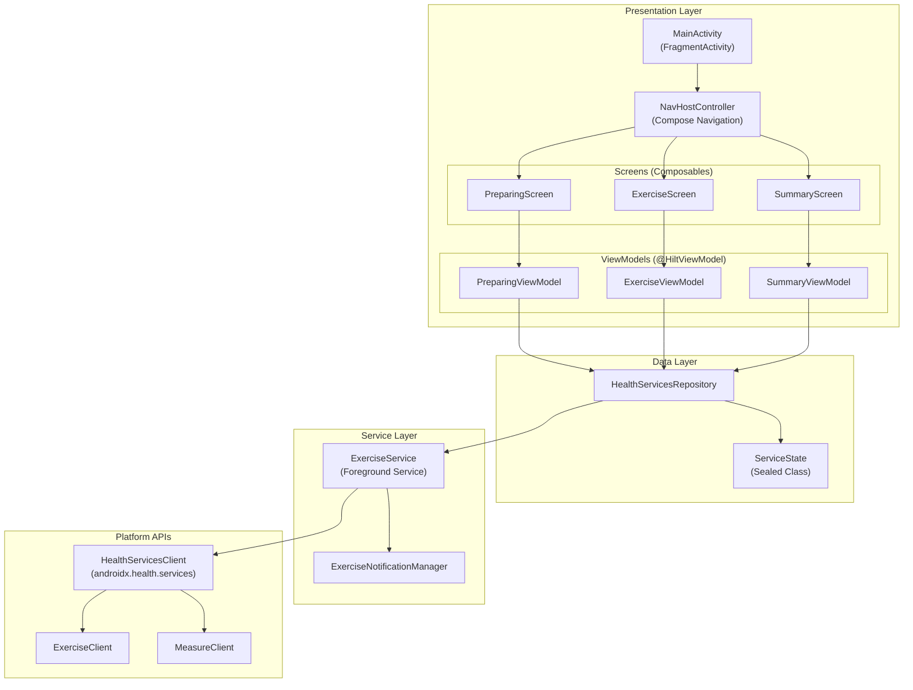

**Sources:** [health-services/ExerciseSampleCompose/app/src/main/java/com/example/exercisesamplecompose/app/MainActivity.kt:32-84](), [health-services/ExerciseSampleCompose/app/src/main/java/com/example/exercisesamplecompose/presentation/preparing/PreparingViewModel.kt:35-96](), [health-services/ExerciseSampleCompose/app/src/main/java/com/example/exercisesamplecompose/presentation/exercise/ExerciseViewModel.kt:29-77]()

### Architectural Layers

| Layer | Responsibility | Key Components |
|-------|---------------|----------------|
| **Presentation** | User interface and user interaction | Composable screens, ViewModels, UI state classes |
| **Data** | Business logic and data access | `HealthServicesRepository`, state models |
| **Service** | Background exercise tracking | `ExerciseService`, notification management |
| **Platform** | Android Health Services API | `HealthServicesClient`, exercise/measure clients |

## MVVM Pattern Implementation

The application implements MVVM with unidirectional data flow: user actions flow down through ViewModels to the repository, while state flows up from the repository through ViewModels to the UI.

### ViewModels

All ViewModels are annotated with `@HiltViewModel` for automatic dependency injection and implement the standard Android `ViewModel` lifecycle.

#### PreparingViewModel

Manages the pre-exercise preparation state, including capability checks, permission handling, and exercise preparation.

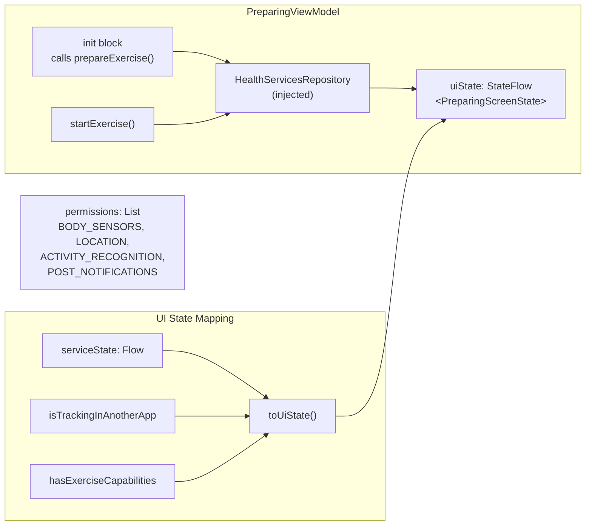

**Key characteristics:**
- Automatically calls `prepareExercise()` in the `init` block [health-services/ExerciseSampleCompose/app/src/main/java/com/example/exercisesamplecompose/presentation/preparing/PreparingViewModel.kt:41-45]()
- Maps `ServiceState` to `PreparingScreenState` with additional capability checks [health-services/ExerciseSampleCompose/app/src/main/java/com/example/exercisesamplecompose/presentation/preparing/PreparingViewModel.kt:51-67]()
- Defines required permissions as a companion object constant [health-services/ExerciseSampleCompose/app/src/main/java/com/example/exercisesamplecompose/presentation/preparing/PreparingViewModel.kt:85-95]()
- Uses `WhileSubscribed(5.seconds)` sharing strategy for state collection [health-services/ExerciseSampleCompose/app/src/main/java/com/example/exercisesamplecompose/presentation/preparing/PreparingViewModel.kt:65]()

**Sources:** [health-services/ExerciseSampleCompose/app/src/main/java/com/example/exercisesamplecompose/presentation/preparing/PreparingViewModel.kt:35-96]()

#### ExerciseViewModel

Manages active exercise state and provides operations for controlling the exercise lifecycle.

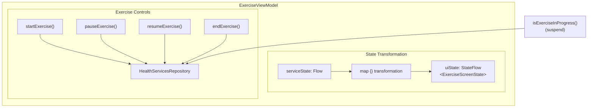

**Key characteristics:**
- Maps `ServiceState` to `ExerciseScreenState` with capability checks [health-services/ExerciseSampleCompose/app/src/main/java/com/example/exercisesamplecompose/presentation/exercise/ExerciseViewModel.kt:35-57]()
- Provides direct control methods delegating to repository [health-services/ExerciseSampleCompose/app/src/main/java/com/example/exercisesamplecompose/presentation/exercise/ExerciseViewModel.kt:62-76]()
- Uses `WhileSubscribed(3_000)` sharing strategy [health-services/ExerciseSampleCompose/app/src/main/java/com/example/exercisesamplecompose/presentation/exercise/ExerciseViewModel.kt:48]()

**Sources:** [health-services/ExerciseSampleCompose/app/src/main/java/com/example/exercisesamplecompose/presentation/exercise/ExerciseViewModel.kt:29-77]()

### UI State Classes

Immutable data classes represent screen state, enabling predictable UI updates through Compose's recomposition mechanism.

#### ExerciseScreenState

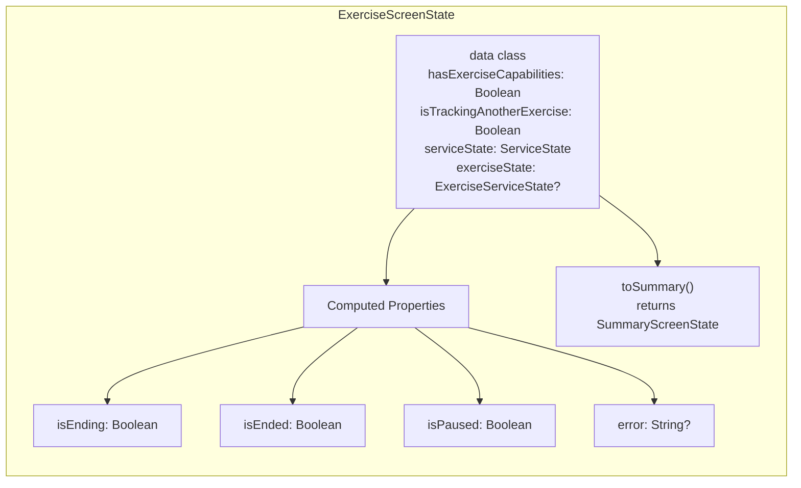

**Sources:** [health-services/ExerciseSampleCompose/app/src/main/java/com/example/exercisesamplecompose/presentation/exercise/ExerciseScreenState.kt:23-53]()

### Compose UI Layer

All screens are implemented as Composable functions following the "Route" and "Screen" pattern:

| Pattern | Purpose | Example |
|---------|---------|---------|
| **Route Composable** | Hooks up ViewModel and state collection | `ExerciseRoute()` |
| **Screen Composable** | Pure UI presentation with state parameter | `ExerciseScreen(uiState, ...)` |

This separation enables easier testing and preview composition.

**Example from ExerciseScreen:**

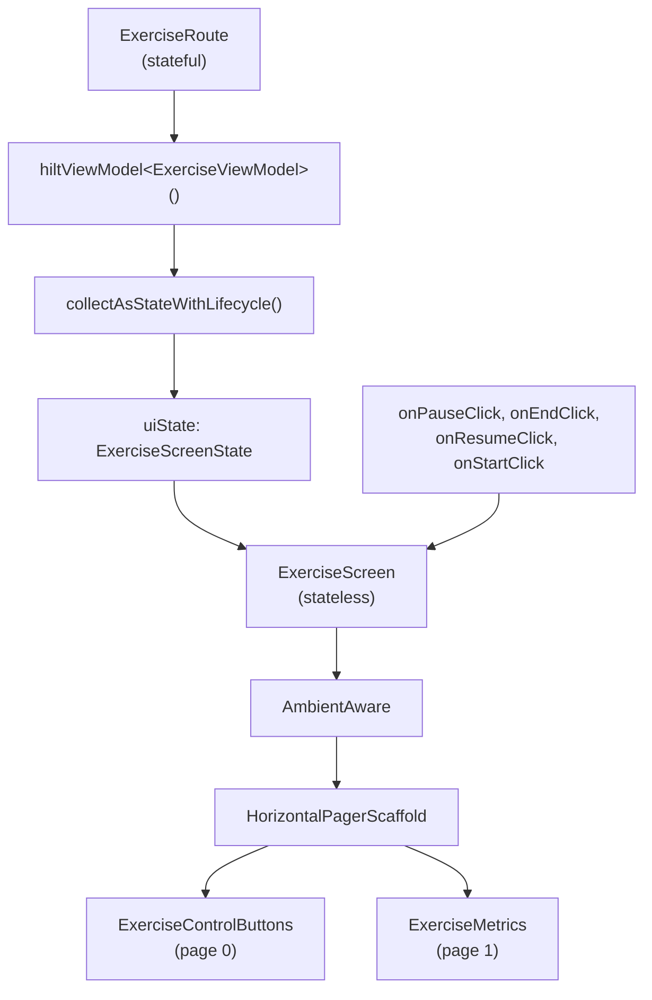

**Sources:** [health-services/ExerciseSampleCompose/app/src/main/java/com/example/exercisesamplecompose/presentation/exercise/ExerciseScreen.kt:72-106](), [health-services/ExerciseSampleCompose/app/src/main/java/com/example/exercisesamplecompose/presentation/exercise/ExerciseScreen.kt:150-202]()

## Dependency Injection with Hilt

The application uses Dagger Hilt for compile-time dependency injection, providing type-safe dependencies across all architectural layers.

### Module Structure

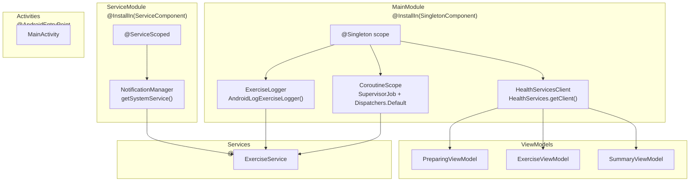

**Sources:** [health-services/ExerciseSampleCompose/app/src/main/java/com/example/exercisesamplecompose/di/MainModule.kt:33-55](), [health-services/ExerciseSampleCompose/app/src/main/java/com/example/exercisesamplecompose/di/ServiceModule.kt:28-40]()

### Dependency Scopes

| Scope | Lifecycle | Use Case | Components |
|-------|-----------|----------|------------|
| `@Singleton` | Application lifetime | Shared resources, API clients | `HealthServicesClient`, `CoroutineScope`, `ExerciseLogger` |
| `@ServiceScoped` | Service lifetime | Service-specific resources | `NotificationManager` |
| `@ViewModelScoped` | ViewModel lifetime | ViewModel dependencies | Automatic through `@HiltViewModel` |

### Hilt Entry Points

All entry points are annotated with `@AndroidEntryPoint` or `@HiltViewModel`:

- **MainActivity**: `@AndroidEntryPoint` [health-services/ExerciseSampleCompose/app/src/main/java/com/example/exercisesamplecompose/app/MainActivity.kt:32]()
- **ExerciseService**: Injected via service module
- **ViewModels**: `@HiltViewModel` enables automatic injection [health-services/ExerciseSampleCompose/app/src/main/java/com/example/exercisesamplecompose/presentation/preparing/PreparingViewModel.kt:35]()

## State Management

The application uses Kotlin Flows and StateFlow for reactive state management with lifecycle-aware collection.

### State Flow Architecture

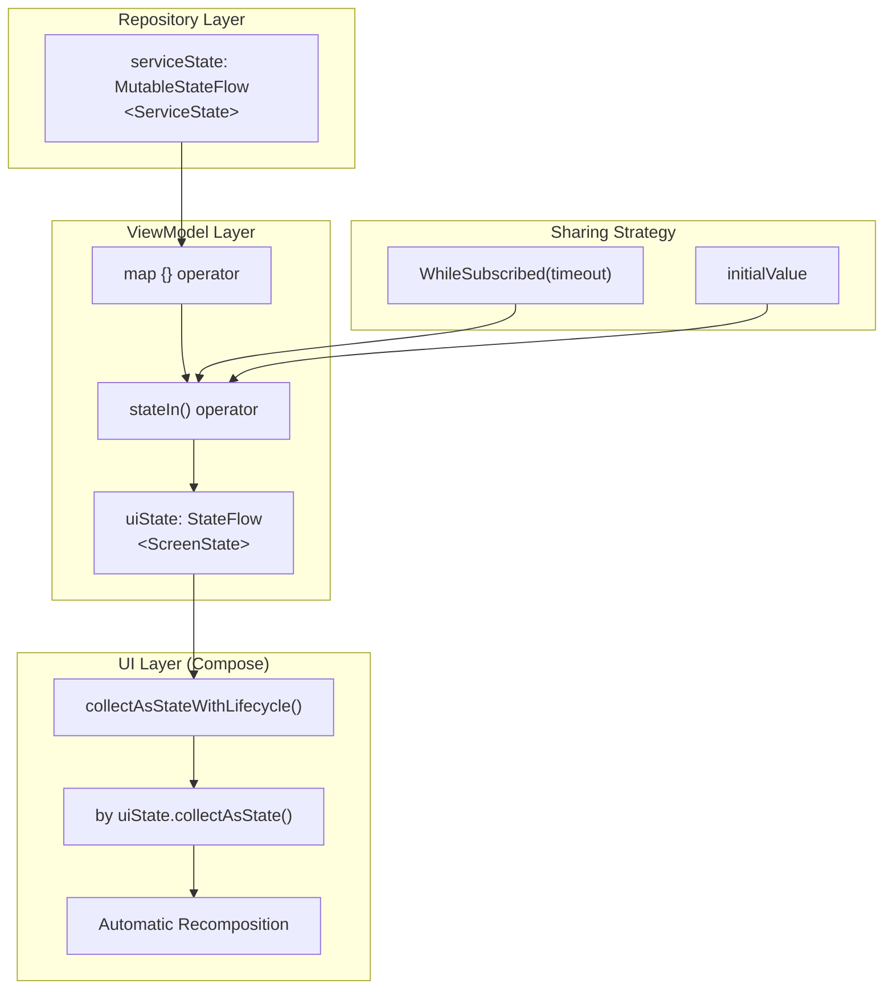

### StateFlow Configuration

ViewModels use `stateIn()` to convert cold Flows into hot StateFlows with specific sharing strategies:

**PreparingViewModel:**
```kotlin
// 5 seconds timeout before stopping upstream collection
SharingStarted.WhileSubscribed(5.seconds)
```

**ExerciseViewModel:**
```kotlin
// 3 seconds timeout
SharingStarted.WhileSubscribed(3_000)
```

This configuration ensures:
1. Upstream flows stop when no collectors are active (battery optimization)
2. Brief configuration changes don't restart collection (timeout buffer)
3. Initial value is immediately available for UI rendering

**Sources:** [health-services/ExerciseSampleCompose/app/src/main/java/com/example/exercisesamplecompose/presentation/preparing/PreparingViewModel.kt:63-67](), [health-services/ExerciseSampleCompose/app/src/main/java/com/example/exercisesamplecompose/presentation/exercise/ExerciseViewModel.kt:46-57]()

### Lifecycle-Aware Collection

UI components use `collectAsStateWithLifecycle()` to automatically manage subscriptions based on lifecycle state:

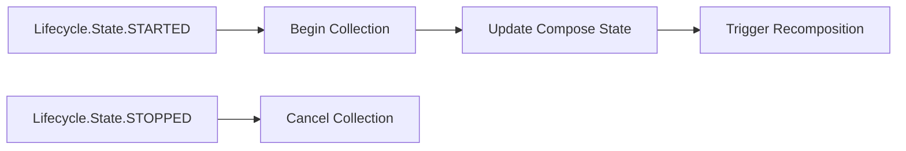

This ensures state collection only occurs when the UI is visible, preventing wasted resources.

**Sources:** [health-services/ExerciseSampleCompose/app/src/main/java/com/example/exercisesamplecompose/presentation/exercise/ExerciseScreen.kt:79](), [health-services/ExerciseSampleCompose/app/src/main/java/com/example/exercisesamplecompose/presentation/summary/SummaryScreen.kt:49]()

## Navigation Architecture

The application uses Jetpack Compose Navigation with Wear OS swipe-dismiss support.

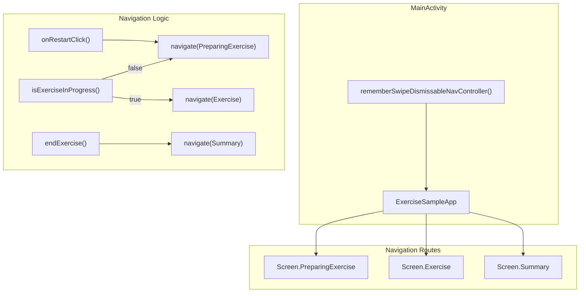

**Sources:** [health-services/ExerciseSampleCompose/app/src/main/java/com/example/exercisesamplecompose/app/MainActivity.kt:61-83]()

## Component Dependencies

### Build Configuration

The application's dependencies are defined in `app/build.gradle` using Gradle version catalogs:

| Category | Key Dependencies | Purpose |
|----------|------------------|---------|
| **Wear Compose** | `wear.compose.material`, `wear.compose.foundation` | Wear OS UI components |
| **Compose Navigation** | `compose.wear.navigation` | Screen navigation |
| **Horologist** | `horologist.compose.layout`, `horologist.health.composables` | Wear OS patterns and health UI |
| **Health Services** | `androidx.health.services` | Health Services API client |
| **Lifecycle** | `androidx.lifecycle.viewmodel`, `androidx.lifecycle.runtime.compose` | ViewModel and lifecycle integration |
| **Dependency Injection** | `dagger.hilt.android`, `hilt.navigation.compose` | Hilt DI framework |
| **Background Work** | `wear.ongoing.activity` | Foreground service notifications |
| **Testing** | `roborazzi`, `horologist.roboscreenshots` | Screenshot testing |

**Sources:** [health-services/ExerciseSampleCompose/app/build.gradle:80-141]()

### Permission Requirements

The application declares required permissions in `AndroidManifest.xml`:

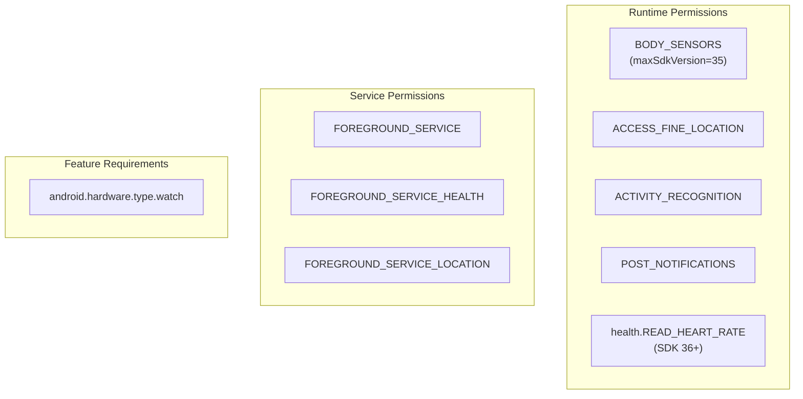

**Sources:** [health-services/ExerciseSampleCompose/app/src/main/AndroidManifest.xml:18-33]()

## Application Entry Point

The application is initialized through `ExerciseSampleApplication`, which must be declared in the manifest to enable Hilt:

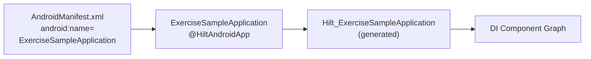

**Sources:** [health-services/ExerciseSampleCompose/app/src/main/AndroidManifest.xml:39]()

## Summary

The ExerciseSampleCompose application demonstrates a production-ready architecture with:

- **Clear layer separation**: Presentation, data, service, and platform layers
- **MVVM pattern**: ViewModels manage state, Composables render UI
- **Dependency injection**: Hilt provides compile-time safety and automatic injection
- **Reactive state management**: StateFlow with lifecycle-aware collection
- **Compose-first UI**: Modern declarative UI with Wear OS optimizations
- **Testability**: Screenshot testing and clear architectural boundaries

This architecture enables maintainability, testability, and follows Android best practices for Wear OS health applications.

**Sources:** [health-services/ExerciseSampleCompose/app/build.gradle:1-142](), [health-services/ExerciseSampleCompose/app/src/main/java/com/example/exercisesamplecompose/di/MainModule.kt:33-55](), [health-services/ExerciseSampleCompose/app/src/main/java/com/example/exercisesamplecompose/presentation/preparing/PreparingViewModel.kt:35-96](), [health-services/ExerciseSampleCompose/app/src/main/java/com/example/exercisesamplecompose/presentation/exercise/ExerciseViewModel.kt:29-77]()

---

