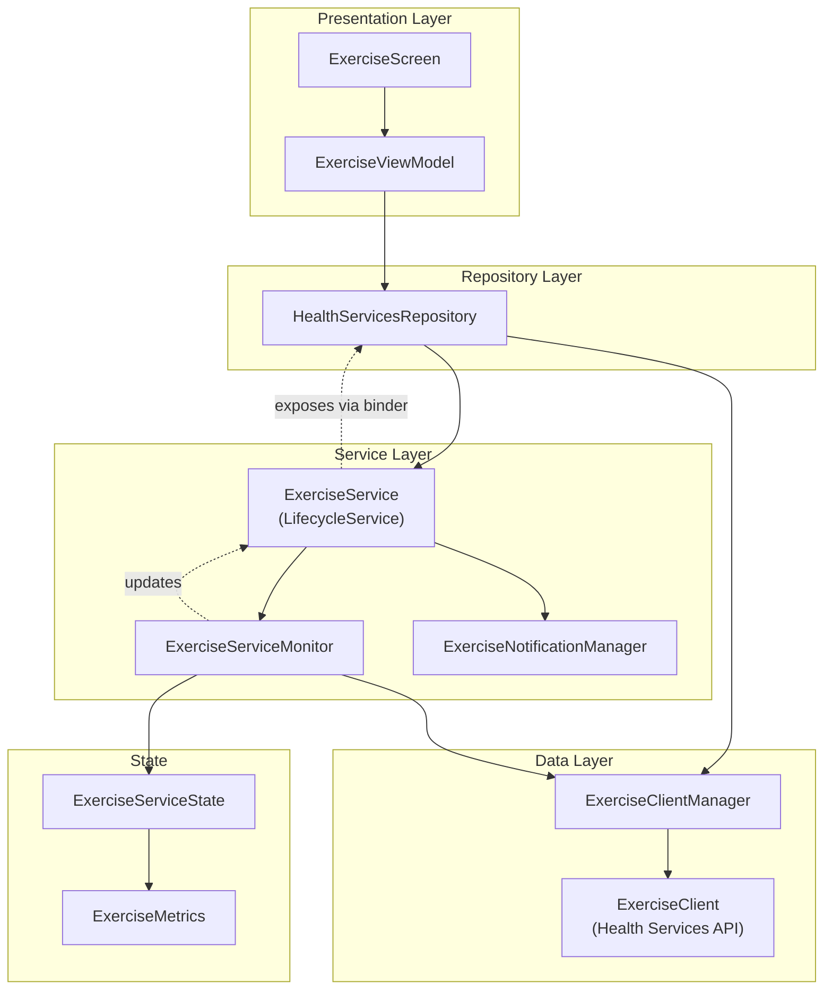
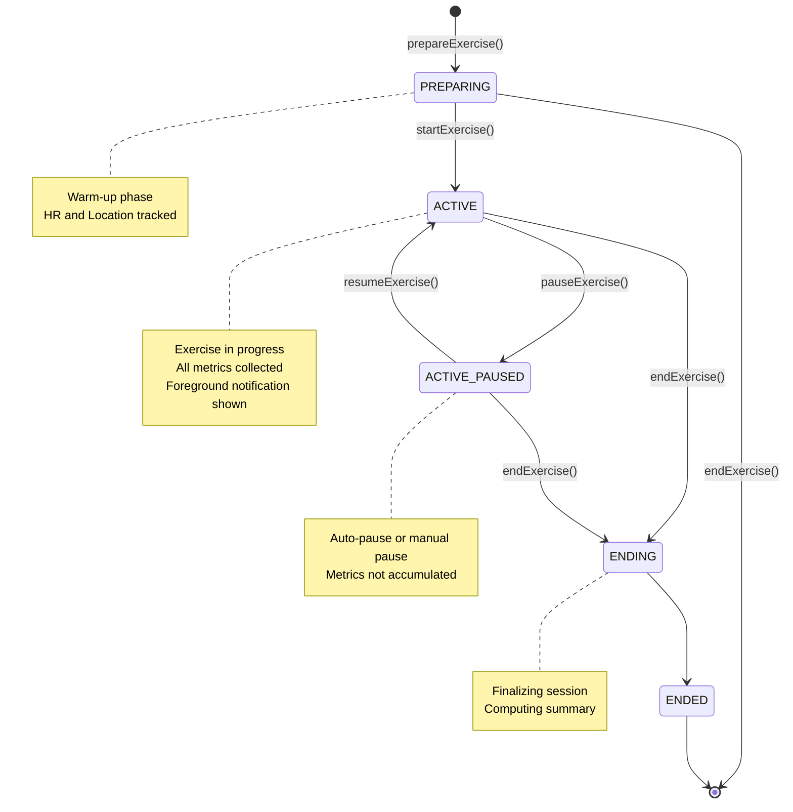
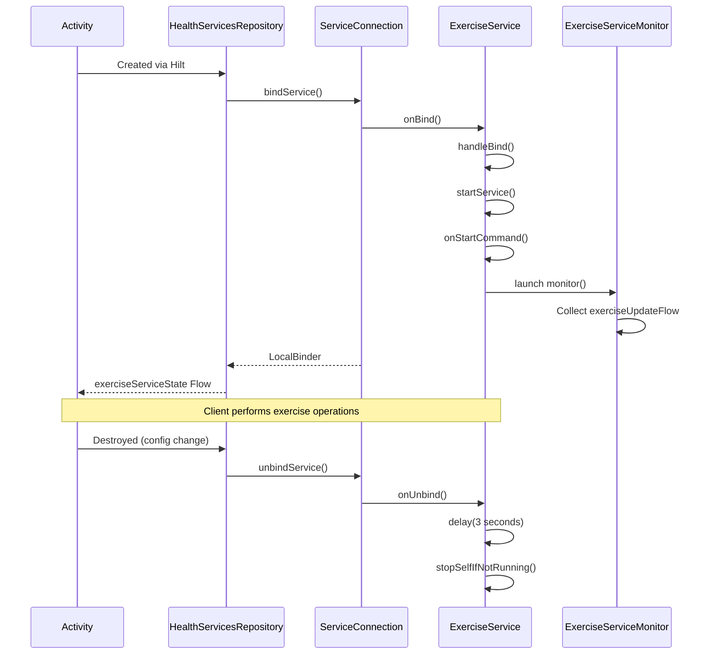
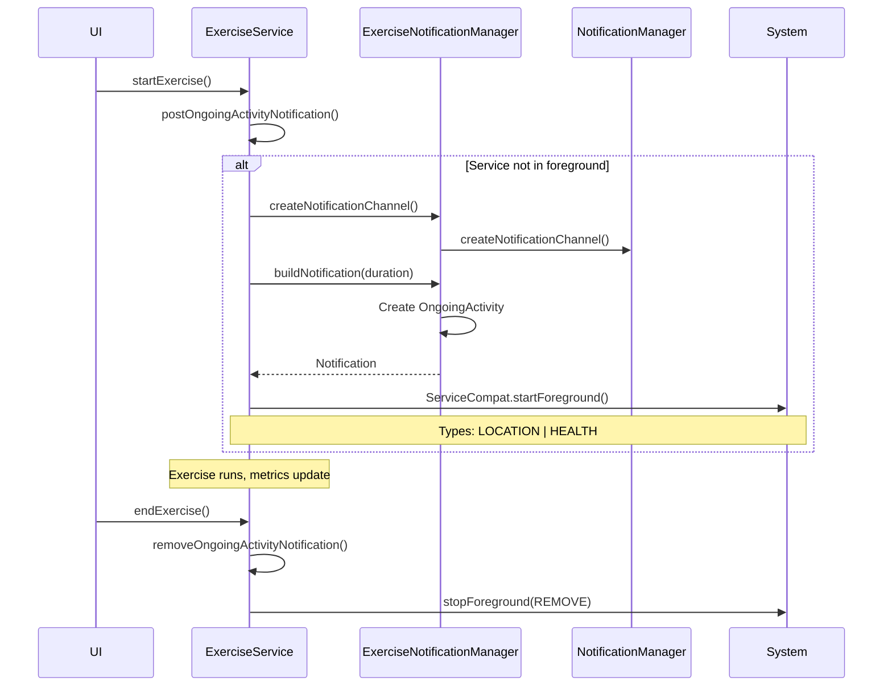

<!-- source: DeepWiki mcp.deepwiki.com · repo android/health-samples · extra page Exercise Lifecycle Management · fetched 2026-10-23 -->

# Exercise Lifecycle Management

<details>
<summary>Relevant source files</summary>

The following files were used as context for generating this wiki page:

- [health-services/ExerciseSampleCompose/app/src/main/java/com/example/exercisesamplecompose/app/Screens.kt](health-services/ExerciseSampleCompose/app/src/main/java/com/example/exercisesamplecompose/app/Screens.kt)
- [health-services/ExerciseSampleCompose/app/src/main/java/com/example/exercisesamplecompose/data/ExerciseClientKtx.kt](health-services/ExerciseSampleCompose/app/src/main/java/com/example/exercisesamplecompose/data/ExerciseClientKtx.kt)
- [health-services/ExerciseSampleCompose/app/src/main/java/com/example/exercisesamplecompose/data/ExerciseClientManager.kt](health-services/ExerciseSampleCompose/app/src/main/java/com/example/exercisesamplecompose/data/ExerciseClientManager.kt)
- [health-services/ExerciseSampleCompose/app/src/main/java/com/example/exercisesamplecompose/data/HealthServicesRepository.kt](health-services/ExerciseSampleCompose/app/src/main/java/com/example/exercisesamplecompose/data/HealthServicesRepository.kt)
- [health-services/ExerciseSampleCompose/app/src/main/java/com/example/exercisesamplecompose/di/MainModule.kt](health-services/ExerciseSampleCompose/app/src/main/java/com/example/exercisesamplecompose/di/MainModule.kt)
- [health-services/ExerciseSampleCompose/app/src/main/java/com/example/exercisesamplecompose/di/ServiceModule.kt](health-services/ExerciseSampleCompose/app/src/main/java/com/example/exercisesamplecompose/di/ServiceModule.kt)
- [health-services/ExerciseSampleCompose/app/src/main/java/com/example/exercisesamplecompose/presentation/dialogs/ExerciseGoalMet.kt](health-services/ExerciseSampleCompose/app/src/main/java/com/example/exercisesamplecompose/presentation/dialogs/ExerciseGoalMet.kt)
- [health-services/ExerciseSampleCompose/app/src/main/java/com/example/exercisesamplecompose/presentation/exercise/ExerciseScreenState.kt](health-services/ExerciseSampleCompose/app/src/main/java/com/example/exercisesamplecompose/presentation/exercise/ExerciseScreenState.kt)
- [health-services/ExerciseSampleCompose/app/src/main/java/com/example/exercisesamplecompose/presentation/exercise/ExerciseViewModel.kt](health-services/ExerciseSampleCompose/app/src/main/java/com/example/exercisesamplecompose/presentation/exercise/ExerciseViewModel.kt)
- [health-services/ExerciseSampleCompose/app/src/main/java/com/example/exercisesamplecompose/presentation/goals/ExerciseGoalsScreen.kt](health-services/ExerciseSampleCompose/app/src/main/java/com/example/exercisesamplecompose/presentation/goals/ExerciseGoalsScreen.kt)
- [health-services/ExerciseSampleCompose/app/src/main/java/com/example/exercisesamplecompose/presentation/goals/ExerciseGoalsViewModel.kt](health-services/ExerciseSampleCompose/app/src/main/java/com/example/exercisesamplecompose/presentation/goals/ExerciseGoalsViewModel.kt)
- [health-services/ExerciseSampleCompose/app/src/main/java/com/example/exercisesamplecompose/presentation/summary/SummaryScreen.kt](health-services/ExerciseSampleCompose/app/src/main/java/com/example/exercisesamplecompose/presentation/summary/SummaryScreen.kt)
- [health-services/ExerciseSampleCompose/app/src/main/java/com/example/exercisesamplecompose/presentation/theme/ThemePreview.kt](health-services/ExerciseSampleCompose/app/src/main/java/com/example/exercisesamplecompose/presentation/theme/ThemePreview.kt)
- [health-services/ExerciseSampleCompose/app/src/main/java/com/example/exercisesamplecompose/service/ExerciseLogger.kt](health-services/ExerciseSampleCompose/app/src/main/java/com/example/exercisesamplecompose/service/ExerciseLogger.kt)
- [health-services/ExerciseSampleCompose/app/src/main/java/com/example/exercisesamplecompose/service/ExerciseNotificationManager.kt](health-services/ExerciseSampleCompose/app/src/main/java/com/example/exercisesamplecompose/service/ExerciseNotificationManager.kt)
- [health-services/ExerciseSampleCompose/app/src/main/java/com/example/exercisesamplecompose/service/ExerciseService.kt](health-services/ExerciseSampleCompose/app/src/main/java/com/example/exercisesamplecompose/service/ExerciseService.kt)
- [health-services/ExerciseSampleCompose/app/src/main/java/com/example/exercisesamplecompose/service/ExerciseServiceMonitor.kt](health-services/ExerciseSampleCompose/app/src/main/java/com/example/exercisesamplecompose/service/ExerciseServiceMonitor.kt)
- [health-services/ExerciseSampleCompose/app/src/main/java/com/example/exercisesamplecompose/service/ExerciseState.kt](health-services/ExerciseSampleCompose/app/src/main/java/com/example/exercisesamplecompose/service/ExerciseState.kt)

</details>


This document describes the lifecycle management of exercise tracking sessions in the ExerciseSampleCompose application. It covers the `ExerciseService` foreground service, its interaction with the Health Services API, state management, and the complete lifecycle from preparation through completion.

For information about the overall application architecture and dependency injection setup, see [Application Architecture](#2.1.1). For details about the UI screens that interact with the exercise service, see [User Interface Components](#2.1.3).

## Purpose and Scope

This page documents:
- The `ExerciseService` implementation and foreground service management
- Exercise state transitions (PREPARING → ACTIVE → PAUSED → ENDING → ENDED)
- Integration with `androidx.health.services.client.ExerciseClient`
- Data collection and metric updates
- Service binding, lifecycle, and notification management

## Core Components

The exercise lifecycle is managed by several interconnected components that form a layered architecture.

### Component Architecture



**Sources:** 
- [health-services/ExerciseSampleCompose/app/src/main/java/com/example/exercisesamplecompose/service/ExerciseService.kt:1-236]()
- [health-services/ExerciseSampleCompose/app/src/main/java/com/example/exercisesamplecompose/data/HealthServicesRepository.kt:1-120]()
- [health-services/ExerciseSampleCompose/app/src/main/java/com/example/exercisesamplecompose/service/ExerciseServiceMonitor.kt:1-86]()

### Key Classes

| Class | Scope | Responsibility |
|-------|-------|----------------|
| `ExerciseService` | Service-scoped | Foreground service managing exercise lifecycle, notification, and service state |
| `ExerciseClientManager` | Singleton | Wraps `ExerciseClient` API calls in coroutine-friendly interfaces |
| `ExerciseServiceMonitor` | Service-scoped | Collects exercise updates from Health Services and updates service state |
| `HealthServicesRepository` | ActivityRetained | Binds to service and exposes state to ViewModels |
| `ExerciseNotificationManager` | Service-scoped | Creates and manages ongoing activity notifications |
| `ExerciseServiceState` | Data class | Immutable state containing exercise state, metrics, and goals |

**Sources:**
- [health-services/ExerciseSampleCompose/app/src/main/java/com/example/exercisesamplecompose/service/ExerciseService.kt:42-236]()
- [health-services/ExerciseSampleCompose/app/src/main/java/com/example/exercisesamplecompose/data/ExerciseClientManager.kt:54-239]()
- [health-services/ExerciseSampleCompose/app/src/main/java/com/example/exercisesamplecompose/service/ExerciseState.kt:45-53]()

## Exercise State Machine

The Health Services API exposes an `ExerciseState` enum that progresses through several states during an exercise session.

### State Transitions



**Sources:**
- [health-services/ExerciseSampleCompose/app/src/main/java/com/example/exercisesamplecompose/data/ExerciseClientManager.kt:155-172]()
- [health-services/ExerciseSampleCompose/app/src/main/java/com/example/exercisesamplecompose/data/ExerciseClientManager.kt:78-148]()
- [health-services/ExerciseSampleCompose/app/src/main/java/com/example/exercisesamplecompose/data/ExerciseClientManager.kt:174-182]()

### State Management Methods

The `ExerciseService` exposes suspend functions that delegate to `ExerciseClientManager`:

| Method | ExerciseService Location | ExerciseClientManager Location | Effect |
|--------|----------|------------|--------|
| `prepareExercise()` | [66-68]() | [155-167]() | Enters PREPARING state with warm-up config |
| `startExercise()` | [73-76]() | [78-149]() | Transitions to ACTIVE, posts notification |
| `pauseExercise()` | [81-83]() | [174-177]() | Transitions to ACTIVE_PAUSED |
| `resumeExercise()` | [88-90]() | [179-182]() | Returns to ACTIVE from ACTIVE_PAUSED |
| `endExercise()` | [95-98]() | [169-172]() | Enters ENDING, removes notification |

**Sources:**
- [health-services/ExerciseSampleCompose/app/src/main/java/com/example/exercisesamplecompose/service/ExerciseService.kt:66-98]()
- [health-services/ExerciseSampleCompose/app/src/main/java/com/example/exercisesamplecompose/data/ExerciseClientManager.kt:78-182]()

## Service Lifecycle and Binding

`ExerciseService` extends `LifecycleService` and operates as a bound foreground service. It manages its own lifetime based on whether clients are bound and whether an exercise is in progress.

### Service Binding Flow



**Sources:**
- [health-services/ExerciseSampleCompose/app/src/main/java/com/example/exercisesamplecompose/service/ExerciseService.kt:155-190]()
- [health-services/ExerciseSampleCompose/app/src/main/java/com/example/exercisesamplecompose/data/HealthServicesRepository.kt:50-68]()

### Service Lifecycle Management

The service implements intelligent lifecycle management to handle process death and configuration changes:

**onStartCommand() behavior:**
- Sets `isStarted = true` flag
- Launches `ExerciseServiceMonitor.monitor()` in `repeatOnLifecycle(STARTED)`
- Returns `START_STICKY` to allow system restart if process dies
- [health-services/ExerciseSampleCompose/app/src/main/java/com/example/exercisesamplecompose/service/ExerciseService.kt:108-135]()

**stopSelfIfNotRunning() logic:**
- Called after unbind delay or on restart
- Checks if exercise is actually in progress via `isExerciseInProgress()`
- If in PREPARING state, calls `endExercise()` to prevent battery drain
- Stops service if no active exercise
- [health-services/ExerciseSampleCompose/app/src/main/java/com/example/exercisesamplecompose/service/ExerciseService.kt:137-153]()

**Unbind handling:**
- Waits 3 seconds (`UNBIND_DELAY`) after unbind
- Allows time for configuration changes to rebind
- If still unbound after delay, calls `stopSelfIfNotRunning()`
- [health-services/ExerciseSampleCompose/app/src/main/java/com/example/exercisesamplecompose/service/ExerciseService.kt:177-190]()

**Sources:**
- [health-services/ExerciseSampleCompose/app/src/main/java/com/example/exercisesamplecompose/service/ExerciseService.kt:108-190]()

## Data Flow and State Updates

Exercise data flows from the Health Services API through several layers to reach the UI.

### End-to-End Data Flow

```mermaid
graph LR
    subgraph "Health Services API"
        ExerciseClient["ExerciseClient"]
        ExerciseUpdateCallback["ExerciseUpdateCallback"]
    end
    
    subgraph "ExerciseClientManager"
        exerciseUpdateFlow["exerciseUpdateFlow<br/>(callbackFlow)"]
    end
    
    subgraph "ExerciseServiceMonitor"
        monitor["monitor()<br/>(collect loop)"]
        exerciseServiceState["exerciseServiceState<br/>(MutableStateFlow)"]
    end
    
    subgraph "ExerciseService"
        LocalBinder["LocalBinder"]
    end
    
    subgraph "HealthServicesRepository"
        serviceState["serviceState<br/>(StateFlow)"]
    end
    
    subgraph "ExerciseViewModel"
        uiState["uiState<br/>(StateFlow)"]
    end
    
    ExerciseClient -->|"setUpdateCallback()"| ExerciseUpdateCallback
    ExerciseUpdateCallback -->|"onExerciseUpdateReceived()"| exerciseUpdateFlow
    ExerciseUpdateCallback -->|"onLapSummaryReceived()"| exerciseUpdateFlow
    ExerciseUpdateCallback -->|"onAvailabilityChanged()"| exerciseUpdateFlow
    
    exerciseUpdateFlow -->|"collect"| monitor
    monitor -->|"update()"| exerciseServiceState
    
    exerciseServiceState -->|"exposed via"| LocalBinder
    LocalBinder -->|"bound flow"| serviceState
    serviceState -->|"map()"| uiState
```



**Sources:**
- [health-services/ExerciseSampleCompose/app/src/main/java/com/example/exercisesamplecompose/data/ExerciseClientManager.kt:198-234]()
- [health-services/ExerciseSampleCompose/app/src/main/java/com/example/exercisesamplecompose/service/ExerciseServiceMonitor.kt:44-85]()
- [health-services/ExerciseSampleCompose/app/src/main/java/com/example/exercisesamplecompose/data/HealthServicesRepository.kt:53-68]()

### ExerciseUpdateCallback Implementation

The `ExerciseClientManager` creates a `callbackFlow` that bridges callback-based Health Services API to Kotlin Flow:

**Callback types handled:**
- `onExerciseUpdateReceived(ExerciseUpdate)` - Contains state, metrics, duration checkpoint, achieved goals
- `onLapSummaryReceived(ExerciseLapSummary)` - Lap count updates
- `onAvailabilityChanged(DataType, Availability)` - Location availability changes

The callback is registered via `exerciseClient.setUpdateCallback()` and unregistered in the flow's `awaitClose` block.

**Sources:**
- [health-services/ExerciseSampleCompose/app/src/main/java/com/example/exercisesamplecompose/data/ExerciseClientManager.kt:198-234]()
- [health-services/ExerciseSampleCompose/app/src/main/java/com/example/exercisesamplecompose/data/ExerciseClientManager.kt:248-260]()

### ExerciseServiceState Updates

`ExerciseServiceMonitor.monitor()` collects from `exerciseUpdateFlow` and updates the mutable state:

**State update on ExerciseUpdate:**
- Copies previous state
- Updates `exerciseState` from `exerciseUpdate.exerciseStateInfo.state`
- Updates `exerciseMetrics` by calling `ExerciseMetrics.update()` with latest data points
- Updates `activeDurationCheckpoint` from update or keeps previous
- Updates `exerciseGoal` with latest achieved goals
- Removes notification if state is ended
- [health-services/ExerciseSampleCompose/app/src/main/java/com/example/exercisesamplecompose/service/ExerciseServiceMonitor.kt:68-84]()

**ExerciseMetrics.update() logic:**
- Extracts heart rate from `DataType.HEART_RATE_BPM`
- Extracts distance from `DataType.DISTANCE_TOTAL`
- Extracts calories from `DataType.CALORIES_TOTAL`
- Extracts average heart rate from `DataType.HEART_RATE_BPM_STATS`
- Uses previous value if new data not available
- [health-services/ExerciseSampleCompose/app/src/main/java/com/example/exercisesamplecompose/service/ExerciseState.kt:31-42]()

**Sources:**
- [health-services/ExerciseSampleCompose/app/src/main/java/com/example/exercisesamplecompose/service/ExerciseServiceMonitor.kt:44-85]()
- [health-services/ExerciseSampleCompose/app/src/main/java/com/example/exercisesamplecompose/service/ExerciseState.kt:25-42]()

## Foreground Service and Notifications

When an exercise starts, the service must run in the foreground with an ongoing notification to comply with Android's background execution limits.

### Notification Management



**Sources:**
- [health-services/ExerciseSampleCompose/app/src/main/java/com/example/exercisesamplecompose/service/ExerciseService.kt:73-76]()
- [health-services/ExerciseSampleCompose/app/src/main/java/com/example/exercisesamplecompose/service/ExerciseService.kt:192-223]()
- [health-services/ExerciseSampleCompose/app/src/main/java/com/example/exercisesamplecompose/service/ExerciseNotificationManager.kt:50-91]()

### Ongoing Activity Notification

The notification uses `androidx.wear.ongoing.OngoingActivity` to display a persistent status on Wear OS:

**Notification components:**
- **Channel:** `com.example.exercisesamplecompose.ONGOING_EXERCISE` with default importance
- **Title:** "Exercise Sample"
- **Text:** "Ongoing Exercise"
- **Small icon:** Running icon (`ic_baseline_directions_run_24`)
- **Category:** `CATEGORY_WORKOUT`
- **Visibility:** `VISIBILITY_PUBLIC`
- **Flags:** `setOngoing(true)` to prevent dismissal

**OngoingActivity status:**
- Template: "Ongoing Exercise #duration#"
- Stopwatch part: Calculates start time from elapsed duration
- Updates automatically as time progresses
- Static and animated icon: Running icon

**Foreground service types:**
- `FOREGROUND_SERVICE_TYPE_LOCATION` (always)
- `FOREGROUND_SERVICE_TYPE_HEALTH` (API 34+, Wear 5+)

**Sources:**
- [health-services/ExerciseSampleCompose/app/src/main/java/com/example/exercisesamplecompose/service/ExerciseNotificationManager.kt:40-102]()
- [health-services/ExerciseSampleCompose/app/src/main/java/com/example/exercisesamplecompose/service/ExerciseService.kt:199-223]()

### Notification Removal

The notification is removed in two scenarios:

1. **Manual end:** When `endExercise()` is called, it explicitly calls `removeOngoingActivityNotification()`
   - [health-services/ExerciseSampleCompose/app/src/main/java/com/example/exercisesamplecompose/service/ExerciseService.kt:95-98]()

2. **Automatic on state change:** When `ExerciseServiceMonitor` receives an update with `exerciseUpdate.exerciseStateInfo.state.isEnded`, it calls `removeOngoingActivityNotification()`
   - [health-services/ExerciseSampleCompose/app/src/main/java/com/example/exercisesamplecompose/service/ExerciseServiceMonitor.kt:69-72]()

**Sources:**
- [health-services/ExerciseSampleCompose/app/src/main/java/com/example/exercisesamplecompose/service/ExerciseService.kt:192-197]()
- [health-services/ExerciseSampleCompose/app/src/main/java/com/example/exercisesamplecompose/service/ExerciseServiceMonitor.kt:68-84]()

## Exercise Configuration

When starting an exercise, `ExerciseClientManager.startExercise()` configures the session based on device capabilities.

### Configuration Parameters

**ExerciseConfig fields:**
- `exerciseType`: `ExerciseType.RUNNING` (hardcoded)
- `dataTypes`: Intersection of requested types and device capabilities
  - `DataType.HEART_RATE_BPM` - Current heart rate
  - `DataType.HEART_RATE_BPM_STATS` - Heart rate statistics (average)
  - `DataType.CALORIES_TOTAL` - Cumulative calories
  - `DataType.DISTANCE_TOTAL` - Cumulative distance
- `isAutoPauseAndResumeEnabled`: Based on `capabilities.supportsAutoPauseAndResume`
- `isGpsEnabled`: `true` (always enabled)
- `exerciseGoals`: List of `ExerciseGoal` objects based on capabilities and user settings

**Sources:**
- [health-services/ExerciseSampleCompose/app/src/main/java/com/example/exercisesamplecompose/data/ExerciseClientManager.kt:78-149]()

### Exercise Goals

The sample supports three types of goals:

| Goal Type | DataType | Threshold Source | Condition |
|-----------|----------|------------------|-----------|
| Calories | `CALORIES_TOTAL` | Hardcoded: 250.0 | `GREATER_THAN_OR_EQUAL` |
| Distance | `DISTANCE_TOTAL` | User input (km * 1000) | `GREATER_THAN_OR_EQUAL` |
| Duration | `ACTIVE_EXERCISE_DURATION_TOTAL` | User input (seconds) | `GREATER_THAN_OR_EQUAL` |

Goals are created as one-time goals using `ExerciseGoal.createOneTimeGoal()`. User-configured thresholds are set via the Goals screen and stored in `ExerciseClientManager.thresholds`.

**Goal capability checks:**
- `supportsCalorieGoal()`: Checks if `CALORIES_TOTAL` supports `GREATER_THAN_OR_EQUAL` comparison
- `supportsDistanceMilestone()`: Checks milestone support for `DISTANCE_TOTAL`
- `supportsDurationMilestone()`: Checks goal support for `ACTIVE_EXERCISE_DURATION_TOTAL`

**Sources:**
- [health-services/ExerciseSampleCompose/app/src/main/java/com/example/exercisesamplecompose/data/ExerciseClientManager.kt:95-134]()
- [health-services/ExerciseSampleCompose/app/src/main/java/com/example/exercisesamplecompose/data/ExerciseClientKtx.kt:38-51]()
- [health-services/ExerciseSampleCompose/app/src/main/java/com/example/exercisesamplecompose/data/ExerciseClientManager.kt:72-76]()

### WarmUp Configuration

The `prepareExercise()` method configures a warm-up phase:

**WarmUpConfig fields:**
- `exerciseType`: `ExerciseType.RUNNING`
- `dataTypes`: 
  - `DataType.HEART_RATE_BPM` - Monitor heart rate during warm-up
  - `DataType.LOCATION` - Acquire GPS lock before exercise

This pre-warms sensors and acquires GPS lock to ensure accurate tracking from the moment the exercise starts.

**Sources:**
- [health-services/ExerciseSampleCompose/app/src/main/java/com/example/exercisesamplecompose/data/ExerciseClientManager.kt:155-167]()

## Repository Pattern and Error Handling

`HealthServicesRepository` abstracts service communication and adds error handling.

### Service Call Pattern

The repository uses a `serviceCall()` helper that:
1. Launches a coroutine in the repository's scope
2. Waits for service connection via `binderConnection.runWhenConnected()`
3. Invokes the provided lambda on the connected `ExerciseService`

```kotlin
// Pattern used for all exercise operations
fun pauseExercise() = serviceCall { pauseExercise() }
fun endExercise() = serviceCall { endExercise() }
```

**Sources:**
- [health-services/ExerciseSampleCompose/app/src/main/java/com/example/exercisesamplecompose/data/HealthServicesRepository.kt:83-105]()

### Error Handling

The `startExercise()` method includes explicit error handling:

1. Clears previous error state: `errorState.value = null`
2. Wraps service call in try-catch block
3. On exception:
   - Sets `errorState.value = e.message`
   - Logs error via `logger.error()`
4. Error state is combined with service state via Flow operators
5. UI receives error through `ExerciseServiceState.error` field

**Sources:**
- [health-services/ExerciseSampleCompose/app/src/main/java/com/example/exercisesamplecompose/data/HealthServicesRepository.kt:90-99]()
- [health-services/ExerciseSampleCompose/app/src/main/java/com/example/exercisesamplecompose/data/HealthServicesRepository.kt:58-68]()
- [health-services/ExerciseSampleCompose/app/src/main/java/com/example/exercisesamplecompose/service/ExerciseState.kt:45-53]()

## Lap Marking

The service supports marking laps during exercise, though this feature is noted as suitable for devices with more than 2 hardware buttons (Wear OS 3.0 reserves two buttons for the OS).

**Implementation:**
- `ExerciseService.markLap()`: Launches a coroutine to call `ExerciseClientManager.markLap()`
- `ExerciseClientManager.markLap()`: Checks if exercise is in progress before calling `exerciseClient.markLap()`
- Lap updates are received via `ExerciseUpdateCallback.onLapSummaryReceived()`
- `ExerciseServiceMonitor` updates `exerciseLaps` count in service state

**Sources:**
- [health-services/ExerciseSampleCompose/app/src/main/java/com/example/exercisesamplecompose/service/ExerciseService.kt:100-106]()
- [health-services/ExerciseSampleCompose/app/src/main/java/com/example/exercisesamplecompose/data/ExerciseClientManager.kt:186-190]()
- [health-services/ExerciseSampleCompose/app/src/main/java/com/example/exercisesamplecompose/service/ExerciseServiceMonitor.kt:50-55]()

---

