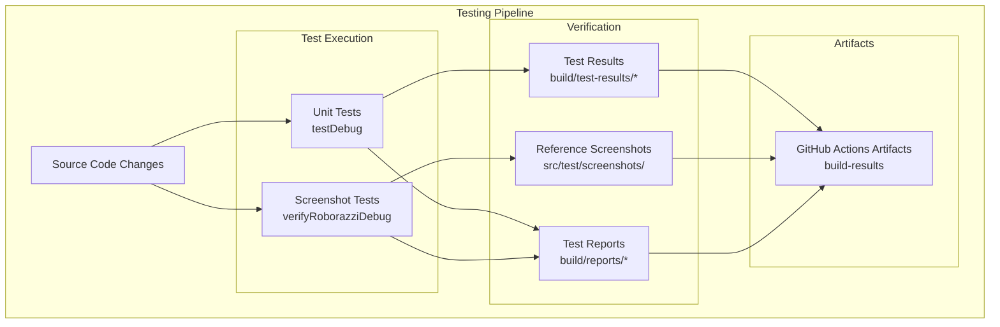
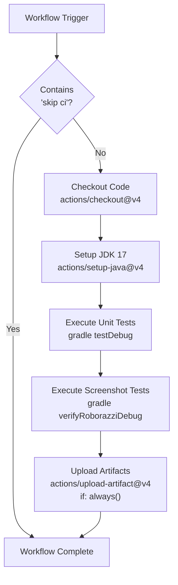
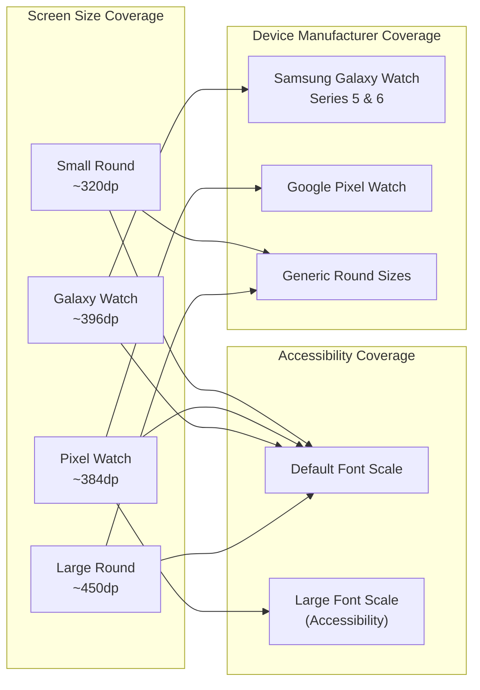
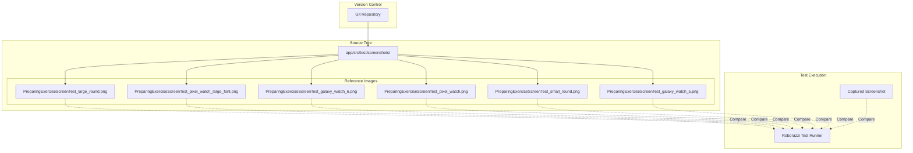
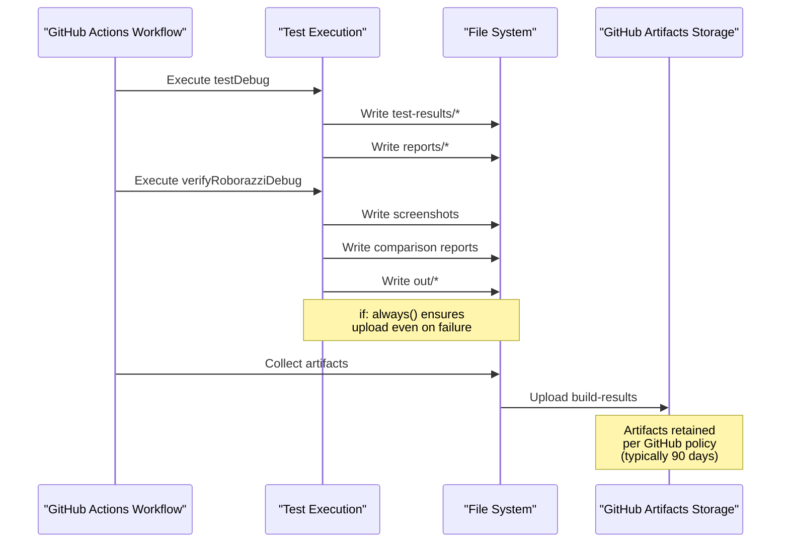
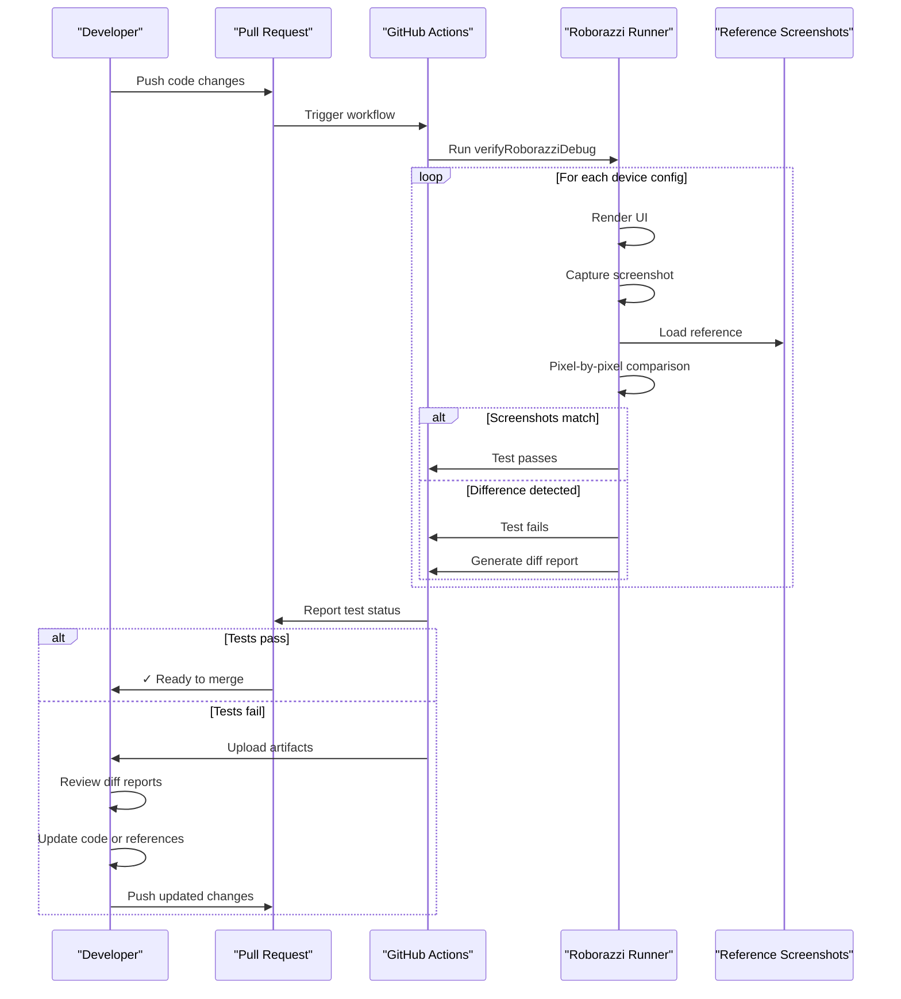
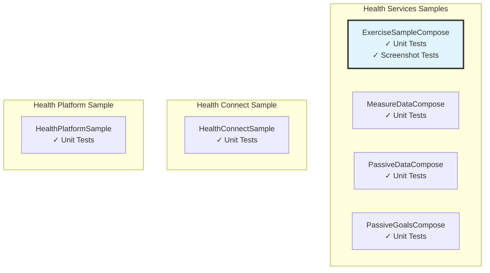

<!-- source: DeepWiki mcp.deepwiki.com · repo android/health-samples · extra page Testing Strategy · fetched 2026-10-23 -->

# Testing Strategy

<details>
<summary>Relevant source files</summary>

The following files were used as context for generating this wiki page:

- [.github/workflows/ExerciseSampleCompose.yml](.github/workflows/ExerciseSampleCompose.yml)
- [.github/workflows/HealthConnectSample.yml](.github/workflows/HealthConnectSample.yml)
- [.github/workflows/HealthPlatformSample.yml](.github/workflows/HealthPlatformSample.yml)
- [.github/workflows/MeasureDataCompose.yml](.github/workflows/MeasureDataCompose.yml)
- [.github/workflows/PassiveDataCompose.yml](.github/workflows/PassiveDataCompose.yml)
- [.github/workflows/PassiveGoalsCompose.yml](.github/workflows/PassiveGoalsCompose.yml)
- [health-services/ExerciseSampleCompose/app/src/test/screenshots/PreparingExerciseScreenTest_galaxy_watch_5.png](health-services/ExerciseSampleCompose/app/src/test/screenshots/PreparingExerciseScreenTest_galaxy_watch_5.png)
- [health-services/ExerciseSampleCompose/app/src/test/screenshots/PreparingExerciseScreenTest_galaxy_watch_6.png](health-services/ExerciseSampleCompose/app/src/test/screenshots/PreparingExerciseScreenTest_galaxy_watch_6.png)
- [health-services/ExerciseSampleCompose/app/src/test/screenshots/PreparingExerciseScreenTest_galaxy_watch_6_small_font.png](health-services/ExerciseSampleCompose/app/src/test/screenshots/PreparingExerciseScreenTest_galaxy_watch_6_small_font.png)
- [health-services/ExerciseSampleCompose/app/src/test/screenshots/PreparingExerciseScreenTest_large_round.png](health-services/ExerciseSampleCompose/app/src/test/screenshots/PreparingExerciseScreenTest_large_round.png)
- [health-services/ExerciseSampleCompose/app/src/test/screenshots/PreparingExerciseScreenTest_pixel_watch.png](health-services/ExerciseSampleCompose/app/src/test/screenshots/PreparingExerciseScreenTest_pixel_watch.png)
- [health-services/ExerciseSampleCompose/app/src/test/screenshots/PreparingExerciseScreenTest_pixel_watch_large_font.png](health-services/ExerciseSampleCompose/app/src/test/screenshots/PreparingExerciseScreenTest_pixel_watch_large_font.png)
- [health-services/ExerciseSampleCompose/app/src/test/screenshots/PreparingExerciseScreenTest_small_round.png](health-services/ExerciseSampleCompose/app/src/test/screenshots/PreparingExerciseScreenTest_small_round.png)
- [health-services/ExerciseSampleCompose/app/src/test/screenshots/PreparingExerciseScreenTest_ticwatch_pro_5.png](health-services/ExerciseSampleCompose/app/src/test/screenshots/PreparingExerciseScreenTest_ticwatch_pro_5.png)

</details>


## Purpose and Scope

This document describes the testing approach for the ExerciseSampleCompose application, specifically focusing on the automated testing infrastructure including unit tests and screenshot-based visual regression testing. The testing strategy demonstrates production-grade quality assurance practices for Wear OS applications built with Jetpack Compose.

For information about the overall application architecture, see [Application Architecture](#2.1.1). For details about the CI/CD pipeline infrastructure, see [GitHub Actions Workflows](#7.1).

---

## Overview

ExerciseSampleCompose implements a comprehensive two-tier testing strategy:

1. **Unit Tests**: Traditional JUnit-based tests executed via the `testDebug` Gradle task
2. **Screenshot Tests**: Visual regression tests using the Roborazzi framework executed via the `verifyRoborazziDebug` Gradle task

This dual approach ensures both functional correctness and UI consistency across multiple Wear OS device configurations.



**Sources:**
- [.github/workflows/ExerciseSampleCompose.yml:37-57]()

---

## GitHub Actions Workflow

The testing strategy is automated through a dedicated GitHub Actions workflow that executes on every push to the main branch and on all pull requests.

### Workflow Configuration

| Property | Value |
|----------|-------|
| Workflow Name | `ExerciseSampleCompose` |
| Trigger Events | `push` (main branch), `pull_request`, `workflow_dispatch` |
| Runner | `ubuntu-latest` |
| Timeout | 40 minutes |
| JDK Version | 17 (Zulu distribution) |

The workflow monitors changes to the sample's directory and its own workflow file:
- `health-services/ExerciseSampleCompose/**`
- `.github/workflows/ExerciseSampleCompose.yml`

### Job Steps



The workflow conditionally skips execution if the commit message contains "skip ci", providing a mechanism to bypass CI for documentation-only changes.

**Sources:**
- [.github/workflows/ExerciseSampleCompose.yml:19-58]()

---

## Unit Testing

Unit tests run via the `testDebug` Gradle task and follow standard JUnit testing practices. These tests validate business logic, data transformations, and non-UI components.

### Execution

The unit test step executes within the `health-services/ExerciseSampleCompose` build directory using the Gradle Build Action for improved caching and performance:

```
gradle testDebug
```

Results are generated in standard locations:
- Test results: `**/build/test-results/*`
- Test reports: `**/build/reports/*`

**Sources:**
- [.github/workflows/ExerciseSampleCompose.yml:37-41]()

---

## Screenshot Testing with Roborazzi

ExerciseSampleCompose employs **Roborazzi**, a screenshot testing library for Android, to perform visual regression testing. This approach captures rendered UI screenshots during test execution and compares them against reference images.

### Framework Integration

Roborazzi integrates with the project's test infrastructure through the `verifyRoborazziDebug` Gradle task. The framework:
- Renders Composable functions in a simulated environment
- Captures screenshots of UI components
- Compares captured images against reference screenshots
- Reports visual differences as test failures

### Execution

```
gradle verifyRoborazziDebug
```

Screenshot tests execute after unit tests in the CI pipeline, ensuring that basic functionality is validated before running the more expensive visual regression tests.

**Sources:**
- [.github/workflows/ExerciseSampleCompose.yml:43-47]()

---

## Device Configuration Matrix

The ExerciseSampleCompose screenshot tests cover **eight distinct device configurations**, ensuring UI consistency across the Wear OS device ecosystem. This comprehensive matrix validates layouts, fonts, and visual elements on various screen sizes and form factors.

### Test Configurations

| Test Configuration | Device Profile | Screen Size | Form Factor | Font Scale |
|-------------------|----------------|-------------|-------------|------------|
| `PreparingExerciseScreenTest_large_round` | Large Round | ~450dp | Round | Default |
| `PreparingExerciseScreenTest_pixel_watch_large_font` | Pixel Watch | ~384dp | Round | Large |
| `PreparingExerciseScreenTest_galaxy_watch_6` | Galaxy Watch 6 | ~396dp | Round | Default |
| `PreparingExerciseScreenTest_pixel_watch` | Pixel Watch | ~384dp | Round | Default |
| `PreparingExerciseScreenTest_small_round` | Small Round | ~320dp | Round | Default |
| `PreparingExerciseScreenTest_galaxy_watch_5` | Galaxy Watch 5 | ~396dp | Round | Default |

### Configuration Coverage Strategy



This matrix ensures:
- **Size Diversity**: Coverage from small (320dp) to large (450dp) screens
- **Manufacturer Profiles**: Testing against actual device specifications from Google and Samsung
- **Accessibility Compliance**: Validation of large font support for users with visual impairments
- **Form Factor Consistency**: All tests verify round watch face layouts

**Sources:**
- [health-services/ExerciseSampleCompose/app/src/test/screenshots/PreparingExerciseScreenTest_large_round.png]()
- [health-services/ExerciseSampleCompose/app/src/test/screenshots/PreparingExerciseScreenTest_pixel_watch_large_font.png]()
- [health-services/ExerciseSampleCompose/app/src/test/screenshots/PreparingExerciseScreenTest_galaxy_watch_6.png]()
- [health-services/ExerciseSampleCompose/app/src/test/screenshots/PreparingExerciseScreenTest_pixel_watch.png]()
- [health-services/ExerciseSampleCompose/app/src/test/screenshots/PreparingExerciseScreenTest_small_round.png]()
- [health-services/ExerciseSampleCompose/app/src/test/screenshots/PreparingExerciseScreenTest_galaxy_watch_5.png]()

---

## Reference Screenshot Management

Reference screenshots are stored in the test source directory at:

```
health-services/ExerciseSampleCompose/app/src/test/screenshots/
```

### File Organization

Reference images follow a naming convention that encodes the test configuration:

```
{TestClassName}_{DeviceConfiguration}.png
```

For example:
- `PreparingExerciseScreenTest_pixel_watch.png`
- `PreparingExerciseScreenTest_large_round.png`

### Screenshot Storage Architecture



Reference images are committed to version control, enabling:
- **Visual Diff Reviews**: Pull request reviewers can see screenshot changes in the Git diff
- **Historical Tracking**: Visual regression history tracked alongside code changes
- **Deterministic Builds**: Consistent test results across different machines

**Sources:**
- [health-services/ExerciseSampleCompose/app/src/test/screenshots/]()

---

## Artifact Preservation

The GitHub Actions workflow preserves all test outputs as build artifacts, ensuring results are accessible even after workflow execution completes.

### Artifact Upload Configuration

The workflow uses the `upload-artifact@v4` action with the `if: always()` condition, guaranteeing artifact preservation regardless of test outcome:

```yaml
- name: Upload test results and reports
  if: always()
  uses: actions/upload-artifact@v4
  with:
    name: build-results
    path: |
      **/build/test-results/*
      **/build/reports/*
      **/out/*
```

### Preserved Artifacts

| Artifact Type | Path Pattern | Contents |
|--------------|--------------|----------|
| Test Results | `**/build/test-results/*` | JUnit XML test result files |
| Test Reports | `**/build/reports/*` | HTML test reports, screenshot comparison reports |
| Output Files | `**/out/*` | Additional test outputs, including captured screenshots |

### Artifact Lifecycle



Artifacts remain accessible through the GitHub Actions UI for download and inspection, enabling:
- **Failure Diagnosis**: Developers can download reports to investigate test failures
- **Screenshot Review**: Visual regression failures can be examined by comparing captured vs. reference images
- **Audit Trail**: Historical test results preserved for debugging and compliance

**Sources:**
- [.github/workflows/ExerciseSampleCompose.yml:49-57]()

---

## Visual Regression Workflow

The screenshot testing workflow follows a compare-and-verify pattern:

### Test Execution Flow



### Handling Visual Changes

When intentional UI changes are made:

1. **Update References**: Run Roborazzi locally to generate new reference screenshots
2. **Commit Changes**: Include updated PNG files in the pull request
3. **Review Process**: Code reviewers examine both code and visual changes in the Git diff
4. **Merge**: Updated references become the new baseline for future tests

**Sources:**
- [.github/workflows/ExerciseSampleCompose.yml:43-47]()

---

## Comparison with Other Samples

ExerciseSampleCompose is the **only sample in the repository with screenshot testing**, reflecting its status as the flagship demonstration of Wear OS best practices.

### Testing Coverage Across Samples



Other samples execute only unit tests via the `testDebug` task. ExerciseSampleCompose's enhanced testing reflects:
- **Complexity**: Multi-screen navigation and state management require visual validation
- **UI Prominence**: Extensive use of Wear OS Compose Material3 components
- **Reference Implementation**: Demonstrates production-grade testing practices for Wear OS apps

**Sources:**
- [.github/workflows/ExerciseSampleCompose.yml:43-47]()
- [.github/workflows/MeasureDataCompose.yml:37-42]()
- [.github/workflows/PassiveDataCompose.yml:37-42]()
- [.github/workflows/PassiveGoalsCompose.yml:37-42]()
- [.github/workflows/HealthConnectSample.yml:37-42]()
- [.github/workflows/HealthPlatformSample.yml:37-42]()

---

## Test Reliability and Determinism

Screenshot tests achieve deterministic results through:

1. **Headless Rendering**: Roborazzi renders UI without hardware dependencies
2. **Consistent Environment**: Ubuntu runners provide stable execution environment
3. **Fixed JDK**: Pinned to Zulu JDK 17 for consistent rendering behavior
4. **Isolated Execution**: Tests run in clean Gradle builds without cross-contamination

This determinism ensures:
- Tests produce identical results across different machines
- Pull request checks are reliable and reproducible
- Visual regressions are detected with high confidence

**Sources:**
- [.github/workflows/ExerciseSampleCompose.yml:24-35]()

---

