<!-- source: DeepWiki mcp.deepwiki.com · repo android/health-samples · extra page User Interface Components · fetched 2026-10-23 -->

# User Interface Components

Relevant source files

The following files were used as context for generating this wiki page:

- [health-services/ExerciseSampleCompose/app/build.gradle](health-services/ExerciseSampleCompose/app/build.gradle)
- [health-services/ExerciseSampleCompose/app/src/main/AndroidManifest.xml](health-services/ExerciseSampleCompose/app/src/main/AndroidManifest.xml)
- [health-services/ExerciseSampleCompose/app/src/main/java/com/example/exercisesamplecompose/app/MainActivity.kt](health-services/ExerciseSampleCompose/app/src/main/java/com/example/exercisesamplecompose/app/MainActivity.kt)
- [health-services/ExerciseSampleCompose/app/src/main/java/com/example/exercisesamplecompose/presentation/ExerciseSampleApp.kt](health-services/ExerciseSampleCompose/app/src/main/java/com/example/exercisesamplecompose/presentation/ExerciseSampleApp.kt)
- [health-services/ExerciseSampleCompose/app/src/main/java/com/example/exercisesamplecompose/presentation/component/FormattingUtils.kt](health-services/ExerciseSampleCompose/app/src/main/java/com/example/exercisesamplecompose/presentation/component/FormattingUtils.kt)
- [health-services/ExerciseSampleCompose/app/src/main/java/com/example/exercisesamplecompose/presentation/component/HRText.kt](health-services/ExerciseSampleCompose/app/src/main/java/com/example/exercisesamplecompose/presentation/component/HRText.kt)
- [health-services/ExerciseSampleCompose/app/src/main/java/com/example/exercisesamplecompose/presentation/exercise/ExerciseScreen.kt](health-services/ExerciseSampleCompose/app/src/main/java/com/example/exercisesamplecompose/presentation/exercise/ExerciseScreen.kt)
- [health-services/ExerciseSampleCompose/app/src/main/java/com/example/exercisesamplecompose/presentation/preparing/PreparingExerciseScreen.kt](health-services/ExerciseSampleCompose/app/src/main/java/com/example/exercisesamplecompose/presentation/preparing/PreparingExerciseScreen.kt)
- [health-services/ExerciseSampleCompose/app/src/main/java/com/example/exercisesamplecompose/presentation/preparing/PreparingViewModel.kt](health-services/ExerciseSampleCompose/app/src/main/java/com/example/exercisesamplecompose/presentation/preparing/PreparingViewModel.kt)
- [health-services/ExerciseSampleCompose/app/src/main/res/values/strings.xml](health-services/ExerciseSampleCompose/app/src/main/res/values/strings.xml)
- [health-services/ExerciseSampleCompose/app/src/test/java/com/example/exercisesamplecompose/presentation/ExerciseScreenTest.kt](health-services/ExerciseSampleCompose/app/src/test/java/com/example/exercisesamplecompose/presentation/ExerciseScreenTest.kt)
- [health-services/ExerciseSampleCompose/app/src/test/java/com/example/exercisesamplecompose/presentation/PreparingExerciseScreenTest.kt](health-services/ExerciseSampleCompose/app/src/test/java/com/example/exercisesamplecompose/presentation/PreparingExerciseScreenTest.kt)

## Purpose and Scope

This document describes the Compose UI layer of the ExerciseSampleCompose application, including screen layouts, navigation flow, reusable components, and Wear OS-specific UI patterns. For information about the underlying exercise service and state management, see [Exercise Lifecycle Management](#2.1.2). For the overall architectural patterns including ViewModels and dependency injection, see [Application Architecture](#2.1.1).

## Screen Architecture Overview

The ExerciseSampleCompose application implements a multi-screen Wear OS UI built with Jetpack Compose and Wear Compose Material3 components. The application consists of five primary screens connected through swipe-dismissible navigation:

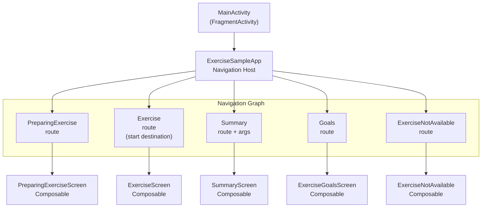

**Sources:** [health-services/ExerciseSampleCompose/app/src/main/java/com/example/exercisesamplecompose/app/MainActivity.kt:16-84](), [health-services/ExerciseSampleCompose/app/src/main/java/com/example/exercisesamplecompose/presentation/ExerciseSampleApp.kt:16-109]()

## Navigation Structure

### Route Definitions and Flow

The application uses `SwipeDismissableNavHost` for Wear OS navigation with swipe-to-dismiss gestures. The navigation graph defines transitions between screens based on user actions and exercise state:

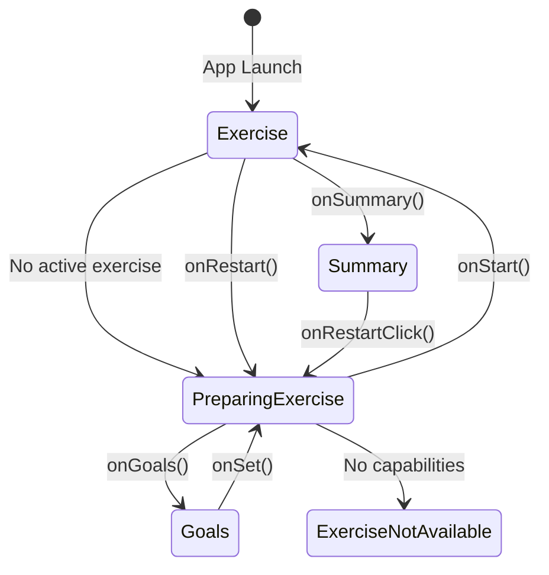

| Route | Arguments | Purpose |
|-------|-----------|---------|
| `PreparingExercise.route` | None | Prepare sensors and request permissions before starting |
| `Exercise.route` | None | Active exercise tracking (start destination) |
| `Summary.route + "/{args}"` | averageHeartRate, totalDistance, totalCalories, elapsedTime | Post-exercise summary |
| `Goals.route` | None | Configure exercise goals |
| `ExerciseNotAvailable.route` | None | Error state when device lacks exercise capabilities |

**Sources:** [health-services/ExerciseSampleCompose/app/src/main/java/com/example/exercisesamplecompose/presentation/ExerciseSampleApp.kt:38-106](), [health-services/ExerciseSampleCompose/app/src/main/java/com/example/exercisesamplecompose/app/MainActivity.kt:75-83]()

### Navigation Callbacks

Each screen route exposes callbacks for navigation actions:

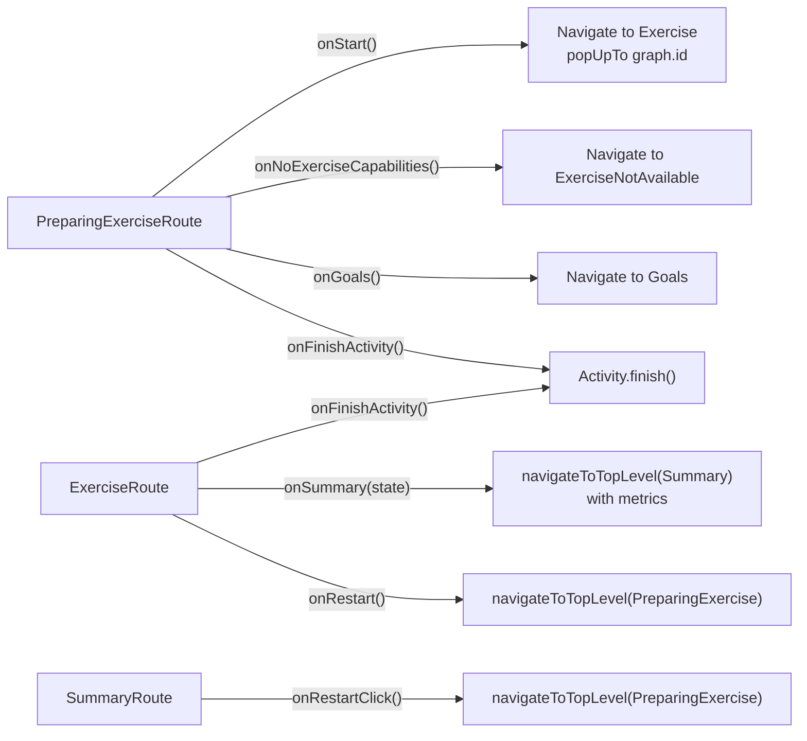

**Sources:** [health-services/ExerciseSampleCompose/app/src/main/java/com/example/exercisesamplecompose/presentation/ExerciseSampleApp.kt:49-103]()

## PreparingExerciseScreen

### Purpose and State

The `PreparingExerciseScreen` composable prepares the device sensors (heart rate, GPS) before starting an exercise session. It displays GPS acquisition status and requires user confirmation to proceed.

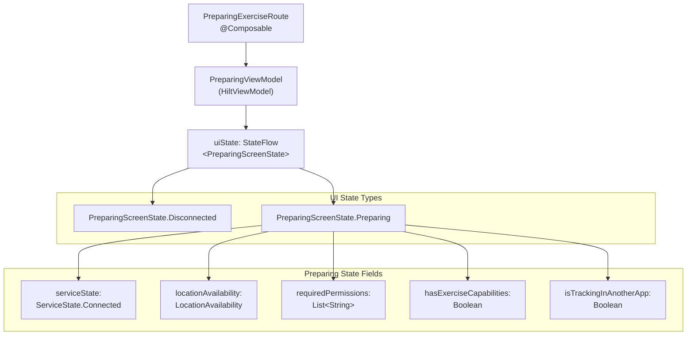

**Sources:** [health-services/ExerciseSampleCompose/app/src/main/java/com/example/exercisesamplecompose/presentation/preparing/PreparingExerciseScreen.kt:73-128](), [health-services/ExerciseSampleCompose/app/src/main/java/com/example/exercisesamplecompose/presentation/preparing/PreparingViewModel.kt:35-96]()

### UI Layout Structure

The screen uses a `ScreenScaffold` with `TransformingLazyColumn` for scrollable content on Wear OS:

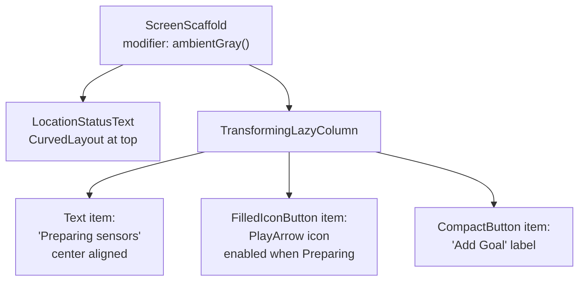

The layout implementation:

| Component | Type | Properties | Purpose |
|-----------|------|------------|---------|
| `ScreenScaffold` | Wear Compose Material3 | `scrollState`, `timeText`, `contentPadding` | Root scaffold with scrolling support |
| `LocationStatusText` | Custom composable | Curved text at 12sp | Displays GPS status at screen top |
| `TransformingLazyColumn` | Wear Foundation | `state`, `contentPadding` | Scrollable list with Wear OS transformations |
| `FilledIconButton` | Wear Material3 | `enabled = uiState is Preparing` | Start exercise button |
| `CompactButton` | Wear Material3 | `label` with Text | Navigate to goals configuration |

**Sources:** [health-services/ExerciseSampleCompose/app/src/main/java/com/example/exercisesamplecompose/presentation/preparing/PreparingExerciseScreen.kt:133-211]()

### GPS Location Status Display

The screen displays real-time GPS acquisition status using curved text at the top:

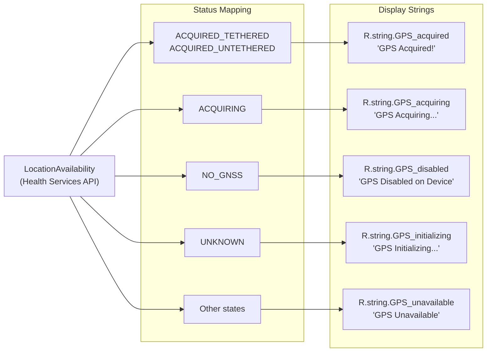

**Sources:** [health-services/ExerciseSampleCompose/app/src/main/java/com/example/exercisesamplecompose/presentation/preparing/PreparingExerciseScreen.kt:215-235](), [health-services/ExerciseSampleCompose/app/src/main/res/values/strings.xml:28-33]()

### Permission Handling

The route composable handles runtime permission requests before exercise preparation:

| Permission | Required | Purpose | API Level |
|------------|----------|---------|-----------|
| `BODY_SENSORS` | Yes | Heart rate monitoring | All |
| `ACCESS_FINE_LOCATION` | Yes | GPS tracking | All |
| `ACTIVITY_RECOGNITION` | Yes | Exercise type detection | All |
| `POST_NOTIFICATIONS` | Yes | Foreground service notification | Android 13+ |
| `READ_HEART_RATE` | Yes | Health Connect integration | Android 36+ |

The permission launcher is registered and invoked when the service connects:

**Sources:** [health-services/ExerciseSampleCompose/app/src/main/java/com/example/exercisesamplecompose/presentation/preparing/PreparingExerciseScreen.kt:84-106](), [health-services/ExerciseSampleCompose/app/src/main/java/com/example/exercisesamplecompose/presentation/preparing/PreparingViewModel.kt:85-95](), [health-services/ExerciseSampleCompose/app/src/main/AndroidManifest.xml:18-25]()

## ExerciseScreen

### Purpose and Layout

The `ExerciseScreen` composable displays real-time exercise metrics and provides controls to pause, resume, and end the workout. It implements a two-page horizontal pager for navigation between controls and metrics.

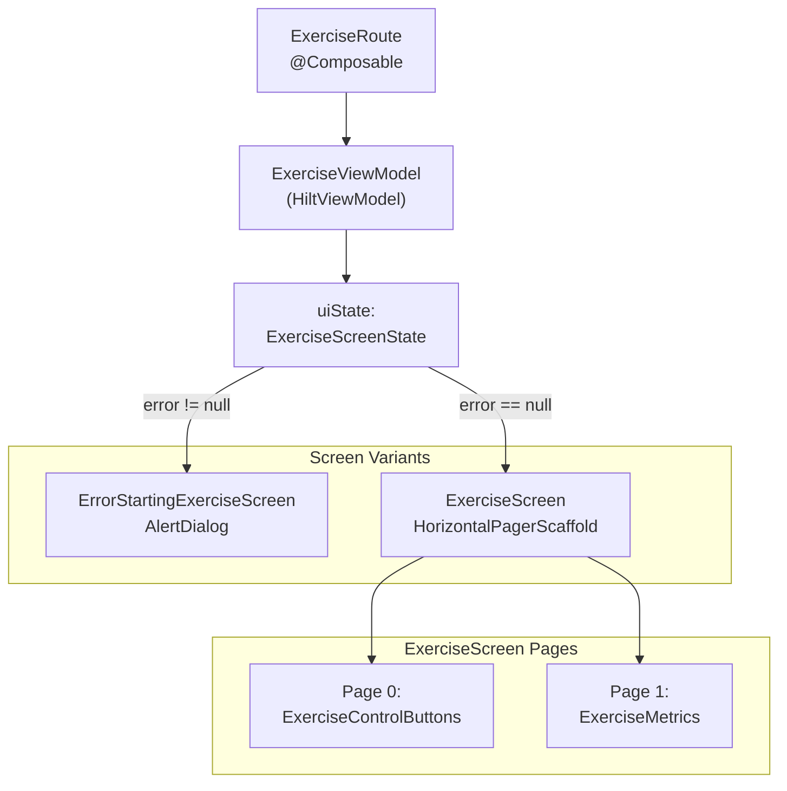

**Sources:** [health-services/ExerciseSampleCompose/app/src/main/java/com/example/exercisesamplecompose/presentation/exercise/ExerciseScreen.kt:71-106]()

### Horizontal Pager Architecture

The screen uses `HorizontalPagerScaffold` to create a swipeable two-page layout:

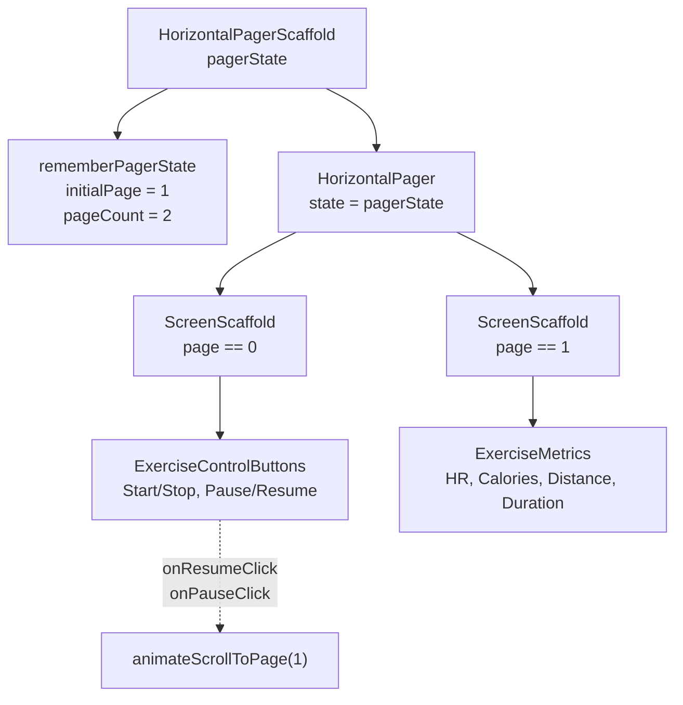

The pager allows users to:
- View exercise controls on page 0
- View real-time metrics on page 1 (initial page)
- Swipe between pages during exercise
- Auto-navigate to metrics after pause/resume actions

**Sources:** [health-services/ExerciseSampleCompose/app/src/main/java/com/example/exercisesamplecompose/presentation/exercise/ExerciseScreen.kt:150-202]()

### Exercise Control Buttons

Page 0 displays conditional button combinations based on exercise state:

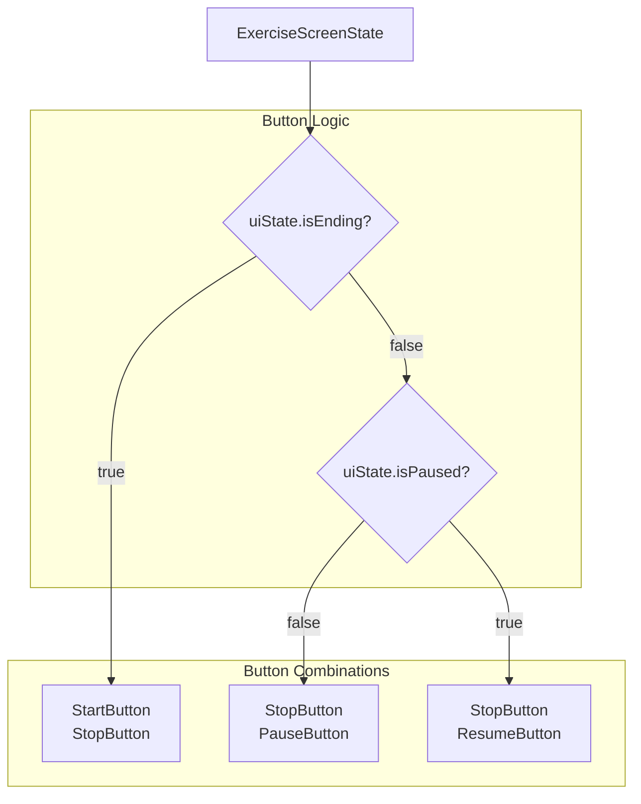

| State | Left Button | Right Button | Actions |
|-------|-------------|--------------|---------|
| Ending | `StartButton` | - | `onStartClick()` |
| Paused | `StopButton` | `ResumeButton` | `onEndClick()`, `onResumeClick()` + animate to page 1 |
| Active | `StopButton` | `PauseButton` | `onEndClick()`, `onPauseClick()` + animate to page 1 |

**Sources:** [health-services/ExerciseSampleCompose/app/src/main/java/com/example/exercisesamplecompose/presentation/exercise/ExerciseScreen.kt:225-253]()

### Exercise Metrics Display

Page 1 displays four rows of exercise metrics in a vertical arrangement:

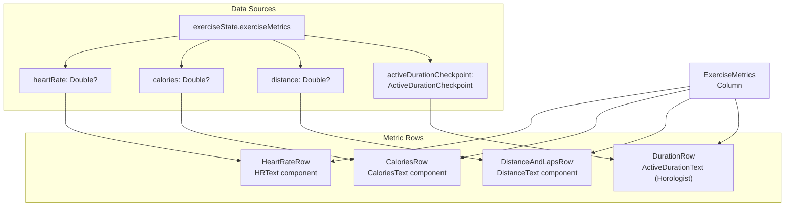

The layout uses:
- `Column` with `verticalArrangement = Arrangement.spacedBy(10.dp)`
- `padding(vertical = 20.dp)`
- Each row is a `Row` with `Arrangement.SpaceAround`

**Sources:** [health-services/ExerciseSampleCompose/app/src/main/java/com/example/exercisesamplecompose/presentation/exercise/ExerciseScreen.kt:204-316]()

### Error Handling UI

When an error occurs during exercise start, an `AlertDialog` is displayed:

| Element | Content | Action |
|---------|---------|--------|
| Title | "Error starting exercise" | - |
| Text | `${uiState.error}. Try again?` | - |
| Confirm Button | "Yes" | `onRestart()` - navigate to PreparingExercise |
| Dismiss Button | "No" | `onFinishActivity()` - finish activity |

**Sources:** [health-services/ExerciseSampleCompose/app/src/main/java/com/example/exercisesamplecompose/presentation/exercise/ExerciseScreen.kt:111-145]()

## Reusable UI Components

### Metric Display Components

The application defines several reusable composables for displaying exercise metrics with consistent formatting:

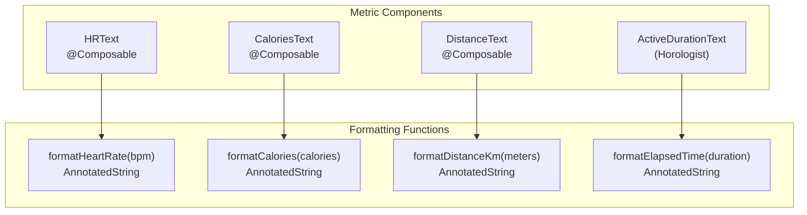

#### HRText Component

Displays heart rate with "bpm" suffix:

| Property | Value | Purpose |
|----------|-------|---------|
| Input | `hr: Double?` | Heart rate value or null |
| Display (active) | `"$hr bpm"` | Shows value with unit |
| Display (ambient/null) | `"--"` | Shows placeholder |
| Font Size | `20.sp` (value), `10.sp` (unit) | Emphasizes value |
| Color | `MaterialTheme.colorScheme.primary` | Theme-aware coloring |

**Sources:** [health-services/ExerciseSampleCompose/app/src/main/java/com/example/exercisesamplecompose/presentation/component/HRText.kt:33-57]()

### Control Button Components

The application provides button components for exercise control:

| Component | Icon/Label | Purpose | Callback |
|-----------|-----------|---------|----------|
| `StartButton` | PlayArrow | Begin exercise | `onClick()` |
| `StopButton` | Stop | End exercise | `onClick()` |
| `PauseButton` | Pause | Pause exercise | `onClick()` |
| `ResumeButton` | Resume | Resume paused exercise | `onClick()` |

Each button is styled consistently using Wear Compose Material3 components.

**Sources:** [health-services/ExerciseSampleCompose/app/src/main/java/com/example/exercisesamplecompose/presentation/exercise/ExerciseScreen.kt:56-59]()

## Formatting Utilities

### Time Formatting

The `formatElapsedTime` function converts `Duration` objects to human-readable time strings with contextual formatting:

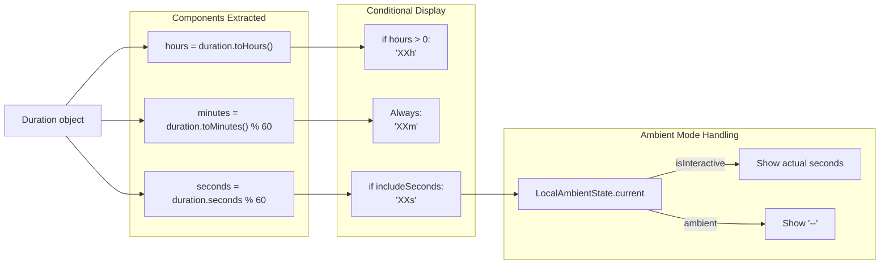

The function returns an `AnnotatedString` with styled units (smaller font) and uses Material3 typography styles.

**Sources:** [health-services/ExerciseSampleCompose/app/src/main/java/com/example/exercisesamplecompose/presentation/component/FormattingUtils.kt:30-59]()

### Metric Formatting Functions

| Function | Input Type | Output Format | Null Handling |
|----------|-----------|---------------|---------------|
| `formatHeartRate(bpm)` | `Double?` | `"XXXbpm"` with styled unit | `"--"` |
| `formatCalories(calories)` | `Double?` | `"XXX"` (rounded int) | `"--"` |
| `formatDistanceKm(meters)` | `Double?` | `"XX.XXkm"` (2 decimals) | `"--"` |
| `formatElapsedTime(duration)` | `Duration?` | `"XXhXXmXXs"` | `"--"` |

All formatting functions:
- Return `AnnotatedString` for styled text
- Handle null/NaN values with `"--"` placeholder
- Use `MaterialTheme.typography.labelSmall` for unit styling
- Apply theme colors via `MaterialTheme.colorScheme`

**Sources:** [health-services/ExerciseSampleCompose/app/src/main/java/com/example/exercisesamplecompose/presentation/component/FormattingUtils.kt:61-96]()

## Ambient Mode Support

### Ambient-Aware UI

The application uses Horologist's `AmbientAware` composable to adapt UI for always-on display mode on Wear OS:

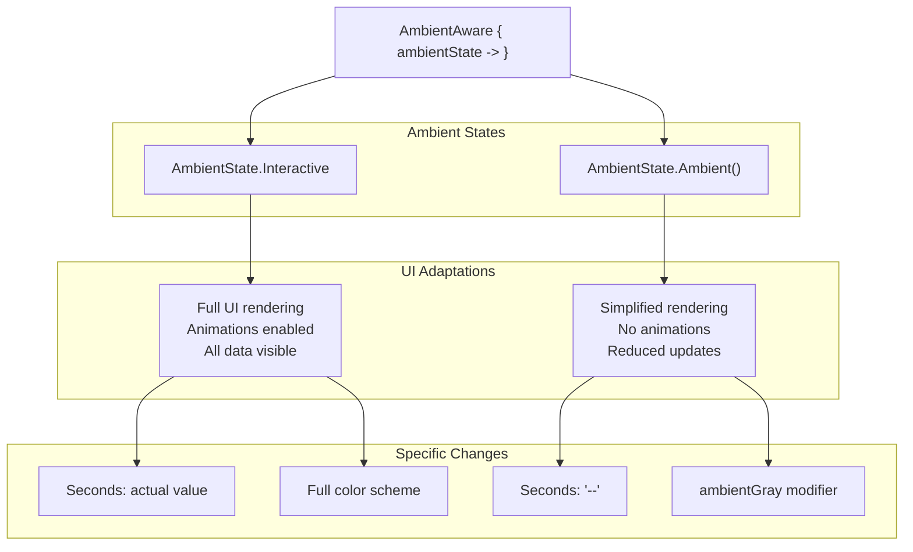

### Ambient Mode Modifiers

The application applies visual modifications in ambient mode:

| Screen | Modifier | Effect |
|--------|----------|--------|
| PreparingExerciseScreen | `.ambientGray(ambientState)` | Converts to grayscale in ambient mode |
| ExerciseScreen | `.ambientBlank(ambientState)` | Blanks the screen in ambient mode |

These modifiers are applied to `ScreenScaffold` instances to ensure the entire screen adapts appropriately.

**Sources:** [health-services/ExerciseSampleCompose/app/src/main/java/com/example/exercisesamplecompose/presentation/preparing/PreparingExerciseScreen.kt:108-118](), [health-services/ExerciseSampleCompose/app/src/main/java/com/example/exercisesamplecompose/presentation/exercise/ExerciseScreen.kt:94-105]()

### Conditional Data Display

Components check `LocalAmbientState.current.isInteractive` to conditionally display data:

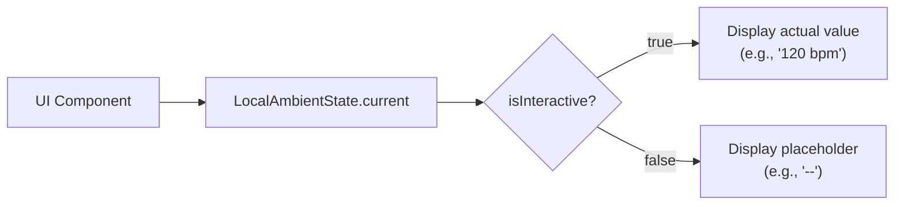

This pattern is used in:
- `HRText` component for heart rate display
- `formatElapsedTime` for seconds display
- Other metric components requiring real-time updates

**Sources:** [health-services/ExerciseSampleCompose/app/src/main/java/com/example/exercisesamplecompose/presentation/component/HRText.kt:42](), [health-services/ExerciseSampleCompose/app/src/main/java/com/example/exercisesamplecompose/presentation/component/FormattingUtils.kt:52-53]()

## Wear OS UI Patterns

### Wear Compose Material3

The application uses Wear Compose Material3 (version 1.5.0-beta04) for modern Wear OS UI components:

| Component | Purpose | Key Properties |
|-----------|---------|----------------|
| `AppScaffold` | App-level container | `timeText` support |
| `ScreenScaffold` | Screen-level container | `scrollState`, `contentPadding`, `timeText` |
| `HorizontalPagerScaffold` | Pager container | `pagerState` management |
| `FilledIconButton` | Primary action button | Icon-based, filled background |
| `CompactButton` | Secondary action button | Text label, compact size |
| `AlertDialog` | Modal dialogs | `title`, `text`, `confirmButton`, `dismissButton` |
| `TimeText` | Curved time display | Standard Wear OS time |

**Sources:** [health-services/ExerciseSampleCompose/app/build.gradle:86-91]()

### Horologist Integration

The application integrates Horologist (version 0.7.14-beta) for Wear OS utilities and health-specific components:

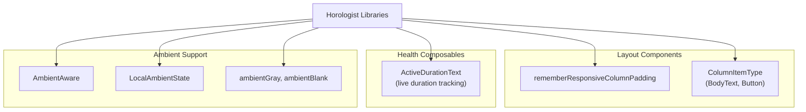

Key Horologist components used:

| Component | Package | Purpose |
|-----------|---------|---------|
| `ActiveDurationText` | `horologist.health.composables` | Live exercise duration with checkpoint tracking |
| `AmbientAware` | `horologist.compose.ambient` | Ambient mode state management |
| `rememberResponsiveColumnPadding` | `horologist.compose.layout` | Responsive padding for different screen sizes |

**Sources:** [health-services/ExerciseSampleCompose/app/build.gradle:101-103](), [health-services/ExerciseSampleCompose/app/src/main/java/com/example/exercisesamplecompose/presentation/exercise/ExerciseScreen.kt:68](), [health-services/ExerciseSampleCompose/app/src/main/java/com/example/exercisesamplecompose/presentation/preparing/PreparingExerciseScreen.kt:68-71]()

### Curved Layout Components

Wear OS provides `CurvedLayout` for positioning text along the circular edge of the watch face:

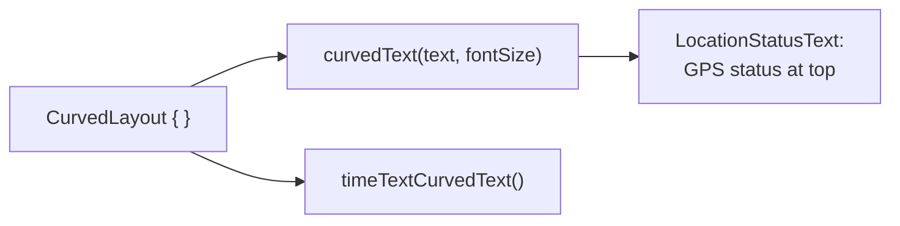

The `LocationStatusText` composable uses `curvedText` at 12sp to display GPS acquisition status along the screen's curve.

**Sources:** [health-services/ExerciseSampleCompose/app/src/main/java/com/example/exercisesamplecompose/presentation/preparing/PreparingExerciseScreen.kt:230-235]()

### TransformingLazyColumn

The application uses `TransformingLazyColumn` instead of standard `LazyColumn` for Wear OS-optimized scrolling:

| Feature | Benefit |
|---------|---------|
| Scale transformations | Items scale as they scroll |
| Optimized for round screens | Better use of circular display area |
| `rememberTransformingLazyColumnState` | Integrated scroll state management |
| Works with `ScreenScaffold` | Proper scroll indicator positioning |

**Sources:** [health-services/ExerciseSampleCompose/app/src/main/java/com/example/exercisesamplecompose/presentation/preparing/PreparingExerciseScreen.kt:142-162]()

## Testing Support

### Screenshot Testing Configuration

The application includes screenshot tests using Roborazzi for visual regression testing:

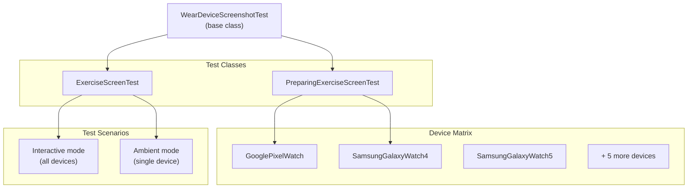

Test classes extend `WearDeviceScreenshotTest` and run parameterized tests across multiple device configurations to capture UI variations.

**Sources:** [health-services/ExerciseSampleCompose/app/src/test/java/com/example/exercisesamplecompose/presentation/PreparingExerciseScreenTest.kt:33-101](), [health-services/ExerciseSampleCompose/app/src/test/java/com/example/exercisesamplecompose/presentation/ExerciseScreenTest.kt:35-107]()

### Preview Annotations

The application uses `@WearPreviewDevices` for Compose previews:

| Annotation | Purpose | Example Usage |
|------------|---------|---------------|
| `@WearPreviewDevices` | Generate previews for all Wear device sizes | Screen composables |
| `@Preview` | Standard Compose preview | Individual components |
| `ThemePreview { }` | Custom preview wrapper with app theme | All preview functions |

Each screen composable includes multiple preview functions showing different states (interactive, ambient, loading, etc.).

**Sources:** [health-services/ExerciseSampleCompose/app/src/main/java/com/example/exercisesamplecompose/presentation/preparing/PreparingExerciseScreen.kt:237-271](), [health-services/ExerciseSampleCompose/app/src/main/java/com/example/exercisesamplecompose/presentation/exercise/ExerciseScreen.kt:318-357]()

---

