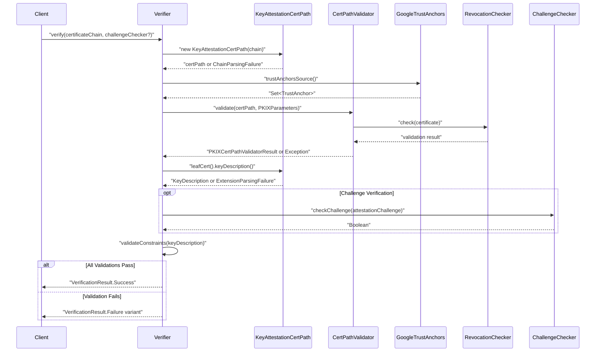
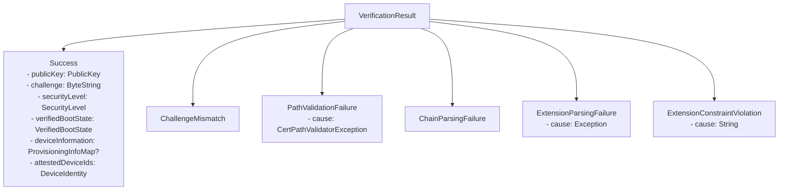

<!-- source: DeepWiki mcp.deepwiki.com · repo android/keyattestation · page 1 Overview · fetched 2026-10-23 -->

# Overview

<details>
<summary>Relevant source files</summary>

The following files were used as context for generating this wiki page:

- [README.md](README.md)
- [src/main/kotlin/Verifier.kt](src/main/kotlin/Verifier.kt)

</details>


## Purpose and Scope

This document provides an overview of the Android Key Attestation verification library, a Kotlin-based system for validating Android key attestation certificate chains according to the Android Key Attestation specification. The library verifies the authenticity of keys generated on Android devices by validating their attestation certificates against Google's trusted root certificates and extracting verified device information.

The library handles certificate path validation, attestation extension parsing, challenge verification, and trust anchor management. For detailed information about the core verification engine, see [Core Verification System](#2). For trust management specifics, see [Trust Management](#3). For challenge validation mechanisms, see [Challenge Verification](#4).

## System Architecture

The Android Key Attestation verification library consists of five main architectural layers that work together to validate attestation certificate chains:

### High-Level Component Architecture

```mermaid
graph TB
    subgraph "Application Layer"
        Client["Client Applications"]
    end
    
    subgraph "Core Verification Engine"
        Verifier["Verifier"]
        VerificationResult["VerificationResult"]
    end
    
    subgraph "Certificate Processing"
        KeyAttestationCertPath["KeyAttestationCertPath"]
        KeyAttestationCertPathValidator["KeyAttestationCertPathValidator"]
        RevocationChecker["RevocationChecker"]
    end
    
    subgraph "Data Models"
        KeyDescription["KeyDescription"]
        AuthorizationList["AuthorizationList"] 
        DeviceIdentity["DeviceIdentity"]
        ProvisioningInfoMap["ProvisioningInfoMap"]
    end
    
    subgraph "Trust & Configuration"
        GoogleTrustAnchors["GoogleTrustAnchors"]
        ChallengeChecker["ChallengeChecker"]
        ChallengeMatcher["ChallengeMatcher"]
        InMemoryLruCache["InMemoryLruCache"]
    end
    
    Client --> Verifier
    Verifier --> VerificationResult
    Verifier --> KeyAttestationCertPath
    Verifier --> KeyAttestationCertPathValidator
    Verifier --> GoogleTrustAnchors
    Verifier --> ChallengeChecker
    
    KeyAttestationCertPathValidator --> RevocationChecker
    KeyAttestationCertPath --> KeyDescription
    KeyDescription --> AuthorizationList
    KeyDescription --> DeviceIdentity
    KeyAttestationCertPath --> ProvisioningInfoMap
    
    ChallengeChecker <|-- ChallengeMatcher
    ChallengeChecker <|-- InMemoryLruCache
```

Sources: [src/main/kotlin/Verifier.kt:1-176](), [README.md:1-106]()

### Core Verification Workflow

The verification process follows a structured pipeline that validates certificate chains through multiple stages:



Sources: [src/main/kotlin/Verifier.kt:82-174]()

## Key Components

### Verifier Class

The `Verifier` class serves as the main entry point and orchestrates the entire verification process. It accepts three configurable sources:

| Component | Type | Purpose |
|-----------|------|---------|
| `trustAnchorsSource` | `() -> Set<TrustAnchor>` | Provides root certificates for path validation |
| `revokedSerialsSource` | `() -> Set<String>` | Supplies revoked certificate serial numbers |
| `instantSource` | `InstantSource` | Provides current time for validation |

The class is thread-safe and supports optional challenge verification through the `ChallengeChecker` interface.

Sources: [src/main/kotlin/Verifier.kt:66-73]()

### Verification Results

The system returns structured results through sealed interface variants that provide specific failure reasons:



Sources: [src/main/kotlin/Verifier.kt:36-55]()

### Trust Anchor Management

The library uses a dual-strategy approach for trust anchor management:

| Strategy | Implementation | Use Case |
|----------|---------------|----------|
| Build-time Generation | `GoogleTrustAnchors` class generated from `roots.json` | Production environments |
| Runtime Loading | `TestUtils` for loading certificates dynamically | Testing and development |

The `GoogleTrustAnchors` class is automatically generated during build time using a Gradle task that processes the `roots.json` file containing Google's attestation root certificates.

Sources: [README.md:86-94]()

### Challenge Verification System

Challenge verification is implemented through a modular system supporting multiple verification strategies:

```mermaid
graph TD
    ChallengeChecker["ChallengeChecker<br/>(interface)"]
    
    ChallengeMatcher["ChallengeMatcher<br/>Exact challenge matching"]
    InMemoryLruCache["InMemoryLruCache<br/>Replay attack prevention"] 
    ChainedChallengeChecker["ChainedChallengeChecker<br/>Multiple check composition"]
    
    ChallengeChecker <|-- ChallengeMatcher
    ChallengeChecker <|-- InMemoryLruCache
    ChallengeChecker <|-- ChainedChallengeChecker
    
    ChainedChallengeChecker --> ChallengeMatcher
    ChainedChallengeChecker --> InMemoryLruCache
```

Sources: [README.md:36-72]()

## Usage Patterns

### Basic Verification

The simplest verification pattern uses default Google trust anchors:

```kotlin
val verifier = Verifier(
  GoogleTrustAnchors,           // Trust anchors source
  { setOf<String>() },          // Revoked serials source  
  { Instant.now() }             // Time source
)

val result = verifier.verify(certificateChain)
```

### Challenge-Based Verification  

Applications requiring challenge validation can use the built-in challenge checkers:

```kotlin
val challengeChecker = ChainedChallengeChecker.of(
  ChallengeMatcher("expectedChallenge"), 
  InMemoryLruCache(100)
)

val result = verifier.verify(certificateChain, challengeChecker)
```

Sources: [README.md:7-66]()

## Security Model

The library enforces several critical security constraints during verification:

| Constraint | Enforcement Location | Purpose |
|------------|---------------------|---------|
| Hardware key origin | [src/main/kotlin/Verifier.kt:139-145]() | Ensures keys are generated in hardware |
| Security level consistency | [src/main/kotlin/Verifier.kt:147-154]() | Validates attestation and key security levels match |
| Root of trust presence | [src/main/kotlin/Verifier.kt:155-159]() | Verifies hardware-enforced root of trust |
| Certificate path validity | [src/main/kotlin/Verifier.kt:117-122]() | Standard PKIX validation with custom extensions |

The system separates software-enforced and hardware-enforced attestation properties, with hardware-enforced properties providing stronger security guarantees for critical attestation data.

Sources: [src/main/kotlin/Verifier.kt:138-173]()

---

