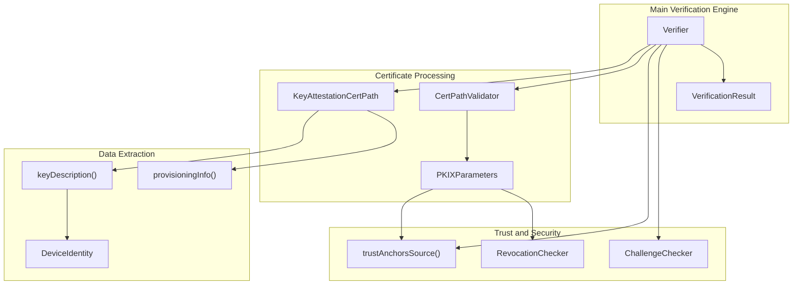
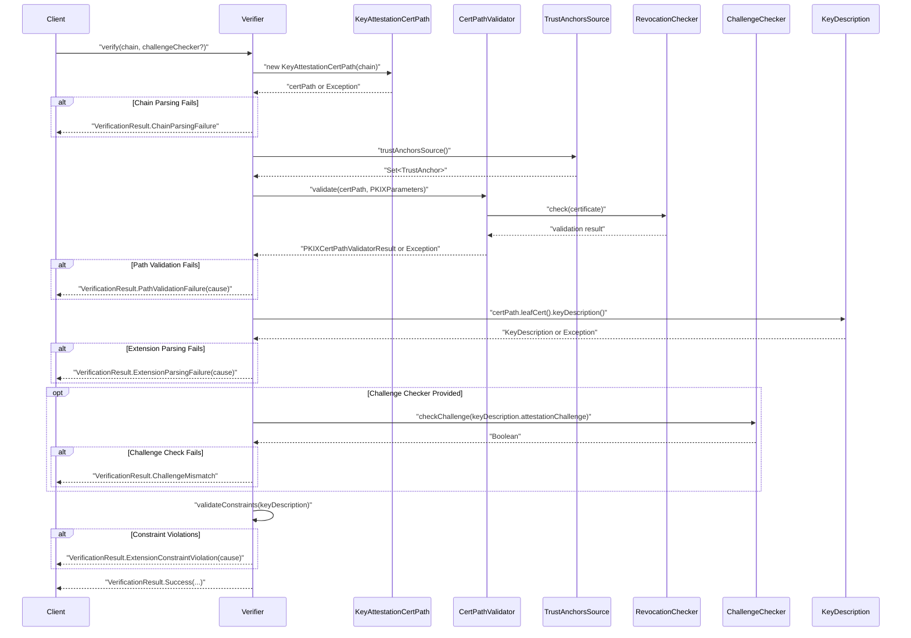
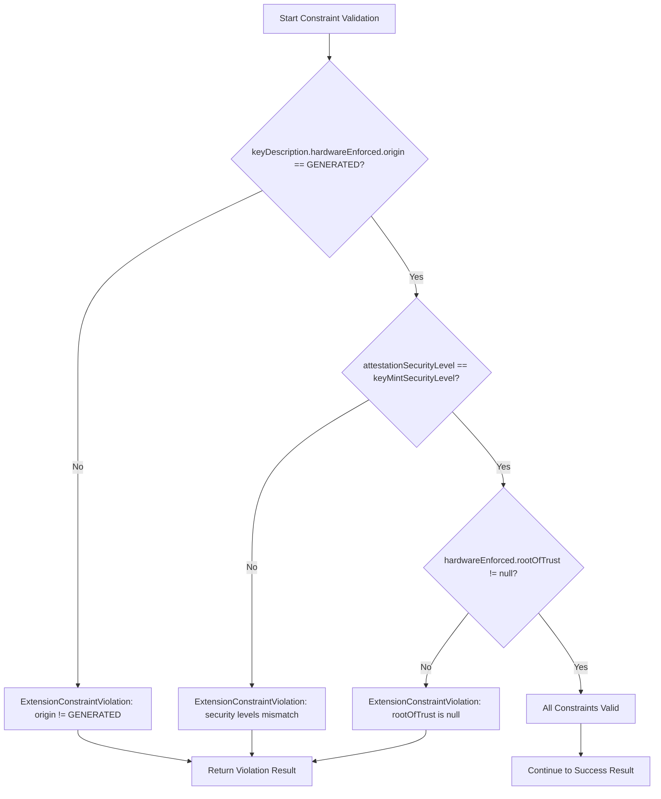
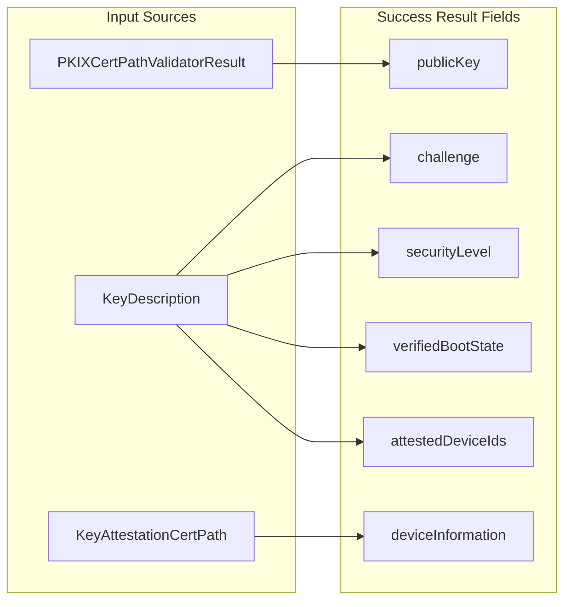

<!-- source: DeepWiki mcp.deepwiki.com · repo android/keyattestation · page 2 Core Verification System · fetched 2026-10-23 -->

# Core Verification System

<details>
<summary>Relevant source files</summary>

The following files were used as context for generating this wiki page:

- [src/main/kotlin/Verifier.kt](src/main/kotlin/Verifier.kt)
- [src/test/kotlin/VerifierTest.kt](src/test/kotlin/VerifierTest.kt)

</details>


This document covers the core verification components that validate Android Key Attestation certificate chains. The system is centered around the `Verifier` class which orchestrates certificate path validation, attestation data parsing, trust anchor verification, and challenge checking to produce comprehensive verification results.

For detailed information about the individual verifier engine implementation, see [Verifier Engine](#2.1). For attestation data structures and parsing, see [Attestation Data Models](#2.2). For certificate path validation specifics, see [Certificate Path Validation](#2.3).

## System Architecture

The core verification system follows a layered architecture where the `Verifier` class orchestrates multiple specialized components to validate attestation certificate chains.

### Core Verification Components



Sources: [src/main/kotlin/Verifier.kt:66-175]()

### Verification Result Types

The system produces structured results that indicate both success and various failure modes:

| Result Type | Description | Key Fields |
|-------------|-------------|------------|
| `Success` | Successful verification | `publicKey`, `challenge`, `securityLevel`, `verifiedBootState`, `deviceInformation`, `attestedDeviceIds` |
| `ChallengeMismatch` | Challenge validation failed | None |
| `PathValidationFailure` | Certificate chain validation failed | `cause: CertPathValidatorException` |
| `ChainParsingFailure` | Certificate chain parsing failed | None |
| `ExtensionParsingFailure` | Attestation extension parsing failed | `cause: Exception` |
| `ExtensionConstraintViolation` | Attestation constraints not met | `cause: String` |

Sources: [src/main/kotlin/Verifier.kt:36-55]()

## Verification Flow

The verification process follows a structured sequence with early failure detection and comprehensive validation.

### Main Verification Sequence



Sources: [src/main/kotlin/Verifier.kt:82-174]()

### Constraint Validation

The verifier enforces several critical security constraints on the attestation data:



Sources: [src/main/kotlin/Verifier.kt:138-159]()

## Component Integration

The `Verifier` class integrates multiple specialized components to provide comprehensive attestation verification.

### Initialization and Configuration

The `Verifier` constructor accepts three key functional dependencies:

| Parameter | Type | Purpose |
|-----------|------|---------|
| `trustAnchorsSource` | `() -> Set<TrustAnchor>` | Provides trusted root certificates for path validation |
| `revokedSerialsSource` | `() -> Set<String>` | Provides revoked certificate serial numbers |
| `instantSource` | `InstantSource` | Provides current time for validity period checking |

Sources: [src/main/kotlin/Verifier.kt:66-70]()

### Security Provider Registration

The verifier automatically registers the `KeyAttestationProvider` to enable custom certificate path validation:

```kotlin
init {
  Security.addProvider(KeyAttestationProvider())
}
```

This enables the use of `CertPathValidator.getInstance("KeyAttestation")` for Android-specific certificate path validation logic.

Sources: [src/main/kotlin/Verifier.kt:71-73]()

### Success Result Construction

When verification succeeds, the verifier extracts and returns comprehensive attestation information:



Sources: [src/main/kotlin/Verifier.kt:160-174]()

## Testing Integration

The verification system is designed for comprehensive testing with configurable trust anchors and challenge checkers.

### Test Configuration Example

```kotlin
private val verifier = Verifier({ prodAnchors }, { setOf<String>() }, { Instant.now() })
```

The test framework demonstrates various verification scenarios including successful verification, challenge checking, and failure modes.

Sources: [src/test/kotlin/VerifierTest.kt:35](), [src/test/kotlin/VerifierTest.kt:37-105]()

---

