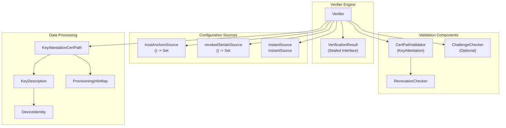
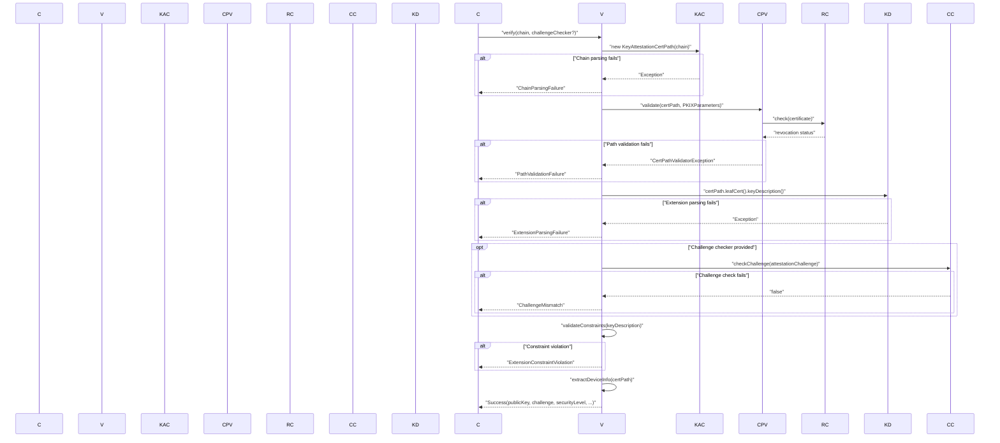
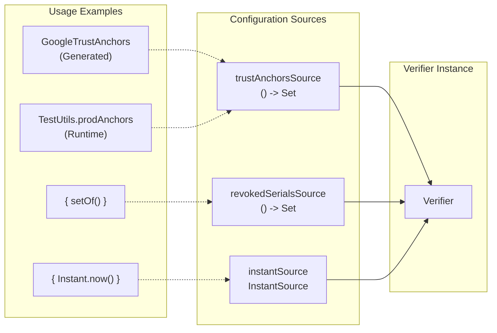
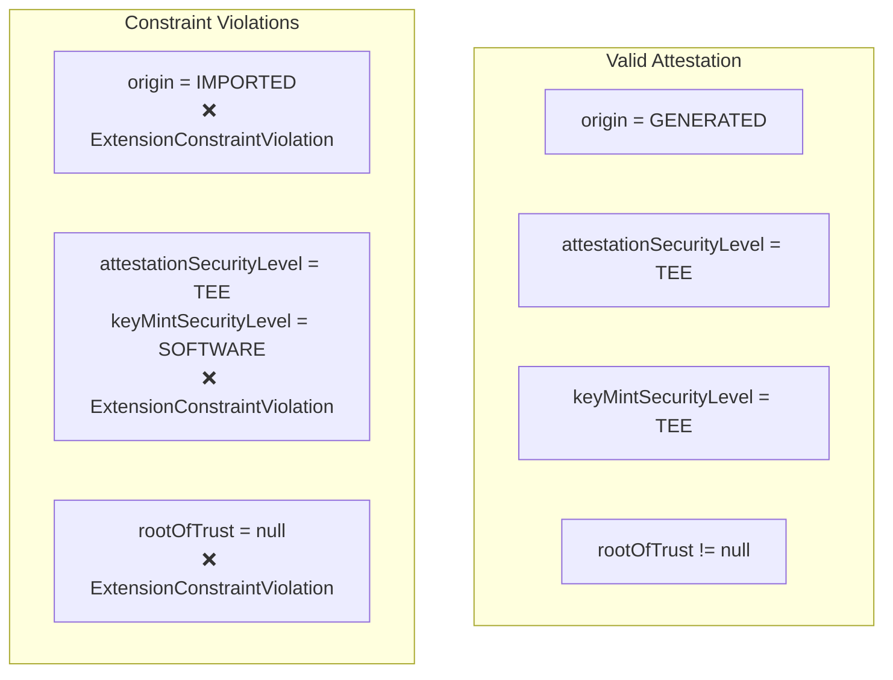

<!-- source: DeepWiki mcp.deepwiki.com · repo android/keyattestation · page 2.1 Verifier Engine · fetched 2026-10-23 -->

# Verifier Engine

<details>
<summary>Relevant source files</summary>

The following files were used as context for generating this wiki page:

- [src/main/kotlin/Verifier.kt](src/main/kotlin/Verifier.kt)
- [src/test/kotlin/VerifierTest.kt](src/test/kotlin/VerifierTest.kt)

</details>


## Purpose and Scope

The Verifier Engine is the central component responsible for validating Android Key Attestation certificate chains. It orchestrates the entire verification process, from certificate path validation to attestation extension parsing and constraint enforcement. This document covers the `Verifier` class, its configuration options, verification workflow, and result types.

For detailed information about attestation data structures and extensions, see [Attestation Data Models](#2.2). For certificate path validation specifics, see [Certificate Path Validation](#2.3). For trust anchor management, see [Trust Management](#3). For challenge verification mechanisms, see [Challenge Verification](#4).

## Architecture Overview

The `Verifier` class serves as the main entry point for attestation verification, coordinating multiple subsystems to provide a comprehensive validation result.

### Core Components



**Sources:** [src/main/kotlin/Verifier.kt:1-176]()

### Verification Result Types

The `VerificationResult` sealed interface defines all possible outcomes of the verification process:

| Result Type | Description | Key Information |
|-------------|-------------|-----------------|
| `Success` | Verification completed successfully | Contains public key, challenge, security level, boot state, device info |
| `ChallengeMismatch` | Challenge checker rejected the attestation challenge | - |
| `PathValidationFailure` | Certificate path validation failed | Contains `CertPathValidatorException` |
| `ChainParsingFailure` | Failed to parse certificate chain | - |
| `ExtensionParsingFailure` | Failed to parse attestation extensions | Contains parsing exception |
| `ExtensionConstraintViolation` | Attestation constraints not met | Contains violation description |

**Sources:** [src/main/kotlin/Verifier.kt:35-55]()

## Verification Process Flow

The verification process follows a structured sequence of validation steps, each capable of producing different failure modes.



**Sources:** [src/main/kotlin/Verifier.kt:82-174]()

### Key Validation Steps

1. **Certificate Chain Parsing** [src/main/kotlin/Verifier.kt:87-94](): Converts raw X.509 certificates into `KeyAttestationCertPath`
2. **Path Validation** [src/main/kotlin/Verifier.kt:111-122](): Standard PKIX validation with custom revocation checking
3. **Extension Parsing** [src/main/kotlin/Verifier.kt:124-129](): Extracts and parses attestation extension from leaf certificate
4. **Challenge Verification** [src/main/kotlin/Verifier.kt:131-136](): Optional validation using provided `ChallengeChecker`
5. **Constraint Enforcement** [src/main/kotlin/Verifier.kt:138-159](): Validates origin, security levels, and root of trust
6. **Device Information Extraction** [src/main/kotlin/Verifier.kt:160-173](): Processes provisioning info and device identity

## Configuration and Instantiation

The `Verifier` class requires three configuration sources provided as lambda functions, enabling flexible runtime configuration.

### Constructor Parameters



**Sources:** [src/main/kotlin/Verifier.kt:66-73](), [src/test/kotlin/VerifierTest.kt:35](), [src/test/kotlin/VerifierTest.kt:49]()

### Common Configuration Patterns

| Pattern | Trust Anchors | Revoked Serials | Use Case |
|---------|---------------|-----------------|----------|
| Production | `GoogleTrustAnchors` | Production revocation list | Live verification |
| Testing | `TestUtils.prodAnchors` | `setOf<String>()` | Unit testing |
| Custom | Custom trust anchor set | Custom revocation list | Specialized validation |

## Constraint Validation

The verifier enforces several critical constraints on attestation extensions to ensure security properties.

### Required Constraints

1. **Key Origin Validation** [src/main/kotlin/Verifier.kt:138-145]():
   - Hardware-enforced origin must be `GENERATED`
   - Prevents attestation of imported keys

2. **Security Level Consistency** [src/main/kotlin/Verifier.kt:147-154]():
   - `attestationSecurityLevel` must equal `keyMintSecurityLevel`
   - Ensures consistent security guarantees

3. **Root of Trust Presence** [src/main/kotlin/Verifier.kt:155-159]():
   - Hardware-enforced `rootOfTrust` must be present
   - Validates device boot state information

### Constraint Violation Examples



**Sources:** [src/main/kotlin/Verifier.kt:138-159]()

## Error Handling and Debugging

The `Verifier` provides detailed error information for debugging failed verifications.

### Error Classification

| Category | Result Type | Information Provided |
|----------|-------------|---------------------|
| Certificate Issues | `ChainParsingFailure` | Chain structure problems |
| Trust Issues | `PathValidationFailure` | PKIX validation details |
| Extension Issues | `ExtensionParsingFailure` | ASN.1/parsing errors |
| Policy Issues | `ExtensionConstraintViolation` | Specific constraint violated |
| Challenge Issues | `ChallengeMismatch` | Challenge validation failure |

### Example Usage

```kotlin
val verifier = Verifier(
    trustAnchorsSource = GoogleTrustAnchors,
    revokedSerialsSource = { setOf<String>() },
    instantSource = { Instant.now() }
)

when (val result = verifier.verify(certificateChain, challengeChecker)) {
    is VerificationResult.Success -> {
        // Access result.publicKey, result.securityLevel, etc.
    }
    is VerificationResult.PathValidationFailure -> {
        logger.error("Path validation failed: ${result.cause.reason}")
    }
    is VerificationResult.ExtensionConstraintViolation -> {
        logger.error("Constraint violation: ${result.cause}")
    }
    // Handle other failure cases...
}
```

**Sources:** [src/test/kotlin/VerifierTest.kt:34-106]()

---

