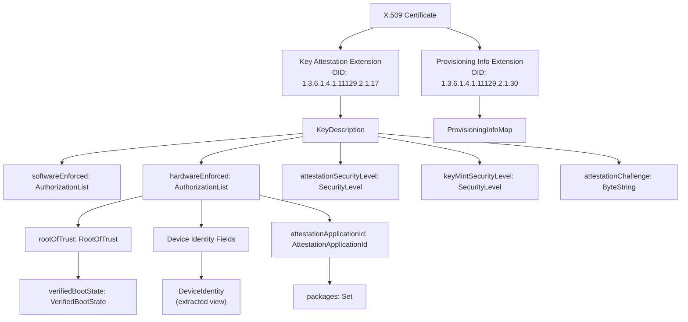
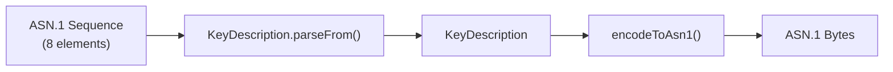
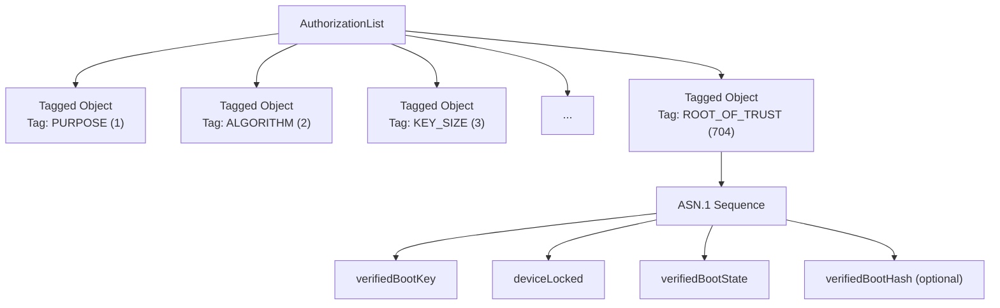
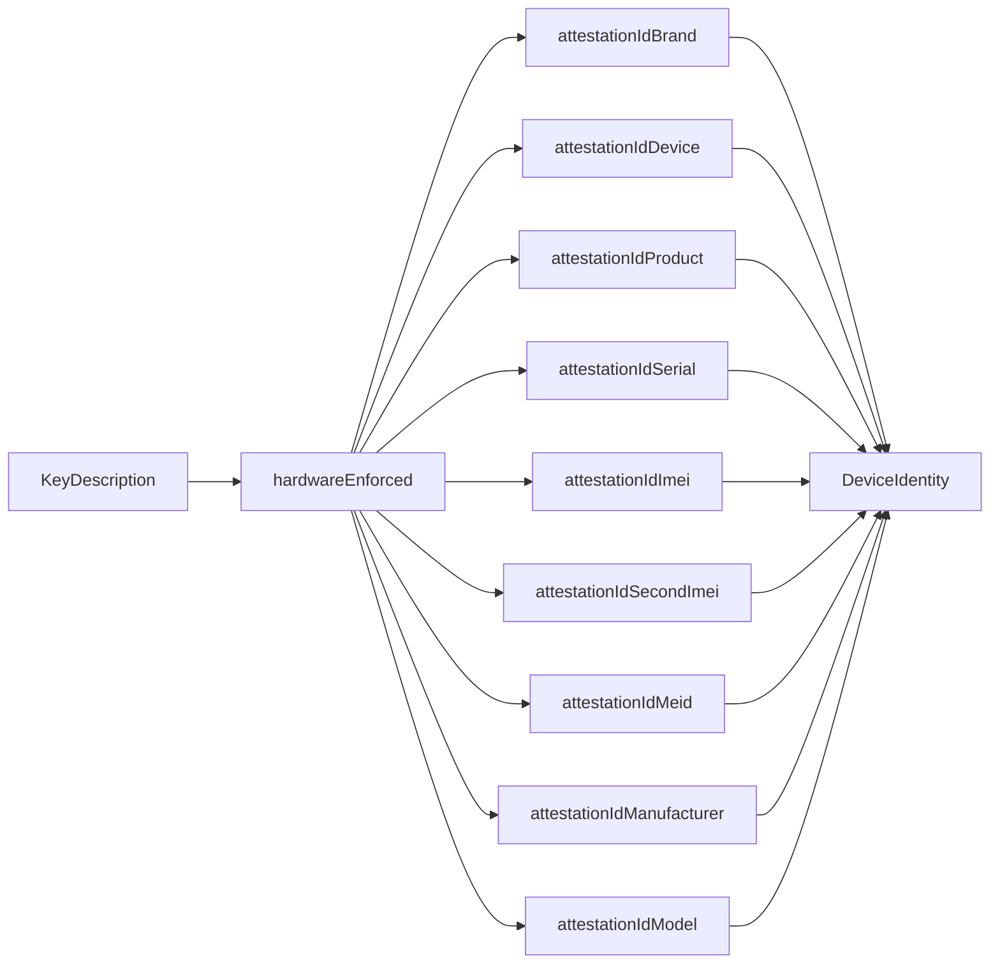
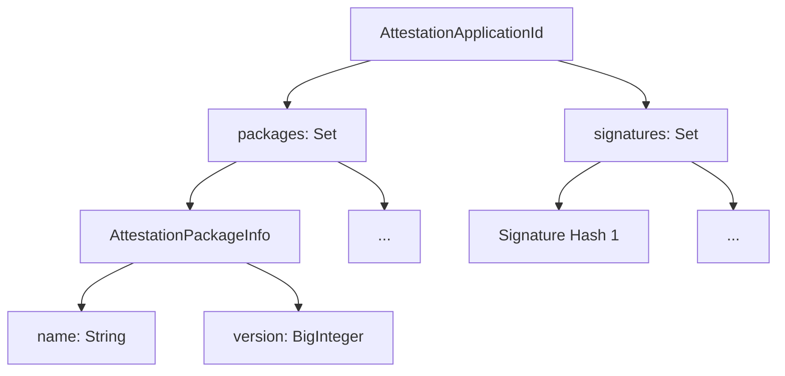
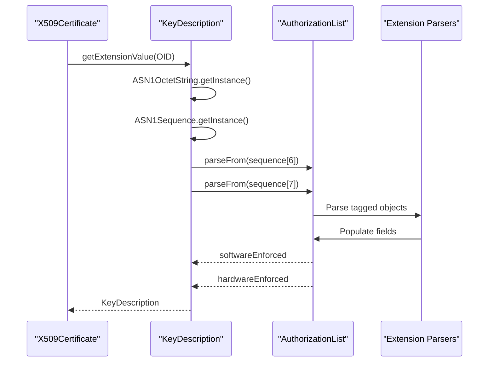

<!-- source: DeepWiki mcp.deepwiki.com · repo android/keyattestation · page 2.2 Attestation Data Models · fetched 2026-10-23 -->

# Attestation Data Models

Relevant source files

The following files were used as context for generating this wiki page:

- [src/main/kotlin/Extension.kt](src/main/kotlin/Extension.kt)
- [src/test/kotlin/ExtensionTest.kt](src/test/kotlin/ExtensionTest.kt)

This document provides a comprehensive guide to the data structures used to represent and parse Android Key Attestation information. It covers the core data models including `KeyDescription`, `AuthorizationList`, device identity structures, and the parsing mechanisms for extracting attestation data from X.509 certificate extensions.

For information about how these data models are used in the verification process, see [Verifier Engine](#2.1). For testing examples using these structures, see [Attestation Examples](#5.2).

## Overview

The attestation data models form the foundation of the Android Key Attestation verification system. These structures represent the parsed contents of two primary X.509 certificate extensions:

- **Key Attestation Extension** (OID: `1.3.6.1.4.1.11129.2.1.17`) - Contains the main attestation data
- **Provisioning Info Extension** (OID: `1.3.6.1.4.1.11129.2.1.30`) - Contains CBOR-encoded provisioning information

### Data Model Hierarchy

Sources: [src/main/kotlin/Extension.kt:60-193]()

## Core Data Structures

### KeyDescription

`KeyDescription` is the primary data structure representing the complete attestation information from a certificate. It contains version information, security levels, challenge data, and two `AuthorizationList` instances for software and hardware enforcement.

| Field | Type | Description |
|-------|------|-------------|
| `attestationVersion` | `BigInteger` | Version of the attestation data format |
| `attestationSecurityLevel` | `SecurityLevel` | Security level of the attestation process |
| `keyMintVersion` | `BigInteger` | Version of KeyMint that generated the key |
| `keyMintSecurityLevel` | `SecurityLevel` | Security level of KeyMint |
| `attestationChallenge` | `ByteString` | Challenge bytes provided during attestation |
| `uniqueId` | `ByteString` | Unique identifier for the key |
| `softwareEnforced` | `AuthorizationList` | Properties enforced by Android software |
| `hardwareEnforced` | `AuthorizationList` | Properties enforced by secure hardware |

The `KeyDescription` class provides parsing from ASN.1 sequences and encoding back to ASN.1 format:

Sources: [src/main/kotlin/Extension.kt:128-193]()

### AuthorizationList

`AuthorizationList` represents the comprehensive set of key usage authorizations and constraints. It contains over 25 different properties covering cryptographic parameters, usage constraints, device identity, and security information.

#### Key Properties Categories

**Cryptographic Parameters:**
- `purposes`, `algorithms`, `keySize`, `digests`, `paddings`
- `ecCurve`, `rsaPublicExponent`

**Usage Constraints:**
- `activeDateTime`, `originationExpireDateTime`, `usageExpireDateTime`
- `noAuthRequired`, `userAuthType`, `authTimeout`
- `trustedUserPresenceRequired`, `unlockedDeviceRequired`

**Device Identity:**
- `attestationIdBrand`, `attestationIdDevice`, `attestationIdProduct`
- `attestationIdSerial`, `attestationIdImei`, `attestationIdMeid`
- `attestationIdManufacturer`, `attestationIdModel`, `attestationIdSecondImei`

**Security Information:**
- `origin`, `rollbackResistant`, `rootOfTrust`
- `osVersion`, `osPatchLevel`, `vendorPatchLevel`, `bootPatchLevel`

The `AuthorizationList` uses tagged ASN.1 objects where each property is identified by a `KeyMintTag`:

Sources: [src/main/kotlin/Extension.kt:280-460](), [src/main/kotlin/Extension.kt:230-272]()

### Security Level Enumeration

The `SecurityLevel` enum defines where cryptographic operations and key storage occur:

| Value | Level | Description |
|-------|-------|-------------|
| 0 | `SOFTWARE` | Implemented in Android system software |
| 1 | `TRUSTED_ENVIRONMENT` | Implemented in secure hardware (TEE) |
| 2 | `STRONG_BOX` | Implemented in dedicated security chip |

Higher security levels provide stronger isolation and tamper resistance.

Sources: [src/main/kotlin/Extension.kt:200-206]()

## Device Identity and Provisioning Data

### DeviceIdentity

`DeviceIdentity` provides a convenient view of device identification information extracted from the hardware-enforced `AuthorizationList`:

The `imeis` field in `DeviceIdentity` consolidates both primary and secondary IMEI values into a set.

Sources: [src/main/kotlin/Extension.kt:99-126]()

### ProvisioningInfoMap

`ProvisioningInfoMap` contains CBOR-encoded provisioning information found in remotely provisioned attestation certificates. It currently tracks the number of certificates issued:

| Field | Type | Description |
|-------|------|-------------|
| `certificatesIssued` | `Int` | Number of certificates issued for this provisioning |

The data is encoded as CBOR and stored in an ASN.1 OCTET STRING within the certificate extension.

Sources: [src/main/kotlin/Extension.kt:60-97]()

## Security-Related Data Structures

### RootOfTrust

`RootOfTrust` contains critical boot verification information that establishes the trustworthiness of the device's software stack:

| Field | Type | Description |
|-------|------|-------------|
| `verifiedBootKey` | `ByteString` | Key used to verify the boot process |
| `deviceLocked` | `Boolean` | Whether the device bootloader is locked |
| `verifiedBootState` | `VerifiedBootState` | Result of boot verification |
| `verifiedBootHash` | `ByteString?` | Hash of verified boot components (optional) |

### VerifiedBootState

The `VerifiedBootState` enum indicates the integrity of the device's boot process:

| Value | State | Description |
|-------|-------|-------------|
| 0 | `VERIFIED` | Boot process verified with official keys |
| 1 | `SELF_SIGNED` | Boot process verified with device-specific keys |
| 2 | `UNVERIFIED` | Boot process not verified |
| 3 | `FAILED` | Boot verification failed |

Sources: [src/main/kotlin/Extension.kt:559-609]()

### AttestationApplicationId

`AttestationApplicationId` identifies the Android application that requested the key attestation:

This structure allows verification that the attestation was requested by a specific, signed application.

Sources: [src/main/kotlin/Extension.kt:501-552]()

## Data Parsing and Encoding

### ASN.1 Parsing Flow

The system parses attestation data through a multi-stage ASN.1 decoding process:

### CBOR Parsing for Provisioning Data

Provisioning information uses CBOR encoding within ASN.1 structures:

The CBOR parsing utilities include type-safe extraction methods like `asInteger()`, `asString()`, and `asMap()`.

Sources: [src/main/kotlin/Extension.kt:693-748](), [src/main/kotlin/Extension.kt:72-96]()

### Tag-Based ASN.1 Structure

`AuthorizationList` uses a tag-based ASN.1 encoding where each field is represented as a tagged object with a specific `KeyMintTag` identifier:

| Tag Range | Purpose |
|-----------|---------|
| 1-99 | Core cryptographic parameters |
| 200-299 | Algorithm-specific parameters |
| 400-499 | Time-based constraints |
| 500-599 | Authentication requirements |
| 700-799 | Attestation and device information |

This flexible structure allows for extension while maintaining backward compatibility.

Sources: [src/main/kotlin/Extension.kt:322-391](), [src/main/kotlin/Extension.kt:394-459]()

---

