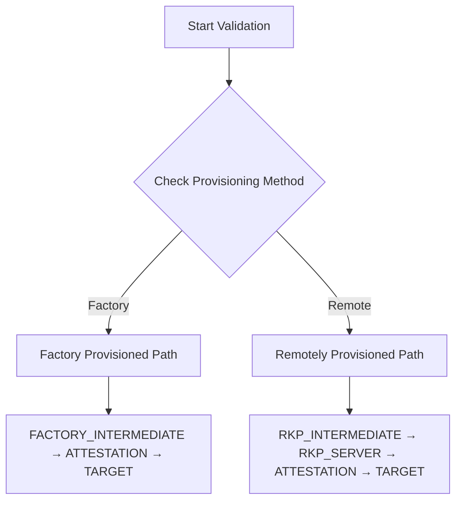
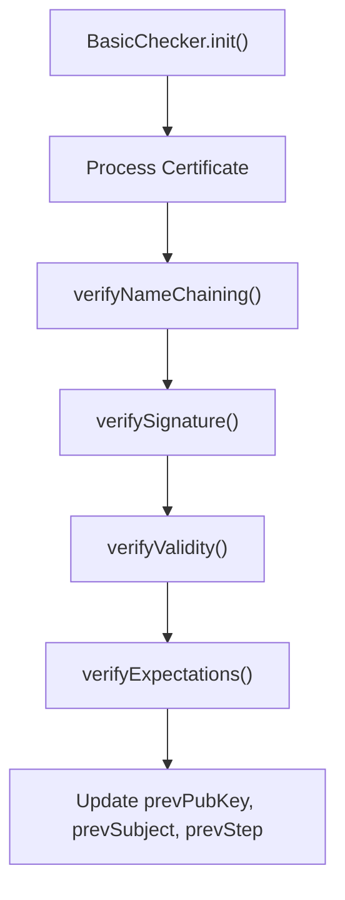
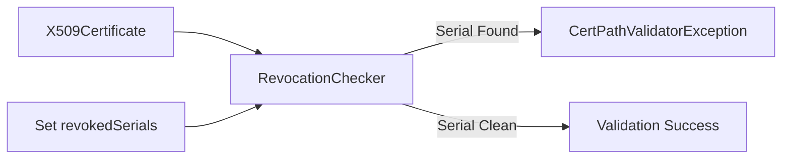
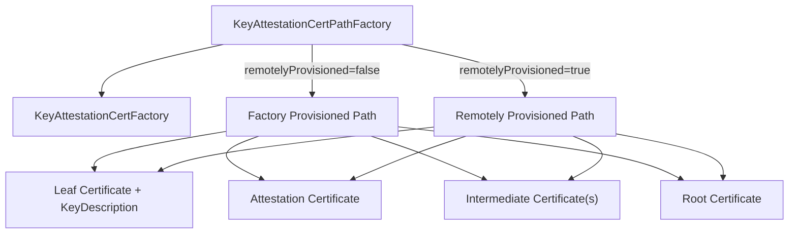

<!-- source: DeepWiki mcp.deepwiki.com · repo android/keyattestation · page 2.3 Certificate Path Validation · fetched 2026-10-23 -->

# Certificate Path Validation

<details>
<summary>Relevant source files</summary>

The following files were used as context for generating this wiki page:

- [roots.json](roots.json)
- [src/main/kotlin/provider/KeyAttestationCertPathValidator.kt](src/main/kotlin/provider/KeyAttestationCertPathValidator.kt)
- [src/main/kotlin/provider/RevocationChecker.kt](src/main/kotlin/provider/RevocationChecker.kt)
- [src/main/kotlin/testing/KeyAttestationCertPathFactory.kt](src/main/kotlin/testing/KeyAttestationCertPathFactory.kt)
- [src/test/kotlin/provider/KeyAttestationCertPathValidatorTest.kt](src/test/kotlin/provider/KeyAttestationCertPathValidatorTest.kt)

</details>


This document covers the custom certificate path validation system used for Android Key Attestation certificate chains. The validation logic extends standard PKIX validation to handle Android Key Attestation certificates that may not fully conform to RFC 5280 standards.

For information about the broader verification process that uses this certificate path validation, see [Verifier Engine](#2.1). For details about the data structures extracted from validated certificates, see [Attestation Data Models](#2.2).

## Purpose and Scope

Android Key Attestation certificate chains from older devices do not always fully conform to RFC 5280, making them incompatible with standard PKIX certificate path validators. This system provides a custom `CertPathValidatorSpi` implementation that performs more permissive validation while maintaining security guarantees. The validation system handles both factory-provisioned and remotely-provisioned certificate chains with appropriate path length and extension checks.

## Why Custom Validation is Needed

Standard PKIX validators cannot process all valid Android Key Attestation certificates due to non-conformance with RFC 5280 in older Android devices. The custom validator implements a more permissive approach that still maintains cryptographic security while accommodating these legacy certificate formats.

The custom validator specifically handles:
- Non-standard certificate chain structures from older Android devices
- Attestation extension placement validation
- Provisioning method-specific path length constraints
- Custom validity period handling for leaf certificates

Sources: [src/main/kotlin/provider/KeyAttestationCertPathValidator.kt:43-52]()

## KeyAttestationCertPathValidator Architecture

The `KeyAttestationCertPathValidator` class extends `CertPathValidatorSpi` to provide Android-specific certificate path validation. It integrates with the Java Security Provider architecture and can be used alongside standard `PKIXRevocationChecker` implementations.

```mermaid
graph TB
    subgraph "Java Security Provider Framework"
        CertPathValidatorSpi["CertPathValidatorSpi"]
        PKIXParameters["PKIXParameters"]
        PKIXCertPathValidatorResult["PKIXCertPathValidatorResult"]
    end
    
    subgraph "Custom Validation Components"
        KeyAttestationCertPathValidator["KeyAttestationCertPathValidator"]
        BasicChecker["BasicChecker"]
        RevocationChecker["RevocationChecker"]
    end
    
    subgraph "Certificate Processing"
        CertPath["CertPath"]
        TrustAnchor["TrustAnchor"]
        X509Certificate["X509Certificate[]"]
    end
    
    CertPathValidatorSpi <|-- KeyAttestationCertPathValidator
    KeyAttestationCertPathValidator --> BasicChecker
    KeyAttestationCertPathValidator --> RevocationChecker
    
    PKIXParameters --> TrustAnchor
    PKIXParameters --> RevocationChecker
    CertPath --> X509Certificate
    
    KeyAttestationCertPathValidator --> PKIXCertPathValidatorResult
```

The validator performs validation in two phases:
1. **Trust Anchor Matching**: Iterates through provided trust anchors to find a matching issuer
2. **Certificate Chain Validation**: Validates each certificate in the chain against the selected trust anchor

Sources: [src/main/kotlin/provider/KeyAttestationCertPathValidator.kt:53-76](), [src/main/kotlin/provider/KeyAttestationCertPathValidator.kt:78-110]()

## Validation Process and Certificate Chain Steps

The validation process follows a specific sequence that accounts for different provisioning methods and certificate chain structures.

### Certificate Chain Structure Recognition

The validator identifies certificate types based on their position in the chain and provisioning method:



The `Step` enum defines the expected certificate types in order:
- `FACTORY_INTERMEDIATE`: First certificate after root for factory provisioning
- `RKP_INTERMEDIATE`: First certificate after root for remote provisioning  
- `RKP_SERVER`: Second certificate in remotely provisioned chains
- `ATTESTATION`: Certificate that signs the target certificate
- `TARGET`: Final certificate containing the attestation extension

Sources: [src/main/kotlin/provider/KeyAttestationCertPathValidator.kt:152-158](), [src/main/kotlin/provider/KeyAttestationCertPathValidator.kt:197-219]()

### BasicChecker Validation Logic

The `BasicChecker` class performs core validation checks for each certificate:



Key validation behaviors:
- **Name Chaining**: Verifies issuer/subject name continuity between certificates
- **Signature Verification**: Validates cryptographic signatures using previous certificate's public key  
- **Validity Period**: Checks certificate validity dates (except for leaf certificate)
- **Path Length Constraints**: Enforces different maximum path lengths based on provisioning method
- **Extension Placement**: Ensures attestation extensions only appear in the target certificate

Sources: [src/main/kotlin/provider/KeyAttestationCertPathValidator.kt:160-196](), [src/main/kotlin/provider/KeyAttestationCertPathValidator.kt:221-326]()

### Special Validity Handling

The validator implements non-standard validity checking that differs from RFC 5280:

```kotlin
// From BasicChecker.verifyValidity()
if (remainingCerts == 0) return  // Skip validity check for final certificate
```

This behavior maintains bug-compatibility with the original KAVS (Key Attestation Verification Service) implementation.

Sources: [src/main/kotlin/provider/KeyAttestationCertPathValidator.kt:254-262]()

## Revocation Checking

The `RevocationChecker` class implements `PKIXRevocationChecker` to validate certificate revocation status using a set of revoked serial numbers.



The revocation checker:
- Maintains a set of revoked certificate serial numbers (in hexadecimal format)
- Throws `CertPathValidatorException` with `BasicReason.REVOKED` if a certificate's serial number is found in the revoked set
- Only supports backward checking (not forward checking)
- Does not support soft-fail exceptions

Sources: [src/main/kotlin/provider/RevocationChecker.kt:25-56]()

## Testing Infrastructure

The `KeyAttestationCertPathFactory` provides test certificate generation for validating the certificate path validation logic.

### Test Certificate Generation



The factory generates different certificate chain structures:
- **Factory Provisioned**: 4 certificates (leaf, attestation, factory intermediate, root)
- **Remotely Provisioned**: 5 certificates (leaf, attestation with provisioning info, RKP intermediate, remote intermediate, root)

For remotely provisioned chains, the factory adds a `ProvisioningInfoMap` extension containing CBOR-encoded provisioning metadata.

Sources: [src/main/kotlin/testing/KeyAttestationCertPathFactory.kt:25-73]()

### Validation Test Coverage

The test suite validates various certificate chain scenarios including:
- Valid factory provisioned and remotely provisioned chains
- Expired certificates and validity period edge cases
- Wrong trust anchors and signature verification failures  
- Path length constraint violations
- Name chaining and algorithm mismatch errors

Sources: [src/test/kotlin/provider/KeyAttestationCertPathValidatorTest.kt:101-233]()

---

