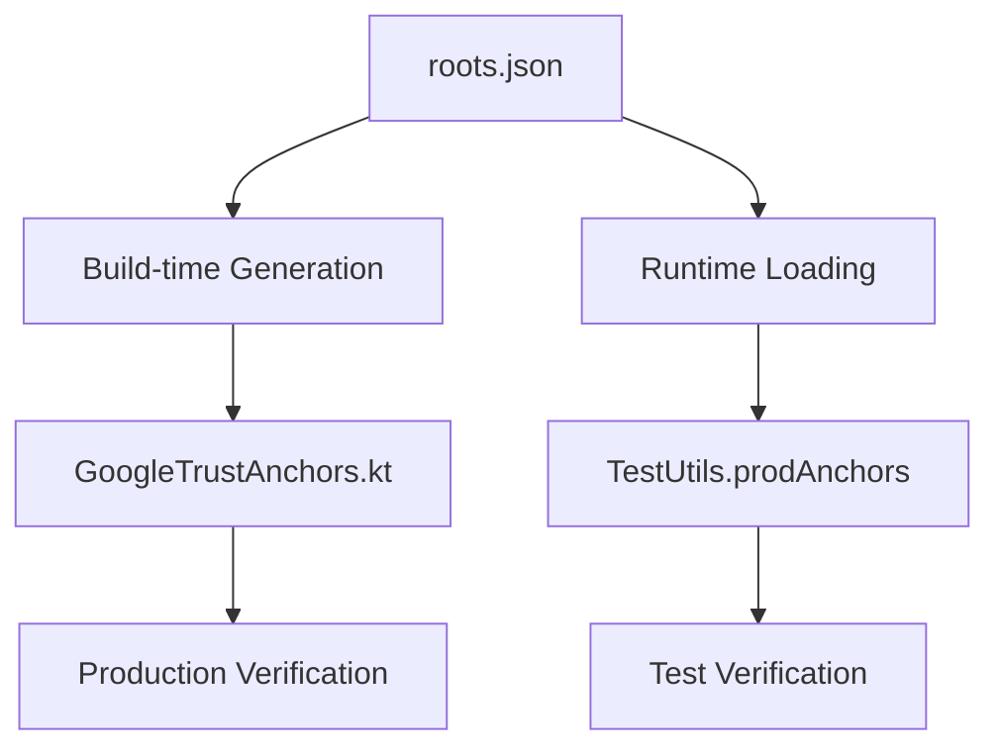
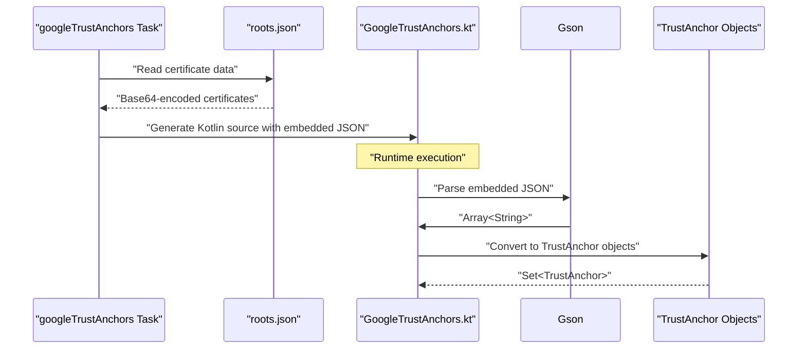
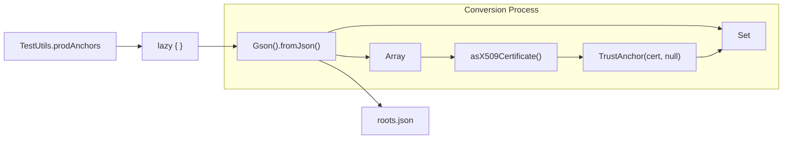
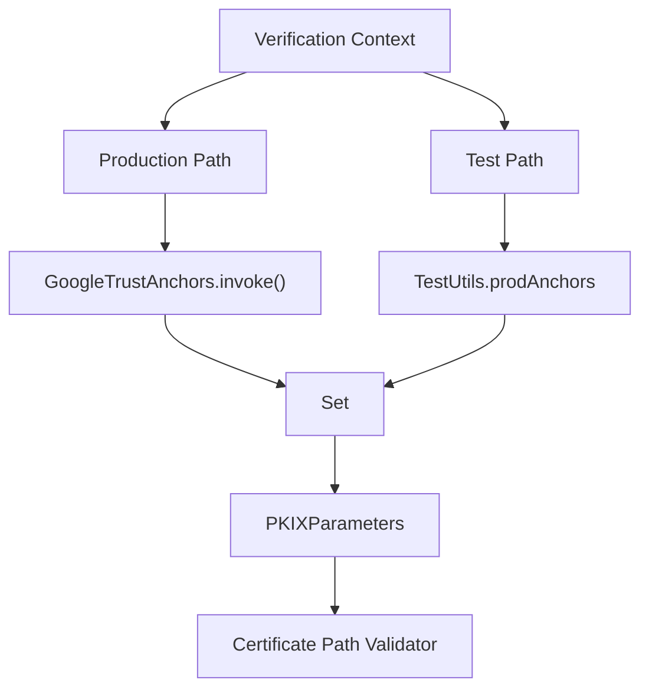

<!-- source: DeepWiki mcp.deepwiki.com · repo android/keyattestation · page 3 Trust Management · fetched 2026-10-23 -->

# Trust Management

Relevant source files

The following files were used as context for generating this wiki page:

- [build.gradle.kts](build.gradle.kts)
- [src/main/kotlin/testing/TestUtils.kt](src/main/kotlin/testing/TestUtils.kt)

## Purpose and Scope

This document covers how trust anchors are managed within the Android Key Attestation verification library. Trust anchors are the root certificates that establish the foundation of trust for validating attestation certificate chains. The system implements a dual strategy supporting both build-time code generation for production use and runtime loading for testing scenarios.

For information about how these trust anchors are used in the actual verification process, see [Core Verification System](#2). For details about certificate path validation logic, see [Certificate Path Validation](#2.3).

## Trust Anchor Sources

The system uses a single source of truth for trust anchors: the `roots.json` file located at the project root. This JSON file contains an array of Base64-encoded X.509 certificates representing Google's trusted root certificates for key attestation.

**Trust Anchor Generation and Loading Flow**

*Sources: [build.gradle.kts:52-86](), [src/main/kotlin/testing/TestUtils.kt:67-72]()*

## Build-time Trust Anchor Generation

The build system automatically generates the `GoogleTrustAnchors` object during compilation using a Gradle task. This approach embeds trust anchors directly into the compiled code, eliminating runtime file dependencies for production scenarios.

### Gradle Task Implementation

The `googleTrustAnchors` task reads `roots.json` and generates Kotlin source code:

| Component | Purpose | Location |
|-----------|---------|----------|
| Input | `roots.json` containing Base64-encoded certificates | Project root |
| Task | `googleTrustAnchors` Gradle task | [build.gradle.kts:52-86]() |
| Output | `GoogleTrustAnchors.kt` generated source | `build/generated/main/kotlin/` |

The generated `GoogleTrustAnchors` object implements a function type `() -> Set<TrustAnchor>` and contains:

- `JSON` constant with embedded certificate data
- `invoke()` method that parses JSON and creates `TrustAnchor` objects
- Gson-based deserialization using the `asX509Certificate()` extension

**Build-time Trust Anchor Generation Process**

*Sources: [build.gradle.kts:52-86]()*

## Runtime Trust Anchor Loading

For testing scenarios, the `TestUtils` object provides runtime loading of trust anchors from the same `roots.json` file. This approach offers flexibility during development and testing without requiring code regeneration.

### TestUtils Implementation

The `TestUtils.prodAnchors` property implements lazy loading:

**Runtime Trust Anchor Loading Architecture**

The implementation uses:
- Lazy initialization for performance optimization
- Direct file reading via `readFile(PROD_ROOT_PATH)`
- Gson for JSON deserialization
- `asX509Certificate()` extension for certificate conversion
- `TrustAnchor` constructor with null name constraints

*Sources: [src/main/kotlin/testing/TestUtils.kt:67-72]()*

## Trust Anchor Configuration Strategies

The system supports two distinct configuration patterns depending on the use case:

| Strategy | Use Case | Advantages | Implementation |
|----------|----------|------------|----------------|
| Build-time Generation | Production deployment | No file dependencies, embedded security | `GoogleTrustAnchors` object |
| Runtime Loading | Testing and development | Flexibility, no compilation required | `TestUtils.prodAnchors` |

### Configuration Selection

Both approaches produce identical `Set<TrustAnchor>` objects, ensuring compatibility across different deployment scenarios. The choice between strategies depends on:

- **Production systems**: Use `GoogleTrustAnchors` for embedded trust anchors
- **Test environments**: Use `TestUtils.prodAnchors` for runtime flexibility
- **Development**: Either approach depending on specific testing needs

**Trust Anchor Configuration in Verification Flow**

*Sources: [build.gradle.kts:52-86](), [src/main/kotlin/testing/TestUtils.kt:67-72]()*

## File System Integration

The trust management system integrates with the build system and runtime file access through specific path conventions:

| Component | Path | Purpose |
|-----------|------|---------|
| Trust anchor source | `roots.json` | Single source of truth for certificates |
| Generated output | `build/generated/main/kotlin/GoogleTrustAnchors.kt` | Build-time embedded anchors |
| Test data location | `testdata/` directory | Additional test certificates |

The `TestUtils` object defines constants for these paths:
- `PROD_ROOT_PATH = "roots.json"` for production trust anchors
- `TESTDATA_PATH = "testdata"` for test certificate chains

*Sources: [src/main/kotlin/testing/TestUtils.kt:46-47]()*

---

