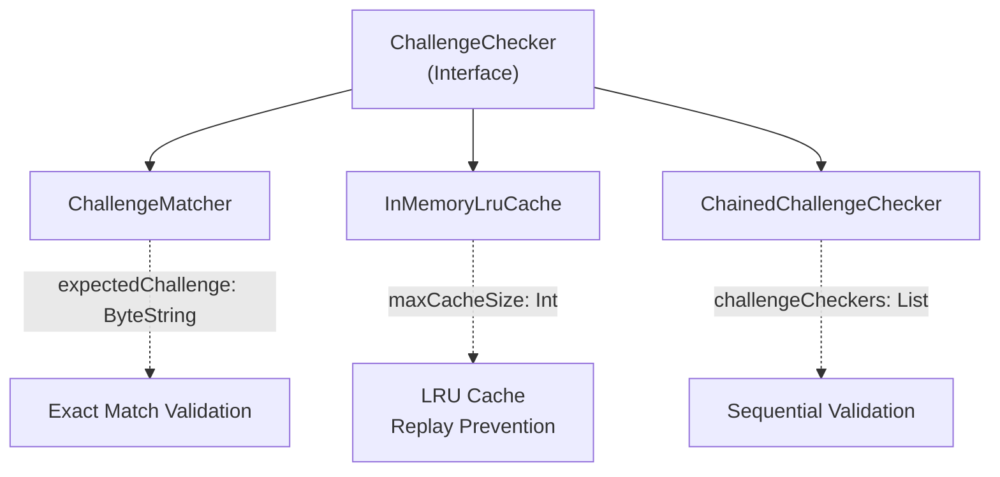
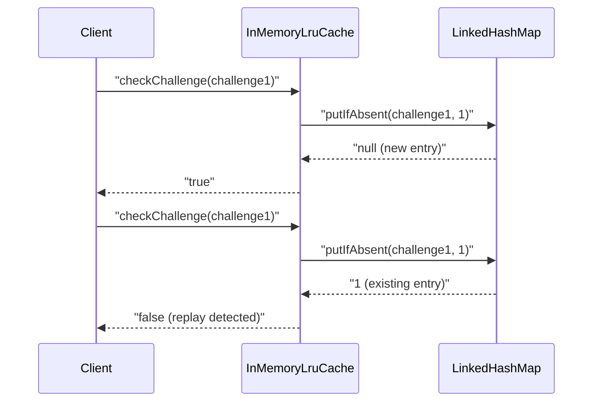
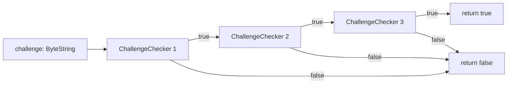
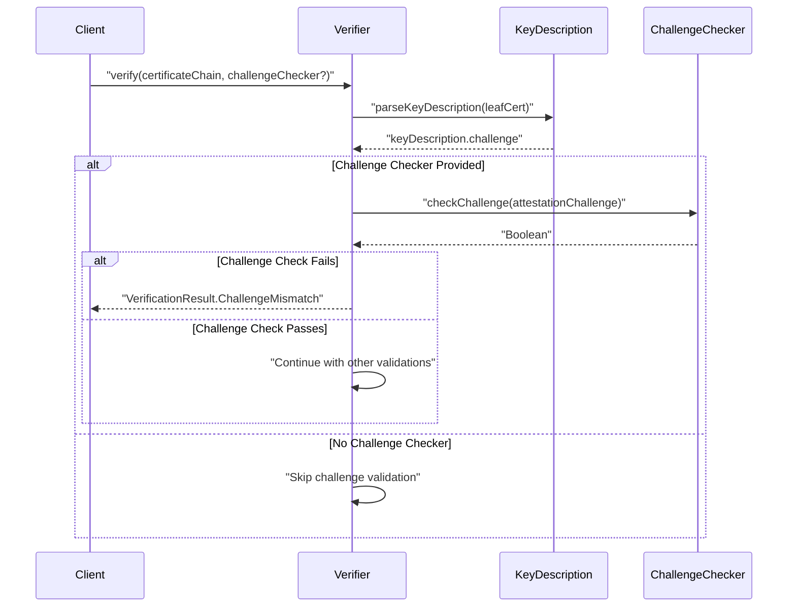

<!-- source: DeepWiki mcp.deepwiki.com · repo android/keyattestation · page 4 Challenge Verification · fetched 2026-10-23 -->

# Challenge Verification

<details>
<summary>Relevant source files</summary>

The following files were used as context for generating this wiki page:

- [src/main/kotlin/ChallengeChecker.kt](src/main/kotlin/ChallengeChecker.kt)
- [src/main/kotlin/challengecheckers/ChainedChallengeChecker.kt](src/main/kotlin/challengecheckers/ChainedChallengeChecker.kt)
- [src/main/kotlin/challengecheckers/ChallengeMatcher.kt](src/main/kotlin/challengecheckers/ChallengeMatcher.kt)
- [src/main/kotlin/challengecheckers/InMemoryLruCache.kt](src/main/kotlin/challengecheckers/InMemoryLruCache.kt)
- [src/test/kotlin/challengecheckers/ChainedChallengeCheckerTest.kt](src/test/kotlin/challengecheckers/ChainedChallengeCheckerTest.kt)
- [src/test/kotlin/challengecheckers/ChallengeMatcherTest.kt](src/test/kotlin/challengecheckers/ChallengeMatcherTest.kt)
- [src/test/kotlin/challengecheckers/InMemoryLruCacheTest.kt](src/test/kotlin/challengecheckers/InMemoryLruCacheTest.kt)

</details>


This document covers the challenge verification mechanisms in the Android Key Attestation library. Challenge verification ensures that attestation certificates contain expected challenge values and prevents replay attacks through various validation strategies. The system provides a pluggable interface for different challenge checking strategies including exact matching, replay prevention via LRU caching, and chained validation.

For information about the overall verification process that uses challenge checkers, see [Core Verification System](#2). For details about attestation data parsing, see [Attestation Data Models](#2.2).

## Challenge Checker Interface

The challenge verification system is built around the `ChallengeChecker` interface, which provides a simple contract for validating challenge values extracted from attestation certificates.



**ChallengeChecker Interface Structure**

The core interface defines a single method for challenge validation:

| Method | Parameters | Return Type | Purpose |
|--------|------------|-------------|---------|
| `checkChallenge` | `challenge: ByteString` | `Boolean` | Validates the given challenge |

Sources: [src/main/kotlin/ChallengeChecker.kt:6-14]()

## Challenge Checker Implementations

### ChallengeMatcher

`ChallengeMatcher` provides basic exact-match validation against a pre-defined expected challenge value.

**Key Characteristics:**
- Performs byte-for-byte equality comparison
- Supports construction from both `ByteString` and `ByteArray`
- Stateless operation - no side effects

**Constructor Options:**
```kotlin
ChallengeMatcher(expectedChallenge: ByteString)
ChallengeMatcher(expectedChallenge: ByteArray)  // Convenience constructor
```

Sources: [src/main/kotlin/challengecheckers/ChallengeMatcher.kt:1-16]()

### InMemoryLruCache

`InMemoryLruCache` prevents challenge replay attacks by maintaining an LRU cache of previously seen challenges. This implementation is essential for preventing attestation replay attacks in production systems.

**Key Features:**
- **Replay Prevention**: Rejects challenges that have been seen before
- **LRU Eviction**: Automatically removes oldest entries when cache is full
- **Access-Order Tracking**: Checking a challenge updates its position in the cache

**Implementation Details:**
- Uses `LinkedHashMap` with access-order tracking
- Configurable maximum cache size
- Thread-unsafe (suitable for single-threaded verification scenarios)



**Cache Overflow Behavior:**
When the cache exceeds `maxCacheSize`, the least recently used entry is automatically removed via the `removeEldestEntry` override.

Sources: [src/main/kotlin/challengecheckers/InMemoryLruCache.kt:1-30]()

### ChainedChallengeChecker

`ChainedChallengeChecker` enables composition of multiple challenge validation strategies by chaining them in sequence with fail-fast behavior.

**Key Characteristics:**
- **Sequential Execution**: Checkers are evaluated in order
- **Fail-Fast**: Stops on first failure, remaining checkers are not called
- **Composition**: Combines multiple validation strategies
- **Empty Chain Behavior**: Returns `true` when no checkers are provided



**Factory Methods:**
- `ChainedChallengeChecker(challengeCheckers: List<ChallengeChecker>)` - Primary constructor
- `ChainedChallengeChecker.of(vararg challengeCheckers: ChallengeChecker)` - Varargs convenience method

Sources: [src/main/kotlin/challengecheckers/ChainedChallengeChecker.kt:1-43]()

## Integration with Verification Process

Challenge checkers integrate with the main verification system through the `Verifier` class. The verification process extracts the challenge from the attestation certificate and passes it to the provided challenge checker.



**Verification Result Integration:**
- Challenge validation failure results in `VerificationResult.ChallengeMismatch`
- Successful challenge validation allows verification to proceed
- Missing challenge checker skips challenge validation entirely

Sources: [src/test/kotlin/challengecheckers/ChallengeMatcherTest.kt:35-48]()

## Common Usage Patterns

### Basic Challenge Matching
```kotlin
val expectedChallenge = ByteString.copyFromUtf8("my-challenge")
val checker = ChallengeMatcher(expectedChallenge)
```

### Replay Prevention
```kotlin
val replayPrevention = InMemoryLruCache(maxCacheSize = 1000)
```

### Combined Validation Strategy
```kotlin
val combinedChecker = ChainedChallengeChecker.of(
    ChallengeMatcher(expectedChallenge),
    InMemoryLruCache(1000)
)
```

This pattern ensures both exact challenge matching and replay prevention in a single validation step.

Sources: [src/test/kotlin/challengecheckers/ChainedChallengeCheckerTest.kt:42-43]()

## Testing Infrastructure

The challenge checker implementations include comprehensive test coverage demonstrating various scenarios:

**ChallengeMatcher Tests:**
- Exact challenge matching validation
- Integration with full verification flow
- Mismatch handling and error conditions

**InMemoryLruCache Tests:**
- Cache overflow and LRU eviction behavior  
- Access-order impact on cache management
- Replay detection accuracy

**ChainedChallengeChecker Tests:**
- Sequential validation with fail-fast behavior
- Empty checker list handling
- Early termination optimization

Sources: [src/test/kotlin/challengecheckers/ChallengeMatcherTest.kt:1-50](), [src/test/kotlin/challengecheckers/InMemoryLruCacheTest.kt:1-79](), [src/test/kotlin/challengecheckers/ChainedChallengeCheckerTest.kt:1-80]()

---

