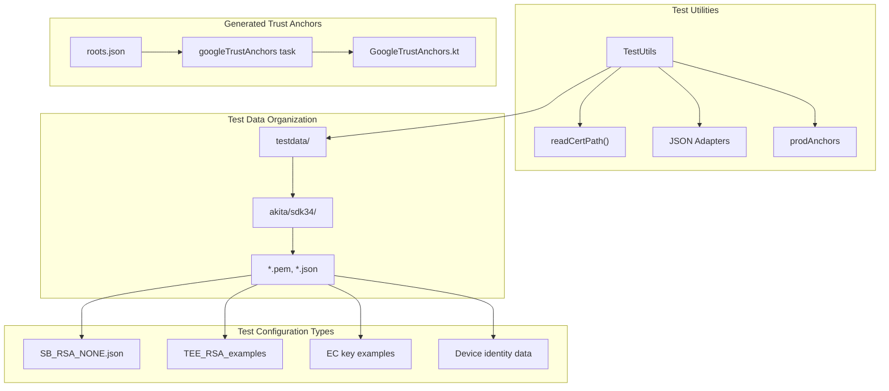
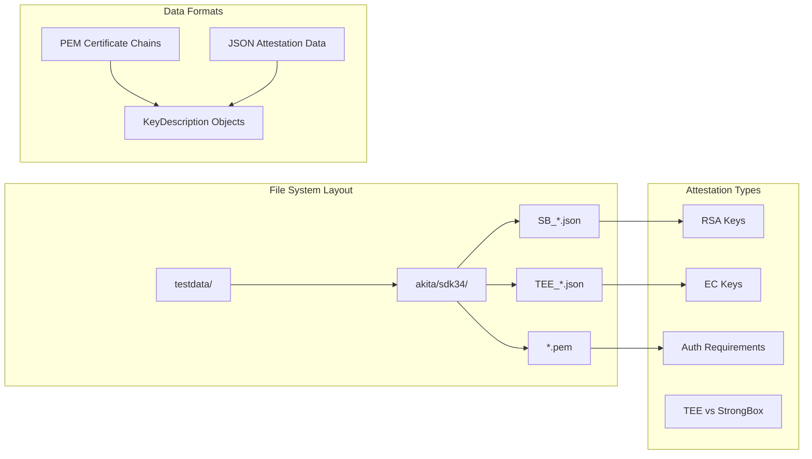
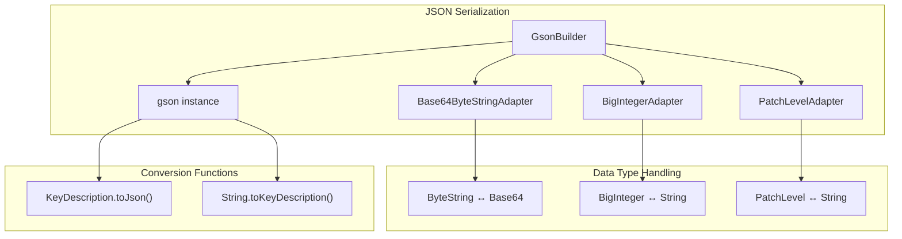
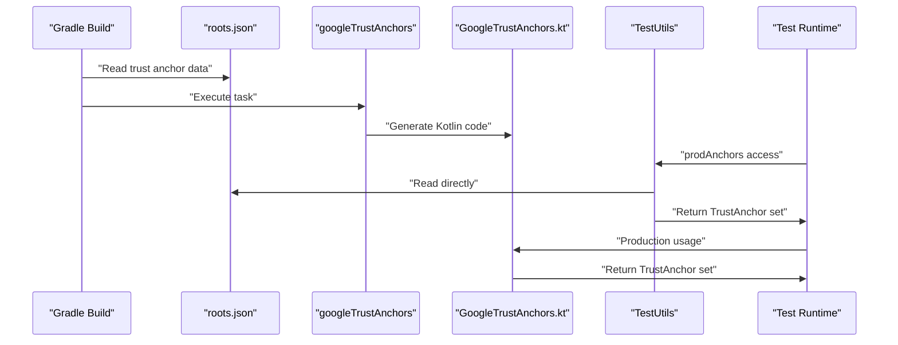

<!-- source: DeepWiki mcp.deepwiki.com · repo android/keyattestation · page 5 Testing and Examples · fetched 2026-10-23 -->

# Testing and Examples

Relevant source files

The following files were used as context for generating this wiki page:

- [build.gradle.kts](build.gradle.kts)
- [src/main/kotlin/testing/TestUtils.kt](src/main/kotlin/testing/TestUtils.kt)
- [testdata/akita/sdk34/SB_RSA_NONE.json](testdata/akita/sdk34/SB_RSA_NONE.json)

This document provides an overview of the testing framework and example attestation data included with the Android Key Attestation verification library. The testing infrastructure is designed to validate the library against real-world attestation data from various Android devices and security configurations.

For detailed information about specific testing utilities, see [Test Framework](#5.1). For comprehensive attestation examples, see [Attestation Examples](#5.2), [StrongBox vs TEE Examples](#5.3), and [Device Identity Attestations](#5.4).

## Testing Architecture Overview

The testing framework consists of three main components: test utilities for loading attestation data, a comprehensive set of real-world attestation examples, and support for both production and test trust anchor configurations.

### Testing Infrastructure

**Sources:** [src/main/kotlin/testing/TestUtils.kt:45-76](), [build.gradle.kts:52-86]()

## Test Data Organization

The test data is systematically organized to cover different Android device configurations and security levels. The data includes both certificate chains (PEM format) and parsed attestation information (JSON format).

### Test Data Structure

**Sources:** [src/main/kotlin/testing/TestUtils.kt:47-50](), [testdata/akita/sdk34/SB_RSA_NONE.json:1-38]()

## Core Testing Utilities

The `TestUtils` object provides essential functionality for loading and parsing test attestation data. It handles both certificate chain parsing from PEM files and JSON serialization of attestation data structures.

| Function | Purpose | Input Format | Output Type |
|----------|---------|--------------|-------------|
| `readCertPath(subpath)` | Load certificate chain from testdata | PEM file path | `KeyAttestationCertPath` |
| `readCertPath(reader)` | Parse certificate chain from reader | PEM format | `KeyAttestationCertPath` |
| `prodAnchors` | Load production trust anchors | roots.json | `Set<TrustAnchor>` |
| `toJson()` | Serialize KeyDescription | `KeyDescription` | JSON string |
| `toKeyDescription()` | Deserialize KeyDescription | JSON string | `KeyDescription` |

**Sources:** [src/main/kotlin/testing/TestUtils.kt:49-76](), [src/main/kotlin/testing/TestUtils.kt:110-112]()

## JSON Serialization Support

The testing framework includes custom JSON adapters to handle complex data types used in attestation data. These adapters ensure proper serialization and deserialization of binary data and specialized types.

### Custom JSON Adapters

**Sources:** [src/main/kotlin/testing/TestUtils.kt:78-112]()

## Example Attestation Data Structure

The test data includes comprehensive examples showing the structure of real Android Key Attestation data. Each example demonstrates different security configurations and device characteristics.

### StrongBox RSA Attestation Example

The following table shows the key fields from a StrongBox RSA attestation example:

| Field | Value | Description |
|-------|--------|-------------|
| `attestationVersion` | "300" | KeyMint version 3.0 |
| `attestationSecurityLevel` | "STRONG_BOX" | Hardware security module |
| `keyMintVersion` | "300" | KeyMint implementation version |
| `attestationChallenge` | "Y2hhbGxlbmdl" | Base64 encoded challenge |
| `hardwareEnforced.purposes` | ["2"] | Encryption purpose |
| `hardwareEnforced.keySize` | "2048" | RSA key size |
| `hardwareEnforced.algorithms` | "1" | RSA algorithm |
| `hardwareEnforced.origin` | "GENERATED" | Key generated in hardware |
| `softwareEnforced.creationDateTime` | "1727389887639" | Unix timestamp |

**Sources:** [testdata/akita/sdk34/SB_RSA_NONE.json:1-38]()

## Trust Anchor Management

The testing framework supports both production and test trust anchor configurations through a dual approach: build-time generated anchors for production use and runtime loading for testing flexibility.

### Trust Anchor Generation Flow

**Sources:** [build.gradle.kts:52-86](), [src/main/kotlin/testing/TestUtils.kt:67-72]()

## Testing Dependencies and Configuration

The project uses several testing libraries to ensure comprehensive validation of the attestation verification process:

- **JUnit Platform**: Modern testing framework with JUnit 4 compatibility
- **Test Parameter Injector**: Google's parameterized testing library
- **Truth**: Fluent assertion library for clear test failures
- **Gson**: JSON serialization for test data handling
- **BouncyCastle**: Cryptographic operations and certificate parsing

**Sources:** [build.gradle.kts:33-47]()

---

