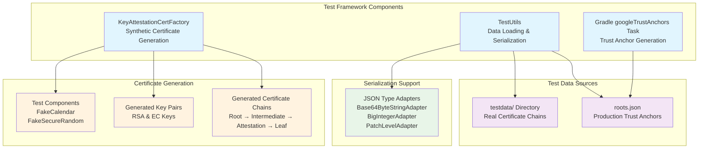
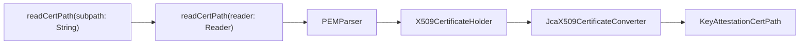
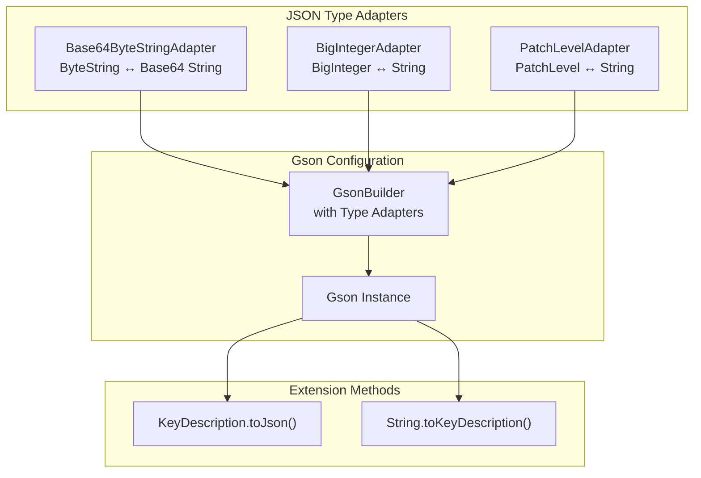
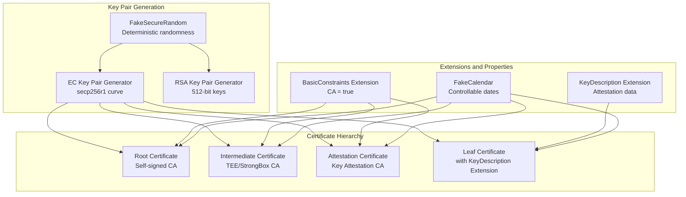
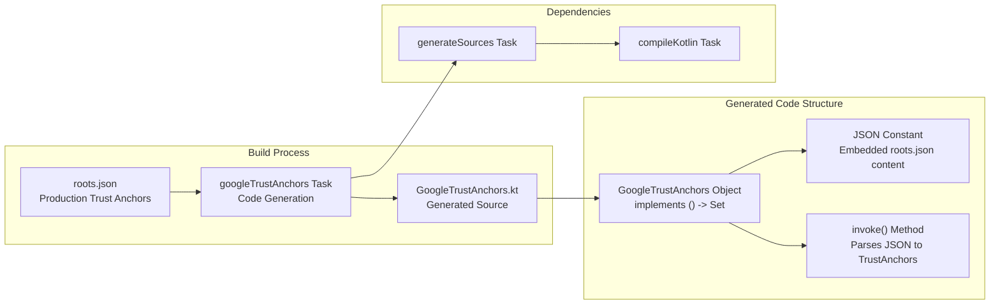

<!-- source: DeepWiki mcp.deepwiki.com · repo android/keyattestation · page 5.1 Test Framework · fetched 2026-10-23 -->

# Test Framework

Relevant source files

The following files were used as context for generating this wiki page:

- [build.gradle.kts](build.gradle.kts)
- [src/main/kotlin/testing/KeyAttestationCertFactory.kt](src/main/kotlin/testing/KeyAttestationCertFactory.kt)
- [src/main/kotlin/testing/TestUtils.kt](src/main/kotlin/testing/TestUtils.kt)

The Test Framework provides comprehensive testing infrastructure for the Android Key Attestation verification library. It includes utilities for loading test data, generating synthetic certificates, and integrating with the build system to provide test environments that closely mirror production scenarios.

This document covers the testing utilities, certificate factories, and build system integration. For actual attestation examples and test data, see [Attestation Examples](#5.2).

## Test Framework Architecture

The testing infrastructure is built around three main components: `TestUtils` for data loading and serialization, `KeyAttestationCertFactory` for synthetic certificate generation, and build system integration for trust anchor management.

**Sources:** [src/main/kotlin/testing/TestUtils.kt:1-113](), [src/main/kotlin/testing/KeyAttestationCertFactory.kt:1-208](), [build.gradle.kts:52-86]()

## TestUtils Class

The `TestUtils` object provides core utilities for loading test data and managing trust anchors during testing. It serves as the primary interface for accessing both real attestation data and production trust anchors.

### Certificate Path Loading

`TestUtils` provides methods to load certificate chains from PEM-formatted files in the test data directory:

**Sources:** [src/main/kotlin/testing/TestUtils.kt:49-65]()

### Trust Anchor Management

The `prodAnchors` property provides lazy-loaded access to production trust anchors for testing verification against real Google root certificates:

| Component | Type | Purpose |
|-----------|------|---------|
| `PROD_ROOT_PATH` | `String` | Path to production root certificates JSON |
| `prodAnchors` | `Set<TrustAnchor>` | Lazy-loaded production trust anchors |
| `TESTDATA_PATH` | `String` | Base path for test certificate data |

**Sources:** [src/main/kotlin/testing/TestUtils.kt:46-72]()

## JSON Serialization Support

The test framework includes specialized JSON adapters for complex data types used in key attestation, enabling serialization and deserialization of `KeyDescription` objects for test data management.

### Type Adapters

**Sources:** [src/main/kotlin/testing/TestUtils.kt:78-112]()

## KeyAttestationCertFactory

The `KeyAttestationCertFactory` class generates synthetic certificate chains for testing scenarios where real attestation certificates are not available or suitable. It creates complete certificate hierarchies with configurable properties.

### Certificate Chain Generation

The factory generates a complete certificate hierarchy following the Android Key Attestation specification:

**Sources:** [src/main/kotlin/testing/KeyAttestationCertFactory.kt:47-191]()

### Test KeyDescription Extension

The factory includes a pre-configured `KeyDescription` extension for leaf certificates that provides realistic attestation data:

| Property | Value | Purpose |
|----------|-------|---------|
| `attestationVersion` | `1` | Key Attestation version |
| `attestationSecurityLevel` | `TRUSTED_ENVIRONMENT` | TEE-based attestation |
| `keyMintVersion` | `1` | KeyMint version |
| `keyMintSecurityLevel` | `TRUSTED_ENVIRONMENT` | TEE-based KeyMint |
| `attestationChallenge` | Random 40-byte challenge | Test challenge data |
| `rootOfTrust` | Configured with test values | Boot state validation |

**Sources:** [src/main/kotlin/testing/KeyAttestationCertFactory.kt:124-145]()

## Build System Integration

The build system includes a custom Gradle task that generates trust anchor code from the production roots JSON file, ensuring tests can verify against the same trust anchors used in production.

### GoogleTrustAnchors Task

**Sources:** [build.gradle.kts:52-101]()

### Task Configuration

The `googleTrustAnchors` task is configured with proper input/output dependencies to ensure incremental builds work correctly:

| Configuration | Value | Purpose |
|---------------|-------|---------|
| Input files | `roots.json` | Trigger rebuild when roots change |
| Output file | `GoogleTrustAnchors.kt` | Generated source location |
| Generated package | `com.android.keyattestation.verifier` | Main package namespace |
| Source set | `main/kotlin` | Integration with Kotlin compilation |

**Sources:** [build.gradle.kts:53-96]()

## Test Dependencies

The test framework integrates with several external libraries to provide comprehensive testing capabilities:

| Library | Version | Purpose |
|---------|---------|---------|
| `kotlin-test` | 2.2.0 | Kotlin testing framework |
| `test-parameter-injector` | 1.18 | Parameterized testing |
| `truth` | 1.4.4 | Assertion library |
| `junit-vintage-engine` | - | JUnit 4 compatibility |
| `gson` | 2.11.0 | JSON serialization |
| `bcpkix-jdk18on` | 1.78.1 | Certificate generation |

**Sources:** [build.gradle.kts:25-38]()

---

