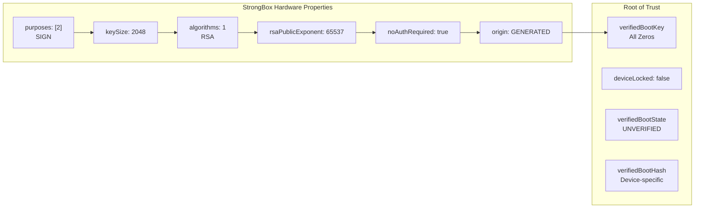
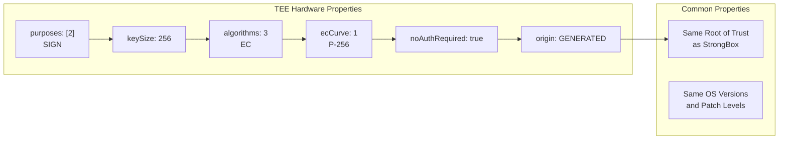
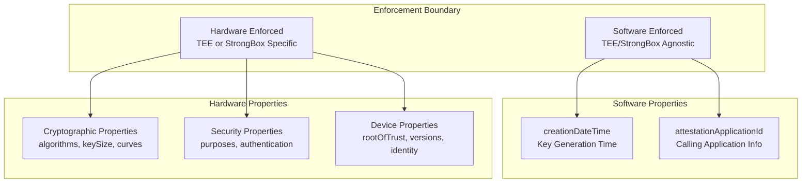

<!-- source: DeepWiki mcp.deepwiki.com · repo android/keyattestation · page 5.2 Attestation Examples · fetched 2026-10-23 -->

# Attestation Examples

<details>
<summary>Relevant source files</summary>

The following files were used as context for generating this wiki page:

- [testdata/akita/sdk34/SB_RSA_NONE.json](testdata/akita/sdk34/SB_RSA_NONE.json)
- [testdata/akita/sdk34/TEE_EC_NONE.json](testdata/akita/sdk34/TEE_EC_NONE.json)
- [testdata/akita/sdk34/TEE_RSA_BASE+IMEI.json](testdata/akita/sdk34/TEE_RSA_BASE+IMEI.json)
- [testdata/blueline/sdk28/SB_RSA_NONE.json](testdata/blueline/sdk28/SB_RSA_NONE.json)

</details>


## Purpose and Scope

This document provides detailed examples of real Android Key Attestation data from different device configurations and security levels. These examples demonstrate how attestation certificates encode device identity, security properties, and cryptographic key information in practice. 

For information about the test framework infrastructure, see [Test Framework](#5.1). For detailed comparisons between StrongBox and TEE implementations, see [StrongBox vs TEE Examples](#5.3). For device identity-specific attestations, see [Device Identity Attestations](#5.4).

## Test Data Organization

The library includes comprehensive attestation examples organized by device and Android SDK version:

```mermaid
graph TB
    TestData[/"testdata/"]
    
    subgraph "Device Types"
        Akita[/"akita/"<br/>"Pixel 8a"]
        Blueline[/"blueline/"<br/>"Pixel 3"]
    end
    
    subgraph "SDK Versions"
        SDK34[/"sdk34/"<br/>"Android 14"]
        SDK28[/"sdk28/"<br/>"Android 9"]
    end
    
    subgraph "Attestation Variants"
        SBRSA["SB_RSA_NONE.json"<br/>"StrongBox RSA"]
        TEEEC["TEE_EC_NONE.json"<br/>"TEE Elliptic Curve"]
        TEERSAIMEI["TEE_RSA_BASE+IMEI.json"<br/>"TEE RSA with Device Identity"]
    end
    
    TestData --> Akita
    TestData --> Blueline
    
    Akita --> SDK34
    Blueline --> SDK28
    
    SDK34 --> SBRSA
    SDK34 --> TEEEC
    SDK34 --> TEERSAIMEI
    SDK28 --> SBRSA
```

Sources: [testdata/akita/sdk34/SB_RSA_NONE.json:1-39](), [testdata/akita/sdk34/TEE_EC_NONE.json:1-39](), [testdata/akita/sdk34/TEE_RSA_BASE+IMEI.json:1-41](), [testdata/blueline/sdk28/SB_RSA_NONE.json:1-39]()

## Attestation Data Structure

All attestation examples follow a consistent JSON structure that maps directly to the `KeyDescription` class:

```mermaid
graph TD
    subgraph "Top Level Fields"
        AttVer["attestationVersion"]
        AttSecLevel["attestationSecurityLevel"]
        KeyMintVer["keyMintVersion"]
        KeyMintSecLevel["keyMintSecurityLevel"]
        Challenge["attestationChallenge"]
        UniqueId["uniqueId"]
    end
    
    subgraph "Authorization Lists"
        SoftEnf["softwareEnforced"<br/>"AuthorizationList"]
        HardEnf["hardwareEnforced"<br/>"AuthorizationList"]
    end
    
    subgraph "Software Enforced Properties"
        CreationTime["creationDateTime"]
        AppId["attestationApplicationId"]
        Packages["packages[]"]
        Signatures["signatures[]"]
    end
    
    subgraph "Hardware Enforced Properties"
        Purposes["purposes[]"]
        KeySize["keySize"]
        Algorithms["algorithms"]
        AlgParams["Algorithm Parameters"<br/>"rsaPublicExponent, ecCurve"]
        NoAuth["noAuthRequired"]
        Origin["origin"]
        RootTrust["rootOfTrust"]
        Versions["OS/Patch Versions"]
        DeviceIds["attestationId* fields"]
    end
    
    AttVer --> SoftEnf
    AttSecLevel --> SoftEnf
    Challenge --> SoftEnf
    
    SoftEnf --> CreationTime
    SoftEnf --> AppId
    AppId --> Packages
    AppId --> Signatures
    
    HardEnf --> Purposes
    HardEnf --> KeySize  
    HardEnf --> Algorithms
    HardEnf --> AlgParams
    HardEnf --> NoAuth
    HardEnf --> Origin
    HardEnf --> RootTrust
    HardEnf --> Versions
    HardEnf --> DeviceIds
```

Sources: [testdata/akita/sdk34/SB_RSA_NONE.json:1-39](), [testdata/akita/sdk34/TEE_EC_NONE.json:1-39]()

## Security Level Comparison

### StrongBox vs TEE Examples

| Property | StrongBox Example | TEE Example |
|----------|-------------------|-------------|
| **attestationSecurityLevel** | `"STRONG_BOX"` | `"TRUSTED_ENVIRONMENT"` |
| **keyMintSecurityLevel** | `"STRONG_BOX"` | `"TRUSTED_ENVIRONMENT"` |
| **attestationVersion** | `"300"` | `"300"` |
| **keyMintVersion** | `"300"` | `"300"` |

#### StrongBox RSA 2048 Configuration



Sources: [testdata/akita/sdk34/SB_RSA_NONE.json:20-37]()

#### TEE Elliptic Curve Configuration



Sources: [testdata/akita/sdk34/TEE_EC_NONE.json:20-37]()

## Algorithm-Specific Parameters

### RSA vs EC Key Properties

| Algorithm | Key Size | Specific Parameters | Example Files |
|-----------|----------|-------------------|---------------|
| **RSA (algorithm: 1)** | 2048 bits | `rsaPublicExponent: 65537` | `SB_RSA_NONE.json`, `TEE_RSA_BASE+IMEI.json` |
| **EC (algorithm: 3)** | 256 bits | `ecCurve: 1` (P-256) | `TEE_EC_NONE.json` |

#### RSA Parameter Encoding
- Algorithm identifier: `"algorithms": "1"`
- Standard exponent: `"rsaPublicExponent": "65537"`
- Key size: `"keySize": "2048"`

#### EC Parameter Encoding  
- Algorithm identifier: `"algorithms": "3"`
- Curve identifier: `"ecCurve": "1"` (corresponds to P-256)
- Key size: `"keySize": "256"`

Sources: [testdata/akita/sdk34/SB_RSA_NONE.json:22-24](), [testdata/akita/sdk34/TEE_EC_NONE.json:22-24](), [testdata/akita/sdk34/TEE_RSA_BASE+IMEI.json:17-19]()

## Device Identity Examples

The TEE RSA with device identity example demonstrates how device-specific information is encoded:

### Device Identity Fields

```mermaid
graph TB
    subgraph "Device Identity Properties"
        Brand["attestationIdBrand: google"]
        Device["attestationIdDevice: akita"]
        Product["attestationIdProduct: akita"]
        Manufacturer["attestationIdManufacturer: Google"]
        Model["attestationIdModel: Pixel 8a"]
        IMEI1["attestationIdImei: 351163520096208"]
        IMEI2["attestationIdSecondImei: 351163520096216"]
    end
    
    subgraph "Application Context"
        AppName["AndroidSystem"]
        AppVersion["version: 1"]
        NoSigs["signatures: []<br/>Empty for system"]
    end
    
    Brand --> Device
    Device --> Product  
    Product --> Manufacturer
    Manufacturer --> Model
    Model --> IMEI1
    IMEI1 --> IMEI2
    
    AppName --> AppVersion
    AppVersion --> NoSigs
```



Sources: [testdata/akita/sdk34/TEE_RSA_BASE+IMEI.json:30-38](), [testdata/akita/sdk34/TEE_RSA_BASE+IMEI.json:10-13]()

## Version Evolution Examples

### Android SDK 34 vs SDK 28

| Property | SDK 34 (Pixel 8a) | SDK 28 (Pixel 3) |
|----------|-------------------|-------------------|
| **attestationVersion** | `"300"` | `"3"` |
| **keyMintVersion** | `"300"` | `"4"` |
| **osVersion** | `"140000"` (Android 14) | `"90000"` (Android 9) |
| **osPatchLevel** | `"202408"` | `"201908"` |
| **verifiedBootHash** | Device-specific newer hash | Device-specific older hash |

#### Attestation Version Mapping
- SDK 34: Uses attestation version `300` (KeyMint 3.0)
- SDK 28: Uses attestation version `3` (Keymaster 4.0)

Sources: [testdata/akita/sdk34/SB_RSA_NONE.json:2-4](), [testdata/blueline/sdk28/SB_RSA_NONE.json:2-4](), [testdata/akita/sdk34/SB_RSA_NONE.json:33-36](), [testdata/blueline/sdk28/SB_RSA_NONE.json:33-36]()

## Software vs Hardware Enforcement

### Software Enforced Properties
All examples show consistent software-enforced properties:
- **creationDateTime**: Timestamp when key was generated
- **attestationApplicationId**: Contains package information and signatures

### Hardware Enforced Properties  
Hardware-enforced properties vary based on security level and device configuration:
- **Cryptographic properties**: Key size, algorithms, curve parameters
- **Usage constraints**: Purposes, authentication requirements
- **Device state**: Root of trust, boot verification status
- **Version information**: OS version, patch levels
- **Device identity**: Brand, model, IMEI (when requested)



Sources: [testdata/akita/sdk34/SB_RSA_NONE.json:8-18](), [testdata/akita/sdk34/SB_RSA_NONE.json:20-37](), [testdata/akita/sdk34/TEE_EC_NONE.json:8-18](), [testdata/akita/sdk34/TEE_EC_NONE.json:20-37]()

---

