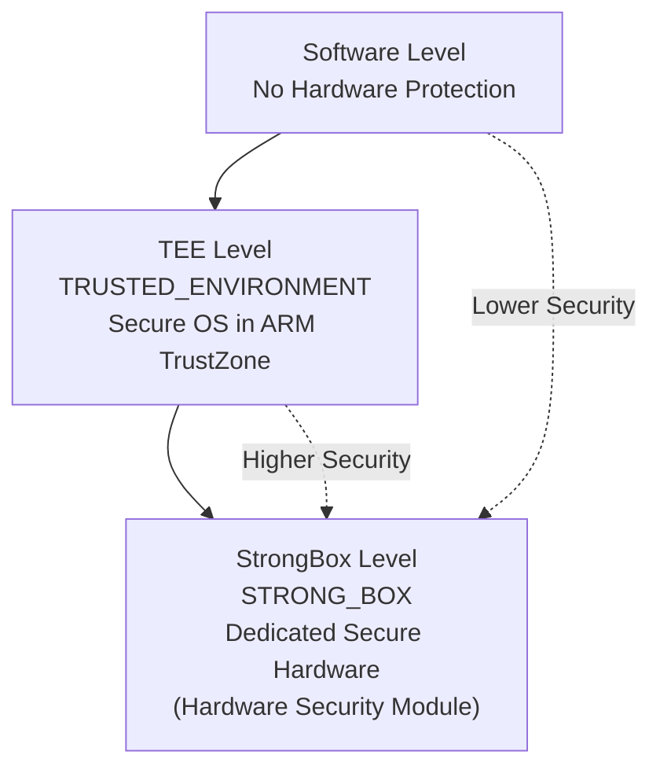
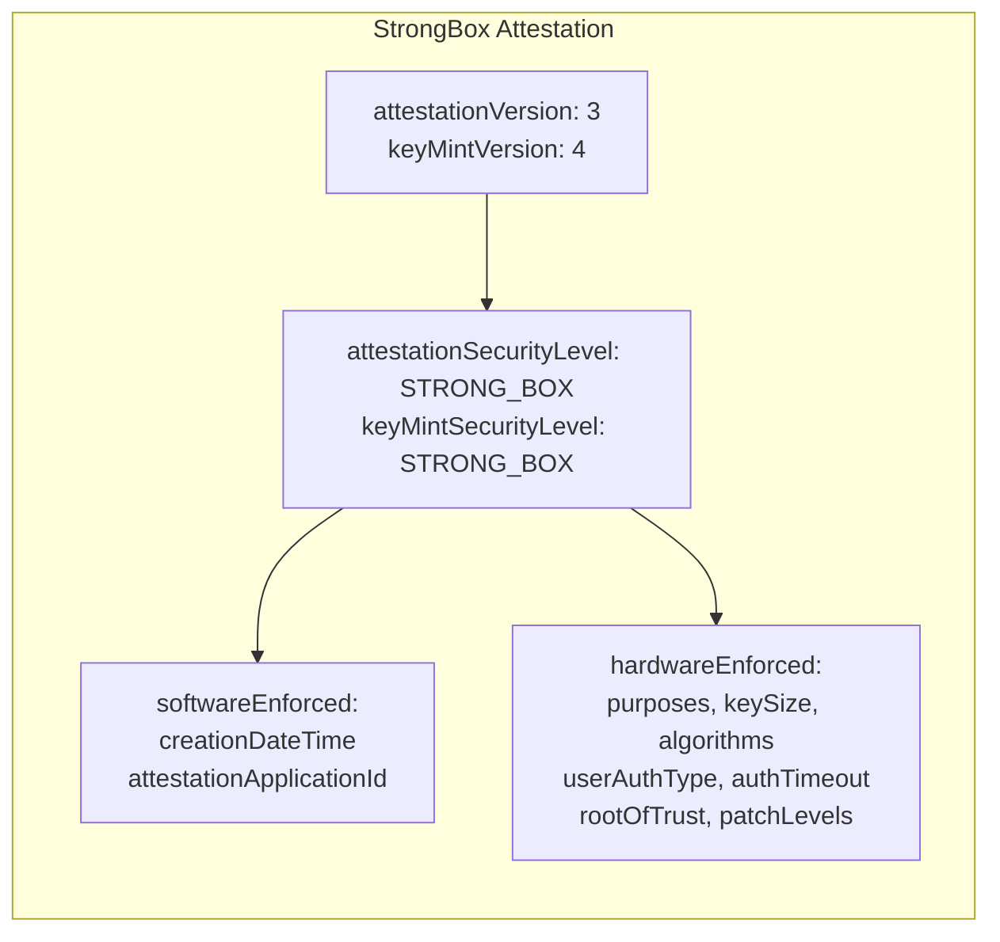
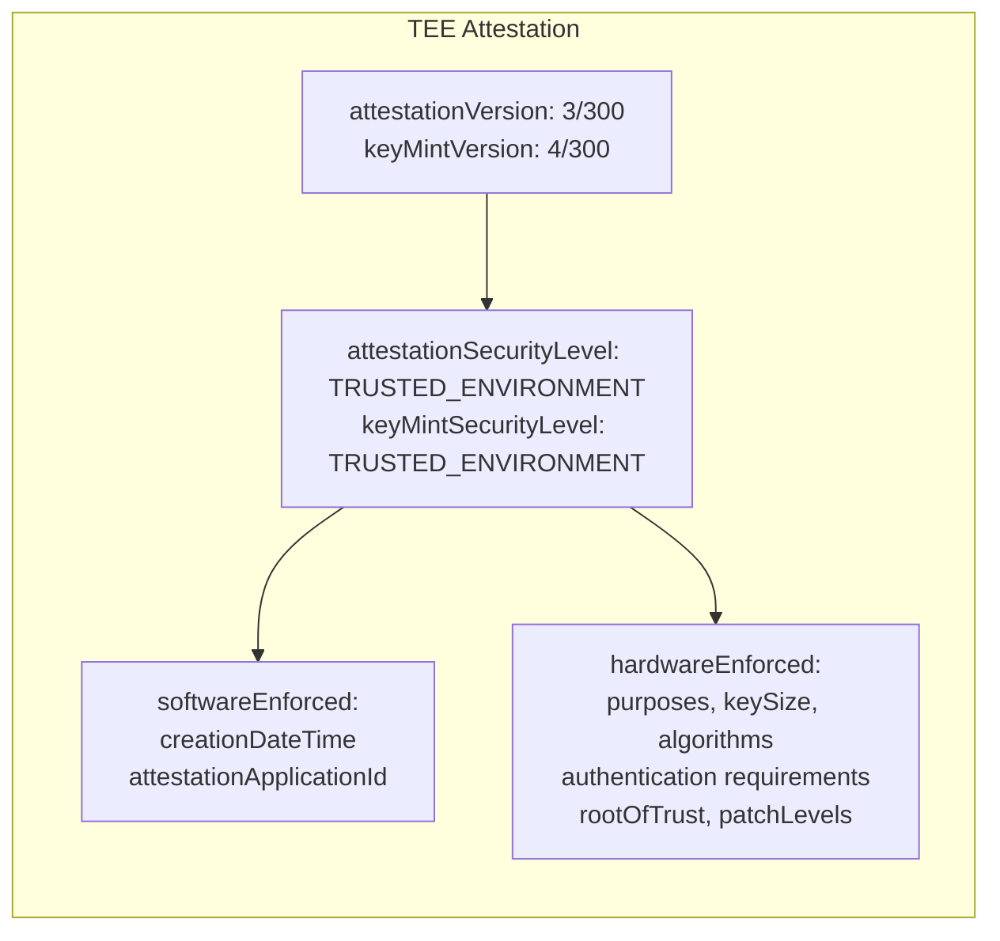
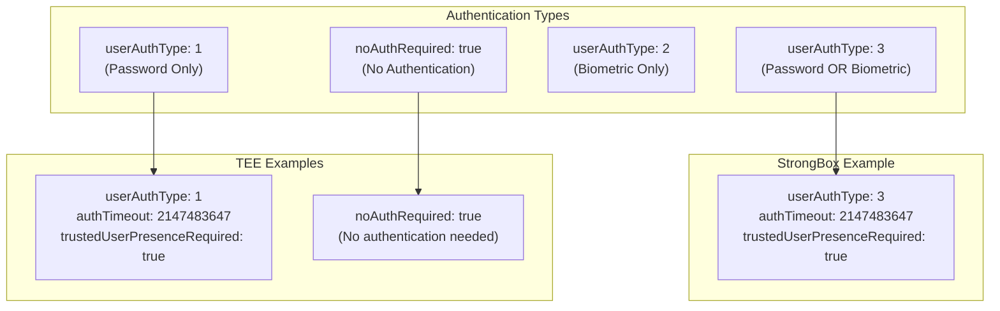
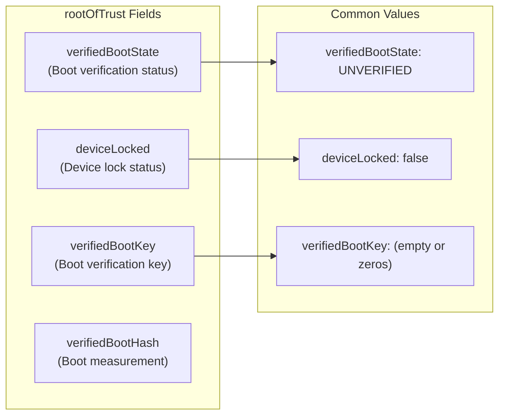
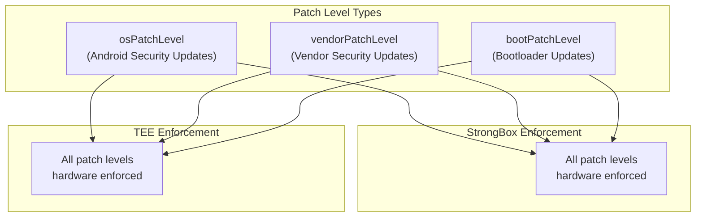

<!-- source: DeepWiki mcp.deepwiki.com · repo android/keyattestation · page 5.3 StrongBox vs TEE Examples · fetched 2026-10-23 -->

# StrongBox vs TEE Examples

Relevant source files

The following files were used as context for generating this wiki page:

- [testdata/akita/sdk34/TEE_RSA_NONE_USERAUTH.json](testdata/akita/sdk34/TEE_RSA_NONE_USERAUTH.json)
- [testdata/blueline/sdk28/SB_RSA_NONE_USERAUTH.json](testdata/blueline/sdk28/SB_RSA_NONE_USERAUTH.json)
- [testdata/blueline/sdk28/TEE_EC_NONE.json](testdata/blueline/sdk28/TEE_EC_NONE.json)

This page provides practical examples comparing StrongBox and Trusted Execution Environment (TEE) attestations, demonstrating the key differences in security levels, authentication requirements, and key management capabilities. The examples are drawn from real attestation test data to illustrate how these security environments differ in practice.

For general information about attestation data structures, see [Attestation Data Models](#2.2). For broader testing examples across different device configurations, see [Attestation Examples](#5.2).

## Security Level Comparison

Android Key Attestation supports two primary hardware-backed security levels: **StrongBox** and **Trusted Execution Environment (TEE)**. StrongBox provides a higher level of security isolation compared to TEE, with dedicated secure hardware specifically designed for key operations.

### Security Level Hierarchy

*Sources: [testdata/blueline/sdk28/SB_RSA_NONE_USERAUTH.json:3](), [testdata/blueline/sdk28/TEE_EC_NONE.json:3](), [testdata/akita/sdk34/TEE_RSA_NONE_USERAUTH.json:3]()*

## Attestation Structure Comparison

The fundamental difference between StrongBox and TEE attestations lies in the `attestationSecurityLevel` and `keyMintSecurityLevel` fields. Both security levels maintain the same overall attestation structure but differ in their security guarantees and enforcement capabilities.

### StrongBox Attestation Example

*Sources: [testdata/blueline/sdk28/SB_RSA_NONE_USERAUTH.json:2-5]()*

### TEE Attestation Example

*Sources: [testdata/blueline/sdk28/TEE_EC_NONE.json:2-5](), [testdata/akita/sdk34/TEE_RSA_NONE_USERAUTH.json:2-5]()*

## Key Type Support Comparison

Both StrongBox and TEE support multiple key types, but with different characteristics and security guarantees.

| Key Type | StrongBox Support | TEE Support | Example Files |
|----------|------------------|-------------|---------------|
| RSA 2048 | ✅ Full Support | ✅ Full Support | `SB_RSA_NONE_USERAUTH.json`, `TEE_RSA_NONE_USERAUTH.json` |
| EC P-256 | ✅ Full Support | ✅ Full Support | `TEE_EC_NONE.json` |
| Algorithm Field | `"algorithms": "1"` (RSA) | `"algorithms": "1"` (RSA) / `"algorithms": "3"` (EC) | Various test files |
| Key Size Field | `"keySize": "2048"` | `"keySize": "2048"` / `"keySize": "256"` | Hardware enforced section |

*Sources: [testdata/blueline/sdk28/SB_RSA_NONE_USERAUTH.json:21-25](), [testdata/akita/sdk34/TEE_RSA_NONE_USERAUTH.json:21-25](), [testdata/blueline/sdk28/TEE_EC_NONE.json:21-24]()*

## Authentication Requirements Differences

One of the key distinguishing factors between StrongBox and TEE attestations is how they handle user authentication requirements.

### Authentication Type Mapping

*Sources: [testdata/blueline/sdk28/SB_RSA_NONE_USERAUTH.json:26-28](), [testdata/akita/sdk34/TEE_RSA_NONE_USERAUTH.json:26-28](), [testdata/blueline/sdk28/TEE_EC_NONE.json:25]()*

### Authentication Timeout Values

Both security levels support authentication timeouts, but the interpretation differs:

| Field | StrongBox Value | TEE Value | Meaning |
|-------|----------------|-----------|---------|
| `authTimeout` | `2147483647` | `2147483647` | Maximum timeout (effectively unlimited) |
| `trustedUserPresenceRequired` | `true` | `true` | Requires user interaction for key usage |
| `userAuthType` | `3` (Combined) | `1` (Password) or `null` | Authentication method required |

*Sources: [testdata/blueline/sdk28/SB_RSA_NONE_USERAUTH.json:26-28](), [testdata/akita/sdk34/TEE_RSA_NONE_USERAUTH.json:26-28]()*

## Root of Trust Comparison

Both StrongBox and TEE attestations include `rootOfTrust` information, but the security guarantees differ based on the underlying hardware security.

### Root of Trust Structure

### Root of Trust Examples

| Security Level | Verified Boot Key | Device Locked | Boot State | Boot Hash Present |
|---------------|------------------|---------------|------------|-------------------|
| StrongBox | Empty/Zeros | `false` | `UNVERIFIED` | ✅ |
| TEE | Empty/Zeros | `false` | `UNVERIFIED` | ✅ |

*Sources: [testdata/blueline/sdk28/SB_RSA_NONE_USERAUTH.json:30-35](), [testdata/akita/sdk34/TEE_RSA_NONE_USERAUTH.json:30-35](), [testdata/blueline/sdk28/TEE_EC_NONE.json:27-32]()*

## Version and Patch Level Differences

Different devices and Android versions show varying KeyMint versions and patch levels across security environments.

### Version Comparison Table

| Device/SDK | Security Level | Attestation Version | KeyMint Version | OS Version | OS Patch Level |
|------------|---------------|-------------------|-----------------|------------|----------------|
| Blueline/SDK28 | StrongBox | `3` | `4` | `90000` | `201908` |
| Blueline/SDK28 | TEE | `3` | `4` | `90000` | `201908` |
| Akita/SDK34 | TEE | `300` | `300` | `140000` | `202408` |

### Patch Level Enforcement

*Sources: [testdata/blueline/sdk28/SB_RSA_NONE_USERAUTH.json:36-39](), [testdata/akita/sdk34/TEE_RSA_NONE_USERAUTH.json:36-39](), [testdata/blueline/sdk28/TEE_EC_NONE.json:33-36]()*

## Software vs Hardware Enforcement

Both StrongBox and TEE follow the same pattern for property enforcement, with certain properties enforced in software and others in hardware.

### Enforcement Pattern

| Property Category | Enforcement Level | Examples |
|------------------|------------------|----------|
| Application Identity | Software | `creationDateTime`, `attestationApplicationId` |
| Key Properties | Hardware | `purposes`, `keySize`, `algorithms`, `origin` |
| Authentication | Hardware | `userAuthType`, `authTimeout`, `trustedUserPresenceRequired` |
| Device Security | Hardware | `rootOfTrust`, patch levels |

The key difference is that StrongBox provides stronger hardware isolation for the hardware-enforced properties compared to TEE.

*Sources: [testdata/blueline/sdk28/SB_RSA_NONE_USERAUTH.json:8-40](), [testdata/akita/sdk34/TEE_RSA_NONE_USERAUTH.json:8-40](), [testdata/blueline/sdk28/TEE_EC_NONE.json:8-37]()*

---

