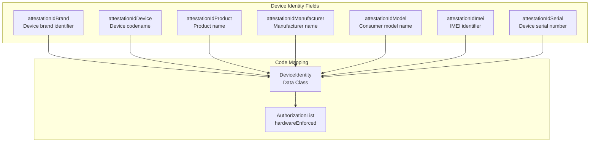
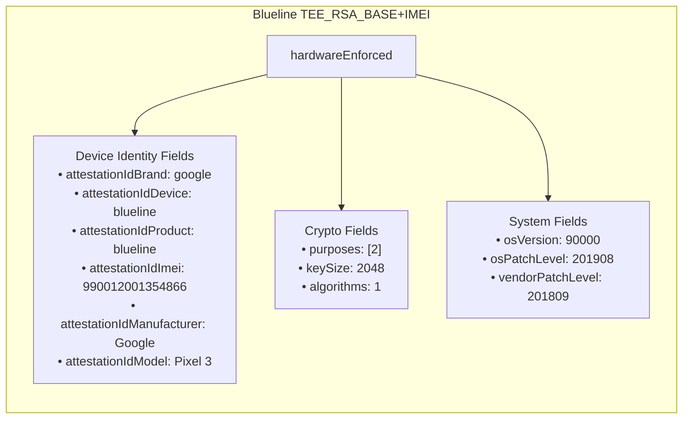
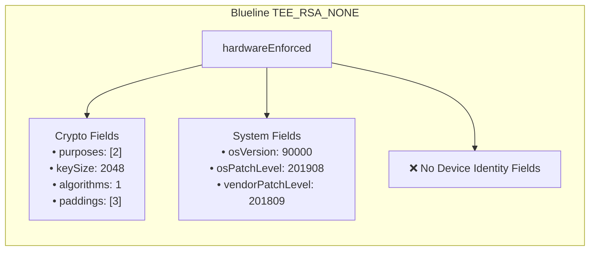
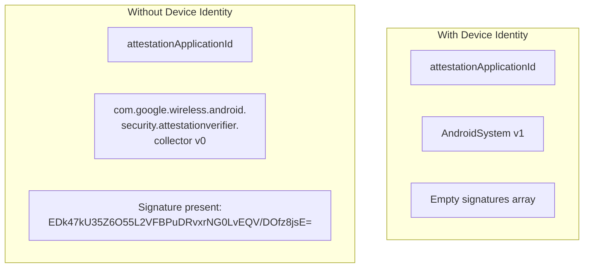

<!-- source: DeepWiki mcp.deepwiki.com · repo android/keyattestation · page 5.4 Device Identity Attestations · fetched 2026-10-23 -->

# Device Identity Attestations

Relevant source files

The following files were used as context for generating this wiki page:

- [testdata/blueline/sdk28/TEE_RSA_BASE+IMEI.json](testdata/blueline/sdk28/TEE_RSA_BASE+IMEI.json)
- [testdata/blueline/sdk28/TEE_RSA_NONE.json](testdata/blueline/sdk28/TEE_RSA_NONE.json)
- [testdata/marlin/sdk29/TEE_EC_NONE.json](testdata/marlin/sdk29/TEE_EC_NONE.json)
- [testdata/marlin/sdk29/TEE_RSA_NONE.json](testdata/marlin/sdk29/TEE_RSA_NONE.json)

## Purpose and Scope

This document demonstrates how device identity information is included in Android Key Attestations through real attestation examples. It shows the structure of device identity fields, when they are present or absent, and how they map to the underlying data structures used by the verification system.

For information about the overall attestation data models, see [Attestation Data Models](#2.2). For broader attestation examples covering different security levels, see [Attestation Examples](#5.2).

## Device Identity Fields Structure

Device identity information in Android Key Attestations consists of several standardized fields that uniquely identify the device hardware and manufacturing details. These fields are included in the `hardwareEnforced` section of the attestation when device identification is requested.

### Device Identity Data Model

**Sources:** [testdata/blueline/sdk28/TEE_RSA_BASE+IMEI.json:30-36]()

### Device Identity Field Mapping

| Attestation Field | Purpose | Example Value |
|------------------|---------|---------------|
| `attestationIdBrand` | Device brand | "google" |
| `attestationIdDevice` | Device codename | "blueline" |
| `attestationIdProduct` | Product identifier | "blueline" |
| `attestationIdManufacturer` | Manufacturer name | "Google" |
| `attestationIdModel` | Consumer model name | "Pixel 3" |
| `attestationIdImei` | IMEI number | "990012001354866" |

**Sources:** [testdata/blueline/sdk28/TEE_RSA_BASE+IMEI.json:30-35]()

## Comparison: With vs Without Device Identity

The presence of device identity fields depends on the attestation request parameters. The following comparison shows the difference between attestations that include device identity versus those that do not.

### Attestation With Device Identity

### Attestation Without Device Identity

**Sources:** [testdata/blueline/sdk28/TEE_RSA_BASE+IMEI.json:15-38](), [testdata/blueline/sdk28/TEE_RSA_NONE.json:20-38]()

## Device Identity Inclusion Patterns

### Attestation Types by Device Identity Presence

| Test Data File | Device Identity | Key Type | Security Level | Device |
|---------------|----------------|----------|----------------|---------|
| `TEE_RSA_BASE+IMEI.json` | ✅ Present | RSA 2048 | TEE | Pixel 3 (blueline) |
| `TEE_RSA_NONE.json` | ❌ Absent | RSA 2048 | TEE | Pixel 3 (blueline) |
| `TEE_EC_NONE.json` | ❌ Absent | EC P-256 | TEE | Pixel (marlin) |

The naming convention in test data indicates device identity inclusion:
- `BASE+IMEI` suffix indicates device identity fields are present
- `NONE` suffix indicates no device identity fields
- Device identity inclusion is independent of key type (RSA/EC) and security level

**Sources:** [testdata/blueline/sdk28/TEE_RSA_BASE+IMEI.json:1](), [testdata/blueline/sdk28/TEE_RSA_NONE.json:1](), [testdata/marlin/sdk29/TEE_EC_NONE.json:1]()

### Application Context Differences

Attestations with device identity also show different application contexts:

This suggests that device identity attestations may be used in system-level contexts where the requesting application is the Android system itself, rather than a specific third-party application.

**Sources:** [testdata/blueline/sdk28/TEE_RSA_BASE+IMEI.json:10-13](), [testdata/blueline/sdk28/TEE_RSA_NONE.json:11-18]()

## Device-Specific Identity Examples

### Pixel 3 (Blueline) Identity Profile

The Pixel 3 device shows the following identity characteristics:

| Field | Value | Description |
|-------|-------|-------------|
| Brand | `google` | Google brand identifier |
| Device | `blueline` | Internal device codename |
| Product | `blueline` | Product identifier (matches device) |
| Manufacturer | `Google` | Manufacturer name |
| Model | `Pixel 3` | Consumer-facing model name |
| IMEI | `990012001354866` | Unique device identifier |

This demonstrates how the attestation system captures both internal identifiers (codenames like "blueline") and consumer-facing identifiers (model names like "Pixel 3").

**Sources:** [testdata/blueline/sdk28/TEE_RSA_BASE+IMEI.json:30-35]()

### Security Level Considerations

Device identity information is included in the `hardwareEnforced` section, indicating that these values are protected and verified by the hardware security module. This provides strong assurance that the device identity cannot be spoofed by software modifications.

The attestation security level for the Pixel 3 examples is `TRUSTED_ENVIRONMENT`, confirming hardware-level protection of the identity information.

**Sources:** [testdata/blueline/sdk28/TEE_RSA_BASE+IMEI.json:3](), [testdata/blueline/sdk28/TEE_RSA_BASE+IMEI.json:15]()