# Page: Overview

# Overview

<details>
<summary>Relevant source files</summary>

The following files were used as context for generating this wiki page:

- [README.md](README.md)
- [src/main/kotlin/Verifier.kt](src/main/kotlin/Verifier.kt)

</details>


## Purpose and Scope

This document provides an overview of the Android Key Attestation verification library, a Kotlin-based system for validating Android key attestation certificate chains according to the Android Key Attestation specification. The library verifies the authenticity of keys generated on Android devices by validating their attestation certificates against Google's trusted root certificates and extracting verified device information.

The library handles certificate path validation, attestation extension parsing, challenge verification, and trust anchor management. For detailed information about the core verification engine, see [Core Verification System](#2). For trust management specifics, see [Trust Management](#3). For challenge validation mechanisms, see [Challenge Verification](#4).

## System Architecture

The Android Key Attestation verification library consists of five main architectural layers that work together to validate attestation certificate chains:

### High-Level Component Architecture

```mermaid
graph TB
    subgraph "Application Layer"
        Client["Client Applications"]
    end
    
    subgraph "Core Verification Engine"
        Verifier["Verifier"]
        VerificationResult["VerificationResult"]
    end
    
    subgraph "Certificate Processing"
        KeyAttestationCertPath["KeyAttestationCertPath"]
        KeyAttestationCertPathValidator["KeyAttestationCertPathValidator"]
        RevocationChecker["RevocationChecker"]
    end
    
    subgraph "Data Models"
        KeyDescription["KeyDescription"]
        AuthorizationList["AuthorizationList"] 
        DeviceIdentity["DeviceIdentity"]
        ProvisioningInfoMap["ProvisioningInfoMap"]
    end
    
    subgraph "Trust & Configuration"
        GoogleTrustAnchors["GoogleTrustAnchors"]
        ChallengeChecker["ChallengeChecker"]
        ChallengeMatcher["ChallengeMatcher"]
        InMemoryLruCache["InMemoryLruCache"]
    end
    
    Client --> Verifier
    Verifier --> VerificationResult
    Verifier --> KeyAttestationCertPath
    Verifier --> KeyAttestationCertPathValidator
    Verifier --> GoogleTrustAnchors
    Verifier --> ChallengeChecker
    
    KeyAttestationCertPathValidator --> RevocationChecker
    KeyAttestationCertPath --> KeyDescription
    KeyDescription --> AuthorizationList
    KeyDescription --> DeviceIdentity
    KeyAttestationCertPath --> ProvisioningInfoMap
    
    ChallengeChecker <|-- ChallengeMatcher
    ChallengeChecker <|-- InMemoryLruCache
```

Sources: [src/main/kotlin/Verifier.kt:1-176](), [README.md:1-106]()

### Core Verification Workflow

The verification process follows a structured pipeline that validates certificate chains through multiple stages:

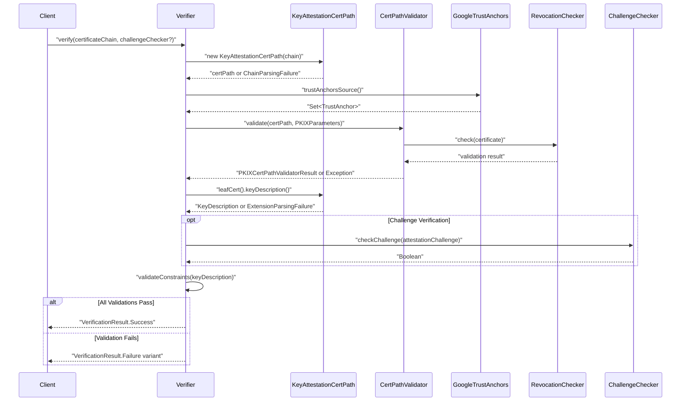

Sources: [src/main/kotlin/Verifier.kt:82-174]()

## Key Components

### Verifier Class

The `Verifier` class serves as the main entry point and orchestrates the entire verification process. It accepts three configurable sources:

| Component | Type | Purpose |
|-----------|------|---------|
| `trustAnchorsSource` | `() -> Set<TrustAnchor>` | Provides root certificates for path validation |
| `revokedSerialsSource` | `() -> Set<String>` | Supplies revoked certificate serial numbers |
| `instantSource` | `InstantSource` | Provides current time for validation |

The class is thread-safe and supports optional challenge verification through the `ChallengeChecker` interface.

Sources: [src/main/kotlin/Verifier.kt:66-73]()

### Verification Results

The system returns structured results through sealed interface variants that provide specific failure reasons:

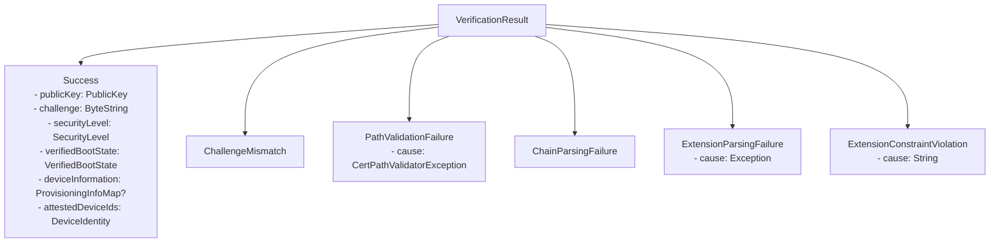

Sources: [src/main/kotlin/Verifier.kt:36-55]()

### Trust Anchor Management

The library uses a dual-strategy approach for trust anchor management:

| Strategy | Implementation | Use Case |
|----------|---------------|----------|
| Build-time Generation | `GoogleTrustAnchors` class generated from `roots.json` | Production environments |
| Runtime Loading | `TestUtils` for loading certificates dynamically | Testing and development |

The `GoogleTrustAnchors` class is automatically generated during build time using a Gradle task that processes the `roots.json` file containing Google's attestation root certificates.

Sources: [README.md:86-94]()

### Challenge Verification System

Challenge verification is implemented through a modular system supporting multiple verification strategies:

```mermaid
graph TD
    ChallengeChecker["ChallengeChecker<br/>(interface)"]
    
    ChallengeMatcher["ChallengeMatcher<br/>Exact challenge matching"]
    InMemoryLruCache["InMemoryLruCache<br/>Replay attack prevention"] 
    ChainedChallengeChecker["ChainedChallengeChecker<br/>Multiple check composition"]
    
    ChallengeChecker <|-- ChallengeMatcher
    ChallengeChecker <|-- InMemoryLruCache
    ChallengeChecker <|-- ChainedChallengeChecker
    
    ChainedChallengeChecker --> ChallengeMatcher
    ChainedChallengeChecker --> InMemoryLruCache
```

Sources: [README.md:36-72]()

## Usage Patterns

### Basic Verification

The simplest verification pattern uses default Google trust anchors:

```kotlin
val verifier = Verifier(
  GoogleTrustAnchors,           // Trust anchors source
  { setOf<String>() },          // Revoked serials source  
  { Instant.now() }             // Time source
)

val result = verifier.verify(certificateChain)
```

### Challenge-Based Verification  

Applications requiring challenge validation can use the built-in challenge checkers:

```kotlin
val challengeChecker = ChainedChallengeChecker.of(
  ChallengeMatcher("expectedChallenge"), 
  InMemoryLruCache(100)
)

val result = verifier.verify(certificateChain, challengeChecker)
```

Sources: [README.md:7-66]()

## Security Model

The library enforces several critical security constraints during verification:

| Constraint | Enforcement Location | Purpose |
|------------|---------------------|---------|
| Hardware key origin | [src/main/kotlin/Verifier.kt:139-145]() | Ensures keys are generated in hardware |
| Security level consistency | [src/main/kotlin/Verifier.kt:147-154]() | Validates attestation and key security levels match |
| Root of trust presence | [src/main/kotlin/Verifier.kt:155-159]() | Verifies hardware-enforced root of trust |
| Certificate path validity | [src/main/kotlin/Verifier.kt:117-122]() | Standard PKIX validation with custom extensions |

The system separates software-enforced and hardware-enforced attestation properties, with hardware-enforced properties providing stronger security guarantees for critical attestation data.

Sources: [src/main/kotlin/Verifier.kt:138-173]()

---

# Page: Core Verification System

# Core Verification System

<details>
<summary>Relevant source files</summary>

The following files were used as context for generating this wiki page:

- [src/main/kotlin/Verifier.kt](src/main/kotlin/Verifier.kt)
- [src/test/kotlin/VerifierTest.kt](src/test/kotlin/VerifierTest.kt)

</details>


This document covers the core verification components that validate Android Key Attestation certificate chains. The system is centered around the `Verifier` class which orchestrates certificate path validation, attestation data parsing, trust anchor verification, and challenge checking to produce comprehensive verification results.

For detailed information about the individual verifier engine implementation, see [Verifier Engine](#2.1). For attestation data structures and parsing, see [Attestation Data Models](#2.2). For certificate path validation specifics, see [Certificate Path Validation](#2.3).

## System Architecture

The core verification system follows a layered architecture where the `Verifier` class orchestrates multiple specialized components to validate attestation certificate chains.

### Core Verification Components

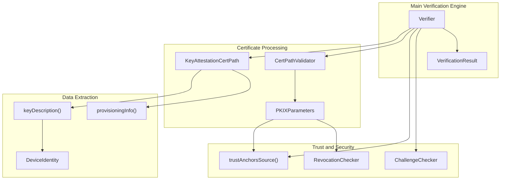

Sources: [src/main/kotlin/Verifier.kt:66-175]()

### Verification Result Types

The system produces structured results that indicate both success and various failure modes:

| Result Type | Description | Key Fields |
|-------------|-------------|------------|
| `Success` | Successful verification | `publicKey`, `challenge`, `securityLevel`, `verifiedBootState`, `deviceInformation`, `attestedDeviceIds` |
| `ChallengeMismatch` | Challenge validation failed | None |
| `PathValidationFailure` | Certificate chain validation failed | `cause: CertPathValidatorException` |
| `ChainParsingFailure` | Certificate chain parsing failed | None |
| `ExtensionParsingFailure` | Attestation extension parsing failed | `cause: Exception` |
| `ExtensionConstraintViolation` | Attestation constraints not met | `cause: String` |

Sources: [src/main/kotlin/Verifier.kt:36-55]()

## Verification Flow

The verification process follows a structured sequence with early failure detection and comprehensive validation.

### Main Verification Sequence

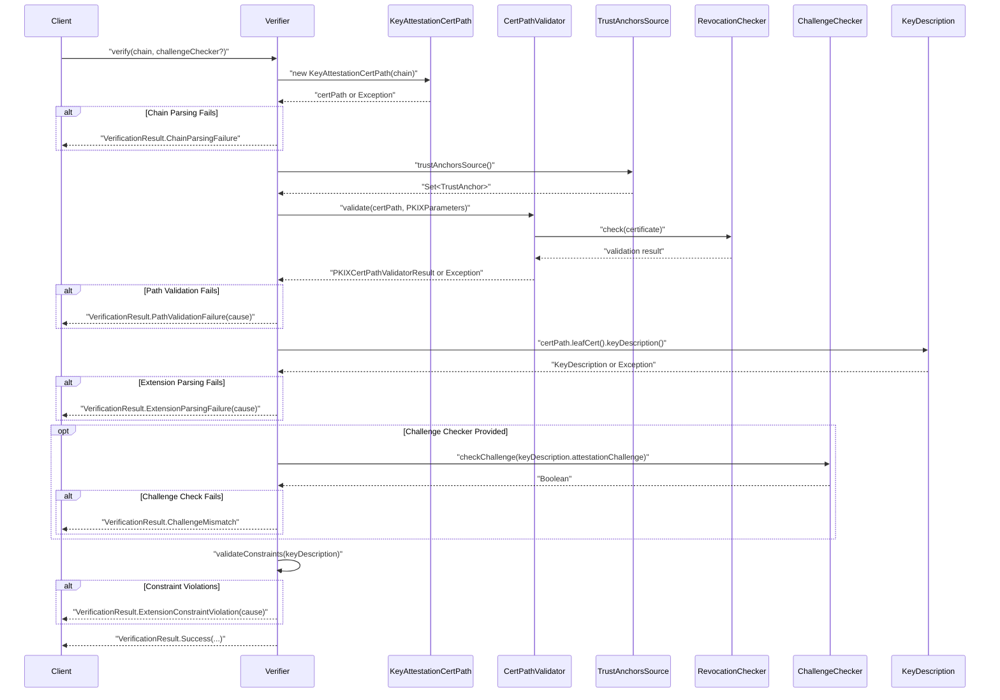

Sources: [src/main/kotlin/Verifier.kt:82-174]()

### Constraint Validation

The verifier enforces several critical security constraints on the attestation data:

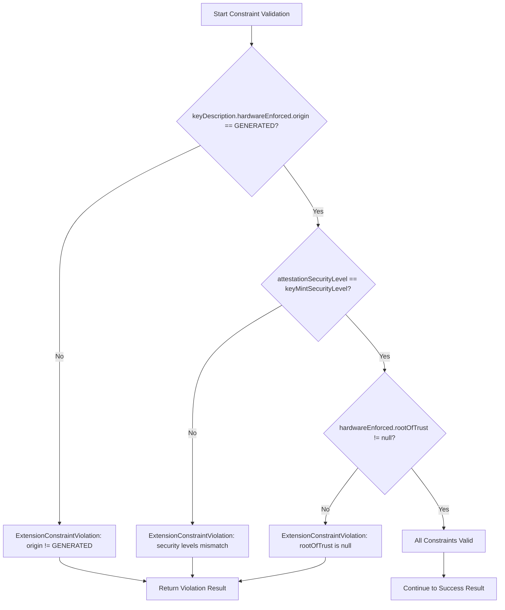

Sources: [src/main/kotlin/Verifier.kt:138-159]()

## Component Integration

The `Verifier` class integrates multiple specialized components to provide comprehensive attestation verification.

### Initialization and Configuration

The `Verifier` constructor accepts three key functional dependencies:

| Parameter | Type | Purpose |
|-----------|------|---------|
| `trustAnchorsSource` | `() -> Set<TrustAnchor>` | Provides trusted root certificates for path validation |
| `revokedSerialsSource` | `() -> Set<String>` | Provides revoked certificate serial numbers |
| `instantSource` | `InstantSource` | Provides current time for validity period checking |

Sources: [src/main/kotlin/Verifier.kt:66-70]()

### Security Provider Registration

The verifier automatically registers the `KeyAttestationProvider` to enable custom certificate path validation:

```kotlin
init {
  Security.addProvider(KeyAttestationProvider())
}
```

This enables the use of `CertPathValidator.getInstance("KeyAttestation")` for Android-specific certificate path validation logic.

Sources: [src/main/kotlin/Verifier.kt:71-73]()

### Success Result Construction

When verification succeeds, the verifier extracts and returns comprehensive attestation information:

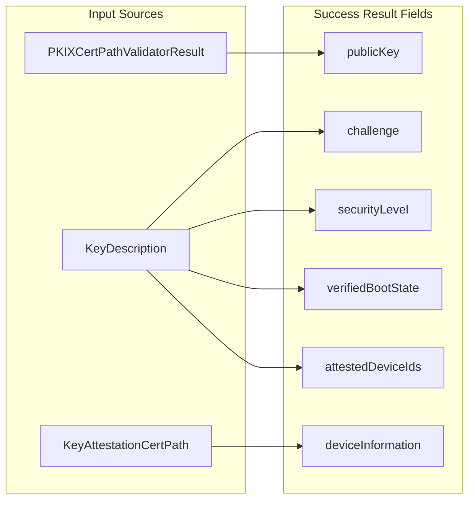

Sources: [src/main/kotlin/Verifier.kt:160-174]()

## Testing Integration

The verification system is designed for comprehensive testing with configurable trust anchors and challenge checkers.

### Test Configuration Example

```kotlin
private val verifier = Verifier({ prodAnchors }, { setOf<String>() }, { Instant.now() })
```

The test framework demonstrates various verification scenarios including successful verification, challenge checking, and failure modes.

Sources: [src/test/kotlin/VerifierTest.kt:35](), [src/test/kotlin/VerifierTest.kt:37-105]()

---

# Page: Verifier Engine

# Verifier Engine

<details>
<summary>Relevant source files</summary>

The following files were used as context for generating this wiki page:

- [src/main/kotlin/Verifier.kt](src/main/kotlin/Verifier.kt)
- [src/test/kotlin/VerifierTest.kt](src/test/kotlin/VerifierTest.kt)

</details>


## Purpose and Scope

The Verifier Engine is the central component responsible for validating Android Key Attestation certificate chains. It orchestrates the entire verification process, from certificate path validation to attestation extension parsing and constraint enforcement. This document covers the `Verifier` class, its configuration options, verification workflow, and result types.

For detailed information about attestation data structures and extensions, see [Attestation Data Models](#2.2). For certificate path validation specifics, see [Certificate Path Validation](#2.3). For trust anchor management, see [Trust Management](#3). For challenge verification mechanisms, see [Challenge Verification](#4).

## Architecture Overview

The `Verifier` class serves as the main entry point for attestation verification, coordinating multiple subsystems to provide a comprehensive validation result.

### Core Components

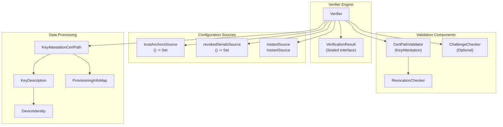

**Sources:** [src/main/kotlin/Verifier.kt:1-176]()

### Verification Result Types

The `VerificationResult` sealed interface defines all possible outcomes of the verification process:

| Result Type | Description | Key Information |
|-------------|-------------|-----------------|
| `Success` | Verification completed successfully | Contains public key, challenge, security level, boot state, device info |
| `ChallengeMismatch` | Challenge checker rejected the attestation challenge | - |
| `PathValidationFailure` | Certificate path validation failed | Contains `CertPathValidatorException` |
| `ChainParsingFailure` | Failed to parse certificate chain | - |
| `ExtensionParsingFailure` | Failed to parse attestation extensions | Contains parsing exception |
| `ExtensionConstraintViolation` | Attestation constraints not met | Contains violation description |

**Sources:** [src/main/kotlin/Verifier.kt:35-55]()

## Verification Process Flow

The verification process follows a structured sequence of validation steps, each capable of producing different failure modes.

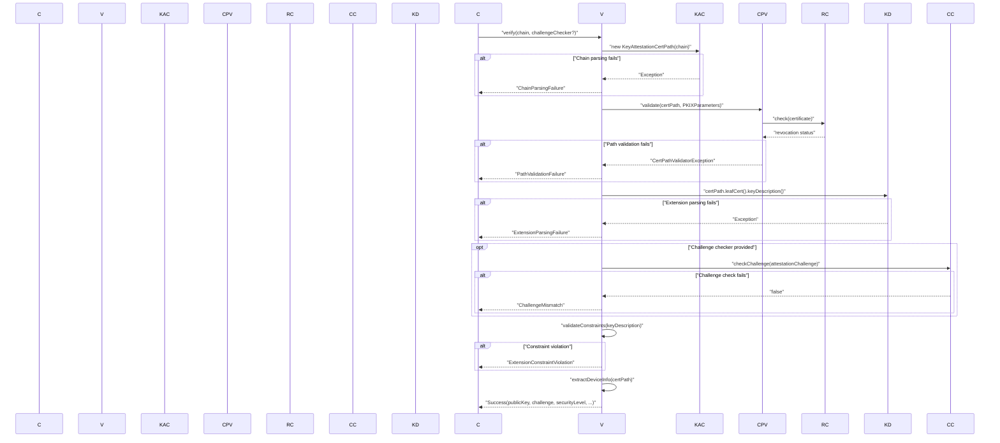

**Sources:** [src/main/kotlin/Verifier.kt:82-174]()

### Key Validation Steps

1. **Certificate Chain Parsing** [src/main/kotlin/Verifier.kt:87-94](): Converts raw X.509 certificates into `KeyAttestationCertPath`
2. **Path Validation** [src/main/kotlin/Verifier.kt:111-122](): Standard PKIX validation with custom revocation checking
3. **Extension Parsing** [src/main/kotlin/Verifier.kt:124-129](): Extracts and parses attestation extension from leaf certificate
4. **Challenge Verification** [src/main/kotlin/Verifier.kt:131-136](): Optional validation using provided `ChallengeChecker`
5. **Constraint Enforcement** [src/main/kotlin/Verifier.kt:138-159](): Validates origin, security levels, and root of trust
6. **Device Information Extraction** [src/main/kotlin/Verifier.kt:160-173](): Processes provisioning info and device identity

## Configuration and Instantiation

The `Verifier` class requires three configuration sources provided as lambda functions, enabling flexible runtime configuration.

### Constructor Parameters

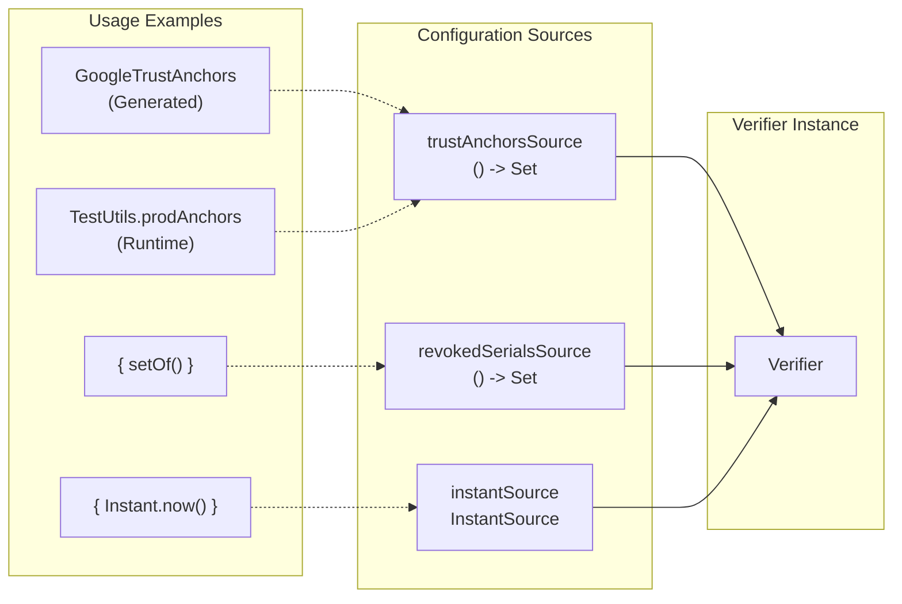

**Sources:** [src/main/kotlin/Verifier.kt:66-73](), [src/test/kotlin/VerifierTest.kt:35](), [src/test/kotlin/VerifierTest.kt:49]()

### Common Configuration Patterns

| Pattern | Trust Anchors | Revoked Serials | Use Case |
|---------|---------------|-----------------|----------|
| Production | `GoogleTrustAnchors` | Production revocation list | Live verification |
| Testing | `TestUtils.prodAnchors` | `setOf<String>()` | Unit testing |
| Custom | Custom trust anchor set | Custom revocation list | Specialized validation |

## Constraint Validation

The verifier enforces several critical constraints on attestation extensions to ensure security properties.

### Required Constraints

1. **Key Origin Validation** [src/main/kotlin/Verifier.kt:138-145]():
   - Hardware-enforced origin must be `GENERATED`
   - Prevents attestation of imported keys

2. **Security Level Consistency** [src/main/kotlin/Verifier.kt:147-154]():
   - `attestationSecurityLevel` must equal `keyMintSecurityLevel`
   - Ensures consistent security guarantees

3. **Root of Trust Presence** [src/main/kotlin/Verifier.kt:155-159]():
   - Hardware-enforced `rootOfTrust` must be present
   - Validates device boot state information

### Constraint Violation Examples

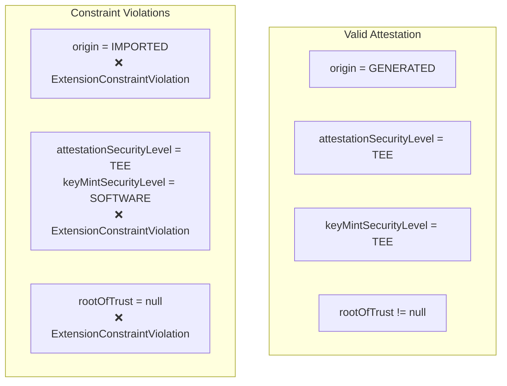

**Sources:** [src/main/kotlin/Verifier.kt:138-159]()

## Error Handling and Debugging

The `Verifier` provides detailed error information for debugging failed verifications.

### Error Classification

| Category | Result Type | Information Provided |
|----------|-------------|---------------------|
| Certificate Issues | `ChainParsingFailure` | Chain structure problems |
| Trust Issues | `PathValidationFailure` | PKIX validation details |
| Extension Issues | `ExtensionParsingFailure` | ASN.1/parsing errors |
| Policy Issues | `ExtensionConstraintViolation` | Specific constraint violated |
| Challenge Issues | `ChallengeMismatch` | Challenge validation failure |

### Example Usage

```kotlin
val verifier = Verifier(
    trustAnchorsSource = GoogleTrustAnchors,
    revokedSerialsSource = { setOf<String>() },
    instantSource = { Instant.now() }
)

when (val result = verifier.verify(certificateChain, challengeChecker)) {
    is VerificationResult.Success -> {
        // Access result.publicKey, result.securityLevel, etc.
    }
    is VerificationResult.PathValidationFailure -> {
        logger.error("Path validation failed: ${result.cause.reason}")
    }
    is VerificationResult.ExtensionConstraintViolation -> {
        logger.error("Constraint violation: ${result.cause}")
    }
    // Handle other failure cases...
}
```

**Sources:** [src/test/kotlin/VerifierTest.kt:34-106]()

---

# Page: Attestation Data Models

# Attestation Data Models

<details>
<summary>Relevant source files</summary>

The following files were used as context for generating this wiki page:

- [src/main/kotlin/Extension.kt](src/main/kotlin/Extension.kt)
- [src/test/kotlin/ExtensionTest.kt](src/test/kotlin/ExtensionTest.kt)

</details>


This document provides a comprehensive guide to the data structures used to represent and parse Android Key Attestation information. It covers the core data models including `KeyDescription`, `AuthorizationList`, device identity structures, and the parsing mechanisms for extracting attestation data from X.509 certificate extensions.

For information about how these data models are used in the verification process, see [Verifier Engine](#2.1). For testing examples using these structures, see [Attestation Examples](#5.2).

## Overview

The attestation data models form the foundation of the Android Key Attestation verification system. These structures represent the parsed contents of two primary X.509 certificate extensions:

- **Key Attestation Extension** (OID: `1.3.6.1.4.1.11129.2.1.17`) - Contains the main attestation data
- **Provisioning Info Extension** (OID: `1.3.6.1.4.1.11129.2.1.30`) - Contains CBOR-encoded provisioning information

### Data Model Hierarchy

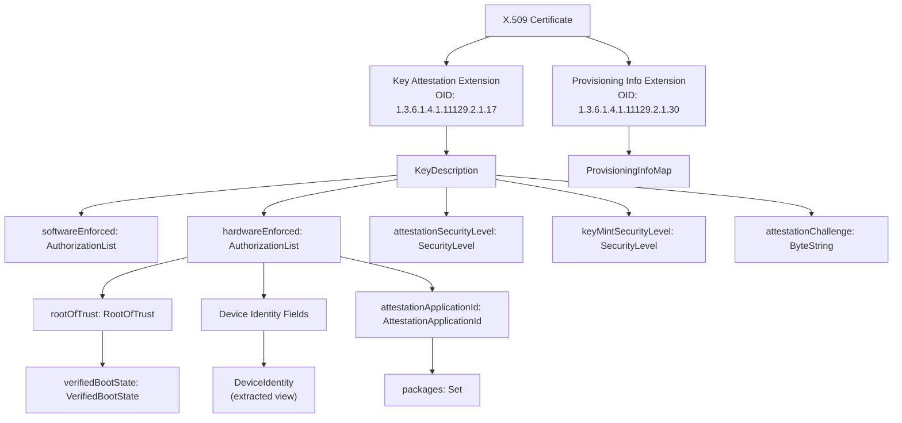

Sources: [src/main/kotlin/Extension.kt:60-193]()

## Core Data Structures

### KeyDescription

`KeyDescription` is the primary data structure representing the complete attestation information from a certificate. It contains version information, security levels, challenge data, and two `AuthorizationList` instances for software and hardware enforcement.

| Field | Type | Description |
|-------|------|-------------|
| `attestationVersion` | `BigInteger` | Version of the attestation data format |
| `attestationSecurityLevel` | `SecurityLevel` | Security level of the attestation process |
| `keyMintVersion` | `BigInteger` | Version of KeyMint that generated the key |
| `keyMintSecurityLevel` | `SecurityLevel` | Security level of KeyMint |
| `attestationChallenge` | `ByteString` | Challenge bytes provided during attestation |
| `uniqueId` | `ByteString` | Unique identifier for the key |
| `softwareEnforced` | `AuthorizationList` | Properties enforced by Android software |
| `hardwareEnforced` | `AuthorizationList` | Properties enforced by secure hardware |

The `KeyDescription` class provides parsing from ASN.1 sequences and encoding back to ASN.1 format:

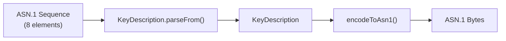

Sources: [src/main/kotlin/Extension.kt:128-193]()

### AuthorizationList

`AuthorizationList` represents the comprehensive set of key usage authorizations and constraints. It contains over 25 different properties covering cryptographic parameters, usage constraints, device identity, and security information.

#### Key Properties Categories

**Cryptographic Parameters:**
- `purposes`, `algorithms`, `keySize`, `digests`, `paddings`
- `ecCurve`, `rsaPublicExponent`

**Usage Constraints:**
- `activeDateTime`, `originationExpireDateTime`, `usageExpireDateTime`
- `noAuthRequired`, `userAuthType`, `authTimeout`
- `trustedUserPresenceRequired`, `unlockedDeviceRequired`

**Device Identity:**
- `attestationIdBrand`, `attestationIdDevice`, `attestationIdProduct`
- `attestationIdSerial`, `attestationIdImei`, `attestationIdMeid`
- `attestationIdManufacturer`, `attestationIdModel`, `attestationIdSecondImei`

**Security Information:**
- `origin`, `rollbackResistant`, `rootOfTrust`
- `osVersion`, `osPatchLevel`, `vendorPatchLevel`, `bootPatchLevel`

The `AuthorizationList` uses tagged ASN.1 objects where each property is identified by a `KeyMintTag`:

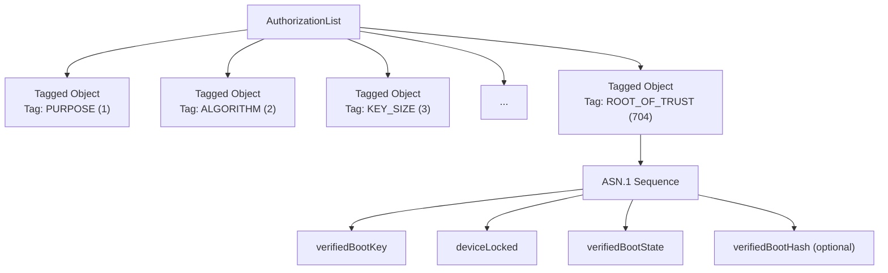

Sources: [src/main/kotlin/Extension.kt:280-460](), [src/main/kotlin/Extension.kt:230-272]()

### Security Level Enumeration

The `SecurityLevel` enum defines where cryptographic operations and key storage occur:

| Value | Level | Description |
|-------|-------|-------------|
| 0 | `SOFTWARE` | Implemented in Android system software |
| 1 | `TRUSTED_ENVIRONMENT` | Implemented in secure hardware (TEE) |
| 2 | `STRONG_BOX` | Implemented in dedicated security chip |

Higher security levels provide stronger isolation and tamper resistance.

Sources: [src/main/kotlin/Extension.kt:200-206]()

## Device Identity and Provisioning Data

### DeviceIdentity

`DeviceIdentity` provides a convenient view of device identification information extracted from the hardware-enforced `AuthorizationList`:

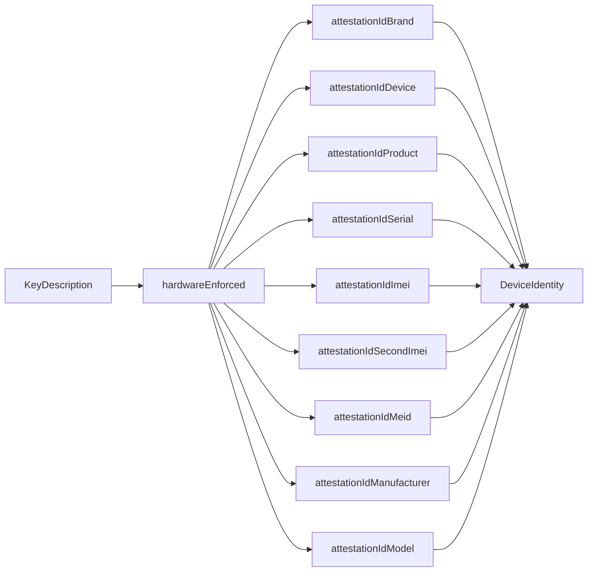

The `imeis` field in `DeviceIdentity` consolidates both primary and secondary IMEI values into a set.

Sources: [src/main/kotlin/Extension.kt:99-126]()

### ProvisioningInfoMap

`ProvisioningInfoMap` contains CBOR-encoded provisioning information found in remotely provisioned attestation certificates. It currently tracks the number of certificates issued:

| Field | Type | Description |
|-------|------|-------------|
| `certificatesIssued` | `Int` | Number of certificates issued for this provisioning |

The data is encoded as CBOR and stored in an ASN.1 OCTET STRING within the certificate extension.

Sources: [src/main/kotlin/Extension.kt:60-97]()

## Security-Related Data Structures

### RootOfTrust

`RootOfTrust` contains critical boot verification information that establishes the trustworthiness of the device's software stack:

| Field | Type | Description |
|-------|------|-------------|
| `verifiedBootKey` | `ByteString` | Key used to verify the boot process |
| `deviceLocked` | `Boolean` | Whether the device bootloader is locked |
| `verifiedBootState` | `VerifiedBootState` | Result of boot verification |
| `verifiedBootHash` | `ByteString?` | Hash of verified boot components (optional) |

### VerifiedBootState

The `VerifiedBootState` enum indicates the integrity of the device's boot process:

| Value | State | Description |
|-------|-------|-------------|
| 0 | `VERIFIED` | Boot process verified with official keys |
| 1 | `SELF_SIGNED` | Boot process verified with device-specific keys |
| 2 | `UNVERIFIED` | Boot process not verified |
| 3 | `FAILED` | Boot verification failed |

Sources: [src/main/kotlin/Extension.kt:559-609]()

### AttestationApplicationId

`AttestationApplicationId` identifies the Android application that requested the key attestation:

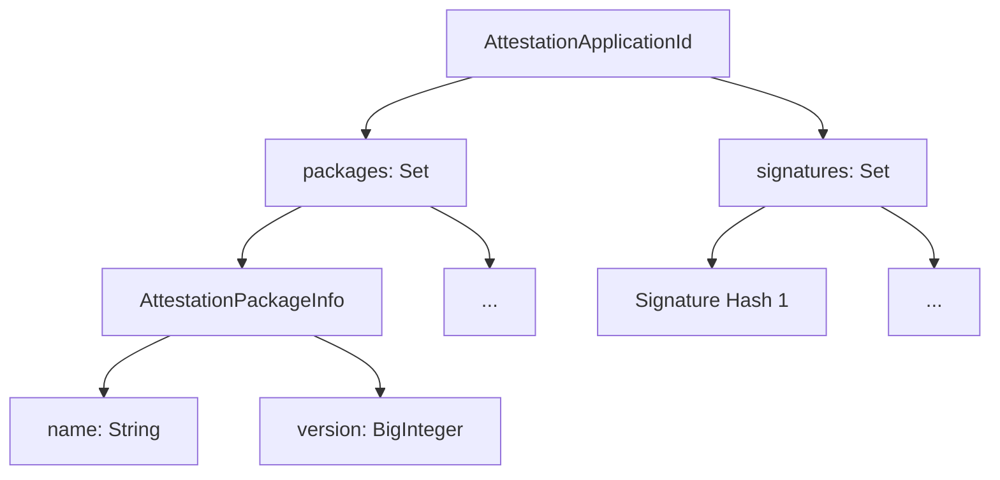

This structure allows verification that the attestation was requested by a specific, signed application.

Sources: [src/main/kotlin/Extension.kt:501-552]()

## Data Parsing and Encoding

### ASN.1 Parsing Flow

The system parses attestation data through a multi-stage ASN.1 decoding process:

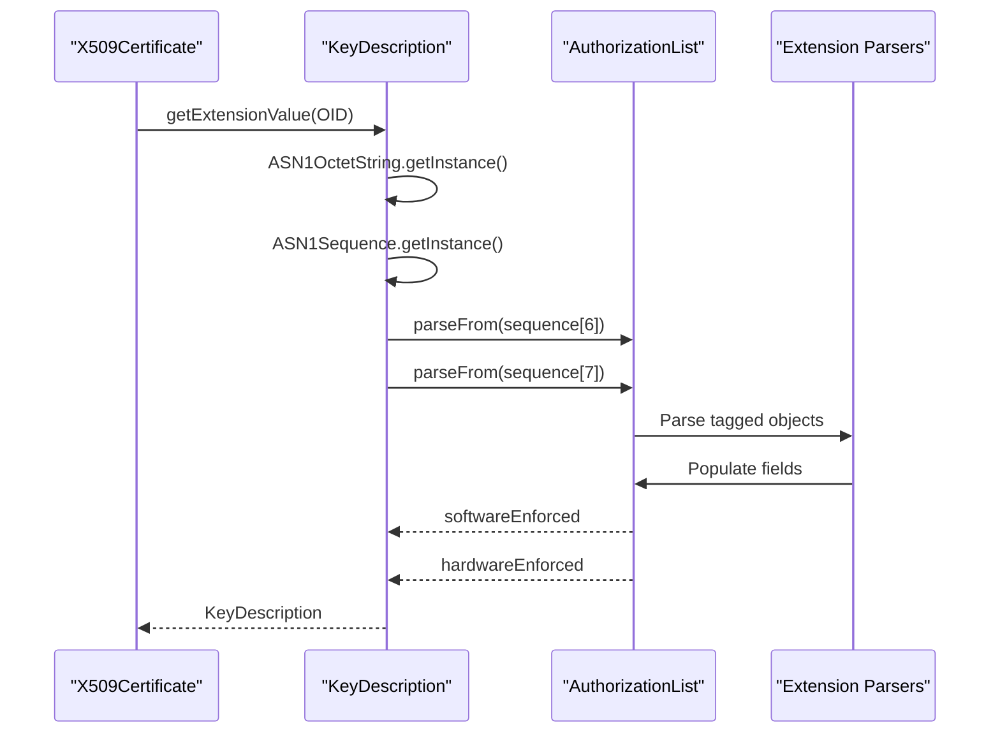

### CBOR Parsing for Provisioning Data

Provisioning information uses CBOR encoding within ASN.1 structures:

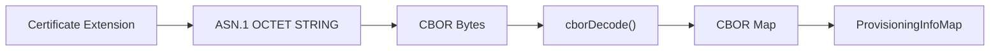

The CBOR parsing utilities include type-safe extraction methods like `asInteger()`, `asString()`, and `asMap()`.

Sources: [src/main/kotlin/Extension.kt:693-748](), [src/main/kotlin/Extension.kt:72-96]()

### Tag-Based ASN.1 Structure

`AuthorizationList` uses a tag-based ASN.1 encoding where each field is represented as a tagged object with a specific `KeyMintTag` identifier:

| Tag Range | Purpose |
|-----------|---------|
| 1-99 | Core cryptographic parameters |
| 200-299 | Algorithm-specific parameters |
| 400-499 | Time-based constraints |
| 500-599 | Authentication requirements |
| 700-799 | Attestation and device information |

This flexible structure allows for extension while maintaining backward compatibility.

Sources: [src/main/kotlin/Extension.kt:322-391](), [src/main/kotlin/Extension.kt:394-459]()

---

# Page: Certificate Path Validation

# Certificate Path Validation

<details>
<summary>Relevant source files</summary>

The following files were used as context for generating this wiki page:

- [roots.json](roots.json)
- [src/main/kotlin/provider/KeyAttestationCertPathValidator.kt](src/main/kotlin/provider/KeyAttestationCertPathValidator.kt)
- [src/main/kotlin/provider/RevocationChecker.kt](src/main/kotlin/provider/RevocationChecker.kt)
- [src/main/kotlin/testing/KeyAttestationCertPathFactory.kt](src/main/kotlin/testing/KeyAttestationCertPathFactory.kt)
- [src/test/kotlin/provider/KeyAttestationCertPathValidatorTest.kt](src/test/kotlin/provider/KeyAttestationCertPathValidatorTest.kt)

</details>


This document covers the custom certificate path validation system used for Android Key Attestation certificate chains. The validation logic extends standard PKIX validation to handle Android Key Attestation certificates that may not fully conform to RFC 5280 standards.

For information about the broader verification process that uses this certificate path validation, see [Verifier Engine](#2.1). For details about the data structures extracted from validated certificates, see [Attestation Data Models](#2.2).

## Purpose and Scope

Android Key Attestation certificate chains from older devices do not always fully conform to RFC 5280, making them incompatible with standard PKIX certificate path validators. This system provides a custom `CertPathValidatorSpi` implementation that performs more permissive validation while maintaining security guarantees. The validation system handles both factory-provisioned and remotely-provisioned certificate chains with appropriate path length and extension checks.

## Why Custom Validation is Needed

Standard PKIX validators cannot process all valid Android Key Attestation certificates due to non-conformance with RFC 5280 in older Android devices. The custom validator implements a more permissive approach that still maintains cryptographic security while accommodating these legacy certificate formats.

The custom validator specifically handles:
- Non-standard certificate chain structures from older Android devices
- Attestation extension placement validation
- Provisioning method-specific path length constraints
- Custom validity period handling for leaf certificates

Sources: [src/main/kotlin/provider/KeyAttestationCertPathValidator.kt:43-52]()

## KeyAttestationCertPathValidator Architecture

The `KeyAttestationCertPathValidator` class extends `CertPathValidatorSpi` to provide Android-specific certificate path validation. It integrates with the Java Security Provider architecture and can be used alongside standard `PKIXRevocationChecker` implementations.

```mermaid
graph TB
    subgraph "Java Security Provider Framework"
        CertPathValidatorSpi["CertPathValidatorSpi"]
        PKIXParameters["PKIXParameters"]
        PKIXCertPathValidatorResult["PKIXCertPathValidatorResult"]
    end
    
    subgraph "Custom Validation Components"
        KeyAttestationCertPathValidator["KeyAttestationCertPathValidator"]
        BasicChecker["BasicChecker"]
        RevocationChecker["RevocationChecker"]
    end
    
    subgraph "Certificate Processing"
        CertPath["CertPath"]
        TrustAnchor["TrustAnchor"]
        X509Certificate["X509Certificate[]"]
    end
    
    CertPathValidatorSpi <|-- KeyAttestationCertPathValidator
    KeyAttestationCertPathValidator --> BasicChecker
    KeyAttestationCertPathValidator --> RevocationChecker
    
    PKIXParameters --> TrustAnchor
    PKIXParameters --> RevocationChecker
    CertPath --> X509Certificate
    
    KeyAttestationCertPathValidator --> PKIXCertPathValidatorResult
```

The validator performs validation in two phases:
1. **Trust Anchor Matching**: Iterates through provided trust anchors to find a matching issuer
2. **Certificate Chain Validation**: Validates each certificate in the chain against the selected trust anchor

Sources: [src/main/kotlin/provider/KeyAttestationCertPathValidator.kt:53-76](), [src/main/kotlin/provider/KeyAttestationCertPathValidator.kt:78-110]()

## Validation Process and Certificate Chain Steps

The validation process follows a specific sequence that accounts for different provisioning methods and certificate chain structures.

### Certificate Chain Structure Recognition

The validator identifies certificate types based on their position in the chain and provisioning method:

```mermaid
graph TD
    Start["Start Validation"]
    CheckProvisioning{"Check Provisioning Method"}
    
    FactoryPath["Factory Provisioned Path"]
    RKPPath["Remotely Provisioned Path"]
    
    FactorySteps["FACTORY_INTERMEDIATE → ATTESTATION → TARGET"]
    RKPSteps["RKP_INTERMEDIATE → RKP_SERVER → ATTESTATION → TARGET"]
    
    Start --> CheckProvisioning
    CheckProvisioning -->|"Factory"| FactoryPath
    CheckProvisioning -->|"Remote"| RKPPath
    
    FactoryPath --> FactorySteps
    RKPPath --> RKPSteps
```

The `Step` enum defines the expected certificate types in order:
- `FACTORY_INTERMEDIATE`: First certificate after root for factory provisioning
- `RKP_INTERMEDIATE`: First certificate after root for remote provisioning  
- `RKP_SERVER`: Second certificate in remotely provisioned chains
- `ATTESTATION`: Certificate that signs the target certificate
- `TARGET`: Final certificate containing the attestation extension

Sources: [src/main/kotlin/provider/KeyAttestationCertPathValidator.kt:152-158](), [src/main/kotlin/provider/KeyAttestationCertPathValidator.kt:197-219]()

### BasicChecker Validation Logic

The `BasicChecker` class performs core validation checks for each certificate:

```mermaid
graph TD
    InitChecker["BasicChecker.init()"]
    ProcessCert["Process Certificate"]
    
    NameCheck["verifyNameChaining()"]
    SigCheck["verifySignature()"]
    ValidityCheck["verifyValidity()"]
    ExpectationCheck["verifyExpectations()"]
    
    UpdateState["Update prevPubKey, prevSubject, prevStep"]
    
    InitChecker --> ProcessCert
    ProcessCert --> NameCheck
    NameCheck --> SigCheck
    SigCheck --> ValidityCheck
    ValidityCheck --> ExpectationCheck
    ExpectationCheck --> UpdateState
```

Key validation behaviors:
- **Name Chaining**: Verifies issuer/subject name continuity between certificates
- **Signature Verification**: Validates cryptographic signatures using previous certificate's public key  
- **Validity Period**: Checks certificate validity dates (except for leaf certificate)
- **Path Length Constraints**: Enforces different maximum path lengths based on provisioning method
- **Extension Placement**: Ensures attestation extensions only appear in the target certificate

Sources: [src/main/kotlin/provider/KeyAttestationCertPathValidator.kt:160-196](), [src/main/kotlin/provider/KeyAttestationCertPathValidator.kt:221-326]()

### Special Validity Handling

The validator implements non-standard validity checking that differs from RFC 5280:

```kotlin
// From BasicChecker.verifyValidity()
if (remainingCerts == 0) return  // Skip validity check for final certificate
```

This behavior maintains bug-compatibility with the original KAVS (Key Attestation Verification Service) implementation.

Sources: [src/main/kotlin/provider/KeyAttestationCertPathValidator.kt:254-262]()

## Revocation Checking

The `RevocationChecker` class implements `PKIXRevocationChecker` to validate certificate revocation status using a set of revoked serial numbers.

```mermaid
graph LR
    Certificate["X509Certificate"]
    RevocationChecker["RevocationChecker"]
    RevokedSerials["Set<String> revokedSerials"]
    
    Exception["CertPathValidatorException"]
    Success["Validation Success"]
    
    Certificate --> RevocationChecker
    RevokedSerials --> RevocationChecker
    
    RevocationChecker -->|"Serial Found"| Exception
    RevocationChecker -->|"Serial Clean"| Success
```

The revocation checker:
- Maintains a set of revoked certificate serial numbers (in hexadecimal format)
- Throws `CertPathValidatorException` with `BasicReason.REVOKED` if a certificate's serial number is found in the revoked set
- Only supports backward checking (not forward checking)
- Does not support soft-fail exceptions

Sources: [src/main/kotlin/provider/RevocationChecker.kt:25-56]()

## Testing Infrastructure

The `KeyAttestationCertPathFactory` provides test certificate generation for validating the certificate path validation logic.

### Test Certificate Generation

```mermaid
graph TD
    Factory["KeyAttestationCertPathFactory"]
    CertFactory["KeyAttestationCertFactory"]
    
    FactoryPath["Factory Provisioned Path"]
    RKPPath["Remotely Provisioned Path"]
    
    LeafCert["Leaf Certificate + KeyDescription"]
    AttestationCert["Attestation Certificate"]
    IntermediateCert["Intermediate Certificate(s)"]
    RootCert["Root Certificate"]
    
    Factory --> CertFactory
    Factory -->|"remotelyProvisioned=false"| FactoryPath
    Factory -->|"remotelyProvisioned=true"| RKPPath
    
    FactoryPath --> LeafCert
    FactoryPath --> AttestationCert
    FactoryPath --> IntermediateCert
    FactoryPath --> RootCert
    
    RKPPath --> LeafCert
    RKPPath --> AttestationCert
    RKPPath --> IntermediateCert
    RKPPath --> RootCert
```

The factory generates different certificate chain structures:
- **Factory Provisioned**: 4 certificates (leaf, attestation, factory intermediate, root)
- **Remotely Provisioned**: 5 certificates (leaf, attestation with provisioning info, RKP intermediate, remote intermediate, root)

For remotely provisioned chains, the factory adds a `ProvisioningInfoMap` extension containing CBOR-encoded provisioning metadata.

Sources: [src/main/kotlin/testing/KeyAttestationCertPathFactory.kt:25-73]()

### Validation Test Coverage

The test suite validates various certificate chain scenarios including:
- Valid factory provisioned and remotely provisioned chains
- Expired certificates and validity period edge cases
- Wrong trust anchors and signature verification failures  
- Path length constraint violations
- Name chaining and algorithm mismatch errors

Sources: [src/test/kotlin/provider/KeyAttestationCertPathValidatorTest.kt:101-233]()

---

# Page: Trust Management

# Trust Management

<details>
<summary>Relevant source files</summary>

The following files were used as context for generating this wiki page:

- [build.gradle.kts](build.gradle.kts)
- [src/main/kotlin/testing/TestUtils.kt](src/main/kotlin/testing/TestUtils.kt)

</details>


## Purpose and Scope

This document covers how trust anchors are managed within the Android Key Attestation verification library. Trust anchors are the root certificates that establish the foundation of trust for validating attestation certificate chains. The system implements a dual strategy supporting both build-time code generation for production use and runtime loading for testing scenarios.

For information about how these trust anchors are used in the actual verification process, see [Core Verification System](#2). For details about certificate path validation logic, see [Certificate Path Validation](#2.3).

## Trust Anchor Sources

The system uses a single source of truth for trust anchors: the `roots.json` file located at the project root. This JSON file contains an array of Base64-encoded X.509 certificates representing Google's trusted root certificates for key attestation.

```mermaid
graph TD
    RootsJSON["roots.json"]
    BuildTime["Build-time Generation"]
    Runtime["Runtime Loading"]
    GoogleTrustAnchors["GoogleTrustAnchors.kt"]
    TestUtils["TestUtils.prodAnchors"]
    
    RootsJSON --> BuildTime
    RootsJSON --> Runtime
    BuildTime --> GoogleTrustAnchors
    Runtime --> TestUtils
    
    GoogleTrustAnchors --> ProductionVerification["Production Verification"]
    TestUtils --> TestVerification["Test Verification"]
```

**Trust Anchor Generation and Loading Flow**

*Sources: [build.gradle.kts:52-86](), [src/main/kotlin/testing/TestUtils.kt:67-72]()*

## Build-time Trust Anchor Generation

The build system automatically generates the `GoogleTrustAnchors` object during compilation using a Gradle task. This approach embeds trust anchors directly into the compiled code, eliminating runtime file dependencies for production scenarios.

### Gradle Task Implementation

The `googleTrustAnchors` task reads `roots.json` and generates Kotlin source code:

| Component | Purpose | Location |
|-----------|---------|----------|
| Input | `roots.json` containing Base64-encoded certificates | Project root |
| Task | `googleTrustAnchors` Gradle task | [build.gradle.kts:52-86]() |
| Output | `GoogleTrustAnchors.kt` generated source | `build/generated/main/kotlin/` |

The generated `GoogleTrustAnchors` object implements a function type `() -> Set<TrustAnchor>` and contains:

- `JSON` constant with embedded certificate data
- `invoke()` method that parses JSON and creates `TrustAnchor` objects
- Gson-based deserialization using the `asX509Certificate()` extension

```mermaid
sequenceDiagram
    participant GradleTask as "googleTrustAnchors Task"
    participant RootsJSON as "roots.json"
    participant GeneratedFile as "GoogleTrustAnchors.kt"
    participant Gson
    participant TrustAnchor as "TrustAnchor Objects"
    
    GradleTask->>RootsJSON: "Read certificate data"
    RootsJSON-->>GradleTask: "Base64-encoded certificates"
    GradleTask->>GeneratedFile: "Generate Kotlin source with embedded JSON"
    
    Note over GeneratedFile: "Runtime execution"
    GeneratedFile->>Gson: "Parse embedded JSON"
    Gson->>GeneratedFile: "Array<String>"
    GeneratedFile->>TrustAnchor: "Convert to TrustAnchor objects"
    TrustAnchor-->>GeneratedFile: "Set<TrustAnchor>"
```

**Build-time Trust Anchor Generation Process**

*Sources: [build.gradle.kts:52-86]()*

## Runtime Trust Anchor Loading

For testing scenarios, the `TestUtils` object provides runtime loading of trust anchors from the same `roots.json` file. This approach offers flexibility during development and testing without requiring code regeneration.

### TestUtils Implementation

The `TestUtils.prodAnchors` property implements lazy loading:

```mermaid
graph LR
    TestUtilsProdAnchors["TestUtils.prodAnchors"]
    LazyDelegate["lazy { }"]
    GsonParser["Gson().fromJson()"]
    RootsJSON["roots.json"]
    TrustAnchorSet["Set<TrustAnchor>"]
    
    TestUtilsProdAnchors --> LazyDelegate
    LazyDelegate --> GsonParser
    GsonParser --> RootsJSON
    GsonParser --> TrustAnchorSet
    
    subgraph "Conversion Process"
        StringArray["Array<String>"]
        X509Conversion["asX509Certificate()"]
        TrustAnchorCreation["TrustAnchor(cert, null)"]
        
        GsonParser --> StringArray
        StringArray --> X509Conversion
        X509Conversion --> TrustAnchorCreation
        TrustAnchorCreation --> TrustAnchorSet
    end
```

**Runtime Trust Anchor Loading Architecture**

The implementation uses:
- Lazy initialization for performance optimization
- Direct file reading via `readFile(PROD_ROOT_PATH)`
- Gson for JSON deserialization
- `asX509Certificate()` extension for certificate conversion
- `TrustAnchor` constructor with null name constraints

*Sources: [src/main/kotlin/testing/TestUtils.kt:67-72]()*

## Trust Anchor Configuration Strategies

The system supports two distinct configuration patterns depending on the use case:

| Strategy | Use Case | Advantages | Implementation |
|----------|----------|------------|----------------|
| Build-time Generation | Production deployment | No file dependencies, embedded security | `GoogleTrustAnchors` object |
| Runtime Loading | Testing and development | Flexibility, no compilation required | `TestUtils.prodAnchors` |

### Configuration Selection

Both approaches produce identical `Set<TrustAnchor>` objects, ensuring compatibility across different deployment scenarios. The choice between strategies depends on:

- **Production systems**: Use `GoogleTrustAnchors` for embedded trust anchors
- **Test environments**: Use `TestUtils.prodAnchors` for runtime flexibility
- **Development**: Either approach depending on specific testing needs

```mermaid
graph TD
    VerificationContext["Verification Context"]
    ProductionPath["Production Path"]
    TestPath["Test Path"]
    
    GoogleTrustAnchorsInvoke["GoogleTrustAnchors.invoke()"]
    TestUtilsProdAnchors["TestUtils.prodAnchors"]
    
    TrustAnchorSet["Set<TrustAnchor>"]
    PKIXParameters["PKIXParameters"]
    CertPathValidator["Certificate Path Validator"]
    
    VerificationContext --> ProductionPath
    VerificationContext --> TestPath
    
    ProductionPath --> GoogleTrustAnchorsInvoke
    TestPath --> TestUtilsProdAnchors
    
    GoogleTrustAnchorsInvoke --> TrustAnchorSet
    TestUtilsProdAnchors --> TrustAnchorSet
    
    TrustAnchorSet --> PKIXParameters
    PKIXParameters --> CertPathValidator
```

**Trust Anchor Configuration in Verification Flow**

*Sources: [build.gradle.kts:52-86](), [src/main/kotlin/testing/TestUtils.kt:67-72]()*

## File System Integration

The trust management system integrates with the build system and runtime file access through specific path conventions:

| Component | Path | Purpose |
|-----------|------|---------|
| Trust anchor source | `roots.json` | Single source of truth for certificates |
| Generated output | `build/generated/main/kotlin/GoogleTrustAnchors.kt` | Build-time embedded anchors |
| Test data location | `testdata/` directory | Additional test certificates |

The `TestUtils` object defines constants for these paths:
- `PROD_ROOT_PATH = "roots.json"` for production trust anchors
- `TESTDATA_PATH = "testdata"` for test certificate chains

*Sources: [src/main/kotlin/testing/TestUtils.kt:46-47]()*

---

# Page: Challenge Verification

# Challenge Verification

<details>
<summary>Relevant source files</summary>

The following files were used as context for generating this wiki page:

- [src/main/kotlin/ChallengeChecker.kt](src/main/kotlin/ChallengeChecker.kt)
- [src/main/kotlin/challengecheckers/ChainedChallengeChecker.kt](src/main/kotlin/challengecheckers/ChainedChallengeChecker.kt)
- [src/main/kotlin/challengecheckers/ChallengeMatcher.kt](src/main/kotlin/challengecheckers/ChallengeMatcher.kt)
- [src/main/kotlin/challengecheckers/InMemoryLruCache.kt](src/main/kotlin/challengecheckers/InMemoryLruCache.kt)
- [src/test/kotlin/challengecheckers/ChainedChallengeCheckerTest.kt](src/test/kotlin/challengecheckers/ChainedChallengeCheckerTest.kt)
- [src/test/kotlin/challengecheckers/ChallengeMatcherTest.kt](src/test/kotlin/challengecheckers/ChallengeMatcherTest.kt)
- [src/test/kotlin/challengecheckers/InMemoryLruCacheTest.kt](src/test/kotlin/challengecheckers/InMemoryLruCacheTest.kt)

</details>


This document covers the challenge verification mechanisms in the Android Key Attestation library. Challenge verification ensures that attestation certificates contain expected challenge values and prevents replay attacks through various validation strategies. The system provides a pluggable interface for different challenge checking strategies including exact matching, replay prevention via LRU caching, and chained validation.

For information about the overall verification process that uses challenge checkers, see [Core Verification System](#2). For details about attestation data parsing, see [Attestation Data Models](#2.2).

## Challenge Checker Interface

The challenge verification system is built around the `ChallengeChecker` interface, which provides a simple contract for validating challenge values extracted from attestation certificates.

```mermaid
graph TD
    ChallengeChecker["ChallengeChecker<br/>(Interface)"]
    ChallengeMatcher["ChallengeMatcher"]
    InMemoryLruCache["InMemoryLruCache"]
    ChainedChallengeChecker["ChainedChallengeChecker"]
    
    ChallengeChecker --> ChallengeMatcher
    ChallengeChecker --> InMemoryLruCache
    ChallengeChecker --> ChainedChallengeChecker
    
    ChallengeMatcher -.-> |"expectedChallenge: ByteString"| MatcherData["Exact Match Validation"]
    InMemoryLruCache -.-> |"maxCacheSize: Int"| CacheData["LRU Cache<br/>Replay Prevention"]
    ChainedChallengeChecker -.-> |"challengeCheckers: List"| ChainData["Sequential Validation"]
```

**ChallengeChecker Interface Structure**

The core interface defines a single method for challenge validation:

| Method | Parameters | Return Type | Purpose |
|--------|------------|-------------|---------|
| `checkChallenge` | `challenge: ByteString` | `Boolean` | Validates the given challenge |

Sources: [src/main/kotlin/ChallengeChecker.kt:6-14]()

## Challenge Checker Implementations

### ChallengeMatcher

`ChallengeMatcher` provides basic exact-match validation against a pre-defined expected challenge value.

**Key Characteristics:**
- Performs byte-for-byte equality comparison
- Supports construction from both `ByteString` and `ByteArray`
- Stateless operation - no side effects

**Constructor Options:**
```kotlin
ChallengeMatcher(expectedChallenge: ByteString)
ChallengeMatcher(expectedChallenge: ByteArray)  // Convenience constructor
```

Sources: [src/main/kotlin/challengecheckers/ChallengeMatcher.kt:1-16]()

### InMemoryLruCache

`InMemoryLruCache` prevents challenge replay attacks by maintaining an LRU cache of previously seen challenges. This implementation is essential for preventing attestation replay attacks in production systems.

**Key Features:**
- **Replay Prevention**: Rejects challenges that have been seen before
- **LRU Eviction**: Automatically removes oldest entries when cache is full
- **Access-Order Tracking**: Checking a challenge updates its position in the cache

**Implementation Details:**
- Uses `LinkedHashMap` with access-order tracking
- Configurable maximum cache size
- Thread-unsafe (suitable for single-threaded verification scenarios)

```mermaid
sequenceDiagram
    participant Client
    participant InMemoryLruCache
    participant LinkedHashMap
    
    Client->>InMemoryLruCache: "checkChallenge(challenge1)"
    InMemoryLruCache->>LinkedHashMap: "putIfAbsent(challenge1, 1)"
    LinkedHashMap-->>InMemoryLruCache: "null (new entry)"
    InMemoryLruCache-->>Client: "true"
    
    Client->>InMemoryLruCache: "checkChallenge(challenge1)"
    InMemoryLruCache->>LinkedHashMap: "putIfAbsent(challenge1, 1)"
    LinkedHashMap-->>InMemoryLruCache: "1 (existing entry)"
    InMemoryLruCache-->>Client: "false (replay detected)"
```

**Cache Overflow Behavior:**
When the cache exceeds `maxCacheSize`, the least recently used entry is automatically removed via the `removeEldestEntry` override.

Sources: [src/main/kotlin/challengecheckers/InMemoryLruCache.kt:1-30]()

### ChainedChallengeChecker

`ChainedChallengeChecker` enables composition of multiple challenge validation strategies by chaining them in sequence with fail-fast behavior.

**Key Characteristics:**
- **Sequential Execution**: Checkers are evaluated in order
- **Fail-Fast**: Stops on first failure, remaining checkers are not called
- **Composition**: Combines multiple validation strategies
- **Empty Chain Behavior**: Returns `true` when no checkers are provided

```mermaid
graph LR
    Input["challenge: ByteString"]
    Checker1["ChallengeChecker 1"]
    Checker2["ChallengeChecker 2"]
    Checker3["ChallengeChecker 3"]
    Success["return true"]
    Failure["return false"]
    
    Input --> Checker1
    Checker1 -->|"true"| Checker2
    Checker1 -->|"false"| Failure
    Checker2 -->|"true"| Checker3
    Checker2 -->|"false"| Failure
    Checker3 -->|"true"| Success
    Checker3 -->|"false"| Failure
```

**Factory Methods:**
- `ChainedChallengeChecker(challengeCheckers: List<ChallengeChecker>)` - Primary constructor
- `ChainedChallengeChecker.of(vararg challengeCheckers: ChallengeChecker)` - Varargs convenience method

Sources: [src/main/kotlin/challengecheckers/ChainedChallengeChecker.kt:1-43]()

## Integration with Verification Process

Challenge checkers integrate with the main verification system through the `Verifier` class. The verification process extracts the challenge from the attestation certificate and passes it to the provided challenge checker.

```mermaid
sequenceDiagram
    participant Client
    participant Verifier
    participant KeyDescription
    participant ChallengeChecker
    
    Client->>Verifier: "verify(certificateChain, challengeChecker?)"
    Verifier->>KeyDescription: "parseKeyDescription(leafCert)"
    KeyDescription-->>Verifier: "keyDescription.challenge"
    
    alt Challenge Checker Provided
        Verifier->>ChallengeChecker: "checkChallenge(attestationChallenge)"
        ChallengeChecker-->>Verifier: "Boolean"
        
        alt Challenge Check Fails
            Verifier-->>Client: "VerificationResult.ChallengeMismatch"
        else Challenge Check Passes
            Verifier->>Verifier: "Continue with other validations"
        end
    else No Challenge Checker
        Verifier->>Verifier: "Skip challenge validation"
    end
```

**Verification Result Integration:**
- Challenge validation failure results in `VerificationResult.ChallengeMismatch`
- Successful challenge validation allows verification to proceed
- Missing challenge checker skips challenge validation entirely

Sources: [src/test/kotlin/challengecheckers/ChallengeMatcherTest.kt:35-48]()

## Common Usage Patterns

### Basic Challenge Matching
```kotlin
val expectedChallenge = ByteString.copyFromUtf8("my-challenge")
val checker = ChallengeMatcher(expectedChallenge)
```

### Replay Prevention
```kotlin
val replayPrevention = InMemoryLruCache(maxCacheSize = 1000)
```

### Combined Validation Strategy
```kotlin
val combinedChecker = ChainedChallengeChecker.of(
    ChallengeMatcher(expectedChallenge),
    InMemoryLruCache(1000)
)
```

This pattern ensures both exact challenge matching and replay prevention in a single validation step.

Sources: [src/test/kotlin/challengecheckers/ChainedChallengeCheckerTest.kt:42-43]()

## Testing Infrastructure

The challenge checker implementations include comprehensive test coverage demonstrating various scenarios:

**ChallengeMatcher Tests:**
- Exact challenge matching validation
- Integration with full verification flow
- Mismatch handling and error conditions

**InMemoryLruCache Tests:**
- Cache overflow and LRU eviction behavior  
- Access-order impact on cache management
- Replay detection accuracy

**ChainedChallengeChecker Tests:**
- Sequential validation with fail-fast behavior
- Empty checker list handling
- Early termination optimization

Sources: [src/test/kotlin/challengecheckers/ChallengeMatcherTest.kt:1-50](), [src/test/kotlin/challengecheckers/InMemoryLruCacheTest.kt:1-79](), [src/test/kotlin/challengecheckers/ChainedChallengeCheckerTest.kt:1-80]()

---

# Page: Testing and Examples

# Testing and Examples

<details>
<summary>Relevant source files</summary>

The following files were used as context for generating this wiki page:

- [build.gradle.kts](build.gradle.kts)
- [src/main/kotlin/testing/TestUtils.kt](src/main/kotlin/testing/TestUtils.kt)
- [testdata/akita/sdk34/SB_RSA_NONE.json](testdata/akita/sdk34/SB_RSA_NONE.json)

</details>


This document provides an overview of the testing framework and example attestation data included with the Android Key Attestation verification library. The testing infrastructure is designed to validate the library against real-world attestation data from various Android devices and security configurations.

For detailed information about specific testing utilities, see [Test Framework](#5.1). For comprehensive attestation examples, see [Attestation Examples](#5.2), [StrongBox vs TEE Examples](#5.3), and [Device Identity Attestations](#5.4).

## Testing Architecture Overview

The testing framework consists of three main components: test utilities for loading attestation data, a comprehensive set of real-world attestation examples, and support for both production and test trust anchor configurations.

### Testing Infrastructure

```mermaid
graph TD
    subgraph "Test Utilities"
        TestUtils["TestUtils"]
        CertPathReader["readCertPath()"]
        JSONAdapters["JSON Adapters"]
        ProdAnchors["prodAnchors"]
    end
    
    subgraph "Test Data Organization"
        TestDataPath["testdata/"]
        DeviceExamples["akita/sdk34/"]
        AttestationFiles["*.pem, *.json"]
    end
    
    subgraph "Generated Trust Anchors"
        RootsJSON["roots.json"]
        GradleTask["googleTrustAnchors task"]
        GeneratedAnchors["GoogleTrustAnchors.kt"]
    end
    
    subgraph "Test Configuration Types"
        StrongBoxRSA["SB_RSA_NONE.json"]
        TEERSA["TEE_RSA_examples"]
        ECExamples["EC key examples"]
        DeviceIdentity["Device identity data"]
    end
    
    TestUtils --> CertPathReader
    TestUtils --> JSONAdapters
    TestUtils --> ProdAnchors
    TestUtils --> TestDataPath
    
    TestDataPath --> DeviceExamples
    DeviceExamples --> AttestationFiles
    
    RootsJSON --> GradleTask
    GradleTask --> GeneratedAnchors
    
    AttestationFiles --> StrongBoxRSA
    AttestationFiles --> TEERSA
    AttestationFiles --> ECExamples
    AttestationFiles --> DeviceIdentity
```

**Sources:** [src/main/kotlin/testing/TestUtils.kt:45-76](), [build.gradle.kts:52-86]()

## Test Data Organization

The test data is systematically organized to cover different Android device configurations and security levels. The data includes both certificate chains (PEM format) and parsed attestation information (JSON format).

### Test Data Structure

```mermaid
graph LR
    subgraph "File System Layout"
        TestDataRoot["testdata/"]
        DeviceFolder["akita/sdk34/"]
        StrongBoxFiles["SB_*.json"]
        TEEFiles["TEE_*.json"]
        CertFiles["*.pem"]
    end
    
    subgraph "Attestation Types"
        RSAAttestation["RSA Keys"]
        ECAttestation["EC Keys"]
        AuthRequirements["Auth Requirements"]
        SecurityLevels["TEE vs StrongBox"]
    end
    
    subgraph "Data Formats"
        PEMCerts["PEM Certificate Chains"]
        JSONData["JSON Attestation Data"]
        KeyDescriptions["KeyDescription Objects"]
    end
    
    TestDataRoot --> DeviceFolder
    DeviceFolder --> StrongBoxFiles
    DeviceFolder --> TEEFiles
    DeviceFolder --> CertFiles
    
    StrongBoxFiles --> RSAAttestation
    TEEFiles --> ECAttestation
    CertFiles --> AuthRequirements
    
    PEMCerts --> KeyDescriptions
    JSONData --> KeyDescriptions
```

**Sources:** [src/main/kotlin/testing/TestUtils.kt:47-50](), [testdata/akita/sdk34/SB_RSA_NONE.json:1-38]()

## Core Testing Utilities

The `TestUtils` object provides essential functionality for loading and parsing test attestation data. It handles both certificate chain parsing from PEM files and JSON serialization of attestation data structures.

| Function | Purpose | Input Format | Output Type |
|----------|---------|--------------|-------------|
| `readCertPath(subpath)` | Load certificate chain from testdata | PEM file path | `KeyAttestationCertPath` |
| `readCertPath(reader)` | Parse certificate chain from reader | PEM format | `KeyAttestationCertPath` |
| `prodAnchors` | Load production trust anchors | roots.json | `Set<TrustAnchor>` |
| `toJson()` | Serialize KeyDescription | `KeyDescription` | JSON string |
| `toKeyDescription()` | Deserialize KeyDescription | JSON string | `KeyDescription` |

**Sources:** [src/main/kotlin/testing/TestUtils.kt:49-76](), [src/main/kotlin/testing/TestUtils.kt:110-112]()

## JSON Serialization Support

The testing framework includes custom JSON adapters to handle complex data types used in attestation data. These adapters ensure proper serialization and deserialization of binary data and specialized types.

### Custom JSON Adapters

```mermaid
graph TD
    subgraph "JSON Serialization"
        GsonBuilder["GsonBuilder"]
        Base64Adapter["Base64ByteStringAdapter"]
        BigIntAdapter["BigIntegerAdapter"] 
        PatchLevelAdapter["PatchLevelAdapter"]
        FinalGson["gson instance"]
    end
    
    subgraph "Data Type Handling"
        ByteStringType["ByteString ↔ Base64"]
        BigIntegerType["BigInteger ↔ String"]
        PatchLevelType["PatchLevel ↔ String"]
    end
    
    subgraph "Conversion Functions"
        ToJSON["KeyDescription.toJson()"]
        FromJSON["String.toKeyDescription()"]
    end
    
    GsonBuilder --> Base64Adapter
    GsonBuilder --> BigIntAdapter
    GsonBuilder --> PatchLevelAdapter
    GsonBuilder --> FinalGson
    
    Base64Adapter --> ByteStringType
    BigIntAdapter --> BigIntegerType
    PatchLevelAdapter --> PatchLevelType
    
    FinalGson --> ToJSON
    FinalGson --> FromJSON
```

**Sources:** [src/main/kotlin/testing/TestUtils.kt:78-112]()

## Example Attestation Data Structure

The test data includes comprehensive examples showing the structure of real Android Key Attestation data. Each example demonstrates different security configurations and device characteristics.

### StrongBox RSA Attestation Example

The following table shows the key fields from a StrongBox RSA attestation example:

| Field | Value | Description |
|-------|--------|-------------|
| `attestationVersion` | "300" | KeyMint version 3.0 |
| `attestationSecurityLevel` | "STRONG_BOX" | Hardware security module |
| `keyMintVersion` | "300" | KeyMint implementation version |
| `attestationChallenge` | "Y2hhbGxlbmdl" | Base64 encoded challenge |
| `hardwareEnforced.purposes` | ["2"] | Encryption purpose |
| `hardwareEnforced.keySize` | "2048" | RSA key size |
| `hardwareEnforced.algorithms` | "1" | RSA algorithm |
| `hardwareEnforced.origin` | "GENERATED" | Key generated in hardware |
| `softwareEnforced.creationDateTime` | "1727389887639" | Unix timestamp |

**Sources:** [testdata/akita/sdk34/SB_RSA_NONE.json:1-38]()

## Trust Anchor Management

The testing framework supports both production and test trust anchor configurations through a dual approach: build-time generated anchors for production use and runtime loading for testing flexibility.

### Trust Anchor Generation Flow

```mermaid
sequenceDiagram
    participant BuildSystem as "Gradle Build"
    participant RootsJSON as "roots.json"
    participant GenerateTask as "googleTrustAnchors"
    participant GeneratedCode as "GoogleTrustAnchors.kt"
    participant TestUtils as "TestUtils"
    participant Runtime as "Test Runtime"
    
    BuildSystem->>RootsJSON: "Read trust anchor data"
    BuildSystem->>GenerateTask: "Execute task"
    GenerateTask->>GeneratedCode: "Generate Kotlin code"
    
    Runtime->>TestUtils: "prodAnchors access"
    TestUtils->>RootsJSON: "Read directly"
    TestUtils->>Runtime: "Return TrustAnchor set"
    
    Runtime->>GeneratedCode: "Production usage"
    GeneratedCode->>Runtime: "Return TrustAnchor set"
```

**Sources:** [build.gradle.kts:52-86](), [src/main/kotlin/testing/TestUtils.kt:67-72]()

## Testing Dependencies and Configuration

The project uses several testing libraries to ensure comprehensive validation of the attestation verification process:

- **JUnit Platform**: Modern testing framework with JUnit 4 compatibility
- **Test Parameter Injector**: Google's parameterized testing library
- **Truth**: Fluent assertion library for clear test failures
- **Gson**: JSON serialization for test data handling
- **BouncyCastle**: Cryptographic operations and certificate parsing

**Sources:** [build.gradle.kts:33-47]()

---

# Page: Test Framework

# Test Framework

<details>
<summary>Relevant source files</summary>

The following files were used as context for generating this wiki page:

- [build.gradle.kts](build.gradle.kts)
- [src/main/kotlin/testing/KeyAttestationCertFactory.kt](src/main/kotlin/testing/KeyAttestationCertFactory.kt)
- [src/main/kotlin/testing/TestUtils.kt](src/main/kotlin/testing/TestUtils.kt)

</details>


The Test Framework provides comprehensive testing infrastructure for the Android Key Attestation verification library. It includes utilities for loading test data, generating synthetic certificates, and integrating with the build system to provide test environments that closely mirror production scenarios.

This document covers the testing utilities, certificate factories, and build system integration. For actual attestation examples and test data, see [Attestation Examples](#5.2).

## Test Framework Architecture

The testing infrastructure is built around three main components: `TestUtils` for data loading and serialization, `KeyAttestationCertFactory` for synthetic certificate generation, and build system integration for trust anchor management.

```mermaid
graph TB
    subgraph "Test Framework Components"
        TestUtils["TestUtils<br/>Data Loading & Serialization"]
        CertFactory["KeyAttestationCertFactory<br/>Synthetic Certificate Generation"]
        BuildSystem["Gradle googleTrustAnchors Task<br/>Trust Anchor Generation"]
    end
    
    subgraph "Test Data Sources"
        TestDataPath["testdata/ Directory<br/>Real Certificate Chains"]
        RootsJson["roots.json<br/>Production Trust Anchors"]
    end
    
    subgraph "Serialization Support"
        GsonAdapters["JSON Type Adapters<br/>Base64ByteStringAdapter<br/>BigIntegerAdapter<br/>PatchLevelAdapter"]
    end
    
    subgraph "Certificate Generation"
        FakeComponents["Test Components<br/>FakeCalendar<br/>FakeSecureRandom"]
        KeyPairs["Generated Key Pairs<br/>RSA & EC Keys"]
        CertChains["Generated Certificate Chains<br/>Root → Intermediate → Attestation → Leaf"]
    end
    
    TestUtils --> TestDataPath
    TestUtils --> RootsJson
    TestUtils --> GsonAdapters
    
    CertFactory --> FakeComponents
    CertFactory --> KeyPairs
    CertFactory --> CertChains
    
    BuildSystem --> RootsJson
    
    classDef testFramework fill:#e1f5fe
    classDef testData fill:#f3e5f5
    classDef serialization fill:#e8f5e8
    classDef certGen fill:#fff3e0
    
    class TestUtils,CertFactory,BuildSystem testFramework
    class TestDataPath,RootsJson testData
    class GsonAdapters serialization
    class FakeComponents,KeyPairs,CertChains certGen
```

**Sources:** [src/main/kotlin/testing/TestUtils.kt:1-113](), [src/main/kotlin/testing/KeyAttestationCertFactory.kt:1-208](), [build.gradle.kts:52-86]()

## TestUtils Class

The `TestUtils` object provides core utilities for loading test data and managing trust anchors during testing. It serves as the primary interface for accessing both real attestation data and production trust anchors.

### Certificate Path Loading

`TestUtils` provides methods to load certificate chains from PEM-formatted files in the test data directory:

```mermaid
graph LR
    readCertPath1["readCertPath(subpath: String)"]
    readCertPath2["readCertPath(reader: Reader)"]
    PEMParser["PEMParser"]
    X509CertificateHolder["X509CertificateHolder"]
    JcaX509CertificateConverter["JcaX509CertificateConverter"]
    KeyAttestationCertPath["KeyAttestationCertPath"]
    
    readCertPath1 --> readCertPath2
    readCertPath2 --> PEMParser
    PEMParser --> X509CertificateHolder
    X509CertificateHolder --> JcaX509CertificateConverter
    JcaX509CertificateConverter --> KeyAttestationCertPath
```

**Sources:** [src/main/kotlin/testing/TestUtils.kt:49-65]()

### Trust Anchor Management

The `prodAnchors` property provides lazy-loaded access to production trust anchors for testing verification against real Google root certificates:

| Component | Type | Purpose |
|-----------|------|---------|
| `PROD_ROOT_PATH` | `String` | Path to production root certificates JSON |
| `prodAnchors` | `Set<TrustAnchor>` | Lazy-loaded production trust anchors |
| `TESTDATA_PATH` | `String` | Base path for test certificate data |

**Sources:** [src/main/kotlin/testing/TestUtils.kt:46-72]()

## JSON Serialization Support

The test framework includes specialized JSON adapters for complex data types used in key attestation, enabling serialization and deserialization of `KeyDescription` objects for test data management.

### Type Adapters

```mermaid
graph TB
    subgraph "JSON Type Adapters"
        Base64Adapter["Base64ByteStringAdapter<br/>ByteString ↔ Base64 String"]
        BigIntAdapter["BigIntegerAdapter<br/>BigInteger ↔ String"]
        PatchLevelAdapter["PatchLevelAdapter<br/>PatchLevel ↔ String"]
    end
    
    subgraph "Gson Configuration"
        GsonBuilder["GsonBuilder<br/>with Type Adapters"]
        GsonInstance["Gson Instance"]
    end
    
    subgraph "Extension Methods"
        ToJson["KeyDescription.toJson()"]
        FromJson["String.toKeyDescription()"]
    end
    
    Base64Adapter --> GsonBuilder
    BigIntAdapter --> GsonBuilder
    PatchLevelAdapter --> GsonBuilder
    GsonBuilder --> GsonInstance
    GsonInstance --> ToJson
    GsonInstance --> FromJson
```

**Sources:** [src/main/kotlin/testing/TestUtils.kt:78-112]()

## KeyAttestationCertFactory

The `KeyAttestationCertFactory` class generates synthetic certificate chains for testing scenarios where real attestation certificates are not available or suitable. It creates complete certificate hierarchies with configurable properties.

### Certificate Chain Generation

The factory generates a complete certificate hierarchy following the Android Key Attestation specification:

```mermaid
graph TB
    subgraph "Key Pair Generation"
        ECKeyGen["EC Key Pair Generator<br/>secp256r1 curve"]
        RSAKeyGen["RSA Key Pair Generator<br/>512-bit keys"]
        FakeSecureRandom["FakeSecureRandom<br/>Deterministic randomness"]
    end
    
    subgraph "Certificate Hierarchy"
        RootCert["Root Certificate<br/>Self-signed CA"]
        IntermediateCert["Intermediate Certificate<br/>TEE/StrongBox CA"]
        AttestationCert["Attestation Certificate<br/>Key Attestation CA"]
        LeafCert["Leaf Certificate<br/>with KeyDescription Extension"]
    end
    
    subgraph "Extensions and Properties"
        BasicConstraints["BasicConstraints Extension<br/>CA = true"]
        KeyDescriptionExt["KeyDescription Extension<br/>Attestation data"]
        FakeCalendar["FakeCalendar<br/>Controllable dates"]
    end
    
    ECKeyGen --> RootCert
    ECKeyGen --> IntermediateCert
    ECKeyGen --> AttestationCert
    ECKeyGen --> LeafCert
    
    FakeSecureRandom --> ECKeyGen
    FakeSecureRandom --> RSAKeyGen
    
    BasicConstraints --> RootCert
    BasicConstraints --> IntermediateCert
    BasicConstraints --> AttestationCert
    
    KeyDescriptionExt --> LeafCert
    FakeCalendar --> RootCert
    FakeCalendar --> IntermediateCert
    FakeCalendar --> AttestationCert
    FakeCalendar --> LeafCert
```

**Sources:** [src/main/kotlin/testing/KeyAttestationCertFactory.kt:47-191]()

### Test KeyDescription Extension

The factory includes a pre-configured `KeyDescription` extension for leaf certificates that provides realistic attestation data:

| Property | Value | Purpose |
|----------|-------|---------|
| `attestationVersion` | `1` | Key Attestation version |
| `attestationSecurityLevel` | `TRUSTED_ENVIRONMENT` | TEE-based attestation |
| `keyMintVersion` | `1` | KeyMint version |
| `keyMintSecurityLevel` | `TRUSTED_ENVIRONMENT` | TEE-based KeyMint |
| `attestationChallenge` | Random 40-byte challenge | Test challenge data |
| `rootOfTrust` | Configured with test values | Boot state validation |

**Sources:** [src/main/kotlin/testing/KeyAttestationCertFactory.kt:124-145]()

## Build System Integration

The build system includes a custom Gradle task that generates trust anchor code from the production roots JSON file, ensuring tests can verify against the same trust anchors used in production.

### GoogleTrustAnchors Task

```mermaid
graph LR
    subgraph "Build Process"
        RootsJsonFile["roots.json<br/>Production Trust Anchors"]
        GradleTask["googleTrustAnchors Task<br/>Code Generation"]
        GeneratedFile["GoogleTrustAnchors.kt<br/>Generated Source"]
    end
    
    subgraph "Generated Code Structure"
        Object["GoogleTrustAnchors Object<br/>implements () -> Set<TrustAnchor>"]
        JsonConstant["JSON Constant<br/>Embedded roots.json content"]
        InvokeMethod["invoke() Method<br/>Parses JSON to TrustAnchors"]
    end
    
    subgraph "Dependencies"
        GenerateSources["generateSources Task"]
        CompileKotlin["compileKotlin Task"]
    end
    
    RootsJsonFile --> GradleTask
    GradleTask --> GeneratedFile
    GeneratedFile --> Object
    Object --> JsonConstant
    Object --> InvokeMethod
    
    GradleTask --> GenerateSources
    GenerateSources --> CompileKotlin
```

**Sources:** [build.gradle.kts:52-101]()

### Task Configuration

The `googleTrustAnchors` task is configured with proper input/output dependencies to ensure incremental builds work correctly:

| Configuration | Value | Purpose |
|---------------|-------|---------|
| Input files | `roots.json` | Trigger rebuild when roots change |
| Output file | `GoogleTrustAnchors.kt` | Generated source location |
| Generated package | `com.android.keyattestation.verifier` | Main package namespace |
| Source set | `main/kotlin` | Integration with Kotlin compilation |

**Sources:** [build.gradle.kts:53-96]()

## Test Dependencies

The test framework integrates with several external libraries to provide comprehensive testing capabilities:

| Library | Version | Purpose |
|---------|---------|---------|
| `kotlin-test` | 2.2.0 | Kotlin testing framework |
| `test-parameter-injector` | 1.18 | Parameterized testing |
| `truth` | 1.4.4 | Assertion library |
| `junit-vintage-engine` | - | JUnit 4 compatibility |
| `gson` | 2.11.0 | JSON serialization |
| `bcpkix-jdk18on` | 1.78.1 | Certificate generation |

**Sources:** [build.gradle.kts:25-38]()

---

# Page: Attestation Examples

# Attestation Examples

<details>
<summary>Relevant source files</summary>

The following files were used as context for generating this wiki page:

- [testdata/akita/sdk34/SB_RSA_NONE.json](testdata/akita/sdk34/SB_RSA_NONE.json)
- [testdata/akita/sdk34/TEE_EC_NONE.json](testdata/akita/sdk34/TEE_EC_NONE.json)
- [testdata/akita/sdk34/TEE_RSA_BASE+IMEI.json](testdata/akita/sdk34/TEE_RSA_BASE+IMEI.json)
- [testdata/blueline/sdk28/SB_RSA_NONE.json](testdata/blueline/sdk28/SB_RSA_NONE.json)

</details>


## Purpose and Scope

This document provides detailed examples of real Android Key Attestation data from different device configurations and security levels. These examples demonstrate how attestation certificates encode device identity, security properties, and cryptographic key information in practice. 

For information about the test framework infrastructure, see [Test Framework](#5.1). For detailed comparisons between StrongBox and TEE implementations, see [StrongBox vs TEE Examples](#5.3). For device identity-specific attestations, see [Device Identity Attestations](#5.4).

## Test Data Organization

The library includes comprehensive attestation examples organized by device and Android SDK version:

```mermaid
graph TB
    TestData[/"testdata/"]
    
    subgraph "Device Types"
        Akita[/"akita/"<br/>"Pixel 8a"]
        Blueline[/"blueline/"<br/>"Pixel 3"]
    end
    
    subgraph "SDK Versions"
        SDK34[/"sdk34/"<br/>"Android 14"]
        SDK28[/"sdk28/"<br/>"Android 9"]
    end
    
    subgraph "Attestation Variants"
        SBRSA["SB_RSA_NONE.json"<br/>"StrongBox RSA"]
        TEEEC["TEE_EC_NONE.json"<br/>"TEE Elliptic Curve"]
        TEERSAIMEI["TEE_RSA_BASE+IMEI.json"<br/>"TEE RSA with Device Identity"]
    end
    
    TestData --> Akita
    TestData --> Blueline
    
    Akita --> SDK34
    Blueline --> SDK28
    
    SDK34 --> SBRSA
    SDK34 --> TEEEC
    SDK34 --> TEERSAIMEI
    SDK28 --> SBRSA
```

Sources: [testdata/akita/sdk34/SB_RSA_NONE.json:1-39](), [testdata/akita/sdk34/TEE_EC_NONE.json:1-39](), [testdata/akita/sdk34/TEE_RSA_BASE+IMEI.json:1-41](), [testdata/blueline/sdk28/SB_RSA_NONE.json:1-39]()

## Attestation Data Structure

All attestation examples follow a consistent JSON structure that maps directly to the `KeyDescription` class:

```mermaid
graph TD
    subgraph "Top Level Fields"
        AttVer["attestationVersion"]
        AttSecLevel["attestationSecurityLevel"]
        KeyMintVer["keyMintVersion"]
        KeyMintSecLevel["keyMintSecurityLevel"]
        Challenge["attestationChallenge"]
        UniqueId["uniqueId"]
    end
    
    subgraph "Authorization Lists"
        SoftEnf["softwareEnforced"<br/>"AuthorizationList"]
        HardEnf["hardwareEnforced"<br/>"AuthorizationList"]
    end
    
    subgraph "Software Enforced Properties"
        CreationTime["creationDateTime"]
        AppId["attestationApplicationId"]
        Packages["packages[]"]
        Signatures["signatures[]"]
    end
    
    subgraph "Hardware Enforced Properties"
        Purposes["purposes[]"]
        KeySize["keySize"]
        Algorithms["algorithms"]
        AlgParams["Algorithm Parameters"<br/>"rsaPublicExponent, ecCurve"]
        NoAuth["noAuthRequired"]
        Origin["origin"]
        RootTrust["rootOfTrust"]
        Versions["OS/Patch Versions"]
        DeviceIds["attestationId* fields"]
    end
    
    AttVer --> SoftEnf
    AttSecLevel --> SoftEnf
    Challenge --> SoftEnf
    
    SoftEnf --> CreationTime
    SoftEnf --> AppId
    AppId --> Packages
    AppId --> Signatures
    
    HardEnf --> Purposes
    HardEnf --> KeySize  
    HardEnf --> Algorithms
    HardEnf --> AlgParams
    HardEnf --> NoAuth
    HardEnf --> Origin
    HardEnf --> RootTrust
    HardEnf --> Versions
    HardEnf --> DeviceIds
```

Sources: [testdata/akita/sdk34/SB_RSA_NONE.json:1-39](), [testdata/akita/sdk34/TEE_EC_NONE.json:1-39]()

## Security Level Comparison

### StrongBox vs TEE Examples

| Property | StrongBox Example | TEE Example |
|----------|-------------------|-------------|
| **attestationSecurityLevel** | `"STRONG_BOX"` | `"TRUSTED_ENVIRONMENT"` |
| **keyMintSecurityLevel** | `"STRONG_BOX"` | `"TRUSTED_ENVIRONMENT"` |
| **attestationVersion** | `"300"` | `"300"` |
| **keyMintVersion** | `"300"` | `"300"` |

#### StrongBox RSA 2048 Configuration

```mermaid
graph LR
    subgraph "StrongBox Hardware Properties"
        Purpose["purposes: [2]<br/>SIGN"]
        KeySize["keySize: 2048"]
        Algorithm["algorithms: 1<br/>RSA"]
        Exponent["rsaPublicExponent: 65537"]
        NoAuth["noAuthRequired: true"]
        Origin["origin: GENERATED"]
    end
    
    subgraph "Root of Trust"
        BootKey["verifiedBootKey<br/>All Zeros"]
        DeviceLocked["deviceLocked: false"]
        BootState["verifiedBootState<br/>UNVERIFIED"]
        BootHash["verifiedBootHash<br/>Device-specific"]
    end
    
    Purpose --> KeySize
    KeySize --> Algorithm
    Algorithm --> Exponent
    Exponent --> NoAuth
    NoAuth --> Origin
    Origin --> BootKey
```

Sources: [testdata/akita/sdk34/SB_RSA_NONE.json:20-37]()

#### TEE Elliptic Curve Configuration

```mermaid
graph LR
    subgraph "TEE Hardware Properties"
        Purpose["purposes: [2]<br/>SIGN"]
        KeySize["keySize: 256"]
        Algorithm["algorithms: 3<br/>EC"]
        Curve["ecCurve: 1<br/>P-256"]
        NoAuth["noAuthRequired: true"]
        Origin["origin: GENERATED"]
    end
    
    subgraph "Common Properties"
        BootState["Same Root of Trust<br/>as StrongBox"]
        Versions["Same OS Versions<br/>and Patch Levels"]
    end
    
    Purpose --> KeySize
    KeySize --> Algorithm
    Algorithm --> Curve
    Curve --> NoAuth
    NoAuth --> Origin
    Origin --> BootState
```

Sources: [testdata/akita/sdk34/TEE_EC_NONE.json:20-37]()

## Algorithm-Specific Parameters

### RSA vs EC Key Properties

| Algorithm | Key Size | Specific Parameters | Example Files |
|-----------|----------|-------------------|---------------|
| **RSA (algorithm: 1)** | 2048 bits | `rsaPublicExponent: 65537` | `SB_RSA_NONE.json`, `TEE_RSA_BASE+IMEI.json` |
| **EC (algorithm: 3)** | 256 bits | `ecCurve: 1` (P-256) | `TEE_EC_NONE.json` |

#### RSA Parameter Encoding
- Algorithm identifier: `"algorithms": "1"`
- Standard exponent: `"rsaPublicExponent": "65537"`
- Key size: `"keySize": "2048"`

#### EC Parameter Encoding  
- Algorithm identifier: `"algorithms": "3"`
- Curve identifier: `"ecCurve": "1"` (corresponds to P-256)
- Key size: `"keySize": "256"`

Sources: [testdata/akita/sdk34/SB_RSA_NONE.json:22-24](), [testdata/akita/sdk34/TEE_EC_NONE.json:22-24](), [testdata/akita/sdk34/TEE_RSA_BASE+IMEI.json:17-19]()

## Device Identity Examples

The TEE RSA with device identity example demonstrates how device-specific information is encoded:

### Device Identity Fields

```mermaid
graph TB
    subgraph "Device Identity Properties"
        Brand["attestationIdBrand: google"]
        Device["attestationIdDevice: akita"]
        Product["attestationIdProduct: akita"]
        Manufacturer["attestationIdManufacturer: Google"]
        Model["attestationIdModel: Pixel 8a"]
        IMEI1["attestationIdImei: 351163520096208"]
        IMEI2["attestationIdSecondImei: 351163520096216"]
    end
    
    subgraph "Application Context"
        AppName["AndroidSystem"]
        AppVersion["version: 1"]
        NoSigs["signatures: []<br/>Empty for system"]
    end
    
    Brand --> Device
    Device --> Product  
    Product --> Manufacturer
    Manufacturer --> Model
    Model --> IMEI1
    IMEI1 --> IMEI2
    
    AppName --> AppVersion
    AppVersion --> NoSigs
```

Sources: [testdata/akita/sdk34/TEE_RSA_BASE+IMEI.json:30-38](), [testdata/akita/sdk34/TEE_RSA_BASE+IMEI.json:10-13]()

## Version Evolution Examples

### Android SDK 34 vs SDK 28

| Property | SDK 34 (Pixel 8a) | SDK 28 (Pixel 3) |
|----------|-------------------|-------------------|
| **attestationVersion** | `"300"` | `"3"` |
| **keyMintVersion** | `"300"` | `"4"` |
| **osVersion** | `"140000"` (Android 14) | `"90000"` (Android 9) |
| **osPatchLevel** | `"202408"` | `"201908"` |
| **verifiedBootHash** | Device-specific newer hash | Device-specific older hash |

#### Attestation Version Mapping
- SDK 34: Uses attestation version `300` (KeyMint 3.0)
- SDK 28: Uses attestation version `3` (Keymaster 4.0)

Sources: [testdata/akita/sdk34/SB_RSA_NONE.json:2-4](), [testdata/blueline/sdk28/SB_RSA_NONE.json:2-4](), [testdata/akita/sdk34/SB_RSA_NONE.json:33-36](), [testdata/blueline/sdk28/SB_RSA_NONE.json:33-36]()

## Software vs Hardware Enforcement

### Software Enforced Properties
All examples show consistent software-enforced properties:
- **creationDateTime**: Timestamp when key was generated
- **attestationApplicationId**: Contains package information and signatures

### Hardware Enforced Properties  
Hardware-enforced properties vary based on security level and device configuration:
- **Cryptographic properties**: Key size, algorithms, curve parameters
- **Usage constraints**: Purposes, authentication requirements
- **Device state**: Root of trust, boot verification status
- **Version information**: OS version, patch levels
- **Device identity**: Brand, model, IMEI (when requested)

```mermaid
graph TD
    subgraph "Enforcement Boundary"
        Software["Software Enforced<br/>TEE/StrongBox Agnostic"]
        Hardware["Hardware Enforced<br/>TEE or StrongBox Specific"]
    end
    
    subgraph "Software Properties"
        CreationTime["creationDateTime<br/>Key Generation Time"]
        AppContext["attestationApplicationId<br/>Calling Application Info"]
    end
    
    subgraph "Hardware Properties"
        CryptoProps["Cryptographic Properties<br/>algorithms, keySize, curves"]
        SecurityProps["Security Properties<br/>purposes, authentication"]
        DeviceProps["Device Properties<br/>rootOfTrust, versions, identity"]
    end
    
    Software --> CreationTime
    Software --> AppContext
    Hardware --> CryptoProps
    Hardware --> SecurityProps  
    Hardware --> DeviceProps
```

Sources: [testdata/akita/sdk34/SB_RSA_NONE.json:8-18](), [testdata/akita/sdk34/SB_RSA_NONE.json:20-37](), [testdata/akita/sdk34/TEE_EC_NONE.json:8-18](), [testdata/akita/sdk34/TEE_EC_NONE.json:20-37]()

---

# Page: StrongBox vs TEE Examples

# StrongBox vs TEE Examples

<details>
<summary>Relevant source files</summary>

The following files were used as context for generating this wiki page:

- [testdata/akita/sdk34/TEE_RSA_NONE_USERAUTH.json](testdata/akita/sdk34/TEE_RSA_NONE_USERAUTH.json)
- [testdata/blueline/sdk28/SB_RSA_NONE_USERAUTH.json](testdata/blueline/sdk28/SB_RSA_NONE_USERAUTH.json)
- [testdata/blueline/sdk28/TEE_EC_NONE.json](testdata/blueline/sdk28/TEE_EC_NONE.json)

</details>


This page provides practical examples comparing StrongBox and Trusted Execution Environment (TEE) attestations, demonstrating the key differences in security levels, authentication requirements, and key management capabilities. The examples are drawn from real attestation test data to illustrate how these security environments differ in practice.

For general information about attestation data structures, see [Attestation Data Models](#2.2). For broader testing examples across different device configurations, see [Attestation Examples](#5.2).

## Security Level Comparison

Android Key Attestation supports two primary hardware-backed security levels: **StrongBox** and **Trusted Execution Environment (TEE)**. StrongBox provides a higher level of security isolation compared to TEE, with dedicated secure hardware specifically designed for key operations.

### Security Level Hierarchy

```mermaid
graph TD
    Software["Software Level<br/>No Hardware Protection"]
    TEE["TEE Level<br/>TRUSTED_ENVIRONMENT<br/>Secure OS in ARM TrustZone"]
    StrongBox["StrongBox Level<br/>STRONG_BOX<br/>Dedicated Secure Hardware<br/>(Hardware Security Module)"]
    
    Software --> TEE
    TEE --> StrongBox
    
    Software -.->|"Lower Security"| StrongBox
    TEE -.->|"Higher Security"| StrongBox
```

*Sources: [testdata/blueline/sdk28/SB_RSA_NONE_USERAUTH.json:3](), [testdata/blueline/sdk28/TEE_EC_NONE.json:3](), [testdata/akita/sdk34/TEE_RSA_NONE_USERAUTH.json:3]()*

## Attestation Structure Comparison

The fundamental difference between StrongBox and TEE attestations lies in the `attestationSecurityLevel` and `keyMintSecurityLevel` fields. Both security levels maintain the same overall attestation structure but differ in their security guarantees and enforcement capabilities.

### StrongBox Attestation Example

```mermaid
graph LR
    subgraph "StrongBox Attestation"
        SBVersion["attestationVersion: 3<br/>keyMintVersion: 4"]
        SBSecLevel["attestationSecurityLevel: STRONG_BOX<br/>keyMintSecurityLevel: STRONG_BOX"]
        SBSoftware["softwareEnforced:<br/>creationDateTime<br/>attestationApplicationId"]
        SBHardware["hardwareEnforced:<br/>purposes, keySize, algorithms<br/>userAuthType, authTimeout<br/>rootOfTrust, patchLevels"]
    end
    
    SBVersion --> SBSecLevel
    SBSecLevel --> SBSoftware
    SBSecLevel --> SBHardware
```

*Sources: [testdata/blueline/sdk28/SB_RSA_NONE_USERAUTH.json:2-5]()*

### TEE Attestation Example

```mermaid
graph LR
    subgraph "TEE Attestation"
        TEEVersion["attestationVersion: 3/300<br/>keyMintVersion: 4/300"]
        TEESecLevel["attestationSecurityLevel: TRUSTED_ENVIRONMENT<br/>keyMintSecurityLevel: TRUSTED_ENVIRONMENT"]
        TEESoftware["softwareEnforced:<br/>creationDateTime<br/>attestationApplicationId"]
        TEEHardware["hardwareEnforced:<br/>purposes, keySize, algorithms<br/>authentication requirements<br/>rootOfTrust, patchLevels"]
    end
    
    TEEVersion --> TEESecLevel
    TEESecLevel --> TEESoftware
    TEESecLevel --> TEEHardware
```

*Sources: [testdata/blueline/sdk28/TEE_EC_NONE.json:2-5](), [testdata/akita/sdk34/TEE_RSA_NONE_USERAUTH.json:2-5]()*

## Key Type Support Comparison

Both StrongBox and TEE support multiple key types, but with different characteristics and security guarantees.

| Key Type | StrongBox Support | TEE Support | Example Files |
|----------|------------------|-------------|---------------|
| RSA 2048 | ✅ Full Support | ✅ Full Support | `SB_RSA_NONE_USERAUTH.json`, `TEE_RSA_NONE_USERAUTH.json` |
| EC P-256 | ✅ Full Support | ✅ Full Support | `TEE_EC_NONE.json` |
| Algorithm Field | `"algorithms": "1"` (RSA) | `"algorithms": "1"` (RSA) / `"algorithms": "3"` (EC) | Various test files |
| Key Size Field | `"keySize": "2048"` | `"keySize": "2048"` / `"keySize": "256"` | Hardware enforced section |

*Sources: [testdata/blueline/sdk28/SB_RSA_NONE_USERAUTH.json:21-25](), [testdata/akita/sdk34/TEE_RSA_NONE_USERAUTH.json:21-25](), [testdata/blueline/sdk28/TEE_EC_NONE.json:21-24]()*

## Authentication Requirements Differences

One of the key distinguishing factors between StrongBox and TEE attestations is how they handle user authentication requirements.

### Authentication Type Mapping

```mermaid
graph TB
    subgraph "Authentication Types"
        None["noAuthRequired: true<br/>(No Authentication)"]
        Password["userAuthType: 1<br/>(Password Only)"]
        Biometric["userAuthType: 2<br/>(Biometric Only)"]
        Combined["userAuthType: 3<br/>(Password OR Biometric)"]
    end
    
    subgraph "StrongBox Example"
        SBAuth["userAuthType: 3<br/>authTimeout: 2147483647<br/>trustedUserPresenceRequired: true"]
    end
    
    subgraph "TEE Examples"
        TEEAuth1["userAuthType: 1<br/>authTimeout: 2147483647<br/>trustedUserPresenceRequired: true"]
        TEEAuth2["noAuthRequired: true<br/>(No authentication needed)"]
    end
    
    Combined --> SBAuth
    Password --> TEEAuth1
    None --> TEEAuth2
```

*Sources: [testdata/blueline/sdk28/SB_RSA_NONE_USERAUTH.json:26-28](), [testdata/akita/sdk34/TEE_RSA_NONE_USERAUTH.json:26-28](), [testdata/blueline/sdk28/TEE_EC_NONE.json:25]()*

### Authentication Timeout Values

Both security levels support authentication timeouts, but the interpretation differs:

| Field | StrongBox Value | TEE Value | Meaning |
|-------|----------------|-----------|---------|
| `authTimeout` | `2147483647` | `2147483647` | Maximum timeout (effectively unlimited) |
| `trustedUserPresenceRequired` | `true` | `true` | Requires user interaction for key usage |
| `userAuthType` | `3` (Combined) | `1` (Password) or `null` | Authentication method required |

*Sources: [testdata/blueline/sdk28/SB_RSA_NONE_USERAUTH.json:26-28](), [testdata/akita/sdk34/TEE_RSA_NONE_USERAUTH.json:26-28]()*

## Root of Trust Comparison

Both StrongBox and TEE attestations include `rootOfTrust` information, but the security guarantees differ based on the underlying hardware security.

### Root of Trust Structure

```mermaid
graph LR
    subgraph "rootOfTrust Fields"
        BootKey["verifiedBootKey<br/>(Boot verification key)"]
        DeviceLock["deviceLocked<br/>(Device lock status)"]
        BootState["verifiedBootState<br/>(Boot verification status)"]
        BootHash["verifiedBootHash<br/>(Boot measurement)"]
    end
    
    subgraph "Common Values"
        UnverifiedState["verifiedBootState: UNVERIFIED"]
        UnlockedDevice["deviceLocked: false"]
        EmptyBootKey["verifiedBootKey: (empty or zeros)"]
    end
    
    BootState --> UnverifiedState
    DeviceLock --> UnlockedDevice
    BootKey --> EmptyBootKey
```

### Root of Trust Examples

| Security Level | Verified Boot Key | Device Locked | Boot State | Boot Hash Present |
|---------------|------------------|---------------|------------|-------------------|
| StrongBox | Empty/Zeros | `false` | `UNVERIFIED` | ✅ |
| TEE | Empty/Zeros | `false` | `UNVERIFIED` | ✅ |

*Sources: [testdata/blueline/sdk28/SB_RSA_NONE_USERAUTH.json:30-35](), [testdata/akita/sdk34/TEE_RSA_NONE_USERAUTH.json:30-35](), [testdata/blueline/sdk28/TEE_EC_NONE.json:27-32]()*

## Version and Patch Level Differences

Different devices and Android versions show varying KeyMint versions and patch levels across security environments.

### Version Comparison Table

| Device/SDK | Security Level | Attestation Version | KeyMint Version | OS Version | OS Patch Level |
|------------|---------------|-------------------|-----------------|------------|----------------|
| Blueline/SDK28 | StrongBox | `3` | `4` | `90000` | `201908` |
| Blueline/SDK28 | TEE | `3` | `4` | `90000` | `201908` |
| Akita/SDK34 | TEE | `300` | `300` | `140000` | `202408` |

### Patch Level Enforcement

```mermaid
graph TD
    subgraph "Patch Level Types"
        OSPatch["osPatchLevel<br/>(Android Security Updates)"]
        VendorPatch["vendorPatchLevel<br/>(Vendor Security Updates)"]
        BootPatch["bootPatchLevel<br/>(Bootloader Updates)"]
    end
    
    subgraph "StrongBox Enforcement"
        SBPatches["All patch levels<br/>hardware enforced"]
    end
    
    subgraph "TEE Enforcement" 
        TEEPatches["All patch levels<br/>hardware enforced"]
    end
    
    OSPatch --> SBPatches
    OSPatch --> TEEPatches
    VendorPatch --> SBPatches
    VendorPatch --> TEEPatches
    BootPatch --> SBPatches
    BootPatch --> TEEPatches
```

*Sources: [testdata/blueline/sdk28/SB_RSA_NONE_USERAUTH.json:36-39](), [testdata/akita/sdk34/TEE_RSA_NONE_USERAUTH.json:36-39](), [testdata/blueline/sdk28/TEE_EC_NONE.json:33-36]()*

## Software vs Hardware Enforcement

Both StrongBox and TEE follow the same pattern for property enforcement, with certain properties enforced in software and others in hardware.

### Enforcement Pattern

| Property Category | Enforcement Level | Examples |
|------------------|------------------|----------|
| Application Identity | Software | `creationDateTime`, `attestationApplicationId` |
| Key Properties | Hardware | `purposes`, `keySize`, `algorithms`, `origin` |
| Authentication | Hardware | `userAuthType`, `authTimeout`, `trustedUserPresenceRequired` |
| Device Security | Hardware | `rootOfTrust`, patch levels |

The key difference is that StrongBox provides stronger hardware isolation for the hardware-enforced properties compared to TEE.

*Sources: [testdata/blueline/sdk28/SB_RSA_NONE_USERAUTH.json:8-40](), [testdata/akita/sdk34/TEE_RSA_NONE_USERAUTH.json:8-40](), [testdata/blueline/sdk28/TEE_EC_NONE.json:8-37]()*

---

# Page: Device Identity Attestations

# Device Identity Attestations

<details>
<summary>Relevant source files</summary>

The following files were used as context for generating this wiki page:

- [testdata/blueline/sdk28/TEE_RSA_BASE+IMEI.json](testdata/blueline/sdk28/TEE_RSA_BASE+IMEI.json)
- [testdata/blueline/sdk28/TEE_RSA_NONE.json](testdata/blueline/sdk28/TEE_RSA_NONE.json)
- [testdata/marlin/sdk29/TEE_EC_NONE.json](testdata/marlin/sdk29/TEE_EC_NONE.json)
- [testdata/marlin/sdk29/TEE_RSA_NONE.json](testdata/marlin/sdk29/TEE_RSA_NONE.json)

</details>


## Purpose and Scope

This document demonstrates how device identity information is included in Android Key Attestations through real attestation examples. It shows the structure of device identity fields, when they are present or absent, and how they map to the underlying data structures used by the verification system.

For information about the overall attestation data models, see [Attestation Data Models](#2.2). For broader attestation examples covering different security levels, see [Attestation Examples](#5.2).

## Device Identity Fields Structure

Device identity information in Android Key Attestations consists of several standardized fields that uniquely identify the device hardware and manufacturing details. These fields are included in the `hardwareEnforced` section of the attestation when device identification is requested.

### Device Identity Data Model

```mermaid
graph TD
    subgraph "Device Identity Fields"
        Brand["attestationIdBrand<br/>Device brand identifier"]
        Device["attestationIdDevice<br/>Device codename"]
        Product["attestationIdProduct<br/>Product name"]
        Manufacturer["attestationIdManufacturer<br/>Manufacturer name"]
        Model["attestationIdModel<br/>Consumer model name"]
        IMEI["attestationIdImei<br/>IMEI identifier"]
        SerialNumber["attestationIdSerial<br/>Device serial number"]
    end
    
    subgraph "Code Mapping"
        DeviceIdentity["DeviceIdentity<br/>Data Class"]
        AuthorizationList["AuthorizationList<br/>hardwareEnforced"]
    end
    
    Brand --> DeviceIdentity
    Device --> DeviceIdentity
    Product --> DeviceIdentity
    Manufacturer --> DeviceIdentity
    Model --> DeviceIdentity
    IMEI --> DeviceIdentity
    SerialNumber --> DeviceIdentity
    
    DeviceIdentity --> AuthorizationList
```

**Sources:** [testdata/blueline/sdk28/TEE_RSA_BASE+IMEI.json:30-36]()

### Device Identity Field Mapping

| Attestation Field | Purpose | Example Value |
|------------------|---------|---------------|
| `attestationIdBrand` | Device brand | "google" |
| `attestationIdDevice` | Device codename | "blueline" |
| `attestationIdProduct` | Product identifier | "blueline" |
| `attestationIdManufacturer` | Manufacturer name | "Google" |
| `attestationIdModel` | Consumer model name | "Pixel 3" |
| `attestationIdImei` | IMEI number | "990012001354866" |

**Sources:** [testdata/blueline/sdk28/TEE_RSA_BASE+IMEI.json:30-35]()

## Comparison: With vs Without Device Identity

The presence of device identity fields depends on the attestation request parameters. The following comparison shows the difference between attestations that include device identity versus those that do not.

### Attestation With Device Identity

```mermaid
graph LR
    subgraph "Blueline TEE_RSA_BASE+IMEI"
        HardwareEnforced1["hardwareEnforced"]
        DeviceFields1["Device Identity Fields<br/>• attestationIdBrand: google<br/>• attestationIdDevice: blueline<br/>• attestationIdProduct: blueline<br/>• attestationIdImei: 990012001354866<br/>• attestationIdManufacturer: Google<br/>• attestationIdModel: Pixel 3"]
        CryptoFields1["Crypto Fields<br/>• purposes: [2]<br/>• keySize: 2048<br/>• algorithms: 1"]
        SystemFields1["System Fields<br/>• osVersion: 90000<br/>• osPatchLevel: 201908<br/>• vendorPatchLevel: 201809"]
    end
    
    HardwareEnforced1 --> DeviceFields1
    HardwareEnforced1 --> CryptoFields1
    HardwareEnforced1 --> SystemFields1
```

### Attestation Without Device Identity

```mermaid
graph LR
    subgraph "Blueline TEE_RSA_NONE"
        HardwareEnforced2["hardwareEnforced"]
        CryptoFields2["Crypto Fields<br/>• purposes: [2]<br/>• keySize: 2048<br/>• algorithms: 1<br/>• paddings: [3]"]
        SystemFields2["System Fields<br/>• osVersion: 90000<br/>• osPatchLevel: 201908<br/>• vendorPatchLevel: 201809"]
        NoDeviceFields["❌ No Device Identity Fields"]
    end
    
    HardwareEnforced2 --> CryptoFields2
    HardwareEnforced2 --> SystemFields2
    HardwareEnforced2 --> NoDeviceFields
```

**Sources:** [testdata/blueline/sdk28/TEE_RSA_BASE+IMEI.json:15-38](), [testdata/blueline/sdk28/TEE_RSA_NONE.json:20-38]()

## Device Identity Inclusion Patterns

### Attestation Types by Device Identity Presence

| Test Data File | Device Identity | Key Type | Security Level | Device |
|---------------|----------------|----------|----------------|---------|
| `TEE_RSA_BASE+IMEI.json` | ✅ Present | RSA 2048 | TEE | Pixel 3 (blueline) |
| `TEE_RSA_NONE.json` | ❌ Absent | RSA 2048 | TEE | Pixel 3 (blueline) |
| `TEE_EC_NONE.json` | ❌ Absent | EC P-256 | TEE | Pixel (marlin) |

The naming convention in test data indicates device identity inclusion:
- `BASE+IMEI` suffix indicates device identity fields are present
- `NONE` suffix indicates no device identity fields
- Device identity inclusion is independent of key type (RSA/EC) and security level

**Sources:** [testdata/blueline/sdk28/TEE_RSA_BASE+IMEI.json:1](), [testdata/blueline/sdk28/TEE_RSA_NONE.json:1](), [testdata/marlin/sdk29/TEE_EC_NONE.json:1]()

### Application Context Differences

Attestations with device identity also show different application contexts:

```mermaid
graph TD
    subgraph "With Device Identity"
        App1["attestationApplicationId"]
        Package1["AndroidSystem v1"]
        NoSig1["Empty signatures array"]
    end
    
    subgraph "Without Device Identity"
        App2["attestationApplicationId"]
        Package2["com.google.wireless.android.<br/>security.attestationverifier.<br/>collector v0"]
        Signature2["Signature present:<br/>EDk47kU35Z6O55L2VFBPuDRvxrNG0LvEQV/DOfz8jsE="]
    end
```

This suggests that device identity attestations may be used in system-level contexts where the requesting application is the Android system itself, rather than a specific third-party application.

**Sources:** [testdata/blueline/sdk28/TEE_RSA_BASE+IMEI.json:10-13](), [testdata/blueline/sdk28/TEE_RSA_NONE.json:11-18]()

## Device-Specific Identity Examples

### Pixel 3 (Blueline) Identity Profile

The Pixel 3 device shows the following identity characteristics:

| Field | Value | Description |
|-------|-------|-------------|
| Brand | `google` | Google brand identifier |
| Device | `blueline` | Internal device codename |
| Product | `blueline` | Product identifier (matches device) |
| Manufacturer | `Google` | Manufacturer name |
| Model | `Pixel 3` | Consumer-facing model name |
| IMEI | `990012001354866` | Unique device identifier |

This demonstrates how the attestation system captures both internal identifiers (codenames like "blueline") and consumer-facing identifiers (model names like "Pixel 3").

**Sources:** [testdata/blueline/sdk28/TEE_RSA_BASE+IMEI.json:30-35]()

### Security Level Considerations

Device identity information is included in the `hardwareEnforced` section, indicating that these values are protected and verified by the hardware security module. This provides strong assurance that the device identity cannot be spoofed by software modifications.

The attestation security level for the Pixel 3 examples is `TRUSTED_ENVIRONMENT`, confirming hardware-level protection of the identity information.

**Sources:** [testdata/blueline/sdk28/TEE_RSA_BASE+IMEI.json:3](), [testdata/blueline/sdk28/TEE_RSA_BASE+IMEI.json:15]()