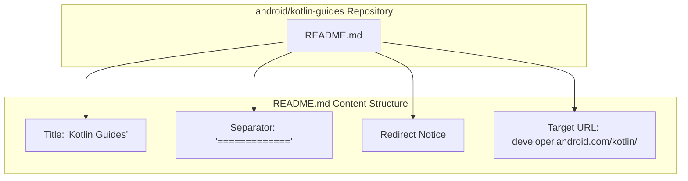
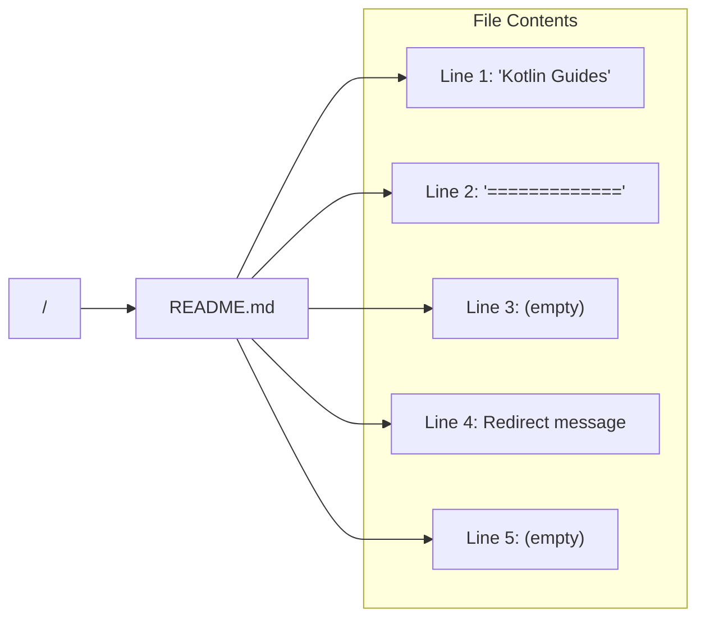
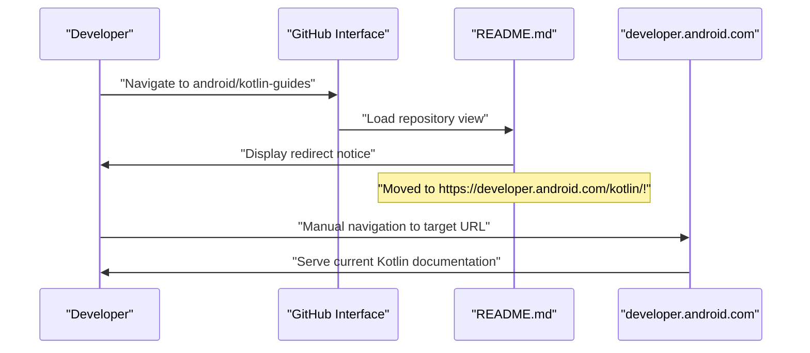
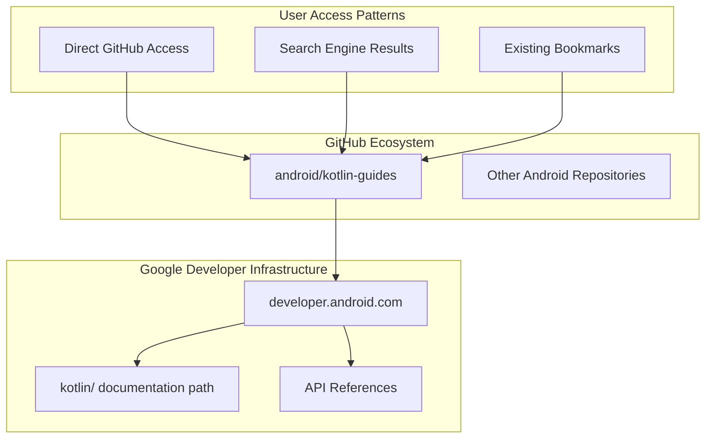
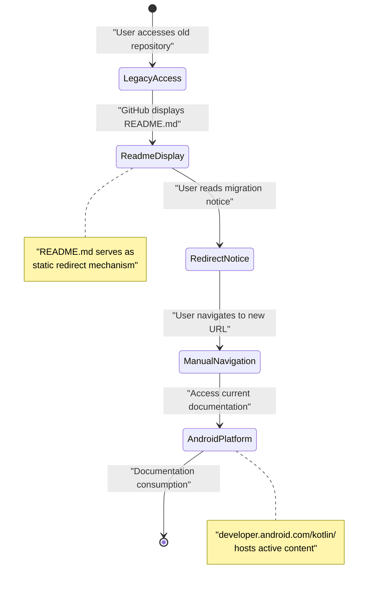
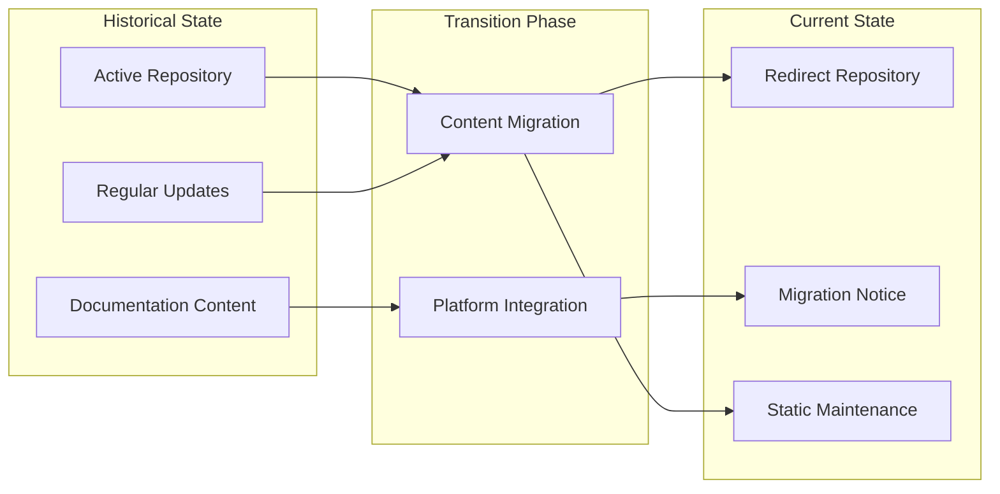

<!-- source: DeepWiki mcp.deepwiki.com · repo android/kotlin-guides · page 1 Repository Overview · fetched 2026-10-23 -->

# Repository Overview

Relevant source files

The following files were used as context for generating this wiki page:

- [README.md](README.md)

## Purpose and Scope

This document provides a technical overview of the `android/kotlin-guides` repository, which currently functions as a static redirect mechanism to guide developers to the official Android Kotlin documentation platform. The repository has been migrated from an active content repository to a legacy redirect state, serving as a permanent pointer to `developer.android.com/kotlin/`.

For detailed information about accessing the current Kotlin guides content, see [Accessing Current Kotlin Guides](#3). For technical details about the migration architecture, see [Migration Architecture](#2.1).

## Repository Architecture

The `android/kotlin-guides` repository currently maintains a minimal file structure optimized for redirect functionality. The entire repository consists of a single documentation file that serves as a migration notice.

### File Structure and Components

**Repository File Structure Diagram**

Sources: [README.md:1-5]()

## Redirect Mechanism Implementation

The repository implements a simple text-based redirect mechanism through the `README.md` file. The redirect notice follows a structured format designed for maximum clarity and immediate user comprehension.

### Redirect Flow Architecture

**Technical Implementation Details**

| Component | Implementation | Purpose |
|-----------|----------------|---------|
| Title Header | `Kotlin Guides` | Repository identification |
| Title Separator | `=============` | Markdown formatting |
| Redirect Message | `Moved to https://developer.android.com/kotlin/!` | User guidance |

Sources: [README.md:1-5]()

## Integration with Android Developer Platform

The repository serves as a bridge component in the broader Android documentation ecosystem, connecting legacy repository access patterns with the current centralized documentation platform.

### System Integration Architecture

**Repository Role in Documentation Ecosystem**

Sources: [README.md:4]()

## Legacy Repository Characteristics

The current repository state represents a common pattern in open-source documentation migration, where community-maintained content transitions to official platform hosting while maintaining backward compatibility for existing access patterns.

### Repository State Analysis

| Characteristic | Current Implementation | Technical Impact |
|---------------|----------------------|------------------|
| File Count | Single file (`README.md`) | Minimal maintenance overhead |
| Content Type | Static text notice | No dynamic content generation |
| Update Frequency | Static (no regular updates) | Zero maintenance operational cost |
| Dependency Requirements | None | No build or deployment pipeline |
| User Interaction Model | Read-only information display | Simple user experience |

**Migration Pattern Architecture**

Sources: [README.md:1-5]()

The `android/kotlin-guides` repository exemplifies a clean migration strategy that prioritizes user experience while minimizing operational complexity. The single-file architecture ensures that developers accessing the repository through any existing workflows receive clear guidance to the current documentation location without encountering broken links or outdated content.

---

