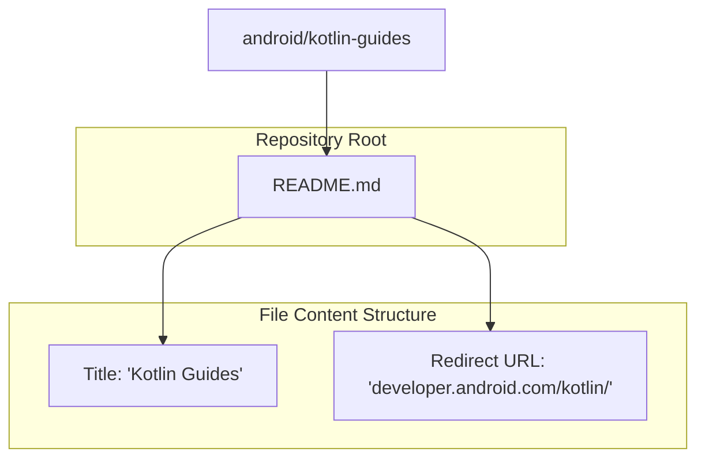
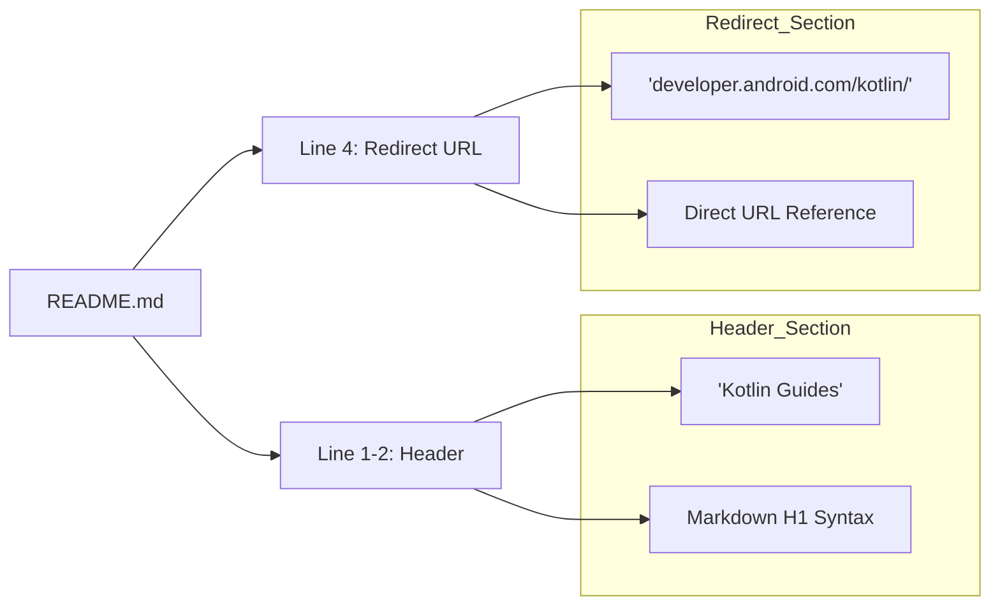
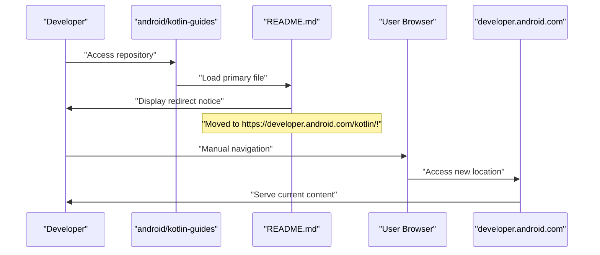
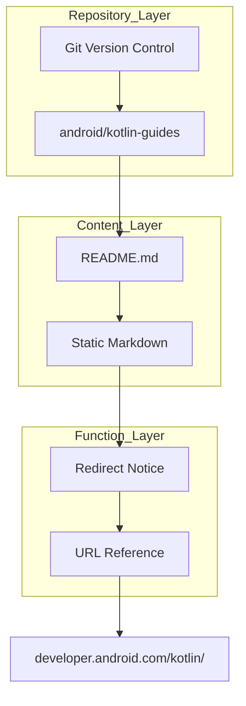

<!-- source: DeepWiki mcp.deepwiki.com · repo android/kotlin-guides · page 1.1 Current Repository State · fetched 2026-10-23 -->

# Current Repository State

Relevant source files

The following files were used as context for generating this wiki page:

- [README.md](README.md)

## Purpose and Scope

This document details the current minimal state of the `android/kotlin-guides` repository, examining its file structure, content, and function as a static redirect mechanism. The analysis covers the repository's current technical implementation and architectural characteristics in its role as a permanent redirect notice.

For information about the historical context and what this repository likely contained before migration, see [Historical Context](#1.2). For details about the migration architecture and redirect mechanism, see [Migration Architecture](#2.1).

## Repository File Structure

The repository currently maintains an extremely minimal file structure, containing only essential files for its redirect function.

### Current File Inventory

The repository consists of a single content file that serves as the primary redirect mechanism:

| File | Purpose | Content Type |
|------|---------|--------------|
| `README.md` | Redirect notice and repository purpose statement | Markdown documentation |

**Repository Structure Diagram**

*Sources: [README.md:1-5]()*

## README.md Content Analysis

The `README.md` file serves as the sole content delivery mechanism for the repository's current purpose. Its structure is deliberately minimal and focused on immediate user redirection.

### Content Structure

The file follows a simple two-part structure:

1. **Header Section**: Repository identification using Markdown heading syntax
2. **Redirect Statement**: Direct URL reference to the new content location

**Content Mapping Diagram**

*Sources: [README.md:1-5]()*

### Technical Content Characteristics

The `README.md` file implements several key technical characteristics:

- **Markdown Heading**: Uses equals sign (`=`) underline syntax for H1 heading [README.md:1-2]()
- **URL Format**: Provides complete HTTP URL without markdown link syntax [README.md:4]()
- **Minimal Formatting**: No additional styling, navigation, or metadata
- **Direct Statement**: Single sentence declarative redirect notice

## Redirect Mechanism Implementation

The repository implements a passive redirect mechanism that relies on user-initiated navigation rather than automated HTTP redirects.

**Redirect Flow Architecture**

*Sources: [README.md:4]()*

## Repository State Characteristics

The current repository state exhibits several distinct technical and operational characteristics that define its function as a redirect mechanism.

### Operational Attributes

| Attribute | Value | Implementation |
|-----------|-------|----------------|
| File Count | 1 | Single `README.md` file |
| Content Type | Static | No dynamic generation |
| Update Frequency | Minimal | Static redirect notice |
| Maintenance Model | Passive | No active content development |
| User Interaction | Manual | User-initiated navigation required |

### Technical Implementation Details

The repository's technical implementation demonstrates several key characteristics:

- **Static Content Delivery**: All information provided through static markdown file
- **No Automation**: Redirect requires manual user action, no HTTP redirect headers
- **Minimal Dependencies**: No build system, frameworks, or external dependencies
- **Platform Agnostic**: Standard markdown readable across all platforms
- **Version Control**: Git-based versioning for the redirect notice itself

**Repository Architecture State**

*Sources: [README.md:1-5]()*

The repository's current state represents a deliberate architectural decision to maintain a minimal footprint while providing essential redirect functionality for users seeking Kotlin documentation resources.

---

