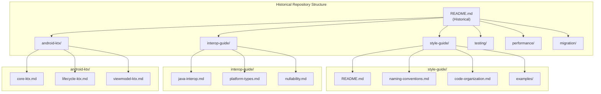
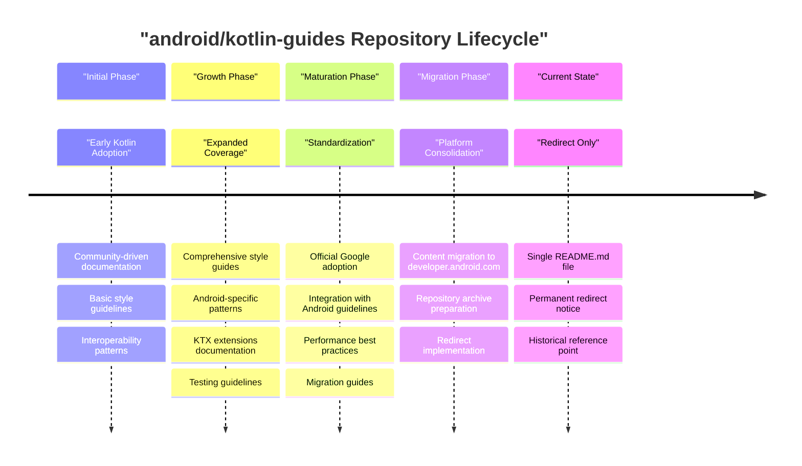
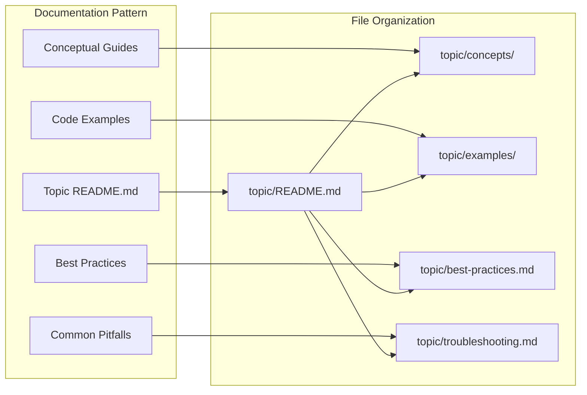
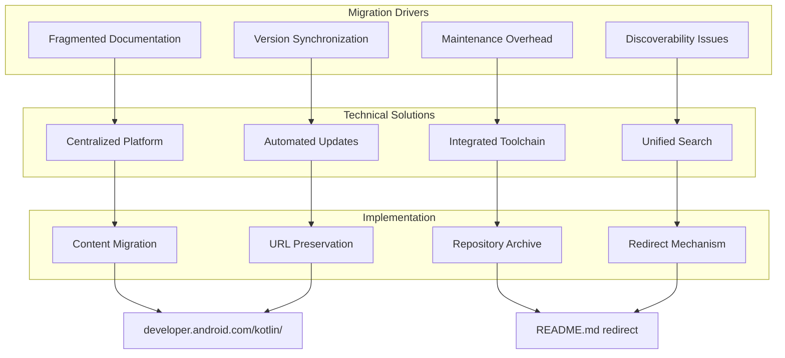

<!-- source: DeepWiki mcp.deepwiki.com · repo android/kotlin-guides · page 1.2 Historical Context · fetched 2026-10-23 -->

# Historical Context

Relevant source files

The following files were used as context for generating this wiki page:

- [README.md](README.md)

This document explains the inferred historical purpose and evolution of the `android/kotlin-guides` repository, analyzing what content and structure likely existed before the migration to the Android Developer platform. For information about the current repository state, see [Current Repository State](#1.1). For details about the migration process, see [Content Migration to Android Developer Platform](#2).

## Purpose and Historical Repository Structure

Based on the repository name and current redirect notice, the `android/kotlin-guides` repository historically served as a centralized location for Kotlin-specific guidance within the Android development ecosystem. The repository likely contained comprehensive documentation, style guides, and best practices for Kotlin development on Android platforms.

### Inferred Historical File Structure

The repository structure likely followed standard documentation repository patterns common in the Android organization:

Sources: [README.md:1-5]()

### Repository Evolution Timeline

The repository likely underwent several phases of evolution before reaching its current state:

Sources: [README.md:1-5]()

## Historical Content Categories

Based on typical Android documentation repository patterns and the migration to `developer.android.com/kotlin/`, the repository likely contained the following content categories:

| Content Category | Likely File Paths | Purpose |
|-----------------|------------------|---------|
| Style Guidelines | `style-guide/README.md`, `style-guide/naming.md` | Kotlin coding standards for Android |
| Interoperability | `interop/java-kotlin.md`, `interop/platform-types.md` | Java-Kotlin interop patterns |
| Android KTX | `android-ktx/core.md`, `android-ktx/lifecycle.md` | Kotlin extension documentation |
| Testing | `testing/unit-tests.md`, `testing/instrumentation.md` | Kotlin testing best practices |
| Performance | `performance/optimization.md`, `performance/memory.md` | Kotlin performance guidelines |
| Migration | `migration/java-to-kotlin.md` | Migration strategies and tools |

### Documentation Structure Pattern

The historical documentation likely followed a hierarchical structure with standardized formatting:

Sources: [README.md:1-5]()

## Migration Drivers and Technical Considerations

### Content Consolidation Strategy

The migration from `android/kotlin-guides` to `developer.android.com/kotlin/` represents a strategic consolidation of Android documentation under Google's official developer platform. This pattern reflects several technical and organizational factors:

Sources: [README.md:4]()

### Repository Lifecycle Management

The current state of the repository demonstrates a common pattern in open-source documentation lifecycle management, where community-maintained resources are eventually absorbed into official platform documentation:

1. **Community Phase**: Open-source contributors maintain documentation in GitHub repositories
2. **Adoption Phase**: Official organizations begin contributing and standardizing content
3. **Integration Phase**: Content is gradually aligned with official documentation standards  
4. **Migration Phase**: Content is moved to official platforms with improved tooling and maintenance
5. **Archive Phase**: Original repositories become redirect points maintaining historical links

The current `README.md` file represents the final archive phase, where [README.md:1-5]() contains only the essential redirect information to guide users to the current documentation location.

Sources: [README.md:1-5]()

## Historical Technical Architecture

The repository likely utilized standard documentation tooling and deployment patterns common in the Android ecosystem during its active phase. This would have included markdown processing, automated builds, and integration with Android development workflows before the consolidation onto the official developer platform.

Sources: [README.md:1-5]()

---

