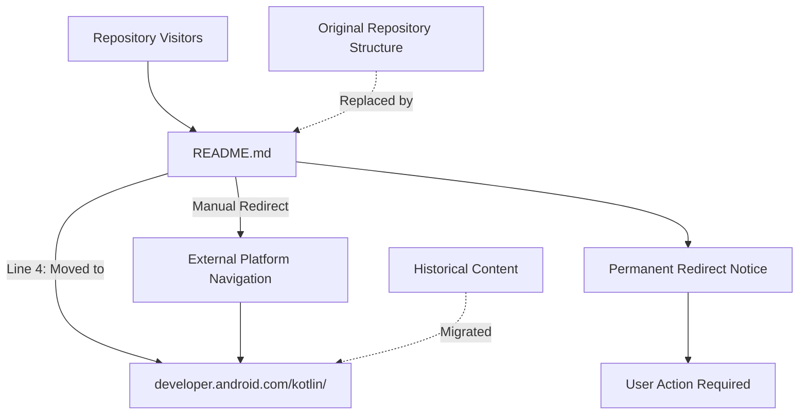
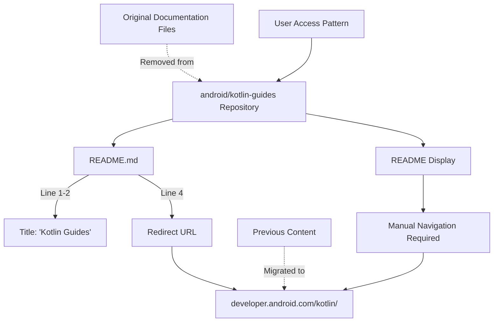

<!-- source: DeepWiki mcp.deepwiki.com · repo android/kotlin-guides · page 2 Content Migration to Android Developer Platform · fetched 2026-10-23 -->

# Content Migration to Android Developer Platform

<details>
<summary>Relevant source files</summary>

The following files were used as context for generating this wiki page:

- [README.md](README.md)

</details>


This document describes the migration of Kotlin guides content from the `android/kotlin-guides` repository to the official Android Developer Platform at `developer.android.com/kotlin/`. It covers the technical implementation of the migration redirect mechanism, the architectural decisions involved, and the implications for developers accessing Kotlin documentation.

For information about the current repository state and how to access the migrated content, see [Current Repository State](#1.1) and [Accessing Current Kotlin Guides](#3).

## Migration Overview

The `android/kotlin-guides` repository has undergone a complete content migration to Google's official Android Developer Platform. This migration represents a strategic consolidation of Kotlin documentation under the authoritative Android documentation umbrella, moving from a standalone GitHub repository to an integrated platform experience.

The migration is implemented through a simple but effective redirect mechanism contained within the repository's `README.md` file, which serves as the primary notification system for users attempting to access the original content location.

**Migration Implementation Flow**


Sources: [README.md:1-5]()

## Technical Implementation Details

The migration is implemented as a minimal redirect system using only the `README.md` file as the communication mechanism. The file contains a simple structure that serves multiple purposes:

| Line Number | Content | Purpose |
|-------------|---------|---------|
| 1 | `Kotlin Guides` | Repository identification |
| 2 | `=============` | Markdown header formatting |
| 4 | `Moved to https://developer.android.com/kotlin/!` | Redirect notice |

The implementation relies on users manually following the provided URL, as there is no automated redirect functionality at the repository level. This approach ensures that:

- Users receive clear notification about the content migration
- The repository maintains its historical significance as a reference point  
- No complex redirect infrastructure is required
- The migration notice is immediately visible upon repository access

**Repository Structure Post-Migration**


Sources: [README.md:1-5]()

## Migration Architecture and Impact

The migration represents a fundamental shift in the documentation architecture, moving from a distributed GitHub-based system to a centralized platform approach. This architectural change has several key implications:

### Platform Integration Benefits

The migration to `developer.android.com/kotlin/` provides several advantages:

- **Unified Documentation Experience**: Integration with the broader Android documentation ecosystem
- **Official Maintenance**: Direct support from Google's Android documentation team  
- **Enhanced Discoverability**: Better SEO and integration with official Android developer resources
- **Consistent Updates**: Synchronized with Android platform releases and Kotlin language updates

### Repository State Transition

The repository has transitioned from an active documentation repository to a redirect marker, maintaining its URL namespace while directing users to the authoritative content source.

**Migration Impact Analysis**
```mermaid
stateDiagram-v2
    [*] --> ActiveRepository: "Original State"
    ActiveRepository --> ContentMigration: "Platform Decision"
    ContentMigration --> README_Only: "Content Transferred"
    README_Only --> RedirectNotice: "README.md Updated"
    RedirectNotice --> [*]: "Current State"
    
    note right of ActiveRepository: "Original kotlin guides\ncontent hosted here"
    note right of README_Only: "Single file:\nREADME.md"
    note right of RedirectNotice: "Line 4: Moved to\ndeveloper.android.com/kotlin/"
```

Sources: [README.md:4]()

## Redirect Mechanism Technical Details

The current redirect implementation in `README.md` functions as a static notification system rather than an automated redirect. The mechanism operates through:

1. **Static Content Display**: The `README.md` file displays automatically when users visit the repository
2. **Manual User Action**: Users must manually click or navigate to the provided URL
3. **External Platform Handoff**: No server-side redirect or JavaScript-based forwarding is implemented

This approach maintains simplicity while ensuring users are informed about the content migration. The redirect URL `https://developer.android.com/kotlin/` leads directly to Google's official Kotlin documentation for Android development.

The minimal implementation reflects a conscious architectural choice to:
- Avoid complex redirect infrastructure maintenance
- Provide clear, human-readable migration notices
- Maintain the repository as a historical reference point
- Ensure long-term stability of the redirect mechanism

Sources: [README.md:4]()

---

