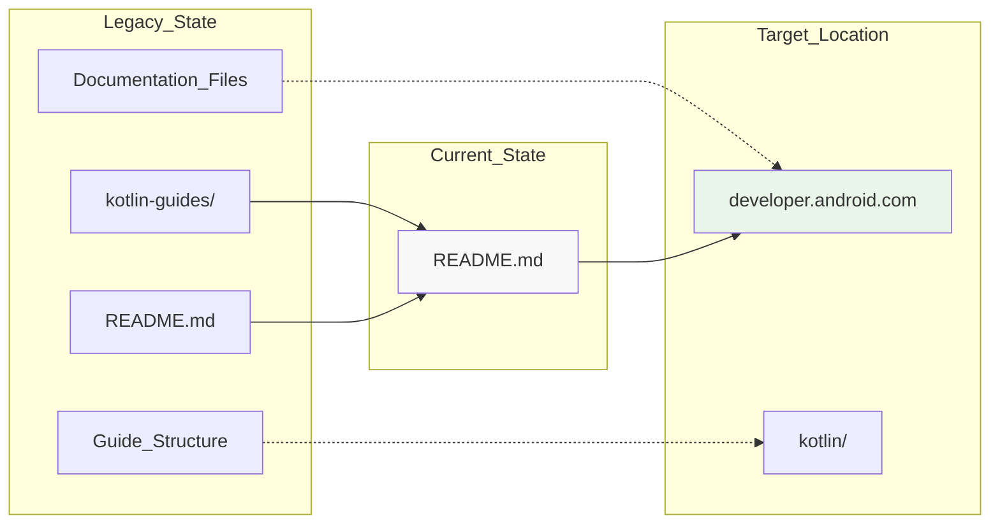
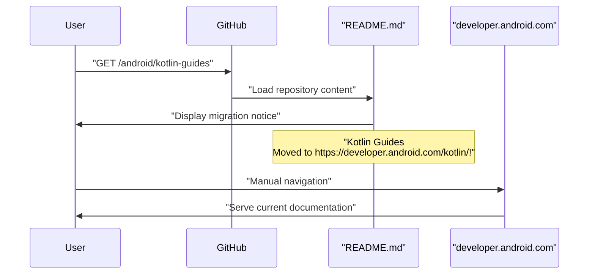
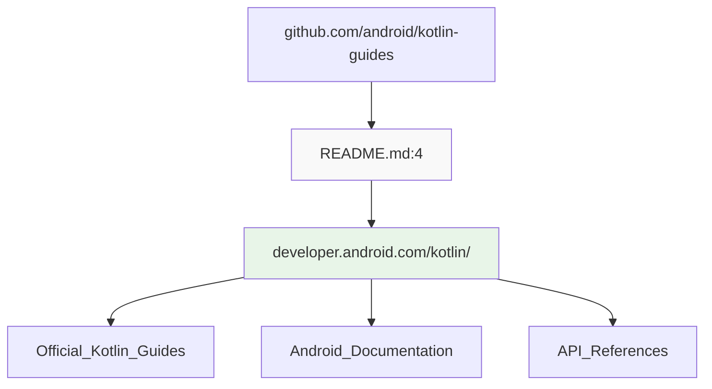
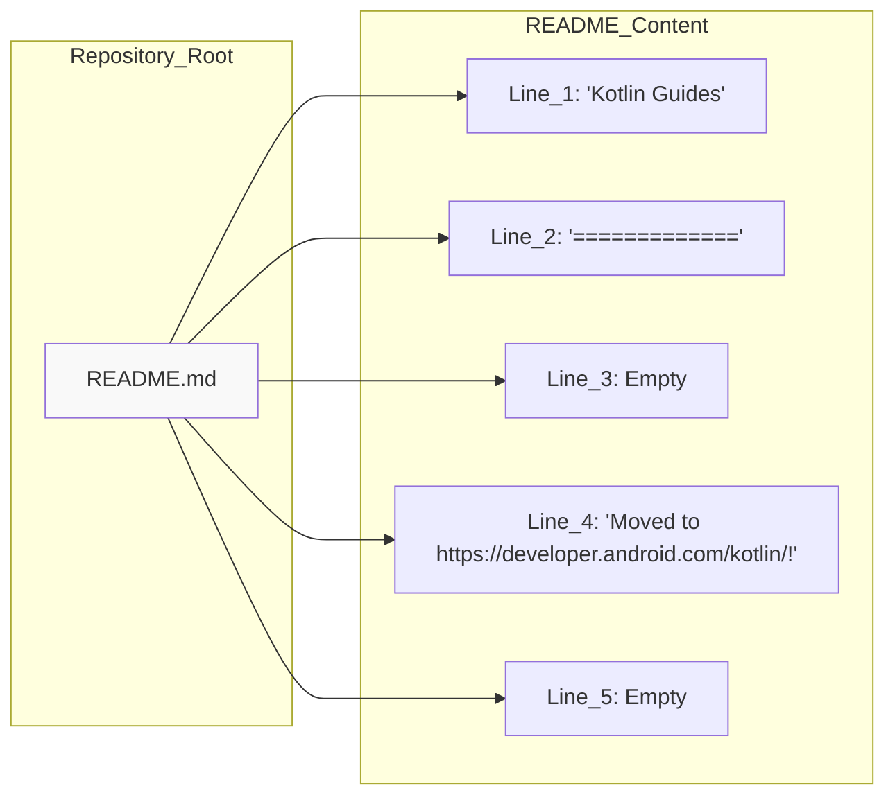

<!-- source: DeepWiki mcp.deepwiki.com · repo android/kotlin-guides · page 2.1 Migration Architecture · fetched 2026-10-23 -->

# Migration Architecture

Relevant source files

The following files were used as context for generating this wiki page:

- [README.md](README.md)

## Purpose and Scope

This document explains the technical architecture underlying the migration of Kotlin guides content from the `android/kotlin-guides` repository to the official Android Developer platform. It covers the redirect mechanism implementation, repository structure transformation, and the relationship between the legacy repository location and the new content destination.

For information about the current repository state, see [Current Repository State](#1.1). For accessing the migrated content, see [Accessing Current Kotlin Guides](#3).

## Migration Mechanism Overview

The migration architecture employs a simple but effective static redirect pattern implemented through repository content replacement. The entire repository structure has been streamlined to serve as a permanent redirection notice rather than maintaining active documentation content.

### Repository Content Transformation

The migration transformed the repository from an active documentation system to a minimal redirect mechanism:

**Repository Structure Migration Flow**
Sources: [README.md:1-5]()

### Static Redirect Implementation

The current implementation uses a repository-level static redirect approach rather than HTTP redirects or GitHub Pages redirection:

**User Interaction Flow with Static Redirect**
Sources: [README.md:1-5]()

## Content Location Mapping

The migration establishes a clear mapping between the legacy repository location and the new content destination:

| Legacy Location | Current Location | Access Method |
|----------------|------------------|---------------|
| `github.com/android/kotlin-guides` | `developer.android.com/kotlin/` | Manual redirect via README notice |
| Repository documentation files | Integrated developer platform content | Direct platform navigation |
| Community-maintained guides | Official Android documentation | Centralized platform access |

### URL Transformation Pattern

The migration implements a one-to-many URL transformation pattern:

**Content Location Transformation Architecture**
Sources: [README.md:4]()

## Repository File Structure

The current repository maintains minimal file structure optimized for redirect functionality:

**Current Repository File Architecture**
Sources: [README.md:1-5]()

## Redirect Mechanism Technical Details

### File-Based Redirect Implementation

The redirect mechanism relies on GitHub's default repository display behavior:

1. **Repository Access**: Users accessing `github.com/android/kotlin-guides` receive the repository's default view
2. **README Display**: GitHub automatically renders [README.md:1-5]() as the primary repository content  
3. **Migration Notice**: The title "Kotlin Guides" on [README.md:1]() and redirect URL on [README.md:4]() provide clear user guidance
4. **Manual Navigation**: Users must manually navigate to the target URL as no automated redirect occurs

### Content Preservation Strategy

The architecture preserves discoverability while eliminating maintenance overhead:

- **Repository Visibility**: Maintains GitHub repository accessibility for existing bookmarks and references
- **Clear Messaging**: [README.md:1-2]() establishes context with "Kotlin Guides" title and separator
- **Direct Link**: [README.md:4]() provides explicit target URL `https://developer.android.com/kotlin/`
- **Minimal Maintenance**: Static content requires no ongoing updates or dependency management

Sources: [README.md:1-5]()

## Migration Architecture Benefits

The implemented migration architecture provides several technical advantages:

1. **Zero Maintenance Overhead**: Static README requires no ongoing content updates
2. **Persistent Discoverability**: Repository remains accessible for historical references  
3. **Clear User Direction**: Unambiguous redirect instruction eliminates confusion
4. **Platform Integration**: Content consolidation under official Android Developer platform
5. **Simplified Deployment**: No server-side redirect logic or configuration required

This architecture pattern effectively bridges legacy community documentation repositories with official platform documentation systems while maintaining user accessibility and minimizing operational complexity.

Sources: [README.md:1-5]()

---

