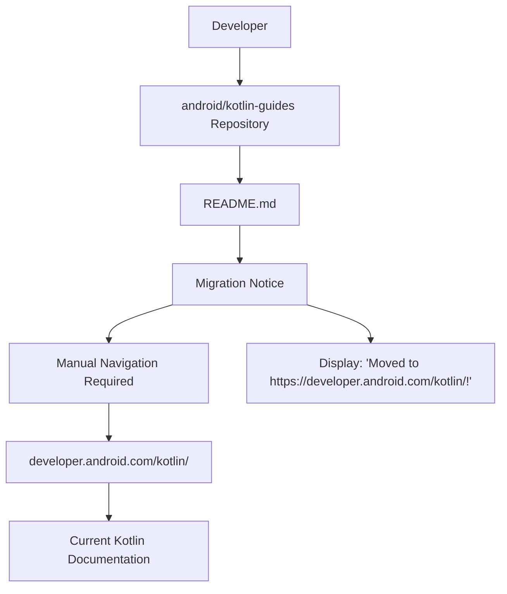
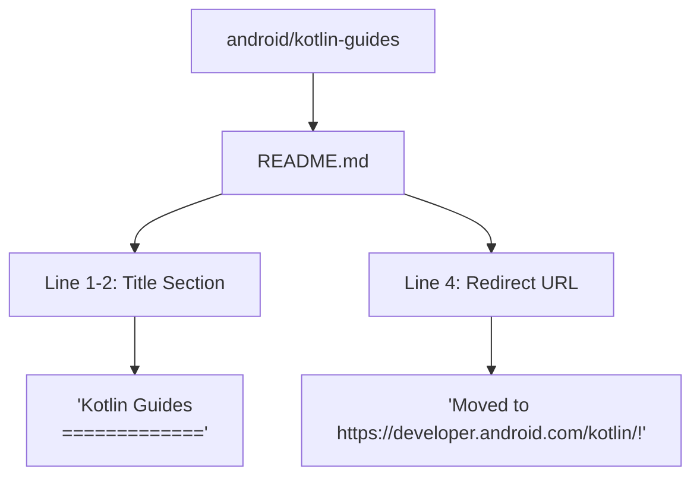
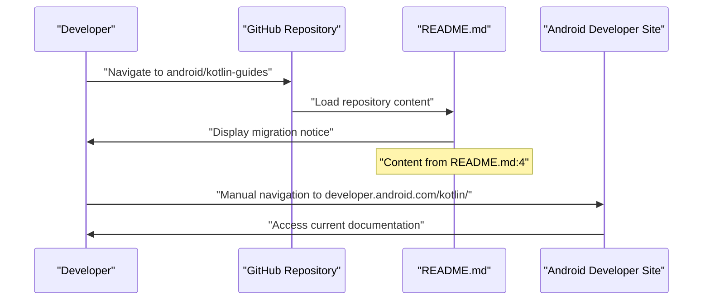

<!-- source: DeepWiki mcp.deepwiki.com · repo android/kotlin-guides · page 3 Accessing Current Kotlin Guides · fetched 2026-10-23 -->

# Accessing Current Kotlin Guides

Relevant source files

The following files were used as context for generating this wiki page:

- [README.md](README.md)

This document provides instructions for accessing the current Kotlin guides documentation and explains the migration from the `android/kotlin-guides` repository to the official Android Developer platform. It covers the technical aspects of the redirect mechanism and user workflow for finding current documentation.

For information about the repository's historical context and migration architecture, see [Repository Overview](#1) and [Content Migration to Android Developer Platform](#2).

## Current Access Method

The Kotlin guides are no longer maintained in this repository. As indicated in [README.md:4](), all content has been moved to the official Android Developer platform at `https://developer.android.com/kotlin/`.

### User Access Flow

The following diagram illustrates the current user journey for accessing Kotlin guides:

Sources: [README.md:1-5]()

### Repository Structure and Content

The current repository contains minimal content serving as a permanent redirect notice:

Sources: [README.md:1-5]()

## Technical Implementation

The redirect mechanism is implemented as a static notice rather than an automated redirect. Users must manually navigate to the new location after reading the notice in [README.md:4]().

### File Structure Analysis

| File | Purpose | Content |
|------|---------|---------|
| `README.md` | Migration notice | Title header and redirect URL |

The repository maintains a minimal footprint with only essential redirect information. The content structure follows this pattern:

- **Header section**: [README.md:1-2]() contains the repository title with markdown formatting
- **Redirect notice**: [README.md:4]() provides the new documentation location

Sources: [README.md:1-5]()

## Documentation Location and Access

### Current Platform

All Kotlin guides are now hosted on the official Android Developer platform. This migration represents a consolidation of documentation resources under Google's official documentation infrastructure.

### Expected Content at New Location

While the specific content structure at `developer.android.com/kotlin/` is not detailed in this repository, users can expect to find:

- Official Kotlin documentation for Android development
- Updated and maintained guides reflecting current best practices
- Integration with other Android developer resources

### User Workflow Recommendations

The recommended approach for accessing current Kotlin guides follows this sequence:

Sources: [README.md:4]()

## Migration Implications

### For Developers

- **Bookmark updates required**: Previous bookmarks to this repository should be updated to point to the new location
- **Manual navigation**: No automatic redirect is implemented; users must manually follow the provided URL
- **Single source of truth**: All current documentation is centralized on the official Android platform

### For Documentation Maintenance

The migration eliminates the need for content synchronization between multiple platforms and ensures that documentation updates occur through official channels.

Sources: [README.md:1-5]()

---

