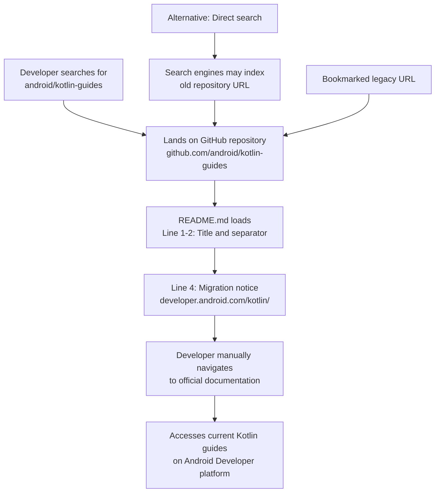
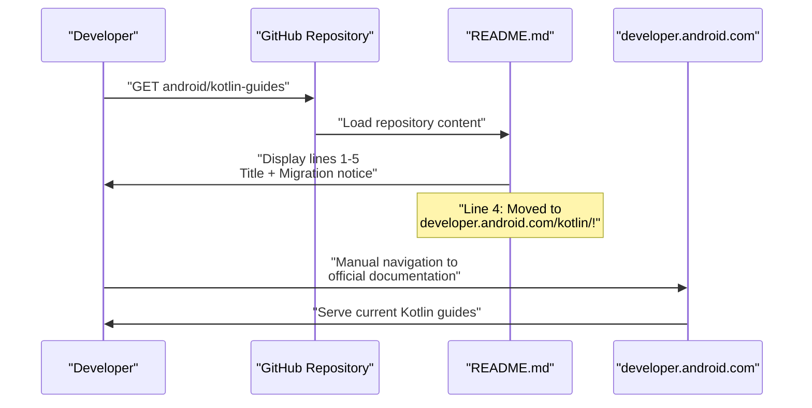
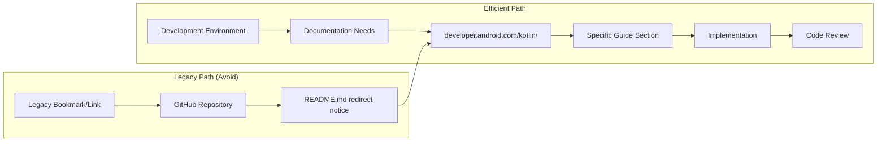
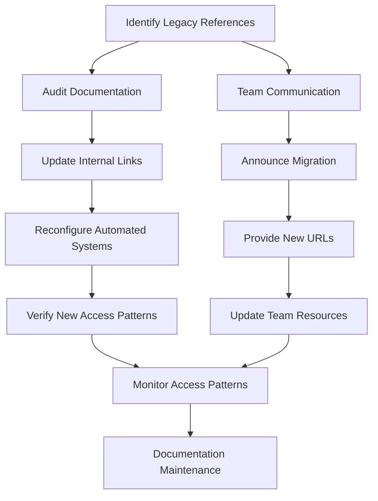

<!-- source: DeepWiki mcp.deepwiki.com · repo android/kotlin-guides · page 3.1 User Journey and Best Practices · fetched 2026-10-23 -->

# User Journey and Best Practices

Relevant source files

The following files were used as context for generating this wiki page:

- [README.md](README.md)

## Purpose and Scope

This document outlines the recommended user workflow for accessing current Kotlin guides and provides best practices for navigating from the legacy `android/kotlin-guides` repository to the official Android Developer platform. It covers the practical implications of the content migration and establishes optimal patterns for developers seeking Kotlin documentation.

For information about the technical aspects of the migration architecture, see [Migration Architecture](#2.1). For details about the repository's current minimal state, see [Current Repository State](#1.1).

## Current User Journey

The user journey for accessing Kotlin guides follows a simple redirect pattern, where developers arriving at the legacy repository are immediately directed to the authoritative documentation source.

### Repository Entry Point Flow

Sources: [README.md:1-5]()

### Content Access Pattern

The migration creates a two-step access pattern where users must perform manual navigation from the repository notice to the target documentation.

Sources: [README.md:4]()

## Best Practices for Accessing Kotlin Guides

### Primary Access Method

**Direct Navigation**: Developers should bookmark and directly access `https://developer.android.com/kotlin/` rather than routing through the legacy repository.

### Search Strategy

| Search Context | Recommended Approach | Rationale |
|----------------|---------------------|-----------|
| General Kotlin guides | Search directly on developer.android.com | Avoids redirect step |
| Specific topics | Use site-specific search: `site:developer.android.com kotlin [topic]` | Ensures current content |
| Legacy references | Update bookmarks and documentation links | Prevents workflow interruption |

### Documentation Integration Workflow

Sources: [README.md:4]()

## Migration Impact on Developer Workflow

### Workflow Disruption Patterns

The content migration introduces specific disruption points in common developer workflows:

1. **Bookmark Invalidation**: Existing bookmarks to repository-hosted guides no longer function
2. **Documentation Links**: Internal team documentation referencing the old repository requires updates
3. **Automated Tools**: CI/CD systems or documentation generators pointing to the repository need reconfiguration

### Mitigation Strategies

Sources: [README.md:1-5]()

## Recommended Navigation Patterns

### For Individual Developers

**Pattern 1: Direct Access**
- Navigate directly to `developer.android.com/kotlin/`
- Use site search functionality for specific topics
- Bookmark frequently accessed guide sections

**Pattern 2: Integration with Development Tools**
- Configure IDE help systems to point to official documentation
- Update local documentation shortcuts and quick references
- Integrate official documentation URLs into development workflows

### For Teams and Organizations

**Pattern 3: Centralized Documentation Management**
- Maintain internal documentation hubs with current official links
- Implement redirect mechanisms in internal systems
- Regular audits of documentation link validity

### Legacy Repository Interaction

When encountering the legacy repository, the optimal interaction pattern involves:

1. **Recognition**: Identify the repository as a redirect notice via [README.md:1-2]()
2. **Extraction**: Note the target URL from [README.md:4]()
3. **Direct Navigation**: Proceed to the official documentation platform
4. **Bookmark Update**: Replace legacy references with direct links

Sources: [README.md:1-5]()

## Platform-Specific Considerations

### Android Developer Platform Integration

The official Kotlin guides on `developer.android.com` provide enhanced integration with the broader Android documentation ecosystem:

- **Cross-reference linking** to Android API documentation
- **Version-specific guidance** aligned with Android releases  
- **Interactive examples** and code samples
- **Community feedback mechanisms** for documentation improvement

### Search Engine Optimization Impact

The migration affects discoverability patterns:
- Legacy repository URLs may persist in search engine indexes
- Official documentation receives enhanced SEO treatment on the Android Developer platform
- Developers should expect a transition period where both URLs appear in search results

Sources: [README.md:4]()