# Page: Repository Overview

# Repository Overview

<details>
<summary>Relevant source files</summary>

The following files were used as context for generating this wiki page:

- [README.md](README.md)

</details>


## Purpose and Scope

This document provides a technical overview of the `android/kotlin-guides` repository, which currently functions as a static redirect mechanism to guide developers to the official Android Kotlin documentation platform. The repository has been migrated from an active content repository to a legacy redirect state, serving as a permanent pointer to `developer.android.com/kotlin/`.

For detailed information about accessing the current Kotlin guides content, see [Accessing Current Kotlin Guides](#3). For technical details about the migration architecture, see [Migration Architecture](#2.1).

## Repository Architecture

The `android/kotlin-guides` repository currently maintains a minimal file structure optimized for redirect functionality. The entire repository consists of a single documentation file that serves as a migration notice.

### File Structure and Components

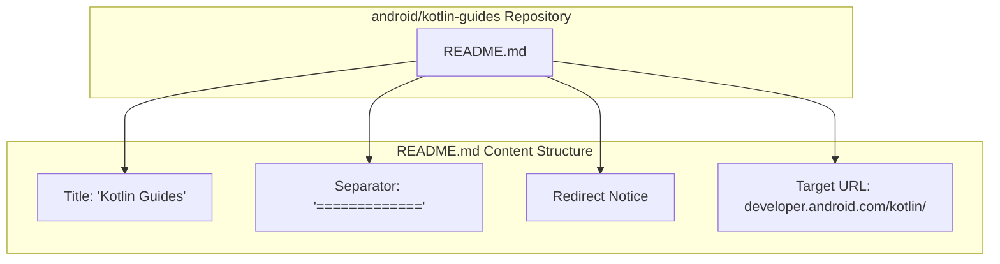

**Repository File Structure Diagram**
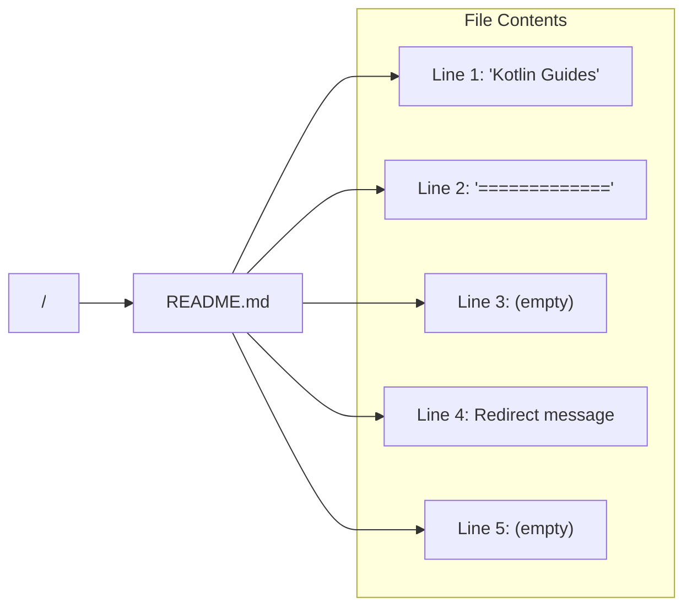

Sources: [README.md:1-5]()

## Redirect Mechanism Implementation

The repository implements a simple text-based redirect mechanism through the `README.md` file. The redirect notice follows a structured format designed for maximum clarity and immediate user comprehension.

### Redirect Flow Architecture

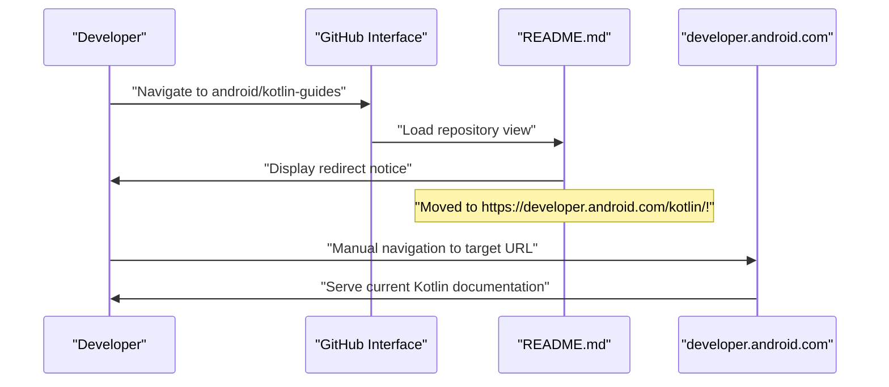

**Technical Implementation Details**

| Component | Implementation | Purpose |
|-----------|----------------|---------|
| Title Header | `Kotlin Guides` | Repository identification |
| Title Separator | `=============` | Markdown formatting |
| Redirect Message | `Moved to https://developer.android.com/kotlin/!` | User guidance |

Sources: [README.md:1-5]()

## Integration with Android Developer Platform

The repository serves as a bridge component in the broader Android documentation ecosystem, connecting legacy repository access patterns with the current centralized documentation platform.

### System Integration Architecture

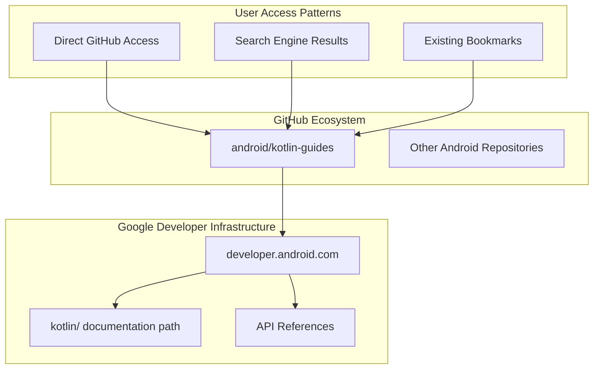

**Repository Role in Documentation Ecosystem**

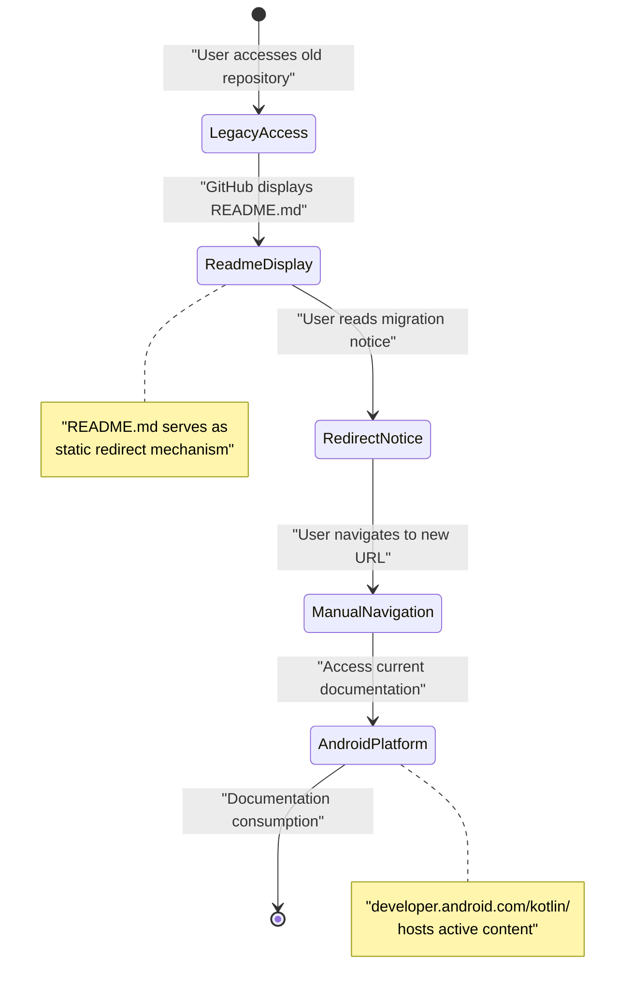

Sources: [README.md:4]()

## Legacy Repository Characteristics

The current repository state represents a common pattern in open-source documentation migration, where community-maintained content transitions to official platform hosting while maintaining backward compatibility for existing access patterns.

### Repository State Analysis

| Characteristic | Current Implementation | Technical Impact |
|---------------|----------------------|------------------|
| File Count | Single file (`README.md`) | Minimal maintenance overhead |
| Content Type | Static text notice | No dynamic content generation |
| Update Frequency | Static (no regular updates) | Zero maintenance operational cost |
| Dependency Requirements | None | No build or deployment pipeline |
| User Interaction Model | Read-only information display | Simple user experience |

**Migration Pattern Architecture**

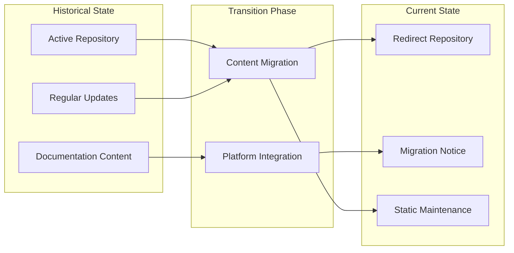

Sources: [README.md:1-5]()

The `android/kotlin-guides` repository exemplifies a clean migration strategy that prioritizes user experience while minimizing operational complexity. The single-file architecture ensures that developers accessing the repository through any existing workflows receive clear guidance to the current documentation location without encountering broken links or outdated content.

---

# Page: Current Repository State

# Current Repository State

<details>
<summary>Relevant source files</summary>

The following files were used as context for generating this wiki page:

- [README.md](README.md)

</details>


## Purpose and Scope

This document details the current minimal state of the `android/kotlin-guides` repository, examining its file structure, content, and function as a static redirect mechanism. The analysis covers the repository's current technical implementation and architectural characteristics in its role as a permanent redirect notice.

For information about the historical context and what this repository likely contained before migration, see [Historical Context](#1.2). For details about the migration architecture and redirect mechanism, see [Migration Architecture](#2.1).

## Repository File Structure

The repository currently maintains an extremely minimal file structure, containing only essential files for its redirect function.

### Current File Inventory

The repository consists of a single content file that serves as the primary redirect mechanism:

| File | Purpose | Content Type |
|------|---------|--------------|
| `README.md` | Redirect notice and repository purpose statement | Markdown documentation |

**Repository Structure Diagram**

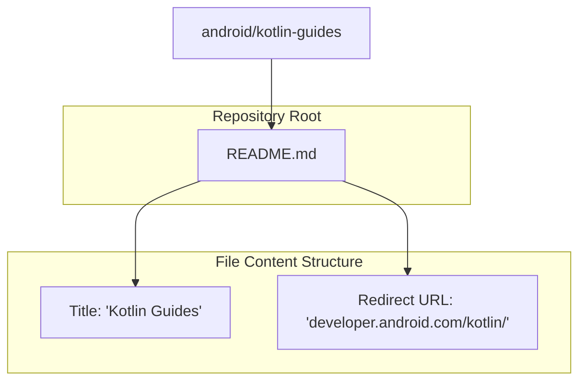

*Sources: [README.md:1-5]()*

## README.md Content Analysis

The `README.md` file serves as the sole content delivery mechanism for the repository's current purpose. Its structure is deliberately minimal and focused on immediate user redirection.

### Content Structure

The file follows a simple two-part structure:

1. **Header Section**: Repository identification using Markdown heading syntax
2. **Redirect Statement**: Direct URL reference to the new content location

**Content Mapping Diagram**

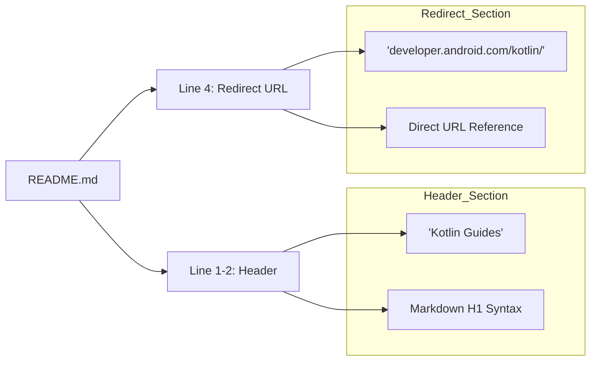

*Sources: [README.md:1-5]()*

### Technical Content Characteristics

The `README.md` file implements several key technical characteristics:

- **Markdown Heading**: Uses equals sign (`=`) underline syntax for H1 heading [README.md:1-2]()
- **URL Format**: Provides complete HTTP URL without markdown link syntax [README.md:4]()
- **Minimal Formatting**: No additional styling, navigation, or metadata
- **Direct Statement**: Single sentence declarative redirect notice

## Redirect Mechanism Implementation

The repository implements a passive redirect mechanism that relies on user-initiated navigation rather than automated HTTP redirects.

**Redirect Flow Architecture**

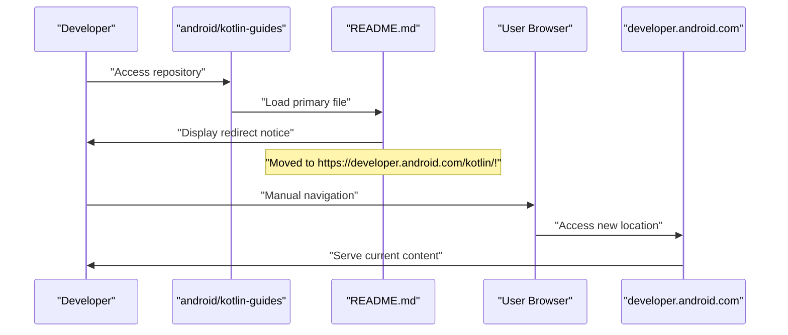

*Sources: [README.md:4]()*

## Repository State Characteristics

The current repository state exhibits several distinct technical and operational characteristics that define its function as a redirect mechanism.

### Operational Attributes

| Attribute | Value | Implementation |
|-----------|-------|----------------|
| File Count | 1 | Single `README.md` file |
| Content Type | Static | No dynamic generation |
| Update Frequency | Minimal | Static redirect notice |
| Maintenance Model | Passive | No active content development |
| User Interaction | Manual | User-initiated navigation required |

### Technical Implementation Details

The repository's technical implementation demonstrates several key characteristics:

- **Static Content Delivery**: All information provided through static markdown file
- **No Automation**: Redirect requires manual user action, no HTTP redirect headers
- **Minimal Dependencies**: No build system, frameworks, or external dependencies
- **Platform Agnostic**: Standard markdown readable across all platforms
- **Version Control**: Git-based versioning for the redirect notice itself

**Repository Architecture State**

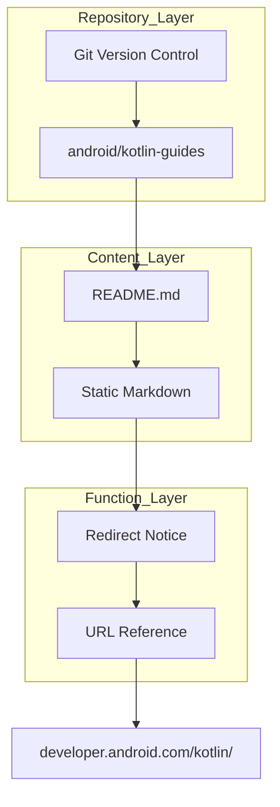

*Sources: [README.md:1-5]()*

The repository's current state represents a deliberate architectural decision to maintain a minimal footprint while providing essential redirect functionality for users seeking Kotlin documentation resources.

---

# Page: Historical Context

# Historical Context

<details>
<summary>Relevant source files</summary>

The following files were used as context for generating this wiki page:

- [README.md](README.md)

</details>


This document explains the inferred historical purpose and evolution of the `android/kotlin-guides` repository, analyzing what content and structure likely existed before the migration to the Android Developer platform. For information about the current repository state, see [Current Repository State](#1.1). For details about the migration process, see [Content Migration to Android Developer Platform](#2).

## Purpose and Historical Repository Structure

Based on the repository name and current redirect notice, the `android/kotlin-guides` repository historically served as a centralized location for Kotlin-specific guidance within the Android development ecosystem. The repository likely contained comprehensive documentation, style guides, and best practices for Kotlin development on Android platforms.

### Inferred Historical File Structure

The repository structure likely followed standard documentation repository patterns common in the Android organization:

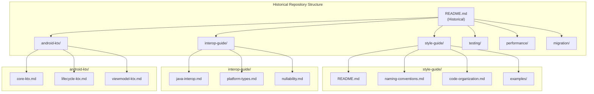

Sources: [README.md:1-5]()

### Repository Evolution Timeline

The repository likely underwent several phases of evolution before reaching its current state:

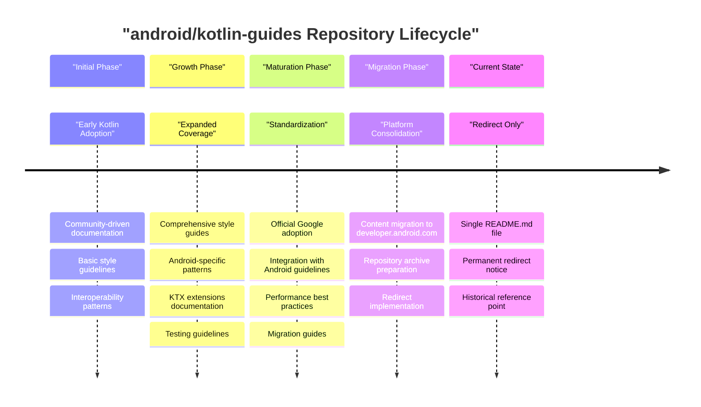

Sources: [README.md:1-5]()

## Historical Content Categories

Based on typical Android documentation repository patterns and the migration to `developer.android.com/kotlin/`, the repository likely contained the following content categories:

| Content Category | Likely File Paths | Purpose |
|-----------------|------------------|---------|
| Style Guidelines | `style-guide/README.md`, `style-guide/naming.md` | Kotlin coding standards for Android |
| Interoperability | `interop/java-kotlin.md`, `interop/platform-types.md` | Java-Kotlin interop patterns |
| Android KTX | `android-ktx/core.md`, `android-ktx/lifecycle.md` | Kotlin extension documentation |
| Testing | `testing/unit-tests.md`, `testing/instrumentation.md` | Kotlin testing best practices |
| Performance | `performance/optimization.md`, `performance/memory.md` | Kotlin performance guidelines |
| Migration | `migration/java-to-kotlin.md` | Migration strategies and tools |

### Documentation Structure Pattern

The historical documentation likely followed a hierarchical structure with standardized formatting:

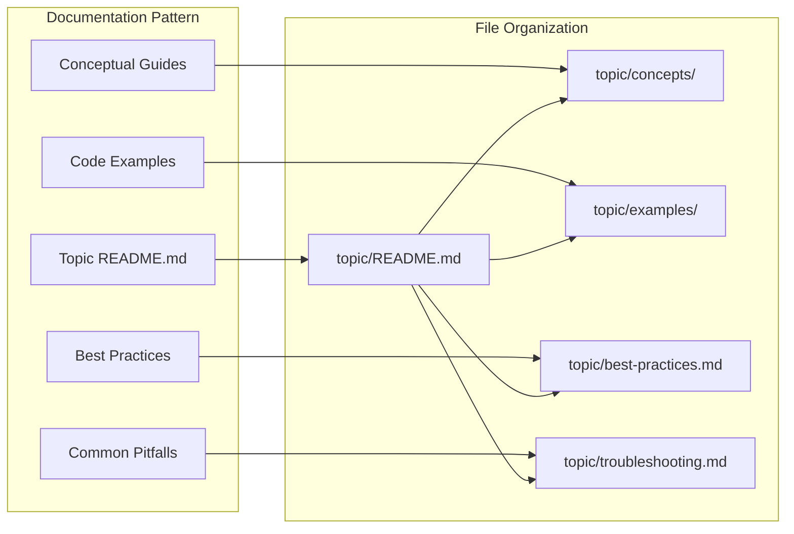

Sources: [README.md:1-5]()

## Migration Drivers and Technical Considerations

### Content Consolidation Strategy

The migration from `android/kotlin-guides` to `developer.android.com/kotlin/` represents a strategic consolidation of Android documentation under Google's official developer platform. This pattern reflects several technical and organizational factors:

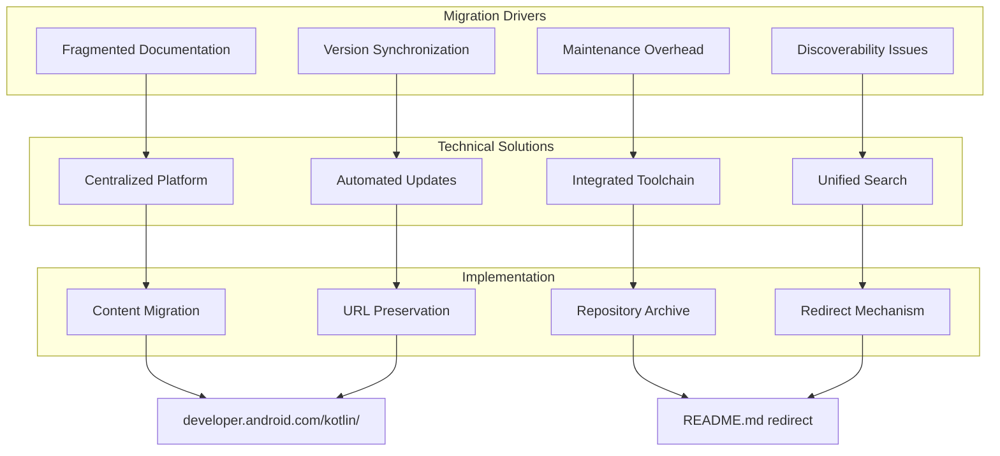

Sources: [README.md:4]()

### Repository Lifecycle Management

The current state of the repository demonstrates a common pattern in open-source documentation lifecycle management, where community-maintained resources are eventually absorbed into official platform documentation:

1. **Community Phase**: Open-source contributors maintain documentation in GitHub repositories
2. **Adoption Phase**: Official organizations begin contributing and standardizing content
3. **Integration Phase**: Content is gradually aligned with official documentation standards  
4. **Migration Phase**: Content is moved to official platforms with improved tooling and maintenance
5. **Archive Phase**: Original repositories become redirect points maintaining historical links

The current `README.md` file represents the final archive phase, where [README.md:1-5]() contains only the essential redirect information to guide users to the current documentation location.

Sources: [README.md:1-5]()

## Historical Technical Architecture

The repository likely utilized standard documentation tooling and deployment patterns common in the Android ecosystem during its active phase. This would have included markdown processing, automated builds, and integration with Android development workflows before the consolidation onto the official developer platform.

Sources: [README.md:1-5]()

---

# Page: Content Migration to Android Developer Platform

# Content Migration to Android Developer Platform

<details>
<summary>Relevant source files</summary>

The following files were used as context for generating this wiki page:

- [README.md](README.md)

</details>


This document describes the migration of Kotlin guides content from the `android/kotlin-guides` repository to the official Android Developer Platform at `developer.android.com/kotlin/`. It covers the technical implementation of the migration redirect mechanism, the architectural decisions involved, and the implications for developers accessing Kotlin documentation.

For information about the current repository state and how to access the migrated content, see [Current Repository State](#1.1) and [Accessing Current Kotlin Guides](#3).

## Migration Overview

The `android/kotlin-guides` repository has undergone a complete content migration to Google's official Android Developer Platform. This migration represents a strategic consolidation of Kotlin documentation under the authoritative Android documentation umbrella, moving from a standalone GitHub repository to an integrated platform experience.

The migration is implemented through a simple but effective redirect mechanism contained within the repository's `README.md` file, which serves as the primary notification system for users attempting to access the original content location.

**Migration Implementation Flow**
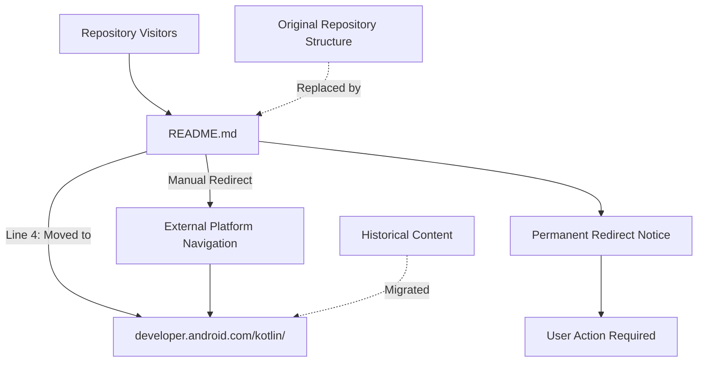

Sources: [README.md:1-5]()

## Technical Implementation Details

The migration is implemented as a minimal redirect system using only the `README.md` file as the communication mechanism. The file contains a simple structure that serves multiple purposes:

| Line Number | Content | Purpose |
|-------------|---------|---------|
| 1 | `Kotlin Guides` | Repository identification |
| 2 | `=============` | Markdown header formatting |
| 4 | `Moved to https://developer.android.com/kotlin/!` | Redirect notice |

The implementation relies on users manually following the provided URL, as there is no automated redirect functionality at the repository level. This approach ensures that:

- Users receive clear notification about the content migration
- The repository maintains its historical significance as a reference point  
- No complex redirect infrastructure is required
- The migration notice is immediately visible upon repository access

**Repository Structure Post-Migration**
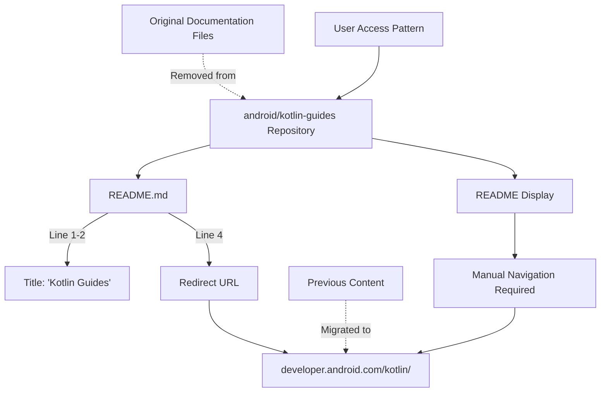

Sources: [README.md:1-5]()

## Migration Architecture and Impact

The migration represents a fundamental shift in the documentation architecture, moving from a distributed GitHub-based system to a centralized platform approach. This architectural change has several key implications:

### Platform Integration Benefits

The migration to `developer.android.com/kotlin/` provides several advantages:

- **Unified Documentation Experience**: Integration with the broader Android documentation ecosystem
- **Official Maintenance**: Direct support from Google's Android documentation team  
- **Enhanced Discoverability**: Better SEO and integration with official Android developer resources
- **Consistent Updates**: Synchronized with Android platform releases and Kotlin language updates

### Repository State Transition

The repository has transitioned from an active documentation repository to a redirect marker, maintaining its URL namespace while directing users to the authoritative content source.

**Migration Impact Analysis**
```mermaid
stateDiagram-v2
    [*] --> ActiveRepository: "Original State"
    ActiveRepository --> ContentMigration: "Platform Decision"
    ContentMigration --> README_Only: "Content Transferred"
    README_Only --> RedirectNotice: "README.md Updated"
    RedirectNotice --> [*]: "Current State"
    
    note right of ActiveRepository: "Original kotlin guides\ncontent hosted here"
    note right of README_Only: "Single file:\nREADME.md"
    note right of RedirectNotice: "Line 4: Moved to\ndeveloper.android.com/kotlin/"
```

Sources: [README.md:4]()

## Redirect Mechanism Technical Details

The current redirect implementation in `README.md` functions as a static notification system rather than an automated redirect. The mechanism operates through:

1. **Static Content Display**: The `README.md` file displays automatically when users visit the repository
2. **Manual User Action**: Users must manually click or navigate to the provided URL
3. **External Platform Handoff**: No server-side redirect or JavaScript-based forwarding is implemented

This approach maintains simplicity while ensuring users are informed about the content migration. The redirect URL `https://developer.android.com/kotlin/` leads directly to Google's official Kotlin documentation for Android development.

The minimal implementation reflects a conscious architectural choice to:
- Avoid complex redirect infrastructure maintenance
- Provide clear, human-readable migration notices
- Maintain the repository as a historical reference point
- Ensure long-term stability of the redirect mechanism

Sources: [README.md:4]()

---

# Page: Migration Architecture

# Migration Architecture

<details>
<summary>Relevant source files</summary>

The following files were used as context for generating this wiki page:

- [README.md](README.md)

</details>


## Purpose and Scope

This document explains the technical architecture underlying the migration of Kotlin guides content from the `android/kotlin-guides` repository to the official Android Developer platform. It covers the redirect mechanism implementation, repository structure transformation, and the relationship between the legacy repository location and the new content destination.

For information about the current repository state, see [Current Repository State](#1.1). For accessing the migrated content, see [Accessing Current Kotlin Guides](#3).

## Migration Mechanism Overview

The migration architecture employs a simple but effective static redirect pattern implemented through repository content replacement. The entire repository structure has been streamlined to serve as a permanent redirection notice rather than maintaining active documentation content.

### Repository Content Transformation

The migration transformed the repository from an active documentation system to a minimal redirect mechanism:

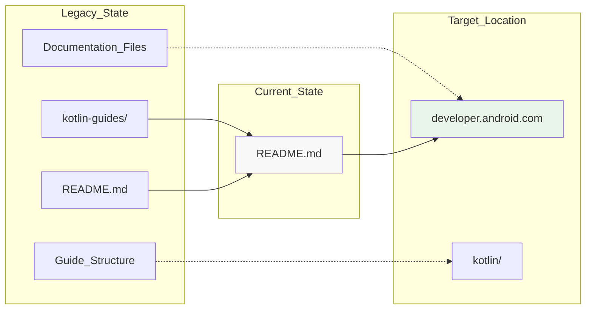

**Repository Structure Migration Flow**
Sources: [README.md:1-5]()

### Static Redirect Implementation

The current implementation uses a repository-level static redirect approach rather than HTTP redirects or GitHub Pages redirection:

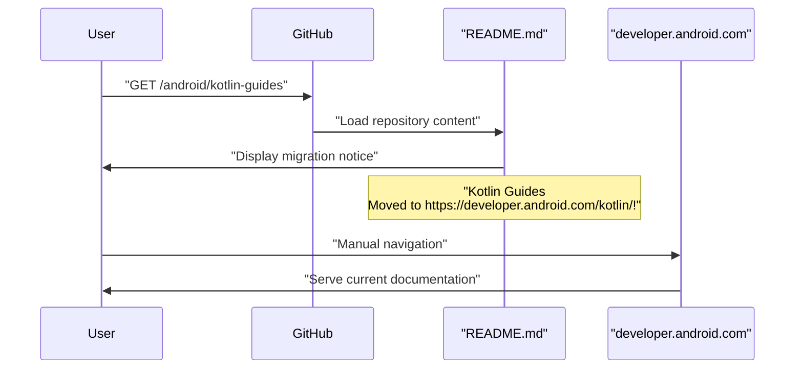

**User Interaction Flow with Static Redirect**
Sources: [README.md:1-5]()

## Content Location Mapping

The migration establishes a clear mapping between the legacy repository location and the new content destination:

| Legacy Location | Current Location | Access Method |
|----------------|------------------|---------------|
| `github.com/android/kotlin-guides` | `developer.android.com/kotlin/` | Manual redirect via README notice |
| Repository documentation files | Integrated developer platform content | Direct platform navigation |
| Community-maintained guides | Official Android documentation | Centralized platform access |

### URL Transformation Pattern

The migration implements a one-to-many URL transformation pattern:

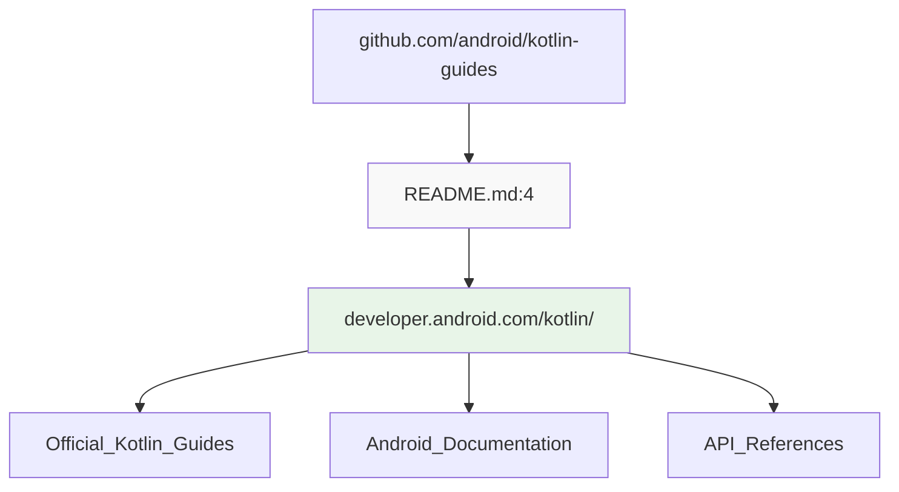

**Content Location Transformation Architecture**
Sources: [README.md:4]()

## Repository File Structure

The current repository maintains minimal file structure optimized for redirect functionality:

```mermaid
graph LR
    subgraph "Repository_Root"
        A["README.md"]
    end
    
    subgraph "README_Content"
        B["Line_1: 'Kotlin Guides'"]
        C["Line_2: '============='"] 
        D["Line_3: Empty"]
        E["Line_4: 'Moved to https://developer.android.com/kotlin/!'"]
        F["Line_5: Empty"]
    end
    
    A --> B
    A --> C
    A --> D
    A --> E
    A --> F
    
    style A fill:#f9f9f9
```

**Current Repository File Architecture**
Sources: [README.md:1-5]()

## Redirect Mechanism Technical Details

### File-Based Redirect Implementation

The redirect mechanism relies on GitHub's default repository display behavior:

1. **Repository Access**: Users accessing `github.com/android/kotlin-guides` receive the repository's default view
2. **README Display**: GitHub automatically renders [README.md:1-5]() as the primary repository content  
3. **Migration Notice**: The title "Kotlin Guides" on [README.md:1]() and redirect URL on [README.md:4]() provide clear user guidance
4. **Manual Navigation**: Users must manually navigate to the target URL as no automated redirect occurs

### Content Preservation Strategy

The architecture preserves discoverability while eliminating maintenance overhead:

- **Repository Visibility**: Maintains GitHub repository accessibility for existing bookmarks and references
- **Clear Messaging**: [README.md:1-2]() establishes context with "Kotlin Guides" title and separator
- **Direct Link**: [README.md:4]() provides explicit target URL `https://developer.android.com/kotlin/`
- **Minimal Maintenance**: Static content requires no ongoing updates or dependency management

Sources: [README.md:1-5]()

## Migration Architecture Benefits

The implemented migration architecture provides several technical advantages:

1. **Zero Maintenance Overhead**: Static README requires no ongoing content updates
2. **Persistent Discoverability**: Repository remains accessible for historical references  
3. **Clear User Direction**: Unambiguous redirect instruction eliminates confusion
4. **Platform Integration**: Content consolidation under official Android Developer platform
5. **Simplified Deployment**: No server-side redirect logic or configuration required

This architecture pattern effectively bridges legacy community documentation repositories with official platform documentation systems while maintaining user accessibility and minimizing operational complexity.

Sources: [README.md:1-5]()

---

# Page: Accessing Current Kotlin Guides

# Accessing Current Kotlin Guides

<details>
<summary>Relevant source files</summary>

The following files were used as context for generating this wiki page:

- [README.md](README.md)

</details>


This document provides instructions for accessing the current Kotlin guides documentation and explains the migration from the `android/kotlin-guides` repository to the official Android Developer platform. It covers the technical aspects of the redirect mechanism and user workflow for finding current documentation.

For information about the repository's historical context and migration architecture, see [Repository Overview](#1) and [Content Migration to Android Developer Platform](#2).

## Current Access Method

The Kotlin guides are no longer maintained in this repository. As indicated in [README.md:4](), all content has been moved to the official Android Developer platform at `https://developer.android.com/kotlin/`.

### User Access Flow

The following diagram illustrates the current user journey for accessing Kotlin guides:

```mermaid
flowchart TD
    A["Developer"] --> B["android/kotlin-guides Repository"]
    B --> C["README.md"]
    C --> D["Migration Notice"]
    D --> E["Manual Navigation Required"]
    E --> F["developer.android.com/kotlin/"]
    F --> G["Current Kotlin Documentation"]
    
    D --> H["Display: 'Moved to https://developer.android.com/kotlin/!'"]
```

Sources: [README.md:1-5]()

### Repository Structure and Content

The current repository contains minimal content serving as a permanent redirect notice:

```mermaid
graph TD
    A["android/kotlin-guides"] --> B["README.md"]
    B --> C["Line 1-2: Title Section"]
    B --> D["Line 4: Redirect URL"]
    
    C --> E["'Kotlin Guides\n============='"]
    D --> F["'Moved to https://developer.android.com/kotlin/!'"]
```

Sources: [README.md:1-5]()

## Technical Implementation

The redirect mechanism is implemented as a static notice rather than an automated redirect. Users must manually navigate to the new location after reading the notice in [README.md:4]().

### File Structure Analysis

| File | Purpose | Content |
|------|---------|---------|
| `README.md` | Migration notice | Title header and redirect URL |

The repository maintains a minimal footprint with only essential redirect information. The content structure follows this pattern:

- **Header section**: [README.md:1-2]() contains the repository title with markdown formatting
- **Redirect notice**: [README.md:4]() provides the new documentation location

Sources: [README.md:1-5]()

## Documentation Location and Access

### Current Platform

All Kotlin guides are now hosted on the official Android Developer platform. This migration represents a consolidation of documentation resources under Google's official documentation infrastructure.

### Expected Content at New Location

While the specific content structure at `developer.android.com/kotlin/` is not detailed in this repository, users can expect to find:

- Official Kotlin documentation for Android development
- Updated and maintained guides reflecting current best practices
- Integration with other Android developer resources

### User Workflow Recommendations

The recommended approach for accessing current Kotlin guides follows this sequence:

```mermaid
sequenceDiagram
    participant Dev as "Developer"
    participant GH as "GitHub Repository"
    participant README as "README.md"
    participant AD as "Android Developer Site"
    
    Dev->>GH: "Navigate to android/kotlin-guides"
    GH->>README: "Load repository content"
    README->>Dev: "Display migration notice"
    Note over README: "Content from README.md:4"
    Dev->>AD: "Manual navigation to developer.android.com/kotlin/"
    AD->>Dev: "Access current documentation"
```

Sources: [README.md:4]()

## Migration Implications

### For Developers

- **Bookmark updates required**: Previous bookmarks to this repository should be updated to point to the new location
- **Manual navigation**: No automatic redirect is implemented; users must manually follow the provided URL
- **Single source of truth**: All current documentation is centralized on the official Android platform

### For Documentation Maintenance

The migration eliminates the need for content synchronization between multiple platforms and ensures that documentation updates occur through official channels.

Sources: [README.md:1-5]()

---

# Page: User Journey and Best Practices

# User Journey and Best Practices

<details>
<summary>Relevant source files</summary>

The following files were used as context for generating this wiki page:

- [README.md](README.md)

</details>


## Purpose and Scope

This document outlines the recommended user workflow for accessing current Kotlin guides and provides best practices for navigating from the legacy `android/kotlin-guides` repository to the official Android Developer platform. It covers the practical implications of the content migration and establishes optimal patterns for developers seeking Kotlin documentation.

For information about the technical aspects of the migration architecture, see [Migration Architecture](#2.1). For details about the repository's current minimal state, see [Current Repository State](#1.1).

## Current User Journey

The user journey for accessing Kotlin guides follows a simple redirect pattern, where developers arriving at the legacy repository are immediately directed to the authoritative documentation source.

### Repository Entry Point Flow

```mermaid
flowchart TD
    A["Developer searches for<br/>android/kotlin-guides"] --> B["Lands on GitHub repository<br/>github.com/android/kotlin-guides"]
    B --> C["README.md loads<br/>Line 1-2: Title and separator"]
    C --> D["Line 4: Migration notice<br/>developer.android.com/kotlin/"]
    D --> E["Developer manually navigates<br/>to official documentation"]
    E --> F["Accesses current Kotlin guides<br/>on Android Developer platform"]
    
    G["Alternative: Direct search"] --> H["Search engines may index<br/>old repository URL"]
    H --> B
    
    I["Bookmarked legacy URL"] --> B
```

Sources: [README.md:1-5]()

### Content Access Pattern

The migration creates a two-step access pattern where users must perform manual navigation from the repository notice to the target documentation.

```mermaid
sequenceDiagram
    participant Dev as "Developer"
    participant GH as "GitHub Repository"
    participant README as "README.md"
    participant AD as "developer.android.com"
    
    Dev->>GH: "GET android/kotlin-guides"
    GH->>README: "Load repository content"
    README->>Dev: "Display lines 1-5<br/>Title + Migration notice"
    Note over README: "Line 4: Moved to<br/>developer.android.com/kotlin/!"
    Dev->>AD: "Manual navigation to<br/>official documentation"
    AD->>Dev: "Serve current Kotlin guides"
```

Sources: [README.md:4]()

## Best Practices for Accessing Kotlin Guides

### Primary Access Method

**Direct Navigation**: Developers should bookmark and directly access `https://developer.android.com/kotlin/` rather than routing through the legacy repository.

### Search Strategy

| Search Context | Recommended Approach | Rationale |
|----------------|---------------------|-----------|
| General Kotlin guides | Search directly on developer.android.com | Avoids redirect step |
| Specific topics | Use site-specific search: `site:developer.android.com kotlin [topic]` | Ensures current content |
| Legacy references | Update bookmarks and documentation links | Prevents workflow interruption |

### Documentation Integration Workflow

```mermaid
graph LR
    A["Development Environment"] --> B["Documentation Needs"]
    B --> C["developer.android.com/kotlin/"]
    C --> D["Specific Guide Section"]
    D --> E["Implementation"]
    E --> F["Code Review"]
    
    G["Legacy Bookmark/Link"] --> H["GitHub Repository"]
    H --> I["README.md redirect notice"]
    I --> C
    
    subgraph "Efficient Path"
        A
        B
        C
        D
        E
        F
    end
    
    subgraph "Legacy Path (Avoid)"
        G
        H
        I
    end
```

Sources: [README.md:4]()

## Migration Impact on Developer Workflow

### Workflow Disruption Patterns

The content migration introduces specific disruption points in common developer workflows:

1. **Bookmark Invalidation**: Existing bookmarks to repository-hosted guides no longer function
2. **Documentation Links**: Internal team documentation referencing the old repository requires updates
3. **Automated Tools**: CI/CD systems or documentation generators pointing to the repository need reconfiguration

### Mitigation Strategies

```mermaid
flowchart TB
    A["Identify Legacy References"] --> B["Audit Documentation"]
    B --> C["Update Internal Links"]
    C --> D["Reconfigure Automated Systems"]
    D --> E["Verify New Access Patterns"]
    
    F["Team Communication"] --> G["Announce Migration"]
    G --> H["Provide New URLs"]
    H --> I["Update Team Resources"]
    
    A --> F
    E --> J["Monitor Access Patterns"]
    I --> J
    J --> K["Documentation Maintenance"]
```

Sources: [README.md:1-5]()

## Recommended Navigation Patterns

### For Individual Developers

**Pattern 1: Direct Access**
- Navigate directly to `developer.android.com/kotlin/`
- Use site search functionality for specific topics
- Bookmark frequently accessed guide sections

**Pattern 2: Integration with Development Tools**
- Configure IDE help systems to point to official documentation
- Update local documentation shortcuts and quick references
- Integrate official documentation URLs into development workflows

### For Teams and Organizations

**Pattern 3: Centralized Documentation Management**
- Maintain internal documentation hubs with current official links
- Implement redirect mechanisms in internal systems
- Regular audits of documentation link validity

### Legacy Repository Interaction

When encountering the legacy repository, the optimal interaction pattern involves:

1. **Recognition**: Identify the repository as a redirect notice via [README.md:1-2]()
2. **Extraction**: Note the target URL from [README.md:4]()
3. **Direct Navigation**: Proceed to the official documentation platform
4. **Bookmark Update**: Replace legacy references with direct links

Sources: [README.md:1-5]()

## Platform-Specific Considerations

### Android Developer Platform Integration

The official Kotlin guides on `developer.android.com` provide enhanced integration with the broader Android documentation ecosystem:

- **Cross-reference linking** to Android API documentation
- **Version-specific guidance** aligned with Android releases  
- **Interactive examples** and code samples
- **Community feedback mechanisms** for documentation improvement

### Search Engine Optimization Impact

The migration affects discoverability patterns:
- Legacy repository URLs may persist in search engine indexes
- Official documentation receives enhanced SEO treatment on the Android Developer platform
- Developers should expect a transition period where both URLs appear in search results

Sources: [README.md:4]()