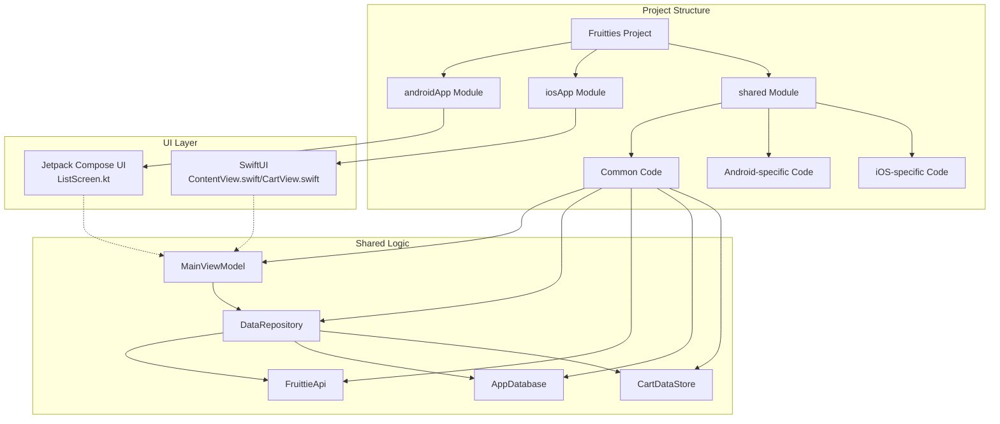
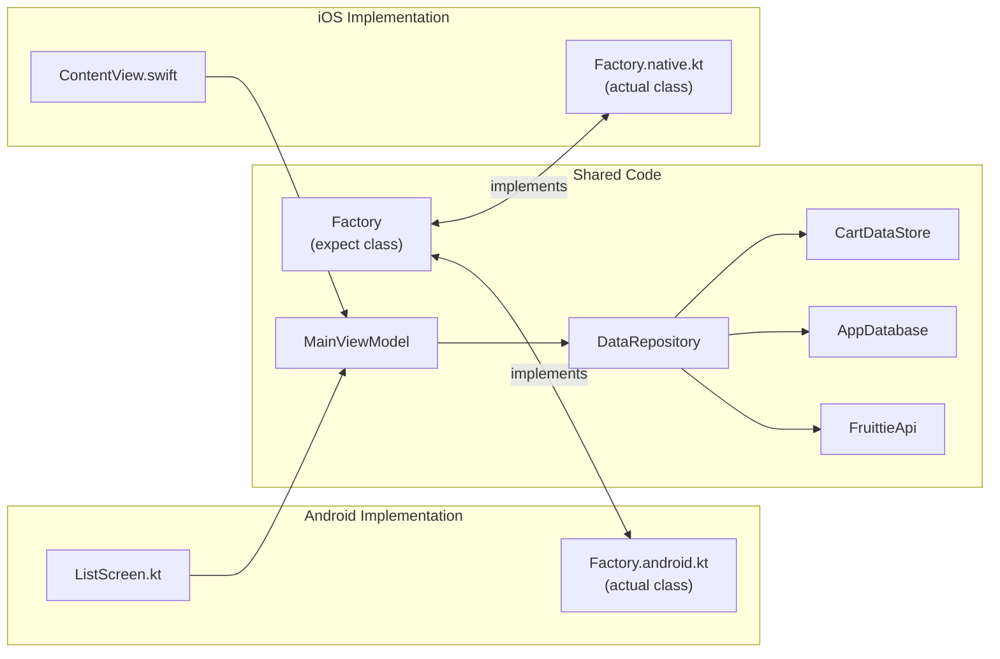
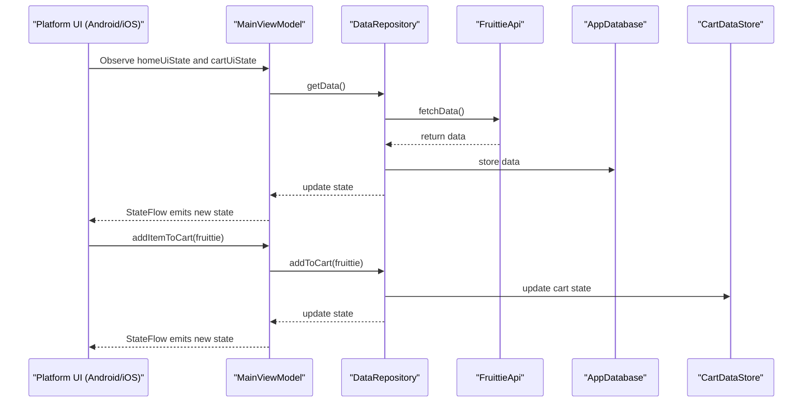
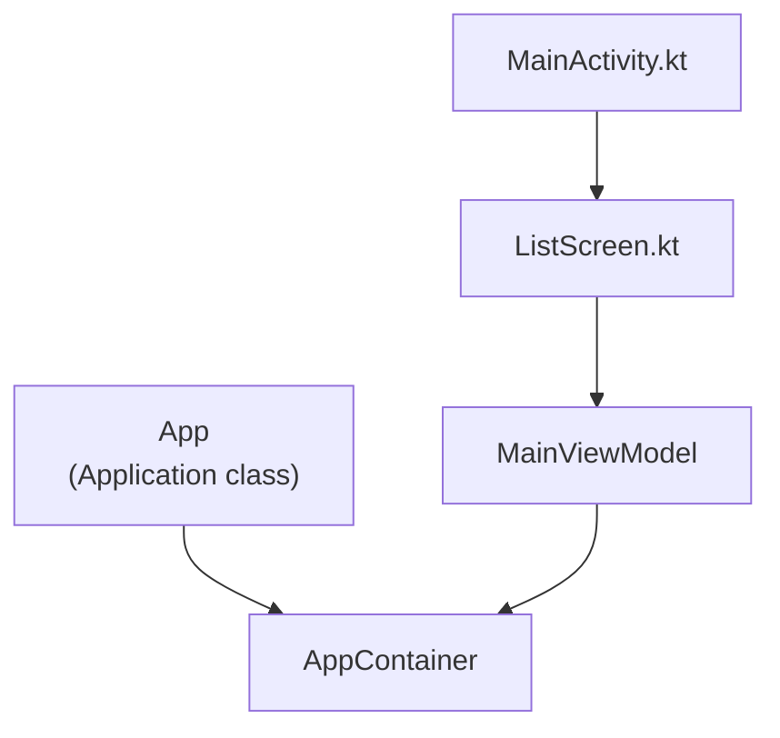
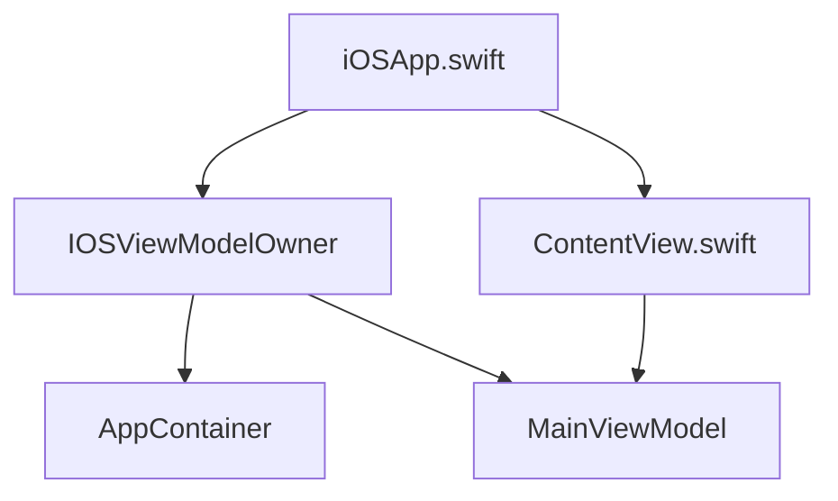

<!-- source: DeepWiki mcp.deepwiki.com · repo android/kotlin-multiplatform-samples · page 1 Overview · fetched 2026-10-23 -->

# Overview

Relevant source files

The following files were used as context for generating this wiki page:

- [Fruitties/androidApp/src/main/java/com/example/fruitties/android/MainActivity.kt](Fruitties/androidApp/src/main/java/com/example/fruitties/android/MainActivity.kt)
- [Fruitties/androidApp/src/main/java/com/example/fruitties/android/ui/ListScreen.kt](Fruitties/androidApp/src/main/java/com/example/fruitties/android/ui/ListScreen.kt)
- [Fruitties/iosApp/iosApp/iOSApp.swift](Fruitties/iosApp/iosApp/iOSApp.swift)
- [Fruitties/shared/build.gradle.kts](Fruitties/shared/build.gradle.kts)

This page provides an introduction to the "Fruitties" sample application, which demonstrates how to build cross-platform mobile applications using Kotlin Multiplatform (KMP). This document covers the high-level architecture, key technologies, and fundamental patterns used in the application.

For detailed information about the project structure, see [Project Structure](#2). For specifics on cross-platform architecture, see [Cross-Platform Architecture](#3).

## What is Fruitties?

Fruitties is a sample application that showcases a shared codebase between Android and iOS platforms while maintaining platform-specific UI implementations. It demonstrates a simple e-commerce application for fruit products with features including:

1. Displaying a list of fruit products
2. Adding items to a shopping cart
3. Viewing cart contents

The application serves as a reference implementation for Kotlin Multiplatform development practices, providing a real-world example of how to structure a cross-platform project.

## High-Level Architecture

Sources: [Fruitties/shared/build.gradle.kts:17-157](), [Fruitties/androidApp/src/main/java/com/example/fruitties/android/ui/ListScreen.kt:69-155](), [Fruitties/iosApp/iosApp/iOSApp.swift:17-28]()

## Key Technologies

The Fruitties application leverages multiple technologies to enable cross-platform development:

| Technology | Purpose | Implementation |
|------------|---------|----------------|
| Kotlin Multiplatform | Code sharing between platforms | Configured in `shared` module |
| Jetpack Compose | Android UI framework | Used in `androidApp` module |
| SwiftUI | iOS UI framework | Used in `iosApp` module |
| Ktor | Networking library | Used for API requests in shared code |
| Room | Database persistence | Used for local caching in shared code |
| DataStore | Preferences storage | Used for cart state persistence |
| Kotlin Coroutines | Asynchronous programming | Used throughout the shared codebase |
| SKIE | Kotlin-Swift interoperability | Enables SwiftUI integration with Kotlin Flows |

Sources: [Fruitties/shared/build.gradle.kts:17-24](), [Fruitties/shared/build.gradle.kts:83-101](), [Fruitties/shared/build.gradle.kts:152-157]()

## Code Sharing Architecture

Sources: [Fruitties/androidApp/src/main/java/com/example/fruitties/android/ui/ListScreen.kt:69-85](), [Fruitties/androidApp/src/main/java/com/example/fruitties/android/MainActivity.kt:29-44](), [Fruitties/iosApp/iosApp/iOSApp.swift:19-28]()

## Data Flow

The application follows a unidirectional data flow pattern:

1. The `MainViewModel` exposes UI state as `StateFlow` objects
2. Platform-specific UIs observe these flows and render their UI accordingly
3. User interactions trigger events that are processed by the `MainViewModel`
4. The `ViewModel` updates the underlying data through the `DataRepository`
5. Changes in data trigger updates to the `StateFlow` objects, completing the cycle

On Android, this integration is achieved via Jetpack Compose's `collectAsState()` function. On iOS, SKIE enables SwiftUI to directly observe Kotlin flows.

Sources: [Fruitties/androidApp/src/main/java/com/example/fruitties/android/ui/ListScreen.kt:87-88](), [Fruitties/androidApp/src/main/java/com/example/fruitties/android/ui/ListScreen.kt:158-216]()

## Platform Integration

The Fruitties application demonstrates how to integrate shared Kotlin code with platform-specific UI frameworks:

### Android Integration

The Android application uses Jetpack Compose and integrates with the shared code through the `MainViewModel`:

Sources: [Fruitties/androidApp/src/main/java/com/example/fruitties/android/MainActivity.kt:29-44](), [Fruitties/androidApp/src/main/java/com/example/fruitties/android/ui/ListScreen.kt:77-85]()

### iOS Integration

The iOS application uses SwiftUI and integrates with the shared code through the `IOSViewModelOwner`:

Sources: [Fruitties/iosApp/iosApp/iOSApp.swift:19-28]()

## Summary

The Fruitties application demonstrates a practical implementation of Kotlin Multiplatform for mobile app development. It showcases how to:

1. Structure a Kotlin Multiplatform project with shared and platform-specific code
2. Implement business logic once and reuse it across platforms
3. Integrate with platform-specific UI frameworks
4. Handle data flow in a consistent way across platforms
5. Use modern libraries and tools to maximize code sharing

For more detailed information about specific aspects of the application, refer to the other sections of this documentation.

---

