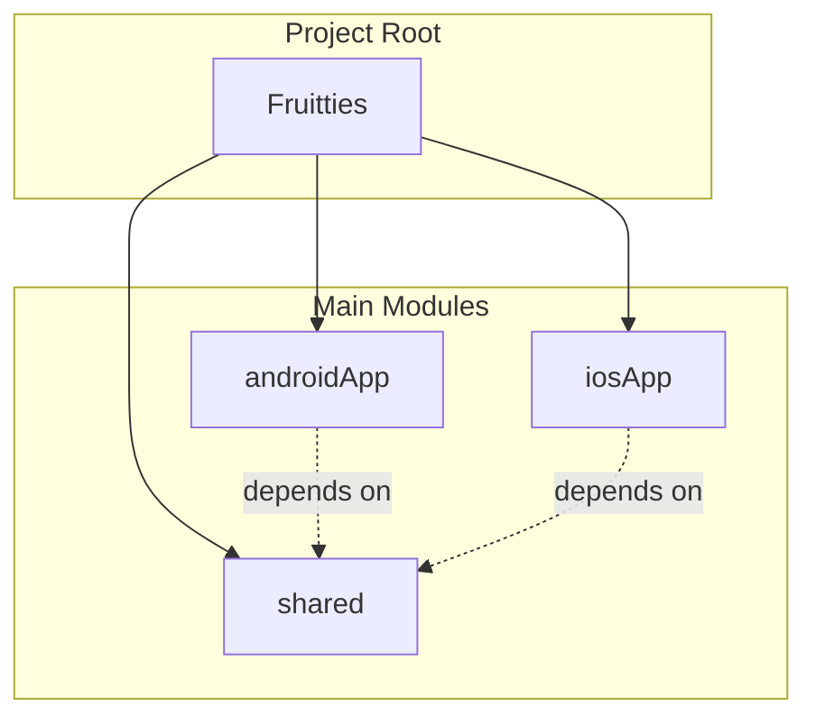
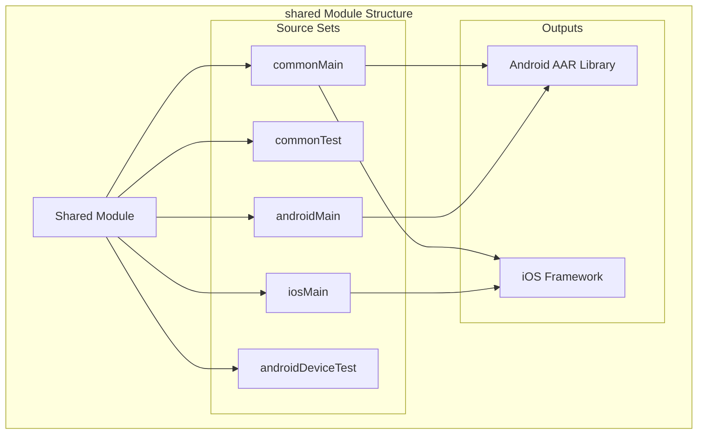
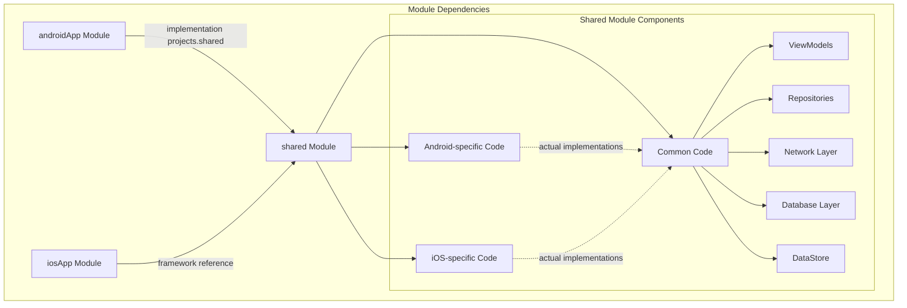
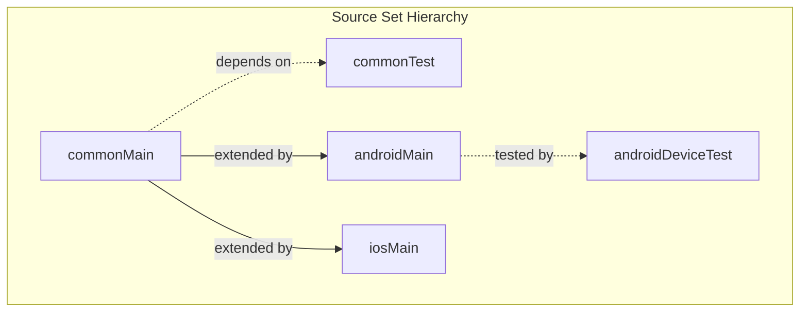
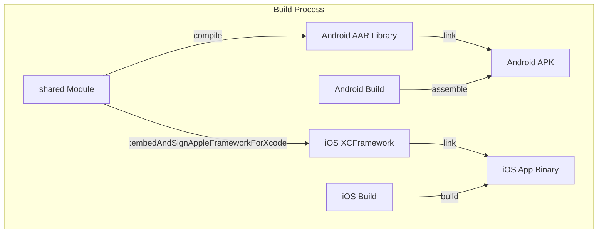
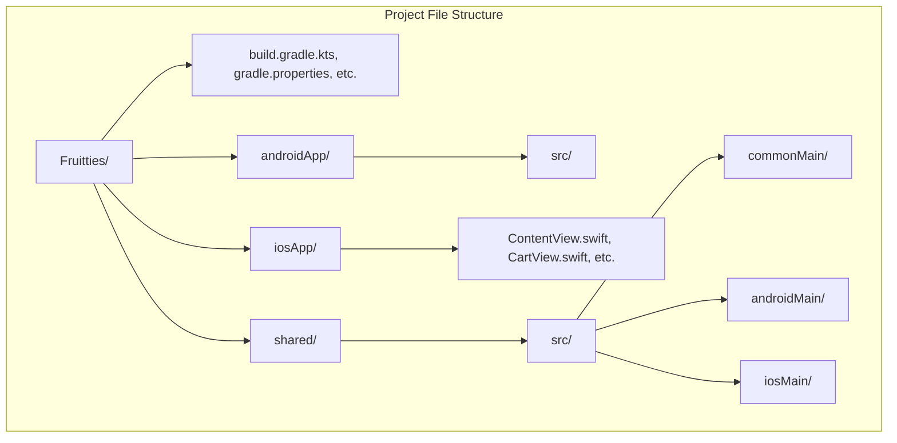

<!-- source: DeepWiki mcp.deepwiki.com · repo android/kotlin-multiplatform-samples · page 2 Project Structure · fetched 2026-10-23 -->

# Project Structure

<details>
<summary>Relevant source files</summary>

The following files were used as context for generating this wiki page:

- [Fruitties/androidApp/build.gradle.kts](Fruitties/androidApp/build.gradle.kts)
- [Fruitties/build.gradle.kts](Fruitties/build.gradle.kts)
- [Fruitties/iosApp/iosApp.xcodeproj/project.pbxproj](Fruitties/iosApp/iosApp.xcodeproj/project.pbxproj)
- [Fruitties/shared/build.gradle.kts](Fruitties/shared/build.gradle.kts)

</details>


This document provides a detailed explanation of the Fruitties application's project structure. It covers how the codebase is organized across different modules and how these modules interact with each other. For details about the build configuration process, see [Build Configuration](#2.1).

## Overview

The Fruitties application is structured as a Kotlin Multiplatform (KMP) project with a modular architecture to maximize code sharing while accommodating platform-specific implementations for Android and iOS.



Sources: [Fruitties/build.gradle.kts:16-25]()

## Module Breakdown

### Shared Module

The shared module contains cross-platform Kotlin code that is compiled for both Android and iOS. It represents the core of the application's business logic, data handling, and state management.



The shared module is configured with multiple Kotlin source sets:

| Source Set | Purpose | Platform |
|------------|---------|----------|
| `commonMain` | Core shared code for all platforms | All |
| `commonTest` | Test code for common functionality | All |
| `androidMain` | Android-specific implementations | Android |
| `iosMain` | iOS-specific implementations | iOS |
| `androidDeviceTest` | Instrumented tests for Android | Android |

The shared module uses the Kotlin Multiplatform plugin to target both Android and iOS platforms:

- Android is targeted via the `androidLibrary` configuration
- iOS is targeted with three architecture-specific targets:
  - `iosX64` (Intel-based iOS simulators)
  - `iosArm64` (Physical iOS devices)
  - `iosSimulatorArm64` (M1/M2 Mac simulators)

Sources: [Fruitties/shared/build.gradle.kts:17-24](), [Fruitties/shared/build.gradle.kts:26-71](), [Fruitties/shared/build.gradle.kts:73-138]()

### Android App Module

The Android app module contains the Android-specific UI implementation using Jetpack Compose and serves as the entry point for the Android application.

Key characteristics:

- Uses Jetpack Compose for UI
- Depends on the shared module for business logic
- Contains Android-specific configurations (manifest, resources, etc.)
- Implements the UI layer using Material3 components

Sources: [Fruitties/androidApp/build.gradle.kts:16-68]()

### iOS App Module

The iOS app module contains the iOS-specific UI implementation using SwiftUI and serves as the entry point for the iOS application.

Key characteristics:

- Uses SwiftUI for UI
- Links to the compiled shared module as a framework
- Contains iOS-specific resources and configurations
- Implements native iOS UI components (ContentView, CartView)

The iOS app incorporates the shared module as a framework through a custom build phase that executes the Gradle task `embedAndSignAppleFrameworkForXcode`.

Sources: [Fruitties/iosApp/iosApp.xcodeproj/project.pbxproj:163-181]()

## Inter-Module Dependencies

The dependency structure between modules shows how code and functionality flow across the project.



Sources: [Fruitties/androidApp/build.gradle.kts:71](), [Fruitties/iosApp/iosApp.xcodeproj/project.pbxproj:330-335]()

## Source Set Organization

The shared module uses Kotlin Multiplatform's source set hierarchy to organize code across platforms.



Each source set in the shared module has specific dependencies:

- **commonMain**: Core libraries used across all platforms (coroutines, ktor, etc.)
- **androidMain**: Android-specific implementations (OkHttp, Room Paging)
- **iosMain**: iOS-specific implementations (Ktor Darwin client)
- **commonTest**: Testing frameworks for common code
- **androidDeviceTest**: Android instrumentation test dependencies

Sources: [Fruitties/shared/build.gradle.kts:78-138]()

## Dependency Management

The project uses Gradle's version catalog system (via `libs.versions.toml`) to centralize dependency management. Key dependency groups include:

| Dependency Group | Used In | Purpose |
|------------------|---------|---------|
| Kotlin | All modules | Core Kotlin functionality |
| Coroutines | Shared | Asynchronous programming |
| Ktor | Shared | Networking |
| Room | Shared | Local database |
| DataStore | Shared | Preferences storage |
| Compose | Android | UI framework |
| SwiftUI | iOS | UI framework |

The shared module's dependencies are organized by source set to ensure appropriate dependencies are included for each platform.

Sources: [Fruitties/build.gradle.kts:16-25](), [Fruitties/shared/build.gradle.kts:83-137](), [Fruitties/androidApp/build.gradle.kts:70-79]()

## Build Output Structure

When built, the project produces different artifacts for each platform:



The build process creates:

1. For Android:
   - An AAR library from the shared module
   - An APK that includes the AAR library

2. For iOS:
   - An XCFramework from the shared module
   - An iOS app that embeds the XCFramework

Sources: [Fruitties/iosApp/iosApp.xcodeproj/project.pbxproj:163-181](), [Fruitties/shared/build.gradle.kts:55-71]()

## Project Files Organization

The project follows a standard directory structure:



Each directory serves a specific purpose:

- **Project root**: Contains build configuration files and module directories
- **androidApp**: Android-specific code and resources
- **iosApp**: iOS-specific code and resources
- **shared**: Cross-platform Kotlin code organized by source sets

Sources: [Fruitties/iosApp/iosApp.xcodeproj/project.pbxproj:76-86](), [Fruitties/shared/build.gradle.kts:78-138]()

## Module Integration

The shared module is integrated differently into each platform:

### Android Integration

In Android, the shared module is included as a Gradle module dependency:

```
implementation(projects.shared)
```

This allows direct access to all Kotlin classes and functions from the shared module.

### iOS Integration

In iOS, the shared module is compiled into a framework and embedded into the app using a custom build phase:

```
cd "$SRCROOT/.."
./gradlew :shared:embedAndSignAppleFrameworkForXcode
```

This build phase runs during the iOS app build process to create and embed the framework with the latest shared code.

Sources: [Fruitties/androidApp/build.gradle.kts:71](), [Fruitties/iosApp/iosApp.xcodeproj/project.pbxproj:180]()

---

