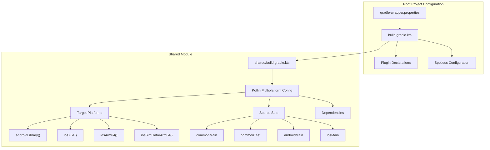
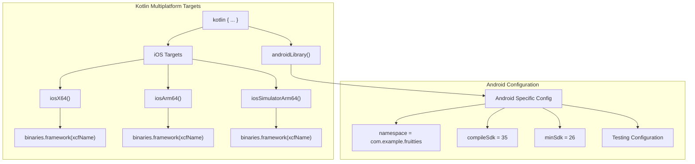
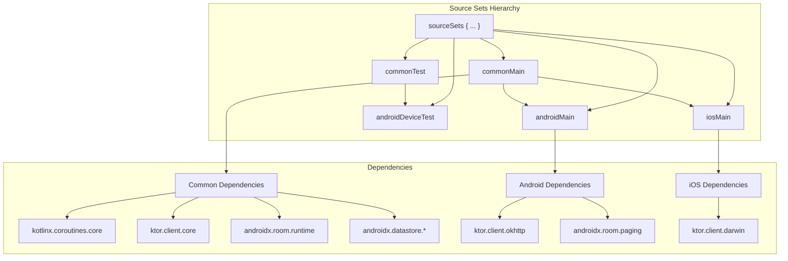

<!-- source: DeepWiki mcp.deepwiki.com · repo android/kotlin-multiplatform-samples · page 2.1 Build Configuration · fetched 2026-10-23 -->

# Build Configuration

<details>
<summary>Relevant source files</summary>

The following files were used as context for generating this wiki page:

- [Fruitties/.gitignore](Fruitties/.gitignore)
- [Fruitties/build.gradle.kts](Fruitties/build.gradle.kts)
- [Fruitties/gradle/wrapper/gradle-wrapper.jar](Fruitties/gradle/wrapper/gradle-wrapper.jar)
- [Fruitties/gradle/wrapper/gradle-wrapper.properties](Fruitties/gradle/wrapper/gradle-wrapper.properties)
- [Fruitties/gradlew](Fruitties/gradlew)
- [Fruitties/gradlew.bat](Fruitties/gradlew.bat)
- [Fruitties/shared/build.gradle.kts](Fruitties/shared/build.gradle.kts)

</details>


This page documents the build system configuration of the Fruitties project, explaining how the project is set up to support both Android and iOS platforms using Kotlin Multiplatform. It covers the Gradle configuration, target platforms setup, source set organization, and platform-specific build settings. For information about dependency management, see [Dependency Management](#2.2).

## Gradle Setup

The Fruitties project uses Gradle as its build tool, with the Gradle Wrapper ensuring consistent builds across different environments.

### Gradle Version and Wrapper

The project uses Gradle version 8.12.1, as specified in the gradle-wrapper.properties file:

```
distributionUrl=https\://services.gradle.org/distributions/gradle-8.12.1-bin.zip
```

The Gradle Wrapper scripts (`gradlew` for Unix-based systems and `gradlew.bat` for Windows) allow developers to build the project without having to install Gradle locally.

Sources: [Fruitties/gradle/wrapper/gradle-wrapper.properties:1-8](), [Fruitties/gradlew:1-251](), [Fruitties/gradlew.bat:1-94]()

## Project Structure

### Build System Architecture

The diagram below illustrates the build system architecture of the Fruitties project:



Sources: [Fruitties/build.gradle.kts:1-42](), [Fruitties/shared/build.gradle.kts:1-158]()

## Root Project Configuration

The root `build.gradle.kts` file defines the plugins used throughout the project and applies the Spotless plugin for code formatting to all subprojects.

Key plugins declared in the root build file include:

| Plugin | Purpose |
|--------|---------|
| `androidApplication` | Configures Android application builds |
| `androidLibrary` | Configures Android library builds |
| `kotlinAndroid` | Adds Kotlin support for Android |
| `kotlinMultiplatform` | Enables Kotlin Multiplatform capabilities |
| `compose.compiler` | Configures the Jetpack Compose compiler |
| `androidKmpLibrary` | Configures Android libraries for KMP projects |

The root build file also sets up code formatting with Spotless:

```kotlin
subprojects {
    apply(plugin = "com.diffplug.spotless")
    configure<com.diffplug.gradle.spotless.SpotlessExtension> {
        kotlin {
            target("**/*.kt")
            targetExclude("${layout.buildDirectory}/**/*.kt")
            ktlint()
        }
        kotlinGradle {
            target("*.gradle.kts")
            ktlint()
        }
    }
}
```

Sources: [Fruitties/build.gradle.kts:16-42]()

## Shared Module Configuration

The shared module is the core of the Kotlin Multiplatform setup and is configured in `shared/build.gradle.kts`.

### Plugins

The shared module applies several plugins to enable Kotlin Multiplatform, serialization, and other features:

```kotlin
plugins {
    alias(libs.plugins.kotlinMultiplatform)
    alias(libs.plugins.androidKmpLibrary)
    alias(libs.plugins.kotlinxSerialization)
    alias(libs.plugins.skie)
    alias(libs.plugins.ksp)
    alias(libs.plugins.room)
}
```

Sources: [Fruitties/shared/build.gradle.kts:17-24]()

### Target Platforms and Framework Configuration

The shared module defines which platforms the KMP code will support. The diagram below illustrates the target platforms and their relationships:



The Android library configuration specifies the namespace, compile SDK, and minimum SDK versions:

```kotlin
androidLibrary {
    namespace = "com.example.fruitties"
    compileSdk = 35
    minSdk = 26

    withHostTestBuilder {
    }

    withDeviceTestBuilder {
        sourceSetTreeName = "test"
    }.configure {
        instrumentationRunner = "androidx.test.runner.AndroidJUnitRunner"
    }
}
```

For iOS, the project configures three targets and generates a framework for each:

```kotlin
val xcfName = "shared"

iosX64 {
    binaries.framework {
        baseName = xcfName
    }
}

iosArm64 {
    binaries.framework {
        baseName = xcfName
    }
}

iosSimulatorArm64 {
    binaries.framework {
        baseName = xcfName
    }
}
```

Sources: [Fruitties/shared/build.gradle.kts:26-71]()

### Source Sets Configuration

The shared module organizes code into source sets that define platform-specific and common code:



The source sets are configured with their respective dependencies:

```kotlin
sourceSets {
    all {
        languageSettings.optIn("kotlin.experimental.ExperimentalObjCName")
    }

    commonMain {
        dependencies {
            implementation(libs.kotlin.stdlib)
            implementation(libs.kotlinx.datetime)
            implementation(libs.kotlinx.coroutines.core)
            implementation(libs.ktor.client.core)
            // ... other common dependencies
        }
    }

    androidMain {
        dependencies {
            implementation(libs.ktor.client.okhttp)
            implementation(libs.androidx.room.paging)
        }
    }

    iosMain {
        dependencies {
            implementation(libs.ktor.client.darwin)
        }
    }
    
    // ... other source sets
}
```

Sources: [Fruitties/shared/build.gradle.kts:78-138]()

### Room and KSP Configuration

The shared module configures Room (Android's database library) and KSP (Kotlin Symbol Processing) for code generation:

```kotlin
dependencies {
    add("kspAndroid", libs.androidx.room.compiler)
    add("kspIosSimulatorArm64", libs.androidx.room.compiler)
    add("kspIosX64", libs.androidx.room.compiler)
    add("kspIosArm64", libs.androidx.room.compiler)
}

room {
    schemaDirectory("$projectDir/schemas")
}
```

Additionally, the SKIE (Swift Kotlin Interface Enhancer) plugin is configured to enable SwiftUI integration:

```kotlin
skie {
    features {
        enableSwiftUIObservingPreview = true
    }
}
```

Sources: [Fruitties/shared/build.gradle.kts:141-157]()

## Building the Project

To build the project, developers can use the Gradle wrapper scripts:

- For Unix-based systems (Linux, macOS): `./gradlew <task>`
- For Windows: `gradlew.bat <task>`

Common build tasks include:

| Task | Description |
|------|-------------|
| `assembleDebug` | Builds the debug version of the Android app |
| `assembleRelease` | Builds the release version of the Android app |
| `build` | Builds all targets |
| `clean` | Cleans the build directory |
| `linkDebugFrameworkIosX64` | Creates the debug iOS framework for X64 architecture |
| `linkReleaseFrameworkIosArm64` | Creates the release iOS framework for Arm64 architecture |

The Gradle wrapper scripts are configured to use a JVM with 64MB of initial and maximum heap size:

```
DEFAULT_JVM_OPTS='"-Xmx64m" "-Xms64m"'
```

Sources: [Fruitties/gradlew:205](), [Fruitties/gradlew.bat:39]()

## Summary

The build configuration of the Fruitties project provides a robust foundation for cross-platform development with Kotlin Multiplatform. It enables:

1. Code sharing between Android and iOS platforms
2. Platform-specific implementations where needed
3. Consistent build environments across development machines
4. Integration with essential libraries like Room and Ktor
5. Swift interoperability via SKIE

This configuration follows Kotlin Multiplatform best practices and provides a scalable structure for the Fruitties application.

---

