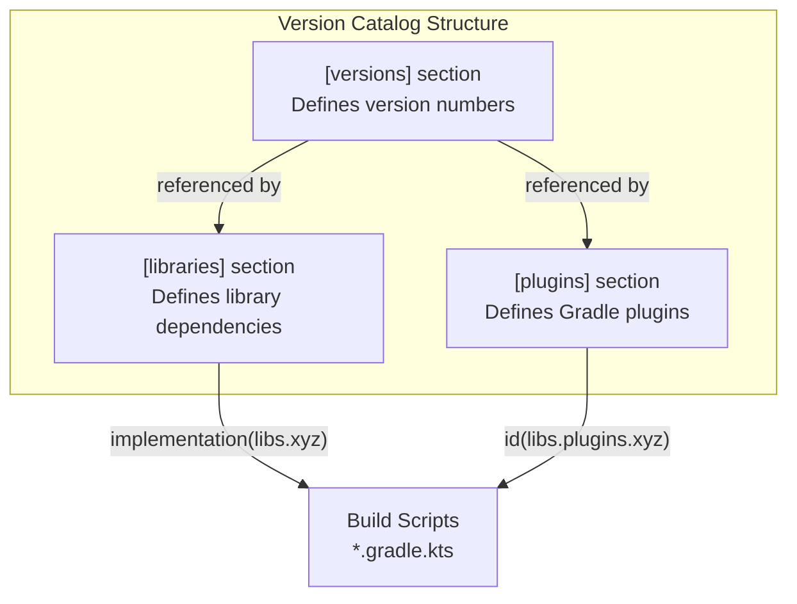
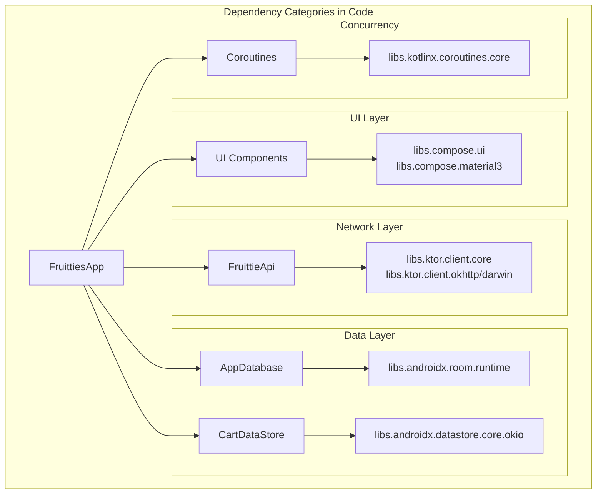
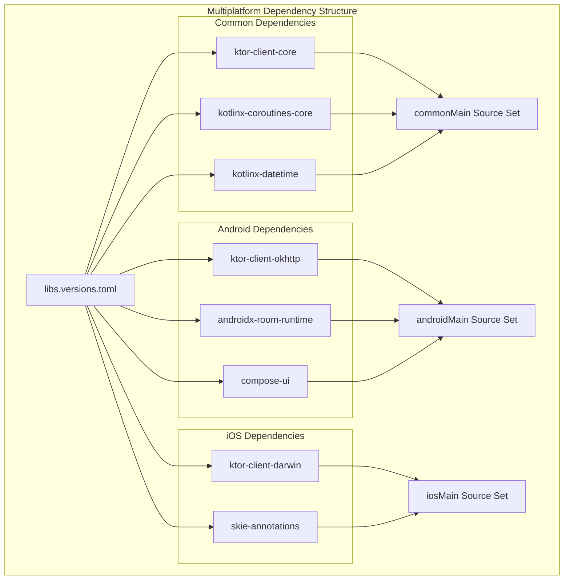

<!-- source: DeepWiki mcp.deepwiki.com · repo android/kotlin-multiplatform-samples · page 2.2 Dependency Management · fetched 2026-10-23 -->

# Dependency Management

<details>
<summary>Relevant source files</summary>

The following files were used as context for generating this wiki page:

- [Fruitties/gradle/libs.versions.toml](Fruitties/gradle/libs.versions.toml)

</details>


This document explains how dependencies are managed in the Fruitties application using Gradle Version Catalog. The project employs a centralized approach to dependency management, making it easier to maintain consistent versions across Android and iOS modules while reducing version conflicts.

For information about the overall build configuration, see [Build Configuration](#2.1).

## Version Catalog Structure

The Fruitties application uses a Gradle Version Catalog to manage dependencies centrally. This approach is implemented through the `libs.versions.toml` file located in the `gradle` directory.



The version catalog is organized into three main sections:

1. **[versions]** - Defines version numbers for all dependencies and plugins
2. **[libraries]** - Defines library dependencies using versions from the first section
3. **[plugins]** - Defines Gradle plugins used in the project

For example, in the versions section, the Kotlin version is defined:

```toml
[versions]
kotlin = "2.1.10"
```

Then, in the libraries section, this version is referenced:

```toml
[libraries]
kotlin-test = { module = "org.jetbrains.kotlin:kotlin-test", version.ref = "kotlin" }
```

Sources: [Fruitties/gradle/libs.versions.toml:15-38](), [Fruitties/gradle/libs.versions.toml:39-69](), [Fruitties/gradle/libs.versions.toml:71-82]()

## Dependency Categories

The project's dependencies can be categorized by their purpose:

| Category | Dependencies | Purpose |
|----------|-------------|---------|
| **UI Framework** | compose-ui, compose-material3, compose-ui-tooling | UI components and Material3 design |
| **Networking** | ktor-client-core, ktor-client-okhttp (Android), ktor-client-darwin (iOS) | Cross-platform HTTP client |
| **Data Persistence** | androidx-room-runtime, androidx-datastore-core-okio | Local storage and preferences |
| **Concurrency** | kotlinx-coroutines-core | Asynchronous programming |
| **Data Serialization** | ktor-serialization-kotlinx-json | JSON processing |
| **Utilities** | kotlinx-datetime, okio | Date/time handling, I/O operations |
| **iOS Integration** | skie-annotations | Kotlin-Swift interoperability |
| **Paging** | androidx-paging-common, androidx-paging-compose-android | Data pagination |



Sources: [Fruitties/gradle/libs.versions.toml:39-69]()

## Multiplatform Dependency Management

In a Kotlin Multiplatform project like Fruitties, dependencies need to be handled for multiple platforms. The version catalog approach makes this easier by providing a single point of reference for all dependencies.

### Common vs Platform-Specific Dependencies

Dependencies are organized into three main categories:

1. **Common dependencies** - Used in the `commonMain` source set
2. **Android-specific dependencies** - Used in the `androidMain` source set
3. **iOS-specific dependencies** - Used in the `iosMain` source set



For example, the project uses:
- **Ktor Client**: Core module in common code, with platform-specific implementations (OkHttp for Android, Darwin for iOS)
- **UI frameworks**: Jetpack Compose for Android, SwiftUI for iOS (native, not a dependency)
- **Room Database**: Android-specific, with custom implementations for iOS

Sources: [Fruitties/gradle/libs.versions.toml:56-62]()

## Dependency Version Management

The version catalog approach simplifies version management across the project:

### Version Declaration

All versions are declared once in the `[versions]` section:

```toml
[versions]
kotlin = "2.1.10"
kotlinx-coroutines = "1.10.1"
ktorVersion = "3.0.3"
```

### Library Declaration

Libraries reference these versions to ensure consistency:

```toml
[libraries]
kotlinx-coroutines-core = { module = "org.jetbrains.kotlinx:kotlinx-coroutines-core", version.ref = "kotlinx-coroutines" }
ktor-client-core = { module = "io.ktor:ktor-client-core", version.ref = "ktorVersion" }
```

### Plugin Declaration

Plugins similarly reference these versions:

```toml
[plugins]
kotlinMultiplatform = { id = "org.jetbrains.kotlin.multiplatform", version.ref = "kotlin" }
```

This approach ensures that when upgrading a dependency (e.g., Kotlin), all related libraries and plugins are updated consistently.

Sources: [Fruitties/gradle/libs.versions.toml:15-38](), [Fruitties/gradle/libs.versions.toml:39-69](), [Fruitties/gradle/libs.versions.toml:71-82]()

## Best Practices

- **Single Source of Truth**: All dependency versions should be defined in `libs.versions.toml`
- **Version Alignment**: Related libraries (e.g., all Ktor components) should use the same version
- **Platform Compatibility**: When adding new dependencies, verify they work on all targeted platforms
- **Update Process**: Update one dependency at a time and test thoroughly on all platforms
- **Version Comments**: For complex dependencies, add comments explaining version constraints or compatibility issues

Sources: [Fruitties/gradle/libs.versions.toml]()

---

