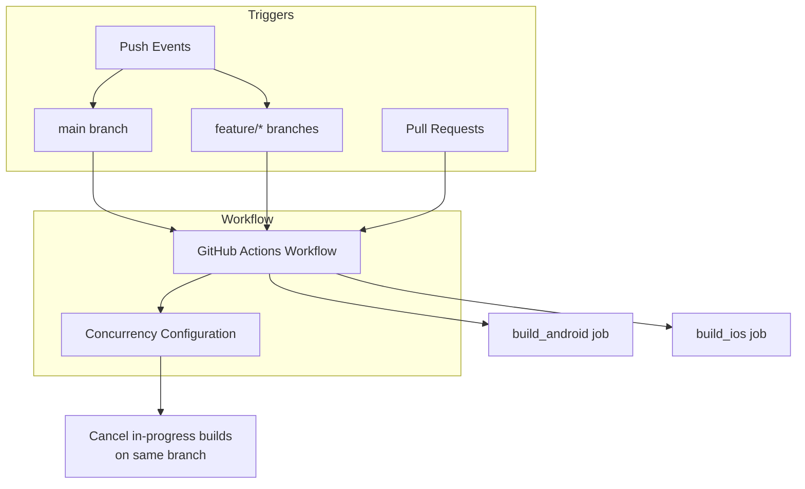
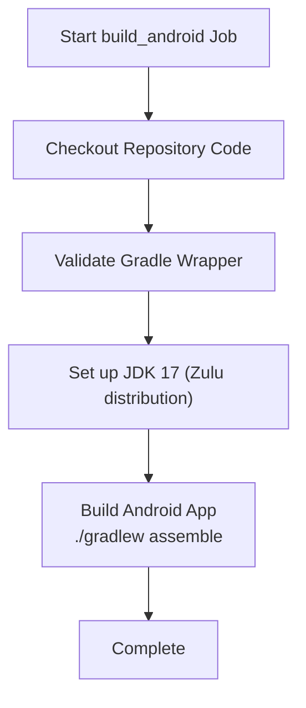
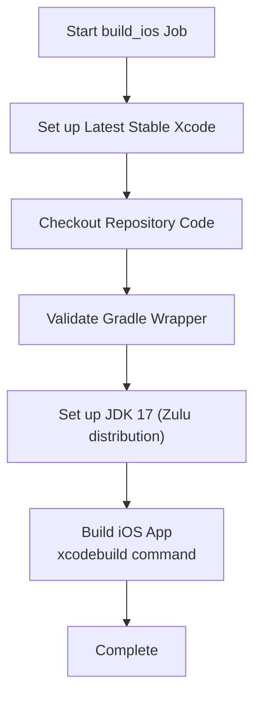
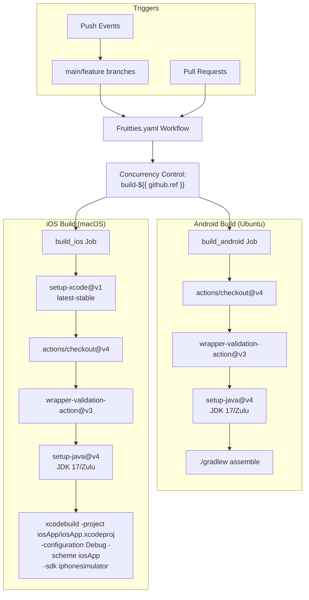
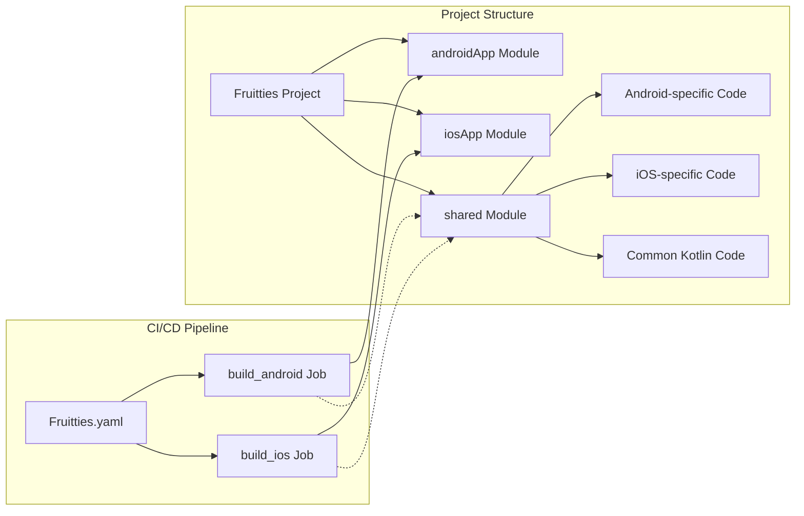

<!-- source: DeepWiki mcp.deepwiki.com · repo android/kotlin-multiplatform-samples · page 2.3 CI/CD Pipeline · fetched 2026-10-23 -->

# CI/CD Pipeline

Relevant source files

The following files were used as context for generating this wiki page:

- [.github/workflows/Fruitties.yaml](.github/workflows/Fruitties.yaml)
- [Fruitties/iosApp/Podfile](Fruitties/iosApp/Podfile)

## Purpose and Scope

This document details the continuous integration and continuous deployment (CI/CD) pipeline implemented for the Fruitties sample application. The pipeline automates building and testing the application across both Android and iOS platforms whenever code changes occur. For information about the build configuration used by this pipeline, see [Build Configuration](#2.1). For dependency management details that impact the build process, see [Dependency Management](#2.2).

## Workflow Triggers and Configuration

The CI/CD pipeline is implemented using GitHub Actions and is defined in the repository's workflow file.

The workflow is triggered by:
- Push events to the `main` branch
- Push events to any branch with the pattern `feature/*`
- Any pull request creation or update

The workflow implements concurrency controls to prevent redundant builds, automatically canceling in-progress builds when new commits are pushed to the same branch.

Sources: [.github/workflows/Fruitties.yaml:3-12]()

## Android Build Process

The Android build job runs on an Ubuntu-based runner and performs the following operations:

The Android build process:
1. Runs on Ubuntu latest
2. Checks out the repository code
3. Validates the Gradle wrapper for security
4. Sets up Java 17 (Zulu distribution)
5. Builds the application using Gradle's `assemble` task
6. The build takes place in the `./Fruitties` directory, which contains the Android application code

Sources: [.github/workflows/Fruitties.yaml:15-33]()

## iOS Build Process

The iOS build job runs on a macOS-based runner and has additional platform-specific setup steps:

The iOS build process:
1. Runs on macOS latest
2. Sets up the latest stable Xcode version
3. Checks out the repository code
4. Validates the Gradle wrapper for security
5. Sets up Java 17 (Zulu distribution)
6. Builds the iOS application using `xcodebuild` with the following parameters:
   - Project: `iosApp/iosApp.xcodeproj`
   - Configuration: `Debug`
   - Scheme: `iosApp`
   - SDK: `iphonesimulator`

Sources: [.github/workflows/Fruitties.yaml:35-57]()

## Complete CI/CD Workflow

The following diagram illustrates the complete CI/CD workflow including both Android and iOS build processes:

This diagram shows how the CI/CD workflow processes builds for both platforms in parallel after being triggered by code changes.

Sources: [.github/workflows/Fruitties.yaml:1-57]()

## Integration with Kotlin Multiplatform

The CI/CD pipeline is designed to work with the Kotlin Multiplatform project structure, where:

This structure shows how the CI/CD pipeline jobs relate to the modules in the Kotlin Multiplatform project. The pipeline ensures that:

1. All platform-specific code builds correctly
2. The shared Kotlin code is compiled and integrated properly into each platform
3. Each platform's build process handles the appropriate compilation of the shared code for that platform

Sources: [.github/workflows/Fruitties.yaml:1-57](), [Fruitties/iosApp/Podfile:1-4]()

## Environment Requirements

The CI/CD pipeline has specific environment requirements for each platform:

| Platform | Runner | Java | Other Requirements |
|----------|--------|------|-------------------|
| Android | ubuntu-latest | JDK 17 (Zulu) | Gradle |
| iOS | macos-latest | JDK 17 (Zulu) | Xcode (latest stable), iOS 14.1+ SDK |

These requirements ensure that the build environment matches the development requirements for each platform and properly supports the Kotlin Multiplatform project structure.

Sources: [.github/workflows/Fruitties.yaml:17-29](), [.github/workflows/Fruitties.yaml:36-53](), [Fruitties/iosApp/Podfile:2]()

## Current Limitations

The current CI/CD pipeline focuses on build verification rather than full deployment:

1. It ensures that code changes don't break the build process
2. It verifies compatibility across platforms
3. It does not include automatic deployment to app stores or testing environments
4. It does not include automated testing beyond build verification

Future enhancements could include:
- Automated unit and integration testing
- UI testing on various device configurations
- Deployment to internal testing channels
- Automated release processes

Sources: [.github/workflows/Fruitties.yaml:1-57]()

---

