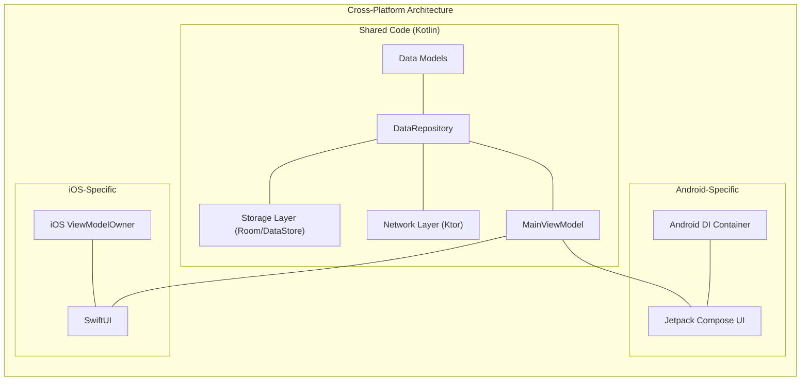
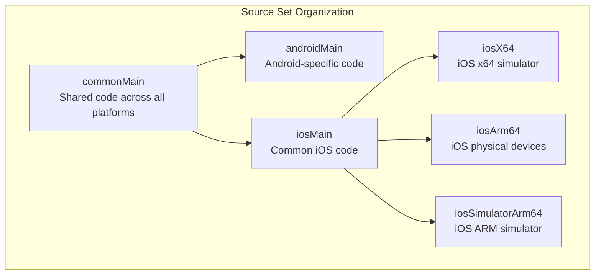
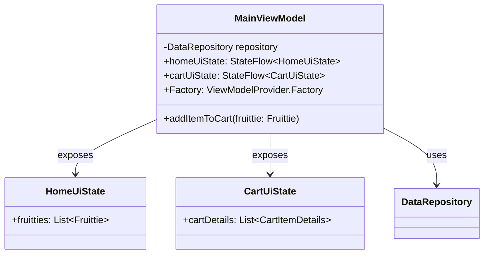
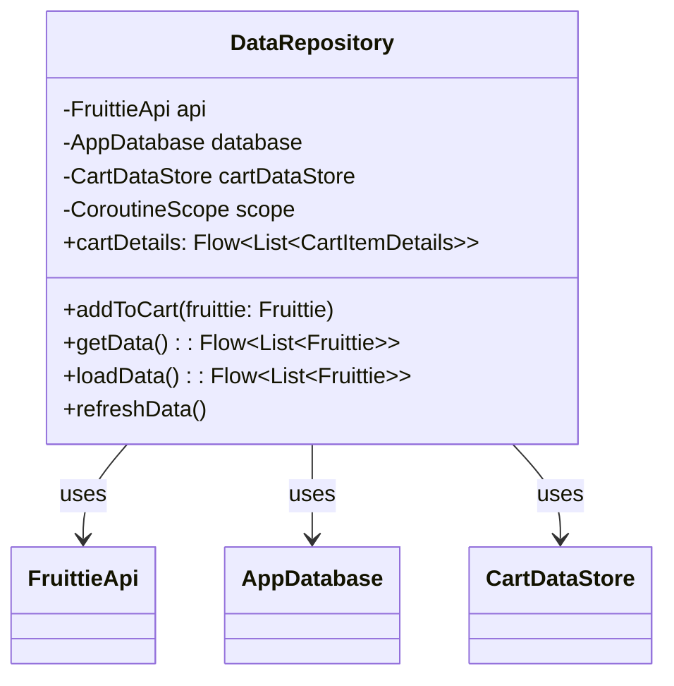
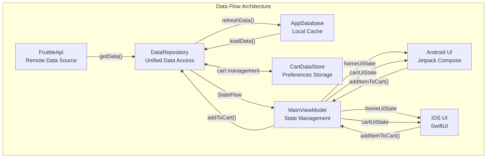
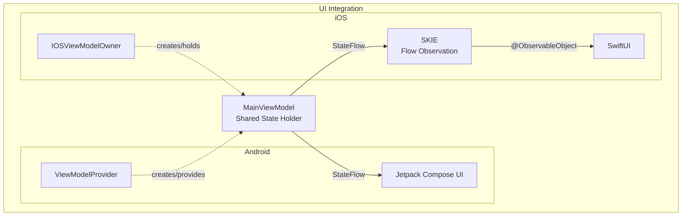
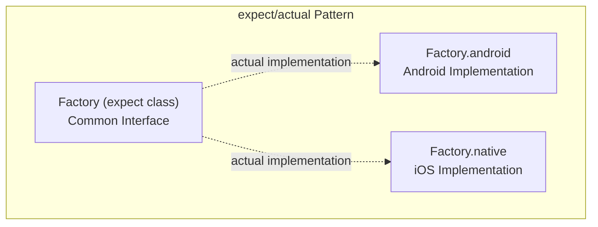

<!-- source: DeepWiki mcp.deepwiki.com · repo android/kotlin-multiplatform-samples · page 3 Cross-Platform Architecture · fetched 2026-10-23 -->

# Cross-Platform Architecture

Relevant source files

The following files were used as context for generating this wiki page:

- [Fruitties/shared/build.gradle.kts](Fruitties/shared/build.gradle.kts)
- [Fruitties/shared/src/commonMain/kotlin/com/example/fruitties/DataRepository.kt](Fruitties/shared/src/commonMain/kotlin/com/example/fruitties/DataRepository.kt)
- [Fruitties/shared/src/commonMain/kotlin/com/example/fruitties/viewmodel/MainViewModel.kt](Fruitties/shared/src/commonMain/kotlin/com/example/fruitties/viewmodel/MainViewModel.kt)

This document outlines the architectural approach used in the Fruitties application to share code between Android and iOS platforms while maintaining platform-specific UI implementations. It covers the core architectural patterns, code organization, and cross-platform data flow mechanisms. For platform-specific implementation details, see [Android Implementation](#5) and [iOS Implementation](#6). For dependency injection specifics, see [Dependency Injection](#3.1).

## 1. Architectural Principles

The Fruitties application follows the principles of Kotlin Multiplatform (KMP) development, which enables sharing business logic, data handling, and state management across platforms while using native UI frameworks for each platform. The architecture is built on these key principles:

- **Shared Business Logic**: Core application logic is written once in Kotlin and shared across platforms
- **Native UI**: Platform-specific UI implementations (Jetpack Compose for Android, SwiftUI for iOS)
- **Clear Boundaries**: Well-defined interfaces between shared and platform-specific code
- **Reactive Data Flow**: Consistent data flow patterns across platforms using Kotlin Flows

Sources:
- [Fruitties/shared/build.gradle.kts:26-71]()
- [Fruitties/shared/src/commonMain/kotlin/com/example/fruitties/viewmodel/MainViewModel.kt:36-48]()
- [Fruitties/shared/src/commonMain/kotlin/com/example/fruitties/DataRepository.kt:29-33]()

## 2. Code Organization

The codebase is organized following KMP conventions, which define specific source sets for different platforms.

### 2.1. Source Set Structure

Kotlin Multiplatform organizes code into source sets, which are collections of Kotlin code and resources targeting specific platforms or shared between platforms.

Sources:
- [Fruitties/shared/build.gradle.kts:73-138]()

### 2.2. Dependency Configuration

Dependencies are configured in the shared module's build file, with platform-specific dependencies defined in appropriate source sets.

| Source Set | Key Dependencies |
|------------|-----------------|
| `commonMain` | Kotlin Coroutines, Ktor Client, Room, DataStore |
| `androidMain` | OkHttp Client, Room Paging |
| `iosMain` | Darwin Ktor Client |

Sources:
- [Fruitties/shared/build.gradle.kts:83-137]()

## 3. Shared Components

The core functionality of the application is implemented in shared components that work across platforms.

### 3.1. ViewModel Architecture

`MainViewModel` serves as the central state holder and business logic coordinator for both platforms. It exposes UI state through `StateFlow` objects that can be observed from both Android and iOS.

Sources:
- [Fruitties/shared/src/commonMain/kotlin/com/example/fruitties/viewmodel/MainViewModel.kt:36-90]()

### 3.2. Repository Pattern

The `DataRepository` class abstracts data operations, managing interactions with the API, database, and preferences storage. It provides a unified interface for data access to the ViewModel.

Sources:
- [Fruitties/shared/src/commonMain/kotlin/com/example/fruitties/DataRepository.kt:29-66]()

## 4. Cross-Platform Data Flow

Data flows through the application in a consistent pattern across platforms, using Kotlin Coroutines and Flow.

Sources:
- [Fruitties/shared/src/commonMain/kotlin/com/example/fruitties/viewmodel/MainViewModel.kt:39-56]()
- [Fruitties/shared/src/commonMain/kotlin/com/example/fruitties/DataRepository.kt:35-65]()

### 4.1. Data Flow Process

1. **Data Retrieval**:
   - `Repository.getData()` checks if data exists in the database
   - If not, it calls `refreshData()` to fetch from the API
   - Returns a Flow of data from the local database

2. **UI State Exposure**:
   - `MainViewModel` transforms repository data into UI states
   - Exposes these states as `StateFlow`s for platform UIs
   - UI states contain only the data needed for display

3. **User Interactions**:
   - User actions in the UI call ViewModel methods
   - ViewModel delegates to Repository for data operations
   - Repository updates local storage as needed
   - Changes flow back to UI through StateFlows

Sources:
- [Fruitties/shared/src/commonMain/kotlin/com/example/fruitties/viewmodel/MainViewModel.kt:58-62]()
- [Fruitties/shared/src/commonMain/kotlin/com/example/fruitties/DataRepository.kt:47-65]()

## 5. Platform-Specific Integration

While the core logic is shared, each platform requires integration code to connect shared components with native UI frameworks.

### 5.1. Cross-Platform Technologies

Several technologies facilitate the cross-platform architecture:

| Technology | Purpose | Implementation |
|------------|---------|----------------|
| **Ktor** | Network communication | Platform-specific HTTP clients (OkHttp for Android, Darwin for iOS) |
| **Room** | Database persistence | KSP generates code for both platforms |
| **DataStore** | Preferences storage | Shared implementation with platform-specific serialization |
| **SKIE** | Swift interoperability | Improves Swift API design and enables SwiftUI integration |
| **Kotlin Flows** | Reactive data streams | Exposed as StateFlows to both platforms |

Sources:
- [Fruitties/shared/build.gradle.kts:17-24]()
- [Fruitties/shared/build.gradle.kts:141-146]()
- [Fruitties/shared/build.gradle.kts:152-157]()

### 5.2. UI Integration

Sources:
- [Fruitties/shared/build.gradle.kts:152-157]()
- [Fruitties/shared/src/commonMain/kotlin/com/example/fruitties/viewmodel/MainViewModel.kt:64-89]()

## 6. Challenges and Solutions

### 6.1. Platform-Specific Implementations

The Kotlin Multiplatform `expect/actual` mechanism is used to define interfaces in common code with platform-specific implementations:

### 6.2. Dependency Injection

Dependency injection is implemented differently for each platform while maintaining the same dependency graph:

- **Android**: Uses a container-based approach with `ViewModelProvider.Factory`
- **iOS**: Uses a `ViewModelOwner` pattern to manage lifecycle and dependencies

Sources:
- [Fruitties/shared/src/commonMain/kotlin/com/example/fruitties/viewmodel/MainViewModel.kt:64-89]()

## Summary

The Fruitties application demonstrates a modern cross-platform architecture using Kotlin Multiplatform. By sharing business logic, data handling, and state management while using native UI frameworks, it achieves a balance between code reuse and platform-specific user experience. The architecture follows a clear separation of concerns with a consistent data flow pattern across platforms.

---

