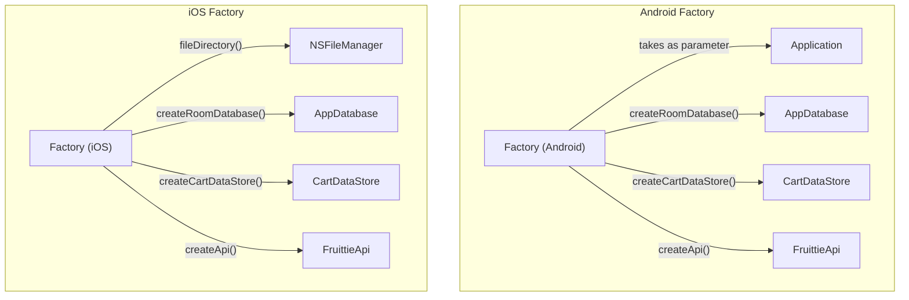
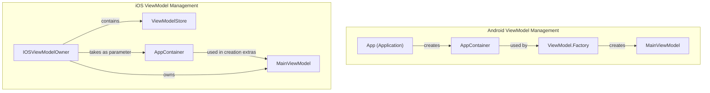

<!-- source: DeepWiki mcp.deepwiki.com · repo android/kotlin-multiplatform-samples · page 3.1 Dependency Injection · fetched 2026-10-23 -->

# Dependency Injection

<details>
<summary>Relevant source files</summary>

The following files were used as context for generating this wiki page:

- [Fruitties/androidApp/src/main/AndroidManifest.xml](Fruitties/androidApp/src/main/AndroidManifest.xml)
- [Fruitties/androidApp/src/main/java/com/example/fruitties/android/di/App.kt](Fruitties/androidApp/src/main/java/com/example/fruitties/android/di/App.kt)
- [Fruitties/iosApp/iosApp/Info.plist](Fruitties/iosApp/iosApp/Info.plist)
- [Fruitties/shared/src/androidMain/kotlin/com/example/fruitties/di/Factory.android.kt](Fruitties/shared/src/androidMain/kotlin/com/example/fruitties/di/Factory.android.kt)
- [Fruitties/shared/src/iosMain/kotlin/com/example/fruitties/di/Factory.native.kt](Fruitties/shared/src/iosMain/kotlin/com/example/fruitties/di/Factory.native.kt)
- [Fruitties/shared/src/iosMain/kotlin/com/example/fruitties/di/viewmodel/IOSViewModelOwner.kt](Fruitties/shared/src/iosMain/kotlin/com/example/fruitties/di/viewmodel/IOSViewModelOwner.kt)

</details>


This document explains the dependency injection (DI) mechanism used in the Fruitties application, detailing how dependencies are managed and provided across both Android and iOS platforms. For information about the overall data flow in the application, see [Data Flow](#3.2).

## Overview

The Fruitties application implements a manual dependency injection system designed to work seamlessly across both Android and iOS platforms. This approach avoids the need for platform-specific DI frameworks while maintaining a clean architecture with proper separation of concerns.

The DI system is built around three key components:

1. **Factory** - An `expect` class with platform-specific implementations that creates core dependencies
2. **AppContainer** - A container that holds and provides dependencies to the rest of the application
3. **Platform-specific ViewModel management** - Different approaches for Android and iOS to create and manage ViewModels

```mermaid
graph TD
    subgraph "Core Components"
        Factory["Factory (expect class)"]
        AppContainer["AppContainer"]
    end
    
    subgraph "Platform-Specific Implementations"
        AndroidFactory["Factory.android"]
        iOSFactory["Factory.native"]
    end
    
    subgraph "Dependencies"
        API["FruittieApi"]
        DB["AppDatabase"]
        CartDS["CartDataStore"]
    end
    
    Factory <|-- AndroidFactory
    Factory <|-- iOSFactory
    
    AppContainer --> Factory
    Factory --> API
    Factory --> DB
    Factory --> CartDS
```

Sources: [shared/src/androidMain/kotlin/com/example/fruitties/di/Factory.android.kt:27-50](), [shared/src/iosMain/kotlin/com/example/fruitties/di/Factory.native.kt:32-61]()

## Factory Implementation

The `Factory` class is the foundation of the DI system. It's defined as a Kotlin Multiplatform `expect` class with platform-specific `actual` implementations. The Factory is responsible for creating the core dependencies used throughout the application:



### Android Implementation

On Android, the `Factory` implementation takes the Android `Application` context as a constructor parameter to access application-specific resources and file system locations.

Key implementations:

- **Room Database**: Created with Android-specific file paths and database configuration
- **Cart Data Store**: Uses the application's file directory for persistence
- **API Client**: Uses a common implementation shared with iOS

Sources: [shared/src/androidMain/kotlin/com/example/fruitties/di/Factory.android.kt:27-50](), [androidApp/src/main/java/com/example/fruitties/android/di/App.kt:23-31]()

### iOS Implementation

The iOS implementation of `Factory` handles iOS-specific configurations:

- **Room Database**: Configured with iOS-specific file system access
- **Cart Data Store**: Uses iOS document directory for persistence
- **API Client**: Uses the same common implementation as Android

The iOS implementation uses `NSFileManager` to access appropriate file locations for data storage.

Sources: [shared/src/iosMain/kotlin/com/example/fruitties/di/Factory.native.kt:32-61]()

## AppContainer

The `AppContainer` class serves as a centralized container for application dependencies. It takes a `Factory` instance as a constructor parameter and uses it to create and store all required dependencies.

While the `AppContainer` implementation is not shown in the provided files, its usage is evident in both the Android and iOS implementations:

- On Android, it's instantiated in the application's `onCreate()` method
- On iOS, it's passed to the `IOSViewModelOwner` to provide dependencies to ViewModels

Sources: [androidApp/src/main/java/com/example/fruitties/android/di/App.kt:23-31](), [shared/src/iosMain/kotlin/com/example/fruitties/di/viewmodel/IOSViewModelOwner.kt:14-16]()

## ViewModel Dependency Management

The application uses different mechanisms for providing dependencies to ViewModels on Android vs. iOS due to platform differences.



### Android ViewModel Management

On Android, the application class (`App`) initializes the `AppContainer` and holds it as a property. The ViewModels then access this container through the application context.

The key components are:
- `App` class that extends `Application`
- `AppContainer` instance initialized in `onCreate()`
- ViewModels access dependencies through this container

Sources: [androidApp/src/main/java/com/example/fruitties/android/di/App.kt:23-31](), [androidApp/src/main/AndroidManifest.xml:25]()

### iOS ViewModel Management

iOS requires a different approach since it doesn't have Android's `Application` concept. The Fruitties app uses a custom `IOSViewModelOwner` class that:

1. Implements Android's `ViewModelStoreOwner` interface
2. Creates and manages a `ViewModelStore`
3. Takes an `AppContainer` as a constructor parameter
4. Creates ViewModels using Android's `ViewModelProvider` mechanism
5. Provides a `clear()` method to properly clean up ViewModel resources

This approach allows using the same ViewModel code on iOS while properly managing their lifecycle.

```
IOSViewModelOwner
├── Takes AppContainer as constructor parameter
├── Implements ViewModelStoreOwner interface
├── Creates ViewModelStore
├── Creates ViewModels using ViewModelProvider
└── Provides clear() method for cleanup
```

Sources: [shared/src/iosMain/kotlin/com/example/fruitties/di/viewmodel/IOSViewModelOwner.kt:13-34]()

## Complete Dependency Flow

The following diagram shows the complete dependency flow throughout the application, from initialization to usage in UI components:

```mermaid
graph TD
    subgraph "Android DI Flow"
        AndroidApp["App (Application)"] -->|"onCreate()"| AndroidContainer["AppContainer"]
        AndroidContainer -->|"creates using"| AndroidFactory["Factory (Android)"]
        AndroidFactory -->|"createRoomDatabase()"| RoomDB1["AppDatabase"]
        AndroidFactory -->|"createCartDataStore()"| CartDS1["CartDataStore"]
        AndroidFactory -->|"createApi()"| API1["FruittieApi"]
        AndroidUI["Android UI Components"] -->|"access ViewModel"| AndroidViewModel["MainViewModel"]
        AndroidViewModel -->|"uses dependencies from"| AndroidContainer
    end
    
    subgraph "iOS DI Flow"
        iOSApp["iOSApp (Swift)"] -->|"creates"| iOSContainer["AppContainer"]
        iOSContainer -->|"creates using"| iOSFactory["Factory (iOS)"]
        iOSFactory -->|"createRoomDatabase()"| RoomDB2["AppDatabase"]
        iOSFactory -->|"createCartDataStore()"| CartDS2["CartDataStore"]
        iOSFactory -->|"createApi()"| API2["FruittieApi"]
        iOSApp -->|"creates"| VMOwner["IOSViewModelOwner"]
        VMOwner -->|"takes as parameter"| iOSContainer
        VMOwner -->|"creates & owns"| iOSViewModel["MainViewModel"]
        iOSUI["iOS UI Components"] -->|"access ViewModel"| iOSViewModel
    end
```



Sources: [androidApp/src/main/java/com/example/fruitties/android/di/App.kt:23-31](), [shared/src/iosMain/kotlin/com/example/fruitties/di/viewmodel/IOSViewModelOwner.kt:13-34](), [shared/src/androidMain/kotlin/com/example/fruitties/di/Factory.android.kt:27-50](), [shared/src/iosMain/kotlin/com/example/fruitties/di/Factory.native.kt:32-61]()

## Advantages and Considerations

This dependency injection approach offers several advantages for Kotlin Multiplatform development:

1. **Shared core logic** - The same dependencies and business logic are used on both platforms
2. **Platform-specific implementations** - Platform-specific needs are handled through the `expect/actual` pattern
3. **Testability** - Dependencies can be easily mocked for testing
4. **No external DI framework** - Reduces dependencies and complexity

When extending this application, consider:

- Adding new dependencies to the `Factory` class and its platform-specific implementations
- Extending the `AppContainer` to hold these new dependencies
- For new ViewModels on iOS, add them as properties in `IOSViewModelOwner` (as noted in the comments)

---

