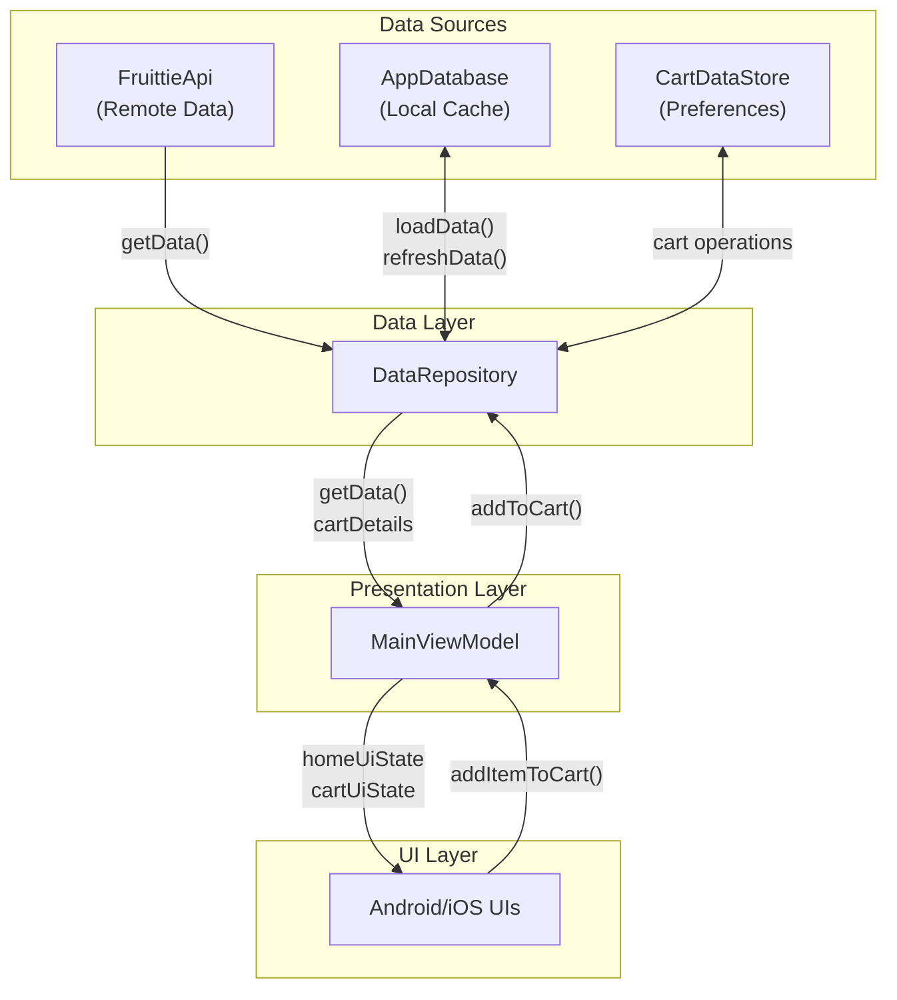
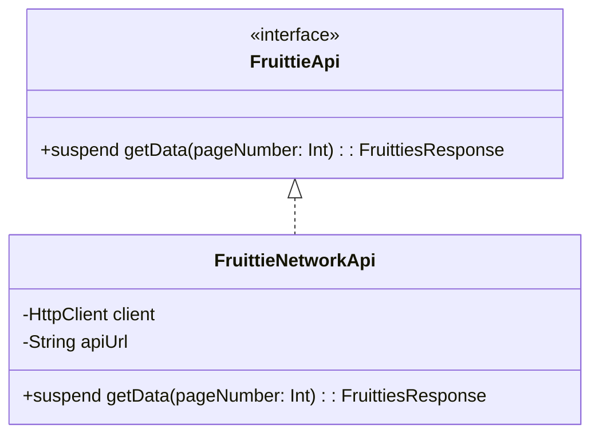
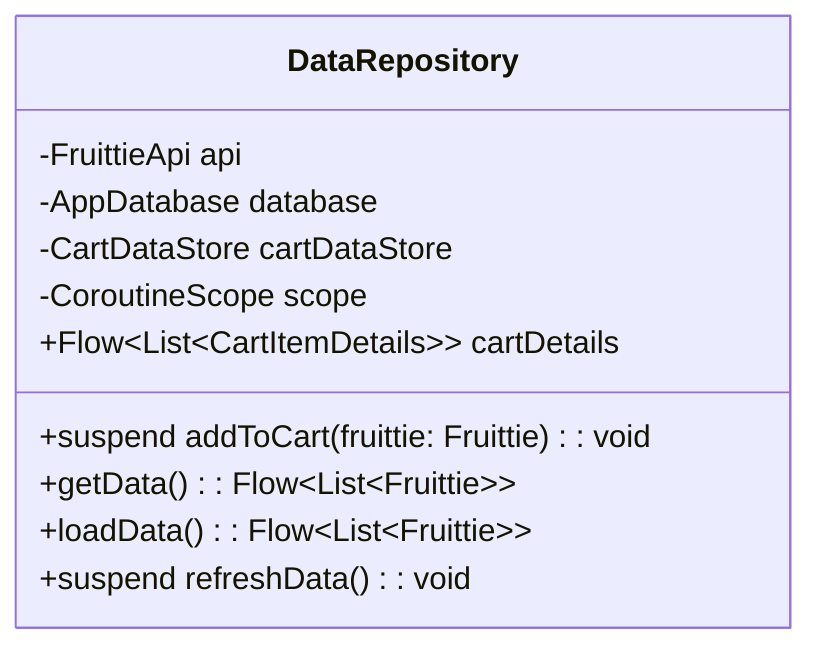
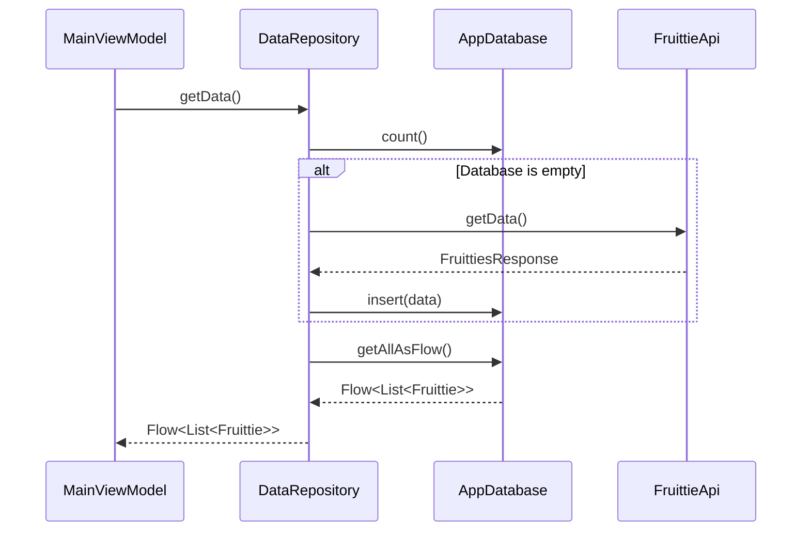
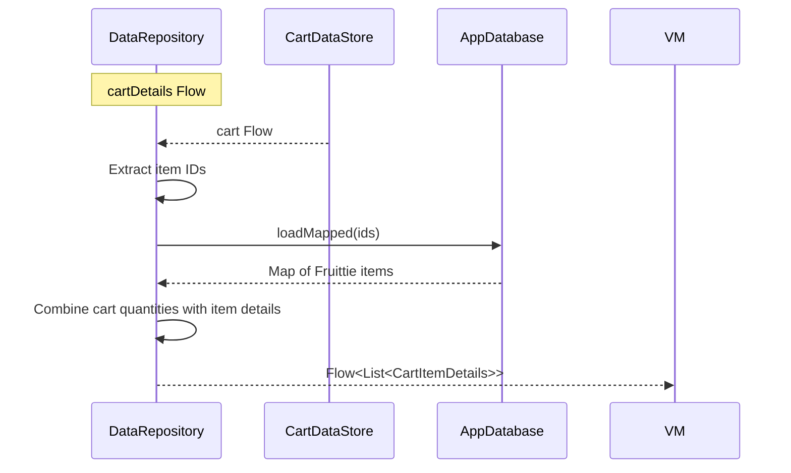
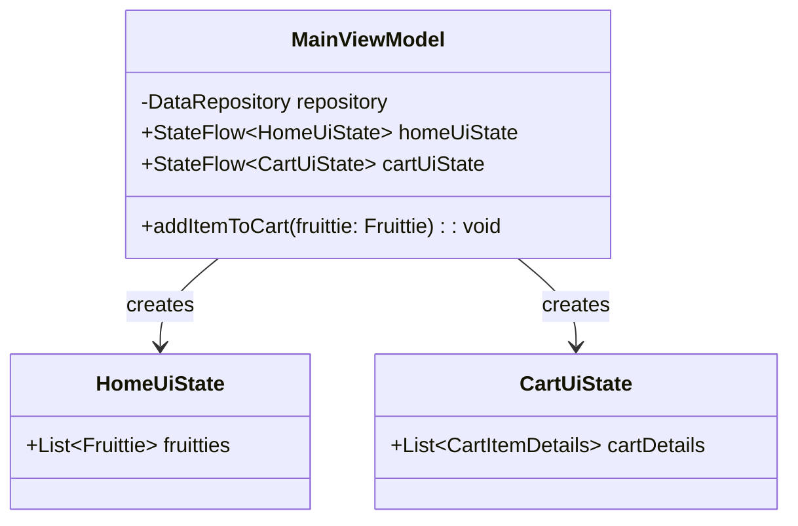
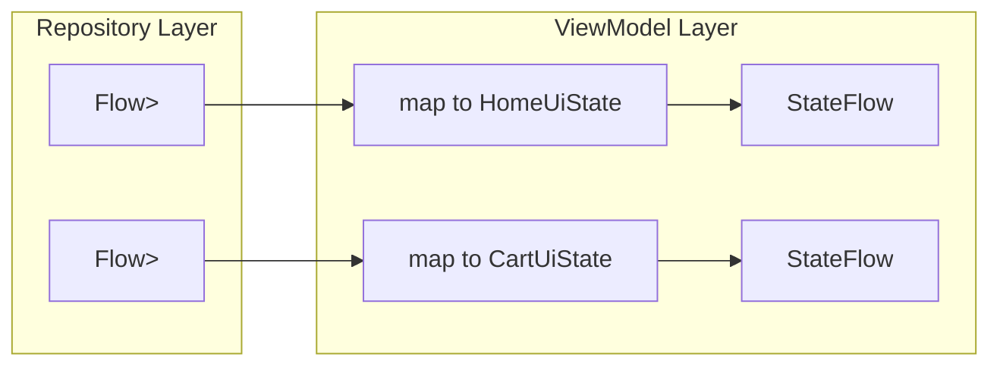
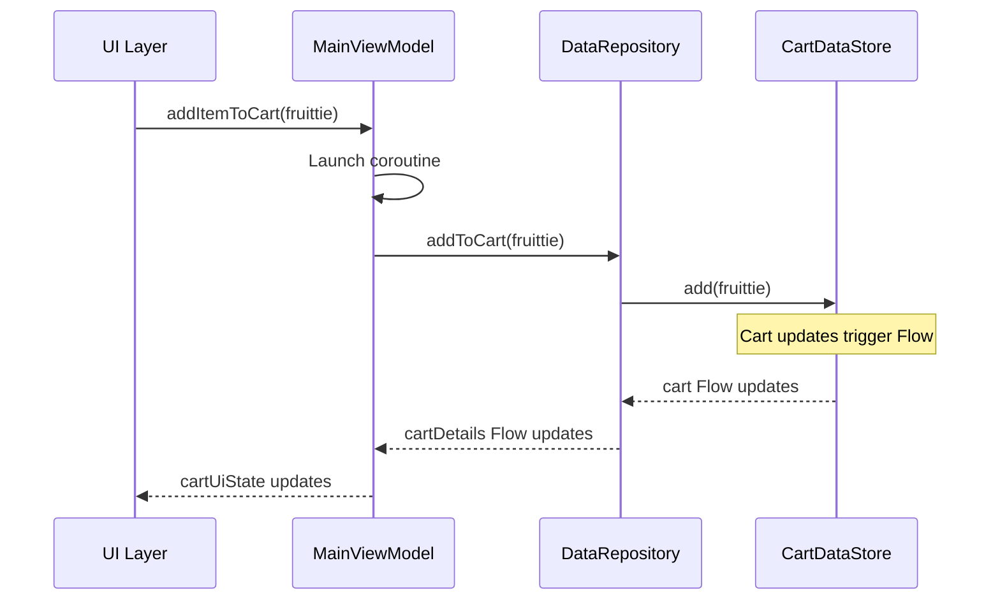

<!-- source: DeepWiki mcp.deepwiki.com · repo android/kotlin-multiplatform-samples · page 3.2 Data Flow · fetched 2026-10-23 -->

# Data Flow

Relevant source files

The following files were used as context for generating this wiki page:

- [Fruitties/shared/src/commonMain/kotlin/com/example/fruitties/DataRepository.kt](Fruitties/shared/src/commonMain/kotlin/com/example/fruitties/DataRepository.kt)
- [Fruitties/shared/src/commonMain/kotlin/com/example/fruitties/di/Factory.kt](Fruitties/shared/src/commonMain/kotlin/com/example/fruitties/di/Factory.kt)
- [Fruitties/shared/src/commonMain/kotlin/com/example/fruitties/network/FruittieApi.kt](Fruitties/shared/src/commonMain/kotlin/com/example/fruitties/network/FruittieApi.kt)
- [Fruitties/shared/src/commonMain/kotlin/com/example/fruitties/viewmodel/MainViewModel.kt](Fruitties/shared/src/commonMain/kotlin/com/example/fruitties/viewmodel/MainViewModel.kt)

This page documents how data flows through the Fruitties application, from external data sources to the user interface and back again. It explains the architectural patterns used to manage data retrieval, storage, transformation, and presentation.

For information about the dependency injection system that wires these components together, see [Dependency Injection](#3.1).

## Overview

The Fruitties application follows a unidirectional data flow pattern with multiple layers, ensuring a clear separation of concerns between data fetching, business logic, and UI presentation.

Sources: [Fruitties/shared/src/commonMain/kotlin/com/example/fruitties/DataRepository.kt:29-66](), [Fruitties/shared/src/commonMain/kotlin/com/example/fruitties/viewmodel/MainViewModel.kt:36-62]()

## Data Sources

The application relies on three primary data sources:

1. **Remote API** - Fetches Fruittie data from a network endpoint
2. **Local Database** - Caches Fruittie items for offline access
3. **Cart Data Store** - Manages shopping cart state

### Remote API (FruittieApi)

The `FruittieApi` interface defines the contract for retrieving data from the remote server:

The implementation uses Ktor client to make HTTP requests and handle responses, with error handling to ensure robustness.

Sources: [Fruitties/shared/src/commonMain/kotlin/com/example/fruitties/network/FruittieApi.kt:24-43]()

## Repository Layer

The `DataRepository` is the central component that orchestrates data flow between different sources:

Key responsibilities of the repository:

1. **Data Caching Strategy**: The repository checks if the local database has data. If empty, it fetches data from the API.
   
2. **Cart Management**: Maintains cart state and combines it with product information.
   
3. **Data Transformation**: Converts raw data models into domain models.

Sources: [Fruitties/shared/src/commonMain/kotlin/com/example/fruitties/DataRepository.kt:29-66]()

### Key Data Flow Patterns

The repository implements several important data flow patterns:

#### 1. Cache-then-Network Strategy

This pattern ensures data is always available locally before being displayed, improving app responsiveness.

Sources: [Fruitties/shared/src/commonMain/kotlin/com/example/fruitties/DataRepository.kt:51-58]()

#### 2. Cart Data Flow

Cart data is combined with product details from the database to create complete cart item objects with quantities.

Sources: [Fruitties/shared/src/commonMain/kotlin/com/example/fruitties/DataRepository.kt:36-45]()

## Presentation Layer

The `MainViewModel` serves as the bridge between the data layer and UI:

The ViewModel:

1. **Transforms Data**: Converts repository data into UI-specific state objects.
   
2. **Manages StateFlows**: Uses Kotlin Flows with `stateIn` to convert cold flows to hot StateFlows that can be observed by UI.
   
3. **Handles User Actions**: Processes UI events and delegates to the repository.

Sources: [Fruitties/shared/src/commonMain/kotlin/com/example/fruitties/viewmodel/MainViewModel.kt:36-107]()

### State Transformation Flow

The `stateIn` operator converts cold flows to hot StateFlows with configuration for lifecycle optimization:

- `scope`: ViewModelScope to tie the flow lifecycle to the ViewModel
- `started`: WhileSubscribed with timeout to conserve resources
- `initialValue`: Empty state to avoid null states

Sources: [Fruitties/shared/src/commonMain/kotlin/com/example/fruitties/viewmodel/MainViewModel.kt:39-56]()

## UI Interaction Flow

When a user interacts with the UI, the action flows back through the system:

This completes the circular data flow, with changes in the data source (Cart) triggering UI updates through the reactive flow chain.

Sources: [Fruitties/shared/src/commonMain/kotlin/com/example/fruitties/viewmodel/MainViewModel.kt:58-62](), [Fruitties/shared/src/commonMain/kotlin/com/example/fruitties/DataRepository.kt:47-49]()

## Platform-Specific Considerations

While the data flow architecture is shared across platforms, the actual data consumption differs between Android and iOS:

- **Android**: Directly collects StateFlows from the ViewModel in Compose UI components
- **iOS**: Observes StateFlows via adapters that convert them to Swift Combine publishers

This pattern allows for shared data flow logic while respecting platform-specific UI paradigms.

Sources: [Fruitties/shared/src/commonMain/kotlin/com/example/fruitties/viewmodel/MainViewModel.kt:36-107]()

## Summary

The data flow in the Fruitties application follows these key principles:

1. **Single Source of Truth**: The repository coordinates between remote and local data sources
2. **Unidirectional Flow**: Data flows from sources through repository to ViewModel to UI
3. **Reactive Programming**: Kotlin Flows enable reactive updates throughout the system
4. **State-Based UI**: UIs observe and render based on immutable state objects

This architecture ensures consistency, testability, and maintainability across both Android and iOS platforms.

---

