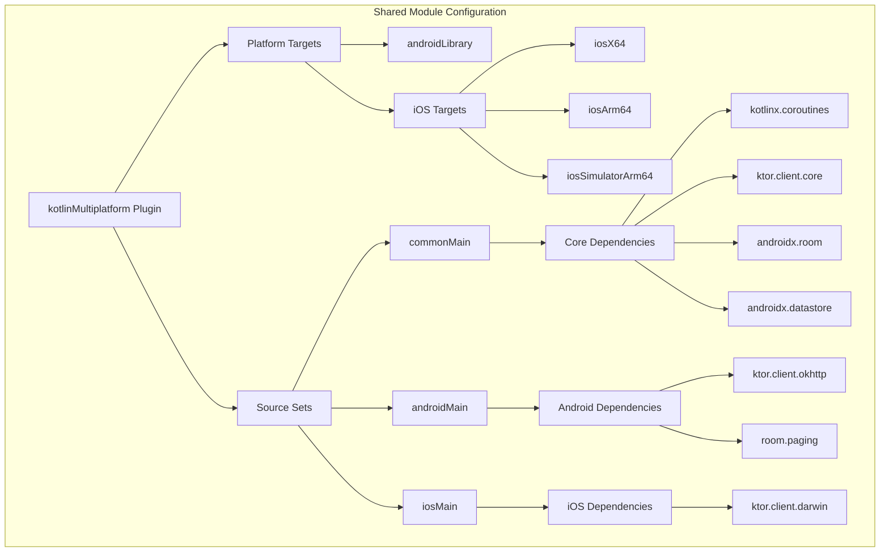

<!-- source: DeepWiki mcp.deepwiki.com · repo android/kotlin-multiplatform-samples · page 4 Shared Module · fetched 2026-10-23 -->

# Shared Module

<details>
<summary>Relevant source files</summary>

The following files were used as context for generating this wiki page:

- [Fruitties/shared/build.gradle.kts](Fruitties/shared/build.gradle.kts)
- [Fruitties/shared/src/commonMain/kotlin/com/example/fruitties/viewmodel/MainViewModel.kt](Fruitties/shared/src/commonMain/kotlin/com/example/fruitties/viewmodel/MainViewModel.kt)

</details>


The Shared Module is the core component of the Kotlin Multiplatform (KMP) architecture in the Fruitties application. It contains code shared between Android and iOS platforms, including business logic, data management, networking, and viewmodel implementations. This document explains how the Shared Module is structured, configured, and how its components interact with platform-specific code.

For information about how the Shared Module fits into the overall project structure, see [Project Structure](#2). For platform-specific implementations, see [Android Implementation](#5) and [iOS Implementation](#6).

## Module Configuration

The Shared Module is configured as a Kotlin Multiplatform library that targets both Android and iOS platforms. It uses the following key plugins:

- Kotlin Multiplatform
- Android KMP Library
- Kotlinx Serialization
- SKIE (Swift Kotlin Interface Enhancer)
- KSP (Kotlin Symbol Processing)
- Room



Sources: [shared/build.gradle.kts:17-139]()

The module's build file defines multiple targets:
- Android library target with minimum SDK 26 and compile SDK 35
- iOS targets including iosX64, iosArm64, and iosSimulatorArm64

Each platform target has corresponding source sets that extend the common source set, allowing for platform-specific implementations while sharing core functionality.

## Source Set Organization

The Shared Module organizes code into hierarchical source sets:

| Source Set | Purpose | Dependencies |
|------------|---------|--------------|
| commonMain | Cross-platform code shared between all targets | Kotlin stdlib, coroutines, ktor, room, datastore |
| androidMain | Android-specific implementations | Inherits from commonMain, adds okhttp and room-paging |
| iosMain | iOS-specific implementations | Inherits from commonMain, adds ktor-darwin client |
| commonTest | Test code for common functionality | Kotlin test framework |

This hierarchical structure allows for maximum code sharing while providing platform-specific implementations where needed.

Sources: [shared/build.gradle.kts:78-138]()

## Core Components

```mermaid
classDiagram
    class MainViewModel {
        -DataRepository repository
        +homeUiState: StateFlow~HomeUiState~
        +cartUiState: StateFlow~CartUiState~
        +addItemToCart(Fruittie)
    }
    
    class DataRepository {
        +getData(): Flow~List~Fruittie~~
        +cartDetails: Flow~List~CartItemDetails~~
        +addToCart(Fruittie)
    }
    
    class AppContainer {
        +dataRepository: DataRepository
    }
    
    class Factory {
        +createApi()
        +createRoomDatabase()
        +createCartDataStore()
    }
    
    MainViewModel --> DataRepository: uses
    DataRepository --> "FruittieApi" : fetches data
    DataRepository --> "AppDatabase" : caches data
    DataRepository --> "CartDataStore" : manages cart
    AppContainer --> DataRepository: creates
    AppContainer --> Factory: uses
```

The shared module contains several key components that work together to provide the core functionality of the application:

### ViewModels

The `MainViewModel` class is the central component for managing UI state and business logic. It's shared between Android and iOS, providing a consistent user experience across platforms. It uses Kotlin's `StateFlow` to expose reactive UI state to both platforms.

Key features of the MainViewModel:
- Exposes UI state for the home screen and cart as StateFlows
- Handles user interactions like adding items to cart
- Communicates with the DataRepository for data operations

Sources: [shared/src/commonMain/kotlin/com/example/fruitties/viewmodel/MainViewModel.kt:36-107]()

### Data Management

The data flow in the shared module follows a repository pattern:

```mermaid
flowchart LR
    subgraph "UI Layer"
        AndroidUI["Android UI"]
        iOSUI["iOS UI"]
    end
    
    subgraph "Shared Module"
        direction TB
        ViewModel["MainViewModel"]
        
        subgraph "Data Layer"
            direction TB
            Repository["DataRepository"]
            API["FruittieApi"]
            DB["AppDatabase (Room)"]
            CartDS["CartDataStore"]
        end
        
        Repository --> API: "remote data"
        Repository --> DB: "local cache"
        Repository --> CartDS: "preferences"
        ViewModel --> Repository: "data operations"
    end
    
    AndroidUI <--> ViewModel: "StateFlows/Actions"
    iOSUI <--> ViewModel: "StateFlows/Actions"
```

The shared module implements a clean architecture approach for data management:
- Remote data is fetched through `FruittieApi` using Ktor
- Local data is cached in `AppDatabase` using Room
- User preferences (cart data) are stored in `CartDataStore` using DataStore
- `DataRepository` coordinates between these data sources
- `MainViewModel` exposes this data to the UI layers

Sources: [shared/src/commonMain/kotlin/com/example/fruitties/viewmodel/MainViewModel.kt:39-56]()

## Platform-Specific Implementations

While the Shared Module provides common functionality, it also includes mechanisms for platform-specific implementations:

### Expect/Actual Pattern

The module uses Kotlin's expect/actual pattern to define interfaces in common code that have platform-specific implementations:

```mermaid
flowchart TD
    subgraph "Common Code"
        Factory["Factory (expect class)"]
    end
    
    subgraph "Android Implementation"
        AndroidFactory["Factory.android.kt"]
    end
    
    subgraph "iOS Implementation"
        iOSFactory["Factory.native.kt"]
    end
    
    Factory --> AndroidFactory: "actual implementation"
    Factory --> iOSFactory: "actual implementation"
    
    AndroidFactory --> AndroidDeps["Android Dependencies"]
    iOSFactory --> iOSDeps["iOS Dependencies"]
```

This pattern allows the shared module to abstract platform-specific implementations while maintaining a consistent API across platforms.

## Dependency Injection

The shared module implements a simple dependency injection system through the `AppContainer` and `Factory` classes:

- `AppContainer` serves as the central registry for dependencies
- `Factory` provides platform-specific implementations of dependencies
- `ViewModelProvider.Factory` facilitates ViewModel creation with dependencies

The ViewModel includes helper methods to simplify dependency injection when creating ViewModels from platform-specific code.

Sources: [shared/src/commonMain/kotlin/com/example/fruitties/viewmodel/MainViewModel.kt:64-89]()

## UI State Management

The shared module defines data classes to represent UI state for different screens:

| UI State Class | Purpose | Properties |
|----------------|---------|------------|
| HomeUiState | Represents state for the home screen | fruitties: List<Fruittie> |
| CartUiState | Represents state for the cart | cartDetails: List<CartItemDetails> |

These UI state classes are exposed as StateFlows, allowing for reactive UI updates on both platforms.

Sources: [shared/src/commonMain/kotlin/com/example/fruitties/viewmodel/MainViewModel.kt:96-105]()

## SKIE Integration

The shared module uses SKIE (Swift Kotlin Interface Enhancer) to improve the Swift API surface generated from Kotlin code. This provides better Swift interoperability, including:

- Better naming conventions for Swift
- Support for Swift concurrency patterns
- SwiftUI observing preview for Kotlin flows

Sources: [shared/build.gradle.kts:152-157]()

## Key Dependencies

The shared module relies on several key libraries:

- **Kotlinx Coroutines**: For asynchronous programming
- **Ktor**: For network operations
- **Room**: For database operations
- **DataStore**: For preferences management
- **Lifecycle ViewModel**: For UI state management

These dependencies are declared in the commonMain source set and platform-specific implementations are added in the platform-specific source sets.

Sources: [shared/build.gradle.kts:83-101](), [shared/build.gradle.kts:110-117](), [shared/build.gradle.kts:128-136]()

---

