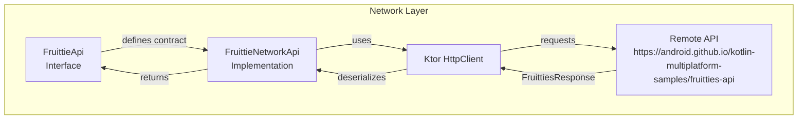
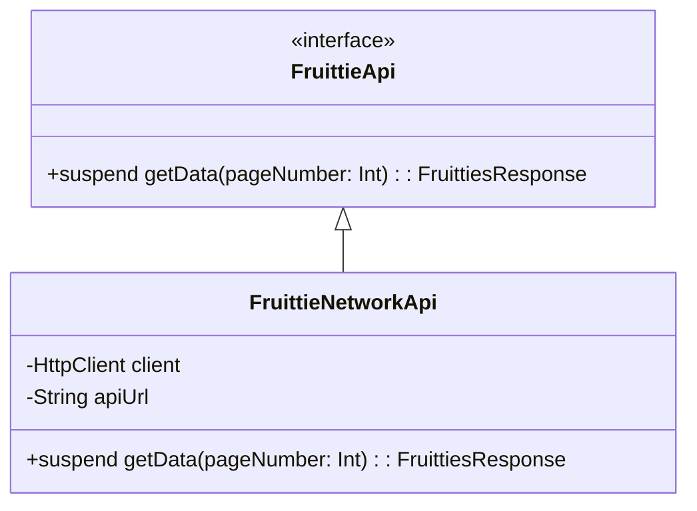
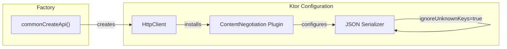
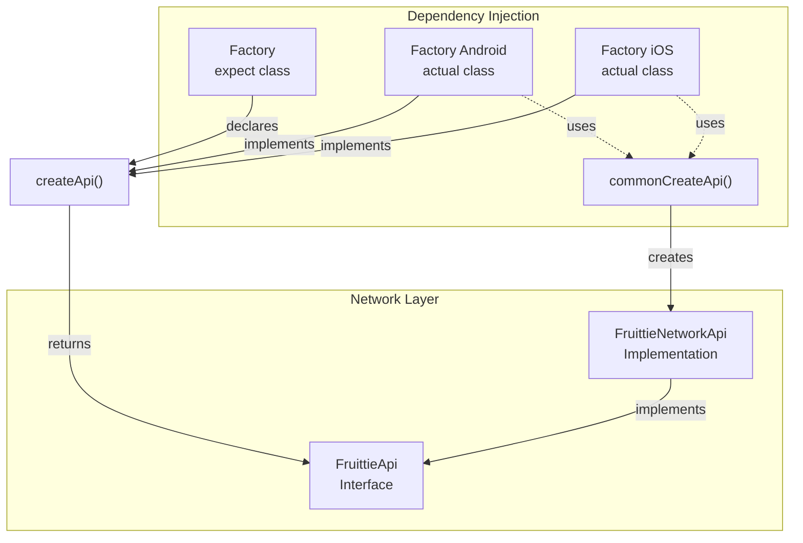

<!-- source: DeepWiki mcp.deepwiki.com · repo android/kotlin-multiplatform-samples · page 4.1 Network Layer · fetched 2026-10-23 -->

# Network Layer

Relevant source files

The following files were used as context for generating this wiki page:

- [Fruitties/shared/src/commonMain/kotlin/com/example/fruitties/di/Factory.kt](Fruitties/shared/src/commonMain/kotlin/com/example/fruitties/di/Factory.kt)
- [Fruitties/shared/src/commonMain/kotlin/com/example/fruitties/network/FruittieApi.kt](Fruitties/shared/src/commonMain/kotlin/com/example/fruitties/network/FruittieApi.kt)

The Network Layer in the Fruitties application is responsible for retrieving product data from a remote API. This page documents the implementation of network communication in the shared KMP (Kotlin Multiplatform) module, focusing on the `FruittieApi` interface and its implementation. For information on how the network data is managed within the application, see [Data Repository](#4.2).

## Overview

The Network Layer uses Ktor HTTP client to make network requests and retrieve product data from a remote JSON API. The implementation is designed to be platform-independent, allowing the same network code to run on both Android and iOS.

Sources: [shared/src/commonMain/kotlin/com/example/fruitties/network/FruittieApi.kt:24-43](), [shared/src/commonMain/kotlin/com/example/fruitties/di/Factory.kt:36-44]()

## API Interface

The `FruittieApi` interface defines a contract for retrieving product data:

The interface is minimal, with just one method:
- `getData(pageNumber: Int)`: Fetches product data for the specified page number and returns a `FruittiesResponse` object

This design allows for easy testing and potential implementation swapping (such as using mock data for tests).

Sources: [shared/src/commonMain/kotlin/com/example/fruitties/network/FruittieApi.kt:24-26]()

## Implementation Details

The actual implementation `FruittieNetworkApi` uses Ktor's HttpClient to perform network requests:

1. The class takes two constructor parameters:
   - `client`: A Ktor HttpClient instance
   - `apiUrl`: The base URL for API requests

2. The `getData` method constructs the URL for the specific page and uses the HttpClient to:
   - Make a GET request to the API endpoint
   - Parse the JSON response into a `FruittiesResponse` object
   - Handle exceptions appropriately, returning an empty response on error

3. Error handling:
   - Propagates cancellation exceptions (important for coroutine cancellation)
   - Logs other exceptions and returns an empty response to prevent crashes

Sources: [shared/src/commonMain/kotlin/com/example/fruitties/network/FruittieApi.kt:28-43]()

## HTTP Client Configuration

The Network Layer uses Ktor's HttpClient with the following configuration:

Key configuration points:
- Uses the ContentNegotiation plugin to handle serialization
- Configures JSON serialization with `ignoreUnknownKeys=true` for more robust parsing
- Accepts any content type to accommodate potential server configuration issues

Sources: [shared/src/commonMain/kotlin/com/example/fruitties/di/Factory.kt:36-44](), [shared/src/commonMain/kotlin/com/example/fruitties/di/Factory.kt:46]()

## Integration with Dependency Injection

The Network Layer integrates with the application's dependency injection system through the `Factory` class:

The integration occurs through:
1. The `Factory` expect class which declares a `createApi()` method
2. Platform-specific actual implementations (Android, iOS)
3. A common implementation `commonCreateApi()` that both platforms can leverage

This pattern allows for consistent API creation across platforms while maintaining the flexibility to add platform-specific configurations if needed.

Sources: [shared/src/commonMain/kotlin/com/example/fruitties/di/Factory.kt:28-34](), [shared/src/commonMain/kotlin/com/example/fruitties/di/Factory.kt:36-44]()

## API Endpoint Structure

The API endpoints follow a simple convention:

| Page Number | URL |
|-------------|-----|
| 0 | https://android.github.io/kotlin-multiplatform-samples/fruitties-api/0.json |
| 1 | https://android.github.io/kotlin-multiplatform-samples/fruitties-api/1.json |
| n | https://android.github.io/kotlin-multiplatform-samples/fruitties-api/{n}.json |

The response is deserialized into the `FruittiesResponse` model object, which contains a list of products and pagination information.

Sources: [shared/src/commonMain/kotlin/com/example/fruitties/network/FruittieApi.kt:32-35](), [shared/src/commonMain/kotlin/com/example/fruitties/di/Factory.kt:43]()

## Summary

The Network Layer in the Fruitties application demonstrates:
- Clean separation of interface and implementation
- Cross-platform network code using Ktor
- Integration with a dependency injection system
- Error handling for robust operation
- JSON deserialization with Kotlinx Serialization

This design ensures that network operations can be performed consistently across both Android and iOS platforms while maintaining a clean architecture.

---

