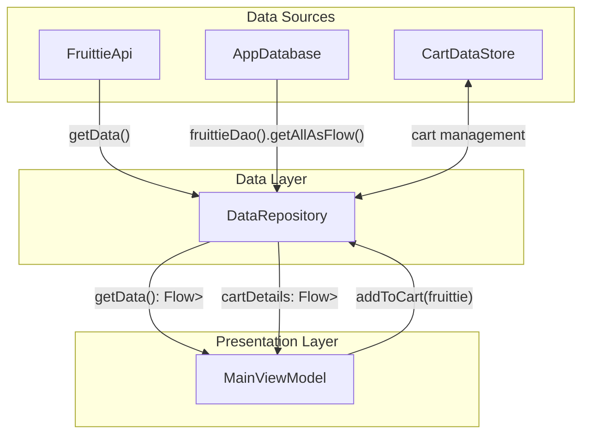
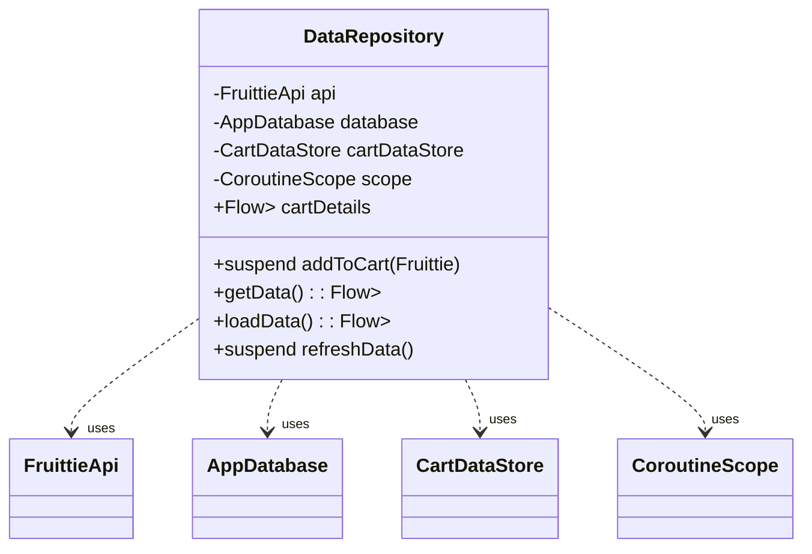
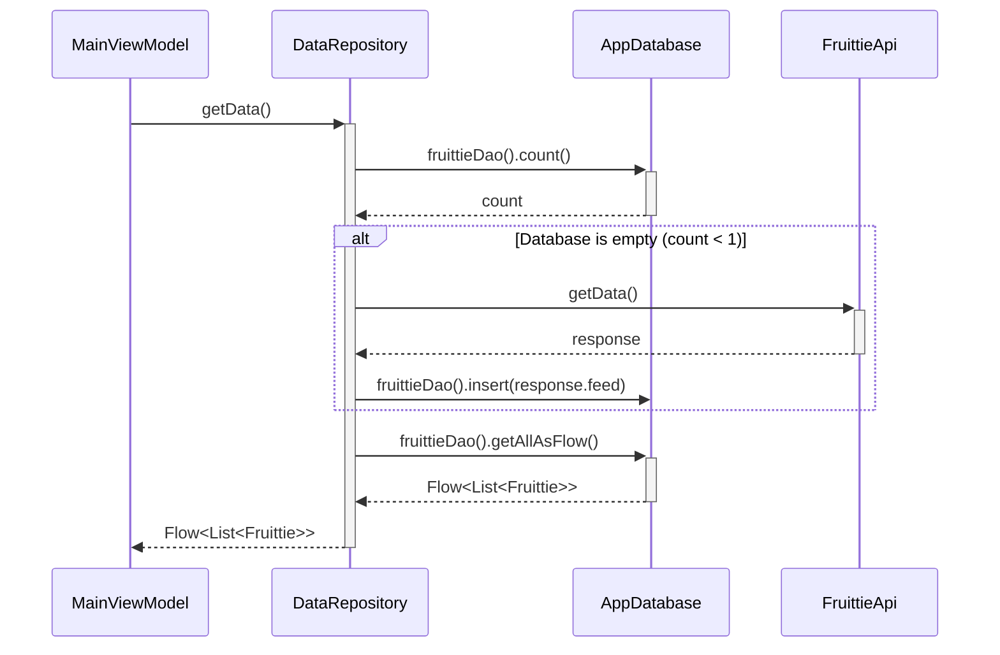
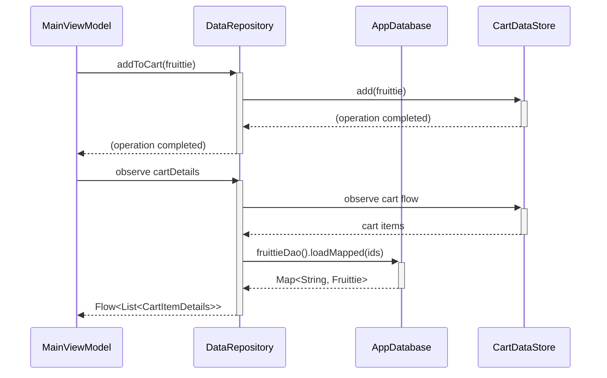

<!-- source: DeepWiki mcp.deepwiki.com · repo android/kotlin-multiplatform-samples · page 4.2 Data Repository · fetched 2026-10-23 -->

# Data Repository

<details>
<summary>Relevant source files</summary>

The following files were used as context for generating this wiki page:

- [Fruitties/shared/src/commonMain/kotlin/com/example/fruitties/DataRepository.kt](Fruitties/shared/src/commonMain/kotlin/com/example/fruitties/DataRepository.kt)

</details>


The Data Repository is a central component in the Fruitties application that implements the Repository pattern to abstract multiple data sources from the rest of the application. It serves as a single source of truth for data, handling the coordination between remote API data, local database caching, and user preference storage for the shopping cart.

For information about the API implementation, see [Network Layer](#4.1). For details about the local database implementation, see [Database Layer](#4.3). For information on how the ViewModel consumes the repository, see [ViewModel Implementation](#4.4).

## Repository Architecture

The DataRepository sits between the data sources and the presentation layer, acting as a mediator that abstracts the complexities of data management.



Sources: [Fruitties/shared/src/commonMain/kotlin/com/example/fruitties/DataRepository.kt:29-34]()

## Implementation Details

The `DataRepository` class is defined in the shared module, making it available to both Android and iOS platforms.

### Class Structure



Sources: [Fruitties/shared/src/commonMain/kotlin/com/example/fruitties/DataRepository.kt:29-66]()

### Dependencies

The `DataRepository` constructor takes four parameters:

```
class DataRepository(
    private val api: FruittieApi,
    private var database: AppDatabase,
    private val cartDataStore: CartDataStore,
    private val scope: CoroutineScope,
)
```

- **api**: Handles network requests to retrieve data from the remote server
- **database**: Provides local storage and caching capabilities
- **cartDataStore**: Manages the user's shopping cart data
- **scope**: Provides a coroutine scope for launching asynchronous operations

Sources: [Fruitties/shared/src/commonMain/kotlin/com/example/fruitties/DataRepository.kt:29-34]()

## Data Flow Operations

### Retrieving Fruittie Data



Sources: [Fruitties/shared/src/commonMain/kotlin/com/example/fruitties/DataRepository.kt:51-58](), [Fruitties/shared/src/commonMain/kotlin/com/example/fruitties/DataRepository.kt:60](), [Fruitties/shared/src/commonMain/kotlin/com/example/fruitties/DataRepository.kt:62-65]()

### Cart Management



Sources: [Fruitties/shared/src/commonMain/kotlin/com/example/fruitties/DataRepository.kt:35-45](), [Fruitties/shared/src/commonMain/kotlin/com/example/fruitties/DataRepository.kt:47-49]()

## Key API Methods

### Getting and Refreshing Data

The repository provides several methods for data retrieval:

| Method | Return Type | Description |
|--------|-------------|-------------|
| `getData()` | `Flow<List<Fruittie>>` | Main method to retrieve data. Checks if database is empty and refreshes from API if needed. |
| `loadData()` | `Flow<List<Fruittie>>` | Returns a Flow directly from the database without checking for freshness. |
| `refreshData()` | `Unit` (suspend) | Fetches fresh data from the API and stores it in the database. |

Sources: [Fruitties/shared/src/commonMain/kotlin/com/example/fruitties/DataRepository.kt:51-65]()

### Cart Operations

| Property/Method | Type | Description |
|-----------------|------|-------------|
| `cartDetails` | `Flow<List<CartItemDetails>>` | A Flow that provides the current cart contents with detailed item information. |
| `addToCart(fruittie: Fruittie)` | `suspend fun` | Adds a Fruittie item to the user's cart. |

Sources: [Fruitties/shared/src/commonMain/kotlin/com/example/fruitties/DataRepository.kt:35-49]()

## Caching Strategy

The repository implements a simple but effective caching strategy:

1. When `getData()` is called, it first checks if the database contains any records
2. If the database is empty, it triggers a refresh from the network API
3. Regardless of whether a refresh was needed, it returns a Flow from the database

This ensures that:
- Data is always available offline once fetched
- Network requests are minimized
- UI always displays the most recent locally available data

Sources: [Fruitties/shared/src/commonMain/kotlin/com/example/fruitties/DataRepository.kt:51-58]()

## Reactive Data Handling with Kotlin Flow

The repository makes extensive use of Kotlin Flow for reactive data handling:

- `cartDetails` transforms the cart data stream using `mapLatest` to combine cart items with their details from the database
- `getData()` and `loadData()` return Flows that emit updates whenever the underlying data changes
- This reactive approach enables automatic UI updates when data changes

The transformation of cart data is particularly interesting:

```
cartDataStore.cart.mapLatest {
    val ids = it.items.map { it.id }
    val fruitties = database.fruittieDao().loadMapped(ids)
    it.items.mapNotNull {
        fruitties[it.id]?.let { fruittie ->
            CartItemDetails(fruittie, it.count)
        }
    }
}
```

This code combines cart item IDs with their corresponding Fruittie details from the database to create a list of `CartItemDetails` objects.

Sources: [Fruitties/shared/src/commonMain/kotlin/com/example/fruitties/DataRepository.kt:35-45]()

## Summary

The `DataRepository` serves as a critical component in the Fruitties application, providing:

1. A clean abstraction over multiple data sources
2. Efficient caching of remote data
3. Reactive data streams using Kotlin Flow
4. Cart management functionality
5. A shared implementation that works across both Android and iOS platforms

By implementing the Repository pattern, the application maintains a clean separation of concerns and facilitates code sharing between platforms.

Sources: [Fruitties/shared/src/commonMain/kotlin/com/example/fruitties/DataRepository.kt:1-66]()

---

