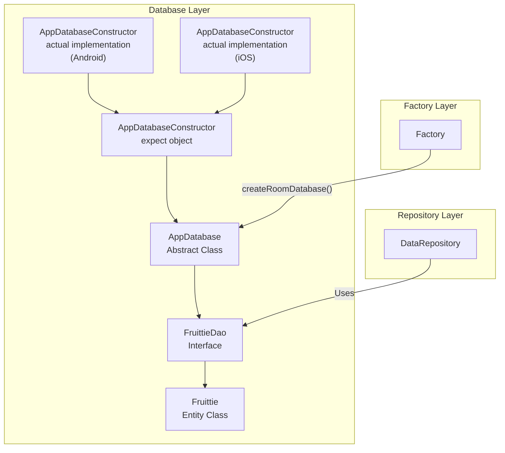
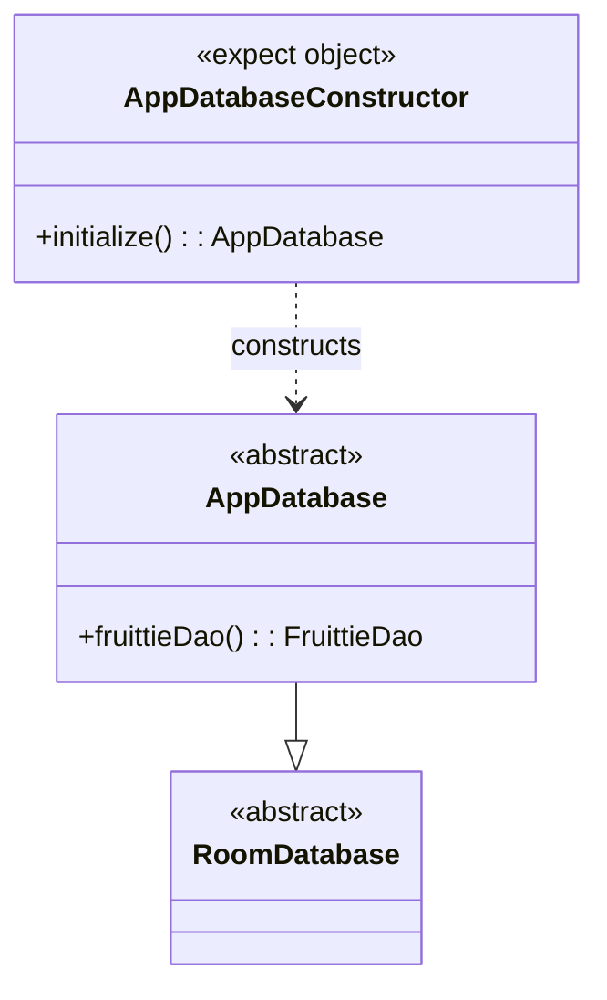
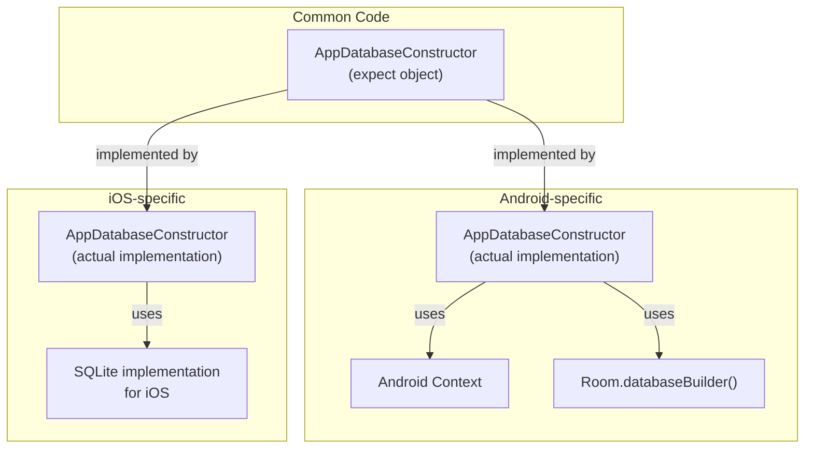
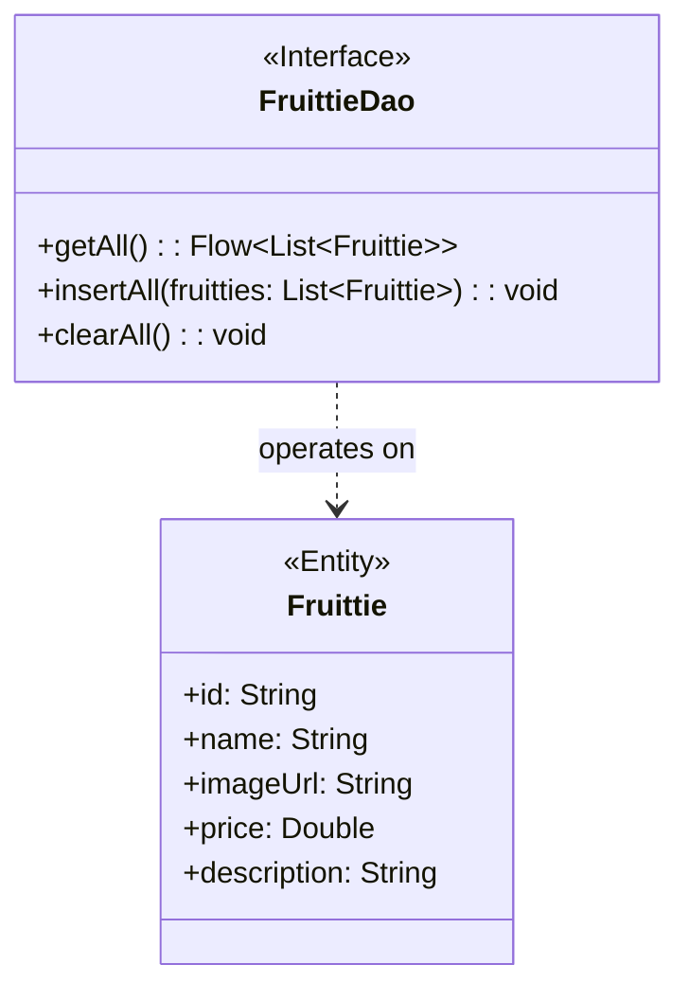
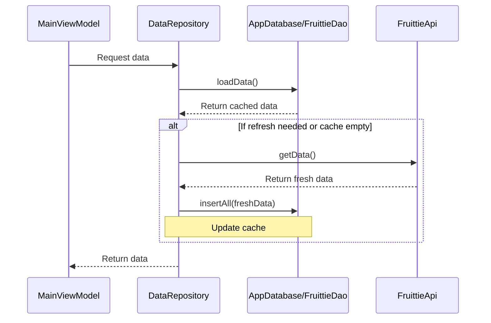
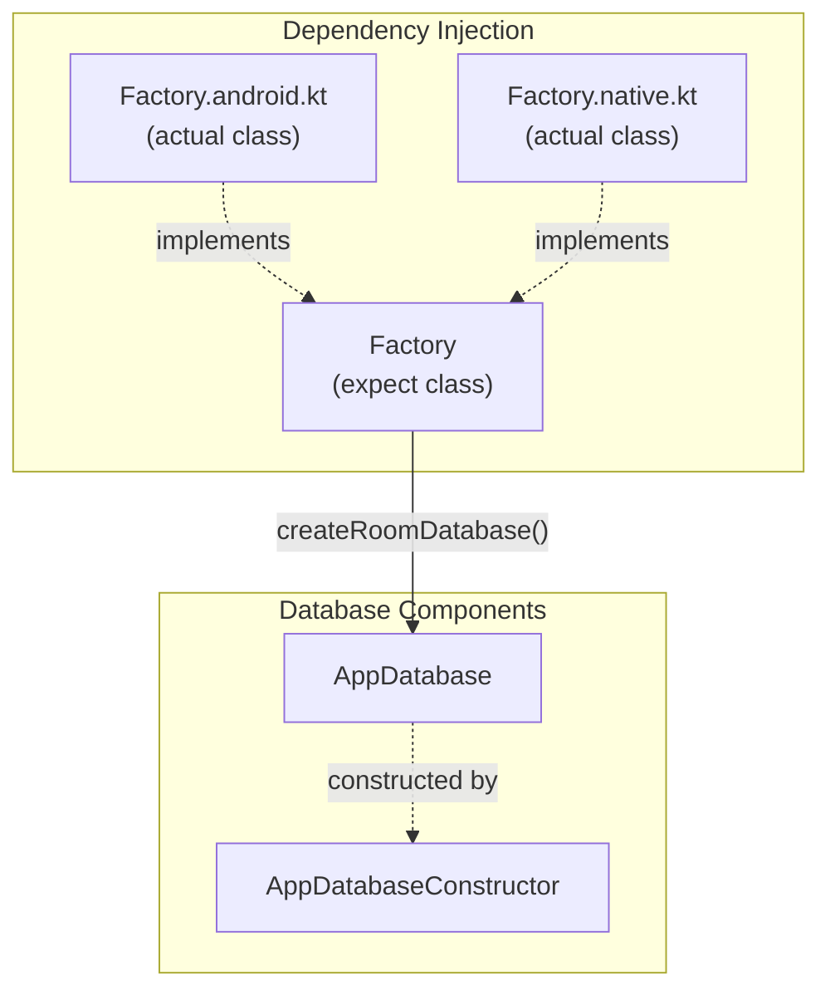

<!-- source: DeepWiki mcp.deepwiki.com · repo android/kotlin-multiplatform-samples · page 4.3 Database Layer · fetched 2026-10-23 -->

# Database Layer

Relevant source files

The following files were used as context for generating this wiki page:

- [Fruitties/shared/src/commonMain/kotlin/com/example/fruitties/database/AppDatabase.kt](Fruitties/shared/src/commonMain/kotlin/com/example/fruitties/database/AppDatabase.kt)

## Purpose and Scope

The Database Layer in the Fruitties application provides local data persistence capabilities, enabling offline access to the app's data and serving as a cache mechanism. This document covers the implementation details of the local database using Room within the Kotlin Multiplatform (KMP) project. 

For information about how the database interacts with other components in the data flow, see [Data Flow](#3.2). For details on how data is retrieved from the network, see [Network Layer](#4.1). To understand how the database is used by higher-level components, see [Data Repository](#4.2).

## Database Architecture Overview

The database architecture follows the Room persistence library pattern, adapted for Kotlin Multiplatform. The central component is the `AppDatabase` abstract class, which provides access to the DAO (Data Access Object) that contains methods for interacting with the database.

Sources: [Fruitties/shared/src/commonMain/kotlin/com/example/fruitties/database/AppDatabase.kt:24-28]()

## Core Components

### AppDatabase

The `AppDatabase` is an abstract class extending RoomDatabase that defines the database schema and serves as the main access point for the underlying connection.

Key characteristics:
- Annotated with `@Database`, specifying `Fruittie` as the only entity
- Database version is set to 1
- Provides an abstract method to access the `FruittieDao`
- Constructed by the `AppDatabaseConstructor` expect object, which has platform-specific implementations

Sources: [Fruitties/shared/src/commonMain/kotlin/com/example/fruitties/database/AppDatabase.kt:24-28]()

### Platform-Specific Database Construction

The `AppDatabaseConstructor` is an expect object that provides different implementations for different platforms:

The `AppDatabaseConstructor` object encapsulates platform-specific logic for creating the database:
- On Android, it likely uses the standard Room database builder
- On iOS, it uses a bridging implementation that makes Room work on iOS
- The file name for the database is defined as "fruits.db"

Sources: [Fruitties/shared/src/commonMain/kotlin/com/example/fruitties/database/AppDatabase.kt:30-34](), [Fruitties/shared/src/commonMain/kotlin/com/example/fruitties/database/AppDatabase.kt:36]()

## Database Entity

The database stores `Fruittie` objects as its main entity. While the specific details of the Fruittie class are not provided in the shared code, we can infer its structure from its usage.

Sources: [Fruitties/shared/src/commonMain/kotlin/com/example/fruitties/database/AppDatabase.kt:24]()

## Data Access Object (DAO)

The `FruittieDao` interface provides methods for accessing and manipulating the database. While the exact implementation is not visible in the shared code, typical Room DAO patterns suggest it would include:

| Method | Purpose | Return Type |
|--------|---------|------------|
| `getAll()` | Retrieve all Fruittie records | Flow<List\<Fruittie\>> |
| `insertAll(fruitties)` | Insert a list of Fruittie objects | void |
| `clearAll()` | Delete all records | void |

Sources: [Fruitties/shared/src/commonMain/kotlin/com/example/fruitties/database/AppDatabase.kt:27]()

## Integration with Repository

The Database Layer integrates with the Data Repository as follows:
1. The Repository requests data from the database first
2. If data is available and fresh, it's returned directly
3. If data is stale or unavailable, the Repository fetches from the API and updates the database
4. This caching strategy optimizes performance and enables offline functionality

Sources: [Fruitties/shared/src/commonMain/kotlin/com/example/fruitties/database/AppDatabase.kt:24-28]()

## Database Creation and Dependency Injection

The database instance is created through the Factory pattern:

The Factory pattern enables platform-specific implementations while maintaining a consistent API for database creation. The database is typically created once and then injected wherever needed, following a singleton pattern.

Sources: [Fruitties/shared/src/commonMain/kotlin/com/example/fruitties/database/AppDatabase.kt:24-28]()

## Conclusion

The Database Layer in the Fruitties application demonstrates how Room can be leveraged in a Kotlin Multiplatform project to provide local data persistence across both Android and iOS platforms. The architecture uses platform-specific implementations hidden behind common interfaces, which allows the rest of the application to interact with the database in a platform-agnostic way.

---

