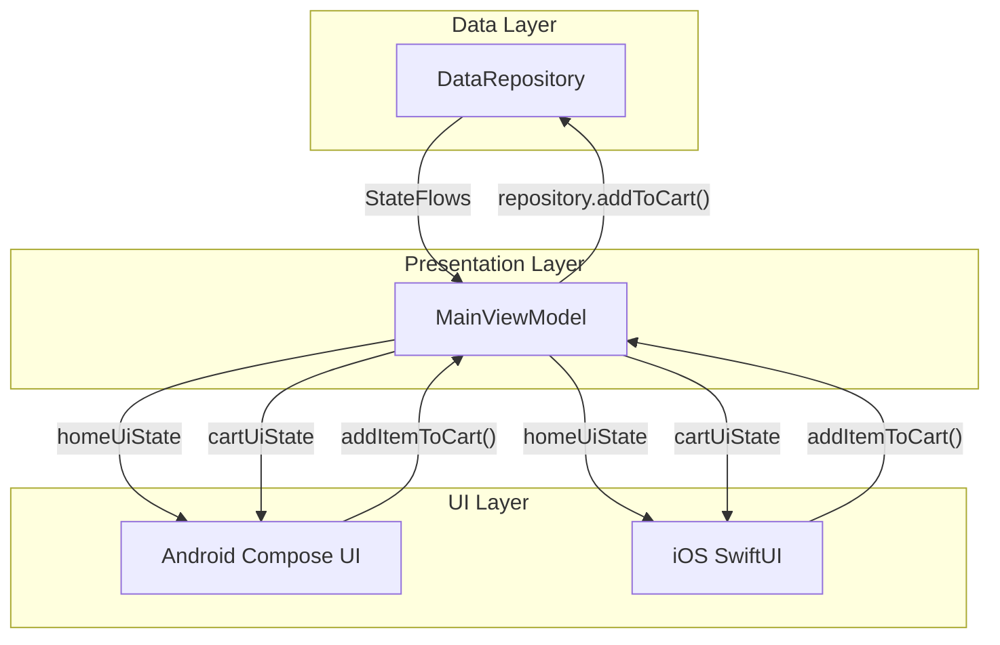
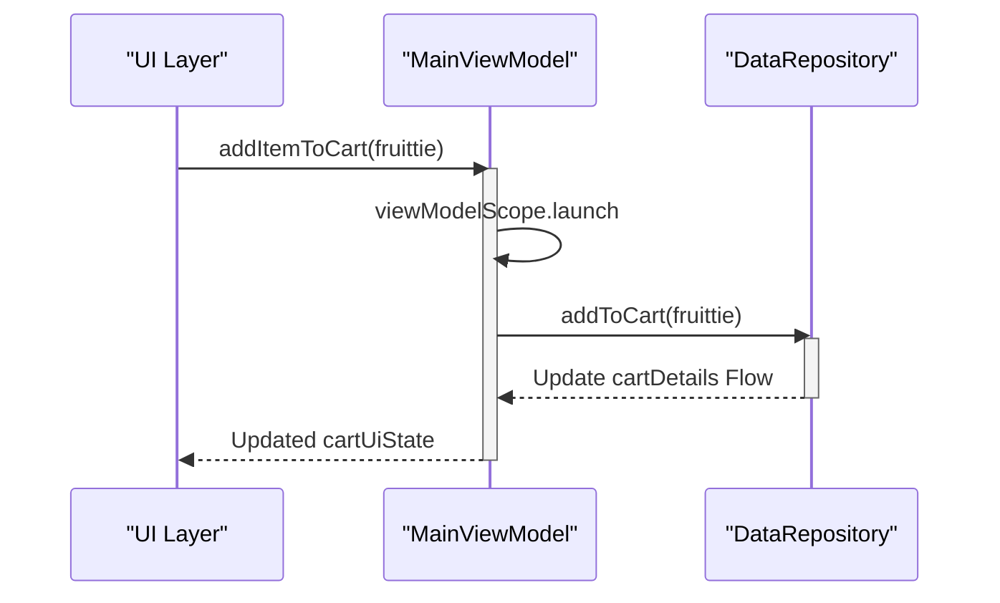
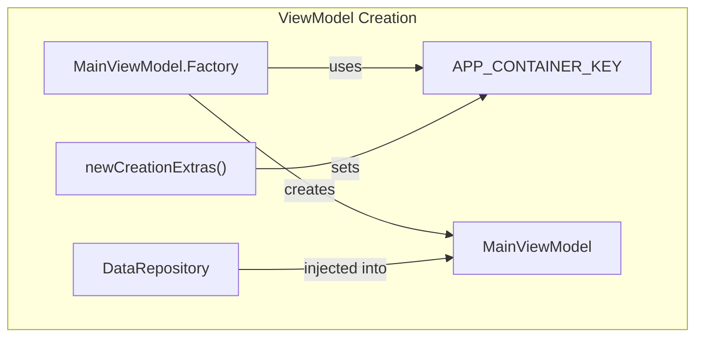
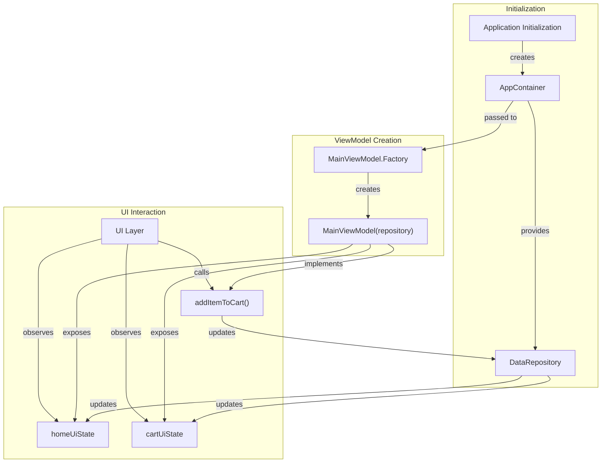

<!-- source: DeepWiki mcp.deepwiki.com · repo android/kotlin-multiplatform-samples · page 4.4 ViewModel Implementation · fetched 2026-10-23 -->

# ViewModel Implementation

<details>
<summary>Relevant source files</summary>

The following files were used as context for generating this wiki page:

- [Fruitties/shared/src/commonMain/kotlin/com/example/fruitties/viewmodel/MainViewModel.kt](Fruitties/shared/src/commonMain/kotlin/com/example/fruitties/viewmodel/MainViewModel.kt)

</details>


## Purpose and Scope

This page documents how the shared `MainViewModel` class manages UI state across both Android and iOS platforms in the Fruitties application. The ViewModel serves as a platform-agnostic mediator between the data layer and the UI, providing a consistent state management solution regardless of the platform-specific UI implementation. For information about platform-specific UI components, see [Android UI Components](#5.1) and [iOS UI Components](#6.1).

## Overview

The Fruitties application uses a single, shared ViewModel implementation that is used by both the Android and iOS platforms. This approach ensures consistent business logic and state management across platforms while allowing for native UI implementations.



Sources: [Fruitties/shared/src/commonMain/kotlin/com/example/fruitties/viewmodel/MainViewModel.kt:36-62]()

## MainViewModel Class Structure

The `MainViewModel` class is designed to be used as a shared component across platforms, managing UI state for both the home screen and the cart.

```mermaid
classDiagram
    class MainViewModel {
        -DataRepository repository
        +StateFlow~HomeUiState~ homeUiState
        +StateFlow~CartUiState~ cartUiState
        +addItemToCart(fruittie: Fruittie)
        +Factory: ViewModelProvider.Factory
    }
    
    class HomeUiState {
        +List~Fruittie~ fruitties
    }
    
    class CartUiState {
        +List~CartItemDetails~ cartDetails
    }
    
    MainViewModel --> HomeUiState: exposes
    MainViewModel --> CartUiState: exposes
    MainViewModel --> "DataRepository": depends on
```

Sources: [Fruitties/shared/src/commonMain/kotlin/com/example/fruitties/viewmodel/MainViewModel.kt:36-105]()

## State Management

The `MainViewModel` manages two primary UI states: `HomeUiState` for the product listing screen and `CartUiState` for the shopping cart screen. These states are exposed as `StateFlow` objects, allowing both Android and iOS UIs to observe and react to state changes.

### StateFlow Implementation

The ViewModel transforms repository data into UI states using Kotlin Flows:

| StateFlow | Data Source | Transformation | Initial Value |
|-----------|-------------|----------------|--------------|
| `homeUiState` | `repository.getData()` | Mapped to `HomeUiState` | Empty `HomeUiState` |
| `cartUiState` | `repository.cartDetails` | Mapped to `CartUiState` | Empty `CartUiState` |

Both StateFlows use `SharingStarted.WhileSubscribed(5000)` as the sharing strategy, meaning they will remain active as long as there are subscribers and for 5 seconds after the last subscriber unsubscribes.

Sources: [Fruitties/shared/src/commonMain/kotlin/com/example/fruitties/viewmodel/MainViewModel.kt:39-56]()

### UI State Data Classes

The ViewModel defines two data classes to represent UI state:

1. `HomeUiState`: Contains a list of `Fruittie` objects for the home screen.
2. `CartUiState`: Contains a list of `CartItemDetails` objects for the cart screen.

These state classes encapsulate all the data needed by the UI layers to render their respective screens.

Sources: [Fruitties/shared/src/commonMain/kotlin/com/example/fruitties/viewmodel/MainViewModel.kt:96-105]()

## User Interaction Handling

The ViewModel handles user interactions through public methods that update the application state. The primary interaction method is `addItemToCart()`, which allows users to add a `Fruittie` item to their shopping cart.



Sources: [Fruitties/shared/src/commonMain/kotlin/com/example/fruitties/viewmodel/MainViewModel.kt:58-62]()

## ViewModel Instantiation

The `MainViewModel` provides a factory pattern for its instantiation, which is used differently on Android and iOS.

### Factory Implementation

The ViewModel includes a companion object with a `Factory` property that uses the AndroidX ViewModel Factory APIs. This factory retrieves an `AppContainer` from the creation extras and uses it to obtain the required `DataRepository` dependency.



Sources: [Fruitties/shared/src/commonMain/kotlin/com/example/fruitties/viewmodel/MainViewModel.kt:64-89]()

### Platform-Specific Instantiation

While the ViewModel itself is platform-independent, its instantiation differs between Android and iOS:

- **Android**: Uses the standard AndroidX ViewModel APIs with the provided Factory.
- **iOS**: Uses a custom `IOSViewModelOwner` that manages the ViewModel lifecycle and provides the necessary dependencies.

The `newCreationExtras()` helper method simplifies ViewModel creation by preparing the necessary CreationExtras with the AppContainer.

Sources: [Fruitties/shared/src/commonMain/kotlin/com/example/fruitties/viewmodel/MainViewModel.kt:86-89]()

## Key Implementation Considerations

1. **Platform Agnostic Design**: The ViewModel uses only APIs available on both platforms or those that have appropriate expect/actual implementations.

2. **Coroutine Scope Management**: The ViewModel uses `viewModelScope` for launching coroutines, which is automatically cancelled when the ViewModel is cleared, preventing memory leaks.

3. **Flow Configuration**: The StateFlows are configured with `WhileSubscribed` sharing strategy to efficiently manage resources by releasing the upstream flow when there are no observers.

4. **Immutable State**: UI states are represented by immutable data classes, promoting a unidirectional data flow pattern.

Sources: [Fruitties/shared/src/commonMain/kotlin/com/example/fruitties/viewmodel/MainViewModel.kt:39-56]()

## Practical Usage Example

Below is a conceptual flow of how the ViewModel is used in the application:



This diagram illustrates the complete lifecycle from initialization to UI interaction, showing how the ViewModel serves as the central component for state management and user interaction handling.

Sources: [Fruitties/shared/src/commonMain/kotlin/com/example/fruitties/viewmodel/MainViewModel.kt:36-62]()

---

