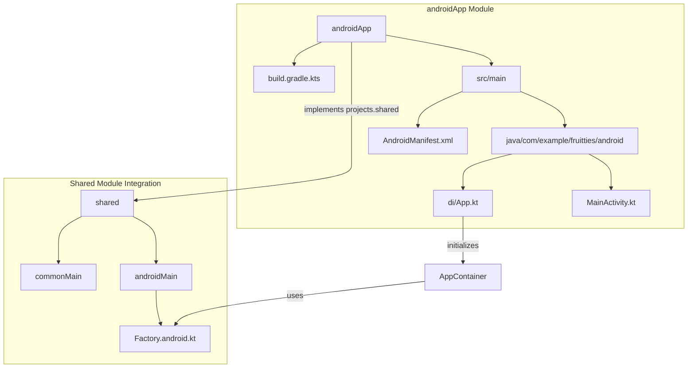
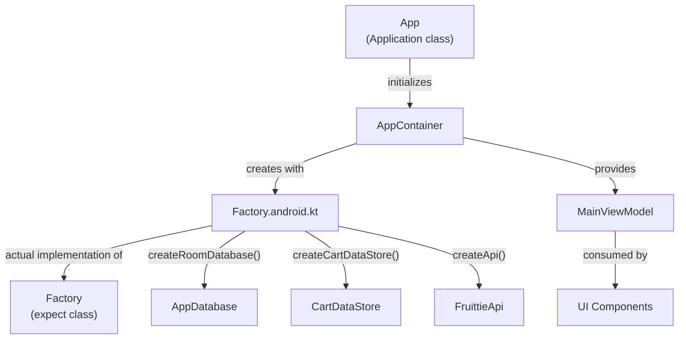

<!-- source: DeepWiki mcp.deepwiki.com · repo android/kotlin-multiplatform-samples · page 5 Android Implementation · fetched 2026-10-23 -->

# Android Implementation

<details>
<summary>Relevant source files</summary>

The following files were used as context for generating this wiki page:

- [Fruitties/androidApp/build.gradle.kts](Fruitties/androidApp/build.gradle.kts)
- [Fruitties/androidApp/src/main/AndroidManifest.xml](Fruitties/androidApp/src/main/AndroidManifest.xml)
- [Fruitties/androidApp/src/main/java/com/example/fruitties/android/di/App.kt](Fruitties/androidApp/src/main/java/com/example/fruitties/android/di/App.kt)
- [Fruitties/iosApp/iosApp/Info.plist](Fruitties/iosApp/iosApp/Info.plist)
- [Fruitties/shared/src/androidMain/kotlin/com/example/fruitties/di/Factory.android.kt](Fruitties/shared/src/androidMain/kotlin/com/example/fruitties/di/Factory.android.kt)

</details>


This page provides an overview of the Android-specific implementation in the Fruitties application. It covers the structure of the Android module, how it integrates with the shared Kotlin Multiplatform code, its build configuration, and key Android-specific implementations.

For detailed information about the Android UI components using Jetpack Compose, see [Android UI Components](#5.1). For specific configuration details like backup rules and platform settings, see [Android-Specific Configuration](#5.2).

## Module Structure and Integration

The Android application uses a dedicated `androidApp` module that leverages the shared code from the `shared` module. The Android module provides the platform-specific implementation and native UI using Jetpack Compose.



Sources:
- [Fruitties/androidApp/build.gradle.kts]()
- [Fruitties/androidApp/src/main/java/com/example/fruitties/android/di/App.kt]()
- [Fruitties/androidApp/src/main/AndroidManifest.xml]()

## Dependency Injection for Android

The Android application implements a dependency injection pattern to manage dependencies and connect with the shared codebase. This is primarily handled through the `App` class and the Android-specific implementation of the `Factory` class.



The dependency injection flow starts in the `App` class (which extends `Application`), initializes the `AppContainer` with the Android-specific implementation of the `Factory`, which in turn creates and provides access to all the required dependencies.

Sources:
- [Fruitties/androidApp/src/main/java/com/example/fruitties/android/di/App.kt]()
- [Fruitties/shared/src/androidMain/kotlin/com/example/fruitties/di/Factory.android.kt]()

## Android Build Configuration

The Android app is configured through its `build.gradle.kts` file, which defines essential build settings, dependencies, and plugins.

### Key Build Settings

| Setting | Value | Description |
|---------|-------|-------------|
| namespace | com.example.fruitties.android | Package namespace |
| compileSdk | 35 | Android SDK version for compilation |
| minSdk | 26 | Minimum supported Android version |
| targetSdk | 35 | Target Android SDK version |
| versionCode | 1 | App version code (for Play Store) |
| versionName | "1.0" | User-visible version name |

### Build Features and Optimizations

The Android build configuration includes:

- Jetpack Compose enabled via `buildFeatures.compose = true`
- Release build optimizations:
  - Code minification with `isMinifyEnabled = true`
  - Resource shrinking with `isShrinkResources = true`
  - ProGuard rules for code optimization

### Key Dependencies

```
dependencies {
    implementation(projects.shared)
    implementation(libs.compose.ui)
    implementation(libs.compose.ui.tooling.preview)
    implementation(libs.compose.material3)
    implementation(libs.androidx.activity.compose)
    implementation(libs.androidx.paging.compose.android)
    implementation(libs.androidx.lifecycle.viewmodel.compose)
    debugImplementation(libs.compose.ui.tooling)
}
```

Sources:
- [Fruitties/androidApp/build.gradle.kts:22-68]()
- [Fruitties/androidApp/build.gradle.kts:70-79]()

## Android-Specific Implementations

### Application Initialization

The application is initialized in the `App` class, which is specified in the `AndroidManifest.xml`:

```xml
<application
    android:allowBackup="false"
    android:fullBackupContent="@xml/full_backup_content"
    android:dataExtractionRules="@xml/data_extraction_rules"
    android:supportsRtl="true"
    android:theme="@style/AppTheme"
    android:name=".di.App">
```

The `App` class initializes the dependency container:

```kotlin
class App : Application() {
    /** AppContainer instance used by the rest of classes to obtain dependencies */
    lateinit var container: AppContainer

    override fun onCreate() {
        super.onCreate()
        container = AppContainer(Factory(this))
    }
}
```

Sources:
- [Fruitties/androidApp/src/main/AndroidManifest.xml:19-25]()
- [Fruitties/androidApp/src/main/java/com/example/fruitties/android/di/App.kt:23-31]()

### Platform-Specific Database Implementation

The Android implementation of the database uses Room with a `BundledSQLiteDriver` and configures database operations to run on the IO dispatcher:

```kotlin
actual fun createRoomDatabase(): AppDatabase {
    val dbFile = app.getDatabasePath(DB_FILE_NAME)
    return Room
        .databaseBuilder<AppDatabase>(
            context = app,
            name = dbFile.absolutePath,
        ).setDriver(BundledSQLiteDriver())
        .setQueryCoroutineContext(Dispatchers.IO)
        .build()
}
```

### Platform-Specific DataStore Implementation

The Android implementation of the CartDataStore uses the app's file system to store cart data in a JSON file:

```kotlin
actual fun createCartDataStore(): CartDataStore =
    CartDataStore {
        app.filesDir
            .resolve(
                "cart.json",
            ).absolutePath
    }
```

Sources:
- [Fruitties/shared/src/androidMain/kotlin/com/example/fruitties/di/Factory.android.kt:30-39]()
- [Fruitties/shared/src/androidMain/kotlin/com/example/fruitties/di/Factory.android.kt:41-47]()

## Android Manifest Configuration

The Android manifest defines essential app settings including:

- Internet permission: `<uses-permission android:name="android.permission.INTERNET" />`
- Main activity configuration, set as the launcher activity
- Backup rules and data extraction policies

Sources:
- [Fruitties/androidApp/src/main/AndroidManifest.xml:17-35]()

---

