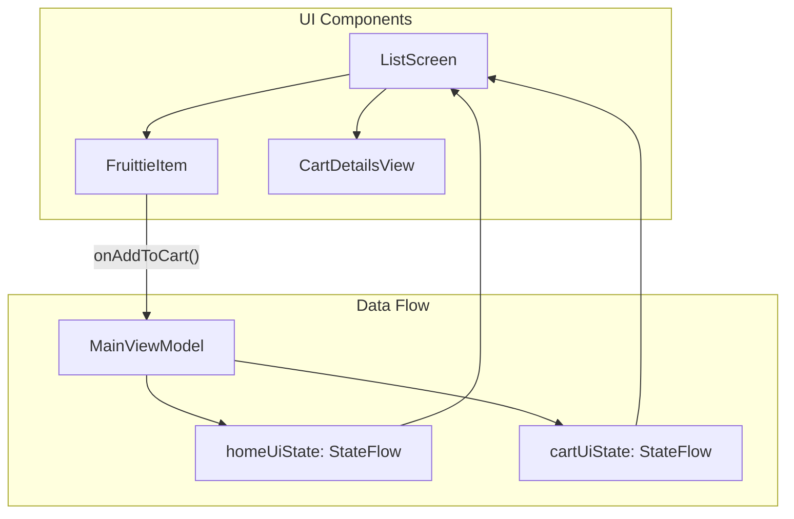
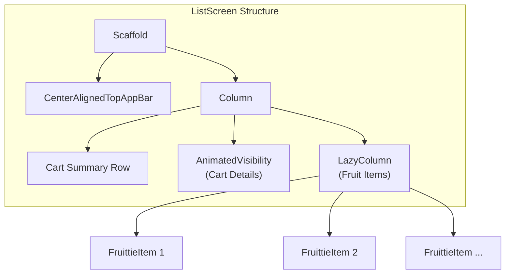
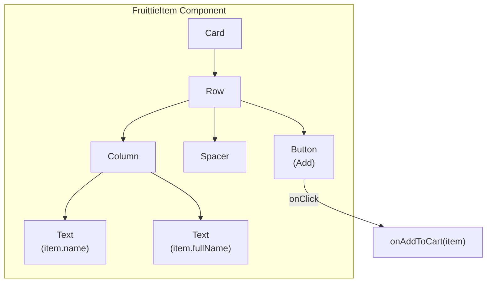
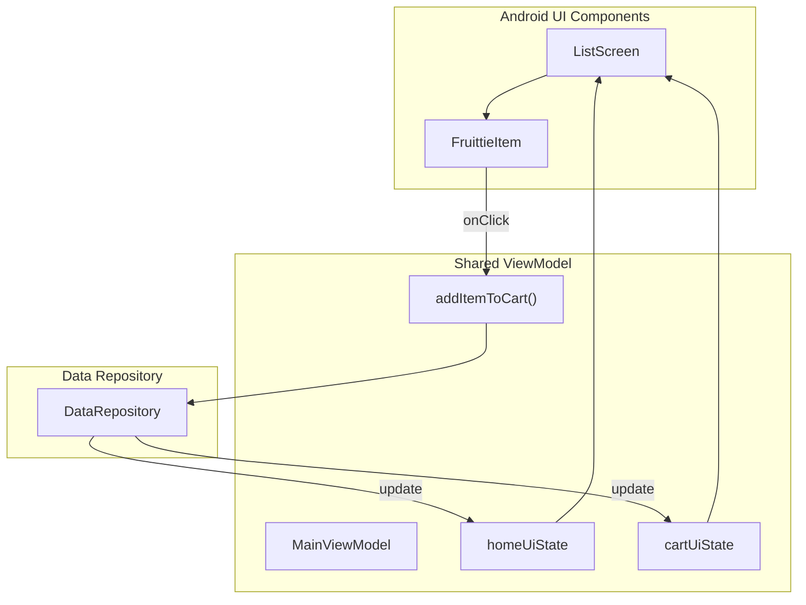

<!-- source: DeepWiki mcp.deepwiki.com · repo android/kotlin-multiplatform-samples · page 5.1 Android UI Components · fetched 2026-10-23 -->

# Android UI Components

<details>
<summary>Relevant source files</summary>

The following files were used as context for generating this wiki page:

- [Fruitties/androidApp/src/main/java/com/example/fruitties/android/ui/ListScreen.kt](Fruitties/androidApp/src/main/java/com/example/fruitties/android/ui/ListScreen.kt)

</details>


This page provides a detailed explanation of the Android UI implementation for the Fruitties application, which is built using Jetpack Compose. We'll cover the UI component structure, how UI state is managed, and how the Android-specific UI interacts with the shared ViewModel layer. For information about iOS UI implementation, see [iOS UI Components](#6.1).

## UI Architecture Overview

The Android UI is built entirely with Jetpack Compose, Google's modern declarative UI toolkit for Android. The UI follows a unidirectional data flow pattern where the ViewModel provides state that the UI observes and renders, while user interactions flow back to the ViewModel.



The UI is structured with a single main screen that contains a list of fruit items and an expandable cart section. The UI components observe state changes from the ViewModel and re-compose when updates occur.

Sources: [Fruitties/androidApp/src/main/java/com/example/fruitties/android/ui/ListScreen.kt:70-155]()

## ListScreen Component

The `ListScreen` is the top-level composable function that structures the entire UI. It contains the implementation for:

1. ViewModel initialization with dependency injection
2. Collecting UI state flows
3. Layout scaffolding with Material 3 components
4. Cart summary and expandable details
5. List of fruit items



### ViewModel Integration

The ListScreen initializes the ViewModel using Android's `viewModel()` composable, but with special configuration to make it compatible with Kotlin Multiplatform:

```kotlin
val app = LocalContext.current.applicationContext as App
val extras = remember(app) {
    val container = app.container
    MainViewModel.newCreationExtras(container)
}
val viewModel: MainViewModel = viewModel(
    factory = MainViewModel.Factory,
    extras = extras,
)
```

This approach allows the ViewModel to be instantiated with dependencies provided by the cross-platform `AppContainer`. For more details on the dependency injection system, see [Dependency Injection](#3.1).

Sources: [Fruitties/androidApp/src/main/java/com/example/fruitties/android/ui/ListScreen.kt:70-85]()

### UI State Collection

The UI uses Kotlin Flow's `collectAsState()` to observe state changes:

```kotlin
val uiState by viewModel.homeUiState.collectAsState()
val cartState by viewModel.cartUiState.collectAsState()
```

This transforms the StateFlows from the ViewModel into Compose State objects that trigger recomposition when their values change.

Sources: [Fruitties/androidApp/src/main/java/com/example/fruitties/android/ui/ListScreen.kt:87-88]()

## FruittieItem Component

The `FruittieItem` composable displays an individual fruit item as a card with:

1. The fruit's name and full name
2. An "Add" button that adds the item to the cart

The component uses Material 3 styling with cards, elevation, and typography. The implementation follows Compose best practices for creating reusable UI components.

| Parameter | Type | Description |
|-----------|------|-------------|
| `item` | `Fruittie` | The fruit item data to display |
| `onAddToCart` | `(fruittie: Fruittie) -> Unit` | Callback function when add button is clicked |
| `modifier` | `Modifier` | Optional modifier for the component |



Sources: [Fruitties/androidApp/src/main/java/com/example/fruitties/android/ui/ListScreen.kt:158-216]()

## Cart Display Components

The ListScreen includes two components related to displaying the cart:

1. **Cart Summary Row**: Shows the total number of items and a button to expand/collapse the cart details
2. **CartDetailsView**: Shows the detailed breakdown of items in the cart

### Cart Summary

The cart summary is implemented as a simple Row with a text showing the total item count and a button for toggling the expanded state.

Sources: [Fruitties/androidApp/src/main/java/com/example/fruitties/android/ui/ListScreen.kt:118-127]()

### CartDetailsView

The `CartDetailsView` composable displays the list of items in the cart with their quantities:

```kotlin
@Composable
fun CartDetailsView(
    cart: List<CartItemDetails>,
    modifier: Modifier = Modifier,
) {
    Column(
        modifier.padding(horizontal = 32.dp),
    ) {
        cart.forEach { item ->
            Text(text = "${item.fruittie.name}: ${item.count}")
        }
    }
}
```

Sources: [Fruitties/androidApp/src/main/java/com/example/fruitties/android/ui/ListScreen.kt:219-230]()

### Animation

The cart details use Compose's `AnimatedVisibility` for smooth fade-in and fade-out animations when the expanded state changes:

```kotlin
AnimatedVisibility(
    visible = expanded,
    enter = fadeIn(animationSpec = tween(1000)),
    exit = fadeOut(animationSpec = tween(1000)),
) {
    CartDetailsView(cartState.cartDetails)
}
```

This provides a polished user experience when toggling the cart details section.

Sources: [Fruitties/androidApp/src/main/java/com/example/fruitties/android/ui/ListScreen.kt:128-134]()

## Edge-to-Edge Support

The application supports edge-to-edge display, extending content to the edges of the screen while appropriately handling system insets. This is particularly important for devices with notches, punch holes, or other display cutouts.

### Window Insets Configuration

The Scaffold is configured with specific window insets to ensure proper layout:

```kotlin
contentWindowInsets = WindowInsets.safeDrawing.only(
    // Do not include Bottom so scrolled content is drawn below system bars.
    // Include Horizontal because some devices have camera cutouts on the side.
    WindowInsetsSides.Top + WindowInsetsSides.Horizontal,
),
```

Sources: [Fruitties/androidApp/src/main/java/com/example/fruitties/android/ui/ListScreen.kt:105-109]()

### Bottom Inset Handling

A spacer is added at the bottom of the LazyColumn to respect the system bars:

```kotlin
Spacer(
    Modifier.windowInsetsBottomHeight(
        WindowInsets.systemBars,
    ),
)
```

Sources: [Fruitties/androidApp/src/main/java/com/example/fruitties/android/ui/ListScreen.kt:146-150]()

## Data Flow Between UI and ViewModel

The Android UI components interact with the shared ViewModel, demonstrating how platform-specific UI can leverage cross-platform business logic.



This diagram illustrates:
1. The UI collects state from the ViewModel's StateFlows
2. User interactions (like adding items to cart) call ViewModel functions
3. The ViewModel updates the repository
4. State changes flow back to the UI via StateFlows

Sources: [Fruitties/androidApp/src/main/java/com/example/fruitties/android/ui/ListScreen.kt:70-155]()

## Preview Composables

The file includes a preview composable for the `FruittieItem` to facilitate UI development within Android Studio's preview pane:

```kotlin
@Preview
@Composable
fun ItemPreview() {
    FruittieItem(
        Fruittie(name = "Fruit", fullName = "Fruitus Mangorus", calories = "240"),
        onAddToCart = {},
    )
}
```

This follows Compose best practices for creating previews to visualize UI components during development.

Sources: [Fruitties/androidApp/src/main/java/com/example/fruitties/android/ui/ListScreen.kt:232-239]()

---

