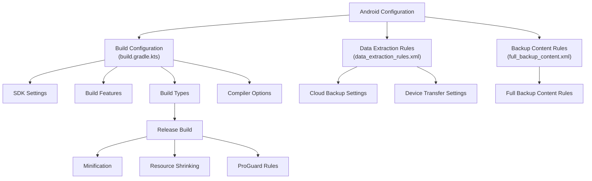
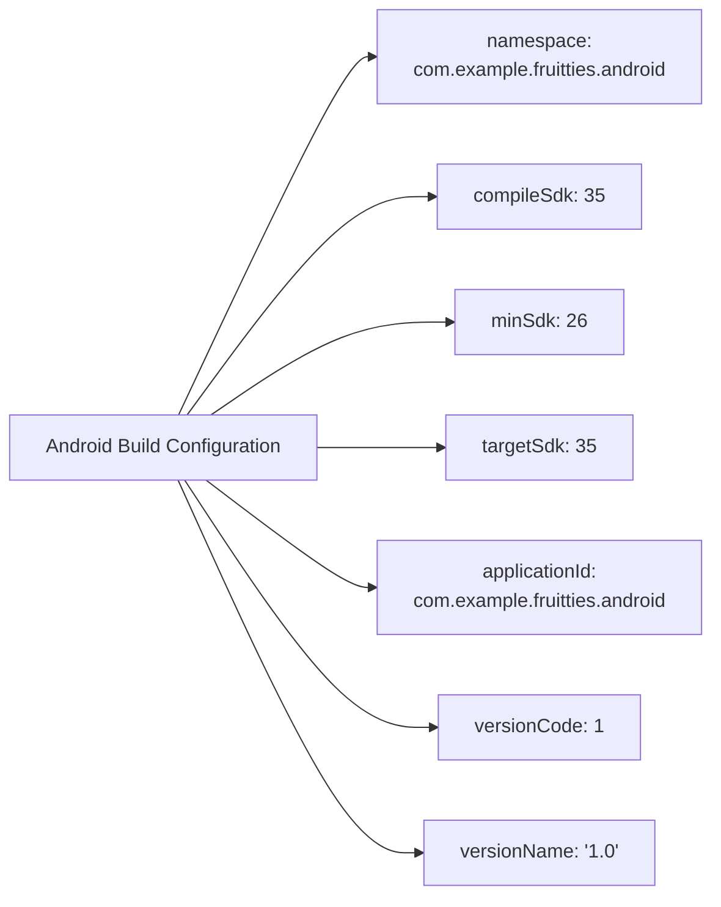
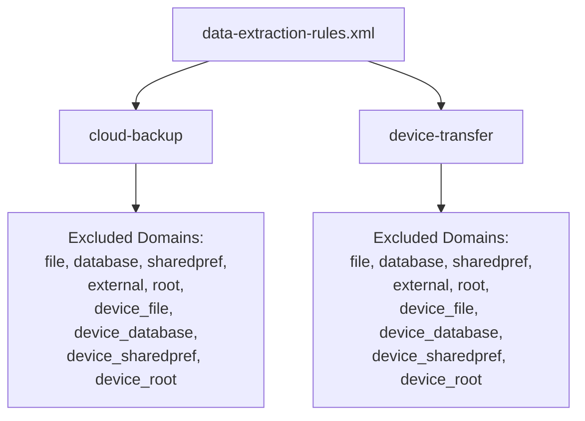
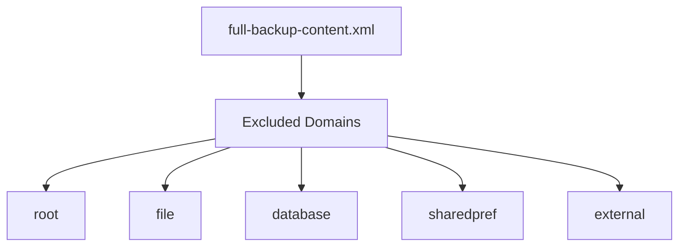
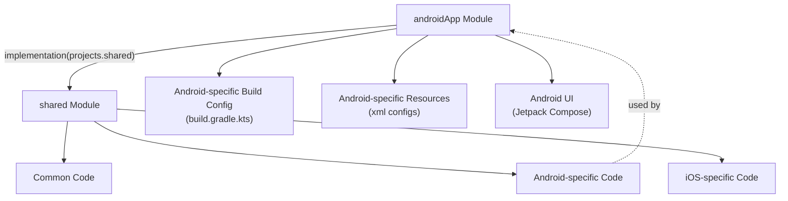

<!-- source: DeepWiki mcp.deepwiki.com · repo android/kotlin-multiplatform-samples · page 5.2 Android-Specific Configuration · fetched 2026-10-23 -->

# Android-Specific Configuration

<details>
<summary>Relevant source files</summary>

The following files were used as context for generating this wiki page:

- [Fruitties/.editorconfig](Fruitties/.editorconfig)
- [Fruitties/androidApp/build.gradle.kts](Fruitties/androidApp/build.gradle.kts)
- [Fruitties/androidApp/src/main/res/xml/data_extraction_rules.xml](Fruitties/androidApp/src/main/res/xml/data_extraction_rules.xml)
- [Fruitties/androidApp/src/main/res/xml/full_backup_content.xml](Fruitties/androidApp/src/main/res/xml/full_backup_content.xml)

</details>


This document covers the Android-specific configuration aspects of the Fruitties Kotlin Multiplatform sample application. It focuses on platform-specific build settings, data backup configurations, and optimization settings that are exclusive to the Android implementation. For information about the Android UI components and implementation, see [Android UI Components](#5.1).

## Overview of Android Configuration Components

The Android configuration in this Kotlin Multiplatform project consists of several key elements that define how the application behaves on Android devices, how it's built, and how it manages data.



Sources: [Fruitties/androidApp/build.gradle.kts](), [Fruitties/androidApp/src/main/res/xml/data_extraction_rules.xml](), [Fruitties/androidApp/src/main/res/xml/full_backup_content.xml]()

## Build Configuration

The Android build configuration is defined in the build.gradle.kts file in the androidApp module. This file specifies essential settings for the Android application.

### Basic Configuration

The basic Android configuration includes the application namespace, SDK versions, and application ID:



Sources: [Fruitties/androidApp/build.gradle.kts:22-31]()

The build configuration defines:
- Namespace and application ID that uniquely identify the app on the Play Store
- SDK compatibility parameters (minimum, target, and compile SDK versions)
- Application version information

### Compose Configuration and Dependencies

Jetpack Compose is enabled through the build features configuration:

```kotlin
buildFeatures {
    compose = true
}
```

The application includes several Compose-related dependencies:

| Dependency | Purpose |
|------------|---------|
| `compose.ui` | Core UI toolkit |
| `compose.ui.tooling.preview` | Preview support for Compose |
| `compose.material3` | Material 3 design components |
| `androidx.activity.compose` | Compose integration with activities |
| `androidx.paging.compose.android` | Paging support for Compose |
| `androidx.lifecycle.viewmodel.compose` | ViewModel integration with Compose |

Sources: [Fruitties/androidApp/build.gradle.kts:32-34](), [Fruitties/androidApp/build.gradle.kts:70-79]()

## Build Types Configuration

The build.gradle.kts file defines specific configurations for release builds that optimize the application size and performance.

### Release Build Optimization

The release build is configured with:

1. **Code Minification**: Reduces code size by removing unused code and shortening names
   ```kotlin
   isMinifyEnabled = true
   ```

2. **Resource Shrinking**: Removes unused resources
   ```kotlin
   isShrinkResources = true
   ```

3. **ProGuard Rules**: Applies code obfuscation and optimization rules
   ```kotlin
   proguardFiles(
       getDefaultProguardFile("proguard-android-optimize.txt"),
       "proguard-rules.pro"
   )
   ```

Sources: [Fruitties/androidApp/build.gradle.kts:40-59]()

## Data Backup and Extraction Rules

Android applications can specify how their data is handled during device backups and transfers. The Fruitties app uses XML configuration files to control this behavior.

### Data Extraction Rules

The `data_extraction_rules.xml` file configures what app data is included in cloud backups and device transfers. In the Fruitties application, all data domains are excluded from both cloud backups and device transfers:



Sources: [Fruitties/androidApp/src/main/res/xml/data_extraction_rules.xml]()

### Full Backup Content

The `full_backup_content.xml` file defines what data is included in full device backups:



In the Fruitties app, all data domains are excluded from full backups, preventing any app data from being included in device backups.

Sources: [Fruitties/androidApp/src/main/res/xml/full_backup_content.xml]()

## Packaging Configuration

The build.gradle.kts file includes packaging rules that exclude certain files from the final application bundle:

```kotlin
packaging {
    resources {
        excludes += "/META-INF/{AL2.0,LGPL2.1}"
    }
}
```

This configuration excludes license files from META-INF to reduce the APK size.

Sources: [Fruitties/androidApp/build.gradle.kts:35-39]()

## Compiler and JVM Settings

The Android application uses specific compiler and JVM settings:

```kotlin
compileOptions {
    sourceCompatibility = JavaVersion.VERSION_1_8
    targetCompatibility = JavaVersion.VERSION_1_8
}
kotlinOptions {
    jvmTarget = "1.8"
}
```

These settings specify that the code is compiled with Java 8 compatibility, which affects language features available in the project.

Sources: [Fruitties/androidApp/build.gradle.kts:61-67]()

## Integration with Kotlin Multiplatform

The Android configuration integrates with the shared Kotlin Multiplatform module through the `implementation(projects.shared)` dependency. This connection is fundamental to how the Android-specific implementation relates to the cross-platform code.



This diagram illustrates how the Android app module depends on the shared module, which contains both common and platform-specific code. The Android configuration settings apply to the Android app module and affect how the shared code is integrated into the final application.

Sources: [Fruitties/androidApp/build.gradle.kts:71]()

## Gradle Plugins

The Android application uses several Gradle plugins to enable specific features:

```kotlin
plugins {
    alias(libs.plugins.androidApplication)
    alias(libs.plugins.kotlinAndroid)
    alias(libs.plugins.compose.compiler)
}
```

These plugins provide:
- Android application build capabilities
- Kotlin language support for Android
- Jetpack Compose compiler optimizations

Sources: [Fruitties/androidApp/build.gradle.kts:16-20]()

The configuration uses Gradle's version catalog system (referenced by `libs.plugins`) for centralized dependency management, aligning with modern Android development practices.

---

