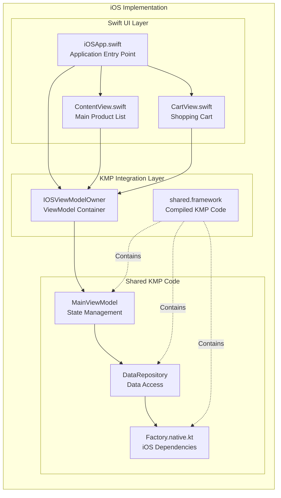
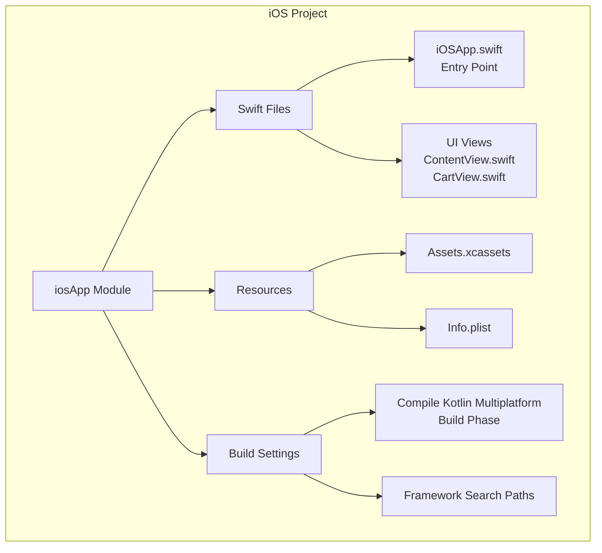
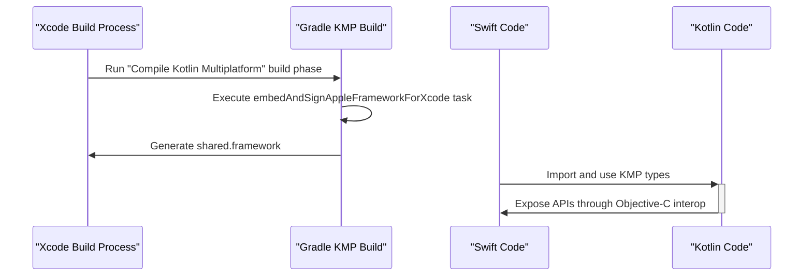
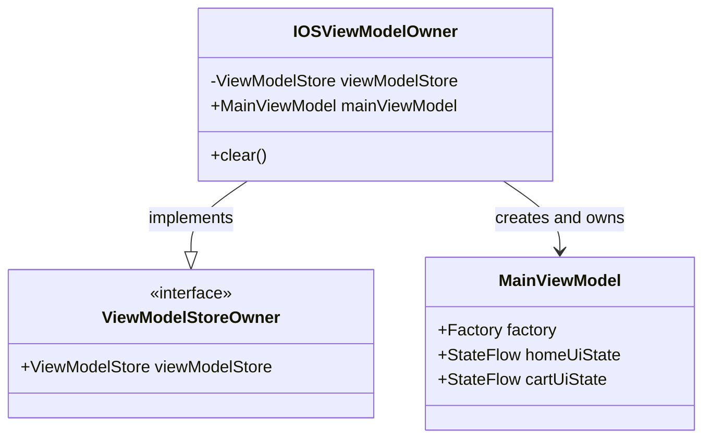
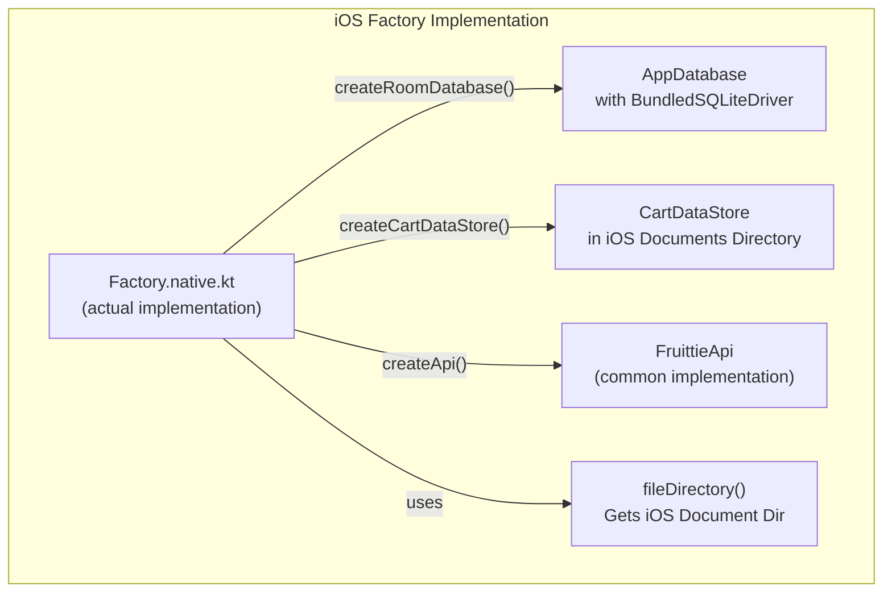
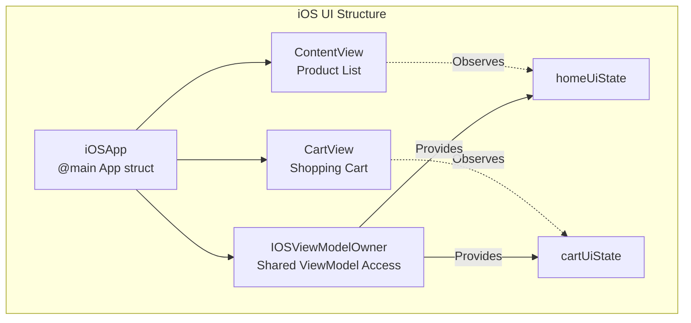

<!-- source: DeepWiki mcp.deepwiki.com · repo android/kotlin-multiplatform-samples · page 6 iOS Implementation · fetched 2026-10-23 -->

# iOS Implementation

<details>
<summary>Relevant source files</summary>

The following files were used as context for generating this wiki page:

- [Fruitties/iosApp/iosApp.xcodeproj/project.pbxproj](Fruitties/iosApp/iosApp.xcodeproj/project.pbxproj)
- [Fruitties/shared/src/iosMain/kotlin/com/example/fruitties/di/Factory.native.kt](Fruitties/shared/src/iosMain/kotlin/com/example/fruitties/di/Factory.native.kt)
- [Fruitties/shared/src/iosMain/kotlin/com/example/fruitties/di/viewmodel/IOSViewModelOwner.kt](Fruitties/shared/src/iosMain/kotlin/com/example/fruitties/di/viewmodel/IOSViewModelOwner.kt)

</details>


This page documents the iOS-specific implementation details of the Fruitties application. It covers how the iOS app integrates with the shared Kotlin Multiplatform code, the iOS project structure, and the SwiftUI implementation. For information about the Android implementation, see [Android Implementation](#5).

## iOS Architecture Overview

The iOS implementation of the Fruitties application leverages SwiftUI for the user interface while using Kotlin Multiplatform for shared business logic, data access, and state management. The architecture follows a pattern where ViewModels are implemented in Kotlin and exposed to Swift through an interoperability layer.



Sources: [shared/src/iosMain/kotlin/com/example/fruitties/di/viewmodel/IOSViewModelOwner.kt:1-34](), [shared/src/iosMain/kotlin/com/example/fruitties/di/Factory.native.kt:1-61](), [iosApp/iosApp.xcodeproj/project.pbxproj:12-14]()

## iOS Project Structure

The iOS application is structured as a standard SwiftUI application with additional components to integrate with the Kotlin Multiplatform shared code.



The iOS app consists of:

1. **Swift UI Files**:
   - `iOSApp.swift`: Application entry point
   - `ContentView.swift`: Main product list screen
   - `CartView.swift`: Shopping cart screen

2. **Build Configuration**:
   - A custom build phase that compiles the Kotlin Multiplatform code
   - Framework search paths configured to find the generated shared framework

Sources: [iosApp/iosApp.xcodeproj/project.pbxproj:76-88](), [iosApp/iosApp.xcodeproj/project.pbxproj:163-181]()

## KMP Integration with iOS

The integration between Kotlin Multiplatform and iOS involves several key components:

### Build Process



The Kotlin Multiplatform code is compiled into a native framework (`shared.framework`) that can be consumed by the Swift code. This process happens through a dedicated build phase in the Xcode project:

```
cd "$SRCROOT/.."
./gradlew :shared:embedAndSignAppleFrameworkForXcode
```

This build phase runs the Gradle task that compiles and packages the Kotlin code for iOS use.

Sources: [iosApp/iosApp.xcodeproj/project.pbxproj:163-181](), [iosApp/iosApp.xcodeproj/project.pbxproj:321-335]()

### ViewModel Integration

The `IOSViewModelOwner` class serves as a bridge between the Kotlin ViewModels and the Swift UI. It:

1. Creates and manages a `ViewModelStore` for iOS
2. Provides access to ViewModels created in Kotlin
3. Handles lifecycle management for the ViewModels



The `IOSViewModelOwner` implements `ViewModelStoreOwner` to provide a consistent ViewModel lifecycle approach across Android and iOS.

Sources: [shared/src/iosMain/kotlin/com/example/fruitties/di/viewmodel/IOSViewModelOwner.kt:9-34]()

## iOS-Specific Factory Implementation

The Kotlin Multiplatform architecture uses the Factory pattern with `expect/actual` declarations to provide platform-specific implementations. For iOS, the `Factory.native.kt` provides iOS-specific implementations:

1. **Database**: Creates a Room database using `BundledSQLiteDriver` specific to iOS
2. **CartDataStore**: Configures storage in the iOS documents directory
3. **API**: Reuses the common API implementation



The iOS-specific Factory handles platform differences like file system access, database drivers, and threading.

Sources: [shared/src/iosMain/kotlin/com/example/fruitties/di/Factory.native.kt:32-61]()

## iOS Data Management

The iOS implementation maintains consistent data access patterns with Android through the shared code:

| Component | Purpose | Implementation |
|-----------|---------|----------------|
| Room Database | Local data storage | Uses `BundledSQLiteDriver` specific to iOS |
| CartDataStore | Shopping cart persistence | Stores in iOS documents directory |
| ViewModel | UI state management | Shared Kotlin implementation exposed to Swift |

This ensures that data access logic remains consistent across platforms while accommodating iOS-specific requirements.

Sources: [shared/src/iosMain/kotlin/com/example/fruitties/di/Factory.native.kt:33-61]()

## iOS UI Implementation

The iOS app uses SwiftUI for its user interface:

1. **iOSApp.swift**: The main app entry point that initializes the `IOSViewModelOwner`
2. **ContentView.swift**: Displays the main product list and observes the `homeUiState` from the shared ViewModel
3. **CartView.swift**: Shows the shopping cart and observes the `cartUiState` from the shared ViewModel

The UI implementation follows SwiftUI conventions while leveraging shared state management from Kotlin Multiplatform.



Sources: [iosApp/iosApp.xcodeproj/project.pbxproj:12-14](), [iosApp/iosApp.xcodeproj/project.pbxproj:79-84]()

## iOS Build Configuration

The iOS project includes specific configuration to integrate with Kotlin Multiplatform:

1. **Framework Search Paths**: Configured to look for the shared framework in the KMP build output directory:
   ```
   $(SRCROOT)/../shared/build/xcode-frameworks/$(CONFIGURATION)/$(SDK_NAME)
   ```

2. **Linked Frameworks**: The build settings specify to link against the `shared` framework:
   ```
   -framework shared
   ```

3. **Deployment Target**: iOS 17.0 is set as the minimum deployment target

These configurations ensure the iOS app can properly integrate and use the shared Kotlin code.

Sources: [iosApp/iosApp.xcodeproj/project.pbxproj:321-335](), [iosApp/iosApp.xcodeproj/project.pbxproj:326]()

## Conclusion

The iOS implementation of the Fruitties application demonstrates how to effectively leverage Kotlin Multiplatform for business logic while maintaining a native iOS UI experience with SwiftUI. The architecture separates UI concerns from business logic, allowing for code sharing while preserving platform-specific UI design patterns.

For more information about the iOS UI components specifically, see [iOS UI Components](#6.1).

---

