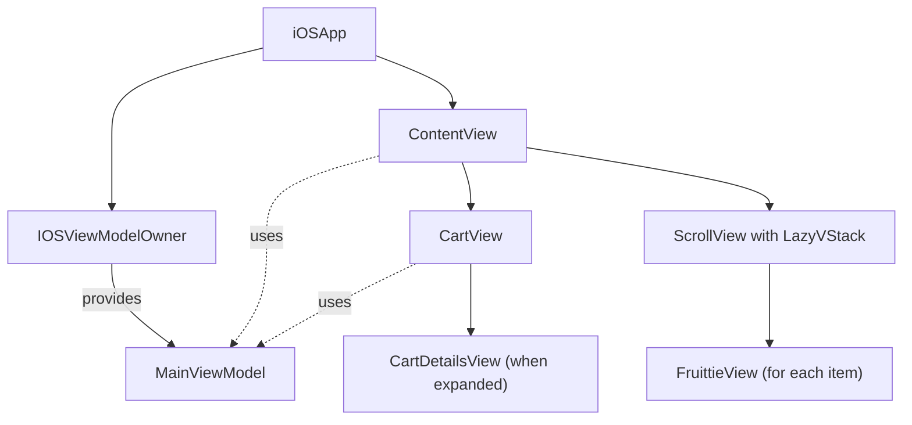
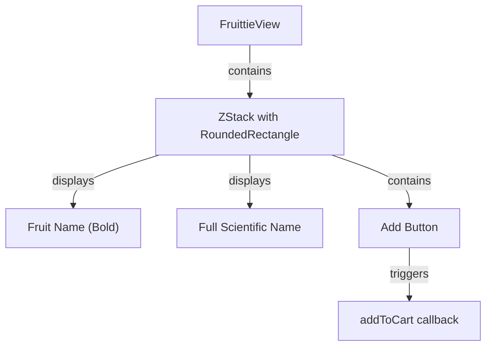
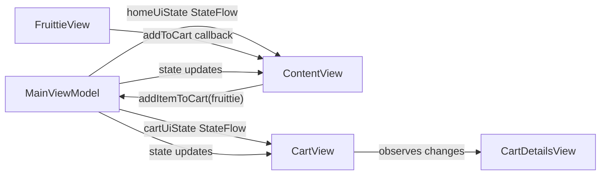
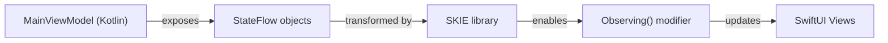

<!-- source: DeepWiki mcp.deepwiki.com · repo android/kotlin-multiplatform-samples · page 6.1 iOS UI Components · fetched 2026-10-23 -->

# iOS UI Components

<details>
<summary>Relevant source files</summary>

The following files were used as context for generating this wiki page:

- [Fruitties/androidApp/src/main/java/com/example/fruitties/android/MainActivity.kt](Fruitties/androidApp/src/main/java/com/example/fruitties/android/MainActivity.kt)
- [Fruitties/iosApp/iosApp/CartView.swift](Fruitties/iosApp/iosApp/CartView.swift)
- [Fruitties/iosApp/iosApp/ContentView.swift](Fruitties/iosApp/iosApp/ContentView.swift)
- [Fruitties/iosApp/iosApp/iOSApp.swift](Fruitties/iosApp/iosApp/iOSApp.swift)

</details>


This document provides a detailed overview of the iOS UI implementation in the Fruitties application. It covers the SwiftUI components, their hierarchy, and how they integrate with the shared Kotlin code through the SKIE library. For information about the Android UI implementation, see [Android UI Components](#5.1).

## Overview

The iOS user interface is built with SwiftUI and follows the MVVM (Model-View-ViewModel) architecture where:
- The ViewModel (`MainViewModel`) is shared Kotlin code 
- The Views are implemented in SwiftUI
- SKIE library enables observation of Kotlin's StateFlow objects directly in SwiftUI

The application presents a list of fruit items that users can browse and add to their cart.

## UI Component Architecture



**iOS UI Component Hierarchy**

Sources: [iosApp/iosApp/iOSApp.swift:20-28](), [iosApp/iosApp/ContentView.swift:21-42](), [iosApp/iosApp/CartView.swift:21-54]()

## Primary UI Components

### ContentView

`ContentView` serves as the main screen of the application. It:
- Displays the application title ("Fruitties")
- Includes the cart view at the top
- Shows a scrollable list of all available fruit items
- Handles the passing of user actions to the ViewModel

The view observes the `homeUiState` StateFlow from the Kotlin ViewModel using SKIE's `Observing` modifier, which automatically updates the UI when the underlying state changes.

Sources: [iosApp/iosApp/ContentView.swift:21-42]()

### FruittieView

`FruittieView` is a reusable component that renders an individual fruit item in the list. Each item:
- Shows the fruit's name and full name in a styled container
- Provides an "Add" button that adds the item to the cart
- Uses a rounded rectangle with light blue background for visual styling



**FruittieView Structure**

Sources: [iosApp/iosApp/ContentView.swift:44-65]()

### CartView

`CartView` displays the current state of the user's shopping cart:
- Shows the total number of items in the cart
- Provides an expand/collapse button to toggle detailed view
- When expanded, displays `CartDetailsView` with itemized contents

The cart view maintains its own `expanded` state variable to track whether detailed information should be shown.

Sources: [iosApp/iosApp/CartView.swift:21-54]()

### CartDetailsView

`CartDetailsView` is rendered when the user expands the cart view and shows:
- A list of all items in the cart
- The quantity of each item

Like the other views, it observes the Kotlin StateFlow (`cartUiState`) using SKIE's `Observing` modifier.

Sources: [iosApp/iosApp/CartView.swift:56-70]()

## Data Flow Architecture



**Data Flow between ViewModel and UI Components**

The key aspects of the data flow:

1. The `MainViewModel` (Kotlin) exposes StateFlow objects:
   - `homeUiState`: Contains the list of available fruit items
   - `cartUiState`: Contains the current cart contents

2. UI components observe these flows and re-render when they change
   
3. User interactions trigger function calls on the ViewModel:
   ```swift
   self.mainViewModel.addItemToCart(fruittie: fruittie)
   ```

4. State changes in the ViewModel automatically propagate back to the UI

Sources: [iosApp/iosApp/ContentView.swift:28-40](), [iosApp/iosApp/CartView.swift:32-52]()

## SKIE Integration



**SKIE State Observation Integration**

The SKIE library provides a crucial bridge between Kotlin's reactive programming model and SwiftUI:

1. SKIE enables direct observation of Kotlin's StateFlow objects in SwiftUI
2. The `Observing` modifier wraps StateFlow observation:
   ```swift
   Observing(self.mainViewModel.homeUiState) { homeUIState in
       // UI rendering with current state
   }
   ```
3. When the observed StateFlow emits a new value, the SwiftUI view automatically re-renders

This integration allows for a seamless reactive UI experience while maintaining a clear separation between UI and business logic.

Sources: [iosApp/iosApp/ContentView.swift:28-40](), [iosApp/iosApp/CartView.swift:32-52]()

## ViewModel Initialization

The ViewModel is initialized in the application's entry point:

1. The `iOSApp` creates an `AppContainer` with a `Factory` instance
2. It creates an `IOSViewModelOwner` that manages the ViewModel lifecycle
3. The `mainViewModel` is passed to the ContentView

This setup ensures that the ViewModel is properly initialized and injected into the UI hierarchy.

Sources: [iosApp/iosApp/iOSApp.swift:20-28]()

## User Interaction Patterns

The iOS UI implementation handles user interactions through a consistent pattern:

1. **Adding to cart**:
   - User taps the "Add" button in a `FruittieView`
   - The `addToCart` callback is executed
   - An asynchronous task calls `mainViewModel.addItemToCart(fruittie: fruittie)`
   - The ViewModel updates its state
   - UI components observing the state are automatically updated

2. **Expanding/collapsing cart details**:
   - User taps the expand/collapse button in `CartView`
   - The local `expanded` state variable is toggled
   - Based on this state, the `CartDetailsView` is either shown or hidden

Sources: [iosApp/iosApp/ContentView.swift:32-36](), [iosApp/iosApp/CartView.swift:38-46]()

## Summary

The iOS UI implementation in the Fruitties application demonstrates effective integration of SwiftUI with Kotlin Multiplatform. By using SKIE to bridge the gap between Kotlin's StateFlow and SwiftUI's view system, the application achieves:

1. A native iOS UI experience using SwiftUI
2. Shared business logic through the Kotlin ViewModel
3. Reactive UI updates through StateFlow observation
4. Clean separation of concerns between UI and business logic

This approach showcases how Kotlin Multiplatform enables code sharing while maintaining platform-specific UI implementations that follow each platform's best practices and design patterns.

Sources: [iosApp/iosApp/ContentView.swift:1-65](), [iosApp/iosApp/CartView.swift:1-70](), [iosApp/iosApp/iOSApp.swift:1-28]()

---

