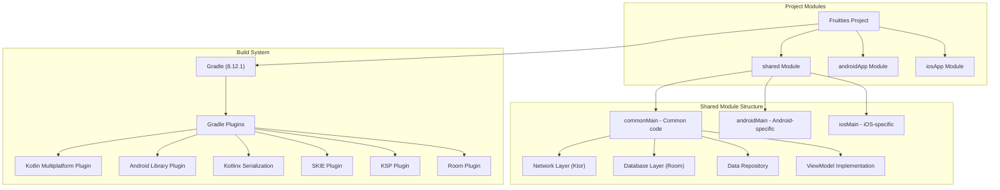
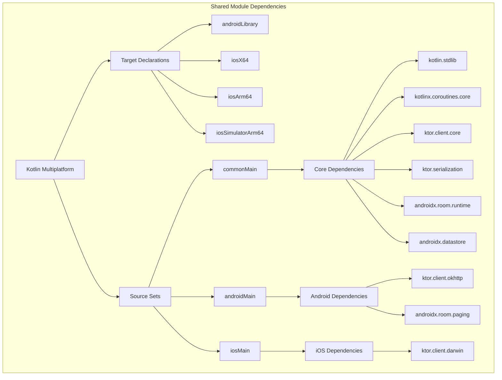
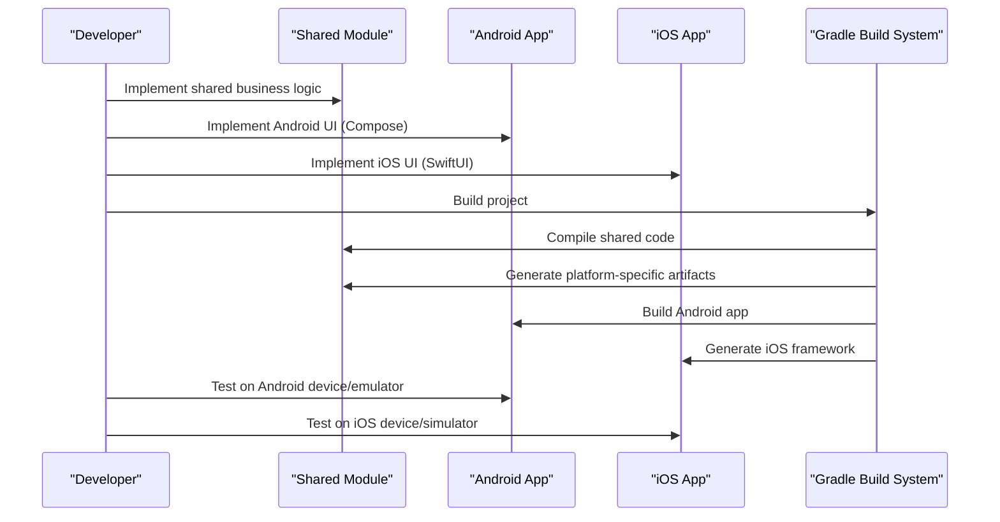

<!-- source: DeepWiki mcp.deepwiki.com · repo android/kotlin-multiplatform-samples · page 7 Development Guide · fetched 2026-10-23 -->

# Development Guide

<details>
<summary>Relevant source files</summary>

The following files were used as context for generating this wiki page:

- [Fruitties/.gitignore](Fruitties/.gitignore)
- [Fruitties/gradle/wrapper/gradle-wrapper.jar](Fruitties/gradle/wrapper/gradle-wrapper.jar)
- [Fruitties/gradle/wrapper/gradle-wrapper.properties](Fruitties/gradle/wrapper/gradle-wrapper.properties)
- [Fruitties/gradlew](Fruitties/gradlew)
- [Fruitties/gradlew.bat](Fruitties/gradlew.bat)
- [Fruitties/shared/build.gradle.kts](Fruitties/shared/build.gradle.kts)

</details>


This guide provides practical instructions for developers working with the Fruitties Kotlin Multiplatform (KMP) sample application. It covers environment setup, building and running the application on both Android and iOS platforms, and development workflows. For detailed architectural information, see [Cross-Platform Architecture](#3).

## Environment Setup

Before you begin, ensure you have the following tools installed:

| Requirement | Version | Notes |
|-------------|---------|-------|
| JDK | 11 or higher | Required for Gradle and Android development |
| Android Studio | Latest version | With Kotlin plugin installed |
| Xcode | 13 or higher | For iOS development (macOS only) |
| Gradle | 8.12.1 (bundled) | Project uses the Gradle wrapper |
| Git | Any recent version | For source control |

The project uses Gradle 8.12.1 as specified in the wrapper properties file.

Sources: [gradle/wrapper/gradle-wrapper.properties:3]()

## Project Structure Overview

The Fruitties project follows the standard KMP structure with shared code and platform-specific implementations:



Sources: [Fruitties/shared/build.gradle.kts:17-24](), [gradle/wrapper/gradle-wrapper.properties:3]()

## Building and Running the Project

### Using Gradle Wrapper

The project includes Gradle wrapper scripts that ensure everyone uses the same Gradle version:

For Unix-like systems (macOS, Linux):
```bash
./gradlew <task>
```

For Windows:
```bash
gradlew.bat <task>
```

Common tasks include:
- `build`: Build all modules
- `clean`: Clean build files
- `assemble`: Assemble outputs
- `test`: Run tests

Sources: [gradlew:1-251](), [gradlew.bat:1-94]()

### Building for Android

1. To build the Android application:
   ```bash
   ./gradlew :androidApp:assembleDebug
   ```

2. To install and run on a connected device:
   ```bash
   ./gradlew :androidApp:installDebug
   ```

3. Alternatively, open the project in Android Studio and run from the IDE.

### Building for iOS

The iOS build process requires macOS with Xcode installed.

1. To build the shared framework for iOS:
   ```bash
   ./gradlew :shared:embedAndSignAppleFrameworkForXcode
   ```

2. Open the Xcode project in the `iosApp` directory and run from there.

## Shared Module Configuration

The shared module is the heart of the KMP project, containing code that's used by both Android and iOS applications.



Key features in the shared module configuration:

1. **Target declarations**: The module targets Android library and multiple iOS architectures
2. **Source sets hierarchy**: Common code and platform-specific implementations
3. **Dependencies management**: Core dependencies for common code and platform-specific dependencies
4. **SKIE integration**: For improved Swift interoperability
5. **Room database integration**: With schema management

Sources: [Fruitties/shared/build.gradle.kts:17-157]()

### Key Plugins Used

| Plugin | Purpose |
|--------|---------|
| `kotlinMultiplatform` | Enables Kotlin multiplatform capabilities |
| `androidKmpLibrary` | Configures Android library for KMP |
| `kotlinxSerialization` | Provides JSON serialization |
| `skie` | Improves Kotlin-Swift interoperability |
| `ksp` | Kotlin Symbol Processing for code generation |
| `room` | Android Room database support |

Sources: [Fruitties/shared/build.gradle.kts:17-24]()

## Development Workflow

When developing in this project, follow these patterns:



1. **Implement shared code first**: Place as much business logic, data handling, and view models in the shared module
2. **Use platform-specific code when necessary**: For native APIs or optimizations
3. **Test on both platforms**: Regularly test your changes on both Android and iOS

## Common Development Tasks

### Adding a New Dependency

To add a new dependency to the shared module:

1. Add the dependency to the appropriate source set in `shared/build.gradle.kts`:
   ```kotlin
   commonMain {
       dependencies {
           implementation("your.new:dependency:1.0.0")
       }
   }
   ```

2. If the dependency has platform-specific implementations, add them to the relevant source sets:
   ```kotlin
   androidMain {
       dependencies {
           implementation("your.new:dependency-android:1.0.0")
       }
   }
   
   iosMain {
       dependencies {
           implementation("your.new:dependency-ios:1.0.0")
       }
   }
   ```

### Working with Platform-Specific Code

The project uses Kotlin's `expect/actual` pattern for platform-specific implementations:

1. Define an interface or expected declaration in common code
2. Provide actual implementations in platform-specific source sets
3. Example from the project: `Factory` class that creates platform-specific implementations

## Troubleshooting

### Common Issues

| Issue | Solution |
|-------|----------|
| Gradle sync fails | Try `./gradlew clean` and restart Android Studio |
| iOS build errors | Ensure XCode Command Line Tools are installed |
| "Kotlin not configured" error | Verify Kotlin plugin is installed and enabled |
| Room compile errors | Check KSP configuration and Room annotations |
| SKIE errors | Check SKIE plugin version compatibility |

### Cleaning the Project

To fully clean the project:

1. Run `./gradlew clean`
2. Delete `.idea` folder (if using IntelliJ/Android Studio)
3. Delete `.gradle` cache if necessary
4. For iOS, clean the Xcode build folder

Sources: [Fruitties/.gitignore:1-12]()

## Additional Resources

For more detailed information about specific components:

- For detailed build configuration, see [Build Configuration](#2.1)
- For dependency management, see [Dependency Management](#2.2)
- For the CI/CD pipeline, see [CI/CD Pipeline](#2.3)
- For detailed instructions on building and running, see [Building and Running](#7.1)

---

