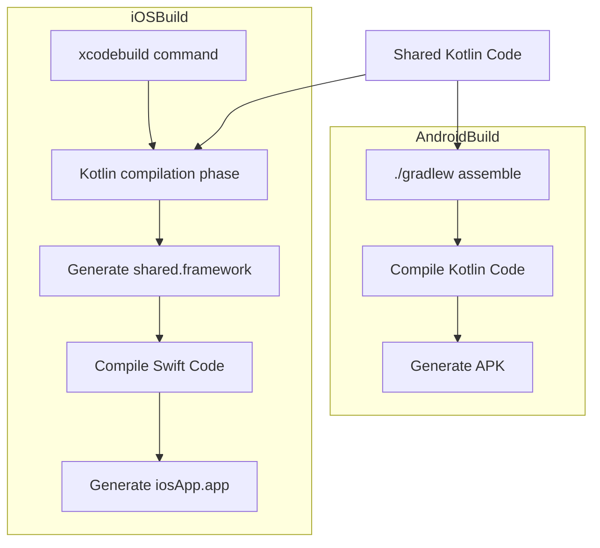
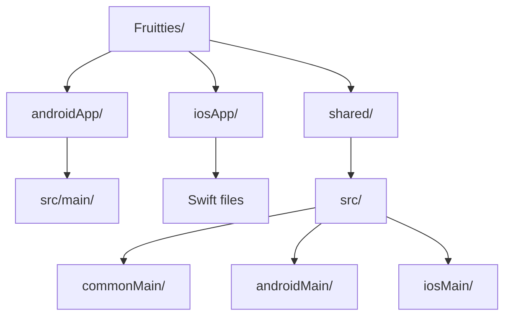

<!-- source: DeepWiki mcp.deepwiki.com · repo android/kotlin-multiplatform-samples · page 7.1 Building and Running · fetched 2026-10-23 -->

# Building and Running

<details>
<summary>Relevant source files</summary>

The following files were used as context for generating this wiki page:

- [.github/workflows/Fruitties.yaml](.github/workflows/Fruitties.yaml)
- [Fruitties/.gitignore](Fruitties/.gitignore)
- [Fruitties/gradle/wrapper/gradle-wrapper.jar](Fruitties/gradle/wrapper/gradle-wrapper.jar)
- [Fruitties/gradlew](Fruitties/gradlew)
- [Fruitties/gradlew.bat](Fruitties/gradlew.bat)
- [Fruitties/iosApp/Podfile](Fruitties/iosApp/Podfile)
- [Fruitties/iosApp/iosApp.xcodeproj/project.pbxproj](Fruitties/iosApp/iosApp.xcodeproj/project.pbxproj)

</details>


This document provides detailed instructions for building and running the Fruitties application on both Android and iOS platforms. The Fruitties app is built using Kotlin Multiplatform, which allows code sharing across platforms while maintaining native UI experiences on each platform.

## Prerequisites

Before building the Fruitties application, you need to have the following tools installed:

### For Android Development
- JDK 17 or newer
- Android Studio
- Android SDK with appropriate build tools

### For iOS Development
- macOS operating system
- Xcode (compatible with iOS 17.0 deployment target)
- JDK 17 (required for compiling shared Kotlin code)

Sources: [.github/workflows/Fruitties.yaml:25-29](), [.github/workflows/Fruitties.yaml:49-53](), [Fruitties/iosApp/iosApp.xcodeproj/project.pbxproj:326]()

## Building and Running on Android

### Using Android Studio

1. Open Android Studio
2. Select "Open an existing Android Studio project"
3. Navigate to the Fruitties project root directory and click "Open"
4. Wait for the Gradle sync to complete
5. Select the "androidApp" run configuration from the dropdown menu
6. Click the Run button or press Shift+F10

### Using Command Line

1. Navigate to the Fruitties project root directory in your terminal
2. Run the following command to build the Android app:
   ```
   ./gradlew assemble --stacktrace
   ```
3. The built APK will be located in `androidApp/build/outputs/apk/`
4. To install and run on a connected device or emulator:
   ```
   ./gradlew installDebug
   ```

Sources: [.github/workflows/Fruitties.yaml:32-33](), [Fruitties/gradlew:1-251]()

## Building and Running on iOS

### Using Xcode

1. Open the Xcode project:
   ```
   open Fruitties/iosApp/iosApp.xcodeproj
   ```
2. Select your target device or simulator
3. Click the Run button or press Cmd+R

Note: Xcode will automatically compile the shared Kotlin code as part of the build process. This is configured as a build phase in the project file.

### Using Command Line

1. Navigate to the Fruitties project root directory in your terminal
2. Build the iOS app using xcodebuild:
   ```
   xcodebuild -project iosApp/iosApp.xcodeproj -configuration Debug -scheme iosApp -sdk iphonesimulator
   ```

Sources: [.github/workflows/Fruitties.yaml:56-57](), [Fruitties/iosApp/iosApp.xcodeproj/project.pbxproj:163-181]()

## Build Process Overview

### Build Process Flow Diagram



The build process for Fruitties involves first compiling the shared Kotlin code and then building the platform-specific applications. For Android, the Gradle build system handles both the Kotlin compilation and APK generation. For iOS, the Xcode build process includes a custom phase that runs Gradle to compile the Kotlin code before building the Swift UI components.

Sources: [.github/workflows/Fruitties.yaml:32-33](), [.github/workflows/Fruitties.yaml:56-57](), [Fruitties/iosApp/iosApp.xcodeproj/project.pbxproj:163-181]()

## Project Structure and Build Artifacts

### Project Structure Diagram



- **androidApp**: Contains Android-specific implementation using Jetpack Compose
- **iosApp**: Contains iOS-specific implementation using SwiftUI
- **shared**: Contains common Kotlin code and platform-specific implementations
  - **commonMain**: Platform-independent code shared by both Android and iOS
  - **androidMain**: Android-specific implementations of shared interfaces
  - **iosMain**: iOS-specific implementations of shared interfaces

## Continuous Integration

The Fruitties project uses GitHub Actions for continuous integration. The CI workflow builds both Android and iOS applications to ensure changes don't break either platform. The workflow runs these commands:

- For Android: `./gradlew assemble --stacktrace`
- For iOS: `xcodebuild -project iosApp/iosApp.xcodeproj -configuration Debug -scheme iosApp -sdk iphonesimulator`

Sources: [.github/workflows/Fruitties.yaml:15-57]()

## Common Build Issues and Troubleshooting

### Android Build Issues

- **Gradle Sync Failed**: Ensure you have JDK 17 installed and correctly configured in Android Studio.
- **Missing Android SDK Components**: Use the Android SDK Manager to install any missing components.
- **Gradle Wrapper Permission Issues**: On Unix-based systems, you may need to make the Gradle wrapper executable: `chmod +x ./gradlew`

### iOS Build Issues

- **Missing Kotlin Framework**: If building manually and encountering errors about missing Kotlin framework, ensure the Kotlin compilation step has been performed: `./gradlew :shared:embedAndSignAppleFrameworkForXcode`
- **Xcode Build Errors**: Make sure you have the latest Xcode command-line tools installed: `xcode-select --install`
- **Framework Search Path Issues**: Verify the framework search paths in the Xcode project settings match the output path of the Kotlin framework

Sources: [Fruitties/iosApp/iosApp.xcodeproj/project.pbxproj:163-181](), [Fruitties/iosApp/iosApp.xcodeproj/project.pbxproj:321-324]()

## Clean Build

If you encounter mysterious build issues, performing a clean build often helps:

- For Android: `./gradlew clean assemble`
- For iOS: First clean the Kotlin build with `./gradlew clean`, then clean the Xcode project with `xcodebuild -project iosApp/iosApp.xcodeproj -scheme iosApp clean`

## Additional Resources

- For more information about the project structure, see [Project Structure](#2).
- For details about the cross-platform architecture, see [Cross-Platform Architecture](#3).
- For information about dependency management, see [Dependency Management](#2.2).