# Page: Overview

# Overview

<details>
<summary>Relevant source files</summary>

The following files were used as context for generating this wiki page:

- [Fruitties/androidApp/src/main/java/com/example/fruitties/android/MainActivity.kt](Fruitties/androidApp/src/main/java/com/example/fruitties/android/MainActivity.kt)
- [Fruitties/androidApp/src/main/java/com/example/fruitties/android/ui/ListScreen.kt](Fruitties/androidApp/src/main/java/com/example/fruitties/android/ui/ListScreen.kt)
- [Fruitties/iosApp/iosApp/iOSApp.swift](Fruitties/iosApp/iosApp/iOSApp.swift)
- [Fruitties/shared/build.gradle.kts](Fruitties/shared/build.gradle.kts)

</details>


This page provides an introduction to the "Fruitties" sample application, which demonstrates how to build cross-platform mobile applications using Kotlin Multiplatform (KMP). This document covers the high-level architecture, key technologies, and fundamental patterns used in the application.

For detailed information about the project structure, see [Project Structure](#2). For specifics on cross-platform architecture, see [Cross-Platform Architecture](#3).

## What is Fruitties?

Fruitties is a sample application that showcases a shared codebase between Android and iOS platforms while maintaining platform-specific UI implementations. It demonstrates a simple e-commerce application for fruit products with features including:

1. Displaying a list of fruit products
2. Adding items to a shopping cart
3. Viewing cart contents

The application serves as a reference implementation for Kotlin Multiplatform development practices, providing a real-world example of how to structure a cross-platform project.

## High-Level Architecture

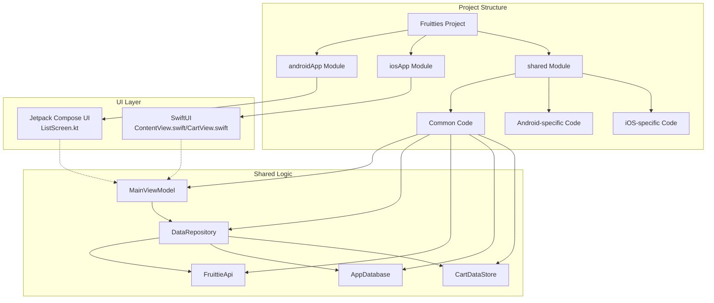

Sources: [Fruitties/shared/build.gradle.kts:17-157](), [Fruitties/androidApp/src/main/java/com/example/fruitties/android/ui/ListScreen.kt:69-155](), [Fruitties/iosApp/iosApp/iOSApp.swift:17-28]()

## Key Technologies

The Fruitties application leverages multiple technologies to enable cross-platform development:

| Technology | Purpose | Implementation |
|------------|---------|----------------|
| Kotlin Multiplatform | Code sharing between platforms | Configured in `shared` module |
| Jetpack Compose | Android UI framework | Used in `androidApp` module |
| SwiftUI | iOS UI framework | Used in `iosApp` module |
| Ktor | Networking library | Used for API requests in shared code |
| Room | Database persistence | Used for local caching in shared code |
| DataStore | Preferences storage | Used for cart state persistence |
| Kotlin Coroutines | Asynchronous programming | Used throughout the shared codebase |
| SKIE | Kotlin-Swift interoperability | Enables SwiftUI integration with Kotlin Flows |

Sources: [Fruitties/shared/build.gradle.kts:17-24](), [Fruitties/shared/build.gradle.kts:83-101](), [Fruitties/shared/build.gradle.kts:152-157]()

## Code Sharing Architecture

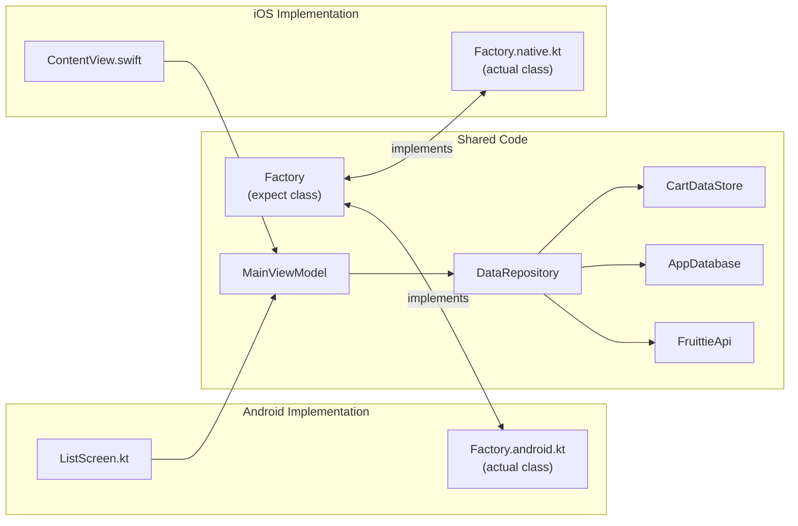

Sources: [Fruitties/androidApp/src/main/java/com/example/fruitties/android/ui/ListScreen.kt:69-85](), [Fruitties/androidApp/src/main/java/com/example/fruitties/android/MainActivity.kt:29-44](), [Fruitties/iosApp/iosApp/iOSApp.swift:19-28]()

## Data Flow

The application follows a unidirectional data flow pattern:

1. The `MainViewModel` exposes UI state as `StateFlow` objects
2. Platform-specific UIs observe these flows and render their UI accordingly
3. User interactions trigger events that are processed by the `MainViewModel`
4. The `ViewModel` updates the underlying data through the `DataRepository`
5. Changes in data trigger updates to the `StateFlow` objects, completing the cycle

On Android, this integration is achieved via Jetpack Compose's `collectAsState()` function. On iOS, SKIE enables SwiftUI to directly observe Kotlin flows.

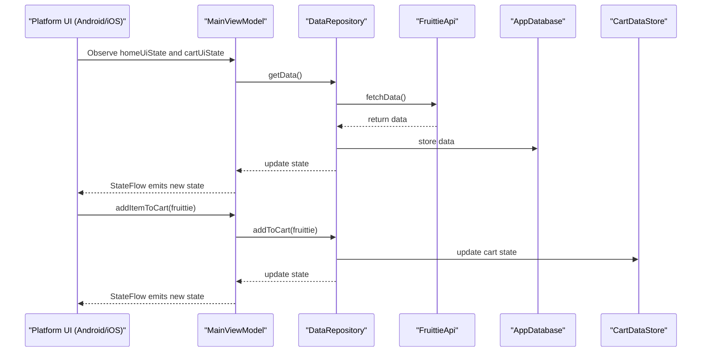

Sources: [Fruitties/androidApp/src/main/java/com/example/fruitties/android/ui/ListScreen.kt:87-88](), [Fruitties/androidApp/src/main/java/com/example/fruitties/android/ui/ListScreen.kt:158-216]()

## Platform Integration

The Fruitties application demonstrates how to integrate shared Kotlin code with platform-specific UI frameworks:

### Android Integration

The Android application uses Jetpack Compose and integrates with the shared code through the `MainViewModel`:

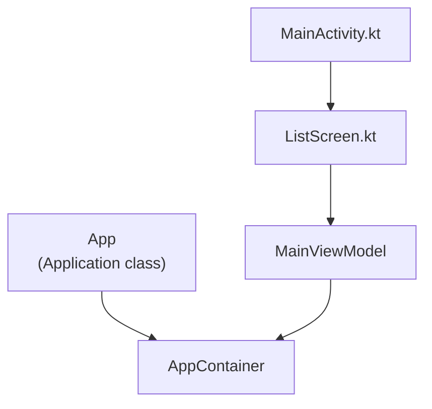

Sources: [Fruitties/androidApp/src/main/java/com/example/fruitties/android/MainActivity.kt:29-44](), [Fruitties/androidApp/src/main/java/com/example/fruitties/android/ui/ListScreen.kt:77-85]()

### iOS Integration

The iOS application uses SwiftUI and integrates with the shared code through the `IOSViewModelOwner`:

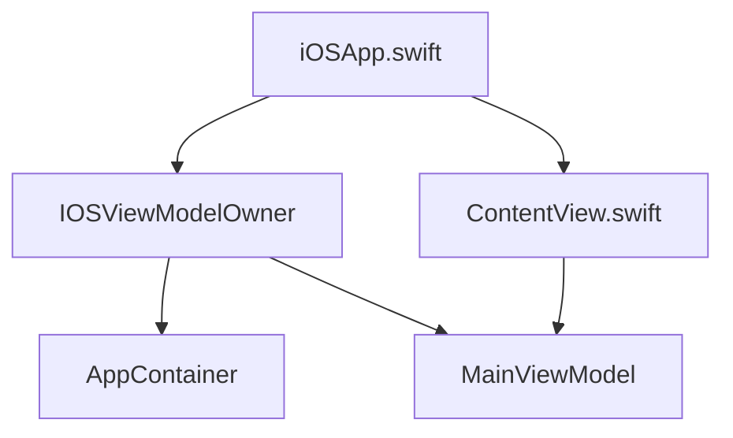

Sources: [Fruitties/iosApp/iosApp/iOSApp.swift:19-28]()

## Summary

The Fruitties application demonstrates a practical implementation of Kotlin Multiplatform for mobile app development. It showcases how to:

1. Structure a Kotlin Multiplatform project with shared and platform-specific code
2. Implement business logic once and reuse it across platforms
3. Integrate with platform-specific UI frameworks
4. Handle data flow in a consistent way across platforms
5. Use modern libraries and tools to maximize code sharing

For more detailed information about specific aspects of the application, refer to the other sections of this documentation.

---

# Page: Project Structure

# Project Structure

<details>
<summary>Relevant source files</summary>

The following files were used as context for generating this wiki page:

- [Fruitties/androidApp/build.gradle.kts](Fruitties/androidApp/build.gradle.kts)
- [Fruitties/build.gradle.kts](Fruitties/build.gradle.kts)
- [Fruitties/iosApp/iosApp.xcodeproj/project.pbxproj](Fruitties/iosApp/iosApp.xcodeproj/project.pbxproj)
- [Fruitties/shared/build.gradle.kts](Fruitties/shared/build.gradle.kts)

</details>


This document provides a detailed explanation of the Fruitties application's project structure. It covers how the codebase is organized across different modules and how these modules interact with each other. For details about the build configuration process, see [Build Configuration](#2.1).

## Overview

The Fruitties application is structured as a Kotlin Multiplatform (KMP) project with a modular architecture to maximize code sharing while accommodating platform-specific implementations for Android and iOS.

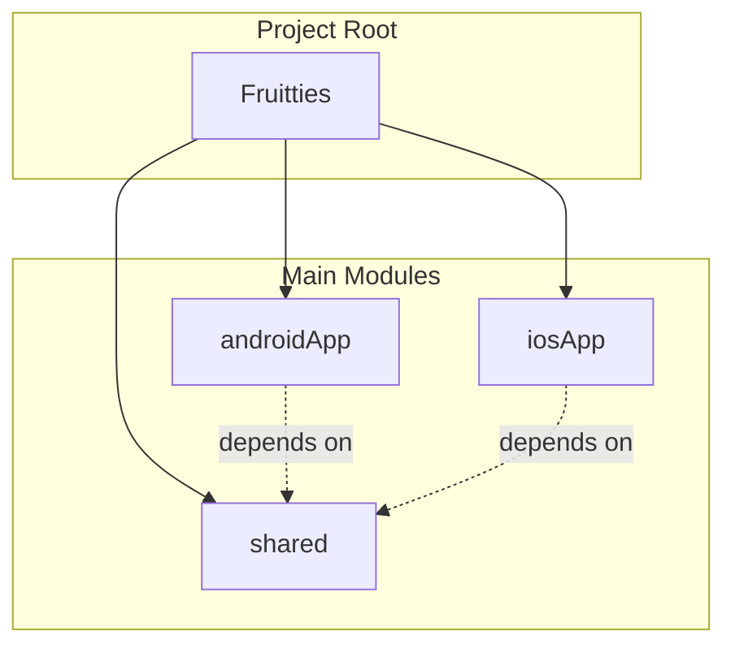

Sources: [Fruitties/build.gradle.kts:16-25]()

## Module Breakdown

### Shared Module

The shared module contains cross-platform Kotlin code that is compiled for both Android and iOS. It represents the core of the application's business logic, data handling, and state management.

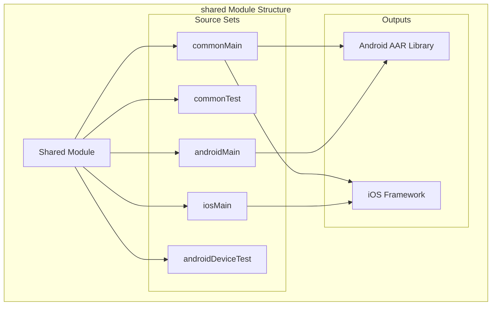

The shared module is configured with multiple Kotlin source sets:

| Source Set | Purpose | Platform |
|------------|---------|----------|
| `commonMain` | Core shared code for all platforms | All |
| `commonTest` | Test code for common functionality | All |
| `androidMain` | Android-specific implementations | Android |
| `iosMain` | iOS-specific implementations | iOS |
| `androidDeviceTest` | Instrumented tests for Android | Android |

The shared module uses the Kotlin Multiplatform plugin to target both Android and iOS platforms:

- Android is targeted via the `androidLibrary` configuration
- iOS is targeted with three architecture-specific targets:
  - `iosX64` (Intel-based iOS simulators)
  - `iosArm64` (Physical iOS devices)
  - `iosSimulatorArm64` (M1/M2 Mac simulators)

Sources: [Fruitties/shared/build.gradle.kts:17-24](), [Fruitties/shared/build.gradle.kts:26-71](), [Fruitties/shared/build.gradle.kts:73-138]()

### Android App Module

The Android app module contains the Android-specific UI implementation using Jetpack Compose and serves as the entry point for the Android application.

Key characteristics:

- Uses Jetpack Compose for UI
- Depends on the shared module for business logic
- Contains Android-specific configurations (manifest, resources, etc.)
- Implements the UI layer using Material3 components

Sources: [Fruitties/androidApp/build.gradle.kts:16-68]()

### iOS App Module

The iOS app module contains the iOS-specific UI implementation using SwiftUI and serves as the entry point for the iOS application.

Key characteristics:

- Uses SwiftUI for UI
- Links to the compiled shared module as a framework
- Contains iOS-specific resources and configurations
- Implements native iOS UI components (ContentView, CartView)

The iOS app incorporates the shared module as a framework through a custom build phase that executes the Gradle task `embedAndSignAppleFrameworkForXcode`.

Sources: [Fruitties/iosApp/iosApp.xcodeproj/project.pbxproj:163-181]()

## Inter-Module Dependencies

The dependency structure between modules shows how code and functionality flow across the project.

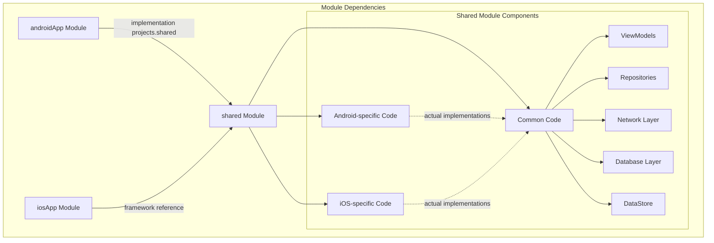

Sources: [Fruitties/androidApp/build.gradle.kts:71](), [Fruitties/iosApp/iosApp.xcodeproj/project.pbxproj:330-335]()

## Source Set Organization

The shared module uses Kotlin Multiplatform's source set hierarchy to organize code across platforms.

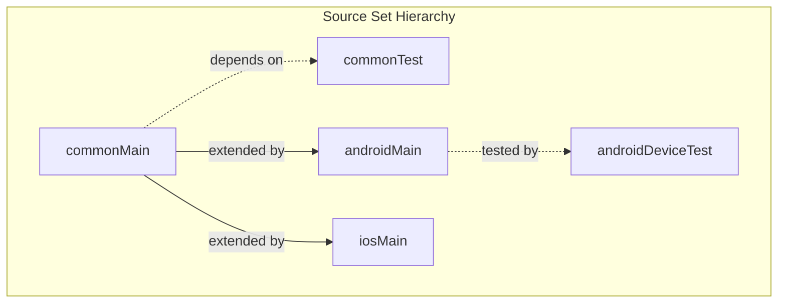

Each source set in the shared module has specific dependencies:

- **commonMain**: Core libraries used across all platforms (coroutines, ktor, etc.)
- **androidMain**: Android-specific implementations (OkHttp, Room Paging)
- **iosMain**: iOS-specific implementations (Ktor Darwin client)
- **commonTest**: Testing frameworks for common code
- **androidDeviceTest**: Android instrumentation test dependencies

Sources: [Fruitties/shared/build.gradle.kts:78-138]()

## Dependency Management

The project uses Gradle's version catalog system (via `libs.versions.toml`) to centralize dependency management. Key dependency groups include:

| Dependency Group | Used In | Purpose |
|------------------|---------|---------|
| Kotlin | All modules | Core Kotlin functionality |
| Coroutines | Shared | Asynchronous programming |
| Ktor | Shared | Networking |
| Room | Shared | Local database |
| DataStore | Shared | Preferences storage |
| Compose | Android | UI framework |
| SwiftUI | iOS | UI framework |

The shared module's dependencies are organized by source set to ensure appropriate dependencies are included for each platform.

Sources: [Fruitties/build.gradle.kts:16-25](), [Fruitties/shared/build.gradle.kts:83-137](), [Fruitties/androidApp/build.gradle.kts:70-79]()

## Build Output Structure

When built, the project produces different artifacts for each platform:

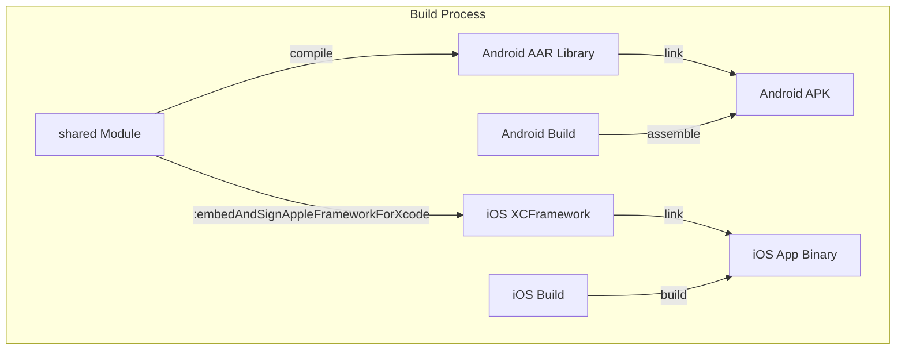

The build process creates:

1. For Android:
   - An AAR library from the shared module
   - An APK that includes the AAR library

2. For iOS:
   - An XCFramework from the shared module
   - An iOS app that embeds the XCFramework

Sources: [Fruitties/iosApp/iosApp.xcodeproj/project.pbxproj:163-181](), [Fruitties/shared/build.gradle.kts:55-71]()

## Project Files Organization

The project follows a standard directory structure:

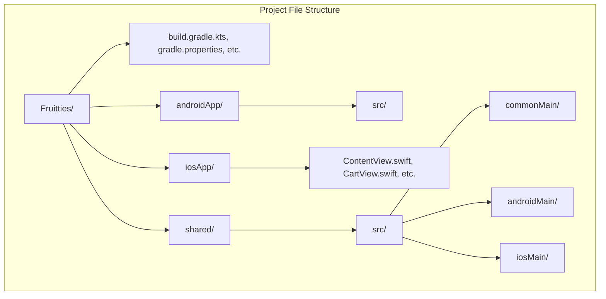

Each directory serves a specific purpose:

- **Project root**: Contains build configuration files and module directories
- **androidApp**: Android-specific code and resources
- **iosApp**: iOS-specific code and resources
- **shared**: Cross-platform Kotlin code organized by source sets

Sources: [Fruitties/iosApp/iosApp.xcodeproj/project.pbxproj:76-86](), [Fruitties/shared/build.gradle.kts:78-138]()

## Module Integration

The shared module is integrated differently into each platform:

### Android Integration

In Android, the shared module is included as a Gradle module dependency:

```
implementation(projects.shared)
```

This allows direct access to all Kotlin classes and functions from the shared module.

### iOS Integration

In iOS, the shared module is compiled into a framework and embedded into the app using a custom build phase:

```
cd "$SRCROOT/.."
./gradlew :shared:embedAndSignAppleFrameworkForXcode
```

This build phase runs during the iOS app build process to create and embed the framework with the latest shared code.

Sources: [Fruitties/androidApp/build.gradle.kts:71](), [Fruitties/iosApp/iosApp.xcodeproj/project.pbxproj:180]()

---

# Page: Build Configuration

# Build Configuration

<details>
<summary>Relevant source files</summary>

The following files were used as context for generating this wiki page:

- [Fruitties/.gitignore](Fruitties/.gitignore)
- [Fruitties/build.gradle.kts](Fruitties/build.gradle.kts)
- [Fruitties/gradle/wrapper/gradle-wrapper.jar](Fruitties/gradle/wrapper/gradle-wrapper.jar)
- [Fruitties/gradle/wrapper/gradle-wrapper.properties](Fruitties/gradle/wrapper/gradle-wrapper.properties)
- [Fruitties/gradlew](Fruitties/gradlew)
- [Fruitties/gradlew.bat](Fruitties/gradlew.bat)
- [Fruitties/shared/build.gradle.kts](Fruitties/shared/build.gradle.kts)

</details>


This page documents the build system configuration of the Fruitties project, explaining how the project is set up to support both Android and iOS platforms using Kotlin Multiplatform. It covers the Gradle configuration, target platforms setup, source set organization, and platform-specific build settings. For information about dependency management, see [Dependency Management](#2.2).

## Gradle Setup

The Fruitties project uses Gradle as its build tool, with the Gradle Wrapper ensuring consistent builds across different environments.

### Gradle Version and Wrapper

The project uses Gradle version 8.12.1, as specified in the gradle-wrapper.properties file:

```
distributionUrl=https\://services.gradle.org/distributions/gradle-8.12.1-bin.zip
```

The Gradle Wrapper scripts (`gradlew` for Unix-based systems and `gradlew.bat` for Windows) allow developers to build the project without having to install Gradle locally.

Sources: [Fruitties/gradle/wrapper/gradle-wrapper.properties:1-8](), [Fruitties/gradlew:1-251](), [Fruitties/gradlew.bat:1-94]()

## Project Structure

### Build System Architecture

The diagram below illustrates the build system architecture of the Fruitties project:

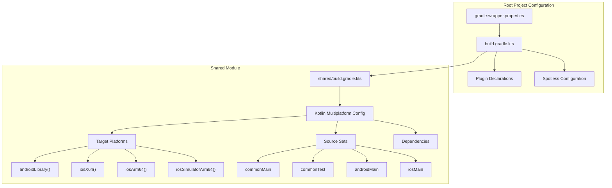

Sources: [Fruitties/build.gradle.kts:1-42](), [Fruitties/shared/build.gradle.kts:1-158]()

## Root Project Configuration

The root `build.gradle.kts` file defines the plugins used throughout the project and applies the Spotless plugin for code formatting to all subprojects.

Key plugins declared in the root build file include:

| Plugin | Purpose |
|--------|---------|
| `androidApplication` | Configures Android application builds |
| `androidLibrary` | Configures Android library builds |
| `kotlinAndroid` | Adds Kotlin support for Android |
| `kotlinMultiplatform` | Enables Kotlin Multiplatform capabilities |
| `compose.compiler` | Configures the Jetpack Compose compiler |
| `androidKmpLibrary` | Configures Android libraries for KMP projects |

The root build file also sets up code formatting with Spotless:

```kotlin
subprojects {
    apply(plugin = "com.diffplug.spotless")
    configure<com.diffplug.gradle.spotless.SpotlessExtension> {
        kotlin {
            target("**/*.kt")
            targetExclude("${layout.buildDirectory}/**/*.kt")
            ktlint()
        }
        kotlinGradle {
            target("*.gradle.kts")
            ktlint()
        }
    }
}
```

Sources: [Fruitties/build.gradle.kts:16-42]()

## Shared Module Configuration

The shared module is the core of the Kotlin Multiplatform setup and is configured in `shared/build.gradle.kts`.

### Plugins

The shared module applies several plugins to enable Kotlin Multiplatform, serialization, and other features:

```kotlin
plugins {
    alias(libs.plugins.kotlinMultiplatform)
    alias(libs.plugins.androidKmpLibrary)
    alias(libs.plugins.kotlinxSerialization)
    alias(libs.plugins.skie)
    alias(libs.plugins.ksp)
    alias(libs.plugins.room)
}
```

Sources: [Fruitties/shared/build.gradle.kts:17-24]()

### Target Platforms and Framework Configuration

The shared module defines which platforms the KMP code will support. The diagram below illustrates the target platforms and their relationships:

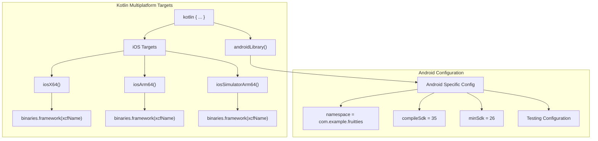

The Android library configuration specifies the namespace, compile SDK, and minimum SDK versions:

```kotlin
androidLibrary {
    namespace = "com.example.fruitties"
    compileSdk = 35
    minSdk = 26

    withHostTestBuilder {
    }

    withDeviceTestBuilder {
        sourceSetTreeName = "test"
    }.configure {
        instrumentationRunner = "androidx.test.runner.AndroidJUnitRunner"
    }
}
```

For iOS, the project configures three targets and generates a framework for each:

```kotlin
val xcfName = "shared"

iosX64 {
    binaries.framework {
        baseName = xcfName
    }
}

iosArm64 {
    binaries.framework {
        baseName = xcfName
    }
}

iosSimulatorArm64 {
    binaries.framework {
        baseName = xcfName
    }
}
```

Sources: [Fruitties/shared/build.gradle.kts:26-71]()

### Source Sets Configuration

The shared module organizes code into source sets that define platform-specific and common code:

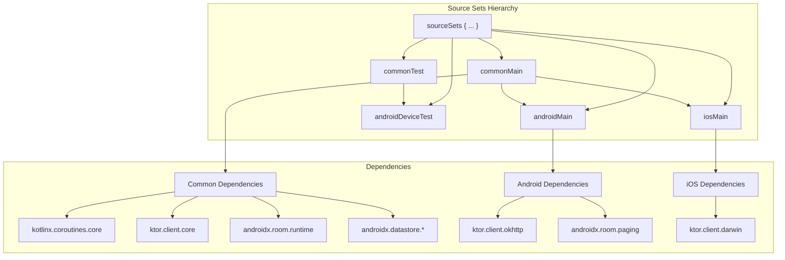

The source sets are configured with their respective dependencies:

```kotlin
sourceSets {
    all {
        languageSettings.optIn("kotlin.experimental.ExperimentalObjCName")
    }

    commonMain {
        dependencies {
            implementation(libs.kotlin.stdlib)
            implementation(libs.kotlinx.datetime)
            implementation(libs.kotlinx.coroutines.core)
            implementation(libs.ktor.client.core)
            // ... other common dependencies
        }
    }

    androidMain {
        dependencies {
            implementation(libs.ktor.client.okhttp)
            implementation(libs.androidx.room.paging)
        }
    }

    iosMain {
        dependencies {
            implementation(libs.ktor.client.darwin)
        }
    }
    
    // ... other source sets
}
```

Sources: [Fruitties/shared/build.gradle.kts:78-138]()

### Room and KSP Configuration

The shared module configures Room (Android's database library) and KSP (Kotlin Symbol Processing) for code generation:

```kotlin
dependencies {
    add("kspAndroid", libs.androidx.room.compiler)
    add("kspIosSimulatorArm64", libs.androidx.room.compiler)
    add("kspIosX64", libs.androidx.room.compiler)
    add("kspIosArm64", libs.androidx.room.compiler)
}

room {
    schemaDirectory("$projectDir/schemas")
}
```

Additionally, the SKIE (Swift Kotlin Interface Enhancer) plugin is configured to enable SwiftUI integration:

```kotlin
skie {
    features {
        enableSwiftUIObservingPreview = true
    }
}
```

Sources: [Fruitties/shared/build.gradle.kts:141-157]()

## Building the Project

To build the project, developers can use the Gradle wrapper scripts:

- For Unix-based systems (Linux, macOS): `./gradlew <task>`
- For Windows: `gradlew.bat <task>`

Common build tasks include:

| Task | Description |
|------|-------------|
| `assembleDebug` | Builds the debug version of the Android app |
| `assembleRelease` | Builds the release version of the Android app |
| `build` | Builds all targets |
| `clean` | Cleans the build directory |
| `linkDebugFrameworkIosX64` | Creates the debug iOS framework for X64 architecture |
| `linkReleaseFrameworkIosArm64` | Creates the release iOS framework for Arm64 architecture |

The Gradle wrapper scripts are configured to use a JVM with 64MB of initial and maximum heap size:

```
DEFAULT_JVM_OPTS='"-Xmx64m" "-Xms64m"'
```

Sources: [Fruitties/gradlew:205](), [Fruitties/gradlew.bat:39]()

## Summary

The build configuration of the Fruitties project provides a robust foundation for cross-platform development with Kotlin Multiplatform. It enables:

1. Code sharing between Android and iOS platforms
2. Platform-specific implementations where needed
3. Consistent build environments across development machines
4. Integration with essential libraries like Room and Ktor
5. Swift interoperability via SKIE

This configuration follows Kotlin Multiplatform best practices and provides a scalable structure for the Fruitties application.

---

# Page: Dependency Management

# Dependency Management

<details>
<summary>Relevant source files</summary>

The following files were used as context for generating this wiki page:

- [Fruitties/gradle/libs.versions.toml](Fruitties/gradle/libs.versions.toml)

</details>


This document explains how dependencies are managed in the Fruitties application using Gradle Version Catalog. The project employs a centralized approach to dependency management, making it easier to maintain consistent versions across Android and iOS modules while reducing version conflicts.

For information about the overall build configuration, see [Build Configuration](#2.1).

## Version Catalog Structure

The Fruitties application uses a Gradle Version Catalog to manage dependencies centrally. This approach is implemented through the `libs.versions.toml` file located in the `gradle` directory.

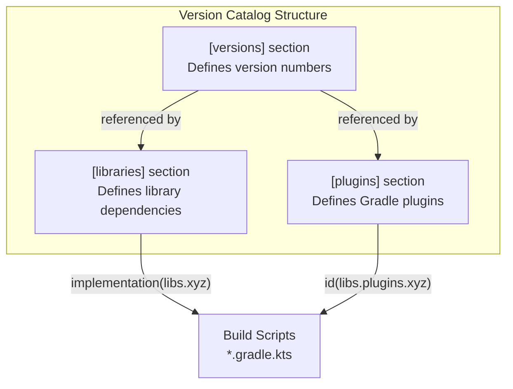

The version catalog is organized into three main sections:

1. **[versions]** - Defines version numbers for all dependencies and plugins
2. **[libraries]** - Defines library dependencies using versions from the first section
3. **[plugins]** - Defines Gradle plugins used in the project

For example, in the versions section, the Kotlin version is defined:

```toml
[versions]
kotlin = "2.1.10"
```

Then, in the libraries section, this version is referenced:

```toml
[libraries]
kotlin-test = { module = "org.jetbrains.kotlin:kotlin-test", version.ref = "kotlin" }
```

Sources: [Fruitties/gradle/libs.versions.toml:15-38](), [Fruitties/gradle/libs.versions.toml:39-69](), [Fruitties/gradle/libs.versions.toml:71-82]()

## Dependency Categories

The project's dependencies can be categorized by their purpose:

| Category | Dependencies | Purpose |
|----------|-------------|---------|
| **UI Framework** | compose-ui, compose-material3, compose-ui-tooling | UI components and Material3 design |
| **Networking** | ktor-client-core, ktor-client-okhttp (Android), ktor-client-darwin (iOS) | Cross-platform HTTP client |
| **Data Persistence** | androidx-room-runtime, androidx-datastore-core-okio | Local storage and preferences |
| **Concurrency** | kotlinx-coroutines-core | Asynchronous programming |
| **Data Serialization** | ktor-serialization-kotlinx-json | JSON processing |
| **Utilities** | kotlinx-datetime, okio | Date/time handling, I/O operations |
| **iOS Integration** | skie-annotations | Kotlin-Swift interoperability |
| **Paging** | androidx-paging-common, androidx-paging-compose-android | Data pagination |

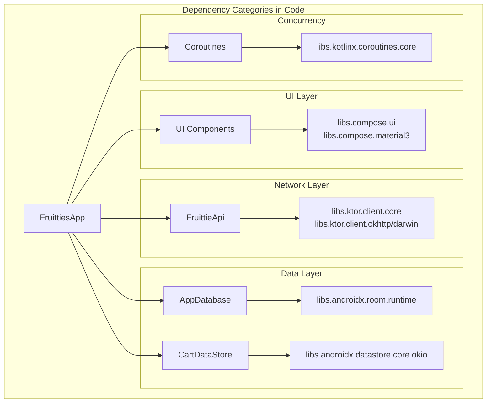

Sources: [Fruitties/gradle/libs.versions.toml:39-69]()

## Multiplatform Dependency Management

In a Kotlin Multiplatform project like Fruitties, dependencies need to be handled for multiple platforms. The version catalog approach makes this easier by providing a single point of reference for all dependencies.

### Common vs Platform-Specific Dependencies

Dependencies are organized into three main categories:

1. **Common dependencies** - Used in the `commonMain` source set
2. **Android-specific dependencies** - Used in the `androidMain` source set
3. **iOS-specific dependencies** - Used in the `iosMain` source set

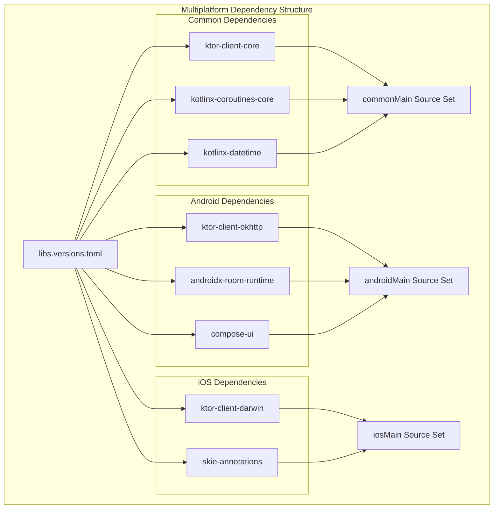

For example, the project uses:
- **Ktor Client**: Core module in common code, with platform-specific implementations (OkHttp for Android, Darwin for iOS)
- **UI frameworks**: Jetpack Compose for Android, SwiftUI for iOS (native, not a dependency)
- **Room Database**: Android-specific, with custom implementations for iOS

Sources: [Fruitties/gradle/libs.versions.toml:56-62]()

## Dependency Version Management

The version catalog approach simplifies version management across the project:

### Version Declaration

All versions are declared once in the `[versions]` section:

```toml
[versions]
kotlin = "2.1.10"
kotlinx-coroutines = "1.10.1"
ktorVersion = "3.0.3"
```

### Library Declaration

Libraries reference these versions to ensure consistency:

```toml
[libraries]
kotlinx-coroutines-core = { module = "org.jetbrains.kotlinx:kotlinx-coroutines-core", version.ref = "kotlinx-coroutines" }
ktor-client-core = { module = "io.ktor:ktor-client-core", version.ref = "ktorVersion" }
```

### Plugin Declaration

Plugins similarly reference these versions:

```toml
[plugins]
kotlinMultiplatform = { id = "org.jetbrains.kotlin.multiplatform", version.ref = "kotlin" }
```

This approach ensures that when upgrading a dependency (e.g., Kotlin), all related libraries and plugins are updated consistently.

Sources: [Fruitties/gradle/libs.versions.toml:15-38](), [Fruitties/gradle/libs.versions.toml:39-69](), [Fruitties/gradle/libs.versions.toml:71-82]()

## Best Practices

- **Single Source of Truth**: All dependency versions should be defined in `libs.versions.toml`
- **Version Alignment**: Related libraries (e.g., all Ktor components) should use the same version
- **Platform Compatibility**: When adding new dependencies, verify they work on all targeted platforms
- **Update Process**: Update one dependency at a time and test thoroughly on all platforms
- **Version Comments**: For complex dependencies, add comments explaining version constraints or compatibility issues

Sources: [Fruitties/gradle/libs.versions.toml]()

---

# Page: CI/CD Pipeline

# CI/CD Pipeline

<details>
<summary>Relevant source files</summary>

The following files were used as context for generating this wiki page:

- [.github/workflows/Fruitties.yaml](.github/workflows/Fruitties.yaml)
- [Fruitties/iosApp/Podfile](Fruitties/iosApp/Podfile)

</details>


## Purpose and Scope

This document details the continuous integration and continuous deployment (CI/CD) pipeline implemented for the Fruitties sample application. The pipeline automates building and testing the application across both Android and iOS platforms whenever code changes occur. For information about the build configuration used by this pipeline, see [Build Configuration](#2.1). For dependency management details that impact the build process, see [Dependency Management](#2.2).

## Workflow Triggers and Configuration

The CI/CD pipeline is implemented using GitHub Actions and is defined in the repository's workflow file.

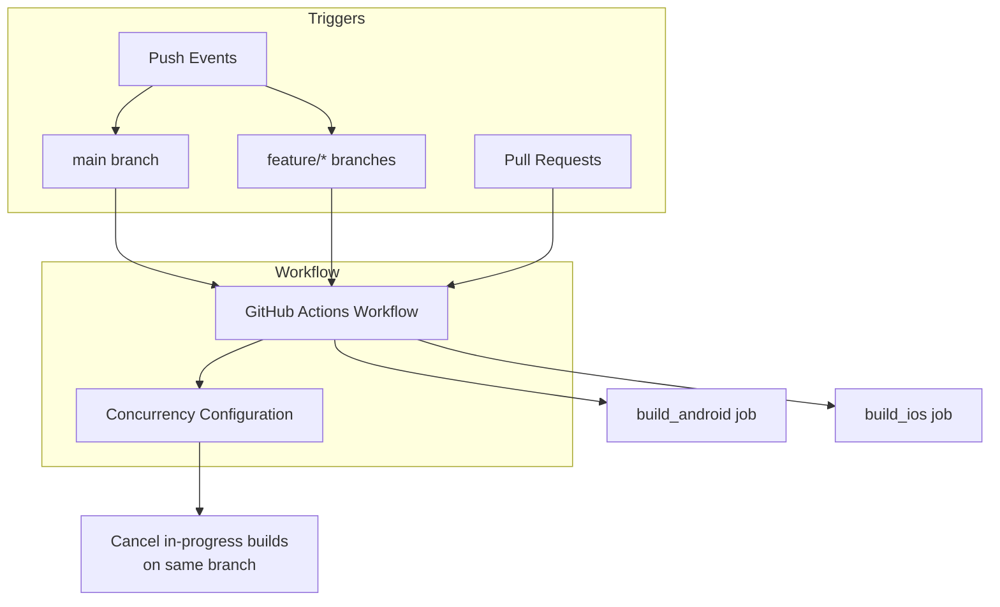

The workflow is triggered by:
- Push events to the `main` branch
- Push events to any branch with the pattern `feature/*`
- Any pull request creation or update

The workflow implements concurrency controls to prevent redundant builds, automatically canceling in-progress builds when new commits are pushed to the same branch.

Sources: [.github/workflows/Fruitties.yaml:3-12]()

## Android Build Process

The Android build job runs on an Ubuntu-based runner and performs the following operations:

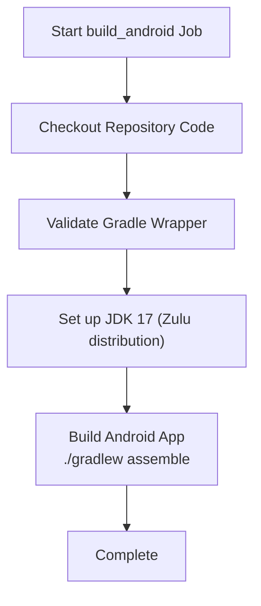

The Android build process:
1. Runs on Ubuntu latest
2. Checks out the repository code
3. Validates the Gradle wrapper for security
4. Sets up Java 17 (Zulu distribution)
5. Builds the application using Gradle's `assemble` task
6. The build takes place in the `./Fruitties` directory, which contains the Android application code

Sources: [.github/workflows/Fruitties.yaml:15-33]()

## iOS Build Process

The iOS build job runs on a macOS-based runner and has additional platform-specific setup steps:

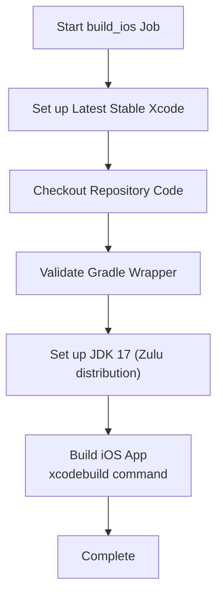

The iOS build process:
1. Runs on macOS latest
2. Sets up the latest stable Xcode version
3. Checks out the repository code
4. Validates the Gradle wrapper for security
5. Sets up Java 17 (Zulu distribution)
6. Builds the iOS application using `xcodebuild` with the following parameters:
   - Project: `iosApp/iosApp.xcodeproj`
   - Configuration: `Debug`
   - Scheme: `iosApp`
   - SDK: `iphonesimulator`

Sources: [.github/workflows/Fruitties.yaml:35-57]()

## Complete CI/CD Workflow

The following diagram illustrates the complete CI/CD workflow including both Android and iOS build processes:

```mermaid
flowchart TD
    subgraph "Triggers"
        Push["Push Events"] --> Branches["main/feature branches"]
        PR["Pull Requests"]
    end
    
    Branches --> Workflow["Fruitties.yaml Workflow"]
    PR --> Workflow
    
    Workflow --> Concurrency["Concurrency Control:<br>build-${{ github.ref }}"]
    
    Concurrency --> AndroidJob["build_android Job"]
    Concurrency --> iOSJob["build_ios Job"]
    
    subgraph "Android Build (Ubuntu)"
        AndroidJob --> A_Checkout["actions/checkout@v4"]
        A_Checkout --> A_ValidateWrapper["wrapper-validation-action@v3"]
        A_ValidateWrapper --> A_SetupJava["setup-java@v4<br>JDK 17/Zulu"]
        A_SetupJava --> A_Build["./gradlew assemble"]
    end
    
    subgraph "iOS Build (macOS)"
        iOSJob --> I_SetupXcode["setup-xcode@v1<br>latest-stable"]
        I_SetupXcode --> I_Checkout["actions/checkout@v4"]
        I_Checkout --> I_ValidateWrapper["wrapper-validation-action@v3"]
        I_ValidateWrapper --> I_SetupJava["setup-java@v4<br>JDK 17/Zulu"]
        I_SetupJava --> I_Build["xcodebuild -project iosApp/iosApp.xcodeproj<br>-configuration Debug -scheme iosApp<br>-sdk iphonesimulator"]
    end
```

This diagram shows how the CI/CD workflow processes builds for both platforms in parallel after being triggered by code changes.

Sources: [.github/workflows/Fruitties.yaml:1-57]()

## Integration with Kotlin Multiplatform

The CI/CD pipeline is designed to work with the Kotlin Multiplatform project structure, where:

```mermaid
flowchart LR
    subgraph "CI/CD Pipeline"
        Workflow["Fruitties.yaml"]
        AndroidBuild["build_android Job"]
        iOSBuild["build_ios Job"]
    end
    
    subgraph "Project Structure"
        Root["Fruitties Project"]
        Root --> AndroidApp["androidApp Module"]
        Root --> iOSApp["iosApp Module"] 
        Root --> Shared["shared Module"]
        
        Shared --> AndroidSpecific["Android-specific Code"]
        Shared --> iOSSpecific["iOS-specific Code"]
        Shared --> CommonCode["Common Kotlin Code"]
    end
    
    Workflow --> AndroidBuild
    Workflow --> iOSBuild
    
    AndroidBuild --> AndroidApp
    AndroidBuild -.-> Shared
    
    iOSBuild --> iOSApp
    iOSBuild -.-> Shared
```

This structure shows how the CI/CD pipeline jobs relate to the modules in the Kotlin Multiplatform project. The pipeline ensures that:

1. All platform-specific code builds correctly
2. The shared Kotlin code is compiled and integrated properly into each platform
3. Each platform's build process handles the appropriate compilation of the shared code for that platform

Sources: [.github/workflows/Fruitties.yaml:1-57](), [Fruitties/iosApp/Podfile:1-4]()

## Environment Requirements

The CI/CD pipeline has specific environment requirements for each platform:

| Platform | Runner | Java | Other Requirements |
|----------|--------|------|-------------------|
| Android | ubuntu-latest | JDK 17 (Zulu) | Gradle |
| iOS | macos-latest | JDK 17 (Zulu) | Xcode (latest stable), iOS 14.1+ SDK |

These requirements ensure that the build environment matches the development requirements for each platform and properly supports the Kotlin Multiplatform project structure.

Sources: [.github/workflows/Fruitties.yaml:17-29](), [.github/workflows/Fruitties.yaml:36-53](), [Fruitties/iosApp/Podfile:2]()

## Current Limitations

The current CI/CD pipeline focuses on build verification rather than full deployment:

1. It ensures that code changes don't break the build process
2. It verifies compatibility across platforms
3. It does not include automatic deployment to app stores or testing environments
4. It does not include automated testing beyond build verification

Future enhancements could include:
- Automated unit and integration testing
- UI testing on various device configurations
- Deployment to internal testing channels
- Automated release processes

Sources: [.github/workflows/Fruitties.yaml:1-57]()

---

# Page: Cross-Platform Architecture

# Cross-Platform Architecture

<details>
<summary>Relevant source files</summary>

The following files were used as context for generating this wiki page:

- [Fruitties/shared/build.gradle.kts](Fruitties/shared/build.gradle.kts)
- [Fruitties/shared/src/commonMain/kotlin/com/example/fruitties/DataRepository.kt](Fruitties/shared/src/commonMain/kotlin/com/example/fruitties/DataRepository.kt)
- [Fruitties/shared/src/commonMain/kotlin/com/example/fruitties/viewmodel/MainViewModel.kt](Fruitties/shared/src/commonMain/kotlin/com/example/fruitties/viewmodel/MainViewModel.kt)

</details>


This document outlines the architectural approach used in the Fruitties application to share code between Android and iOS platforms while maintaining platform-specific UI implementations. It covers the core architectural patterns, code organization, and cross-platform data flow mechanisms. For platform-specific implementation details, see [Android Implementation](#5) and [iOS Implementation](#6). For dependency injection specifics, see [Dependency Injection](#3.1).

## 1. Architectural Principles

The Fruitties application follows the principles of Kotlin Multiplatform (KMP) development, which enables sharing business logic, data handling, and state management across platforms while using native UI frameworks for each platform. The architecture is built on these key principles:

- **Shared Business Logic**: Core application logic is written once in Kotlin and shared across platforms
- **Native UI**: Platform-specific UI implementations (Jetpack Compose for Android, SwiftUI for iOS)
- **Clear Boundaries**: Well-defined interfaces between shared and platform-specific code
- **Reactive Data Flow**: Consistent data flow patterns across platforms using Kotlin Flows

```mermaid
flowchart TB
    subgraph "Cross-Platform Architecture"
        direction TB
        subgraph "Shared Code (Kotlin)"
            Models["Data Models"]
            Repository["DataRepository"]
            ViewModel["MainViewModel"]
            Network["Network Layer (Ktor)"]
            Storage["Storage Layer (Room/DataStore)"]
        end

        subgraph "Android-Specific"
            AndroidUI["Jetpack Compose UI"]
            AndroidDI["Android DI Container"]
        end

        subgraph "iOS-Specific"
            iOSUI["SwiftUI"]
            iOSDI["iOS ViewModelOwner"]
        end

        Models --- Repository
        Repository --- ViewModel
        Repository --- Network
        Repository --- Storage
        
        ViewModel --- AndroidUI
        ViewModel --- iOSUI
        
        AndroidDI --- AndroidUI
        iOSDI --- iOSUI
    end
```

Sources:
- [Fruitties/shared/build.gradle.kts:26-71]()
- [Fruitties/shared/src/commonMain/kotlin/com/example/fruitties/viewmodel/MainViewModel.kt:36-48]()
- [Fruitties/shared/src/commonMain/kotlin/com/example/fruitties/DataRepository.kt:29-33]()

## 2. Code Organization

The codebase is organized following KMP conventions, which define specific source sets for different platforms.

### 2.1. Source Set Structure

Kotlin Multiplatform organizes code into source sets, which are collections of Kotlin code and resources targeting specific platforms or shared between platforms.

```mermaid
flowchart TD
    subgraph "Source Set Organization"
        commonMain["commonMain<br>Shared code across all platforms"]
        androidMain["androidMain<br>Android-specific code"]
        iosMain["iosMain<br>Common iOS code"]
        iosX64["iosX64<br>iOS x64 simulator"]
        iosArm64["iosArm64<br>iOS physical devices"]
        iosSimulatorArm64["iosSimulatorArm64<br>iOS ARM simulator"]
        
        commonMain --> androidMain
        commonMain --> iosMain
        iosMain --> iosX64
        iosMain --> iosArm64
        iosMain --> iosSimulatorArm64
    end
```

Sources:
- [Fruitties/shared/build.gradle.kts:73-138]()

### 2.2. Dependency Configuration

Dependencies are configured in the shared module's build file, with platform-specific dependencies defined in appropriate source sets.

| Source Set | Key Dependencies |
|------------|-----------------|
| `commonMain` | Kotlin Coroutines, Ktor Client, Room, DataStore |
| `androidMain` | OkHttp Client, Room Paging |
| `iosMain` | Darwin Ktor Client |

Sources:
- [Fruitties/shared/build.gradle.kts:83-137]()

## 3. Shared Components

The core functionality of the application is implemented in shared components that work across platforms.

### 3.1. ViewModel Architecture

`MainViewModel` serves as the central state holder and business logic coordinator for both platforms. It exposes UI state through `StateFlow` objects that can be observed from both Android and iOS.

```mermaid
classDiagram
    class MainViewModel {
        -DataRepository repository
        +homeUiState: StateFlow~HomeUiState~
        +cartUiState: StateFlow~CartUiState~
        +addItemToCart(fruittie: Fruittie)
        +Factory: ViewModelProvider.Factory
    }
    
    class HomeUiState {
        +fruitties: List~Fruittie~
    }
    
    class CartUiState {
        +cartDetails: List~CartItemDetails~
    }
    
    MainViewModel --> HomeUiState: exposes
    MainViewModel --> CartUiState: exposes
    MainViewModel --> DataRepository: uses
```

Sources:
- [Fruitties/shared/src/commonMain/kotlin/com/example/fruitties/viewmodel/MainViewModel.kt:36-90]()

### 3.2. Repository Pattern

The `DataRepository` class abstracts data operations, managing interactions with the API, database, and preferences storage. It provides a unified interface for data access to the ViewModel.

```mermaid
classDiagram
    class DataRepository {
        -FruittieApi api
        -AppDatabase database
        -CartDataStore cartDataStore
        -CoroutineScope scope
        +cartDetails: Flow~List~CartItemDetails~~
        +addToCart(fruittie: Fruittie)
        +getData(): Flow~List~Fruittie~~
        +loadData(): Flow~List~Fruittie~~
        +refreshData()
    }
    
    DataRepository --> FruittieApi: uses
    DataRepository --> AppDatabase: uses
    DataRepository --> CartDataStore: uses
```

Sources:
- [Fruitties/shared/src/commonMain/kotlin/com/example/fruitties/DataRepository.kt:29-66]()

## 4. Cross-Platform Data Flow

Data flows through the application in a consistent pattern across platforms, using Kotlin Coroutines and Flow.

```mermaid
flowchart TB
    subgraph "Data Flow Architecture"
        API["FruittieApi<br>Remote Data Source"]
        DB["AppDatabase<br>Local Cache"]
        Cart["CartDataStore<br>Preferences Storage"]
        Repo["DataRepository<br>Unified Data Access"]
        VM["MainViewModel<br>State Management"]
        AndroidUI["Android UI<br>Jetpack Compose"]
        iOSUI["iOS UI<br>SwiftUI"]
        
        API -->|"getData()"| Repo
        DB -->|"loadData()"| Repo
        Repo -->|"refreshData()"| DB
        Repo <-->|"cart management"| Cart
        
        Repo -->|"StateFlow"| VM
        VM -->|"homeUiState"| AndroidUI
        VM -->|"homeUiState"| iOSUI
        VM -->|"cartUiState"| AndroidUI
        VM -->|"cartUiState"| iOSUI
        
        AndroidUI -->|"addItemToCart()"| VM
        iOSUI -->|"addItemToCart()"| VM
        VM -->|"addToCart()"| Repo
    end
```

Sources:
- [Fruitties/shared/src/commonMain/kotlin/com/example/fruitties/viewmodel/MainViewModel.kt:39-56]()
- [Fruitties/shared/src/commonMain/kotlin/com/example/fruitties/DataRepository.kt:35-65]()

### 4.1. Data Flow Process

1. **Data Retrieval**:
   - `Repository.getData()` checks if data exists in the database
   - If not, it calls `refreshData()` to fetch from the API
   - Returns a Flow of data from the local database

2. **UI State Exposure**:
   - `MainViewModel` transforms repository data into UI states
   - Exposes these states as `StateFlow`s for platform UIs
   - UI states contain only the data needed for display

3. **User Interactions**:
   - User actions in the UI call ViewModel methods
   - ViewModel delegates to Repository for data operations
   - Repository updates local storage as needed
   - Changes flow back to UI through StateFlows

Sources:
- [Fruitties/shared/src/commonMain/kotlin/com/example/fruitties/viewmodel/MainViewModel.kt:58-62]()
- [Fruitties/shared/src/commonMain/kotlin/com/example/fruitties/DataRepository.kt:47-65]()

## 5. Platform-Specific Integration

While the core logic is shared, each platform requires integration code to connect shared components with native UI frameworks.

### 5.1. Cross-Platform Technologies

Several technologies facilitate the cross-platform architecture:

| Technology | Purpose | Implementation |
|------------|---------|----------------|
| **Ktor** | Network communication | Platform-specific HTTP clients (OkHttp for Android, Darwin for iOS) |
| **Room** | Database persistence | KSP generates code for both platforms |
| **DataStore** | Preferences storage | Shared implementation with platform-specific serialization |
| **SKIE** | Swift interoperability | Improves Swift API design and enables SwiftUI integration |
| **Kotlin Flows** | Reactive data streams | Exposed as StateFlows to both platforms |

Sources:
- [Fruitties/shared/build.gradle.kts:17-24]()
- [Fruitties/shared/build.gradle.kts:141-146]()
- [Fruitties/shared/build.gradle.kts:152-157]()

### 5.2. UI Integration

```mermaid
flowchart TB
    subgraph "UI Integration"
        VM["MainViewModel<br>Shared State Holder"]
        
        subgraph "Android"
            ComposeUI["Jetpack Compose UI"]
            AndroidVMAccess["ViewModelProvider"]
        end
        
        subgraph "iOS"
            SwiftUI["SwiftUI"]
            iOSVMAccess["IOSViewModelOwner"]
            SKIE["SKIE<br>Flow Observation"]
        end
        
        VM -->|"StateFlow"| ComposeUI
        VM -->|"StateFlow"| SKIE
        SKIE -->|"@ObservableObject"| SwiftUI
        AndroidVMAccess -.->|"creates/provides"| VM
        iOSVMAccess -.->|"creates/holds"| VM
    end
```

Sources:
- [Fruitties/shared/build.gradle.kts:152-157]()
- [Fruitties/shared/src/commonMain/kotlin/com/example/fruitties/viewmodel/MainViewModel.kt:64-89]()

## 6. Challenges and Solutions

### 6.1. Platform-Specific Implementations

The Kotlin Multiplatform `expect/actual` mechanism is used to define interfaces in common code with platform-specific implementations:

```mermaid
flowchart TB
    subgraph "expect/actual Pattern"
        ExpectFactory["Factory (expect class)<br>Common Interface"]
        
        AndroidFactory["Factory.android<br>Android Implementation"]
        iOSFactory["Factory.native<br>iOS Implementation"]
        
        ExpectFactory -.->|"actual implementation"| AndroidFactory
        ExpectFactory -.->|"actual implementation"| iOSFactory
    end
```

### 6.2. Dependency Injection

Dependency injection is implemented differently for each platform while maintaining the same dependency graph:

- **Android**: Uses a container-based approach with `ViewModelProvider.Factory`
- **iOS**: Uses a `ViewModelOwner` pattern to manage lifecycle and dependencies

Sources:
- [Fruitties/shared/src/commonMain/kotlin/com/example/fruitties/viewmodel/MainViewModel.kt:64-89]()

## Summary

The Fruitties application demonstrates a modern cross-platform architecture using Kotlin Multiplatform. By sharing business logic, data handling, and state management while using native UI frameworks, it achieves a balance between code reuse and platform-specific user experience. The architecture follows a clear separation of concerns with a consistent data flow pattern across platforms.

---

# Page: Dependency Injection

# Dependency Injection

<details>
<summary>Relevant source files</summary>

The following files were used as context for generating this wiki page:

- [Fruitties/androidApp/src/main/AndroidManifest.xml](Fruitties/androidApp/src/main/AndroidManifest.xml)
- [Fruitties/androidApp/src/main/java/com/example/fruitties/android/di/App.kt](Fruitties/androidApp/src/main/java/com/example/fruitties/android/di/App.kt)
- [Fruitties/iosApp/iosApp/Info.plist](Fruitties/iosApp/iosApp/Info.plist)
- [Fruitties/shared/src/androidMain/kotlin/com/example/fruitties/di/Factory.android.kt](Fruitties/shared/src/androidMain/kotlin/com/example/fruitties/di/Factory.android.kt)
- [Fruitties/shared/src/iosMain/kotlin/com/example/fruitties/di/Factory.native.kt](Fruitties/shared/src/iosMain/kotlin/com/example/fruitties/di/Factory.native.kt)
- [Fruitties/shared/src/iosMain/kotlin/com/example/fruitties/di/viewmodel/IOSViewModelOwner.kt](Fruitties/shared/src/iosMain/kotlin/com/example/fruitties/di/viewmodel/IOSViewModelOwner.kt)

</details>


This document explains the dependency injection (DI) mechanism used in the Fruitties application, detailing how dependencies are managed and provided across both Android and iOS platforms. For information about the overall data flow in the application, see [Data Flow](#3.2).

## Overview

The Fruitties application implements a manual dependency injection system designed to work seamlessly across both Android and iOS platforms. This approach avoids the need for platform-specific DI frameworks while maintaining a clean architecture with proper separation of concerns.

The DI system is built around three key components:

1. **Factory** - An `expect` class with platform-specific implementations that creates core dependencies
2. **AppContainer** - A container that holds and provides dependencies to the rest of the application
3. **Platform-specific ViewModel management** - Different approaches for Android and iOS to create and manage ViewModels

```mermaid
graph TD
    subgraph "Core Components"
        Factory["Factory (expect class)"]
        AppContainer["AppContainer"]
    end
    
    subgraph "Platform-Specific Implementations"
        AndroidFactory["Factory.android"]
        iOSFactory["Factory.native"]
    end
    
    subgraph "Dependencies"
        API["FruittieApi"]
        DB["AppDatabase"]
        CartDS["CartDataStore"]
    end
    
    Factory <|-- AndroidFactory
    Factory <|-- iOSFactory
    
    AppContainer --> Factory
    Factory --> API
    Factory --> DB
    Factory --> CartDS
```

Sources: [shared/src/androidMain/kotlin/com/example/fruitties/di/Factory.android.kt:27-50](), [shared/src/iosMain/kotlin/com/example/fruitties/di/Factory.native.kt:32-61]()

## Factory Implementation

The `Factory` class is the foundation of the DI system. It's defined as a Kotlin Multiplatform `expect` class with platform-specific `actual` implementations. The Factory is responsible for creating the core dependencies used throughout the application:

```mermaid
graph TD
    subgraph "Android Factory"
        AF["Factory (Android)"]
        App["Application"]
        AF -->|"takes as parameter"| App
        AF -->|"createRoomDatabase()"| RoomDB["AppDatabase"]
        AF -->|"createCartDataStore()"| CartDS1["CartDataStore"]
        AF -->|"createApi()"| API1["FruittieApi"]
    end
    
    subgraph "iOS Factory"
        IF["Factory (iOS)"]
        NSFileManager["NSFileManager"]
        IF -->|"fileDirectory()"| NSFileManager
        IF -->|"createRoomDatabase()"| RoomDB2["AppDatabase"]
        IF -->|"createCartDataStore()"| CartDS2["CartDataStore"]
        IF -->|"createApi()"| API2["FruittieApi"]
    end
```

### Android Implementation

On Android, the `Factory` implementation takes the Android `Application` context as a constructor parameter to access application-specific resources and file system locations.

Key implementations:

- **Room Database**: Created with Android-specific file paths and database configuration
- **Cart Data Store**: Uses the application's file directory for persistence
- **API Client**: Uses a common implementation shared with iOS

Sources: [shared/src/androidMain/kotlin/com/example/fruitties/di/Factory.android.kt:27-50](), [androidApp/src/main/java/com/example/fruitties/android/di/App.kt:23-31]()

### iOS Implementation

The iOS implementation of `Factory` handles iOS-specific configurations:

- **Room Database**: Configured with iOS-specific file system access
- **Cart Data Store**: Uses iOS document directory for persistence
- **API Client**: Uses the same common implementation as Android

The iOS implementation uses `NSFileManager` to access appropriate file locations for data storage.

Sources: [shared/src/iosMain/kotlin/com/example/fruitties/di/Factory.native.kt:32-61]()

## AppContainer

The `AppContainer` class serves as a centralized container for application dependencies. It takes a `Factory` instance as a constructor parameter and uses it to create and store all required dependencies.

While the `AppContainer` implementation is not shown in the provided files, its usage is evident in both the Android and iOS implementations:

- On Android, it's instantiated in the application's `onCreate()` method
- On iOS, it's passed to the `IOSViewModelOwner` to provide dependencies to ViewModels

Sources: [androidApp/src/main/java/com/example/fruitties/android/di/App.kt:23-31](), [shared/src/iosMain/kotlin/com/example/fruitties/di/viewmodel/IOSViewModelOwner.kt:14-16]()

## ViewModel Dependency Management

The application uses different mechanisms for providing dependencies to ViewModels on Android vs. iOS due to platform differences.

```mermaid
flowchart TD
    subgraph "Android ViewModel Management"
        App["App (Application)"]
        AndroidAppContainer["AppContainer"]
        ViewModelFactory["ViewModel.Factory"]
        MainVM1["MainViewModel"]
        
        App -->|"creates"| AndroidAppContainer
        AndroidAppContainer -->|"used by"| ViewModelFactory
        ViewModelFactory -->|"creates"| MainVM1
    end
    
    subgraph "iOS ViewModel Management"
        IOSViewModelOwner["IOSViewModelOwner"]
        IOSAppContainer["AppContainer"]
        ViewModelStore["ViewModelStore"]
        MainVM2["MainViewModel"]
        
        IOSViewModelOwner -->|"contains"| ViewModelStore
        IOSViewModelOwner -->|"takes as parameter"| IOSAppContainer
        IOSAppContainer -->|"used in creation extras"| MainVM2
        IOSViewModelOwner -->|"owns"| MainVM2
    end
```

### Android ViewModel Management

On Android, the application class (`App`) initializes the `AppContainer` and holds it as a property. The ViewModels then access this container through the application context.

The key components are:
- `App` class that extends `Application`
- `AppContainer` instance initialized in `onCreate()`
- ViewModels access dependencies through this container

Sources: [androidApp/src/main/java/com/example/fruitties/android/di/App.kt:23-31](), [androidApp/src/main/AndroidManifest.xml:25]()

### iOS ViewModel Management

iOS requires a different approach since it doesn't have Android's `Application` concept. The Fruitties app uses a custom `IOSViewModelOwner` class that:

1. Implements Android's `ViewModelStoreOwner` interface
2. Creates and manages a `ViewModelStore`
3. Takes an `AppContainer` as a constructor parameter
4. Creates ViewModels using Android's `ViewModelProvider` mechanism
5. Provides a `clear()` method to properly clean up ViewModel resources

This approach allows using the same ViewModel code on iOS while properly managing their lifecycle.

```
IOSViewModelOwner
├── Takes AppContainer as constructor parameter
├── Implements ViewModelStoreOwner interface
├── Creates ViewModelStore
├── Creates ViewModels using ViewModelProvider
└── Provides clear() method for cleanup
```

Sources: [shared/src/iosMain/kotlin/com/example/fruitties/di/viewmodel/IOSViewModelOwner.kt:13-34]()

## Complete Dependency Flow

The following diagram shows the complete dependency flow throughout the application, from initialization to usage in UI components:

```mermaid
graph TD
    subgraph "Android DI Flow"
        AndroidApp["App (Application)"] -->|"onCreate()"| AndroidContainer["AppContainer"]
        AndroidContainer -->|"creates using"| AndroidFactory["Factory (Android)"]
        AndroidFactory -->|"createRoomDatabase()"| RoomDB1["AppDatabase"]
        AndroidFactory -->|"createCartDataStore()"| CartDS1["CartDataStore"]
        AndroidFactory -->|"createApi()"| API1["FruittieApi"]
        AndroidUI["Android UI Components"] -->|"access ViewModel"| AndroidViewModel["MainViewModel"]
        AndroidViewModel -->|"uses dependencies from"| AndroidContainer
    end
    
    subgraph "iOS DI Flow"
        iOSApp["iOSApp (Swift)"] -->|"creates"| iOSContainer["AppContainer"]
        iOSContainer -->|"creates using"| iOSFactory["Factory (iOS)"]
        iOSFactory -->|"createRoomDatabase()"| RoomDB2["AppDatabase"]
        iOSFactory -->|"createCartDataStore()"| CartDS2["CartDataStore"]
        iOSFactory -->|"createApi()"| API2["FruittieApi"]
        iOSApp -->|"creates"| VMOwner["IOSViewModelOwner"]
        VMOwner -->|"takes as parameter"| iOSContainer
        VMOwner -->|"creates & owns"| iOSViewModel["MainViewModel"]
        iOSUI["iOS UI Components"] -->|"access ViewModel"| iOSViewModel
    end
```

Sources: [androidApp/src/main/java/com/example/fruitties/android/di/App.kt:23-31](), [shared/src/iosMain/kotlin/com/example/fruitties/di/viewmodel/IOSViewModelOwner.kt:13-34](), [shared/src/androidMain/kotlin/com/example/fruitties/di/Factory.android.kt:27-50](), [shared/src/iosMain/kotlin/com/example/fruitties/di/Factory.native.kt:32-61]()

## Advantages and Considerations

This dependency injection approach offers several advantages for Kotlin Multiplatform development:

1. **Shared core logic** - The same dependencies and business logic are used on both platforms
2. **Platform-specific implementations** - Platform-specific needs are handled through the `expect/actual` pattern
3. **Testability** - Dependencies can be easily mocked for testing
4. **No external DI framework** - Reduces dependencies and complexity

When extending this application, consider:

- Adding new dependencies to the `Factory` class and its platform-specific implementations
- Extending the `AppContainer` to hold these new dependencies
- For new ViewModels on iOS, add them as properties in `IOSViewModelOwner` (as noted in the comments)

---

# Page: Data Flow

# Data Flow

<details>
<summary>Relevant source files</summary>

The following files were used as context for generating this wiki page:

- [Fruitties/shared/src/commonMain/kotlin/com/example/fruitties/DataRepository.kt](Fruitties/shared/src/commonMain/kotlin/com/example/fruitties/DataRepository.kt)
- [Fruitties/shared/src/commonMain/kotlin/com/example/fruitties/di/Factory.kt](Fruitties/shared/src/commonMain/kotlin/com/example/fruitties/di/Factory.kt)
- [Fruitties/shared/src/commonMain/kotlin/com/example/fruitties/network/FruittieApi.kt](Fruitties/shared/src/commonMain/kotlin/com/example/fruitties/network/FruittieApi.kt)
- [Fruitties/shared/src/commonMain/kotlin/com/example/fruitties/viewmodel/MainViewModel.kt](Fruitties/shared/src/commonMain/kotlin/com/example/fruitties/viewmodel/MainViewModel.kt)

</details>


This page documents how data flows through the Fruitties application, from external data sources to the user interface and back again. It explains the architectural patterns used to manage data retrieval, storage, transformation, and presentation.

For information about the dependency injection system that wires these components together, see [Dependency Injection](#3.1).

## Overview

The Fruitties application follows a unidirectional data flow pattern with multiple layers, ensuring a clear separation of concerns between data fetching, business logic, and UI presentation.

```mermaid
flowchart TD
    subgraph "Data Sources"
        API["FruittieApi<br/>(Remote Data)"]
        DB["AppDatabase<br/>(Local Cache)"]
        Cart["CartDataStore<br/>(Preferences)"]
    end
    
    subgraph "Data Layer"
        Repo["DataRepository"]
    end
    
    subgraph "Presentation Layer"
        VM["MainViewModel"]
    end
    
    subgraph "UI Layer"
        UI["Android/iOS UIs"]
    end
    
    API -->|"getData()"| Repo
    DB <-->|"loadData()<br/>refreshData()"| Repo
    Cart <-->|"cart operations"| Repo
    
    Repo -->|"getData()<br/>cartDetails"| VM
    VM -->|"homeUiState<br/>cartUiState"| UI
    UI -->|"addItemToCart()"| VM
    VM -->|"addToCart()"| Repo
```

Sources: [Fruitties/shared/src/commonMain/kotlin/com/example/fruitties/DataRepository.kt:29-66](), [Fruitties/shared/src/commonMain/kotlin/com/example/fruitties/viewmodel/MainViewModel.kt:36-62]()

## Data Sources

The application relies on three primary data sources:

1. **Remote API** - Fetches Fruittie data from a network endpoint
2. **Local Database** - Caches Fruittie items for offline access
3. **Cart Data Store** - Manages shopping cart state

### Remote API (FruittieApi)

The `FruittieApi` interface defines the contract for retrieving data from the remote server:

```mermaid
classDiagram
    class FruittieApi {
        <<interface>>
        +suspend getData(pageNumber: Int): FruittiesResponse
    }
    
    class FruittieNetworkApi {
        -HttpClient client
        -String apiUrl
        +suspend getData(pageNumber: Int): FruittiesResponse
    }
    
    FruittieApi <|.. FruittieNetworkApi
```

The implementation uses Ktor client to make HTTP requests and handle responses, with error handling to ensure robustness.

Sources: [Fruitties/shared/src/commonMain/kotlin/com/example/fruitties/network/FruittieApi.kt:24-43]()

## Repository Layer

The `DataRepository` is the central component that orchestrates data flow between different sources:

```mermaid
classDiagram
    class DataRepository {
        -FruittieApi api
        -AppDatabase database
        -CartDataStore cartDataStore
        -CoroutineScope scope
        +Flow~List~CartItemDetails~~ cartDetails
        +suspend addToCart(fruittie: Fruittie): void
        +getData(): Flow~List~Fruittie~~
        +loadData(): Flow~List~Fruittie~~
        +suspend refreshData(): void
    }
```

Key responsibilities of the repository:

1. **Data Caching Strategy**: The repository checks if the local database has data. If empty, it fetches data from the API.
   
2. **Cart Management**: Maintains cart state and combines it with product information.
   
3. **Data Transformation**: Converts raw data models into domain models.

Sources: [Fruitties/shared/src/commonMain/kotlin/com/example/fruitties/DataRepository.kt:29-66]()

### Key Data Flow Patterns

The repository implements several important data flow patterns:

#### 1. Cache-then-Network Strategy

```mermaid
sequenceDiagram
    participant VM as MainViewModel
    participant Repo as DataRepository
    participant DB as AppDatabase
    participant API as FruittieApi
    
    VM->>Repo: getData()
    Repo->>DB: count()
    
    alt Database is empty
        Repo->>API: getData()
        API-->>Repo: FruittiesResponse
        Repo->>DB: insert(data)
    end
    
    Repo->>DB: getAllAsFlow()
    DB-->>Repo: Flow<List<Fruittie>>
    Repo-->>VM: Flow<List<Fruittie>>
```

This pattern ensures data is always available locally before being displayed, improving app responsiveness.

Sources: [Fruitties/shared/src/commonMain/kotlin/com/example/fruitties/DataRepository.kt:51-58]()

#### 2. Cart Data Flow

```mermaid
sequenceDiagram
    participant Repo as DataRepository
    participant Cart as CartDataStore
    participant DB as AppDatabase
    
    Note over Repo: cartDetails Flow
    Cart-->>Repo: cart Flow
    Repo->>Repo: Extract item IDs
    Repo->>DB: loadMapped(ids)
    DB-->>Repo: Map of Fruittie items
    Repo->>Repo: Combine cart quantities with item details
    Repo-->>VM: Flow<List<CartItemDetails>>
```

Cart data is combined with product details from the database to create complete cart item objects with quantities.

Sources: [Fruitties/shared/src/commonMain/kotlin/com/example/fruitties/DataRepository.kt:36-45]()

## Presentation Layer

The `MainViewModel` serves as the bridge between the data layer and UI:

```mermaid
classDiagram
    class MainViewModel {
        -DataRepository repository
        +StateFlow~HomeUiState~ homeUiState
        +StateFlow~CartUiState~ cartUiState
        +addItemToCart(fruittie: Fruittie): void
    }
    
    class HomeUiState {
        +List~Fruittie~ fruitties
    }
    
    class CartUiState {
        +List~CartItemDetails~ cartDetails
    }
    
    MainViewModel --> HomeUiState : creates
    MainViewModel --> CartUiState : creates
```

The ViewModel:

1. **Transforms Data**: Converts repository data into UI-specific state objects.
   
2. **Manages StateFlows**: Uses Kotlin Flows with `stateIn` to convert cold flows to hot StateFlows that can be observed by UI.
   
3. **Handles User Actions**: Processes UI events and delegates to the repository.

Sources: [Fruitties/shared/src/commonMain/kotlin/com/example/fruitties/viewmodel/MainViewModel.kt:36-107]()

### State Transformation Flow

```mermaid
flowchart LR
    subgraph "Repository Layer"
        RepoData["Flow<List<Fruittie>>"]
        CartData["Flow<List<CartItemDetails>>"]
    end
    
    subgraph "ViewModel Layer"
        HomeMap["map to HomeUiState"]
        CartMap["map to CartUiState"]
        HomeState["StateFlow<HomeUiState>"]
        CartState["StateFlow<CartUiState>"]
    end
    
    RepoData --> HomeMap --> HomeState
    CartData --> CartMap --> CartState
```

The `stateIn` operator converts cold flows to hot StateFlows with configuration for lifecycle optimization:

- `scope`: ViewModelScope to tie the flow lifecycle to the ViewModel
- `started`: WhileSubscribed with timeout to conserve resources
- `initialValue`: Empty state to avoid null states

Sources: [Fruitties/shared/src/commonMain/kotlin/com/example/fruitties/viewmodel/MainViewModel.kt:39-56]()

## UI Interaction Flow

When a user interacts with the UI, the action flows back through the system:

```mermaid
sequenceDiagram
    participant UI as UI Layer
    participant VM as MainViewModel
    participant Repo as DataRepository
    participant Cart as CartDataStore
    
    UI->>VM: addItemToCart(fruittie)
    VM->>VM: Launch coroutine
    VM->>Repo: addToCart(fruittie)
    Repo->>Cart: add(fruittie)
    
    Note over Cart: Cart updates trigger Flow
    Cart-->>Repo: cart Flow updates
    Repo-->>VM: cartDetails Flow updates
    VM-->>UI: cartUiState updates
```

This completes the circular data flow, with changes in the data source (Cart) triggering UI updates through the reactive flow chain.

Sources: [Fruitties/shared/src/commonMain/kotlin/com/example/fruitties/viewmodel/MainViewModel.kt:58-62](), [Fruitties/shared/src/commonMain/kotlin/com/example/fruitties/DataRepository.kt:47-49]()

## Platform-Specific Considerations

While the data flow architecture is shared across platforms, the actual data consumption differs between Android and iOS:

- **Android**: Directly collects StateFlows from the ViewModel in Compose UI components
- **iOS**: Observes StateFlows via adapters that convert them to Swift Combine publishers

This pattern allows for shared data flow logic while respecting platform-specific UI paradigms.

Sources: [Fruitties/shared/src/commonMain/kotlin/com/example/fruitties/viewmodel/MainViewModel.kt:36-107]()

## Summary

The data flow in the Fruitties application follows these key principles:

1. **Single Source of Truth**: The repository coordinates between remote and local data sources
2. **Unidirectional Flow**: Data flows from sources through repository to ViewModel to UI
3. **Reactive Programming**: Kotlin Flows enable reactive updates throughout the system
4. **State-Based UI**: UIs observe and render based on immutable state objects

This architecture ensures consistency, testability, and maintainability across both Android and iOS platforms.

---

# Page: Shared Module

# Shared Module

<details>
<summary>Relevant source files</summary>

The following files were used as context for generating this wiki page:

- [Fruitties/shared/build.gradle.kts](Fruitties/shared/build.gradle.kts)
- [Fruitties/shared/src/commonMain/kotlin/com/example/fruitties/viewmodel/MainViewModel.kt](Fruitties/shared/src/commonMain/kotlin/com/example/fruitties/viewmodel/MainViewModel.kt)

</details>


The Shared Module is the core component of the Kotlin Multiplatform (KMP) architecture in the Fruitties application. It contains code shared between Android and iOS platforms, including business logic, data management, networking, and viewmodel implementations. This document explains how the Shared Module is structured, configured, and how its components interact with platform-specific code.

For information about how the Shared Module fits into the overall project structure, see [Project Structure](#2). For platform-specific implementations, see [Android Implementation](#5) and [iOS Implementation](#6).

## Module Configuration

The Shared Module is configured as a Kotlin Multiplatform library that targets both Android and iOS platforms. It uses the following key plugins:

- Kotlin Multiplatform
- Android KMP Library
- Kotlinx Serialization
- SKIE (Swift Kotlin Interface Enhancer)
- KSP (Kotlin Symbol Processing)
- Room

```mermaid
flowchart TD
    subgraph "Shared Module Configuration"
        KMP["kotlinMultiplatform Plugin"] --> Targets["Platform Targets"]
        Targets --> Android["androidLibrary"]
        Targets --> iOS["iOS Targets"]
        iOS --> iOSX64["iosX64"]
        iOS --> iOSArm64["iosArm64"]
        iOS --> iOSSimArm64["iosSimulatorArm64"] 
        
        KMP --> SourceSets["Source Sets"]
        SourceSets --> Common["commonMain"]
        SourceSets --> AndroidSet["androidMain"]
        SourceSets --> iOSSet["iosMain"]
        
        Common --> CoreDeps["Core Dependencies"]
        CoreDeps --> Coroutines["kotlinx.coroutines"]
        CoreDeps --> KtorCore["ktor.client.core"]
        CoreDeps --> Room["androidx.room"]
        CoreDeps --> DataStore["androidx.datastore"]
        
        AndroidSet --> AndroidDeps["Android Dependencies"]
        AndroidDeps --> OkHttp["ktor.client.okhttp"]
        AndroidDeps --> RoomPaging["room.paging"]
        
        iOSSet --> iOSDeps["iOS Dependencies"]
        iOSDeps --> Darwin["ktor.client.darwin"]
    end
```

Sources: [shared/build.gradle.kts:17-139]()

The module's build file defines multiple targets:
- Android library target with minimum SDK 26 and compile SDK 35
- iOS targets including iosX64, iosArm64, and iosSimulatorArm64

Each platform target has corresponding source sets that extend the common source set, allowing for platform-specific implementations while sharing core functionality.

## Source Set Organization

The Shared Module organizes code into hierarchical source sets:

| Source Set | Purpose | Dependencies |
|------------|---------|--------------|
| commonMain | Cross-platform code shared between all targets | Kotlin stdlib, coroutines, ktor, room, datastore |
| androidMain | Android-specific implementations | Inherits from commonMain, adds okhttp and room-paging |
| iosMain | iOS-specific implementations | Inherits from commonMain, adds ktor-darwin client |
| commonTest | Test code for common functionality | Kotlin test framework |

This hierarchical structure allows for maximum code sharing while providing platform-specific implementations where needed.

Sources: [shared/build.gradle.kts:78-138]()

## Core Components

```mermaid
classDiagram
    class MainViewModel {
        -DataRepository repository
        +homeUiState: StateFlow~HomeUiState~
        +cartUiState: StateFlow~CartUiState~
        +addItemToCart(Fruittie)
    }
    
    class DataRepository {
        +getData(): Flow~List~Fruittie~~
        +cartDetails: Flow~List~CartItemDetails~~
        +addToCart(Fruittie)
    }
    
    class AppContainer {
        +dataRepository: DataRepository
    }
    
    class Factory {
        +createApi()
        +createRoomDatabase()
        +createCartDataStore()
    }
    
    MainViewModel --> DataRepository: uses
    DataRepository --> "FruittieApi" : fetches data
    DataRepository --> "AppDatabase" : caches data
    DataRepository --> "CartDataStore" : manages cart
    AppContainer --> DataRepository: creates
    AppContainer --> Factory: uses
```

The shared module contains several key components that work together to provide the core functionality of the application:

### ViewModels

The `MainViewModel` class is the central component for managing UI state and business logic. It's shared between Android and iOS, providing a consistent user experience across platforms. It uses Kotlin's `StateFlow` to expose reactive UI state to both platforms.

Key features of the MainViewModel:
- Exposes UI state for the home screen and cart as StateFlows
- Handles user interactions like adding items to cart
- Communicates with the DataRepository for data operations

Sources: [shared/src/commonMain/kotlin/com/example/fruitties/viewmodel/MainViewModel.kt:36-107]()

### Data Management

The data flow in the shared module follows a repository pattern:

```mermaid
flowchart LR
    subgraph "UI Layer"
        AndroidUI["Android UI"]
        iOSUI["iOS UI"]
    end
    
    subgraph "Shared Module"
        direction TB
        ViewModel["MainViewModel"]
        
        subgraph "Data Layer"
            direction TB
            Repository["DataRepository"]
            API["FruittieApi"]
            DB["AppDatabase (Room)"]
            CartDS["CartDataStore"]
        end
        
        Repository --> API: "remote data"
        Repository --> DB: "local cache"
        Repository --> CartDS: "preferences"
        ViewModel --> Repository: "data operations"
    end
    
    AndroidUI <--> ViewModel: "StateFlows/Actions"
    iOSUI <--> ViewModel: "StateFlows/Actions"
```

The shared module implements a clean architecture approach for data management:
- Remote data is fetched through `FruittieApi` using Ktor
- Local data is cached in `AppDatabase` using Room
- User preferences (cart data) are stored in `CartDataStore` using DataStore
- `DataRepository` coordinates between these data sources
- `MainViewModel` exposes this data to the UI layers

Sources: [shared/src/commonMain/kotlin/com/example/fruitties/viewmodel/MainViewModel.kt:39-56]()

## Platform-Specific Implementations

While the Shared Module provides common functionality, it also includes mechanisms for platform-specific implementations:

### Expect/Actual Pattern

The module uses Kotlin's expect/actual pattern to define interfaces in common code that have platform-specific implementations:

```mermaid
flowchart TD
    subgraph "Common Code"
        Factory["Factory (expect class)"]
    end
    
    subgraph "Android Implementation"
        AndroidFactory["Factory.android.kt"]
    end
    
    subgraph "iOS Implementation"
        iOSFactory["Factory.native.kt"]
    end
    
    Factory --> AndroidFactory: "actual implementation"
    Factory --> iOSFactory: "actual implementation"
    
    AndroidFactory --> AndroidDeps["Android Dependencies"]
    iOSFactory --> iOSDeps["iOS Dependencies"]
```

This pattern allows the shared module to abstract platform-specific implementations while maintaining a consistent API across platforms.

## Dependency Injection

The shared module implements a simple dependency injection system through the `AppContainer` and `Factory` classes:

- `AppContainer` serves as the central registry for dependencies
- `Factory` provides platform-specific implementations of dependencies
- `ViewModelProvider.Factory` facilitates ViewModel creation with dependencies

The ViewModel includes helper methods to simplify dependency injection when creating ViewModels from platform-specific code.

Sources: [shared/src/commonMain/kotlin/com/example/fruitties/viewmodel/MainViewModel.kt:64-89]()

## UI State Management

The shared module defines data classes to represent UI state for different screens:

| UI State Class | Purpose | Properties |
|----------------|---------|------------|
| HomeUiState | Represents state for the home screen | fruitties: List<Fruittie> |
| CartUiState | Represents state for the cart | cartDetails: List<CartItemDetails> |

These UI state classes are exposed as StateFlows, allowing for reactive UI updates on both platforms.

Sources: [shared/src/commonMain/kotlin/com/example/fruitties/viewmodel/MainViewModel.kt:96-105]()

## SKIE Integration

The shared module uses SKIE (Swift Kotlin Interface Enhancer) to improve the Swift API surface generated from Kotlin code. This provides better Swift interoperability, including:

- Better naming conventions for Swift
- Support for Swift concurrency patterns
- SwiftUI observing preview for Kotlin flows

Sources: [shared/build.gradle.kts:152-157]()

## Key Dependencies

The shared module relies on several key libraries:

- **Kotlinx Coroutines**: For asynchronous programming
- **Ktor**: For network operations
- **Room**: For database operations
- **DataStore**: For preferences management
- **Lifecycle ViewModel**: For UI state management

These dependencies are declared in the commonMain source set and platform-specific implementations are added in the platform-specific source sets.

Sources: [shared/build.gradle.kts:83-101](), [shared/build.gradle.kts:110-117](), [shared/build.gradle.kts:128-136]()

---

# Page: Network Layer

# Network Layer

<details>
<summary>Relevant source files</summary>

The following files were used as context for generating this wiki page:

- [Fruitties/shared/src/commonMain/kotlin/com/example/fruitties/di/Factory.kt](Fruitties/shared/src/commonMain/kotlin/com/example/fruitties/di/Factory.kt)
- [Fruitties/shared/src/commonMain/kotlin/com/example/fruitties/network/FruittieApi.kt](Fruitties/shared/src/commonMain/kotlin/com/example/fruitties/network/FruittieApi.kt)

</details>


The Network Layer in the Fruitties application is responsible for retrieving product data from a remote API. This page documents the implementation of network communication in the shared KMP (Kotlin Multiplatform) module, focusing on the `FruittieApi` interface and its implementation. For information on how the network data is managed within the application, see [Data Repository](#4.2).

## Overview

The Network Layer uses Ktor HTTP client to make network requests and retrieve product data from a remote JSON API. The implementation is designed to be platform-independent, allowing the same network code to run on both Android and iOS.

```mermaid
flowchart TD
    subgraph "Network Layer"
        API["FruittieApi<br>Interface"]
        Implementation["FruittieNetworkApi<br>Implementation"]
        HttpClient["Ktor HttpClient"]
        Remote["Remote API<br>https://android.github.io/kotlin-multiplatform-samples/fruitties-api"]
    end

    API -->|"defines contract"| Implementation
    Implementation -->|"uses"| HttpClient
    HttpClient -->|"requests"| Remote
    Remote -->|"FruittiesResponse"| HttpClient
    HttpClient -->|"deserializes"| Implementation
    Implementation -->|"returns"| API
```

Sources: [shared/src/commonMain/kotlin/com/example/fruitties/network/FruittieApi.kt:24-43](), [shared/src/commonMain/kotlin/com/example/fruitties/di/Factory.kt:36-44]()

## API Interface

The `FruittieApi` interface defines a contract for retrieving product data:

```mermaid
classDiagram
    class FruittieApi {
        <<interface>>
        +suspend getData(pageNumber: Int): FruittiesResponse
    }
    
    class FruittieNetworkApi {
        -HttpClient client
        -String apiUrl
        +suspend getData(pageNumber: Int): FruittiesResponse
    }
    
    FruittieApi <|-- FruittieNetworkApi
```

The interface is minimal, with just one method:
- `getData(pageNumber: Int)`: Fetches product data for the specified page number and returns a `FruittiesResponse` object

This design allows for easy testing and potential implementation swapping (such as using mock data for tests).

Sources: [shared/src/commonMain/kotlin/com/example/fruitties/network/FruittieApi.kt:24-26]()

## Implementation Details

The actual implementation `FruittieNetworkApi` uses Ktor's HttpClient to perform network requests:

1. The class takes two constructor parameters:
   - `client`: A Ktor HttpClient instance
   - `apiUrl`: The base URL for API requests

2. The `getData` method constructs the URL for the specific page and uses the HttpClient to:
   - Make a GET request to the API endpoint
   - Parse the JSON response into a `FruittiesResponse` object
   - Handle exceptions appropriately, returning an empty response on error

3. Error handling:
   - Propagates cancellation exceptions (important for coroutine cancellation)
   - Logs other exceptions and returns an empty response to prevent crashes

Sources: [shared/src/commonMain/kotlin/com/example/fruitties/network/FruittieApi.kt:28-43]()

## HTTP Client Configuration

The Network Layer uses Ktor's HttpClient with the following configuration:

```mermaid
flowchart LR
    subgraph "Factory"
        createApi["commonCreateApi()"]
    end
    
    subgraph "Ktor Configuration"
        HttpClient["HttpClient"]
        ContentNegotiation["ContentNegotiation Plugin"]
        JsonSerializer["JSON Serializer"]
    end
    
    createApi -->|"creates"| HttpClient
    HttpClient -->|"installs"| ContentNegotiation
    ContentNegotiation -->|"configures"| JsonSerializer
    JsonSerializer -->|"ignoreUnknownKeys=true"| JsonSerializer
```

Key configuration points:
- Uses the ContentNegotiation plugin to handle serialization
- Configures JSON serialization with `ignoreUnknownKeys=true` for more robust parsing
- Accepts any content type to accommodate potential server configuration issues

Sources: [shared/src/commonMain/kotlin/com/example/fruitties/di/Factory.kt:36-44](), [shared/src/commonMain/kotlin/com/example/fruitties/di/Factory.kt:46]()

## Integration with Dependency Injection

The Network Layer integrates with the application's dependency injection system through the `Factory` class:

```mermaid
flowchart TD
    subgraph "Dependency Injection"
        Factory["Factory<br>expect class"]
        AndroidFactory["Factory Android<br>actual class"]
        iOSFactory["Factory iOS<br>actual class"]
        CommonImpl["commonCreateApi()"]
    end
    
    subgraph "Network Layer"
        FruittieApi["FruittieApi<br>Interface"]
        FruittieNetworkApi["FruittieNetworkApi<br>Implementation"]
    end
    
    Factory -->|"declares"| createApi["createApi()"]
    AndroidFactory -->|"implements"| createApi
    iOSFactory -->|"implements"| createApi
    
    createApi -->|"returns"| FruittieApi
    CommonImpl -->|"creates"| FruittieNetworkApi
    FruittieNetworkApi -->|"implements"| FruittieApi
    
    AndroidFactory -.->|"uses"| CommonImpl
    iOSFactory -.->|"uses"| CommonImpl
```

The integration occurs through:
1. The `Factory` expect class which declares a `createApi()` method
2. Platform-specific actual implementations (Android, iOS)
3. A common implementation `commonCreateApi()` that both platforms can leverage

This pattern allows for consistent API creation across platforms while maintaining the flexibility to add platform-specific configurations if needed.

Sources: [shared/src/commonMain/kotlin/com/example/fruitties/di/Factory.kt:28-34](), [shared/src/commonMain/kotlin/com/example/fruitties/di/Factory.kt:36-44]()

## API Endpoint Structure

The API endpoints follow a simple convention:

| Page Number | URL |
|-------------|-----|
| 0 | https://android.github.io/kotlin-multiplatform-samples/fruitties-api/0.json |
| 1 | https://android.github.io/kotlin-multiplatform-samples/fruitties-api/1.json |
| n | https://android.github.io/kotlin-multiplatform-samples/fruitties-api/{n}.json |

The response is deserialized into the `FruittiesResponse` model object, which contains a list of products and pagination information.

Sources: [shared/src/commonMain/kotlin/com/example/fruitties/network/FruittieApi.kt:32-35](), [shared/src/commonMain/kotlin/com/example/fruitties/di/Factory.kt:43]()

## Summary

The Network Layer in the Fruitties application demonstrates:
- Clean separation of interface and implementation
- Cross-platform network code using Ktor
- Integration with a dependency injection system
- Error handling for robust operation
- JSON deserialization with Kotlinx Serialization

This design ensures that network operations can be performed consistently across both Android and iOS platforms while maintaining a clean architecture.

---

# Page: Data Repository

# Data Repository

<details>
<summary>Relevant source files</summary>

The following files were used as context for generating this wiki page:

- [Fruitties/shared/src/commonMain/kotlin/com/example/fruitties/DataRepository.kt](Fruitties/shared/src/commonMain/kotlin/com/example/fruitties/DataRepository.kt)

</details>


The Data Repository is a central component in the Fruitties application that implements the Repository pattern to abstract multiple data sources from the rest of the application. It serves as a single source of truth for data, handling the coordination between remote API data, local database caching, and user preference storage for the shopping cart.

For information about the API implementation, see [Network Layer](#4.1). For details about the local database implementation, see [Database Layer](#4.3). For information on how the ViewModel consumes the repository, see [ViewModel Implementation](#4.4).

## Repository Architecture

The DataRepository sits between the data sources and the presentation layer, acting as a mediator that abstracts the complexities of data management.

```mermaid
graph TD
    subgraph "Data Sources"
        API["FruittieApi"]
        DB["AppDatabase"]
        CartDS["CartDataStore"]
    end
    
    subgraph "Data Layer"
        Repo["DataRepository"]
    end
    
    subgraph "Presentation Layer"
        VM["MainViewModel"]
    end
    
    API -->|"getData()"| Repo
    DB -->|"fruittieDao().getAllAsFlow()"| Repo
    CartDS <-->|"cart management"| Repo
    
    Repo -->|"getData(): Flow<List<Fruittie>>"| VM
    Repo -->|"cartDetails: Flow<List<CartItemDetails>>"| VM
    VM -->|"addToCart(fruittie)"| Repo
```

Sources: [Fruitties/shared/src/commonMain/kotlin/com/example/fruitties/DataRepository.kt:29-34]()

## Implementation Details

The `DataRepository` class is defined in the shared module, making it available to both Android and iOS platforms.

### Class Structure

```mermaid
classDiagram
    class DataRepository {
        -FruittieApi api
        -AppDatabase database
        -CartDataStore cartDataStore
        -CoroutineScope scope
        +Flow<List<CartItemDetails>> cartDetails
        +suspend addToCart(Fruittie)
        +getData(): Flow<List<Fruittie>>
        +loadData(): Flow<List<Fruittie>>
        +suspend refreshData()
    }
    
    DataRepository ..> "uses" FruittieApi
    DataRepository ..> "uses" AppDatabase
    DataRepository ..> "uses" CartDataStore
    DataRepository ..> "uses" CoroutineScope
```

Sources: [Fruitties/shared/src/commonMain/kotlin/com/example/fruitties/DataRepository.kt:29-66]()

### Dependencies

The `DataRepository` constructor takes four parameters:

```
class DataRepository(
    private val api: FruittieApi,
    private var database: AppDatabase,
    private val cartDataStore: CartDataStore,
    private val scope: CoroutineScope,
)
```

- **api**: Handles network requests to retrieve data from the remote server
- **database**: Provides local storage and caching capabilities
- **cartDataStore**: Manages the user's shopping cart data
- **scope**: Provides a coroutine scope for launching asynchronous operations

Sources: [Fruitties/shared/src/commonMain/kotlin/com/example/fruitties/DataRepository.kt:29-34]()

## Data Flow Operations

### Retrieving Fruittie Data

```mermaid
sequenceDiagram
    participant VM as MainViewModel
    participant Repo as DataRepository
    participant DB as AppDatabase
    participant API as FruittieApi
    
    VM->>+Repo: getData()
    Repo->>+DB: fruittieDao().count()
    DB-->>-Repo: count
    
    alt Database is empty (count < 1)
        Repo->>+API: getData()
        API-->>-Repo: response
        Repo->>DB: fruittieDao().insert(response.feed)
    end
    
    Repo->>+DB: fruittieDao().getAllAsFlow()
    DB-->>-Repo: Flow<List<Fruittie>>
    Repo-->>-VM: Flow<List<Fruittie>>
```

Sources: [Fruitties/shared/src/commonMain/kotlin/com/example/fruitties/DataRepository.kt:51-58](), [Fruitties/shared/src/commonMain/kotlin/com/example/fruitties/DataRepository.kt:60](), [Fruitties/shared/src/commonMain/kotlin/com/example/fruitties/DataRepository.kt:62-65]()

### Cart Management

```mermaid
sequenceDiagram
    participant VM as MainViewModel
    participant Repo as DataRepository
    participant DB as AppDatabase
    participant Cart as CartDataStore
    
    VM->>+Repo: addToCart(fruittie)
    Repo->>+Cart: add(fruittie)
    Cart-->>-Repo: (operation completed)
    Repo-->>-VM: (operation completed)
    
    VM->>Repo: observe cartDetails
    activate Repo
    Repo->>+Cart: observe cart flow
    Cart-->>-Repo: cart items
    Repo->>+DB: fruittieDao().loadMapped(ids)
    DB-->>-Repo: Map<String, Fruittie>
    Repo-->>VM: Flow<List<CartItemDetails>>
    deactivate Repo
```

Sources: [Fruitties/shared/src/commonMain/kotlin/com/example/fruitties/DataRepository.kt:35-45](), [Fruitties/shared/src/commonMain/kotlin/com/example/fruitties/DataRepository.kt:47-49]()

## Key API Methods

### Getting and Refreshing Data

The repository provides several methods for data retrieval:

| Method | Return Type | Description |
|--------|-------------|-------------|
| `getData()` | `Flow<List<Fruittie>>` | Main method to retrieve data. Checks if database is empty and refreshes from API if needed. |
| `loadData()` | `Flow<List<Fruittie>>` | Returns a Flow directly from the database without checking for freshness. |
| `refreshData()` | `Unit` (suspend) | Fetches fresh data from the API and stores it in the database. |

Sources: [Fruitties/shared/src/commonMain/kotlin/com/example/fruitties/DataRepository.kt:51-65]()

### Cart Operations

| Property/Method | Type | Description |
|-----------------|------|-------------|
| `cartDetails` | `Flow<List<CartItemDetails>>` | A Flow that provides the current cart contents with detailed item information. |
| `addToCart(fruittie: Fruittie)` | `suspend fun` | Adds a Fruittie item to the user's cart. |

Sources: [Fruitties/shared/src/commonMain/kotlin/com/example/fruitties/DataRepository.kt:35-49]()

## Caching Strategy

The repository implements a simple but effective caching strategy:

1. When `getData()` is called, it first checks if the database contains any records
2. If the database is empty, it triggers a refresh from the network API
3. Regardless of whether a refresh was needed, it returns a Flow from the database

This ensures that:
- Data is always available offline once fetched
- Network requests are minimized
- UI always displays the most recent locally available data

Sources: [Fruitties/shared/src/commonMain/kotlin/com/example/fruitties/DataRepository.kt:51-58]()

## Reactive Data Handling with Kotlin Flow

The repository makes extensive use of Kotlin Flow for reactive data handling:

- `cartDetails` transforms the cart data stream using `mapLatest` to combine cart items with their details from the database
- `getData()` and `loadData()` return Flows that emit updates whenever the underlying data changes
- This reactive approach enables automatic UI updates when data changes

The transformation of cart data is particularly interesting:

```
cartDataStore.cart.mapLatest {
    val ids = it.items.map { it.id }
    val fruitties = database.fruittieDao().loadMapped(ids)
    it.items.mapNotNull {
        fruitties[it.id]?.let { fruittie ->
            CartItemDetails(fruittie, it.count)
        }
    }
}
```

This code combines cart item IDs with their corresponding Fruittie details from the database to create a list of `CartItemDetails` objects.

Sources: [Fruitties/shared/src/commonMain/kotlin/com/example/fruitties/DataRepository.kt:35-45]()

## Summary

The `DataRepository` serves as a critical component in the Fruitties application, providing:

1. A clean abstraction over multiple data sources
2. Efficient caching of remote data
3. Reactive data streams using Kotlin Flow
4. Cart management functionality
5. A shared implementation that works across both Android and iOS platforms

By implementing the Repository pattern, the application maintains a clean separation of concerns and facilitates code sharing between platforms.

Sources: [Fruitties/shared/src/commonMain/kotlin/com/example/fruitties/DataRepository.kt:1-66]()

---

# Page: Database Layer

# Database Layer

<details>
<summary>Relevant source files</summary>

The following files were used as context for generating this wiki page:

- [Fruitties/shared/src/commonMain/kotlin/com/example/fruitties/database/AppDatabase.kt](Fruitties/shared/src/commonMain/kotlin/com/example/fruitties/database/AppDatabase.kt)

</details>


## Purpose and Scope

The Database Layer in the Fruitties application provides local data persistence capabilities, enabling offline access to the app's data and serving as a cache mechanism. This document covers the implementation details of the local database using Room within the Kotlin Multiplatform (KMP) project. 

For information about how the database interacts with other components in the data flow, see [Data Flow](#3.2). For details on how data is retrieved from the network, see [Network Layer](#4.1). To understand how the database is used by higher-level components, see [Data Repository](#4.2).

## Database Architecture Overview

```mermaid
graph TD
    subgraph "Database Layer"
        AppDB["AppDatabase<br>Abstract Class"]
        FDao["FruittieDao<br>Interface"]
        Entity["Fruittie<br>Entity Class"]
        Constructor["AppDatabaseConstructor<br>expect object"]
        AndroidCons["AppDatabaseConstructor<br>actual implementation<br>(Android)"] 
        iOSCons["AppDatabaseConstructor<br>actual implementation<br>(iOS)"]
    end

    subgraph "Repository Layer"
        Repo["DataRepository"]
    end

    subgraph "Factory Layer"
        Factory["Factory"]
    end

    AppDB --> FDao
    FDao --> Entity
    Constructor --> AppDB
    AndroidCons --> Constructor
    iOSCons --> Constructor
    
    Factory -->|"createRoomDatabase()"| AppDB
    Repo -->|"Uses"| FDao
```

The database architecture follows the Room persistence library pattern, adapted for Kotlin Multiplatform. The central component is the `AppDatabase` abstract class, which provides access to the DAO (Data Access Object) that contains methods for interacting with the database.

Sources: [Fruitties/shared/src/commonMain/kotlin/com/example/fruitties/database/AppDatabase.kt:24-28]()

## Core Components

### AppDatabase

The `AppDatabase` is an abstract class extending RoomDatabase that defines the database schema and serves as the main access point for the underlying connection.

```mermaid
classDiagram
    class AppDatabase {
        <<abstract>>
        +fruittieDao(): FruittieDao
    }
    class RoomDatabase {
        <<abstract>>
    }
    class AppDatabaseConstructor {
        <<expect object>>
        +initialize(): AppDatabase
    }
    AppDatabase --|> RoomDatabase
    AppDatabaseConstructor ..> AppDatabase : constructs
```

Key characteristics:
- Annotated with `@Database`, specifying `Fruittie` as the only entity
- Database version is set to 1
- Provides an abstract method to access the `FruittieDao`
- Constructed by the `AppDatabaseConstructor` expect object, which has platform-specific implementations

Sources: [Fruitties/shared/src/commonMain/kotlin/com/example/fruitties/database/AppDatabase.kt:24-28]()

### Platform-Specific Database Construction

The `AppDatabaseConstructor` is an expect object that provides different implementations for different platforms:

```mermaid
graph TD
    subgraph "Common Code"
        ExpectCons["AppDatabaseConstructor<br>(expect object)"]
    end
    
    subgraph "Android-specific"
        AndroidCons["AppDatabaseConstructor<br>(actual implementation)"]
        Context["Android Context"]
        Builder["Room.databaseBuilder()"]
    end
    
    subgraph "iOS-specific"
        iOSCons["AppDatabaseConstructor<br>(actual implementation)"]
        SQLiteOrm["SQLite implementation<br>for iOS"]
    end
    
    ExpectCons -->|"implemented by"| AndroidCons
    ExpectCons -->|"implemented by"| iOSCons
    AndroidCons -->|"uses"| Context
    AndroidCons -->|"uses"| Builder
    iOSCons -->|"uses"| SQLiteOrm
```

The `AppDatabaseConstructor` object encapsulates platform-specific logic for creating the database:
- On Android, it likely uses the standard Room database builder
- On iOS, it uses a bridging implementation that makes Room work on iOS
- The file name for the database is defined as "fruits.db"

Sources: [Fruitties/shared/src/commonMain/kotlin/com/example/fruitties/database/AppDatabase.kt:30-34](), [Fruitties/shared/src/commonMain/kotlin/com/example/fruitties/database/AppDatabase.kt:36]()

## Database Entity

The database stores `Fruittie` objects as its main entity. While the specific details of the Fruittie class are not provided in the shared code, we can infer its structure from its usage.

```mermaid
classDiagram
    class Fruittie {
        <<Entity>>
        +id: String
        +name: String
        +imageUrl: String
        +price: Double
        +description: String
    }
    
    class FruittieDao {
        <<Interface>>
        +getAll(): Flow~List~Fruittie~~
        +insertAll(fruitties: List~Fruittie~): void
        +clearAll(): void
    }
    
    FruittieDao ..> Fruittie : operates on
```

Sources: [Fruitties/shared/src/commonMain/kotlin/com/example/fruitties/database/AppDatabase.kt:24]()

## Data Access Object (DAO)

The `FruittieDao` interface provides methods for accessing and manipulating the database. While the exact implementation is not visible in the shared code, typical Room DAO patterns suggest it would include:

| Method | Purpose | Return Type |
|--------|---------|------------|
| `getAll()` | Retrieve all Fruittie records | Flow<List\<Fruittie\>> |
| `insertAll(fruitties)` | Insert a list of Fruittie objects | void |
| `clearAll()` | Delete all records | void |

Sources: [Fruitties/shared/src/commonMain/kotlin/com/example/fruitties/database/AppDatabase.kt:27]()

## Integration with Repository

```mermaid
sequenceDiagram
    participant ViewModel as MainViewModel
    participant Repo as DataRepository
    participant DB as AppDatabase/FruittieDao
    participant API as FruittieApi
    
    ViewModel->>Repo: Request data
    Repo->>DB: loadData()
    DB-->>Repo: Return cached data
    
    alt If refresh needed or cache empty
        Repo->>API: getData()
        API-->>Repo: Return fresh data
        Repo->>DB: insertAll(freshData)
        Note over Repo,DB: Update cache
    end
    
    Repo-->>ViewModel: Return data
```

The Database Layer integrates with the Data Repository as follows:
1. The Repository requests data from the database first
2. If data is available and fresh, it's returned directly
3. If data is stale or unavailable, the Repository fetches from the API and updates the database
4. This caching strategy optimizes performance and enables offline functionality

Sources: [Fruitties/shared/src/commonMain/kotlin/com/example/fruitties/database/AppDatabase.kt:24-28]()

## Database Creation and Dependency Injection

The database instance is created through the Factory pattern:

```mermaid
graph TD
    subgraph "Dependency Injection"
        Factory["Factory<br>(expect class)"]
        AndroidFactory["Factory.android.kt<br>(actual class)"]
        iOSFactory["Factory.native.kt<br>(actual class)"]
    end
    
    subgraph "Database Components"
        AppDB["AppDatabase"]
        Constructor["AppDatabaseConstructor"]
    end
    
    Factory -->|"createRoomDatabase()"| AppDB
    AndroidFactory -.->|"implements"| Factory
    iOSFactory -.->|"implements"| Factory
    AppDB -.->|"constructed by"| Constructor
```

The Factory pattern enables platform-specific implementations while maintaining a consistent API for database creation. The database is typically created once and then injected wherever needed, following a singleton pattern.

Sources: [Fruitties/shared/src/commonMain/kotlin/com/example/fruitties/database/AppDatabase.kt:24-28]()

## Conclusion

The Database Layer in the Fruitties application demonstrates how Room can be leveraged in a Kotlin Multiplatform project to provide local data persistence across both Android and iOS platforms. The architecture uses platform-specific implementations hidden behind common interfaces, which allows the rest of the application to interact with the database in a platform-agnostic way.

---

# Page: ViewModel Implementation

# ViewModel Implementation

<details>
<summary>Relevant source files</summary>

The following files were used as context for generating this wiki page:

- [Fruitties/shared/src/commonMain/kotlin/com/example/fruitties/viewmodel/MainViewModel.kt](Fruitties/shared/src/commonMain/kotlin/com/example/fruitties/viewmodel/MainViewModel.kt)

</details>


## Purpose and Scope

This page documents how the shared `MainViewModel` class manages UI state across both Android and iOS platforms in the Fruitties application. The ViewModel serves as a platform-agnostic mediator between the data layer and the UI, providing a consistent state management solution regardless of the platform-specific UI implementation. For information about platform-specific UI components, see [Android UI Components](#5.1) and [iOS UI Components](#6.1).

## Overview

The Fruitties application uses a single, shared ViewModel implementation that is used by both the Android and iOS platforms. This approach ensures consistent business logic and state management across platforms while allowing for native UI implementations.

```mermaid
flowchart TD
    subgraph "Data Layer"
        DR["DataRepository"]
    end

    subgraph "Presentation Layer"
        MVM["MainViewModel"]
    end

    subgraph "UI Layer"
        AC["Android Compose UI"]
        IS["iOS SwiftUI"]
    end

    DR -->|"StateFlows"| MVM
    MVM -->|"homeUiState"| AC
    MVM -->|"homeUiState"| IS
    MVM -->|"cartUiState"| AC
    MVM -->|"cartUiState"| IS
    
    AC -->|"addItemToCart()"| MVM
    IS -->|"addItemToCart()"| MVM
    MVM -->|"repository.addToCart()"| DR
```

Sources: [Fruitties/shared/src/commonMain/kotlin/com/example/fruitties/viewmodel/MainViewModel.kt:36-62]()

## MainViewModel Class Structure

The `MainViewModel` class is designed to be used as a shared component across platforms, managing UI state for both the home screen and the cart.

```mermaid
classDiagram
    class MainViewModel {
        -DataRepository repository
        +StateFlow~HomeUiState~ homeUiState
        +StateFlow~CartUiState~ cartUiState
        +addItemToCart(fruittie: Fruittie)
        +Factory: ViewModelProvider.Factory
    }
    
    class HomeUiState {
        +List~Fruittie~ fruitties
    }
    
    class CartUiState {
        +List~CartItemDetails~ cartDetails
    }
    
    MainViewModel --> HomeUiState: exposes
    MainViewModel --> CartUiState: exposes
    MainViewModel --> "DataRepository": depends on
```

Sources: [Fruitties/shared/src/commonMain/kotlin/com/example/fruitties/viewmodel/MainViewModel.kt:36-105]()

## State Management

The `MainViewModel` manages two primary UI states: `HomeUiState` for the product listing screen and `CartUiState` for the shopping cart screen. These states are exposed as `StateFlow` objects, allowing both Android and iOS UIs to observe and react to state changes.

### StateFlow Implementation

The ViewModel transforms repository data into UI states using Kotlin Flows:

| StateFlow | Data Source | Transformation | Initial Value |
|-----------|-------------|----------------|--------------|
| `homeUiState` | `repository.getData()` | Mapped to `HomeUiState` | Empty `HomeUiState` |
| `cartUiState` | `repository.cartDetails` | Mapped to `CartUiState` | Empty `CartUiState` |

Both StateFlows use `SharingStarted.WhileSubscribed(5000)` as the sharing strategy, meaning they will remain active as long as there are subscribers and for 5 seconds after the last subscriber unsubscribes.

Sources: [Fruitties/shared/src/commonMain/kotlin/com/example/fruitties/viewmodel/MainViewModel.kt:39-56]()

### UI State Data Classes

The ViewModel defines two data classes to represent UI state:

1. `HomeUiState`: Contains a list of `Fruittie` objects for the home screen.
2. `CartUiState`: Contains a list of `CartItemDetails` objects for the cart screen.

These state classes encapsulate all the data needed by the UI layers to render their respective screens.

Sources: [Fruitties/shared/src/commonMain/kotlin/com/example/fruitties/viewmodel/MainViewModel.kt:96-105]()

## User Interaction Handling

The ViewModel handles user interactions through public methods that update the application state. The primary interaction method is `addItemToCart()`, which allows users to add a `Fruittie` item to their shopping cart.

```mermaid
sequenceDiagram
    participant UI as "UI Layer"
    participant VM as "MainViewModel"
    participant Repo as "DataRepository"
    
    UI->>VM: addItemToCart(fruittie)
    activate VM
    VM->>VM: viewModelScope.launch
    VM->>Repo: addToCart(fruittie)
    activate Repo
    Repo-->>VM: Update cartDetails Flow
    deactivate Repo
    VM-->>UI: Updated cartUiState
    deactivate VM
```

Sources: [Fruitties/shared/src/commonMain/kotlin/com/example/fruitties/viewmodel/MainViewModel.kt:58-62]()

## ViewModel Instantiation

The `MainViewModel` provides a factory pattern for its instantiation, which is used differently on Android and iOS.

### Factory Implementation

The ViewModel includes a companion object with a `Factory` property that uses the AndroidX ViewModel Factory APIs. This factory retrieves an `AppContainer` from the creation extras and uses it to obtain the required `DataRepository` dependency.

```mermaid
flowchart TD
    subgraph "ViewModel Creation"
        VMF["MainViewModel.Factory"]
        ACK["APP_CONTAINER_KEY"]
        NCE["newCreationExtras()"]
        
        VMF -->|"uses"| ACK
        NCE -->|"sets"| ACK
        
        VMF -->|"creates"| MVM["MainViewModel"]
        DR["DataRepository"] -->|"injected into"| MVM
    end
```

Sources: [Fruitties/shared/src/commonMain/kotlin/com/example/fruitties/viewmodel/MainViewModel.kt:64-89]()

### Platform-Specific Instantiation

While the ViewModel itself is platform-independent, its instantiation differs between Android and iOS:

- **Android**: Uses the standard AndroidX ViewModel APIs with the provided Factory.
- **iOS**: Uses a custom `IOSViewModelOwner` that manages the ViewModel lifecycle and provides the necessary dependencies.

The `newCreationExtras()` helper method simplifies ViewModel creation by preparing the necessary CreationExtras with the AppContainer.

Sources: [Fruitties/shared/src/commonMain/kotlin/com/example/fruitties/viewmodel/MainViewModel.kt:86-89]()

## Key Implementation Considerations

1. **Platform Agnostic Design**: The ViewModel uses only APIs available on both platforms or those that have appropriate expect/actual implementations.

2. **Coroutine Scope Management**: The ViewModel uses `viewModelScope` for launching coroutines, which is automatically cancelled when the ViewModel is cleared, preventing memory leaks.

3. **Flow Configuration**: The StateFlows are configured with `WhileSubscribed` sharing strategy to efficiently manage resources by releasing the upstream flow when there are no observers.

4. **Immutable State**: UI states are represented by immutable data classes, promoting a unidirectional data flow pattern.

Sources: [Fruitties/shared/src/commonMain/kotlin/com/example/fruitties/viewmodel/MainViewModel.kt:39-56]()

## Practical Usage Example

Below is a conceptual flow of how the ViewModel is used in the application:

```mermaid
flowchart TD
    subgraph "Initialization"
        AI["Application Initialization"]
        AI -->|"creates"| AC["AppContainer"]
        AC -->|"provides"| DR["DataRepository"]
    end
    
    subgraph "ViewModel Creation"
        AC -->|"passed to"| VMF["MainViewModel.Factory"]
        VMF -->|"creates"| MVM["MainViewModel(repository)"]
    end
    
    subgraph "UI Interaction"
        UI["UI Layer"] -->|"observes"| HUS["homeUiState"]
        UI -->|"observes"| CUS["cartUiState"]
        UI -->|"calls"| AIC["addItemToCart()"]
        
        MVM -->|"exposes"| HUS
        MVM -->|"exposes"| CUS
        MVM -->|"implements"| AIC
    end
    
    AIC -->|"updates"| DR
    DR -->|"updates"| HUS
    DR -->|"updates"| CUS
```

This diagram illustrates the complete lifecycle from initialization to UI interaction, showing how the ViewModel serves as the central component for state management and user interaction handling.

Sources: [Fruitties/shared/src/commonMain/kotlin/com/example/fruitties/viewmodel/MainViewModel.kt:36-62]()

---

# Page: Android Implementation

# Android Implementation

<details>
<summary>Relevant source files</summary>

The following files were used as context for generating this wiki page:

- [Fruitties/androidApp/build.gradle.kts](Fruitties/androidApp/build.gradle.kts)
- [Fruitties/androidApp/src/main/AndroidManifest.xml](Fruitties/androidApp/src/main/AndroidManifest.xml)
- [Fruitties/androidApp/src/main/java/com/example/fruitties/android/di/App.kt](Fruitties/androidApp/src/main/java/com/example/fruitties/android/di/App.kt)
- [Fruitties/iosApp/iosApp/Info.plist](Fruitties/iosApp/iosApp/Info.plist)
- [Fruitties/shared/src/androidMain/kotlin/com/example/fruitties/di/Factory.android.kt](Fruitties/shared/src/androidMain/kotlin/com/example/fruitties/di/Factory.android.kt)

</details>


This page provides an overview of the Android-specific implementation in the Fruitties application. It covers the structure of the Android module, how it integrates with the shared Kotlin Multiplatform code, its build configuration, and key Android-specific implementations.

For detailed information about the Android UI components using Jetpack Compose, see [Android UI Components](#5.1). For specific configuration details like backup rules and platform settings, see [Android-Specific Configuration](#5.2).

## Module Structure and Integration

The Android application uses a dedicated `androidApp` module that leverages the shared code from the `shared` module. The Android module provides the platform-specific implementation and native UI using Jetpack Compose.

```mermaid
graph TD
    subgraph "androidApp Module"
        A["androidApp"] --> B["build.gradle.kts"]
        A --> C["src/main"]
        C --> D["java/com/example/fruitties/android"]
        C --> E["AndroidManifest.xml"]
        D --> F["di/App.kt"]
        D --> G["MainActivity.kt"]
    end
    
    subgraph "Shared Module Integration"
        I["shared"] --> J["commonMain"]
        I --> K["androidMain"]
        K --> L["Factory.android.kt"]
    end
    
    F -->|"initializes"| M["AppContainer"]
    M -->|"uses"| L
    A -->|"implements projects.shared"| I
```

Sources:
- [Fruitties/androidApp/build.gradle.kts]()
- [Fruitties/androidApp/src/main/java/com/example/fruitties/android/di/App.kt]()
- [Fruitties/androidApp/src/main/AndroidManifest.xml]()

## Dependency Injection for Android

The Android application implements a dependency injection pattern to manage dependencies and connect with the shared codebase. This is primarily handled through the `App` class and the Android-specific implementation of the `Factory` class.

```mermaid
flowchart TB
    A["App<br>(Application class)"] -->|"initializes"| B["AppContainer"]
    B -->|"creates with"| C["Factory.android.kt"]
    C -->|"actual implementation of"| D["Factory<br>(expect class)"]
    
    C -->|"createRoomDatabase()"| E["AppDatabase"]
    C -->|"createCartDataStore()"| F["CartDataStore"]
    C -->|"createApi()"| G["FruittieApi"]
    
    B -->|"provides"| H["MainViewModel"]
    H -->|"consumed by"| I["UI Components"]
```

The dependency injection flow starts in the `App` class (which extends `Application`), initializes the `AppContainer` with the Android-specific implementation of the `Factory`, which in turn creates and provides access to all the required dependencies.

Sources:
- [Fruitties/androidApp/src/main/java/com/example/fruitties/android/di/App.kt]()
- [Fruitties/shared/src/androidMain/kotlin/com/example/fruitties/di/Factory.android.kt]()

## Android Build Configuration

The Android app is configured through its `build.gradle.kts` file, which defines essential build settings, dependencies, and plugins.

### Key Build Settings

| Setting | Value | Description |
|---------|-------|-------------|
| namespace | com.example.fruitties.android | Package namespace |
| compileSdk | 35 | Android SDK version for compilation |
| minSdk | 26 | Minimum supported Android version |
| targetSdk | 35 | Target Android SDK version |
| versionCode | 1 | App version code (for Play Store) |
| versionName | "1.0" | User-visible version name |

### Build Features and Optimizations

The Android build configuration includes:

- Jetpack Compose enabled via `buildFeatures.compose = true`
- Release build optimizations:
  - Code minification with `isMinifyEnabled = true`
  - Resource shrinking with `isShrinkResources = true`
  - ProGuard rules for code optimization

### Key Dependencies

```
dependencies {
    implementation(projects.shared)
    implementation(libs.compose.ui)
    implementation(libs.compose.ui.tooling.preview)
    implementation(libs.compose.material3)
    implementation(libs.androidx.activity.compose)
    implementation(libs.androidx.paging.compose.android)
    implementation(libs.androidx.lifecycle.viewmodel.compose)
    debugImplementation(libs.compose.ui.tooling)
}
```

Sources:
- [Fruitties/androidApp/build.gradle.kts:22-68]()
- [Fruitties/androidApp/build.gradle.kts:70-79]()

## Android-Specific Implementations

### Application Initialization

The application is initialized in the `App` class, which is specified in the `AndroidManifest.xml`:

```xml
<application
    android:allowBackup="false"
    android:fullBackupContent="@xml/full_backup_content"
    android:dataExtractionRules="@xml/data_extraction_rules"
    android:supportsRtl="true"
    android:theme="@style/AppTheme"
    android:name=".di.App">
```

The `App` class initializes the dependency container:

```kotlin
class App : Application() {
    /** AppContainer instance used by the rest of classes to obtain dependencies */
    lateinit var container: AppContainer

    override fun onCreate() {
        super.onCreate()
        container = AppContainer(Factory(this))
    }
}
```

Sources:
- [Fruitties/androidApp/src/main/AndroidManifest.xml:19-25]()
- [Fruitties/androidApp/src/main/java/com/example/fruitties/android/di/App.kt:23-31]()

### Platform-Specific Database Implementation

The Android implementation of the database uses Room with a `BundledSQLiteDriver` and configures database operations to run on the IO dispatcher:

```kotlin
actual fun createRoomDatabase(): AppDatabase {
    val dbFile = app.getDatabasePath(DB_FILE_NAME)
    return Room
        .databaseBuilder<AppDatabase>(
            context = app,
            name = dbFile.absolutePath,
        ).setDriver(BundledSQLiteDriver())
        .setQueryCoroutineContext(Dispatchers.IO)
        .build()
}
```

### Platform-Specific DataStore Implementation

The Android implementation of the CartDataStore uses the app's file system to store cart data in a JSON file:

```kotlin
actual fun createCartDataStore(): CartDataStore =
    CartDataStore {
        app.filesDir
            .resolve(
                "cart.json",
            ).absolutePath
    }
```

Sources:
- [Fruitties/shared/src/androidMain/kotlin/com/example/fruitties/di/Factory.android.kt:30-39]()
- [Fruitties/shared/src/androidMain/kotlin/com/example/fruitties/di/Factory.android.kt:41-47]()

## Android Manifest Configuration

The Android manifest defines essential app settings including:

- Internet permission: `<uses-permission android:name="android.permission.INTERNET" />`
- Main activity configuration, set as the launcher activity
- Backup rules and data extraction policies

Sources:
- [Fruitties/androidApp/src/main/AndroidManifest.xml:17-35]()

---

# Page: Android UI Components

# Android UI Components

<details>
<summary>Relevant source files</summary>

The following files were used as context for generating this wiki page:

- [Fruitties/androidApp/src/main/java/com/example/fruitties/android/ui/ListScreen.kt](Fruitties/androidApp/src/main/java/com/example/fruitties/android/ui/ListScreen.kt)

</details>


This page provides a detailed explanation of the Android UI implementation for the Fruitties application, which is built using Jetpack Compose. We'll cover the UI component structure, how UI state is managed, and how the Android-specific UI interacts with the shared ViewModel layer. For information about iOS UI implementation, see [iOS UI Components](#6.1).

## UI Architecture Overview

The Android UI is built entirely with Jetpack Compose, Google's modern declarative UI toolkit for Android. The UI follows a unidirectional data flow pattern where the ViewModel provides state that the UI observes and renders, while user interactions flow back to the ViewModel.

```mermaid
flowchart TD
    subgraph "UI Components"
        LS["ListScreen"]
        FI["FruittieItem"]
        CDV["CartDetailsView"]
    end
    
    subgraph "Data Flow"
        VM["MainViewModel"]
        HUS["homeUiState: StateFlow"]
        CUS["cartUiState: StateFlow"]
    end
    
    VM --> HUS
    VM --> CUS
    
    HUS --> LS
    CUS --> LS
    
    LS --> FI
    LS --> CDV
    
    FI --"onAddToCart()"--> VM
```

The UI is structured with a single main screen that contains a list of fruit items and an expandable cart section. The UI components observe state changes from the ViewModel and re-compose when updates occur.

Sources: [Fruitties/androidApp/src/main/java/com/example/fruitties/android/ui/ListScreen.kt:70-155]()

## ListScreen Component

The `ListScreen` is the top-level composable function that structures the entire UI. It contains the implementation for:

1. ViewModel initialization with dependency injection
2. Collecting UI state flows
3. Layout scaffolding with Material 3 components
4. Cart summary and expandable details
5. List of fruit items

```mermaid
flowchart TD
    subgraph "ListScreen Structure"
        SC["Scaffold"]
        TAB["CenterAlignedTopAppBar"]
        COL["Column"]
        CART["Cart Summary Row"]
        CDET["AnimatedVisibility<br>(Cart Details)"]
        LAZYCOL["LazyColumn<br>(Fruit Items)"]
    end
    
    SC --> TAB
    SC --> COL
    COL --> CART
    COL --> CDET
    COL --> LAZYCOL
    
    LAZYCOL --> FI1["FruittieItem 1"]
    LAZYCOL --> FI2["FruittieItem 2"]
    LAZYCOL --> FI3["FruittieItem ..."]
```

### ViewModel Integration

The ListScreen initializes the ViewModel using Android's `viewModel()` composable, but with special configuration to make it compatible with Kotlin Multiplatform:

```kotlin
val app = LocalContext.current.applicationContext as App
val extras = remember(app) {
    val container = app.container
    MainViewModel.newCreationExtras(container)
}
val viewModel: MainViewModel = viewModel(
    factory = MainViewModel.Factory,
    extras = extras,
)
```

This approach allows the ViewModel to be instantiated with dependencies provided by the cross-platform `AppContainer`. For more details on the dependency injection system, see [Dependency Injection](#3.1).

Sources: [Fruitties/androidApp/src/main/java/com/example/fruitties/android/ui/ListScreen.kt:70-85]()

### UI State Collection

The UI uses Kotlin Flow's `collectAsState()` to observe state changes:

```kotlin
val uiState by viewModel.homeUiState.collectAsState()
val cartState by viewModel.cartUiState.collectAsState()
```

This transforms the StateFlows from the ViewModel into Compose State objects that trigger recomposition when their values change.

Sources: [Fruitties/androidApp/src/main/java/com/example/fruitties/android/ui/ListScreen.kt:87-88]()

## FruittieItem Component

The `FruittieItem` composable displays an individual fruit item as a card with:

1. The fruit's name and full name
2. An "Add" button that adds the item to the cart

The component uses Material 3 styling with cards, elevation, and typography. The implementation follows Compose best practices for creating reusable UI components.

| Parameter | Type | Description |
|-----------|------|-------------|
| `item` | `Fruittie` | The fruit item data to display |
| `onAddToCart` | `(fruittie: Fruittie) -> Unit` | Callback function when add button is clicked |
| `modifier` | `Modifier` | Optional modifier for the component |

```mermaid
flowchart TD
    subgraph "FruittieItem Component"
        CARD["Card"]
        ROW["Row"]
        COL["Column"]
        TS["Text<br>(item.name)"]
        TD["Text<br>(item.fullName)"]
        SPACER["Spacer"]
        BTN["Button<br>(Add)"]
    end
    
    CARD --> ROW
    ROW --> COL
    COL --> TS
    COL --> TD
    ROW --> SPACER
    ROW --> BTN
    
    BTN --"onClick"--> AC["onAddToCart(item)"]
```

Sources: [Fruitties/androidApp/src/main/java/com/example/fruitties/android/ui/ListScreen.kt:158-216]()

## Cart Display Components

The ListScreen includes two components related to displaying the cart:

1. **Cart Summary Row**: Shows the total number of items and a button to expand/collapse the cart details
2. **CartDetailsView**: Shows the detailed breakdown of items in the cart

### Cart Summary

The cart summary is implemented as a simple Row with a text showing the total item count and a button for toggling the expanded state.

Sources: [Fruitties/androidApp/src/main/java/com/example/fruitties/android/ui/ListScreen.kt:118-127]()

### CartDetailsView

The `CartDetailsView` composable displays the list of items in the cart with their quantities:

```kotlin
@Composable
fun CartDetailsView(
    cart: List<CartItemDetails>,
    modifier: Modifier = Modifier,
) {
    Column(
        modifier.padding(horizontal = 32.dp),
    ) {
        cart.forEach { item ->
            Text(text = "${item.fruittie.name}: ${item.count}")
        }
    }
}
```

Sources: [Fruitties/androidApp/src/main/java/com/example/fruitties/android/ui/ListScreen.kt:219-230]()

### Animation

The cart details use Compose's `AnimatedVisibility` for smooth fade-in and fade-out animations when the expanded state changes:

```kotlin
AnimatedVisibility(
    visible = expanded,
    enter = fadeIn(animationSpec = tween(1000)),
    exit = fadeOut(animationSpec = tween(1000)),
) {
    CartDetailsView(cartState.cartDetails)
}
```

This provides a polished user experience when toggling the cart details section.

Sources: [Fruitties/androidApp/src/main/java/com/example/fruitties/android/ui/ListScreen.kt:128-134]()

## Edge-to-Edge Support

The application supports edge-to-edge display, extending content to the edges of the screen while appropriately handling system insets. This is particularly important for devices with notches, punch holes, or other display cutouts.

### Window Insets Configuration

The Scaffold is configured with specific window insets to ensure proper layout:

```kotlin
contentWindowInsets = WindowInsets.safeDrawing.only(
    // Do not include Bottom so scrolled content is drawn below system bars.
    // Include Horizontal because some devices have camera cutouts on the side.
    WindowInsetsSides.Top + WindowInsetsSides.Horizontal,
),
```

Sources: [Fruitties/androidApp/src/main/java/com/example/fruitties/android/ui/ListScreen.kt:105-109]()

### Bottom Inset Handling

A spacer is added at the bottom of the LazyColumn to respect the system bars:

```kotlin
Spacer(
    Modifier.windowInsetsBottomHeight(
        WindowInsets.systemBars,
    ),
)
```

Sources: [Fruitties/androidApp/src/main/java/com/example/fruitties/android/ui/ListScreen.kt:146-150]()

## Data Flow Between UI and ViewModel

The Android UI components interact with the shared ViewModel, demonstrating how platform-specific UI can leverage cross-platform business logic.

```mermaid
flowchart TD
    subgraph "Android UI Components"
        LS["ListScreen"]
        FI["FruittieItem"]
    end
    
    subgraph "Shared ViewModel"
        VM["MainViewModel"]
        HUS["homeUiState"]
        CUS["cartUiState"]
        AAIC["addItemToCart()"]
    end
    
    subgraph "Data Repository"
        DR["DataRepository"]
    end
    
    HUS --> LS
    CUS --> LS
    LS --> FI
    
    FI --"onClick"--> AAIC
    AAIC --> DR
    
    DR --"update"--> HUS
    DR --"update"--> CUS
```

This diagram illustrates:
1. The UI collects state from the ViewModel's StateFlows
2. User interactions (like adding items to cart) call ViewModel functions
3. The ViewModel updates the repository
4. State changes flow back to the UI via StateFlows

Sources: [Fruitties/androidApp/src/main/java/com/example/fruitties/android/ui/ListScreen.kt:70-155]()

## Preview Composables

The file includes a preview composable for the `FruittieItem` to facilitate UI development within Android Studio's preview pane:

```kotlin
@Preview
@Composable
fun ItemPreview() {
    FruittieItem(
        Fruittie(name = "Fruit", fullName = "Fruitus Mangorus", calories = "240"),
        onAddToCart = {},
    )
}
```

This follows Compose best practices for creating previews to visualize UI components during development.

Sources: [Fruitties/androidApp/src/main/java/com/example/fruitties/android/ui/ListScreen.kt:232-239]()

---

# Page: Android-Specific Configuration

# Android-Specific Configuration

<details>
<summary>Relevant source files</summary>

The following files were used as context for generating this wiki page:

- [Fruitties/.editorconfig](Fruitties/.editorconfig)
- [Fruitties/androidApp/build.gradle.kts](Fruitties/androidApp/build.gradle.kts)
- [Fruitties/androidApp/src/main/res/xml/data_extraction_rules.xml](Fruitties/androidApp/src/main/res/xml/data_extraction_rules.xml)
- [Fruitties/androidApp/src/main/res/xml/full_backup_content.xml](Fruitties/androidApp/src/main/res/xml/full_backup_content.xml)

</details>


This document covers the Android-specific configuration aspects of the Fruitties Kotlin Multiplatform sample application. It focuses on platform-specific build settings, data backup configurations, and optimization settings that are exclusive to the Android implementation. For information about the Android UI components and implementation, see [Android UI Components](#5.1).

## Overview of Android Configuration Components

The Android configuration in this Kotlin Multiplatform project consists of several key elements that define how the application behaves on Android devices, how it's built, and how it manages data.

```mermaid
graph TD
    A["Android Configuration"]
    A --> B["Build Configuration<br>(build.gradle.kts)"]
    A --> C["Data Extraction Rules<br>(data_extraction_rules.xml)"]
    A --> D["Backup Content Rules<br>(full_backup_content.xml)"]
    
    B --> B1["SDK Settings"]
    B --> B2["Build Features"]
    B --> B3["Build Types"]
    B --> B4["Compiler Options"]
    
    B3 --> B3A["Release Build"]
    B3A --> B3A1["Minification"]
    B3A --> B3A2["Resource Shrinking"]
    B3A --> B3A3["ProGuard Rules"]
    
    C --> C1["Cloud Backup Settings"]
    C --> C2["Device Transfer Settings"]
    
    D --> D1["Full Backup Content Rules"]
```

Sources: [Fruitties/androidApp/build.gradle.kts](), [Fruitties/androidApp/src/main/res/xml/data_extraction_rules.xml](), [Fruitties/androidApp/src/main/res/xml/full_backup_content.xml]()

## Build Configuration

The Android build configuration is defined in the build.gradle.kts file in the androidApp module. This file specifies essential settings for the Android application.

### Basic Configuration

The basic Android configuration includes the application namespace, SDK versions, and application ID:

```mermaid
graph LR
    A["Android Build Configuration"]
    A --> B["namespace:<br>com.example.fruitties.android"]
    A --> C["compileSdk: 35"]
    A --> D["minSdk: 26"]
    A --> E["targetSdk: 35"]
    A --> F["applicationId:<br>com.example.fruitties.android"]
    A --> G["versionCode: 1"]
    A --> H["versionName: '1.0'"]
```

Sources: [Fruitties/androidApp/build.gradle.kts:22-31]()

The build configuration defines:
- Namespace and application ID that uniquely identify the app on the Play Store
- SDK compatibility parameters (minimum, target, and compile SDK versions)
- Application version information

### Compose Configuration and Dependencies

Jetpack Compose is enabled through the build features configuration:

```kotlin
buildFeatures {
    compose = true
}
```

The application includes several Compose-related dependencies:

| Dependency | Purpose |
|------------|---------|
| `compose.ui` | Core UI toolkit |
| `compose.ui.tooling.preview` | Preview support for Compose |
| `compose.material3` | Material 3 design components |
| `androidx.activity.compose` | Compose integration with activities |
| `androidx.paging.compose.android` | Paging support for Compose |
| `androidx.lifecycle.viewmodel.compose` | ViewModel integration with Compose |

Sources: [Fruitties/androidApp/build.gradle.kts:32-34](), [Fruitties/androidApp/build.gradle.kts:70-79]()

## Build Types Configuration

The build.gradle.kts file defines specific configurations for release builds that optimize the application size and performance.

### Release Build Optimization

The release build is configured with:

1. **Code Minification**: Reduces code size by removing unused code and shortening names
   ```kotlin
   isMinifyEnabled = true
   ```

2. **Resource Shrinking**: Removes unused resources
   ```kotlin
   isShrinkResources = true
   ```

3. **ProGuard Rules**: Applies code obfuscation and optimization rules
   ```kotlin
   proguardFiles(
       getDefaultProguardFile("proguard-android-optimize.txt"),
       "proguard-rules.pro"
   )
   ```

Sources: [Fruitties/androidApp/build.gradle.kts:40-59]()

## Data Backup and Extraction Rules

Android applications can specify how their data is handled during device backups and transfers. The Fruitties app uses XML configuration files to control this behavior.

### Data Extraction Rules

The `data_extraction_rules.xml` file configures what app data is included in cloud backups and device transfers. In the Fruitties application, all data domains are excluded from both cloud backups and device transfers:

```mermaid
graph TD
    A["data-extraction-rules.xml"]
    A --> B["cloud-backup"]
    A --> C["device-transfer"]
    
    B --> D1["Excluded Domains:<br>file, database, sharedpref,<br>external, root,<br>device_file, device_database,<br>device_sharedpref, device_root"]
    
    C --> E1["Excluded Domains:<br>file, database, sharedpref,<br>external, root,<br>device_file, device_database,<br>device_sharedpref, device_root"]
```

Sources: [Fruitties/androidApp/src/main/res/xml/data_extraction_rules.xml]()

### Full Backup Content

The `full_backup_content.xml` file defines what data is included in full device backups:

```mermaid
graph TD
    A["full-backup-content.xml"]
    A --> B["Excluded Domains"]
    
    B --> C["root"]
    B --> D["file"]
    B --> E["database"]
    B --> F["sharedpref"]
    B --> G["external"]
```

In the Fruitties app, all data domains are excluded from full backups, preventing any app data from being included in device backups.

Sources: [Fruitties/androidApp/src/main/res/xml/full_backup_content.xml]()

## Packaging Configuration

The build.gradle.kts file includes packaging rules that exclude certain files from the final application bundle:

```kotlin
packaging {
    resources {
        excludes += "/META-INF/{AL2.0,LGPL2.1}"
    }
}
```

This configuration excludes license files from META-INF to reduce the APK size.

Sources: [Fruitties/androidApp/build.gradle.kts:35-39]()

## Compiler and JVM Settings

The Android application uses specific compiler and JVM settings:

```kotlin
compileOptions {
    sourceCompatibility = JavaVersion.VERSION_1_8
    targetCompatibility = JavaVersion.VERSION_1_8
}
kotlinOptions {
    jvmTarget = "1.8"
}
```

These settings specify that the code is compiled with Java 8 compatibility, which affects language features available in the project.

Sources: [Fruitties/androidApp/build.gradle.kts:61-67]()

## Integration with Kotlin Multiplatform

The Android configuration integrates with the shared Kotlin Multiplatform module through the `implementation(projects.shared)` dependency. This connection is fundamental to how the Android-specific implementation relates to the cross-platform code.

```mermaid
graph TD
    A["androidApp Module"]
    B["shared Module"]
    
    A -->|"implementation(projects.shared)"| B
    
    A --> C["Android-specific Build Config<br>(build.gradle.kts)"]
    A --> D["Android-specific Resources<br>(xml configs)"]
    A --> E["Android UI<br>(Jetpack Compose)"]
    
    B --> F["Common Code"]
    B --> G["Android-specific Code"]
    B --> H["iOS-specific Code"]
    
    G -.->|"used by"| A
```

This diagram illustrates how the Android app module depends on the shared module, which contains both common and platform-specific code. The Android configuration settings apply to the Android app module and affect how the shared code is integrated into the final application.

Sources: [Fruitties/androidApp/build.gradle.kts:71]()

## Gradle Plugins

The Android application uses several Gradle plugins to enable specific features:

```kotlin
plugins {
    alias(libs.plugins.androidApplication)
    alias(libs.plugins.kotlinAndroid)
    alias(libs.plugins.compose.compiler)
}
```

These plugins provide:
- Android application build capabilities
- Kotlin language support for Android
- Jetpack Compose compiler optimizations

Sources: [Fruitties/androidApp/build.gradle.kts:16-20]()

The configuration uses Gradle's version catalog system (referenced by `libs.plugins`) for centralized dependency management, aligning with modern Android development practices.

---

# Page: iOS Implementation

# iOS Implementation

<details>
<summary>Relevant source files</summary>

The following files were used as context for generating this wiki page:

- [Fruitties/iosApp/iosApp.xcodeproj/project.pbxproj](Fruitties/iosApp/iosApp.xcodeproj/project.pbxproj)
- [Fruitties/shared/src/iosMain/kotlin/com/example/fruitties/di/Factory.native.kt](Fruitties/shared/src/iosMain/kotlin/com/example/fruitties/di/Factory.native.kt)
- [Fruitties/shared/src/iosMain/kotlin/com/example/fruitties/di/viewmodel/IOSViewModelOwner.kt](Fruitties/shared/src/iosMain/kotlin/com/example/fruitties/di/viewmodel/IOSViewModelOwner.kt)

</details>


This page documents the iOS-specific implementation details of the Fruitties application. It covers how the iOS app integrates with the shared Kotlin Multiplatform code, the iOS project structure, and the SwiftUI implementation. For information about the Android implementation, see [Android Implementation](#5).

## iOS Architecture Overview

The iOS implementation of the Fruitties application leverages SwiftUI for the user interface while using Kotlin Multiplatform for shared business logic, data access, and state management. The architecture follows a pattern where ViewModels are implemented in Kotlin and exposed to Swift through an interoperability layer.

```mermaid
flowchart TD
    subgraph "iOS Implementation"
        direction TB
        subgraph "Swift UI Layer"
            iOSApp["iOSApp.swift<br>Application Entry Point"]
            ContentView["ContentView.swift<br>Main Product List"]
            CartView["CartView.swift<br>Shopping Cart"]
        end
        
        subgraph "KMP Integration Layer"
            VMOwner["IOSViewModelOwner<br>ViewModel Container"]
            KMPFramework["shared.framework<br>Compiled KMP Code"]
        end
        
        subgraph "Shared KMP Code"
            KotlinVM["MainViewModel<br>State Management"]
            Repository["DataRepository<br>Data Access"]
            Factory["Factory.native.kt<br>iOS Dependencies"]
        end
    end
    
    iOSApp --> VMOwner
    iOSApp --> ContentView
    iOSApp --> CartView
    
    ContentView --> VMOwner
    CartView --> VMOwner
    
    VMOwner --> KotlinVM
    KotlinVM --> Repository
    Repository --> Factory
    
    KMPFramework -.->|"Contains"| KotlinVM
    KMPFramework -.->|"Contains"| Repository
    KMPFramework -.->|"Contains"| Factory
```

Sources: [shared/src/iosMain/kotlin/com/example/fruitties/di/viewmodel/IOSViewModelOwner.kt:1-34](), [shared/src/iosMain/kotlin/com/example/fruitties/di/Factory.native.kt:1-61](), [iosApp/iosApp.xcodeproj/project.pbxproj:12-14]()

## iOS Project Structure

The iOS application is structured as a standard SwiftUI application with additional components to integrate with the Kotlin Multiplatform shared code.

```mermaid
graph TD
    subgraph "iOS Project"
        iOSAppModule["iosApp Module"]
        iOSAppModule --> SwiftFiles["Swift Files"]
        iOSAppModule --> Resources["Resources"]
        iOSAppModule --> BuildSettings["Build Settings"]
        
        SwiftFiles --> AppEntry["iOSApp.swift<br>Entry Point"]
        SwiftFiles --> Views["UI Views<br>ContentView.swift<br>CartView.swift"]
        
        Resources --> Assets["Assets.xcassets"]
        Resources --> Info["Info.plist"]
        
        BuildSettings --> CompilePhase["Compile Kotlin Multiplatform<br>Build Phase"]
        BuildSettings --> FrameworkSearch["Framework Search Paths"]
    end
```

The iOS app consists of:

1. **Swift UI Files**:
   - `iOSApp.swift`: Application entry point
   - `ContentView.swift`: Main product list screen
   - `CartView.swift`: Shopping cart screen

2. **Build Configuration**:
   - A custom build phase that compiles the Kotlin Multiplatform code
   - Framework search paths configured to find the generated shared framework

Sources: [iosApp/iosApp.xcodeproj/project.pbxproj:76-88](), [iosApp/iosApp.xcodeproj/project.pbxproj:163-181]()

## KMP Integration with iOS

The integration between Kotlin Multiplatform and iOS involves several key components:

### Build Process

```mermaid
sequenceDiagram
    participant Xcode as "Xcode Build Process"
    participant Gradle as "Gradle KMP Build"
    participant Swift as "Swift Code"
    participant Kotlin as "Kotlin Code"
    
    Xcode->>Gradle: Run "Compile Kotlin Multiplatform" build phase
    Gradle->>Gradle: Execute embedAndSignAppleFrameworkForXcode task
    Gradle->>Xcode: Generate shared.framework
    Swift->>+Kotlin: Import and use KMP types
    Kotlin->>-Swift: Expose APIs through Objective-C interop
```

The Kotlin Multiplatform code is compiled into a native framework (`shared.framework`) that can be consumed by the Swift code. This process happens through a dedicated build phase in the Xcode project:

```
cd "$SRCROOT/.."
./gradlew :shared:embedAndSignAppleFrameworkForXcode
```

This build phase runs the Gradle task that compiles and packages the Kotlin code for iOS use.

Sources: [iosApp/iosApp.xcodeproj/project.pbxproj:163-181](), [iosApp/iosApp.xcodeproj/project.pbxproj:321-335]()

### ViewModel Integration

The `IOSViewModelOwner` class serves as a bridge between the Kotlin ViewModels and the Swift UI. It:

1. Creates and manages a `ViewModelStore` for iOS
2. Provides access to ViewModels created in Kotlin
3. Handles lifecycle management for the ViewModels

```mermaid
classDiagram
    class IOSViewModelOwner {
        -ViewModelStore viewModelStore
        +MainViewModel mainViewModel
        +clear()
    }
    
    class ViewModelStoreOwner {
        <<interface>>
        +ViewModelStore viewModelStore
    }
    
    class MainViewModel {
        +Factory factory
        +StateFlow homeUiState
        +StateFlow cartUiState
    }
    
    IOSViewModelOwner --|> ViewModelStoreOwner : implements
    IOSViewModelOwner --> MainViewModel : creates and owns
```

The `IOSViewModelOwner` implements `ViewModelStoreOwner` to provide a consistent ViewModel lifecycle approach across Android and iOS.

Sources: [shared/src/iosMain/kotlin/com/example/fruitties/di/viewmodel/IOSViewModelOwner.kt:9-34]()

## iOS-Specific Factory Implementation

The Kotlin Multiplatform architecture uses the Factory pattern with `expect/actual` declarations to provide platform-specific implementations. For iOS, the `Factory.native.kt` provides iOS-specific implementations:

1. **Database**: Creates a Room database using `BundledSQLiteDriver` specific to iOS
2. **CartDataStore**: Configures storage in the iOS documents directory
3. **API**: Reuses the common API implementation

```mermaid
graph TD
    subgraph "iOS Factory Implementation"
        Factory["Factory.native.kt<br>(actual implementation)"]
        Factory -->|"createRoomDatabase()"| AppDB["AppDatabase<br>with BundledSQLiteDriver"]
        Factory -->|"createCartDataStore()"| CartDS["CartDataStore<br>in iOS Documents Directory"]
        Factory -->|"createApi()"| API["FruittieApi<br>(common implementation)"]
        
        Factory -->|"uses"| FileDir["fileDirectory()<br>Gets iOS Document Dir"]
    end
```

The iOS-specific Factory handles platform differences like file system access, database drivers, and threading.

Sources: [shared/src/iosMain/kotlin/com/example/fruitties/di/Factory.native.kt:32-61]()

## iOS Data Management

The iOS implementation maintains consistent data access patterns with Android through the shared code:

| Component | Purpose | Implementation |
|-----------|---------|----------------|
| Room Database | Local data storage | Uses `BundledSQLiteDriver` specific to iOS |
| CartDataStore | Shopping cart persistence | Stores in iOS documents directory |
| ViewModel | UI state management | Shared Kotlin implementation exposed to Swift |

This ensures that data access logic remains consistent across platforms while accommodating iOS-specific requirements.

Sources: [shared/src/iosMain/kotlin/com/example/fruitties/di/Factory.native.kt:33-61]()

## iOS UI Implementation

The iOS app uses SwiftUI for its user interface:

1. **iOSApp.swift**: The main app entry point that initializes the `IOSViewModelOwner`
2. **ContentView.swift**: Displays the main product list and observes the `homeUiState` from the shared ViewModel
3. **CartView.swift**: Shows the shopping cart and observes the `cartUiState` from the shared ViewModel

The UI implementation follows SwiftUI conventions while leveraging shared state management from Kotlin Multiplatform.

```mermaid
graph TB
    subgraph "iOS UI Structure"
        iOSApp["iOSApp<br>@main App struct"]
        iOSApp --> ContentView["ContentView<br>Product List"]
        iOSApp --> CartView["CartView<br>Shopping Cart"]
        
        iOSApp --> VMOwner["IOSViewModelOwner<br>Shared ViewModel Access"]
        
        ContentView -.->|"Observes"| HomeState["homeUiState"]
        CartView -.->|"Observes"| CartState["cartUiState"]
        
        VMOwner -->|"Provides"| HomeState
        VMOwner -->|"Provides"| CartState
    end
```

Sources: [iosApp/iosApp.xcodeproj/project.pbxproj:12-14](), [iosApp/iosApp.xcodeproj/project.pbxproj:79-84]()

## iOS Build Configuration

The iOS project includes specific configuration to integrate with Kotlin Multiplatform:

1. **Framework Search Paths**: Configured to look for the shared framework in the KMP build output directory:
   ```
   $(SRCROOT)/../shared/build/xcode-frameworks/$(CONFIGURATION)/$(SDK_NAME)
   ```

2. **Linked Frameworks**: The build settings specify to link against the `shared` framework:
   ```
   -framework shared
   ```

3. **Deployment Target**: iOS 17.0 is set as the minimum deployment target

These configurations ensure the iOS app can properly integrate and use the shared Kotlin code.

Sources: [iosApp/iosApp.xcodeproj/project.pbxproj:321-335](), [iosApp/iosApp.xcodeproj/project.pbxproj:326]()

## Conclusion

The iOS implementation of the Fruitties application demonstrates how to effectively leverage Kotlin Multiplatform for business logic while maintaining a native iOS UI experience with SwiftUI. The architecture separates UI concerns from business logic, allowing for code sharing while preserving platform-specific UI design patterns.

For more information about the iOS UI components specifically, see [iOS UI Components](#6.1).

---

# Page: iOS UI Components

# iOS UI Components

<details>
<summary>Relevant source files</summary>

The following files were used as context for generating this wiki page:

- [Fruitties/androidApp/src/main/java/com/example/fruitties/android/MainActivity.kt](Fruitties/androidApp/src/main/java/com/example/fruitties/android/MainActivity.kt)
- [Fruitties/iosApp/iosApp/CartView.swift](Fruitties/iosApp/iosApp/CartView.swift)
- [Fruitties/iosApp/iosApp/ContentView.swift](Fruitties/iosApp/iosApp/ContentView.swift)
- [Fruitties/iosApp/iosApp/iOSApp.swift](Fruitties/iosApp/iosApp/iOSApp.swift)

</details>


This document provides a detailed overview of the iOS UI implementation in the Fruitties application. It covers the SwiftUI components, their hierarchy, and how they integrate with the shared Kotlin code through the SKIE library. For information about the Android UI implementation, see [Android UI Components](#5.1).

## Overview

The iOS user interface is built with SwiftUI and follows the MVVM (Model-View-ViewModel) architecture where:
- The ViewModel (`MainViewModel`) is shared Kotlin code 
- The Views are implemented in SwiftUI
- SKIE library enables observation of Kotlin's StateFlow objects directly in SwiftUI

The application presents a list of fruit items that users can browse and add to their cart.

## UI Component Architecture

```mermaid
graph TD
    iOSApp["iOSApp"] --> IOSVM["IOSViewModelOwner"]
    iOSApp --> CV["ContentView"]
    CV --> CartV["CartView"]
    CV --> SV["ScrollView with LazyVStack"]
    SV --> FV["FruittieView (for each item)"]
    CartV --> CDV["CartDetailsView (when expanded)"]
    IOSVM -->|"provides"| MVM["MainViewModel"]
    CV -.->|"uses"| MVM
    CartV -.->|"uses"| MVM
```

**iOS UI Component Hierarchy**

Sources: [iosApp/iosApp/iOSApp.swift:20-28](), [iosApp/iosApp/ContentView.swift:21-42](), [iosApp/iosApp/CartView.swift:21-54]()

## Primary UI Components

### ContentView

`ContentView` serves as the main screen of the application. It:
- Displays the application title ("Fruitties")
- Includes the cart view at the top
- Shows a scrollable list of all available fruit items
- Handles the passing of user actions to the ViewModel

The view observes the `homeUiState` StateFlow from the Kotlin ViewModel using SKIE's `Observing` modifier, which automatically updates the UI when the underlying state changes.

Sources: [iosApp/iosApp/ContentView.swift:21-42]()

### FruittieView

`FruittieView` is a reusable component that renders an individual fruit item in the list. Each item:
- Shows the fruit's name and full name in a styled container
- Provides an "Add" button that adds the item to the cart
- Uses a rounded rectangle with light blue background for visual styling

```mermaid
graph TD
    FV["FruittieView"] -->|"contains"| Container["ZStack with RoundedRectangle"]
    Container -->|"displays"| Name["Fruit Name (Bold)"]
    Container -->|"displays"| FullName["Full Scientific Name"]
    Container -->|"contains"| AddButton["Add Button"] 
    AddButton -->|"triggers"| AddAction["addToCart callback"]
```

**FruittieView Structure**

Sources: [iosApp/iosApp/ContentView.swift:44-65]()

### CartView

`CartView` displays the current state of the user's shopping cart:
- Shows the total number of items in the cart
- Provides an expand/collapse button to toggle detailed view
- When expanded, displays `CartDetailsView` with itemized contents

The cart view maintains its own `expanded` state variable to track whether detailed information should be shown.

Sources: [iosApp/iosApp/CartView.swift:21-54]()

### CartDetailsView

`CartDetailsView` is rendered when the user expands the cart view and shows:
- A list of all items in the cart
- The quantity of each item

Like the other views, it observes the Kotlin StateFlow (`cartUiState`) using SKIE's `Observing` modifier.

Sources: [iosApp/iosApp/CartView.swift:56-70]()

## Data Flow Architecture

```mermaid
graph LR
    MVM["MainViewModel"] -->|"homeUiState StateFlow"| CV["ContentView"]
    MVM -->|"cartUiState StateFlow"| CartV["CartView"]
    FV["FruittieView"] -->|"addToCart callback"| CV
    CV -->|"addItemToCart(fruittie)"| MVM
    CartV -->|"observes changes"| CDV["CartDetailsView"]
    MVM -->|"state updates"| CV
    MVM -->|"state updates"| CartV
```

**Data Flow between ViewModel and UI Components**

The key aspects of the data flow:

1. The `MainViewModel` (Kotlin) exposes StateFlow objects:
   - `homeUiState`: Contains the list of available fruit items
   - `cartUiState`: Contains the current cart contents

2. UI components observe these flows and re-render when they change
   
3. User interactions trigger function calls on the ViewModel:
   ```swift
   self.mainViewModel.addItemToCart(fruittie: fruittie)
   ```

4. State changes in the ViewModel automatically propagate back to the UI

Sources: [iosApp/iosApp/ContentView.swift:28-40](), [iosApp/iosApp/CartView.swift:32-52]()

## SKIE Integration

```mermaid
graph LR
    KVM["MainViewModel (Kotlin)"] -->|"exposes"| KFlow["StateFlow objects"]
    KFlow -->|"transformed by"| SKIE["SKIE library"]
    SKIE -->|"enables"| Obs["Observing() modifier"]
    Obs -->|"updates"| UI["SwiftUI Views"]
```

**SKIE State Observation Integration**

The SKIE library provides a crucial bridge between Kotlin's reactive programming model and SwiftUI:

1. SKIE enables direct observation of Kotlin's StateFlow objects in SwiftUI
2. The `Observing` modifier wraps StateFlow observation:
   ```swift
   Observing(self.mainViewModel.homeUiState) { homeUIState in
       // UI rendering with current state
   }
   ```
3. When the observed StateFlow emits a new value, the SwiftUI view automatically re-renders

This integration allows for a seamless reactive UI experience while maintaining a clear separation between UI and business logic.

Sources: [iosApp/iosApp/ContentView.swift:28-40](), [iosApp/iosApp/CartView.swift:32-52]()

## ViewModel Initialization

The ViewModel is initialized in the application's entry point:

1. The `iOSApp` creates an `AppContainer` with a `Factory` instance
2. It creates an `IOSViewModelOwner` that manages the ViewModel lifecycle
3. The `mainViewModel` is passed to the ContentView

This setup ensures that the ViewModel is properly initialized and injected into the UI hierarchy.

Sources: [iosApp/iosApp/iOSApp.swift:20-28]()

## User Interaction Patterns

The iOS UI implementation handles user interactions through a consistent pattern:

1. **Adding to cart**:
   - User taps the "Add" button in a `FruittieView`
   - The `addToCart` callback is executed
   - An asynchronous task calls `mainViewModel.addItemToCart(fruittie: fruittie)`
   - The ViewModel updates its state
   - UI components observing the state are automatically updated

2. **Expanding/collapsing cart details**:
   - User taps the expand/collapse button in `CartView`
   - The local `expanded` state variable is toggled
   - Based on this state, the `CartDetailsView` is either shown or hidden

Sources: [iosApp/iosApp/ContentView.swift:32-36](), [iosApp/iosApp/CartView.swift:38-46]()

## Summary

The iOS UI implementation in the Fruitties application demonstrates effective integration of SwiftUI with Kotlin Multiplatform. By using SKIE to bridge the gap between Kotlin's StateFlow and SwiftUI's view system, the application achieves:

1. A native iOS UI experience using SwiftUI
2. Shared business logic through the Kotlin ViewModel
3. Reactive UI updates through StateFlow observation
4. Clean separation of concerns between UI and business logic

This approach showcases how Kotlin Multiplatform enables code sharing while maintaining platform-specific UI implementations that follow each platform's best practices and design patterns.

Sources: [iosApp/iosApp/ContentView.swift:1-65](), [iosApp/iosApp/CartView.swift:1-70](), [iosApp/iosApp/iOSApp.swift:1-28]()

---

# Page: Development Guide

# Development Guide

<details>
<summary>Relevant source files</summary>

The following files were used as context for generating this wiki page:

- [Fruitties/.gitignore](Fruitties/.gitignore)
- [Fruitties/gradle/wrapper/gradle-wrapper.jar](Fruitties/gradle/wrapper/gradle-wrapper.jar)
- [Fruitties/gradle/wrapper/gradle-wrapper.properties](Fruitties/gradle/wrapper/gradle-wrapper.properties)
- [Fruitties/gradlew](Fruitties/gradlew)
- [Fruitties/gradlew.bat](Fruitties/gradlew.bat)
- [Fruitties/shared/build.gradle.kts](Fruitties/shared/build.gradle.kts)

</details>


This guide provides practical instructions for developers working with the Fruitties Kotlin Multiplatform (KMP) sample application. It covers environment setup, building and running the application on both Android and iOS platforms, and development workflows. For detailed architectural information, see [Cross-Platform Architecture](#3).

## Environment Setup

Before you begin, ensure you have the following tools installed:

| Requirement | Version | Notes |
|-------------|---------|-------|
| JDK | 11 or higher | Required for Gradle and Android development |
| Android Studio | Latest version | With Kotlin plugin installed |
| Xcode | 13 or higher | For iOS development (macOS only) |
| Gradle | 8.12.1 (bundled) | Project uses the Gradle wrapper |
| Git | Any recent version | For source control |

The project uses Gradle 8.12.1 as specified in the wrapper properties file.

Sources: [gradle/wrapper/gradle-wrapper.properties:3]()

## Project Structure Overview

The Fruitties project follows the standard KMP structure with shared code and platform-specific implementations:

```mermaid
flowchart TD
    subgraph "Project Modules"
        Root["Fruitties Project"]
        Root --> Shared["shared Module"]
        Root --> AndroidApp["androidApp Module"]
        Root --> iOSApp["iosApp Module"]
    end
    
    subgraph "Shared Module Structure"
        Shared --> CommonCode["commonMain - Common code"]
        Shared --> AndroidSpecific["androidMain - Android-specific"]
        Shared --> iOSSpecific["iosMain - iOS-specific"]
        
        CommonCode --> Network["Network Layer (Ktor)"]
        CommonCode --> Database["Database Layer (Room)"]
        CommonCode --> Repository["Data Repository"]
        CommonCode --> ViewModel["ViewModel Implementation"]
    end
    
    subgraph "Build System"
        Gradle["Gradle (8.12.1)"]
        GradlePlugins["Gradle Plugins"]
        
        Gradle --> GradlePlugins
        GradlePlugins --> KMP["Kotlin Multiplatform Plugin"]
        GradlePlugins --> AndroidLib["Android Library Plugin"]
        GradlePlugins --> Serialization["Kotlinx Serialization"]
        GradlePlugins --> SKIE["SKIE Plugin"]
        GradlePlugins --> KSP["KSP Plugin"]
        GradlePlugins --> Room["Room Plugin"]
    end
    
    Root --> Gradle
```

Sources: [Fruitties/shared/build.gradle.kts:17-24](), [gradle/wrapper/gradle-wrapper.properties:3]()

## Building and Running the Project

### Using Gradle Wrapper

The project includes Gradle wrapper scripts that ensure everyone uses the same Gradle version:

For Unix-like systems (macOS, Linux):
```bash
./gradlew <task>
```

For Windows:
```bash
gradlew.bat <task>
```

Common tasks include:
- `build`: Build all modules
- `clean`: Clean build files
- `assemble`: Assemble outputs
- `test`: Run tests

Sources: [gradlew:1-251](), [gradlew.bat:1-94]()

### Building for Android

1. To build the Android application:
   ```bash
   ./gradlew :androidApp:assembleDebug
   ```

2. To install and run on a connected device:
   ```bash
   ./gradlew :androidApp:installDebug
   ```

3. Alternatively, open the project in Android Studio and run from the IDE.

### Building for iOS

The iOS build process requires macOS with Xcode installed.

1. To build the shared framework for iOS:
   ```bash
   ./gradlew :shared:embedAndSignAppleFrameworkForXcode
   ```

2. Open the Xcode project in the `iosApp` directory and run from there.

## Shared Module Configuration

The shared module is the heart of the KMP project, containing code that's used by both Android and iOS applications.

```mermaid
graph TD
    subgraph "Shared Module Dependencies"
        KMP["Kotlin Multiplatform"]
        KMP --> Targets["Target Declarations"]
        KMP --> SourceSets["Source Sets"]
        
        Targets --> Android["androidLibrary"]
        Targets --> iOSX64["iosX64"]
        Targets --> iOSArm64["iosArm64"]
        Targets --> iOSSimArm64["iosSimulatorArm64"]
        
        SourceSets --> CommonMain["commonMain"]
        SourceSets --> AndroidMain["androidMain"]
        SourceSets --> iOSMain["iosMain"]
        
        CommonMain --> CoreDeps["Core Dependencies"]
        CoreDeps --> KotlinStdLib["kotlin.stdlib"]
        CoreDeps --> Coroutines["kotlinx.coroutines.core"]
        CoreDeps --> KtorCore["ktor.client.core"]
        CoreDeps --> Serialization["ktor.serialization"]
        CoreDeps --> Room["androidx.room.runtime"]
        CoreDeps --> DataStore["androidx.datastore"]
        
        AndroidMain --> AndroidDeps["Android Dependencies"]
        AndroidDeps --> OkHttp["ktor.client.okhttp"]
        AndroidDeps --> RoomPaging["androidx.room.paging"]
        
        iOSMain --> iOSDeps["iOS Dependencies"]
        iOSDeps --> KtorDarwin["ktor.client.darwin"]
    end
```

Key features in the shared module configuration:

1. **Target declarations**: The module targets Android library and multiple iOS architectures
2. **Source sets hierarchy**: Common code and platform-specific implementations
3. **Dependencies management**: Core dependencies for common code and platform-specific dependencies
4. **SKIE integration**: For improved Swift interoperability
5. **Room database integration**: With schema management

Sources: [Fruitties/shared/build.gradle.kts:17-157]()

### Key Plugins Used

| Plugin | Purpose |
|--------|---------|
| `kotlinMultiplatform` | Enables Kotlin multiplatform capabilities |
| `androidKmpLibrary` | Configures Android library for KMP |
| `kotlinxSerialization` | Provides JSON serialization |
| `skie` | Improves Kotlin-Swift interoperability |
| `ksp` | Kotlin Symbol Processing for code generation |
| `room` | Android Room database support |

Sources: [Fruitties/shared/build.gradle.kts:17-24]()

## Development Workflow

When developing in this project, follow these patterns:

```mermaid
sequenceDiagram
    participant Dev as "Developer"
    participant Shared as "Shared Module"
    participant Android as "Android App"
    participant iOS as "iOS App"
    participant Gradle as "Gradle Build System"
    
    Dev->>Shared: Implement shared business logic
    Dev->>Android: Implement Android UI (Compose)
    Dev->>iOS: Implement iOS UI (SwiftUI)
    
    Dev->>Gradle: Build project
    Gradle->>Shared: Compile shared code
    Gradle->>Shared: Generate platform-specific artifacts
    Gradle->>Android: Build Android app
    Gradle->>iOS: Generate iOS framework
    
    Dev->>Android: Test on Android device/emulator
    Dev->>iOS: Test on iOS device/simulator
```

1. **Implement shared code first**: Place as much business logic, data handling, and view models in the shared module
2. **Use platform-specific code when necessary**: For native APIs or optimizations
3. **Test on both platforms**: Regularly test your changes on both Android and iOS

## Common Development Tasks

### Adding a New Dependency

To add a new dependency to the shared module:

1. Add the dependency to the appropriate source set in `shared/build.gradle.kts`:
   ```kotlin
   commonMain {
       dependencies {
           implementation("your.new:dependency:1.0.0")
       }
   }
   ```

2. If the dependency has platform-specific implementations, add them to the relevant source sets:
   ```kotlin
   androidMain {
       dependencies {
           implementation("your.new:dependency-android:1.0.0")
       }
   }
   
   iosMain {
       dependencies {
           implementation("your.new:dependency-ios:1.0.0")
       }
   }
   ```

### Working with Platform-Specific Code

The project uses Kotlin's `expect/actual` pattern for platform-specific implementations:

1. Define an interface or expected declaration in common code
2. Provide actual implementations in platform-specific source sets
3. Example from the project: `Factory` class that creates platform-specific implementations

## Troubleshooting

### Common Issues

| Issue | Solution |
|-------|----------|
| Gradle sync fails | Try `./gradlew clean` and restart Android Studio |
| iOS build errors | Ensure XCode Command Line Tools are installed |
| "Kotlin not configured" error | Verify Kotlin plugin is installed and enabled |
| Room compile errors | Check KSP configuration and Room annotations |
| SKIE errors | Check SKIE plugin version compatibility |

### Cleaning the Project

To fully clean the project:

1. Run `./gradlew clean`
2. Delete `.idea` folder (if using IntelliJ/Android Studio)
3. Delete `.gradle` cache if necessary
4. For iOS, clean the Xcode build folder

Sources: [Fruitties/.gitignore:1-12]()

## Additional Resources

For more detailed information about specific components:

- For detailed build configuration, see [Build Configuration](#2.1)
- For dependency management, see [Dependency Management](#2.2)
- For the CI/CD pipeline, see [CI/CD Pipeline](#2.3)
- For detailed instructions on building and running, see [Building and Running](#7.1)

---

# Page: Building and Running

# Building and Running

<details>
<summary>Relevant source files</summary>

The following files were used as context for generating this wiki page:

- [.github/workflows/Fruitties.yaml](.github/workflows/Fruitties.yaml)
- [Fruitties/.gitignore](Fruitties/.gitignore)
- [Fruitties/gradle/wrapper/gradle-wrapper.jar](Fruitties/gradle/wrapper/gradle-wrapper.jar)
- [Fruitties/gradlew](Fruitties/gradlew)
- [Fruitties/gradlew.bat](Fruitties/gradlew.bat)
- [Fruitties/iosApp/Podfile](Fruitties/iosApp/Podfile)
- [Fruitties/iosApp/iosApp.xcodeproj/project.pbxproj](Fruitties/iosApp/iosApp.xcodeproj/project.pbxproj)

</details>


This document provides detailed instructions for building and running the Fruitties application on both Android and iOS platforms. The Fruitties app is built using Kotlin Multiplatform, which allows code sharing across platforms while maintaining native UI experiences on each platform.

## Prerequisites

Before building the Fruitties application, you need to have the following tools installed:

### For Android Development
- JDK 17 or newer
- Android Studio
- Android SDK with appropriate build tools

### For iOS Development
- macOS operating system
- Xcode (compatible with iOS 17.0 deployment target)
- JDK 17 (required for compiling shared Kotlin code)

Sources: [.github/workflows/Fruitties.yaml:25-29](), [.github/workflows/Fruitties.yaml:49-53](), [Fruitties/iosApp/iosApp.xcodeproj/project.pbxproj:326]()

## Building and Running on Android

### Using Android Studio

1. Open Android Studio
2. Select "Open an existing Android Studio project"
3. Navigate to the Fruitties project root directory and click "Open"
4. Wait for the Gradle sync to complete
5. Select the "androidApp" run configuration from the dropdown menu
6. Click the Run button or press Shift+F10

### Using Command Line

1. Navigate to the Fruitties project root directory in your terminal
2. Run the following command to build the Android app:
   ```
   ./gradlew assemble --stacktrace
   ```
3. The built APK will be located in `androidApp/build/outputs/apk/`
4. To install and run on a connected device or emulator:
   ```
   ./gradlew installDebug
   ```

Sources: [.github/workflows/Fruitties.yaml:32-33](), [Fruitties/gradlew:1-251]()

## Building and Running on iOS

### Using Xcode

1. Open the Xcode project:
   ```
   open Fruitties/iosApp/iosApp.xcodeproj
   ```
2. Select your target device or simulator
3. Click the Run button or press Cmd+R

Note: Xcode will automatically compile the shared Kotlin code as part of the build process. This is configured as a build phase in the project file.

### Using Command Line

1. Navigate to the Fruitties project root directory in your terminal
2. Build the iOS app using xcodebuild:
   ```
   xcodebuild -project iosApp/iosApp.xcodeproj -configuration Debug -scheme iosApp -sdk iphonesimulator
   ```

Sources: [.github/workflows/Fruitties.yaml:56-57](), [Fruitties/iosApp/iosApp.xcodeproj/project.pbxproj:163-181]()

## Build Process Overview

### Build Process Flow Diagram

```mermaid
flowchart TD
    subgraph "AndroidBuild"
        A1["./gradlew assemble"] --> A2["Compile Kotlin Code"]
        A2 --> A3["Generate APK"]
    end
    
    subgraph "iOSBuild"
        I0["xcodebuild command"] --> I1["Kotlin compilation phase"]
        I1 --> I2["Generate shared.framework"]
        I2 --> I3["Compile Swift Code"]
        I3 --> I4["Generate iosApp.app"]
    end
    
    KMP["Shared Kotlin Code"] --> A1
    KMP --> I1
```

The build process for Fruitties involves first compiling the shared Kotlin code and then building the platform-specific applications. For Android, the Gradle build system handles both the Kotlin compilation and APK generation. For iOS, the Xcode build process includes a custom phase that runs Gradle to compile the Kotlin code before building the Swift UI components.

Sources: [.github/workflows/Fruitties.yaml:32-33](), [.github/workflows/Fruitties.yaml:56-57](), [Fruitties/iosApp/iosApp.xcodeproj/project.pbxproj:163-181]()

## Project Structure and Build Artifacts

### Project Structure Diagram

```mermaid
graph TD
    Root["Fruitties/"] --> AndroidApp["androidApp/"]
    Root --> iOSApp["iosApp/"]
    Root --> Shared["shared/"]
    
    AndroidApp --> AndroidMain["src/main/"]
    iOSApp --> iOSFiles["Swift files"]
    Shared --> SharedSrc["src/"]
    
    SharedSrc --> CommonMain["commonMain/"]
    SharedSrc --> AndroidMain2["androidMain/"]
    SharedSrc --> iOSMain["iosMain/"]
```

- **androidApp**: Contains Android-specific implementation using Jetpack Compose
- **iosApp**: Contains iOS-specific implementation using SwiftUI
- **shared**: Contains common Kotlin code and platform-specific implementations
  - **commonMain**: Platform-independent code shared by both Android and iOS
  - **androidMain**: Android-specific implementations of shared interfaces
  - **iosMain**: iOS-specific implementations of shared interfaces

## Continuous Integration

The Fruitties project uses GitHub Actions for continuous integration. The CI workflow builds both Android and iOS applications to ensure changes don't break either platform. The workflow runs these commands:

- For Android: `./gradlew assemble --stacktrace`
- For iOS: `xcodebuild -project iosApp/iosApp.xcodeproj -configuration Debug -scheme iosApp -sdk iphonesimulator`

Sources: [.github/workflows/Fruitties.yaml:15-57]()

## Common Build Issues and Troubleshooting

### Android Build Issues

- **Gradle Sync Failed**: Ensure you have JDK 17 installed and correctly configured in Android Studio.
- **Missing Android SDK Components**: Use the Android SDK Manager to install any missing components.
- **Gradle Wrapper Permission Issues**: On Unix-based systems, you may need to make the Gradle wrapper executable: `chmod +x ./gradlew`

### iOS Build Issues

- **Missing Kotlin Framework**: If building manually and encountering errors about missing Kotlin framework, ensure the Kotlin compilation step has been performed: `./gradlew :shared:embedAndSignAppleFrameworkForXcode`
- **Xcode Build Errors**: Make sure you have the latest Xcode command-line tools installed: `xcode-select --install`
- **Framework Search Path Issues**: Verify the framework search paths in the Xcode project settings match the output path of the Kotlin framework

Sources: [Fruitties/iosApp/iosApp.xcodeproj/project.pbxproj:163-181](), [Fruitties/iosApp/iosApp.xcodeproj/project.pbxproj:321-324]()

## Clean Build

If you encounter mysterious build issues, performing a clean build often helps:

- For Android: `./gradlew clean assemble`
- For iOS: First clean the Kotlin build with `./gradlew clean`, then clean the Xcode project with `xcodebuild -project iosApp/iosApp.xcodeproj -scheme iosApp clean`

## Additional Resources

- For more information about the project structure, see [Project Structure](#2).
- For details about the cross-platform architecture, see [Cross-Platform Architecture](#3).
- For information about dependency management, see [Dependency Management](#2.2).