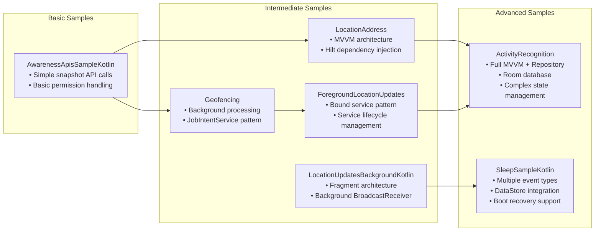
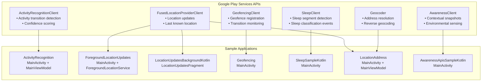

<!-- source: DeepWiki mcp.deepwiki.com · repo android/location-samples · page 1 Overview · fetched 2026-10-23 -->

# Overview

Relevant source files

The following files were used as context for generating this wiki page:

- [ActivityRecognition/README.md](ActivityRecognition/README.md)
- [Geofencing/README.md](Geofencing/README.md)
- [LocationUpdatesBackgroundKotlin/README.md](LocationUpdatesBackgroundKotlin/README.md)
- [README.md](README.md)

This document provides an overview of the Google Play Location & Context APIs sample repository, which contains demonstration applications for Android location and context awareness features. The repository showcases various architectural patterns and implementation approaches for integrating Google Play Services location APIs into Android applications.

**Important**: This repository has been deprecated and is no longer maintained. For current location samples, refer to the [new platform-samples repository](https://github.com/android/platform-samples/tree/main/samples/location).

For detailed documentation of individual sample applications, see [Sample Applications](#2). For cross-cutting architectural patterns and best practices, see [Architecture Patterns](#3).

## Repository Purpose

The repository serves as an educational resource demonstrating how to integrate Google Play Services location and context APIs into Android applications. It provides samples ranging from basic API usage to production-ready architectural patterns, including:

- Location tracking in foreground and background scenarios
- Activity recognition and sleep detection
- Geofencing and location-based notifications  
- Address geocoding and reverse geocoding
- Context awareness through Google's Awareness APIs

Each sample demonstrates different aspects of Android's location ecosystem while addressing modern Android constraints around background processing, permissions, and battery optimization.

**Sources**: [README.md:1-59]()

## Sample Applications Overview

The repository contains seven distinct sample applications, each targeting specific location or context APIs:

| Sample | Language | Primary API | Complexity Level |
|--------|----------|-------------|------------------|
| ActivityRecognition | Kotlin | ActivityRecognitionApi | Advanced |
| SleepSampleKotlin | Kotlin | Sleep API | Advanced |
| ForegroundLocationUpdates | Kotlin | FusedLocationProviderClient | Intermediate |
| LocationUpdatesBackgroundKotlin | Kotlin | FusedLocationProviderClient | Intermediate |
| LocationAddress | Kotlin | Geocoder API | Intermediate |
| Geofencing | Java | GeofencingClient | Intermediate |
| AwarenessApisSampleKotlin | Kotlin | Awareness Snapshot API | Basic |

**Sample Complexity Classification:**

**Sources**: [README.md:12-28](), [ActivityRecognition/README.md:1-80](), [LocationUpdatesBackgroundKotlin/README.md:1-59](), [Geofencing/README.md:1-76]()

## Core API Integration Patterns

The samples demonstrate integration with multiple Google Play Services APIs through consistent patterns:

**API Client Integration Architecture:**

**Sources**: [README.md:14-28](), [ActivityRecognition/README.md:10-17](), [LocationUpdatesBackgroundKotlin/README.md:13-17]()

## Technical Requirements and Prerequisites

All samples share common technical requirements reflecting modern Android development practices:

**System Requirements:**
- Android API Level 9+ (minimum)
- Android Build Tools 21+ 
- Google Support Repository
- Location services enabled on device

**Key Dependencies:**
- Google Play Services Location APIs
- AndroidX libraries for modern UI components
- Hilt for dependency injection (advanced samples)
- Room database for local persistence (advanced samples)
- DataStore for preferences (newer samples)

**Runtime Requirements:**
- Device location must be enabled
- Appropriate runtime permissions granted
- Google Play Services installed and updated

**Sources**: [README.md:30-36](), [ActivityRecognition/README.md:37-43](), [LocationUpdatesBackgroundKotlin/README.md:37-42](), [Geofencing/README.md:33-39]()

## Permission Model Evolution

The samples demonstrate Android's evolving permission model for location and activity recognition:

**Permission Requirements by API Level:**

```mermaid
graph TB
    subgraph "Location Permissions"
        COARSE["ACCESS_COARSE_LOCATION<br/>All location samples"]
        FINE["ACCESS_FINE_LOCATION<br/>All location samples"] 
        BACKGROUND["ACCESS_BACKGROUND_LOCATION<br/>API 29+ background samples"]
    end
    
    subgraph "Activity Recognition Permissions"
        ACT_OLD["com.google.android.gms.permission.ACTIVITY_RECOGNITION<br/>API ≤ 28"]
        ACT_NEW["android.permission.ACTIVITY_RECOGNITION<br/>API ≥ 29"]
    end
    
    subgraph "System Permissions"
        BOOT["RECEIVE_BOOT_COMPLETED<br/>Auto-restart after reboot"]
        NOTIF["POST_NOTIFICATIONS<br/>API 33+ notification display"]
        WAKE["WAKE_LOCK<br/>Background processing"]
    end
    
    subgraph "Sample Usage"
        AR_PERMS["ActivityRecognition<br/>• ACTIVITY_RECOGNITION<br/>• RECEIVE_BOOT_COMPLETED"]
        BG_PERMS["LocationUpdatesBackgroundKotlin<br/>• ACCESS_BACKGROUND_LOCATION<br/>• RECEIVE_BOOT_COMPLETED"] 
        FG_PERMS["ForegroundLocationUpdates<br/>• POST_NOTIFICATIONS<br/>• WAKE_LOCK"]
    end
    
    ACT_NEW --> AR_PERMS
    BACKGROUND --> BG_PERMS
    BOOT --> AR_PERMS
    BOOT --> BG_PERMS
    NOTIF --> FG_PERMS
    WAKE --> FG_PERMS
```

**Sources**: [LocationUpdatesBackgroundKotlin/README.md:19-27]()

## Build System and Project Structure

The repository uses Gradle build system with individual module structure for each sample:

**Project Structure:**
- Each sample is a standalone Android application
- Individual `build.gradle` files with specific dependencies
- Shared Gradle wrapper for consistent build environment
- Apache License 2.0 for all samples

**Build Commands:**
- `gradlew build` - Build all samples
- Import individual projects in Android Studio
- Target SDK versions vary by sample complexity and API requirements

**Sources**: [README.md:37-42](), [ActivityRecognition/README.md:44-49](), [LocationUpdatesBackgroundKotlin/README.md:43-47](), [Geofencing/README.md:40-45]()

---

